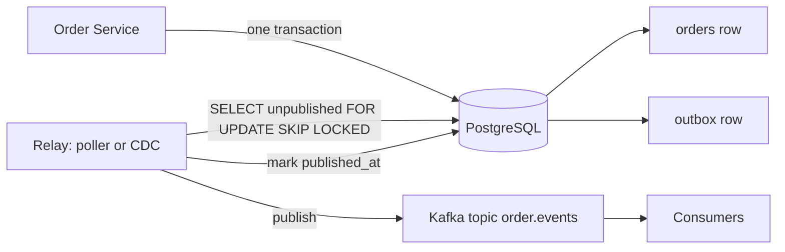
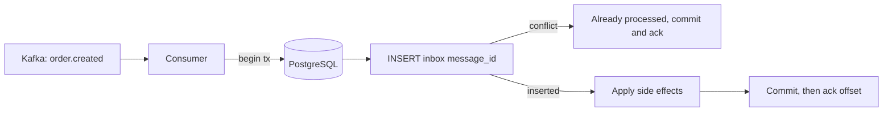
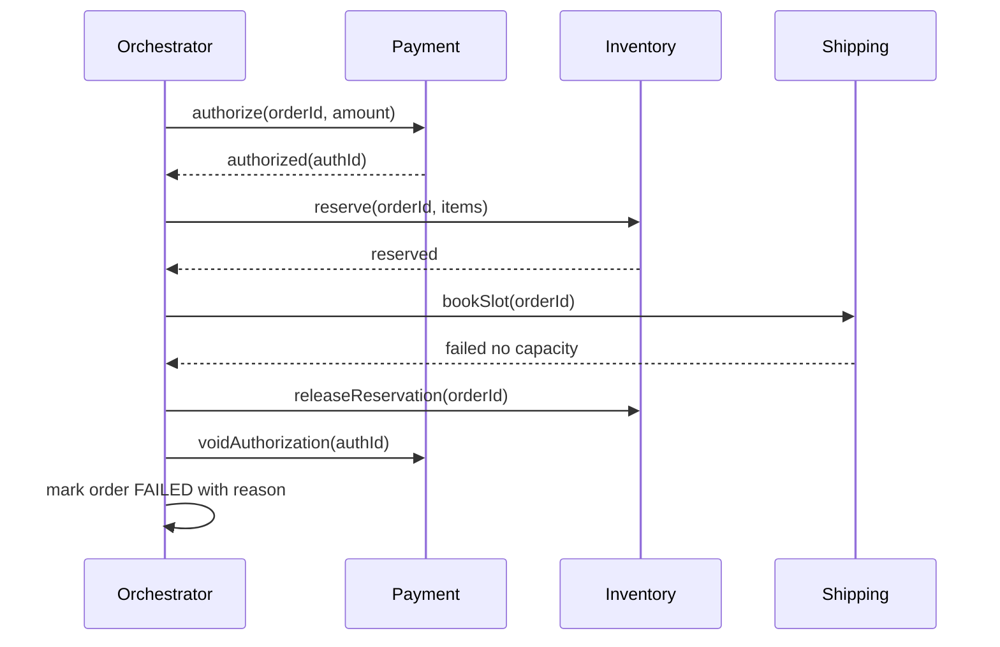
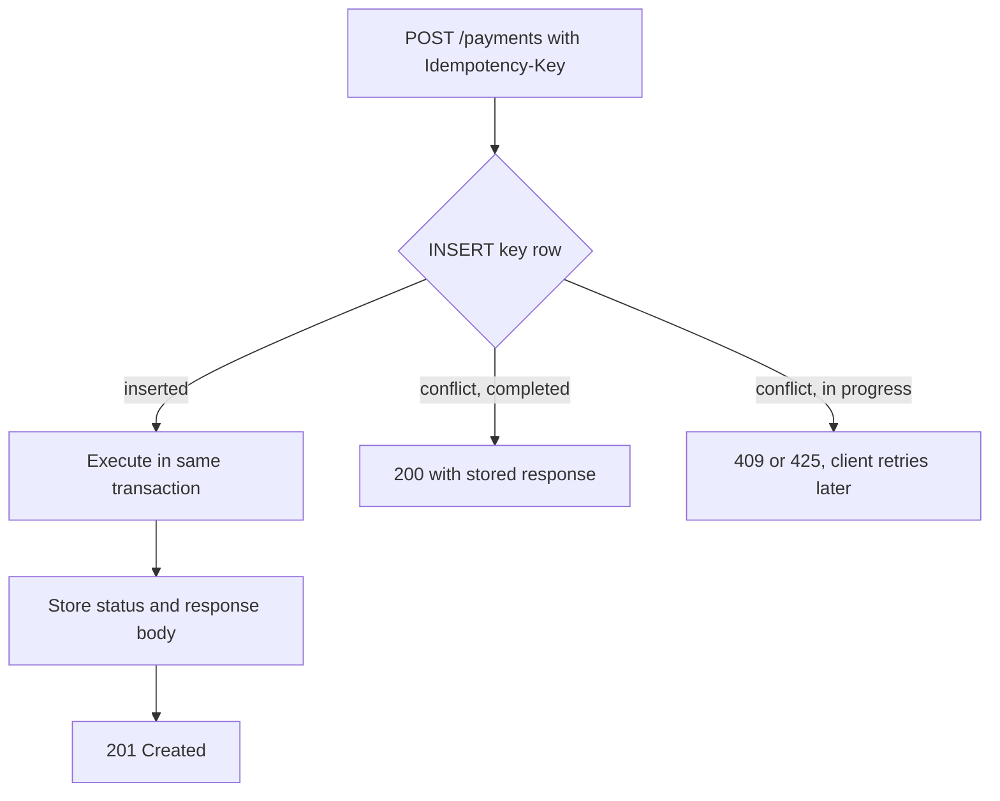
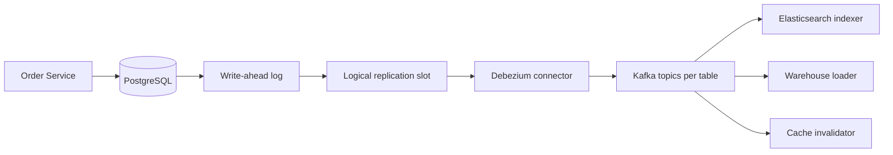
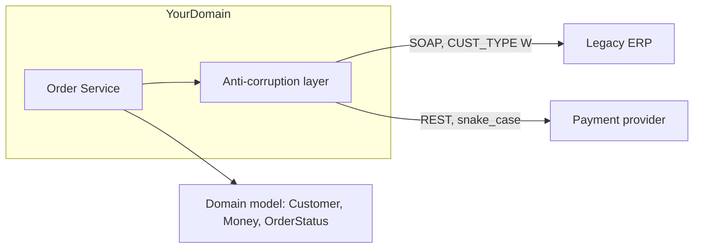

## 66.13 Outbox

### Problem

An order is placed. You must write the order row to PostgreSQL *and* publish `order.created` to Kafka. These are two different systems with no shared transaction. Whichever you do first, there is a window where a crash leaves them inconsistent: an order that nobody was told about, or an event about an order that does not exist. This is the dual-write problem, and it will bite you at a rate roughly proportional to your deploy frequency.

### Solution

Write the event into the *same database transaction* as the business change, into an `outbox` table. A separate relay reads unpublished rows and publishes them to the broker, marking them sent. The database transaction guarantees the event exists if and only if the order exists. Publication becomes at-least-once, which is why consumers need idempotency. Part 33 — Distributed Transactions covers the relay, ordering and cleanup in full; this entry gives the shape and a distinct example.

### Architecture



### Example

The table, the write inside the transaction, and the relay query. Note `SKIP LOCKED`, which lets several relay pods share the table without blocking each other.

```sql
CREATE TABLE outbox (
  id            BIGSERIAL PRIMARY KEY,
  aggregate_id  UUID        NOT NULL,
  event_type    TEXT        NOT NULL,
  payload       JSONB       NOT NULL,
  created_at    TIMESTAMPTZ NOT NULL DEFAULT now(),
  published_at  TIMESTAMPTZ
);
-- partial index: only unpublished rows are ever scanned, so it stays tiny
CREATE INDEX outbox_unpublished_idx ON outbox (id) WHERE published_at IS NULL;
```

```ts
async placeOrder(dto: PlaceOrderDto): Promise<Order> {
  return this.dataSource.transaction(async (em) => {
    const order = await em.save(em.create(Order, { ...dto, status: 'PENDING' }));
    await em.insert(OutboxEvent, {
      aggregateId: order.id,
      eventType: 'order.created',
      payload: { orderId: order.id, userId: order.userId, totalMinor: order.totalMinor },
    });
    return order; // both rows commit together, or neither does
  });
}
```

```sql
-- relay: batch of 200, several pods can run this concurrently
WITH batch AS (
  SELECT id FROM outbox
  WHERE published_at IS NULL
  ORDER BY id
  FOR UPDATE SKIP LOCKED
  LIMIT 200
)
SELECT o.* FROM outbox o JOIN batch b ON b.id = o.id ORDER BY o.id;
```

### Advantages

- Atomic by construction. No lost events, no phantom events.
- Works with any broker, and with none: the outbox is also a perfectly good audit log.
- The relay is independently scalable and restartable; a crash mid-publish costs a duplicate, not a loss.

### Disadvantages

- At-least-once only. Every consumer must be idempotent or you will process duplicates.
- Extra write per business operation, extra table growth, and a table that needs pruning.
- Publication latency is the poll interval (typically 100 ms to 1 s) unless you use CDC.

### When to use

- Any time a database write and a message publish must both happen.
- When you are currently doing `await repo.save(); await kafka.send();` and hoping.

### When NOT to use

- When the event does not need to be reliable — analytics pings, "user viewed page". Fire and forget is cheaper and honest.
- When the write itself is the event and consumers can read from CDC directly.
- Single-service systems with no broker, where an in-process event emitter inside the same transaction boundary is enough.

### Edge cases and failure modes

- **Ordering**: per-aggregate ordering requires publishing in `id` order per key and using `aggregate_id` as the Kafka partition key. Global ordering is not achievable with parallel relays.
- **Table bloat**: a busy outbox at 500 events per second is 43 million rows a day. Delete published rows older than a few days, or partition by day and drop partitions.
- **Relay down**: events accumulate silently. Alert on `max(now() - created_at)` for unpublished rows, not on row count.
- **Broker down**: the relay must retry without marking rows published, and must not spin at full speed.
- **Long transactions**: an open transaction holding outbox rows blocks the relay's view; keep transactions short.
- **Duplicate publish**: a crash between publishing and marking sends the row again. Expected; consumers dedupe.

### Senior perspective

The outbox is the least glamorous pattern in this catalogue and the one I have argued for most often. The counter-argument is always "but we can just publish after commit, the window is milliseconds". That window is real, and at 100 deploys a month with pods being terminated mid-request, it *will* produce orders that never reached fulfilment. The debugging cost of one such incident exceeds the implementation cost of the outbox. The operational detail people forget is retention: put the cleanup job in the same pull request as the table, or you will meet the outbox again as a disk-full alert.

## 66.14 Transactional inbox

### Problem

The outbox gives you at-least-once delivery, so a consumer will see `order.created` twice. If the consumer's job is "charge the card" or "decrement stock", processing it twice is a real financial or inventory error. Consumers must be idempotent, and "make the handler idempotent" is easy to say and hard to do for handlers that touch several tables.

### Solution

Record every consumed message id in an `inbox` table, in the *same transaction* as the side effects. If the insert violates the primary key, this message was already processed and you skip it. The database's uniqueness guarantee becomes your deduplication guarantee, with no extra infrastructure. Part 33 covers the interplay with offsets and retries; here is the practical shape.

### Architecture



### Example

One transaction, two guarantees: dedupe and side effect. Note that the offset is committed only after the database transaction succeeds.

```ts
@Injectable()
export class OrderCreatedConsumer {
  constructor(private readonly ds: DataSource) {}

  async handle(msg: KafkaMessage): Promise<void> {
    const messageId = msg.headers?.['message-id']?.toString();
    if (!messageId) throw new Error('message-id header required');

    await this.ds.transaction(async (em) => {
      const res = await em
        .createQueryBuilder()
        .insert()
        .into(InboxMessage)
        .values({ messageId, consumer: 'reserve-stock', receivedAt: new Date() })
        .orIgnore()                       // ON CONFLICT DO NOTHING
        .execute();

      if (res.raw.length === 0) return;   // duplicate: do nothing, commit cleanly

      const event = JSON.parse(msg.value!.toString()) as OrderCreated;
      // Side effects live in the same transaction as the dedupe row.
      await em.decrement(Stock, { sku: event.sku }, 'available', event.qty);
      await em.insert(StockLedger, { sku: event.sku, delta: -event.qty, ref: event.orderId });
    });
  }
}
```

```sql
CREATE TABLE inbox_message (
  consumer    TEXT        NOT NULL,
  message_id  TEXT        NOT NULL,
  received_at TIMESTAMPTZ NOT NULL DEFAULT now(),
  PRIMARY KEY (consumer, message_id)   -- per-consumer dedupe, same event, many consumers
);
CREATE INDEX inbox_received_idx ON inbox_message (received_at);  -- for pruning
```

### Advantages

- Exactly-once *effects* on top of at-least-once delivery, without a distributed transaction.
- Uses only PostgreSQL guarantees you already trust.
- Gives you a queryable record of what was consumed and when, which is priceless during incidents.

### Disadvantages

- One more table to prune. At 2,000 messages per second that is 172 million rows a day.
- Only protects effects inside that one database. It cannot make an outbound HTTP call idempotent.
- Adds a write to every message, raising consumer cost and WAL volume.

### When to use

- Any consumer with non-idempotent side effects: money, stock, emails, external calls.
- Whenever the delivery guarantee is at-least-once, which is essentially always.

### When NOT to use

- When the handler is naturally idempotent: a full-state upsert (`INSERT ... ON CONFLICT DO UPDATE` of the whole row) needs no inbox.
- When the side effect is in a different system than the dedupe table, because then it is not atomic anyway; use an idempotency key at that system's boundary instead.

### Edge cases and failure modes

- **Ack before commit**: acking the offset before the transaction commits loses the message on crash. Commit database first, always.
- **Missing message id**: relying on payload hashing breaks when a producer adds a timestamp field. Require an explicit id header.
- **Retention shorter than replay**: pruning after 7 days then replaying a 30-day-old topic reprocesses everything. Match retention to your replay policy.
- **Consumer rename**: changing the `consumer` value re-processes the entire history.
- **Hot table**: heavy inserts and heavy deletes cause bloat. Partition by day and drop partitions instead of `DELETE`.

### Senior perspective

The inbox is a two-line change with a five-year payoff. The subtlety I always check in review is transaction scope: the dedupe insert and the side effects must be the same transaction, and the offset commit must be strictly after. I have seen a version where the dedupe row was written with a separate connection "for speed" — it deduped perfectly and lost the side effects on every rollback. Also: prefer natural idempotency where you can get it. If the handler can be written as an upsert of a full state, that is better than an inbox, because it needs no cleanup job and survives replays of any age.

## 66.15 Saga

### Problem

Placing an order spans four services: payment authorises the card, inventory reserves stock, shipping books a slot, notification emails the customer. There is no distributed transaction across them — and even if there were (two-phase commit), holding locks across four services and a network for the duration of a checkout is an availability disaster. Yet the business needs the whole thing to either complete or be visibly undone.

### Solution

Model the flow as a sequence of local transactions, each with a defined **compensating action**. If step three fails, run the compensations for steps two and one, in reverse. Consistency becomes eventual and *semantic*: you do not roll back a captured payment, you issue a refund. Two styles: **choreography** (services react to each other's events) and **orchestration** (one component owns the state machine). Part 33 covers both in depth; this entry gives the shape.

### Architecture



### Example

An orchestrator step table plus the handler, so the saga survives a pod restart. The state is in PostgreSQL, not in a variable.

```sql
CREATE TABLE saga_instance (
  id           UUID PRIMARY KEY,
  saga_type    TEXT NOT NULL,
  order_id     UUID NOT NULL,
  step         TEXT NOT NULL,          -- AUTHORIZE, RESERVE, SHIP, DONE, COMPENSATING
  state        JSONB NOT NULL,         -- authId, reservationId, ...
  attempts     INT  NOT NULL DEFAULT 0,
  next_run_at  TIMESTAMPTZ NOT NULL DEFAULT now(),
  updated_at   TIMESTAMPTZ NOT NULL DEFAULT now()
);
CREATE INDEX saga_due_idx ON saga_instance (next_run_at) WHERE step <> 'DONE';
```

```ts
async advance(saga: SagaInstance): Promise<void> {
  try {
    switch (saga.step) {
      case 'AUTHORIZE': {
        const auth = await this.payment.authorize(saga.orderId, saga.state.amountMinor, {
          idempotencyKey: `${saga.id}:authorize`,      // safe to retry this step
        });
        return this.moveTo(saga, 'RESERVE', { ...saga.state, authId: auth.id });
      }
      case 'RESERVE': {
        const r = await this.inventory.reserve(saga.orderId, saga.state.items, {
          idempotencyKey: `${saga.id}:reserve`,
        });
        return this.moveTo(saga, 'SHIP', { ...saga.state, reservationId: r.id });
      }
      case 'SHIP': {
        await this.shipping.book(saga.orderId, { idempotencyKey: `${saga.id}:ship` });
        return this.moveTo(saga, 'DONE', saga.state);
      }
    }
  } catch (err) {
    if (isRetryable(err) && saga.attempts < 5) return this.scheduleRetry(saga, err);
    return this.compensate(saga, err);   // release reservation, void authorization
  }
}
```

### Advantages

- No distributed locks, so services stay independently available.
- Every step is a normal local transaction your team already understands.
- The saga table is a live, queryable record of every in-flight order and where it is stuck.

### Disadvantages

- You must design a compensation for every step, and some are not truly reversible (an email is sent; a refund is not an un-charge).
- Intermediate states are visible to users and to other services.
- The failure matrix grows fast: N steps means N compensations plus the cases where a compensation itself fails.
- Testing is genuinely hard. Every step needs a "what if this fails after the remote side succeeded" test.

### When to use

- Multi-service business processes with real money or inventory at stake.
- Long-running flows (minutes to days) where holding a transaction is impossible.

### When NOT to use

- Inside one service and one database. Use a single ACID transaction. A saga there is pure cost.
- For two steps where the second is retryable and idempotent — just retry until it succeeds.
- When the business genuinely requires atomic visibility ("the customer must never see a half-created order"). Redesign the boundaries instead; that is usually a sign the split is wrong.

### Edge cases and failure modes

- **Compensation fails**: the refund API is down. You need a dead-letter path and a human queue, not an infinite retry.
- **Duplicate step execution**: the orchestrator crashes after the remote call but before recording it. This is why every step carries an idempotency key derived from the saga id.
- **Out-of-order events** in choreography: `payment.captured` arrives before `order.created`. Handlers must tolerate it or buffer.
- **Stuck sagas**: a step whose event never arrives sits forever. Add a timeout per step and a "sagas older than 15 minutes" alert.
- **Partial compensation**: stock released but authorization not voided, so the customer's card holds funds for a week.

### Senior perspective

Sagas are what you get when you split a transaction across services, and the honest framing is that they are the *cost* of that split, not a benefit of it. Before writing one I always ask whether the two steps could live in the same service and the same transaction. Very often they could, and the saga disappears. When the saga is genuinely needed, three things make it survivable: state persisted in a table rather than in memory, an idempotency key on every outbound step, and a dashboard showing sagas by step and age. That last one turns "some orders are stuck" from a two-day investigation into a two-minute query.

## 66.16 Idempotency key

### Problem

The mobile app sends `POST /payments`. The response is lost to a flaky network. The app retries. Without protection, the customer is charged twice. This is not a rare edge case: on mobile networks, 0.5 to 2 percent of requests get a lost response, and every retry layer in your stack multiplies the chance.

### Solution

The client generates a unique key per logical operation and sends it as a header. The server stores the key with the result of the first successful execution. A repeat with the same key returns the stored result instead of executing again. The database's unique constraint does the hard part.

### Architecture



### Example

The table and the interceptor. The key detail is the three-state handling: new, completed, and *in progress* (two concurrent retries).

```sql
CREATE TABLE idempotency_key (
  key           TEXT PRIMARY KEY,
  user_id       UUID        NOT NULL,
  endpoint      TEXT        NOT NULL,
  request_hash  TEXT        NOT NULL,      -- detects key reuse with a different body
  status        TEXT        NOT NULL,      -- IN_PROGRESS | COMPLETED
  response_code INT,
  response_body JSONB,
  created_at    TIMESTAMPTZ NOT NULL DEFAULT now()
);
```

```ts
@Injectable()
export class IdempotencyInterceptor implements NestInterceptor {
  async intercept(ctx: ExecutionContext, next: CallHandler): Promise<Observable<unknown>> {
    const req = ctx.switchToHttp().getRequest();
    const key = req.headers['idempotency-key'];
    if (!key) throw new BadRequestException('Idempotency-Key header required');
    const hash = sha256(JSON.stringify(req.body));

    const existing = await this.repo.claim(key, req.user.id, req.route.path, hash);
    if (existing?.status === 'COMPLETED') {
      if (existing.requestHash !== hash) throw new ConflictException('key reused with different body');
      ctx.switchToHttp().getResponse().status(existing.responseCode);
      return of(existing.responseBody);                 // replay, do not execute
    }
    if (existing?.status === 'IN_PROGRESS') {
      throw new ConflictException('request already in progress');  // client retries later
    }
    return next.handle().pipe(
      tap((body) => this.repo.complete(key, 201, body)),
      catchError((e) => { void this.repo.release(key); return throwError(() => e); }),
    );
  }
}
```

### Advantages

- Makes retries safe, which makes every other reliability pattern usable.
- Cheap: one indexed insert per request.
- Turns "did my payment go through?" from a support ticket into a repeat call with the same key.

### Disadvantages

- Clients must generate and persist keys correctly, which requires a contract and documentation.
- The stored response can become stale if the resource changes afterwards.
- Keys need retention management, and the table grows with traffic.

### When to use

- Every non-idempotent public write: payments, orders, transfers, refunds, sending messages.
- Webhook receivers, where the provider guarantees at-least-once delivery.
- Any endpoint your own retry logic might call twice.

### When NOT to use

- `GET`, `PUT` with full state, and `DELETE` by id, which are already idempotent by definition.
- Where a natural business key exists and can be a unique constraint (`UNIQUE (user_id, cart_id)` prevents double order creation without any extra machinery). Prefer the natural key.

### Edge cases and failure modes

- **Concurrent duplicates**: two retries arrive 5 ms apart. The `IN_PROGRESS` state and the unique constraint are what stop double execution; without them, both pass the "does it exist" check.
- **Client reuses a key with a different body**: without the request hash you would replay the wrong response. Reject with 409.
- **Crash mid-execution**: the row stays `IN_PROGRESS` forever and blocks the customer. Add a TTL or a sweeper that releases stale claims.
- **Key scope too wide**: a global key namespace lets one tenant guess another's key. Scope by user id.
- **Retention too short**: a client retrying after 48 hours re-executes. State the window in your API docs (24 hours is typical).

### Senior perspective

I treat the idempotency key as a public API contract, documented alongside authentication. The design decision that matters is *who generates it*: it must be the client, generated once per logical intent and reused across retries. A key generated per HTTP attempt is worthless. In review I also look for the response being stored, not just the key — replaying with an empty 200 body breaks clients that expect the payment id. And I always pair it with the natural-key question: if a unique constraint on the business data gives the same protection, take it, because constraints never expire and never need a sweeper.

## 66.17 Change Data Capture

### Problem

Six systems need to know when a product changes: the search index, the cache, the analytics warehouse, the recommendation service, a partner feed and the audit log. Writing six publish calls into the product service couples it to all of them, and every one of those calls is a dual write that can be lost. Meanwhile the outbox relay's polling adds latency and load.

### Solution

Read the database's own replication log — in PostgreSQL, the write-ahead log via logical replication — and turn committed row changes into a stream of events. Nothing is added to the application. Debezium is the common implementation; it publishes `before` and `after` images to Kafka. CDC can also *carry* your outbox table, which gives you outbox semantics with sub-second latency and no polling.

### Architecture



### Example

The PostgreSQL side and a Debezium connector configured in outbox mode, which is the configuration I recommend in almost every case.

```sql
ALTER SYSTEM SET wal_level = 'logical';           -- requires restart
-- REPLICA IDENTITY FULL gives you the "before" image, at a WAL size cost
ALTER TABLE products REPLICA IDENTITY FULL;
CREATE PUBLICATION cdc_pub FOR TABLE products, outbox;
SELECT pg_create_logical_replication_slot('debezium_orders', 'pgoutput');
-- watch this, it is the number that causes disk-full incidents
SELECT slot_name, active, pg_size_pretty(
  pg_wal_lsn_diff(pg_current_wal_lsn(), restart_lsn)) AS retained
FROM pg_replication_slots;
```

```json
{
  "name": "orders-outbox",
  "config": {
    "connector.class": "io.debezium.connector.postgresql.PostgresConnector",
    "plugin.name": "pgoutput",
    "slot.name": "debezium_orders",
    "publication.name": "cdc_pub",
    "table.include.list": "public.outbox",
    "transforms": "outbox",
    "transforms.outbox.type": "io.debezium.transforms.outbox.EventRouter",
    "transforms.outbox.route.by.field": "event_type",
    "transforms.outbox.table.field.event.key": "aggregate_id",
    "heartbeat.interval.ms": "10000"
  }
}
```

### Advantages

- Zero application code. New consumers appear without touching the producing service.
- Sub-second latency, far better than a 1-second poller.
- Captures every change including manual `UPDATE`s run by an engineer at 02:00, which application-level events miss.
- Guaranteed consistent with committed data, because it *is* the commit log.

### Disadvantages

- You are now publishing your schema. A column rename becomes a breaking change for six consumers.
- Replication slots retain WAL. A stopped connector with an active slot fills the disk and takes the primary down. This is the number one CDC outage.
- Operational weight: Kafka Connect is another cluster to run, monitor and upgrade.
- Snapshotting a 500 GB table on first start puts real load on the database.

### When to use

- Fanning changes to search, cache, analytics and other read models.
- Carrying an outbox table, where you get clean events *and* CDC's latency.
- Migrating data to a new system while the old one keeps writing (see Strangler Fig).

### When NOT to use

- As your primary integration contract for raw tables. Publishing `products` row images makes every consumer depend on your physical schema; use the outbox transform so you publish *events* you designed.
- For a handful of consumers in one service, where an in-process emitter is enough.
- When nobody on the team can operate Kafka Connect at 03:00.

### Edge cases and failure modes

- **Slot retention**: connector stops, `restart_lsn` freezes, WAL grows without bound. Alert on retained WAL bytes, and always set `max_slot_wal_keep_size`.
- **Schema evolution**: adding a nullable column is fine; renaming or dropping breaks consumers. Version your event payloads.
- **Failover**: a physical replica promoted to primary does not carry logical slots in older PostgreSQL versions, so CDC stops silently after failover.
- **Snapshot storms**: an accidental connector reset re-snapshots a huge table and floods Kafka.
- **Transaction boundaries**: consumers see individual row changes, not transactions, so a multi-row change appears as separate events out of business order unless you use the outbox transform.
- **Toast columns**: unchanged large values arrive as a placeholder unless `REPLICA IDENTITY FULL` is set, which surprises consumers expecting full rows.

### Senior perspective

CDC is the highest-leverage integration tool in the box and the one with the sharpest operational edge. My strong preference is CDC-over-outbox rather than CDC-over-tables: you keep an explicit, versioned event contract, and consumers never depend on a column you might want to rename. On the operations side, there is exactly one alert I insist on before CDC goes to production: retained WAL per replication slot, paging at a threshold you can survive. I have seen a stopped Debezium task over a long weekend take a primary to 100 percent disk. Nothing else about CDC is as urgent as that graph.

## 66.18 Anti-corruption layer

### Problem

You integrate with a 15-year-old ERP. Its concept of "customer" has 60 fields, three status codes that mean "active", dates as `YYYYMMDD` strings, and a `CUST_TYPE` of `'W'` that means wholesale. If those shapes leak into your domain, every service in your system learns the ERP's vocabulary, and the day you replace the ERP you rewrite everything. The same happens with any external model: a payment provider, a legacy monolith, a partner feed.

### Solution

Put a translation layer at the boundary that speaks the foreign model on one side and your domain model on the other. Nothing beyond the layer knows the foreign vocabulary. It is a coordinate transform for concepts, and it is the single most valuable thing you can do when integrating with a system you do not control.

### Architecture



### Example

A port, an adapter and a mapper. The domain sees `Customer`; only the adapter has ever heard of `CUST_TYPE`.

```ts
// Domain-owned interface (the port). Lives in the domain module.
export interface CustomerDirectory {
  findById(id: CustomerId): Promise<Customer | null>;
}

// Adapter: the only file allowed to know the ERP exists.
@Injectable()
export class ErpCustomerDirectory implements CustomerDirectory {
  constructor(private readonly erp: ErpSoapClient) {}

  async findById(id: CustomerId): Promise<Customer | null> {
    const raw = await this.erp.getCustomer({ CUST_ID: id.value }); // throws ErpFault
    if (!raw || raw.DEL_FLG === 'Y') return null;
    return this.toDomain(raw);
  }

  private toDomain(r: ErpCustomerRecord): Customer {
    return new Customer({
      id: CustomerId.of(r.CUST_ID),
      name: r.CUST_NAME.trim(),
      // three ERP codes collapse into one domain concept
      status: ['A', 'AC', '01'].includes(r.STATUS) ? 'ACTIVE' : 'INACTIVE',
      segment: r.CUST_TYPE === 'W' ? 'WHOLESALE' : 'RETAIL',
      creditLimit: Money.fromMinor(Number(r.CRED_LIM) * 100, 'EUR'),
      createdAt: parse(r.CRT_DT, 'yyyyMMdd', new Date()),
    });
  }
}
```

### Advantages

- Your domain model stays clean and expressive regardless of what you integrate with.
- Replacing the foreign system means rewriting one adapter, not the application.
- Testing gets easy: unit-test the mapper with real recorded payloads; stub the port everywhere else.
- Foreign failures are translated too, so the domain sees `CustomerUnavailableError`, not `ErpFault`.

### Disadvantages

- Boilerplate. Two models and a mapper for every integrated concept.
- An extra hop of indirection when debugging.
- Mapping is where subtle bugs hide: a wrong status collapse can silently change business behaviour.

### When to use

- Any integration with a system you do not control: legacy monolith, ERP, partner API, acquired company's platform.
- Strangler Fig migrations, where the ACL is what lets old and new coexist.
- Any bounded-context boundary where the two contexts disagree about a word's meaning.

### When NOT to use

- Between two services your own team owns with a shared, well-designed contract. Then the ACL is a second name for the same model.
- For trivially-shaped data. A single string field does not need a mapper class.
- When "translation" is really business logic — deciding whether a customer gets credit is a domain rule, not a mapping.

### Edge cases and failure modes

- **Lossy mapping**: the foreign model has a state yours cannot express, so information is silently dropped. Log and alert on unmapped values rather than defaulting them.
- **New enum value**: the ERP adds `STATUS = 'P'` and your mapper quietly returns `INACTIVE`. Fail loudly on unknown values in non-critical paths, and alert.
- **Encoding and locale**: dates without timezones, decimal commas, non-UTF-8 payloads.
- **Foreign failures leaking**: a SOAP fault propagating into an HTTP 500 with a stack trace from the ERP client.
- **Performance**: the ACL becomes a chatty proxy, calling the ERP once per item in a loop. Batch inside the adapter.

### Senior perspective

The anti-corruption layer is the cheapest insurance in software architecture. It costs a mapper file per concept; it buys you the ability to replace a vendor without rewriting your product. The signal that you skipped it is unmistakable: search your codebase for a foreign vocabulary word like `CUST_TYPE` and count the files. If the answer is more than one, the foreign model has already colonised your domain. I also make the adapter own translation of *errors* and *timeouts*, not just data. When the domain layer catches `ErpFault`, the boundary has leaked even though the field names were mapped.
