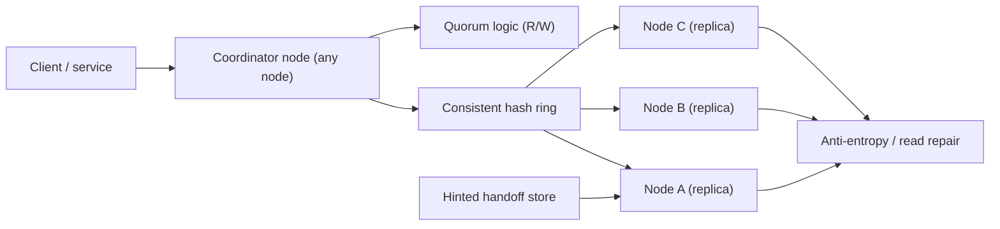
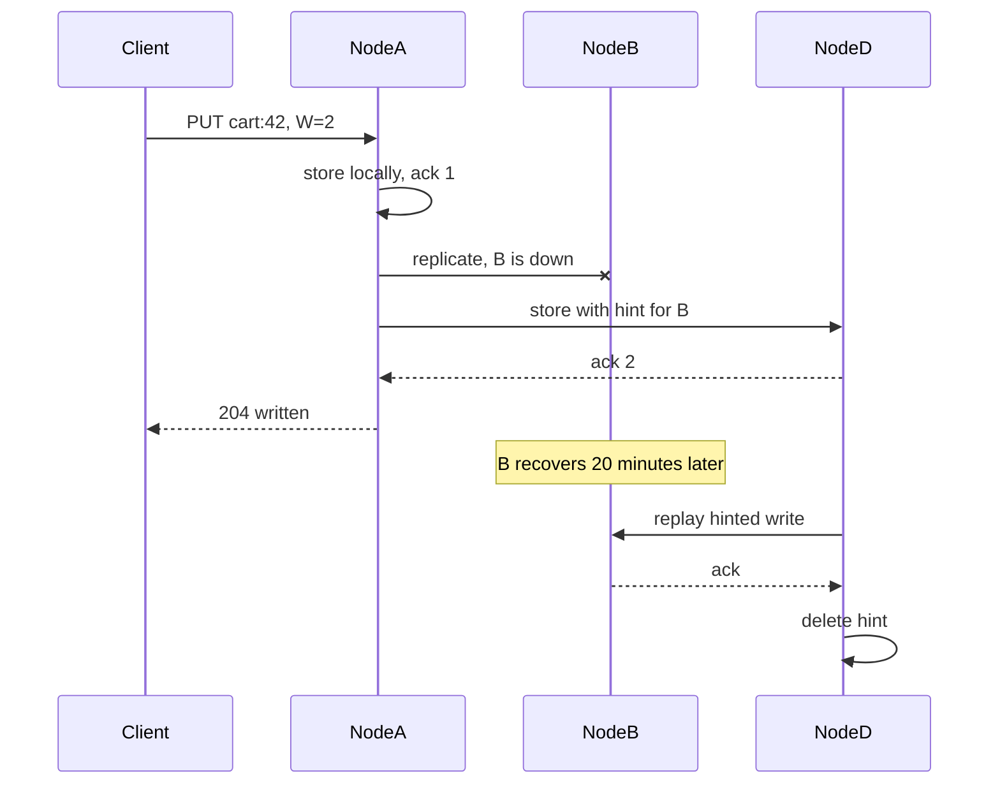
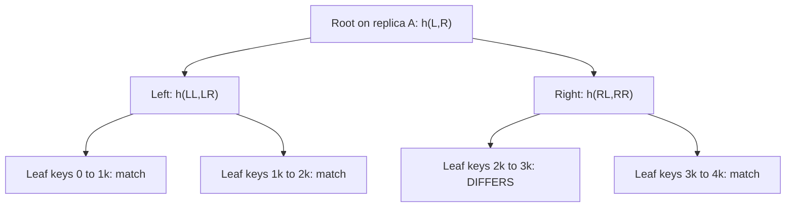

## 66.2 Distributed Key-Value Store

> **Try it first** · Level: Advanced · About 60 minutes
>
> **Build:** a masterless key-value store that partitions and replicates data across many nodes and stays available when nodes fail.
>
> **Requirements:**
> - `put(key, value)`, `get(key)` and `delete(key)`.
> - Partition data across many nodes and replicate it so losing a node loses nothing.
> - Stay available for reads and writes during node failures and network partitions.
> - Tunable consistency: callers choose how many replicas must respond (quorum).
> - Add and remove nodes with minimal data movement; replicas eventually converge.
>
> **Scale and constraints:** 10 billion keys of about 1 KB (10 TB raw, 30 TB with 3 replicas, about 15 to 20 nodes); 100,000 operations per second. p99 latency single-digit to low tens of ms; no single point of failure; no data loss on a single-node failure; scales linearly with nodes; must handle partitions and clock skew.
>
> **Your task:** sketch the API, the data model and the main components (partitioning, replication, the coordinator, the storage engine); estimate per-node load and disk; name the two hardest problems and how you would solve them.
>
> Spend the time on paper before you read on. The model design follows.

### 66.2.1 Requirements

A distributed key-value store holds `key -> value` pairs across many machines, surviving machine failures, serving reads and writes at scale with low latency, and staying available even when some nodes or network links fail. This is the canonical distributed-systems design (the shape of Dynamo, Cassandra, Riak). The users are other services that need a fast, highly-available store for data that does not need relational queries. The design probes the deepest distributed-systems ideas: partitioning, replication, consistency, and the CAP tradeoff (see Part 29 — Distributed Systems Fundamentals, sections 29.4 to 29.10, which teach CAP, PACELC, replication and quorum; this design applies them rather than re-teaching them).

Imagine a chain of identical lockers spread across many buildings. Each item (value) goes in a locker chosen by a formula from its tag (key), and a copy is placed in two nearby buildings too (replication), so if one building closes you still get your item. When you store or fetch, you can insist that a majority of the buildings confirm (strong consistency, slower) or accept one building's word (fast, maybe slightly stale). The buildings are nodes; the formula is consistent hashing; the copies are replicas; the majority rule is quorum.

### 66.2.2 Functional requirements

1. `put(key, value)` stores a value; `get(key)` retrieves it; `delete(key)` removes it.
2. Data is distributed across many nodes (partitioning).
3. Data is replicated so the loss of a node does not lose data.
4. The system stays available for reads and writes during node failures and network partitions (tunable).
5. Tunable consistency: callers choose how many replicas must respond (quorum).
6. Nodes can be added and removed with minimal data movement (elastic).
7. Eventually, all replicas converge to the same value (anti-entropy, read repair).

### 66.2.3 Non-functional requirements

| Property | Target | Why |
|---|---|---|
| Read/write latency | p99 single-digit to low-tens of ms | A fast store for other services |
| Availability | Very high (survive node/AZ loss, stay writable) | The reason to build this over a single database |
| Durability | No data loss on single-node (or N-1 replica) failure | Replication guarantees this |
| Scalability | Linear with nodes added | Add capacity by adding nodes |
| Consistency | Tunable per operation (quorum) | Trade consistency for availability/latency per need |

### 66.2.4 Constraints

- Distributed by definition; must handle node failure, network partitions and clock skew.
- No single point of failure; masterless (every node equal) for availability.
- Rebalancing when nodes join/leave must move minimal data (consistent hashing).
- The CAP tradeoff (Part 29, section 29.4) is fundamental: during a partition, choose availability or consistency, tunable per operation.

### 66.2.5 Capacity estimation

| Quantity | Assumption | Calculation | Result |
|---|---|---|---|
| Keys | Target | given | 10 billion |
| Value size | average | given | 1 KB |
| Raw data | 10B x 1 KB | | 10 TB |
| Replication factor | 3 copies | 10 TB x 3 | 30 TB stored |
| Nodes | per-node capacity ~2 TB usable | 30 TB / 2 TB | about 15-20 nodes |
| Read/write rate | Target | given | 100,000 ops/second |
| Per-node ops | 100k / 15 | | about 7,000 ops/s/node |

The "7,000 ops per node" row is the client view. The node actually does more, because every write goes to all N replicas (W only decides how many acknowledgements the coordinator waits for) and every quorum read touches R replicas:

| Quantity | Assumption | Calculation | Result |
|---|---|---|---|
| Client mix | 50 percent reads, 50 percent writes | 100k ops/s | 50k reads, 50k writes per second |
| Replica writes | every write goes to N = 3 | 50k x 3 | 150k per second |
| Replica reads | R = 2 (one full read plus one digest) | 50k x 2 | 100k per second |
| Replica operations per node | 18 nodes | 250k / 18 | about 14,000 per second per node |
| Replication traffic | 50k writes x 1 KB x 3 | | 150 MB/s inside the cluster |
| Cross-AZ share | replicas spread over 3 AZs, so about 2 of every 3 copies cross an AZ boundary | about 100 MB/s writes plus about 65 MB/s reads | about 430 TB per month |
| Disk per node | 30 TB / 18 nodes, doubled for LSM compaction headroom | 1.7 TB x 2 | 3.5 TB NVMe per node |
| Keys per node | 30B replica copies / 18 | | about 1.7B keys per node |
| Bloom filters per node | 1.2 bytes per key at 1 percent false positives | 1.7B x 1.2 B | about 2 GB RAM per node |

The numbers say: partition 10B keys across ~15-20 nodes with 3x replication, each node handling a slice of keys and ~14,000 replica operations per second, and rebalancing must be cheap when the node count changes. These are the forces that make consistent hashing and quorum the right tools. They also say something people forget: at 430 TB a month of cross-AZ traffic at 0.01 USD per GB in each direction, the network bill (about 8,600 USD per month) is larger than the compute bill. Replication is not free.

### 66.2.6 API design

| Operation | Signature | Consistency option |
|---|---|---|
| Put | `put(key, value, W)` | W = replicas that must ack the write |
| Get | `get(key, R)` | R = replicas that must respond to the read |
| Delete | `delete(key, W)` | A delete is a write of a tombstone |

The caller chooses `W` (write quorum) and `R` (read quorum). With `R + W > N` (replication factor), a read is guaranteed to see the latest write (strong consistency); with lower values, you get lower latency and higher availability but possible staleness. This per-operation tunability is the practical expression of the CAP tradeoff.

The wire contract is worth writing down, because conflicts are part of it:

| Call | Request | Response | Errors |
|---|---|---|---|
| `GET /kv/{key}?r=2` | | `200 { values: [{ value, context }] }` (more than one value means concurrent siblings) | `404`, `503 { acks: 1, required: 2 }` when quorum is not reached within the timeout |
| `PUT /kv/{key}?w=2` | `{ value, context? }` | `204` | `503` quorum failure; `409` never, because a write is always accepted and conflicts become siblings |
| `DELETE /kv/{key}?w=2` | `{ context }` | `204` | `503` |

The `context` is an opaque blob holding the version vector that the client last read. Writing it back tells the store "this new value replaces what I saw", which is how the store knows a write supersedes the old value rather than conflicting with it. A client that writes without a context is saying "I did not read first", and any existing value becomes a concurrent sibling.

The same ideas in a production system you can rent: in Cassandra the replication factor is per keyspace and R/W are per query consistency levels.

```sql
-- CQL (Cassandra). N = 3 per data center
CREATE KEYSPACE kv WITH replication = {'class': 'NetworkTopologyStrategy', 'eu-west-1': 3};

CREATE TABLE kv.items (
  k  text PRIMARY KEY,
  v  blob
) WITH gc_grace_seconds = 864000          -- 10 days: how long tombstones are kept (see 65.2.15)
   AND speculative_retry = '99p';         -- re-send a read to another replica if one is slower than p99

-- cqlsh: R = W = 2 of 3 in the local data center
CONSISTENCY LOCAL_QUORUM;
INSERT INTO kv.items (k, v) VALUES ('session:7f3a', 0xCAFE) USING TTL 86400;
SELECT v FROM kv.items WHERE k = 'session:7f3a';
```

Cassandra resolves conflicts by last-write-wins per cell, not with siblings, which is simpler for clients and is exactly the tradeoff discussed in 66.2.19.

### 66.2.7 Data model

```text
Just keys and values. The system's structure is in the placement:

key -> hash(key) -> position on the hash ring -> the N nodes clockwise own it

Each key's value is stored on N nodes (the "preference list"), e.g. N=3:
  key "user:42" -> hashes to ring position P -> stored on nodes A, B, C (next 3 clockwise)

Each stored value carries a version (vector clock or timestamp) to resolve conflicts.
```

There are no tables or joins; the data model is deliberately minimal. The sophistication is in *where* each key lives (consistent hashing) and how conflicting versions are reconciled (versioning).

### 66.2.8 High-level architecture



Any node can act as the **coordinator** for a request: it hashes the key to find the N replica nodes (the preference list), sends the read/write to them, waits for R or W acknowledgements (quorum), and returns. Replicas converge via **read repair** (fix stale replicas noticed during a read) and **anti-entropy** (background comparison and repair). When a replica is temporarily down, a **hinted handoff** stores the write on another node to be delivered when the replica recovers.

### 66.2.9 Component design

| Component | Responsibility |
|---|---|
| Consistent hashing ring | Map keys to nodes; minimize movement when nodes change |
| Coordinator | Route a request to the N replicas, enforce R/W quorum |
| Replica store | Hold the data for its key ranges, with versions |
| Versioning (vector clocks / timestamps) | Detect and resolve conflicting concurrent writes |
| Read repair | Fix stale replicas detected during a read |
| Anti-entropy (Merkle trees) | Background sync of divergent replicas |
| Hinted handoff | Hold writes for a down replica, deliver on recovery |
| Gossip | Nodes share membership and health (no central coordinator) |

### 66.2.10 Deep dive: consistent hashing, replication, quorum

**Consistent hashing** (taught in Part 23 — Database Scaling, section 23.11) places nodes and keys on a ring (hash space). A key is owned by the N nodes clockwise from its position. When a node is added or removed, only the keys between it and its neighbor move — about 1/N of the data — instead of rehashing everything (which naive modulo hashing would require). **Virtual nodes** (each physical node occupies many ring positions) spread load evenly and avoid hotspots.

**Replication**: each key is stored on N nodes (the preference list). This gives durability (lose a node, N-1 copies remain) and availability (read from any live replica).

**Quorum**: a write waits for `W` acknowledgements, a read for `R` responses. Choosing `R + W > N` guarantees a read sees the latest write (the read and write quorums overlap by at least one node). `W=N, R=1` favors read speed; `W=1, R=N` favors write speed; `W=R=quorum (⌈(N+1)/2⌉)` balances. Lower `R`/`W` trade consistency for availability and latency — the CAP tradeoff, per operation.

```text
N=3 replicas. Quorum = 2.
  Write with W=2: ack when 2 of 3 replicas confirm (survives 1 down, fast-ish)
  Read with R=2:  read 2 of 3, take the newest version (read repair fixes the third)
  R(2) + W(2) = 4 > N(3) -> a read always overlaps the latest write -> strong consistency
  Lower to R=1/W=1: faster, more available, but a read may miss the latest write (eventual)
```

**Conflict resolution**: concurrent writes to different replicas can diverge. Versioning (vector clocks, or last-write-wins by timestamp with its risks) detects conflicts; the system either resolves them (last-write-wins) or returns both versions for the application to reconcile. This is the price of high availability: during a partition, both sides may accept writes, and they must be reconciled later.

#### Deep dive: the ring and the coordinator in code

The ring is small enough to show whole. Each physical node gets 256 tokens (virtual nodes); the preference list walks clockwise, skipping other tokens of nodes already chosen and preferring a different availability zone for each replica, so that losing one AZ never loses two copies of a key.

```ts
// ring/hash-ring.ts
import { createHash } from 'node:crypto';

export interface RingNode { id: string; az: string }
interface Token { token: bigint; node: RingNode }

export class HashRing {
  private tokens: Token[] = [];

  constructor(nodes: RingNode[], private readonly vnodes = 256) {
    for (const n of nodes)
      for (let v = 0; v < vnodes; v++) this.tokens.push({ token: HashRing.hash(`${n.id}#${v}`), node: n });
    this.tokens.sort((a, b) => (a.token < b.token ? -1 : a.token > b.token ? 1 : 0));
  }

  static hash(s: string): bigint {
    return createHash('md5').update(s).digest().readBigUInt64BE(0);   // first 64 bits as the ring position
  }

  /** N distinct physical nodes clockwise from the key, one per AZ when possible. */
  preferenceList(key: string, n = 3): RingNode[] {
    const start = this.firstAtOrAfter(HashRing.hash(key));
    const chosen: RingNode[] = [];
    for (const distinctAz of [true, false]) {              // pass 1: new AZs only; pass 2: any new node
      for (let s = 0; s < this.tokens.length && chosen.length < n; s++) {
        const node = this.tokens[(start + s) % this.tokens.length].node;
        if (chosen.some((c) => c.id === node.id)) continue;
        if (distinctAz && chosen.some((c) => c.az === node.az)) continue;
        chosen.push(node);
      }
    }
    return chosen;
  }

  private firstAtOrAfter(t: bigint): number {              // binary search; wraps to 0 past the end
    let lo = 0, hi = this.tokens.length;
    while (lo < hi) { const mid = (lo + hi) >> 1; if (this.tokens[mid].token < t) lo = mid + 1; else hi = mid; }
    return lo % this.tokens.length;
  }
}
```

The coordinator sends the write to all N replicas and returns as soon as W have acknowledged. The remaining replicas keep going in the background; the client does not wait for them, but they still get the write.

```ts
// coordinator/quorum-writer.ts
export class QuorumError extends Error {
  constructor(readonly acks: number, readonly required: number) { super(`quorum not reached: ${acks}/${required}`); }
}

export async function quorumWrite(
  replicas: RingNode[], w: number, timeoutMs: number,
  send: (node: RingNode) => Promise<void>,                // RPC to one replica, with its own deadline
): Promise<void> {
  let acks = 0, failures = 0;
  await new Promise<void>((resolve, reject) => {
    const timer = setTimeout(() => reject(new QuorumError(acks, w)), timeoutMs);
    for (const node of replicas) {
      send(node).then(
        () => { if (++acks === w) { clearTimeout(timer); resolve(); } },
        () => {                                           // fail fast once quorum is impossible
          if (++failures > replicas.length - w) { clearTimeout(timer); reject(new QuorumError(acks, w)); }
        },
      );
    }
  });
}
```

A `QuorumError` does **not** mean the write failed. It means the coordinator could not prove it succeeded: one replica may have stored it. This is the partial-failure lesson of Part 29, section 29.2, in its purest form. The client must treat a quorum timeout as "unknown" and retry with the same context, which is safe because the retry produces the same version.

#### Deep dive: sloppy quorum and hinted handoff

When one of the three replicas for a key is down, a strict quorum system still succeeds with W = 2, because two replicas are up. A **sloppy quorum** goes further: the coordinator writes to the next healthy node on the ring that is not in the preference list, with a **hint** saying "this belongs to node B". When B comes back, the holder replays the hint and deletes it.



The subtle point, and a classic interview follow-up: **a sloppy quorum breaks the R + W > N guarantee.** The two acknowledgements came from A and D, but a read with R = 2 might ask A's neighbors B and C, neither of which has the write yet. That is why Dynamo described its sloppy quorum as favoring write availability over read-your-writes, and why Cassandra does not count hinted writes toward the consistency level (except the special level `ANY`). Hints are also bounded: Cassandra stops collecting them after `max_hint_window` (3 hours by default), after which only repair can bring the returning node up to date.

#### Deep dive: vector clocks, siblings and merge

A vector clock is a list of `(node, counter)` pairs attached to a value. A coordinator increments its own counter when it accepts a write. Comparing two clocks gives one of three answers: one descends from the other (newer, discard the old one), they are equal, or neither descends (concurrent, keep both as **siblings**).

```text
Shopping cart key "cart:42", N = 3

1. Client writes {milk} through A                  -> [A:1]
2. Client writes {milk, eggs} through A (context [A:1]) -> [A:2]         replaces [A:1]
3. Network partition. Two devices both read [A:2]:
     phone writes {milk, eggs, bread} through B     -> [A:2, B:1]
     laptop writes {milk} (removed eggs) through C  -> [A:2, C:1]
   Neither clock descends from the other: siblings.
4. Next read returns both values with contexts [A:2,B:1] and [A:2,C:1]
5. Application merges (union: {milk, eggs, bread}) and writes back with the
   merged context -> [A:3, B:1, C:1], which descends from both siblings.
```

Step 5 shows the cost: the union merge brought "eggs" back although the laptop removed it. Dynamo's paper admits exactly this for its shopping cart. The fixes are a smarter data type (a CRDT set that records removals, like an OR-Set, the same family of ideas as collaborative editing in Part 67), or accepting last-write-wins and its lost updates. Vector clocks also grow with every coordinator that ever touched a key, so real systems truncate old entries or use dotted version vectors, a refinement that keeps the clock size bounded by the number of replicas rather than the number of clients.

#### Deep dive: the storage engine on each node

Each node stores its replicas in an LSM tree (log-structured merge tree), the same engine Part 26 — NoSQL Data Modelling, section 26.9, walks through for Cassandra: append to a commit log, insert into an in-memory memtable, flush the memtable to an immutable sorted file (SSTable) when it fills, and merge SSTables in the background (compaction). Reads check the memtable, then SSTables newest to oldest, skipping files whose Bloom filter says the key is absent. Two consequences shape this design:

- **Durability of an acknowledged write depends on fsync policy.** Cassandra's default `commitlog_sync: periodic` fsyncs every 10 seconds, so a node can acknowledge a write it later loses in a crash. With W = 2 that is acceptable, because a second replica has it. With W = 1 it is a real window of loss, which is one more reason W = 1 is for data you can afford to lose.
- **Deletes are writes.** A delete writes a tombstone that must outlive every stale copy of the value; it is only purged after `gc_grace_seconds`. The incident in 66.2.21 is what happens when a replica is away longer than that.

#### Deep dive: anti-entropy with Merkle trees

Read repair only fixes keys that are read. Cold keys can stay divergent forever, so replicas also compare their data in the background. Comparing 1.7 billion keys one by one between two nodes would take hours and saturate the network, so each replica builds a **Merkle tree** per token range: leaves are hashes of small key ranges, and each parent is the hash of its children.



Two replicas exchange roots. If they match, the whole range is identical and they are done after one comparison. If not, they descend only into children whose hashes differ. A tree of depth 15 has 32,768 leaves; one divergent key costs 15 hash comparisons plus streaming one leaf's range, instead of comparing every key. In Cassandra this is `nodetool repair`, and it must run on every node at least once per `gc_grace_seconds`, which is the operational rule the incident below was about.

Failure detection, finally, is gossip plus a **phi accrual detector** (Part 29, section 29.14): rather than "no heartbeat for 10 seconds means dead", each node computes a suspicion level phi from the observed distribution of heartbeat intervals, and marks a peer down when phi crosses a threshold (Cassandra's `phi_convict_threshold` defaults to 8). A node on a jittery network gets more patience; a node that has always been punctual is suspected quickly.
