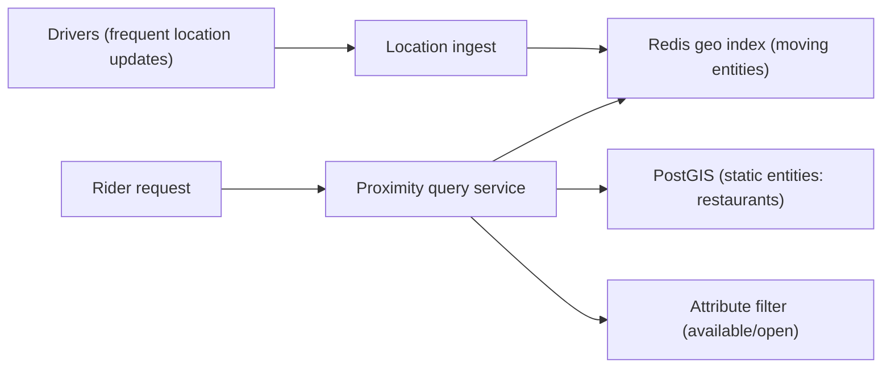
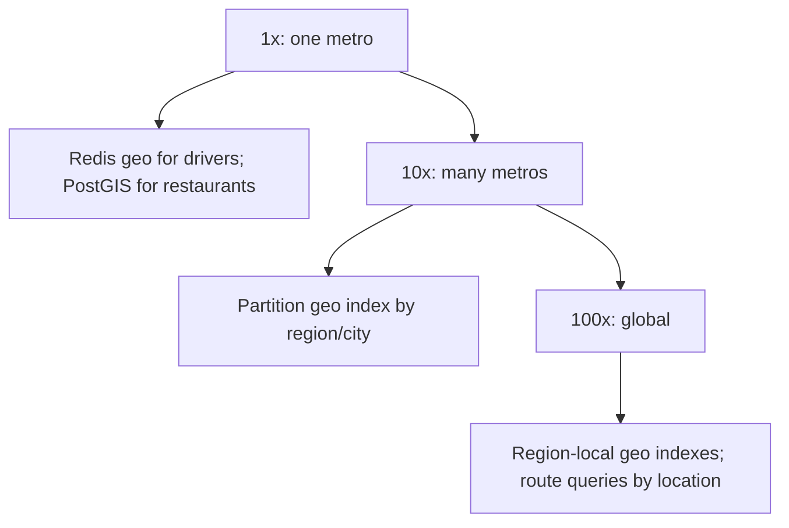

## 66.3 Proximity Search (Nearby Drivers and Restaurants)

### 66.3.1 Requirements

A proximity search system answers "what is near this location?" — the nearby available drivers for a ride request, the restaurants within delivery range, the friends near you — efficiently, over data where locations change constantly (drivers move every few seconds) and queries are frequent. The users are riders needing a nearby driver, diners browsing nearby restaurants, and the matching systems that pair them. This design probes geospatial indexing: how to query "near a point" fast over millions of moving or static locations, when a naive "compute distance to every location" is far too slow.

Imagine needing the nearest taxi in a huge city. Checking the distance from you to every taxi in the city on every request would be hopeless. Instead, imagine the city divided into a grid of cells; you only need to check taxis in your cell and the adjacent ones, not the whole city. That spatial bucketing — only looking near where you are — is the essence of proximity search, and geohashes and quadtrees are two ways to do the bucketing.

### 66.3.2 Functional requirements

1. Find entities (drivers, restaurants) within a radius of a point, or the nearest N.
2. Handle frequently-changing locations (drivers update their position every few seconds).
3. Filter by attributes (available drivers only; open restaurants that deliver here).
4. Answer queries fast (riders expect instant matching).
5. Scale to millions of entities and high query and update rates.

### 66.3.3 Non-functional requirements

| Property | Target | Why |
|---|---|---|
| Query latency | p99 low (tens of ms) | Riders wait for a match |
| Update rate | High (drivers update every ~4s) | Positions change constantly |
| Query rate | High (every ride request, every browse) | Core to the product |
| Accuracy | Close-enough nearest (slight approximation often fine) | "Nearby" tolerates small imprecision |
| Scale | Millions of entities, large metro areas | City-scale services |

### 66.3.4 Constraints

- Naive distance-to-all is O(n) per query — infeasible at millions of entities; a spatial index is required.
- Driver locations change every few seconds, so the index must support very high update rates, not just queries.
- Queries filter by attributes (available, open, delivers-here), so the spatial search combines with attribute filtering.
- "Nearby" tolerates slight approximation, which lets cheaper/faster approximate methods work.

### 66.3.5 Capacity estimation

| Quantity | Assumption | Calculation | Result |
|---|---|---|---|
| Drivers in a large metro | Active | given | 100,000 |
| Location updates | every 4s per driver | 100,000 / 4 | 25,000 updates/second |
| Proximity queries | ride requests + browsing | given | 10,000/second |
| Restaurants (static) | metro | given | 50,000 |
| Index memory | locations + ids | | modest (MBs) |

The numbers say: updates (25,000/second) outnumber queries (10,000/second) for the moving-driver case, so the index must handle very frequent updates cheaply — this is what makes a simple in-memory geohash-bucketed index (fast updates) attractive over a heavier tree that is costly to update. Restaurants are static, so a PostGIS index (query-optimized) fits them.

### 66.3.6 API design

| Method | Path | Request | Response | Notes |
|---|---|---|---|---|
| POST | `/locations` | `{ entityId, lat, lng }` | | Update an entity's location (frequent) |
| GET | `/nearby` | `?lat&lng&radius&filter=available` | nearby entities, sorted by distance | The proximity query |
| GET | `/nearest` | `?lat&lng&n=5&filter=...` | nearest N | Nearest-N variant |

### 66.3.7 Data model

```text
Geohash approach (good for frequently-moving entities):
  A geohash encodes a lat/lng into a short string where a shared prefix = nearby.
  Bucket entities by geohash prefix (a grid cell). To query near a point, look at the
  point's cell and its 8 neighbors, then filter by exact distance.
  Store in Redis: GEOADD/GEOSEARCH use geohashes internally for exactly this.

PostGIS approach (good for static/queryable entities like restaurants):
  A PostgreSQL extension adding a geometry/geography type and spatial (GiST) indexes.
  restaurants(id, location geography(Point), is_open, delivers_radius_m, ...)
  CREATE INDEX ON restaurants USING gist (location);
  SELECT ... WHERE ST_DWithin(location, :point, :radius) ORDER BY location <-> :point;

Quadtree: a tree that recursively subdivides space into quadrants; dense areas get
  finer subdivision. Good for nearest-neighbor queries; costlier to update than geohash buckets.
```

### 66.3.8 High-level architecture



Frequently-moving entities (drivers) live in a Redis geo index (fast updates via `GEOADD`, fast radius queries via `GEOSEARCH`, built on geohashes). Static entities (restaurants) live in PostGIS (spatial index, rich queries, joined to attributes). The proximity query service queries the appropriate index, applies attribute filters, and returns results sorted by distance.

### 66.3.9 Component design

| Component | Responsibility |
|---|---|
| Location ingest | Accept high-rate location updates, write to the geo index |
| Redis geo index | Hold moving entities; fast update and radius query (geohash-based) |
| PostGIS | Hold static entities with spatial index and attribute columns |
| Proximity query service | Run the near/nearest query, filter by attributes, sort by distance |
| Attribute filter | Combine spatial results with availability/open/range filters |

### 66.3.10 Deep dive: geohash, quadtrees, PostGIS

**Geohash** encodes a latitude/longitude into a short string such that locations with a common prefix are geographically close (a longer shared prefix means closer). This turns "find nearby" into "find entities whose geohash shares a prefix" — a cheap string/bucket lookup. The trick for correctness: a point near a cell boundary has close neighbors in adjacent cells, so a proper query checks the point's cell and its 8 neighbors, then filters by exact distance. Geohash bucketing updates very cheaply (just move an entity to a new bucket), which suits frequently-moving drivers. **Redis's geo commands** (`GEOADD`, `GEOSEARCH`) implement exactly this — they store positions by geohash and do radius/box searches — making Redis a ready-made moving-entity geo index with fast updates and queries.

**Quadtrees** recursively subdivide space into four quadrants, subdividing dense areas more finely, giving efficient nearest-neighbor queries with good adaptivity to uneven density. They are powerful for queries but costlier to update than flat geohash buckets, so they suit relatively static data or query-heavy workloads more than the 25,000-updates/second driver case.

**PostGIS** adds a spatial type and GiST spatial index to PostgreSQL, so you get exact, rich spatial queries (`ST_DWithin` for within-radius, `<->` distance ordering for nearest) joined directly to attribute columns (is_open, delivers_radius) and relational data, all in one SQL query. This is ideal for static or less-frequently-updated entities (restaurants) where the query richness and the join to attributes matter, and it keeps everything in PostgreSQL (the "stay in PostgreSQL" theme of pgvector, Part 60, and TimescaleDB, Part 62). It is less suited to 25,000 updates/second of moving points, where Redis's lightweight geo index shines.

```text
Choose the geo index by update rate and query needs:
  Frequently moving (drivers, 25k updates/s) -> Redis geo (geohash): cheap updates
  Static + rich queries + attribute joins (restaurants) -> PostGIS: query power, one DB
  Query-heavy, uneven density, less frequent updates -> quadtree: adaptive nearest-neighbor
```

### 66.3.11 Caching

Nearby-restaurant results for a location (static data) can be cached briefly, since restaurants do not move and open/close slowly. Driver proximity results are too volatile to cache (drivers move constantly), so they query the live geo index each time.

### 66.3.12 Messaging

High-rate location updates can flow through a queue to the ingest service to buffer bursts, though the Redis geo index is fast enough to take updates directly in many cases. Matching events (rider matched to driver) emit downstream.

### 66.3.13 Scaling



Geospatial data partitions naturally by region/city: a query is always local to a location, so you shard the geo index by region and route each query to its region's index. This scales cleanly because proximity queries never need global data — a rider in one city never needs drivers in another. Redis geo handles the update rate per region; PostGIS handles restaurant queries per region.

### 66.3.14 Security

Location data is sensitive (it reveals where people are): restrict who can query whose location, do not expose precise locations beyond what is needed (a rider sees a driver's approximate position, not a precise track), rate-limit location queries to prevent scraping, and apply privacy/retention policies to location history (Part 22, Part 63). Authorization: a user can only query proximity for legitimate purposes (their own ride).

### 66.3.15 Failure scenarios

| Failure | Detection | Impact | Mitigation | Effect |
|---|---|---|---|---|
| Redis geo index down | Errors | No driver proximity | Fallback to PostGIS (slower) or cached last positions | Degraded |
| Stale driver position | Last-update timestamp | Match a driver who moved | Expire stale positions (TTL); recheck on match | Mostly avoided |
| Boundary miss (geohash edge) | Missing nearby result | Nearest entity in adjacent cell missed | Query the cell plus 8 neighbors | Correct |
| Update flood | Ingest overload | Updates lag | Buffer/queue updates; shard by region | Smoothed |
| PostGIS query slow | Latency | Slow restaurant search | Spatial index; cache results | Mitigated |
| Hot region (city center) | Load on one shard | Latency in that region | Finer partitioning of dense regions | Balanced |

### 66.3.16 Observability

Metrics: query latency (near/nearest), update rate and lag, index sizes, stale-position rate, cache hit rate (restaurants), per-region load. Alerts: query latency spikes, update lag (positions going stale), geo index unavailability, hot-region imbalance. Dashboards: proximity query performance, location freshness, per-region load.

### 66.3.17 Deployment

Redis (clustered, partitioned by region) for the moving-entity geo index; PostGIS (PostgreSQL with the extension) for static entities; the query service autoscaled and region-aware. Location ingest scaled for the update rate. Stale-position expiry via TTL on geo entries.

### 66.3.18 Cost considerations

Redis memory for the moving-entity index (modest — positions and ids) and PostgreSQL/PostGIS for static entities are the main stores; both are inexpensive at these data sizes. The cost scales with the update and query rates (compute for the query service) and with regions. Caching static results and partitioning by region keep it efficient.

### 66.3.19 Tradeoffs

- **Redis geo (cheap updates, geohash-based, in-memory) for moving entities vs PostGIS (rich queries, durable, one DB) for static entities**: use each where its strength fits — Redis for the 25k-updates/second drivers, PostGIS for the query-rich, attribute-joined, slow-changing restaurants. This split matches the store to the update/query profile.
- **Geohash bucketing (cheap updates, approximate, boundary handling needed) vs quadtree (adaptive, good nearest-neighbor, costlier updates)**: geohash for high update rates, quadtree for query-heavy, less-frequently-updated data.
- **Approximate nearby (fast, slight imprecision) vs exact nearest (more work)**: "nearby" usually tolerates approximation, so cheaper approximate methods are fine; exact is reserved for when precision matters.
- **Region partitioning (scalable, queries are local) with the complexity of routing**: proximity queries are naturally local, so region sharding scales cleanly, at the cost of routing and handling region boundaries.

### 66.3.20 Alternative architectures

**PostGIS-only**: use PostGIS for everything, including moving entities, accepting that 25,000 updates/second of point locations is heavier for a spatial index than for Redis geo. Viable at smaller scale or lower update rates, and simplest (one database, rich queries); it struggles at very high update rates, which is why Redis geo is paired with it for moving entities.

**Redis geo-only**: use Redis geo for everything, including restaurants, accepting that you lose PostGIS's rich spatial queries and attribute joins and must filter attributes separately. Viable when queries are simple radius searches; weaker when you need complex spatial queries or tight integration with relational attributes.

**Specialized geospatial database / managed service**: a dedicated spatial/location service can handle extreme scale and advanced queries; justified only when the Redis+PostGIS combination genuinely does not meet the scale or query needs, following the "do not add a store without a specific requirement" discipline (Part 62).
