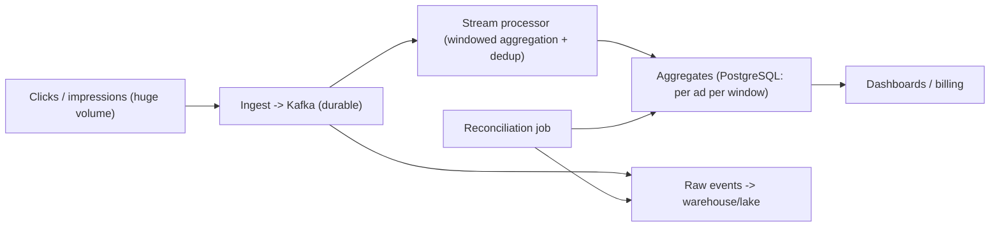
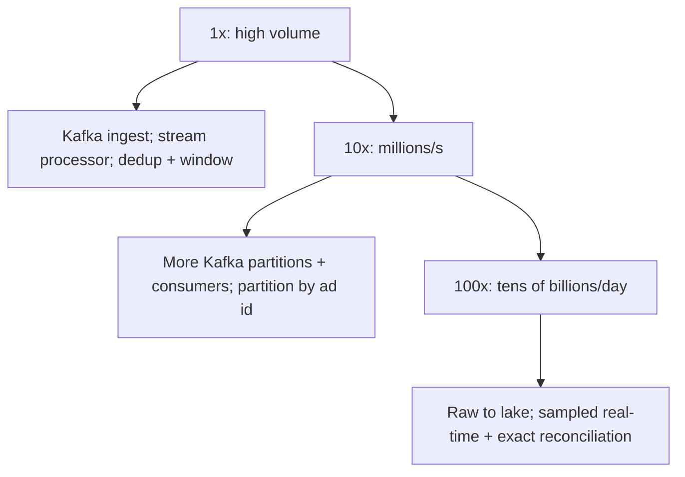

## 66.4 Ad-Click and Metrics Aggregation

### 66.4.1 Requirements

An ad-click (or metrics) aggregation system ingests a very high volume of events — ad clicks, impressions, page views, product views — and produces accurate aggregated counts and metrics (clicks per ad per hour, views per product per day), handling billions of events, counting correctly despite duplicates and retries, aggregating over time windows, and reconciling to catch any discrepancies. The users are advertisers (who are billed by clicks, so accuracy is money), analysts, and dashboards. This design probes high-volume ingestion and the hard problem of counting accurately at scale, where exactly-once counting matters because the counts are billed.

Imagine counting every person entering every store in a country, continuously, and billing each store by the count — so the count must be right, not approximately right, even though people stream in by the millions per second, some turnstiles double-report, and some reports arrive late. You cannot count each person by hand (volume), you must not double-count (billing accuracy), and you must handle late and duplicate reports. That is ad-click aggregation: massive ingest, exact counting despite duplicates, windowed aggregation, and reconciliation to catch errors.

### 66.4.2 Functional requirements

1. Ingest a very high volume of events (clicks, impressions) reliably without loss.
2. Aggregate events into counts/metrics over time windows (per ad per minute/hour/day).
3. Count accurately despite duplicate events (retries, at-least-once delivery) — exactly-once semantics for the counts.
4. Handle late-arriving events (an event delayed by network/offline device).
5. Reconcile aggregates against raw events to catch and correct discrepancies.
6. Serve aggregated results to dashboards and billing with low latency.

### 66.4.3 Non-functional requirements

| Property | Target | Why |
|---|---|---|
| Ingest throughput | Very high (millions of events/second) | Ad/metrics scale |
| Count accuracy | Exact for billed metrics (no over/under-count) | Counts are money |
| No event loss | Durable ingestion | A lost click is lost revenue |
| Aggregation freshness | Near real-time for dashboards; exact for billing (can lag) | Different consumers, different needs |
| Reconciliation | Aggregates provably match raw events | Trust in the billed numbers |

### 66.4.4 Constraints

- Volume is enormous (millions of events/second), so ingestion must be a streaming/queue problem, not synchronous inserts.
- At-least-once delivery (the reliable default, Part 17) means duplicates, but the counts must be exact — so deduplication/idempotency is essential for accuracy.
- Events arrive out of order and late, so windowed aggregation needs watermarks and late-event handling (Part 63).
- The counts are billed, so accuracy is a correctness requirement, not a nicety, and must be verifiable (reconciliation).

### 66.4.5 Capacity estimation

| Quantity | Assumption | Calculation | Result |
|---|---|---|---|
| Events/second | Peak | given | 1,000,000/second |
| Event size | small | given | about 200 B |
| Ingest bandwidth | 1M x 200 B | | 200 MB/s |
| Events/day | 1M x 86,400 | | about 86 billion/day |
| Raw storage/day | 86B x 200 B (compressed less) | | tens of TB/day raw |
| Aggregates | counts per ad per window | | tiny compared to raw |

The numbers say: ingestion is a high-throughput streaming problem (Kafka, Part 17), raw events are huge (store in a columnar warehouse/lake, Part 63, or drop after aggregation), aggregates are small (the whole point of aggregating), and the system must count 86 billion events/day exactly despite duplicates — which forces careful deduplication and reconciliation.

### 66.4.6 API design

| Operation | Interface | Notes |
|---|---|---|
| Ingest event | `POST /events` or SDK -> queue | High-volume, fire-and-forget to a durable queue |
| Get aggregate | `GET /metrics?adId&from&to&granularity` | Read precomputed aggregates |
| Reconciliation status | `GET /reconciliation` | Discrepancy reports |

Ingestion returns fast (write to a durable queue and acknowledge); the heavy aggregation happens asynchronously.

### 66.4.7 Data model

```text
Raw events (durable, high-volume): in Kafka (retained) and/or a columnar store/lake.
  event(event_id, ad_id, user_hash, type, event_time, received_time)
  event_id is a client/server-assigned unique id -> the key for deduplication.

Aggregates (small, served to dashboards/billing): pre-aggregated per ad per window.
  ad_metrics(ad_id, window_start, granularity, clicks, impressions)  -- in PostgreSQL

Dedup state: a store of seen event_ids per window (to count each event once),
  or idempotent aggregation keyed by event_id.
```

The `event_id` is the linchpin of exactly-once counting: every event carries a unique id, and the aggregation counts each id once, so duplicates (from at-least-once delivery) do not inflate the count.

### 66.4.8 High-level architecture



Events are ingested into Kafka (durable, high-throughput buffer). A stream processor (Part 63) consumes them, deduplicates by `event_id`, aggregates into time windows, and writes small aggregates to PostgreSQL for serving. Raw events also land in a warehouse/lake. A reconciliation job periodically compares the aggregates against the raw events to catch and correct any discrepancy.

### 66.4.9 Component design

| Component | Responsibility |
|---|---|
| Ingest | Accept events fast, write durably to Kafka, acknowledge |
| Kafka | Durable, high-throughput, replayable event buffer |
| Stream processor | Deduplicate by event_id, aggregate into windows, write aggregates |
| Aggregate store | PostgreSQL: small per-ad-per-window counts for serving |
| Raw store | Warehouse/lake: raw events for reconciliation and deep analysis |
| Reconciliation job | Compare aggregates to raw counts; detect and fix discrepancies |

### 66.4.10 Deep dive: exactly-once counting, windowing, reconciliation

**Exactly-once counting** is the heart. At-least-once delivery (Part 17) means the same click event can be delivered more than once (a producer retry, a consumer reprocessing after a crash). If you simply increment a counter per event, duplicates inflate the count — and since clicks are billed, that is over-billing. The defenses:

- **Deduplication by `event_id`**: each event has a unique id; the aggregator tracks which ids it has counted (per window) and ignores repeats. This makes counting idempotent — re-processing an event does not double-count.
- **Idempotent aggregate updates with offset tracking**: the stream processor records the last-processed Kafka offset together with the aggregate update in one atomic step, so reprocessing after a crash skips already-counted events (the pattern from Part 40's click consumer).

Either way, the count reflects each distinct event once, achieving exactly-once *counting* on top of at-least-once *delivery* — the practical way to get exact counts without the (often impossible) guarantee of exactly-once delivery.

**Windowed aggregation** (Part 63): events are aggregated into time windows (per minute, hour, day) by **event time**, with **watermarks** to decide when a window is complete and **allowed lateness** to incorporate late events. A click from a device that was briefly offline arrives late; within the allowed-lateness grace period it still lands in its correct window; beyond that, it is side-outputted for reconciliation rather than silently dropped — because a dropped click is lost revenue.

**Reconciliation** is the accuracy backstop (Part 63): periodically recompute the aggregates directly from the raw events (in the warehouse/lake) and compare against the served aggregates. Any mismatch — from a bug, a dropped event, a dedup miss — is detected and the aggregate corrected. Because the counts are billed, reconciliation is not optional: it is how you can stand behind the numbers. This is the lambda-style idea of a fast approximate/real-time path (the stream aggregates) backed by a slower exact path (reconciliation from raw events) that corrects it.

```text
Exactly-once counting on at-least-once delivery:
  every event has a unique event_id -> count each id once (dedup) -> duplicates harmless
  + atomic (aggregate update, Kafka offset) -> crash reprocessing does not double-count
Windowing by event time + watermark + allowed lateness -> late clicks counted, not dropped
Reconciliation: recompute from raw events, compare to served aggregates, correct mismatches
```

### 66.4.11 Caching

Served aggregates are small and can be cached for dashboards (short TTL) since they update per window. The dedup state is effectively a cache/index of seen event ids within the active window.

### 66.4.12 Messaging

Kafka is central (Part 17): durable, high-throughput, replayable ingestion, partitioned (by ad id for aggregation locality, so one consumer sees all of an ad's events and can aggregate in memory before flushing). Replayability is key — if aggregation has a bug, you can reprocess from Kafka. At-least-once delivery with idempotent, deduplicating consumers is the contract.

### 66.4.13 Scaling



Ingestion scales via Kafka partitions and consumer parallelism (partition by ad id for aggregation locality). Aggregates stay small regardless of event volume (the point of aggregating). At extreme scale, real-time dashboards may use sampling/approximation for speed while billing uses the exact reconciled counts — a fast-approximate plus slow-exact split.

### 66.4.14 Security

Prevent click fraud (fake clicks to inflate bills or drain competitors' budgets): bot detection, rate limiting, anomaly detection on click patterns, and validation — click fraud is a major real threat in ad systems. Protect PII in events (hash user identifiers, Part 63). Authorize who can read whose metrics. Ensure the billed counts cannot be tampered with.

### 66.4.15 Failure scenarios

| Failure | Detection | Impact | Mitigation | Effect |
|---|---|---|---|---|
| Duplicate events (at-least-once) | Normal | Over-count, over-bill | Dedup by event_id; idempotent aggregation | Exact counts |
| Consumer crash mid-aggregation | Offset lag | Reprocessing | Atomic (aggregate, offset); dedup | No double-count |
| Late events | Watermark | Miss the window | Allowed lateness; side output for very late; reconciliation | Counted or reconciled |
| Dropped event | Reconciliation mismatch | Under-count, lost revenue | Durable Kafka (no loss); reconciliation detects and corrects | Caught and fixed |
| Aggregation bug | Reconciliation mismatch | Wrong counts | Replay from Kafka with fixed code; reconcile | Corrected |
| Click fraud | Anomaly detection | Inflated bills | Fraud detection, rate limits, validation | Mitigated |
| Ingest overload | Kafka lag | Delayed aggregation | Kafka buffers; scale consumers | Smoothed, not lost |

### 66.4.16 Observability

Metrics: ingest rate, Kafka consumer lag, aggregation latency, dedup rate (duplicates caught), late-event rate, reconciliation discrepancies (should be ~zero; alert on any significant gap), fraud-detection signals. Alerts: reconciliation mismatch beyond tolerance (billing accuracy), consumer lag (aggregates falling behind), ingest loss (any event loss), fraud spikes. Dashboards: ingest/aggregation health, accuracy (reconciliation), fraud.

### 66.4.17 Deployment

High-throughput Kafka cluster; stream processor (Kafka Streams/Flink or custom consumers) scaled to the partition count; PostgreSQL for aggregates; a warehouse/lake for raw events; a scheduled reconciliation job. Replay capability (reprocess from Kafka) built in for fixing aggregation bugs. Fraud detection integrated at or near ingest.

### 66.4.18 Cost considerations

Dominated by the high-throughput ingestion (Kafka) and raw-event storage (tens of TB/day — store in cheap columnar lake storage, and retain raw events only as long as needed for reconciliation and analysis, Part 63). Aggregates are tiny and cheap. The cost is controlled by retention policy on raw events (the dominant storage cost) and by right-sizing the stream-processing fleet. Accuracy (dedup, reconciliation) costs some compute but is non-negotiable because the counts are billed.

### 66.4.19 Tradeoffs

- **Exactly-once counting via dedup + idempotent aggregation on at-least-once delivery** over attempting exactly-once delivery (hard/impossible end to end): we get exact counts the practical way — unique event ids counted once — rather than chasing an exactly-once delivery guarantee.
- **Fast approximate real-time + slow exact reconciliation** over a single exact real-time path: dashboards get near-real-time (possibly sampled) numbers quickly, while billing uses the exact reconciled counts, because real-time and exact are in tension at this volume.
- **Durable Kafka buffer (replayable, no loss) with the cost of running it** over synchronous inserts (would never keep up and would lose events on failure): the durability and replay are worth the operational cost at this scale.
- **Retain raw events for reconciliation (storage cost) vs aggregate-and-drop (cheaper, no reconciliation)**: for billed counts, keeping raw events long enough to reconcile is worth the storage, because trust in the numbers requires it.

### 66.4.20 Alternative architectures

**Approximate-only counting** (count-min sketch, HyperLogLog for unique counts): for non-billed metrics where approximate counts suffice (rough dashboard trends), probabilistic structures count in tiny fixed memory with no exact-count machinery — far cheaper and simpler. Use this when accuracy is not billed; reserve the full exactly-once-plus-reconciliation design for metrics that are money.

**Database-only aggregation**: for moderate volume, insert events into PostgreSQL (partitioned by time, Part 14) and aggregate with SQL into summary tables (the Part 63 in-product analytics pattern). Simpler, no Kafka/stream processor; it does not scale to millions of events/second, but most "metrics" needs are far below that threshold — build this first unless the volume genuinely demands the streaming pipeline.

**Managed analytics/streaming service**: a managed ingestion-and-aggregation service offloads operating Kafka and stream processors; viable when you prefer managed infrastructure and accept its cost and constraints, especially for teams without a data-platform team.
