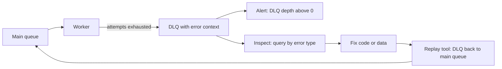
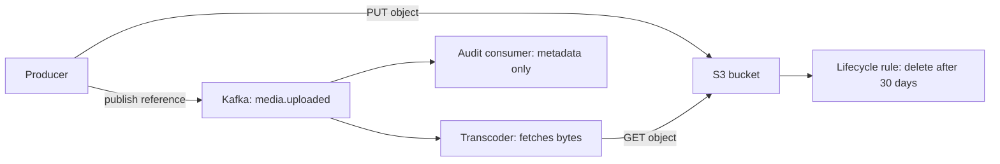
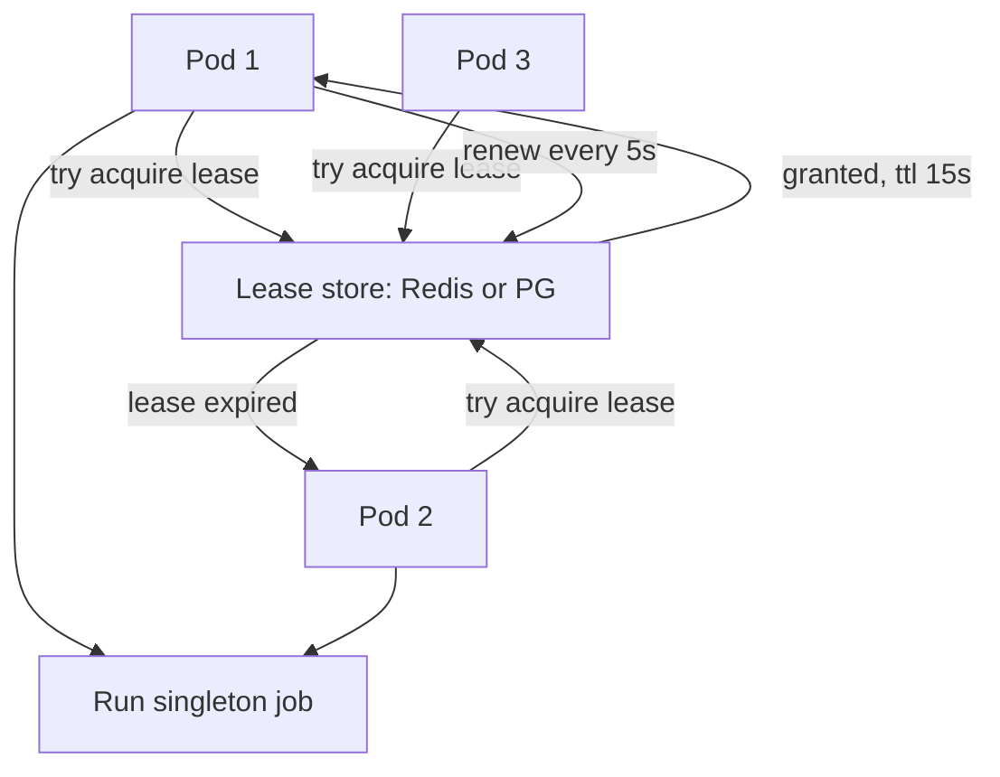
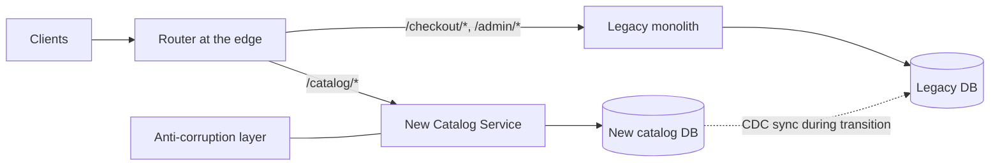

## 66.27 Dead-letter queue

### Problem

A message fails permanently: a schema change made the payload unparseable, a referenced order was hard-deleted, or a bug throws on one specific edge case. Without somewhere to put it, you have two bad options — drop it silently (data loss you will discover in an audit) or keep retrying (a poison message that blocks the partition or burns capacity forever).

### Solution

After a bounded number of attempts, move the message to a dedicated queue or topic with its full context: original payload, error message, stack trace, attempt count, timestamps and correlation id. The main flow continues. Humans and tools then inspect, fix and replay.

### Architecture



### Example

A dead-letter record that is actually useful during an incident, and the replay endpoint that makes it a workflow rather than a graveyard.

```ts
async deadLetter(msg: KafkaMessage, err: Error, attempts: number): Promise<void> {
  await this.producer.send({
    topic: 'orders.dlq',
    messages: [{
      key: msg.key,
      value: msg.value,                                   // original payload, untouched
      headers: {
        'original-topic': 'orders.events',
        'original-partition': String(msg.partition ?? ''),
        'original-offset': msg.offset,
        'error-class': err.constructor.name,
        'error-message': err.message.slice(0, 500),
        'attempts': String(attempts),
        'failed-at': new Date().toISOString(),
        'correlation-id': msg.headers?.['correlation-id'] ?? '',
        'consumer-version': process.env.APP_VERSION ?? 'unknown',
      },
    }],
  });
  this.metrics.inc('dlq_messages', { topic: 'orders.events', error: err.constructor.name });
}
```

```ts
// Replay is a first-class, guarded operation, not a script somebody writes at 03:00.
@Post('admin/dlq/:topic/replay')
@Roles('sre')
async replay(@Param('topic') topic: string, @Body() dto: ReplayDto) {
  const msgs = await this.dlq.read(topic, { since: dto.since, errorClass: dto.errorClass, limit: dto.limit ?? 100 });
  for (const m of msgs) {
    await this.producer.send({ topic: m.originalTopic, messages: [{ key: m.key, value: m.value }] });
  }
  return { replayed: msgs.length };   // consumers are idempotent, so replay is safe
}
```

### Advantages

- No silent data loss, and no poison message stalling the pipeline.
- Failures become a queryable dataset: "17,000 messages failed with `ProductNotFound` between 14:00 and 14:20" is a diagnosis in one query.
- Replay after a fix restores correctness without manual data entry.

### Disadvantages

- Only works if someone watches it. An unmonitored DLQ is a very tidy way to lose data.
- Replay requires idempotent consumers, or you double-process.
- Storing full payloads in the DLQ can duplicate sensitive data into a less-protected place.

### When to use

- Every consumer, without exception. This is not optional infrastructure.

### When NOT to use

- Never skip it. But do not use a DLQ as a *substitute* for validation: if 30 percent of messages dead-letter, the contract is broken and the DLQ is hiding it.

### Edge cases and failure modes

- **Unmonitored DLQ**: the classic. Alert on depth greater than zero, and on rate.
- **DLQ for the DLQ**: the dead-lettering itself fails because the broker is down. Fall back to writing the failure to a database table or structured log.
- **Replay storms**: replaying 200,000 messages at once takes down the very service that could not handle them. Replay with rate limiting.
- **Stale replays**: replaying week-old `price.changed` events overwrites current prices with old ones. Check event timestamps before replaying anything order-dependent.
- **PII duplication**: DLQ payloads inherit personal data, so retention and access control must match the source topic.

### Senior perspective

The DLQ is where I judge a team's operational maturity. Anyone can create the topic; the mature version has three more things: an alert that fires on the first message, headers rich enough to diagnose without opening the payload, and a tested replay path with rate limiting and role-based access. I have seen a DLQ with 1.2 million messages accumulated over eight months that nobody had ever looked at — every one of them a customer order that never shipped. Set the alert on the day you create the topic, not later.

## 66.28 Claim check

### Problem

Your event carries a 40 MB video, a 12 MB CSV import, or a base64 PDF. Kafka's default message limit is 1 MB and raising it hurts everything: broker memory, replication bandwidth, consumer buffer sizes and rebalance times. SQS caps at 256 KB. Even where a big message fits, every consumer of that topic now pays to transfer bytes it may not need, and your broker becomes an expensive, badly-shaped blob store.

### Solution

Store the payload in object storage and put only a reference in the message: bucket, key, size, checksum, content type. Consumers that need the bytes fetch them; consumers that only need the metadata never pay. The message goes from 40 MB to 400 bytes. The name comes from a coat check: you carry the ticket, not the coat.

### Architecture



### Example

Producing the claim check and consuming it, with the details that make it safe: checksum, size limit and a scoped, expiring URL.

```ts
async publishUpload(file: Express.Multer.File, userId: string): Promise<void> {
  const key = `uploads/${userId}/${randomUUID()}`;
  const checksum = createHash('sha256').update(file.buffer).digest('hex');

  await this.s3.send(new PutObjectCommand({
    Bucket: this.bucket, Key: key, Body: file.buffer,
    ContentType: file.mimetype, ChecksumSHA256: Buffer.from(checksum, 'hex').toString('base64'),
    Metadata: { userId },
  }));

  // 380 bytes instead of 40 MB
  await this.producer.send({
    topic: 'media.uploaded',
    messages: [{ key: userId, value: JSON.stringify({
      bucket: this.bucket, key, sizeBytes: file.size,
      contentType: file.mimetype, checksumSha256: checksum,
      uploadedAt: new Date().toISOString(),
    }) }],
  });
}

async consume(ref: ClaimCheck): Promise<void> {
  if (ref.sizeBytes > 500 * 1024 * 1024) throw new TooLargeError(ref.key);  // guard memory
  const obj = await this.s3.send(new GetObjectCommand({ Bucket: ref.bucket, Key: ref.key }));
  await pipeline(obj.Body as Readable, this.transcoder.createSink());        // stream, never buffer
}
```

### Advantages

- Messages stay small, so broker throughput, retention cost and rebalance times all stay healthy.
- Consumers that need only metadata skip the transfer entirely.
- Object storage is the right tool for blobs: cheap, durable, lifecycle-managed, and it supports ranged reads and streaming.
- Retention policies decouple: keep events for a year, keep blobs for 30 days.

### Disadvantages

- Two systems must stay consistent. A message pointing at a deleted object is a broken event.
- Extra latency per consumer: an S3 `GET` is 20 to 80 ms versus reading bytes already in the message.
- Access control gets more complex; each consumer needs bucket permissions.
- Replaying old events may find the objects expired.

### When to use

- Any payload above roughly 100 KB: images, video, documents, large exports, bulk import files.
- Where multiple consumers need the same large payload, so it is downloaded only by those that use it.

### When NOT to use

- Small payloads. A 2 KB order event does not need a claim check; you have added a network call and a failure mode for nothing.
- When the consumer must be able to process from the message alone with no external dependency, for example a strictly air-gapped audit consumer.
- When object lifetime cannot be guaranteed to exceed message retention plus replay window.

### Edge cases and failure modes

- **Dangling reference**: the lifecycle rule deletes the object after 30 days, then someone replays a 60-day-old event. Align lifecycle with replay policy, and handle `NoSuchKey` as a permanent failure, not a retry.
- **Write-then-publish race**: publishing before the `PUT` completes gives consumers a 404. Always store first, publish second.
- **Partial upload**: a multipart upload that failed leaves an incomplete object. Verify the checksum on read.
- **Memory blowup**: a consumer that buffers a 2 GB object into a Node `Buffer` gets `OOMKilled`. Stream, and enforce a size guard.
- **Permission drift**: a new consumer without bucket access fails on every message.

### Senior perspective

The claim check is one of those patterns that seems obvious after you have had the alternative incident: a team raised `max.message.bytes` to 50 MB to ship PDFs through Kafka, and six months later broker memory pressure during a rebalance caused a two-hour consumer outage. The rule I write into event guidelines is a hard cap — messages over 100 KB must use a claim check — enforced by a producer-side check that throws. The other detail is ordering: store the object, verify it, then publish. Reversing those two produces intermittent 404s that are maddening to debug because they only happen under load.

## 66.29 Leader election

### Problem

You run six replicas of a service for availability. One of its jobs is a nightly reconciliation that must run exactly once, and another is a poller that drains a table. With six replicas, both run six times: six duplicate reports, six workers fighting over the same rows, six emails to the finance team. Scaling for availability broke a job that assumes singularity.

### Solution

Elect one replica as leader; only the leader performs the singleton work. Election uses a shared store with an atomic primitive and a lease that expires, so if the leader dies another takes over within seconds. Options in order of increasing weight: a PostgreSQL advisory lock, a Redis lease with `SET NX PX`, a Kubernetes `Lease` object, or a proper consensus store like etcd.

### Architecture



### Example

The simplest thing that works well in a PostgreSQL shop: a session-level advisory lock. The lock disappears automatically if the connection dies, which is exactly the failure semantics you want.

```ts
@Injectable()
export class ReconciliationJob {
  private readonly LOCK_KEY = 918_273_645;   // arbitrary but fixed per job

  @Cron('0 2 * * *')                          // fires on every replica
  async run(): Promise<void> {
    const runner = this.ds.createQueryRunner();
    await runner.connect();
    try {
      // Non-blocking: returns immediately. Only one connection in the cluster wins.
      const [{ pg_try_advisory_lock: got }] = await runner.query(
        'SELECT pg_try_advisory_lock($1)', [this.LOCK_KEY]);
      if (!got) return this.logger.debug('another replica holds the lock, skipping');

      await this.reconcile();                 // safe: exactly one replica is here
    } finally {
      await runner.query('SELECT pg_advisory_unlock($1)', [this.LOCK_KEY]);
      await runner.release();                 // releasing the connection also frees the lock
    }
  }
}
```

```ts
// Redis variant for non-PostgreSQL work, with the renewal that makes it a lease.
const acquired = await redis.set('leader:indexer', this.podName, 'NX', 'PX', 15_000);
if (acquired) {
  this.renewTimer = setInterval(async () => {
    // renew ONLY if we still own it; a plain PEXPIRE can extend someone else's lease
    await redis.eval(
      `if redis.call('GET', KEYS[1]) == ARGV[1] then return redis.call('PEXPIRE', KEYS[1], 15000) else return 0 end`,
      1, 'leader:indexer', this.podName);
  }, 5_000);
}
```

### Advantages

- Lets you scale replicas for availability without duplicating singleton work.
- Automatic failover: a crashed leader's lease expires and another replica takes over in seconds.
- The advisory-lock version needs no new infrastructure at all.

### Disadvantages

- Leadership is never perfectly safe. Between a leader pausing (GC, CPU throttle) and its lease expiring, two processes can believe they are leader.
- The leader is a capacity bottleneck: singleton work does not scale.
- Failover has a gap. With a 15-second lease, nothing runs for up to 15 seconds.

### When to use

- Cron jobs and schedulers on multi-replica deployments.
- Single-writer processes: a CDC relay, a partition assigner, a cache warmer.
- Coordination where a broker's consumer-group semantics do not apply.

### When NOT to use

- Where the work is parallelisable. Do not elect a leader to consume a queue; use competing consumers.
- Where a database constraint or `SKIP LOCKED` gives you safety without coordination — that is almost always the better answer for "drain a table".
- As a substitute for idempotency. Assume split brain will happen and make the work safe anyway.
- Do not build your own consensus. If you truly need strong leadership guarantees, use etcd or the platform's primitives.

### Edge cases and failure modes

- **Split brain**: a leader is CPU-throttled for 20 seconds; its lease expires; a new leader starts; the old one wakes up and continues, believing it still leads. Fence the work with a monotonically increasing token, or make it idempotent.
- **Clock skew**: TTL-based leases assume roughly synchronised clocks. Renew at one third of the TTL to leave margin.
- **Lock never released**: an application-level lock in a table with no expiry, held by a crashed pod, blocks the job forever. Advisory locks and Redis leases both expire; table-based locks usually do not.
- **Leader overload**: all singleton work concentrated on one pod that then falls behind on its health checks.
- **Renewal failure**: Redis blips for 3 seconds, the renewal fails, the lease is lost mid-job. Detect loss and abort cleanly rather than finishing blind.

### Senior perspective

My first question is always whether the work truly needs a single runner. Half the time the honest answer is "we need it to not run twice", and the right tool is a uniqueness constraint or `SELECT ... FOR UPDATE SKIP LOCKED`, not an election. When election is genuinely needed, I use `pg_try_advisory_lock` in PostgreSQL shops because it is free, correct and self-cleaning. The thing I never rely on is the guarantee itself: leader election reduces the probability of duplicate execution; idempotency eliminates the consequence. Build both, and you can sleep through a lease expiry.

## 66.30 Strangler Fig

### Problem

A ten-year-old monolith runs the business. It is 400,000 lines, has no tests worth the name, and touches one database with 300 tables. A rewrite is estimated at eighteen months, during which no new features ship. Every big-bang rewrite you have witnessed either shipped two years late or was cancelled. Yet the monolith cannot be maintained much longer.

### Solution

Grow the new system around the old one and let it take over route by route, exactly as a strangler fig grows around its host tree. Put a routing layer in front. Move one capability at a time to a new service; the router sends that path to the new system and everything else to the old. Repeat until the monolith serves nothing, then delete it. The system stays live and shippable throughout, and every step is individually reversible.

### Architecture



### Example

The migration in three states, expressed as router config. The middle state — dual read with comparison — is the one that makes this safe.

```yaml
# Stage 1: shadow. New service receives a copy, its response is compared, never returned.
- match: { prefix: /catalog }
  route: { cluster: legacy }
  request_mirror_policies:
    - cluster: catalog_new
      runtime_fraction: { default_value: { numerator: 100, denominator: HUNDRED } }

# Stage 2: canary. 5 percent of real traffic served by the new service.
- match: { prefix: /catalog }
  route:
    weighted_clusters:
      clusters:
        - { name: catalog_new, weight: 5 }
        - { name: legacy,      weight: 95 }

# Stage 3: cut over. Legacy kept warm for a one-line rollback for two weeks.
- match: { prefix: /catalog }
  route: { cluster: catalog_new }
```

```ts
// Shadow comparison: log differences, never fail the user's request.
@Injectable()
export class ShadowComparator {
  async compare(path: string, legacy: unknown, next: Promise<unknown>): Promise<void> {
    try {
      const candidate = await Promise.race([next, timeout(1_500)]);
      const diff = diffIgnoring(legacy, candidate, ['generatedAt', 'traceId']);
      if (diff.length) this.metrics.inc('shadow_mismatch', { path, field: diff[0].path });
    } catch {
      this.metrics.inc('shadow_error', { path });   // shadow failures never affect users
    }
  }
}
```

### Advantages

- The business keeps shipping. No feature freeze, no eighteen-month bet.
- Risk is decomposed: each capability is a small, independently reversible migration.
- You learn the real requirements from live traffic instead of from the old code's comments.
- Rollback is a routing change, measured in seconds.

### Disadvantages

- Two systems run in parallel for a long time — often years — and both need maintenance, on-call and deploys.
- Data synchronisation between old and new is the hard part, and it is where the real cost lives.
- Migration fatigue is a genuine organisational risk. Half-finished strangler migrations are extremely common, and a permanently half-migrated system is worse than either endpoint.

### When to use

- Any migration of a live, revenue-carrying system.
- Replacing a vendor platform, a legacy monolith, or an old database.
- When downtime is unacceptable and a rewrite is unaffordable.

### When NOT to use

- Small systems. If the whole thing is 8,000 lines and can be rewritten in three weeks with a maintenance window, do that.
- When the boundaries are not yet understood. Strangling requires knowing where to cut; if you cannot name the capability, do the domain work first.
- When nobody will fund finishing it. Starting a strangler migration without a committed end date and an owner produces the worst outcome in this catalogue: permanent duality.

### Edge cases and failure modes

- **Shared database**: the new service reads the legacy schema directly, which is fast to build and creates the exact coupling you were escaping. Use an ACL and plan the data split.
- **Dual writes during transition**: writing to both systems is a dual-write problem; use CDC one way instead, and make one system authoritative for each entity at all times.
- **Behavioural drift**: the new service is 99 percent identical, and the 1 percent is a pricing rule that costs money. That is what the shadow stage is for.
- **Session and auth split**: users bouncing between systems lose their session. Share the token format from day one.
- **Stalled migration**: the last 10 percent of routes are the ugliest, so they never move. Schedule them first if you can, or budget explicitly for them.
- **Rollback after data divergence**: once the new system has written data the old cannot read, routing rollback is no longer safe. Know the point of no return and announce it.

### Senior perspective

Strangler Fig is not really a technical pattern; it is a risk-management pattern that happens to be implemented with a router. The technical work is easy compared to the organisational work of maintaining momentum over eighteen months. Two practices make the difference. First, always run the shadow stage — comparing real responses on real traffic finds requirements no one documented, and it is the only cheap way to discover them. Second, publish a burndown of routes still served by the legacy system, visible to leadership, updated automatically. Migrations that are measured get finished; migrations that are merely intended become permanent.

## 66.31 A pattern selection matrix

Patterns are answers. This table starts from the *question*, which is how the decision actually arrives.

| Problem you have | Candidate patterns | Pick this one when |
|---|---|---|
| Twelve services, each doing its own auth and TLS | API Gateway, service mesh | Gateway when the concern is north-south and public; mesh when it is east-west and mTLS |
| Mobile needs small payloads, web needs rich ones | BFF, GraphQL, sparse fieldsets | BFF when the clients differ in *shape and release cadence*; fieldsets when they differ by a few fields |
| Instances change IP on every deploy | Service discovery, static DNS | Discovery whenever the platform is dynamic; static DNS for two fixed hosts |
| A dependency is slow and dragging you down | Circuit breaker, timeout, bulkhead | Timeout always; breaker when a fallback exists; bulkhead when one workload must not starve another |
| Transient network failures cause user-visible errors | Retry, retry queue, idempotency key | Retry inline for sub-second blips; retry queue when backoff exceeds the request budget |
| One slow endpoint takes down fast ones | Bulkhead, separate deployment, rate limiter | Separate deployment when the workloads are named and different; bulkhead within a process otherwise |
| Abusive or runaway clients | Rate limiter, token bucket, load shedding | Token bucket for public APIs with bursts; shedding when *you* are saturated regardless of who is calling |
| Producer faster than consumer | Bounded queue with backpressure, competing consumers | Backpressure first, always; add consumers when the bottleneck is consumer capacity |
| DB write and event publish must both happen | Outbox, CDC | Outbox when you want a designed event contract; CDC-over-outbox when you also need sub-second latency |
| Consumers see duplicate messages | Transactional inbox, natural upsert, idempotency key | Natural upsert when the handler can be a full-state write; inbox when side effects span tables |
| A business flow spans four services | Saga, merge the services, single transaction | Merge first if you can; saga only when the split is genuinely required |
| Client retries cause double charges | Idempotency key, unique business constraint | Constraint when a natural key exists; idempotency key for open-ended public writes |
| Six systems need to know about row changes | CDC, outbox, dual writes | CDC over an outbox table; never dual writes |
| Integrating a legacy or vendor model | Anti-corruption layer | Always, when you do not control the other model |
| Reads and writes have different shapes and loads | CQRS light (read table), materialized view, index | Index first; materialized view next; separate read model only when the first two fail |
| The business asks questions about the past | Event sourcing, audit table, CDC to warehouse | Audit table for 90 percent of cases; event sourcing only for ledger-like domains |
| A dashboard query takes 2.8 seconds | Materialized view, better index, cache | Index first; materialized view when the query is an aggregate over lots of rows |
| Read-heavy data, expensive query | Cache-aside, read replica, materialized view | Cache-aside when staleness is acceptable and the key space is bounded |
| One row is a write bottleneck | Sharded counters, Redis counter, batching | Redis plus rollup for social counters; PostgreSQL shards when durability matters |
| Feed must be fast for everyone | Fan-out on write, on read, hybrid | Hybrid past a few million users; on read below that |
| Emails are backing up during a sale | Competing consumers with queue-depth autoscaling | Always, unless per-entity ordering is required |
| A message can never succeed | Dead-letter queue | Always. Alert on depth greater than zero |
| Payload is 40 MB | Claim check | Any payload over about 100 KB |
| A cron runs on all six replicas | Leader election, SKIP LOCKED, external scheduler | `SKIP LOCKED` when it is queue-shaped; advisory lock for true singletons |
| A ten-year-old monolith must be replaced | Strangler Fig, rewrite | Strangler for anything live and revenue-carrying |
| Deploys cause 30 seconds of 502s | Health checks plus drain, discovery | Readiness probe, `preStop` delay, bounded socket lifetime. All three |

Two meta-rules for reading this table. First, the row's *first* candidate is usually the cheap one; try it before the expensive one. Second, if none of the candidates makes the answer to a senior question better — can it time out, fail, slow down, duplicate, return wrongly, partially succeed — then the honest choice is the pattern that is not in the table: do nothing, and keep the simpler system.

## Senior Checklist — Part 66

- [ ] I understand the concept
- [ ] I can explain it simply
- [ ] I can implement it
- [ ] I understand its failure modes
- [ ] I understand its scaling limitations
- [ ] I understand its security implications
- [ ] I understand its operational implications
- [ ] I can choose between alternatives
- [ ] I can explain the tradeoffs
- [ ] I can answer senior-level interview questions
- [ ] I can name the cheaper alternative to every pattern I propose, and say why it is insufficient
- [ ] I can explain why most CRUD applications should not use CQRS or event sourcing
- [ ] I can write an outbox table, relay query and retention job from memory
- [ ] I can explain why readiness must not check optional dependencies
- [ ] I can state the maximum size of every queue and buffer in my service
- [ ] I know where retries happen in my stack, and that it is exactly one layer
- [ ] I can describe the rollback path for a Strangler Fig migration, including the point of no return
- [ ] I can compute follower distribution before choosing fan-out on write or read
- [ ] I have an alert on DLQ depth and on replication-slot retained WAL

## Part 66 — Key Takeaways

- A pattern is a named trade, not an upgrade. Applying one to a problem you do not have is pure cost.
- The two sub-sections that save you are "When NOT to use" and "Edge cases and failure modes". Read those first.
- Gateways and BFFs are presentation and policy layers. The moment either learns a business rule, the boundary is wrong.
- Health checks cause more self-inflicted outages than crashes do: liveness checks nothing remote, readiness checks only hard dependencies.
- Retry at exactly one layer, against a deadline rather than a count, and only where the operation is idempotent.
- Every buffer needs a maximum and a defined behaviour when full. Rejecting work is healthy; dying is not.
- The outbox solves the dual-write problem for the price of one table and a cleanup job. Almost nothing else does.
- At-least-once delivery is the norm, so idempotency is not optional — prefer a natural unique constraint, then an inbox, then an idempotency key.
- CQRS as "the read shape differs from the write shape" is nearly always right and nearly free. CQRS as separate stores and asynchronous projection is a distributed-systems commitment that needs a number to justify it.
- Event sourcing is excellent for ledgers and quietly ruinous for CRUD. If "we might want history" is the reason, write an audit table instead.
- Check the index before you build the cache, the materialized view or the projection. Roughly half of those requests are a missing composite index.
- Leader election lowers the probability of duplicate work; idempotency removes its consequence. Build both.
- Strangler Fig is risk management with a router. The shadow-comparison stage is where the unknown requirements are found.
- The simplest architecture that meets the requirement wins, and the pattern catalogue exists to help you skip the ones you do not need.
