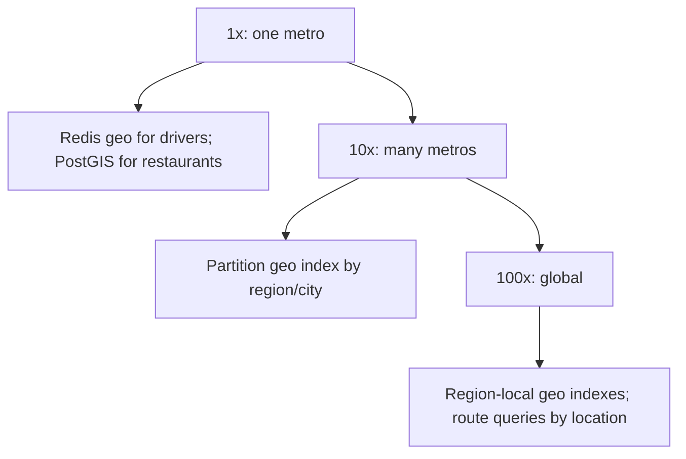

### 66.3.11 Caching

Nearby-restaurant results for a location (static data) can be cached briefly, since restaurants do not move and open/close slowly. Driver proximity results are too volatile to cache (drivers move constantly), so they query the live geo index each time.

The trick that makes restaurant caching work is the **cache key**. Raw coordinates are useless as a key: two users on the same street send `12.93521, 77.61013` and `12.93518, 77.61020`, and the hit rate is zero. Snap the point to its geohash-6 cell (about 1.2 km x 0.6 km) and cache "open restaurants delivering anywhere in this cell, with their polygons" for 60 seconds. The API then does the exact `ST_Covers` check for the user's real point in memory against at most a few hundred cached polygons. A metro has about 2,000 populated cells, so the whole cache is a few thousand Redis keys, and at dinner time the hit rate is above 95 percent. The key also carries the hour's opening-state version, so a restaurant that closes early is purged by bumping one counter, not by scanning keys.

### 66.3.12 Messaging

High-rate location updates can flow through a queue to the ingest service to buffer bursts, though the Redis geo index is fast enough to take updates directly in many cases. Matching events (rider matched to driver) emit downstream.

The cleanest split is to treat Redis as the **live view** and Kafka as the **record**. The ingest API writes the latest position to Redis synchronously (the dispatcher needs it now) and publishes every update to `driver.location_updated`, keyed by driver id, partitioned by city. Consumers of that topic build trip polylines for receipts and fare disputes, feed ETA models, and archive to the lake. None of them can slow down dispatch, and replaying the topic can rebuild the Redis view after a disaster.

The update rate itself is a design choice, and it is where most of the cost hides:

| Driver state | Interval | Why |
|---|---|---|
| Offline | none | Not dispatchable; stop the GPS to save battery |
| Available, stationary (moved under 20 m) | 15-30 s heartbeat | Only liveness matters; the position has not changed |
| Available, moving | 4 s | Dispatch needs a position accurate to about 50 m at city speeds |
| En route to pickup, under 500 m away | 1-2 s | The rider is watching the car on the map |
| On trip | 4 s, batched every 12 s | Route record and ETA; nobody needs sub-second freshness |

Adaptive rates cut the 25,000 updates per second in 66.3.5 roughly in half, because a large share of available drivers are parked. The client batches points while on a trip and sends them together, which saves radio wake-ups on the phone and requests on the server.

### 66.3.13 Scaling

Geospatial data partitions naturally by region/city: a query is always local to a location, so you shard the geo index by region and route each query to its region's index. This scales cleanly because proximity queries never need global data — a rider in one city never needs drivers in another. Redis geo handles the update rate per region; PostGIS handles restaurant queries per region.

| Stage | Load | Architecture | What changes |
|---|---|---|---|
| 1x | One city, 10,000 drivers, 2,500 updates/s | One Redis primary with a replica, one PostgreSQL with PostGIS | Even PostGIS alone would cope at this rate |
| 10x | 30 cities, 100,000 drivers in the largest | Redis Cluster with one hash tag per city (`{blr}`), read replicas for `GEOSEARCH`, Kafka for history | The city is the shard key; the largest city sets the shard size |
| 100x | Global, several million drivers | Region-local stacks (Asia, Europe, Americas), cities homed to regions, dense cities split into sub-zones | A rider near a sub-zone edge queries two zones and merges, the geohash boundary problem at a larger scale |

The hot shard is always the biggest city at rush hour. Splitting it into zones (by H3 cell or geohash-4 prefix, as in Part 54, section 54.11) works because a 4-8 km search touches at most a few zones.

### 66.3.14 Security

Location data is sensitive (it reveals where people are): restrict who can query whose location, do not expose precise locations beyond what is needed (a rider sees a driver's approximate position, not a precise track), rate-limit location queries to prevent scraping, and apply privacy/retention policies to location history (Part 40, Part 39). Authorization: a user can only query proximity for legitimate purposes (their own ride).

One attack deserves a name because it beats naive "we only show distances" designs: **trilateration**. An attacker who can ask "how far is driver X from me?" from three different fake positions can solve for X's exact location, even if the app never reveals a coordinate. The defences are to round distances (to 100 m or to minutes of ETA), add small random noise that is fixed per driver per hour (so averaging many queries does not remove it), rate-limit proximity queries per account and per device, and only reveal a specific driver's live position to the rider who has an active trip with them. Before dispatch, the map shows nearby cars snapped to cell centres with jitter, which is enough for "there are cars around".

### 66.3.15 Failure scenarios

| Failure | Detection | Impact | Mitigation | Effect |
|---|---|---|---|---|
| Redis geo index down | Errors | No driver proximity | Fallback to PostGIS (slower) or cached last positions | Degraded |
| Stale driver position | Last-update timestamp | Match a driver who moved | Expire stale positions with a sweeper on the last-seen set (geo members have no per-member TTL); recheck on match | Mostly avoided |
| Boundary miss (geohash edge) | Missing nearby result | Nearest entity in adjacent cell missed | Query the cell plus 8 neighbors | Correct |
| Update flood | Ingest overload | Updates lag | Buffer/queue updates; shard by region | Smoothed |
| PostGIS query slow | Latency | Slow restaurant search | Spatial index; cache results | Mitigated |
| Hot region (city center) | Load on one shard | Latency in that region | Finer partitioning of dense regions | Balanced |
| Ghost drivers (app stopped sending, still "available") | `drivers:seen` age, offer acceptance rate drops | Riders matched to nobody, long waits | Sweeper removes drivers silent for 30 s; offers time out in 15 s (66.3.21) | Bounded to 30 s |
| Latitude and longitude swapped | Positions outside the city's bounding box | Drivers invisible or in the sea | Validate every update against the city polygon at ingest | Rejected |
| Two dispatchers pick one driver | `SET NX` claim fails | Double assignment | Atomic claim per driver (66.3.10) | One wins |
| GPS spoofing (driver fakes position near an airport queue) | Impossible speeds between updates, mock-location flag | Unfair dispatch | Speed check between consecutive points, device attestation | Flagged |
| Clock skew on phones | Update timestamps in the future | Wrong last-seen | Use server receive time for liveness, device time only for ordering points | None |

### 66.3.16 Observability

Metrics: query latency (near/nearest), update rate and lag, index sizes, stale-position rate, cache hit rate (restaurants), per-region load. Alerts: query latency spikes, update lag (positions going stale), geo index unavailability, hot-region imbalance. Dashboards: proximity query performance, location freshness, per-region load.

The metric that would have caught the incident below is not technical at all: **offer acceptance rate** per city, the fraction of dispatch offers that a driver accepts or declines rather than ignores. Ghost drivers ignore offers, so this rate falls before riders complain. Pair it with `driver_location_age_seconds` as a histogram (p99 should stay under 10 s for available drivers), `ZCARD` of each available set compared with the count of drivers with a live app session, and `geosearch_candidates` per query, which shows dense-area cost growing.

### 66.3.17 Deployment

Redis (clustered, partitioned by region) for the moving-entity geo index; PostGIS (PostgreSQL with the extension) for static entities; the query service autoscaled and region-aware. Location ingest scaled for the update rate. Stale-position expiry by a sweeper, not by TTL: Redis expires whole keys, not individual members of a sorted set, so a per-driver TTL on a geo set does not exist.

The sweeper runs every 5 seconds per city: `ZRANGEBYSCORE drivers:seen:{blr} -inf <now - 30000>` returns the silent drivers, and one `MULTI` removes each from both geo sets and the seen set. It is idempotent, so two replicas can run it for redundancy.

### 66.3.18 Cost considerations

Redis memory for the moving-entity index (modest — positions and ids) and PostgreSQL/PostGIS for static entities are the main stores; both are inexpensive at these data sizes. The cost scales with the update and query rates (compute for the query service) and with regions. Caching static results and partitioning by region keep it efficient.

The surprising line item is the location stream, not the index. 130 GB per day per large metro, kept for 90 days for disputes, is about 12 TB per city in the lake, and the ingest fleet that terminates 25,000 HTTPS requests per second is larger than the Redis that stores the result. Adaptive update rates (66.3.12) are therefore the biggest cost lever in the design.

### 66.3.19 Tradeoffs

- **Redis geo (cheap updates, geohash-based, in-memory) for moving entities vs PostGIS (rich queries, durable, one DB) for static entities**: use each where its strength fits — Redis for the 25k-updates/second drivers, PostGIS for the query-rich, attribute-joined, slow-changing restaurants. This split matches the store to the update/query profile.
- **Geohash bucketing (cheap updates, approximate, boundary handling needed) vs quadtree (adaptive, good nearest-neighbor, costlier updates)**: geohash for high update rates, quadtree for query-heavy, less-frequently-updated data.
- **Approximate nearby (fast, slight imprecision) vs exact nearest (more work)**: "nearby" usually tolerates approximation, so cheaper approximate methods are fine; exact is reserved for when precision matters.
- **Region partitioning (scalable, queries are local) with the complexity of routing**: proximity queries are naturally local, so region sharding scales cleanly, at the cost of routing and handling region boundaries.

| Decision | Options | Chosen | Why | Cost |
|---|---|---|---|---|
| Driver index | Redis geo, PostGIS, in-process quadtree, H3 buckets in Redis | Redis geo, sets per city and state | Cheap updates, built-in radius search, shared by all pods | Approximate cells; no per-member TTL |
| Restaurant index | PostGIS, Redis geo | PostGIS | Polygons, joins, filters in one query | Cache needed at dinner peak |
| Liveness | Key TTL per driver, last-seen sorted set and sweeper | Sorted set and sweeper | Works with geo sets; one range query finds all stale drivers | Up to 30 s of ghosts |
| Update rate | Fixed 4 s, adaptive by state | Adaptive | Halves load and battery use | More client logic |
| Rider-visible positions | Exact, rounded and jittered | Rounded until a trip exists | Defeats trilateration | Cars on the pre-booking map are approximate |

### 66.3.20 Alternative architectures

**PostGIS-only**: use PostGIS for everything, including moving entities, accepting that 25,000 updates/second of point locations is heavier for a spatial index than for Redis geo. Viable at smaller scale or lower update rates, and simplest (one database, rich queries); it struggles at very high update rates, which is why Redis geo is paired with it for moving entities.

**Redis geo-only**: use Redis geo for everything, including restaurants, accepting that you lose PostGIS's rich spatial queries and attribute joins and must filter attributes separately. Viable when queries are simple radius searches; weaker when you need complex spatial queries or tight integration with relational attributes.

**Specialized geospatial database / managed service**: a dedicated spatial/location service can handle extreme scale and advanced queries; justified only when the Redis+PostGIS combination genuinely does not meet the scale or query needs, following the "do not add a store without a specific requirement" discipline (Part 26).

**Hexagonal grids (H3)**: bucket drivers by H3 cell id in plain Redis sets and query a ring of cells, as the ride-booking design in Part 54, section 54.11 does. Hexagons have uniform neighbour distances, which makes supply and demand heatmaps and surge pricing by cell cleaner than geohash rectangles; the cost is that you implement the radius filter yourself.

### 66.3.21 Incident story: the ghost fleet

A ride-hailing company in one city released a driver-app update on a Thursday. On a subset of Android phones, a new battery-optimisation setting stopped the app's background location service about ten minutes after the screen locked. The app did not crash and did not log the driver out; it simply stopped sending updates.

The location service's design document said "stale positions expire via TTL". In fact the geo set had no expiry at all, because nobody had built the sweeper; a TTL on the whole `drivers:geo:{city}:available` key would have deleted every driver at once, so it had been left off "for now". By Friday evening, 22 percent of the drivers in the available set were ghosts: positioned where they had parked hours earlier, still marked available.

Dispatch kept offering trips to the nearest driver. Ghosts never responded, every offer waited its full 15-second timeout, and riders in neighbourhoods where ghosts clustered (near a large residential area where many drivers lived) waited three or four offer cycles before reaching a real driver. Median pickup time in the city rose from 4 to 9 minutes. The dashboards showed healthy Redis, healthy APIs and normal query latency. The first real signal was the offer-ignore rate, which nobody alerted on, and the second was social media.

The immediate fix was a script that removed every driver whose `updated_at` was more than 60 seconds old. The permanent fix was the last-seen sorted set and 5-second sweeper from 66.3.17, the acceptance-rate alert from 66.3.16, and a server-side push to drivers whose updates stop while their session is "available", asking them to reopen the app. The lesson: **in a location index, presence must be proven continuously; a driver is available only while they keep saying so.**

### 66.3.22 Interview follow-ups

1. **Why not compute the distance from the rider to every driver?**
   Expected answer: O(n) per query; 100,000 drivers x 10,000 queries per second is a billion distance computations per second. A spatial index reduces each query to the drivers in a few nearby cells. Follow-up: what does `GEOSEARCH` cost? (O(N + log M), N being the members in the searched area.)
2. **Explain the geohash boundary problem and how you handle it.**
   Expected answer: close points can share no prefix across a cell edge; search the cell and its 8 neighbours, then filter by exact distance.
3. **Drivers update every 4 seconds. Why is that a problem for PostGIS but not Redis?**
   Expected answer: each update is a row version, a GiST index update and WAL in PostgreSQL, with vacuum to clean up; in Redis it is an in-memory sorted-set update with no history. Follow-up: when is PostGIS fine? (Thousands of updates per second, not tens of thousands.)
4. **How do you avoid assigning one driver to two riders?**
   Expected answer: search is advisory; dispatch claims the driver atomically (`SET NX` with an offer TTL, or a conditional update), and the loser tries the next candidate.
5. **How would you find restaurants that deliver to a point when delivery zones are irregular?**
   Expected answer: store polygons, GiST-index them, `ST_Covers(delivery_area, point)` with KNN ordering, cache by geohash-6 cell.
6. **How do you protect driver location privacy?**
   Expected answer: rounding and per-driver jitter, rate limits, exact positions only for an active trip, retention limits on history, and awareness of trilateration.

### 66.3.23 Practical exercise

Build the nearby-drivers and nearby-restaurants services with NestJS, Redis and PostGIS.

1. Implement `POST /locations` with the pipeline from 66.3.10, including the minimum-move check and bounding-box validation, and the expanding-radius `GET /nearby`.
2. Implement the last-seen sweeper and the dispatch claim with `SET NX PX`.
3. Load 50,000 restaurants with delivery polygons into PostGIS and implement the restaurant query with the geohash-6 cache.
4. Simulate 20,000 drivers moving along random routes and 2,000 riders requesting trips per minute, with 5 percent of drivers going silent mid-test.

Acceptance criteria:

- p99 for `GET /nearby` stays under 20 ms at 1,000 queries per second.
- No driver is assigned to two trips at once (check the trip table for overlapping assignments).
- Silent drivers disappear from search results within 35 seconds.
- A driver 10 m across a geohash-6 boundary from the rider is returned, verified by a test.
- The restaurant query returns the same set as an uncached PostGIS query for 1,000 random points, and the cache hit rate is above 80 percent during the test.
