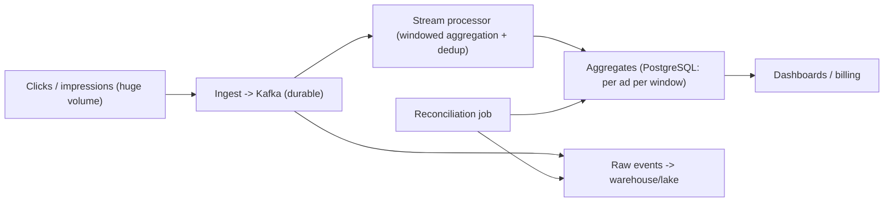

## 66.4 Ad-Click and Metrics Aggregation

### 66.4.1 Requirements

An ad-click (or metrics) aggregation system ingests a very high volume of events — ad clicks, impressions, page views, product views — and produces accurate aggregated counts and metrics (clicks per ad per hour, views per product per day), handling billions of events, counting correctly despite duplicates and retries, aggregating over time windows, and reconciling to catch any discrepancies. The users are advertisers (who are billed by clicks, so accuracy is money), analysts, and dashboards. This design probes high-volume ingestion and the hard problem of counting accurately at scale, where exactly-once counting matters because the counts are billed.

Imagine counting every person entering every store in a country, continuously, and billing each store by the count — so the count must be right, not approximately right, even though people stream in by the millions per second, some turnstiles double-report, and some reports arrive late. You cannot count each person by hand (volume), you must not double-count (billing accuracy), and you must handle late and duplicate reports. That is ad-click aggregation: massive ingest, exact counting despite duplicates, windowed aggregation, and reconciliation to catch errors.

### 66.4.2 Functional requirements

1. Ingest a very high volume of events (clicks, impressions) reliably without loss.
2. Aggregate events into counts/metrics over time windows (per ad per minute/hour/day).
3. Count accurately despite duplicate events (retries, at-least-once delivery) — exactly-once semantics for the counts.
4. Handle late-arriving events (an event delayed by network/offline device).
5. Reconcile aggregates against raw events to catch and correct discrepancies.
6. Serve aggregated results to dashboards and billing with low latency.

### 66.4.3 Non-functional requirements

| Property | Target | Why |
|---|---|---|
| Ingest throughput | Very high (millions of events/second) | Ad/metrics scale |
| Count accuracy | Exact for billed metrics (no over/under-count) | Counts are money |
| No event loss | Durable ingestion | A lost click is lost revenue |
| Aggregation freshness | Near real-time for dashboards; exact for billing (can lag) | Different consumers, different needs |
| Reconciliation | Aggregates provably match raw events | Trust in the billed numbers |

### 66.4.4 Constraints

- Volume is enormous (millions of events/second), so ingestion must be a streaming/queue problem, not synchronous inserts.
- At-least-once delivery (the reliable default, Part 28) means duplicates, but the counts must be exact — so deduplication/idempotency is essential for accuracy.
- Events arrive out of order and late, so windowed aggregation needs watermarks and late-event handling (Part 39).
- The counts are billed, so accuracy is a correctness requirement, not a nicety, and must be verifiable (reconciliation).

### 66.4.5 Capacity estimation

| Quantity | Assumption | Calculation | Result |
|---|---|---|---|
| Events/second | Peak | given | 1,000,000/second |
| Event size | small | given | about 200 B |
| Ingest bandwidth | 1M x 200 B | | 200 MB/s |
| Events/day | 1M x 86,400 | | about 86 billion/day |
| Raw storage/day | 86B x 200 B | | about 17 TB/day uncompressed, a few TB compressed |
| Aggregates | counts per ad per window | | tiny compared to raw |

The numbers say: ingestion is a high-throughput streaming problem (Kafka, Part 28), raw events are huge (store in a columnar warehouse/lake, Part 39, or drop after aggregation), aggregates are small (the whole point of aggregating), and the system must count 86 billion events/day exactly despite duplicates — which forces careful deduplication and reconciliation.

Not every event is billed, and the second table separates the money path from the rest:

| Quantity | Assumption | Calculation | Result |
|---|---|---|---|
| Billed clicks | click-through rate about 2 percent of impressions | 1,000,000 x 0.02 | about 20,000 clicks/second |
| Kafka partitions for impressions | ~5 MB/s comfortably per partition per consumer | 200 MB/s / 5, doubled for headroom | 64-128 partitions |
| Dedup window for clicks | client and redirect retries arrive within minutes; keep 1 hour | 20,000 x 3,600 | 72M ids, about 5 GB in PostgreSQL with index |
| Minute aggregates | ~150,000 ads receive a click in a given minute | 150,000 x 1,440 | about 200M rows/day, kept 7 days |
| Hourly aggregates | rolled up from minutes | ~500,000 ads x 24 | about 12M rows/day, kept 25 months for invoices |
| Raw clicks in the lake | 20,000 x 86,400 x ~60 B compressed Parquet | | about 100 GB/day, kept 13 months for disputes |

The split matters: impressions are counted with a stream processor and reported, while clicks, a fiftieth of the volume, get the full exactly-once and reconciliation treatment because they are what advertisers pay for.

### 66.4.6 API design

| Operation | Interface | Notes |
|---|---|---|
| Ingest event | `POST /events` or SDK -> queue | High-volume, fire-and-forget to a durable queue |
| Get aggregate | `GET /metrics?adId&from&to&granularity` | Read precomputed aggregates |
| Reconciliation status | `GET /reconciliation` | Discrepancy reports |

Ingestion returns fast (write to a durable queue and acknowledge); the heavy aggregation happens asynchronously.

### 66.4.7 Data model

```text
Raw events (durable, high-volume): in Kafka (retained) and/or a columnar store/lake.
  event(event_id, ad_id, user_hash, type, event_time, received_time)
  event_id is a client/server-assigned unique id -> the key for deduplication.

Aggregates (small, served to dashboards/billing): pre-aggregated per ad per window.
  ad_metrics(ad_id, window_start, granularity, clicks, impressions)  -- in PostgreSQL

Dedup state: a store of seen event_ids per window (to count each event once),
  or idempotent aggregation keyed by event_id.
```

The concrete PostgreSQL schema for the click path keeps aggregates, recent dedup ids and consumer offsets side by side, so one transaction can update all three:

```sql
CREATE TABLE ad_clicks_minute (
  ad_id         bigint      NOT NULL,
  window_start  timestamptz NOT NULL,
  clicks        bigint      NOT NULL,
  PRIMARY KEY (ad_id, window_start)
) PARTITION BY RANGE (window_start);       -- daily partitions, dropped after 7 days

CREATE TABLE click_dedup (
  event_id    uuid        NOT NULL,
  event_time  timestamptz NOT NULL,
  PRIMARY KEY (event_id, event_time)
) PARTITION BY RANGE (event_time);         -- hourly partitions, dropped after 2 hours

CREATE TABLE consumer_offsets (
  consumer_group  text   NOT NULL,
  topic           text   NOT NULL,
  partition       int    NOT NULL,
  next_offset     bigint NOT NULL,
  PRIMARY KEY (consumer_group, topic, partition)
);
```

Dropping an hourly dedup partition is instant, which is why the window is enforced by partitions rather than by `DELETE`.

The `event_id` is the linchpin of exactly-once counting: every event carries a unique id, and the aggregation counts each id once, so duplicates (from at-least-once delivery) do not inflate the count.

### 66.4.8 High-level architecture



Events are ingested into Kafka (durable, high-throughput buffer). A stream processor (Part 39) consumes them, deduplicates by `event_id`, aggregates into time windows, and writes small aggregates to PostgreSQL for serving. Raw events also land in a warehouse/lake. A reconciliation job periodically compares the aggregates against the raw events to catch and correct any discrepancy.

### 66.4.9 Component design

| Component | Responsibility |
|---|---|
| Ingest | Accept events fast, write durably to Kafka, acknowledge |
| Kafka | Durable, high-throughput, replayable event buffer |
| Stream processor | Deduplicate by event_id, aggregate into windows, write aggregates |
| Aggregate store | PostgreSQL: small per-ad-per-window counts for serving |
| Raw store | Warehouse/lake: raw events for reconciliation and deep analysis |
| Reconciliation job | Compare aggregates to raw counts; detect and fix discrepancies |

### 66.4.10 Deep dive: exactly-once counting, windowing, reconciliation

**Exactly-once counting** is the heart. At-least-once delivery (Part 28) means the same click event can be delivered more than once (a producer retry, a consumer reprocessing after a crash). If you simply increment a counter per event, duplicates inflate the count — and since clicks are billed, that is over-billing. The defenses:

- **Deduplication by `event_id`**: each event has a unique id; the aggregator tracks which ids it has counted (per window) and ignores repeats. This makes counting idempotent — re-processing an event does not double-count.
- **Idempotent aggregate updates with offset tracking**: the stream processor records the last-processed Kafka offset together with the aggregate update in one atomic step, so reprocessing after a crash skips already-counted events (the pattern from Part 54's click consumer).

Either way, the count reflects each distinct event once, achieving exactly-once *counting* on top of at-least-once *delivery* — the practical way to get exact counts without the (often impossible) guarantee of exactly-once delivery.

**Windowed aggregation** (Part 39): events are aggregated into time windows (per minute, hour, day) by **event time**, with **watermarks** to decide when a window is complete and **allowed lateness** to incorporate late events. A click from a device that was briefly offline arrives late; within the allowed-lateness grace period it still lands in its correct window; beyond that, it is side-outputted for reconciliation rather than silently dropped — because a dropped click is lost revenue.

**Reconciliation** is the accuracy backstop (Part 39): periodically recompute the aggregates directly from the raw events (in the warehouse/lake) and compare against the served aggregates. Any mismatch — from a bug, a dropped event, a dedup miss — is detected and the aggregate corrected. Because the counts are billed, reconciliation is not optional: it is how you can stand behind the numbers. This is the lambda-style idea of a fast approximate/real-time path (the stream aggregates) backed by a slower exact path (reconciliation from raw events) that corrects it.

```text
Exactly-once counting on at-least-once delivery:
  every event has a unique event_id -> count each id once (dedup) -> duplicates harmless
  + atomic (aggregate update, Kafka offset) -> crash reprocessing does not double-count
Windowing by event time + watermark + allowed lateness -> late clicks counted, not dropped
Reconciliation: recompute from raw events, compare to served aggregates, correct mismatches
```


#### Deep dive: the click aggregator, one transaction per batch

Duplicates come from three places, and each has its own defence. **Producer retries** are removed by Kafka's idempotent producer. **Consumer reprocessing** after a crash is removed by storing the consumer's offset in PostgreSQL in the same transaction as the counts, so counts and offset can never disagree. **Client retries** (a browser that fires the click beacon twice) produce two events with the same `event_id`, because the id is assigned once, server-side, by the click redirect service, and the dedup table removes them.

```ts
// clicks/click-aggregator.worker.ts
@Injectable()
export class ClickAggregatorWorker implements OnModuleInit {
  private readonly consumer: Consumer;
  constructor(private readonly dataSource: DataSource, @Inject(KAFKA) kafka: Kafka) {
    this.consumer = kafka.consumer({ groupId: 'click-aggregator' });
  }

  async onModuleInit() {
    await this.consumer.connect();
    await this.consumer.subscribe({ topic: 'ad.click_validated' });
    // After every rebalance, start from the offsets stored next to the counts, not Kafka's
    this.consumer.on(this.consumer.events.GROUP_JOIN, async ({ payload }) => {
      for (const partition of payload.memberAssignment['ad.click_validated'] ?? []) {
        const [row] = await this.dataSource.query(
          `SELECT next_offset FROM consumer_offsets WHERE consumer_group = 'click-aggregator'
             AND topic = 'ad.click_validated' AND partition = $1`, [partition]);
        if (row) this.consumer.seek({ topic: 'ad.click_validated', partition, offset: String(row.next_offset) });
      }
    });
    await this.consumer.run({ autoCommit: false, eachBatch: (p) => this.handle(p) });
  }

  private async handle({ batch, heartbeat }: EachBatchPayload) {
    const byId = new Map<string, Click>();                     // duplicates inside one batch
    for (const m of batch.messages) { const c = JSON.parse(m.value!.toString()) as Click; byId.set(c.eventId, c); }
    const clicks = [...byId.values()];
    const next = (BigInt(batch.lastOffset()) + 1n).toString();

    await this.dataSource.transaction(async (em) => {
      const fresh: { event_id: string }[] = await em.query(
        `INSERT INTO click_dedup (event_id, event_time)
         SELECT * FROM unnest($1::uuid[], $2::timestamptz[]) ON CONFLICT DO NOTHING RETURNING event_id`,
        [clicks.map((c) => c.eventId), clicks.map((c) => c.eventTime)]);
      const isFresh = new Set(fresh.map((r) => r.event_id));
      const counts = new Map<string, number>();                // key: adId|minute
      for (const c of clicks) if (isFresh.has(c.eventId)) {
        const k = `${c.adId}|${c.eventTime.slice(0, 16)}:00Z`;   // event time, not arrival time
        counts.set(k, (counts.get(k) ?? 0) + 1);
      }
      const keys = [...counts.keys()];
      await em.query(
        `INSERT INTO ad_clicks_minute (ad_id, window_start, clicks)
         SELECT * FROM unnest($1::bigint[], $2::timestamptz[], $3::bigint[])
         ON CONFLICT (ad_id, window_start) DO UPDATE SET clicks = ad_clicks_minute.clicks + EXCLUDED.clicks`,
        [keys.map((k) => k.split('|')[0]), keys.map((k) => k.split('|')[1]), keys.map((k) => counts.get(k))]);
      await em.query(
        `INSERT INTO consumer_offsets VALUES ('click-aggregator', $1, $2, $3)
         ON CONFLICT (consumer_group, topic, partition) DO UPDATE SET next_offset = EXCLUDED.next_offset`,
        [batch.topic, batch.partition, next]);
    });
    await heartbeat();
  }
}
```

A crash before the commit loses nothing and counts nothing; a crash after it resumes from `next_offset`. This is the practical meaning of "exactly-once counting on at-least-once delivery". It is also honest about its ceiling: one PostgreSQL primary handles 20,000 clicks per second in batches of 1,000 comfortably, but not 1,000,000 impressions per second. The impression path runs the same logic in Flink (checkpointed keyed state and a transactional sink) or Kafka Streams with `processing.guarantee=exactly_once_v2`, both covered in Part 39, section 39.10.

#### Deep dive: event-time windows and late clicks

A one-minute tumbling window by **event time** is complete when the **watermark** (the stream's estimate of "all events before this time have arrived") passes its end. With a watermark of "maximum event time seen minus 2 minutes", the 10:00-10:01 window closes at about 10:03 wall-clock time:

```text
10:00:40  click A, event time 10:00:31          -> window 10:00, counted
10:03:05  watermark passes 10:01                -> window 10:00 emitted to dashboards
10:20:00  click B from a phone back online, event time 10:00:50
          within allowed lateness (1 hour)      -> window 10:00 updated, correction emitted
11:30:00  click C, event time 10:00:12
          beyond allowed lateness               -> side output: late_clicks table, picked up by reconciliation
```

The PostgreSQL aggregator above has no watermark at all: it upserts into whatever minute the click belongs to, so a late click simply increments an old row. That is simpler and exactly right for billing. Watermarks matter for the dashboard stream, which must decide when a minute is "final enough" to draw.

#### Deep dive: reconciliation before invoicing

Invoices are generated the morning after, from reconciled numbers only. At 03:00 the reconciliation job recomputes yesterday from the raw clicks in the lake, where every validated click was written by a separate consumer:

```sql
-- Exact count from the raw events: one row per ad per hour
SELECT ad_id, date_trunc('hour', event_time) AS hour, count(DISTINCT event_id) AS clicks
  FROM raw_clicks
 WHERE event_time >= DATE '2026-11-04' AND event_time < DATE '2026-11-05'
   AND is_valid
 GROUP BY 1, 2;
```

The job compares each row with the served hourly aggregate. A difference within 0.01 percent is logged; anything larger blocks the invoice for that advertiser, writes an adjustment row with the reason, and pages the on-call engineer. The raw path uses `count(DISTINCT event_id)`, which makes it immune to every duplicate the streaming path might have missed, which is exactly the point: two independent computations of the same number, one fast and one careful.
