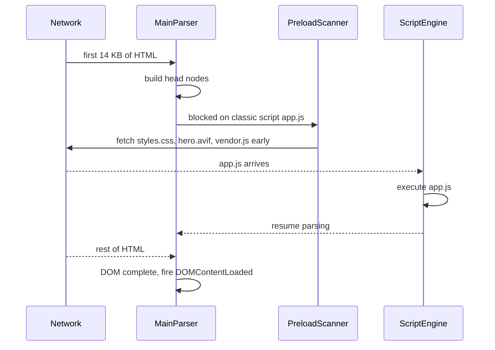
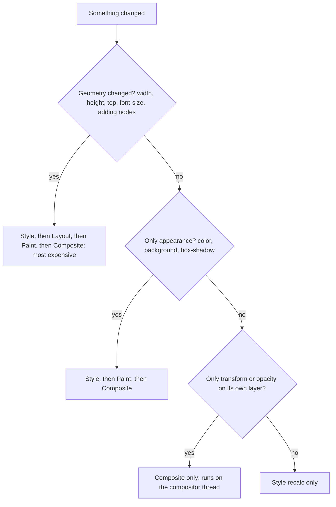

# Part 67 — How the Browser Builds a Page

For most of this book the browser has been a client at the far end of the wire. It sent a request, your NestJS application answered, and the story ended at the last byte of the response. In this Volume the story keeps going. The browser takes those bytes and, in a few hundred milliseconds, turns them into a page a person can read, tap and buy from. Every decision your API makes about headers, payload shape, cookies and timing shows up somewhere in that process, and very often it shows up as "the page feels slow" or "the button jumps when I try to click it".

Part 3 — How the Web Works sketched the outline: DNS, connection, HTML, sub-resources, JavaScript, API calls (see 3.6). Part 10 — Networking and HTTP went deep on the wire itself: caching headers (10.11), TLS (10.12), CORS (10.13) and an end-to-end request trace (10.14). This Part starts where those stop. We open the browser up and follow the bytes through the HTML parser, the style engine, layout, paint and the compositor. Then we look at the parts of HTML, CSS and JavaScript that a backend engineer must understand to build or review a screen, the storage the browser gives you and what must never go in it, accessibility as an engineering discipline, and the DevTools panels that let you see all of this happening. We finish by tracing a real product page from its first byte to the moment a user can click "Add to cart", with an annotated network waterfall.

Throughout, every concept ends with a **Backend side (NestJS)** block. That block answers one question: what must the API do so that the page is correct and fast?

## 67.1 From URL to pixels: the rendering pipeline

#### Concept

A browser turns a URL into pixels through a fixed sequence of stages. First it **navigates**: it decides this is a page load, finds the server, and requests the HTML document. Then it **parses** the HTML into a tree of objects called the **DOM** (Document Object Model). In parallel it parses CSS into a second tree-like structure called the **CSSOM** (CSS Object Model). It combines the two into a **render tree** that contains only the things that will be drawn, with their final computed styles. It runs **layout** to work out the exact position and size of every box. It **paints** those boxes into lists of drawing commands, and finally it **composites** the painted layers together on the GPU to produce the frame you see.

This sequence is often called the **critical rendering path**. "Critical" because nothing appears on the screen until the first pass through it finishes. Every byte, every blocking script and every stylesheet you put in front of that first pass delays the moment the user sees anything at all.

The pipeline does not run once. It runs again whenever something changes: JavaScript adds a row to an order table, a font finishes loading, a user resizes the window, a CSS animation moves a toast. Knowing which stage a change forces the browser to redo is the difference between a page that scrolls at 60 frames per second and one that stutters.

#### Why does it exist?

HTML, CSS and JavaScript arrive as text, in pieces, over a network that might be fast fibre or a congested train-station 4G connection. The browser cannot wait for everything before drawing. It must start work on the first bytes, discover what else it needs as early as possible, and draw something useful the moment it has enough. The staged pipeline exists to make that possible:

- **Streaming parsing** means the browser can build the top of the DOM while the bottom of the HTML is still on the wire.
- **Separating DOM and CSSOM** means structure and style can be fetched and parsed in parallel.
- **Separating layout from paint from compositing** means a change that only affects colour does not have to recompute geometry, and a change that only moves a layer does not have to repaint anything.


#### Mental model

Imagine a newspaper print shop at 03:00. Reporters send articles in one paragraph at a time (the HTML stream). A typesetter turns each paragraph into lines of type as it arrives (parsing into the DOM). The style guide says which headlines are bold and which columns are narrow (the CSSOM). An editor combines the type and the style guide into a page plan, leaving out anything marked "do not print" (the render tree). The layout desk measures where each column and photo goes on the page (layout). The printers ink each sheet (paint). Finally, the sheets are stacked and bound together (compositing).

If the style guide is late, the editor refuses to plan any page, because printing the paper in the wrong fonts and then reprinting it would be worse than waiting. That is exactly why CSS blocks rendering. If someone changes one headline's colour, only the printers redo work. If someone adds a new paragraph in the middle, the layout desk must re-measure everything below it. If someone just slides a finished sheet across the table, nobody reinks anything; that is compositing.

#### How it works

The full pipeline, in order:


**Step 1: navigation.** When the user presses Enter, the browser process decides whether the input is a URL or a search, checks for a service worker that controls the URL, and starts the request. The network part (DNS, TCP, TLS, HTTP) is covered in Part 10 — Networking and HTTP. What matters here is the cost: on a mobile connection with a 150 ms round-trip time, a cold connection with TLS 1.3 needs roughly DNS (one round trip, often cached) plus TCP (one round trip) plus TLS (one round trip) before the first request byte leaves. That is 300 to 450 ms of nothing before your server even sees the request. Once the response headers arrive, the browser checks `Content-Type`. If it is `text/html`, it hands the stream to a renderer process for that site. If it is `application/json` or `application/pdf`, the page load becomes a download or a viewer instead.

**Step 2: parsing HTML into the DOM.** The HTML parser reads bytes, decodes them into characters using the charset (from the `Content-Type` header, or a `<meta charset>` in the first 1,024 bytes), splits characters into tokens (start tag, end tag, text, comment) and builds DOM nodes from those tokens. HTML parsing is forgiving by specification: an unclosed `<p>` or a stray `</div>` does not stop the page, the parser repairs the tree using well-defined rules. That is why invalid HTML "works" but sometimes produces a DOM you did not expect, for example a `<div>` placed inside a `<p>` closes the paragraph early.

The parser works on a stream. With an HTML response that is sent in chunks, the browser builds the `<head>` and the first part of `<body>` while the rest is still arriving. This is why sending the top of the page early (streaming, or "early flush") is so effective.

**Step 3: the preload scanner.** The main parser must stop when it meets a classic `<script src>` without `defer` or `async`, because that script may call `document.write()` and change everything after it. To avoid wasting that waiting time, browsers run a second, lightweight **preload scanner** (also called the speculative parser). It races ahead through the raw HTML, finds URLs in `<link rel="stylesheet">`, `<script src>`, `` and ``, and starts fetching them early. It cannot see resources that only JavaScript creates, or images that are only referenced from CSS `background-image`, or anything rendered later by a client-side framework. That limitation will matter in the worked example in 67.11.



**Step 4: CSS into the CSSOM.** Each stylesheet is parsed into rules: selectors plus declarations. The CSSOM is not a copy of the DOM; it is the set of rules, organised so the style engine can quickly find which rules match a given element. Two important behaviours:

- **CSS is render-blocking.** The browser will not paint the first frame until all stylesheets found in the `<head>` (that apply to the current media) have loaded and parsed. This avoids a flash of unstyled content followed by a jarring re-layout.
- **CSS can be parser-blocking indirectly.** A classic script after a stylesheet waits for that stylesheet, because the script might read computed styles such as `getComputedStyle(el).width`. So a slow CSS file delays scripts that come after it, which delays the rest of the parse.

**Step 5: style calculation and the render tree.** For every DOM node, the style engine finds the matching CSS rules, resolves the cascade (67.4) and computes final values: `font-size: 1.25rem` becomes `20px`, `width: 50%` stays relative until layout. Nodes that are not rendered do not enter the render tree (in Chromium this structure is called the layout tree): everything in `<head>`, elements with `display: none`, `<script>` elements. Nodes with `visibility: hidden` *are* in the tree; they take space but are not painted. Pseudo-elements such as `::before` *are* added even though they are not in the DOM.

**Step 6: layout.** Layout (also called reflow) walks the render tree and computes geometry: the x and y position, width and height of every box, line breaks in every paragraph, the size of every flex item and grid track. Layout is inherently global. Change the width of a container and every child inside it may need new line breaks. Insert a 40-pixel banner at the top of the body and everything below moves down by 40 pixels.

**Step 7: paint.** Paint does not produce pixels directly. It produces **display lists**: ordered drawing commands such as "fill rectangle at (0, 64, 1280, 400) with #f5f5f5", "draw text run 'Ergonomic Office Chair' at (24, 96)", "draw image hero.avif into this rectangle". The page is split into **layers** at this point. Elements with a 3D transform, `will-change: transform`, a `<video>`, a `position: fixed` header or an animated `opacity` often get their own layer.

**Step 8: raster and composite.** Raster threads turn display lists into pixels, in tiles of a few hundred pixels square, usually on the GPU. The **compositor** thread then stacks the layers in the right order, applies transforms and opacity, and hands the final frame to the display. The compositor runs on its own thread. That is why a page can still scroll smoothly while the main thread is busy with JavaScript, as long as scrolling does not need the main thread (for example, no non-passive `wheel` or `touchmove` listeners blocking it).

The most important practical consequence is the cost ladder. When something changes, the browser restarts the pipeline from the earliest affected stage:



The frame budget makes this concrete. A 60 Hz display shows a new frame every 16.7 ms. A 120 Hz phone shows one every 8.3 ms. Out of that budget the browser needs a few milliseconds for its own housekeeping, so your JavaScript plus style plus layout plus paint for one frame must fit in roughly 10 ms on a 60 Hz screen. A full layout of a complex product listing page with 2,000 DOM nodes on a mid-range Android phone can take 15 to 40 ms by itself. Animate `top` on such a page and you will drop frames. Animate `transform: translateY()` and the compositor does it without touching layout or paint at all.

A last, critical detail: **forced synchronous layout**. Normally the browser batches style and layout work and does it once per frame. But if JavaScript writes a style and then immediately reads a geometric property (`offsetHeight`, `getBoundingClientRect()`, `scrollTop`), the browser has to run layout right now to give a correct answer. Do this in a loop and you get **layout thrashing**:

```ts
// BAD: each iteration writes then reads, forcing a full layout 200 times.
const rows = document.querySelectorAll<HTMLElement>('.order-row');
rows.forEach((row) => {
  row.style.height = `${row.offsetHeight + 8}px`; // read after previous write = forced layout
});

// GOOD: read everything first, then write everything. One layout total.
const heights = Array.from(rows, (row) => row.offsetHeight); // reads, one layout
rows.forEach((row, i) => {
  row.style.height = `${heights[i] + 8}px`;                  // writes, batched
});
```

With 200 rows on a phone, the first version can easily take 300 ms. The second takes a few milliseconds.

Two more milestones finish the page load:

- **`DOMContentLoaded`** fires when the HTML is fully parsed and all `defer` and module scripts have run. Images and stylesheets may still be loading.
- **`load`** fires when everything the page references (images, iframes, stylesheets, synchronous scripts) has finished loading.

Neither milestone means "the user sees the content" or "the user can interact". That is why modern measurement uses user-centric metrics: **First Contentful Paint (FCP)**, when the first text or image appears; **Largest Contentful Paint (LCP)**, when the biggest content element (usually the hero image or the main heading) is painted; **Interaction to Next Paint (INP)**, how long the page takes to respond visually to clicks and key presses; and **Cumulative Layout Shift (CLS)**, how much the page jumps around. Part 74 — Web Performance covers them in depth. For now remember the "good" thresholds Google uses: LCP at or under 2.5 s, INP at or under 200 ms, CLS at or under 0.1.

#### Practical example

A customer opens `https://shop.example.com/products/ergonomic-office-chair` on a mid-range phone over 4G. Here is what the pipeline does, with plausible timings:

| Time (ms) | Stage | What happens |
|---|---|---|
| 0 | Navigation | Enter pressed, no service worker, DNS cached from an earlier visit |
| 0 to 310 | Connection | TCP and TLS 1.3 to the CDN edge, about two round trips at 150 ms |
| 310 to 520 | Server time | CDN misses, origin renders HTML (database query, product API call) |
| 520 | First byte | Head of the HTML arrives; parser starts, preload scanner finds `app.css`, `app.js`, `hero.avif` |
| 520 to 800 | CSS fetch | 38 KB of compressed CSS over the existing connection |
| 830 | Style, layout, paint | First frame: header, title, price. **FCP** |
| 800 to 1,400 | Image fetch | 110 KB AVIF hero image |
| 1,450 | Paint | Hero image painted. **LCP** |
| 900 to 1,600 | JS fetch | 160 KB compressed JavaScript (`defer`) |
| 1,600 to 2,050 | Script | Parse, compile, execute, React hydration: one 380 ms long task |
| 2,050 | Interactive | "Add to cart" handler attached |

Notice that the user sees the price at 830 ms but cannot add to cart until 2,050 ms. If they tap at 1,800 ms, nothing happens: the button looks ready but is not. That gap is invisible in server logs and is exactly the kind of thing this Part teaches you to see.

#### React / Next.js example

With the Next.js 14 App Router, a page is a server component by default. It renders to HTML on the server and streams that HTML to the browser, so the parser can start immediately. A `<Suspense>` boundary lets the slow part (reviews from a separate service) stream in later without holding back the shell.

```tsx
// app/products/[slug]/page.tsx  (Next.js 14 App Router; in Next.js 15 params is a Promise)
import { Suspense } from 'react';
import { notFound } from 'next/navigation';
import Image from 'next/image';
import { Reviews } from './reviews';

type Product = { id: string; name: string; priceMinor: number; currency: string;
  image: { url: string; width: number; height: number; alt: string } };

async function getProduct(slug: string): Promise<Product | null> {
  const res = await fetch(`${process.env.API_URL}/v1/products/by-slug/${slug}`, {
    next: { revalidate: 60 }, // cache this fetch for 60 s on the Next.js server
  });
  if (res.status === 404) return null;
  if (!res.ok) throw new Error(`product API ${res.status}`);
  return res.json();
}

export default async function ProductPage({ params }: { params: { slug: string } }) {
  const product = await getProduct(params.slug);
  if (!product) notFound();

  return (
    <main>
      <h1>{product.name}</h1>
      {/* priority: preloads the image and sets fetchpriority=high, so the LCP image is found early */}
      <Image src={product.image.url} width={product.image.width} height={product.image.height}
             alt={product.image.alt} priority />
      <p>{new Intl.NumberFormat('en-IN', { style: 'currency', currency: product.currency })
            .format(product.priceMinor / 100)}</p>
      {/* The shell above is flushed first; reviews stream in when ready */}
      <Suspense fallback={<p aria-busy="true">Loading reviews...</p>}>
        <Reviews productId={product.id} />
      </Suspense>
    </main>
  );
}
```

What reaches the browser is HTML in two chunks: first everything outside the `<Suspense>` boundary plus the fallback, then, when `Reviews` resolves, a second chunk containing the reviews markup and a tiny inline script that swaps it into place. The parser and the preload scanner start on chunk one while the server is still waiting on the reviews service.

#### Backend side (NestJS)

The browser can only start its pipeline when bytes arrive, so the most valuable thing a backend can do for rendering is send useful bytes early and label them correctly. When NestJS serves HTML itself (server-rendered templates, an admin page, a status page), two techniques help:

1. **103 Early Hints**: before the final response is ready, tell the browser which critical resources to fetch. Node.js has `response.writeEarlyHints()` since v18.11, and Chrome supports Early Hints for `preload` and `preconnect` since version 103.
2. **Early flush**: write the `<head>` immediately, then await the slow data, then write the body. The browser fetches CSS while your database query runs.

```ts
// product-page.controller.ts
import { Controller, Get, Param, Res, NotFoundException } from '@nestjs/common';
import type { Response } from 'express';
import { ProductService } from './product.service';
import { renderHead, renderProductBody } from './templates';

@Controller('products')
export class ProductPageController {
  constructor(private readonly products: ProductService) {}

  @Get(':slug')
  async page(@Param('slug') slug: string, @Res() res: Response): Promise<void> {
    // 1. 103 Early Hints: the browser starts these fetches during our DB query.
    res.writeEarlyHints({
      link: [
        '</assets/app.3f9c1a.css>; rel=preload; as=style',
        '<https://img.shop-cdn.example>; rel=preconnect',
      ],
    });

    // 2. Look up the product before committing to a 200 status.
    const product = await this.products.findBySlug(slug); // ~8 ms, indexed lookup
    if (!product) throw new NotFoundException();

    res.status(200);
    res.setHeader('Content-Type', 'text/html; charset=utf-8'); // charset in the header, not just meta
    res.setHeader('Cache-Control', 'public, max-age=0, s-maxage=60, stale-while-revalidate=300');

    // 3. Early flush: head goes out now, the browser starts on CSS immediately.
    res.write(renderHead({ title: product.name }));

    // 4. Slower work (recommendations, ~120 ms) happens while the browser parses the head.
    const related = await this.products.related(product.id, 8);
    res.end(renderProductBody(product, related));
  }
}
```

Things the backend must get right, which this code shows:

- `Content-Type: text/html; charset=utf-8` in the header. Without a charset, the browser may have to restart parsing when it meets `<meta charset>` later.
- Decide the status code before the first `res.write()`. Once bytes are flushed, headers are sent, so a 404 or 500 discovered later cannot be reported with the right status. That is why the product lookup happens before the flush and only the "nice to have" data comes after.
- Watch the compression middleware. The `compression` package for Express buffers output; with streaming you need it to flush per write (it adds a `res.flush()` method) or let the CDN or load balancer compress.

When Next.js is the frontend and NestJS is a JSON API behind it, the same idea applies one level down: the API's latency is part of the server-render time, so a slow `GET /v1/products/by-slug/:slug` delays the first byte of HTML for every user. Measure it as part of the page budget, not as an isolated endpoint.

#### Production scenario

A furniture retailer serves 1.8 million product page views per day. Their HTML is rendered by Next.js and cached at the CDN for 60 s. CDN hit rate is 92 %. On a hit, time to first byte (TTFB) at the 75th percentile is 90 ms; on a miss it is 640 ms, of which 410 ms is the Next.js server waiting on three sequential API calls to NestJS services (product, price, stock). The rendering pipeline on a mid-range phone adds about 900 ms after the first byte before LCP.

The team's LCP at p75 is 2.3 s on hits and 2.9 s on misses. The cheapest fix was not in the browser at all: running the three API calls in parallel with `Promise.all` cut the miss TTFB to 310 ms and brought p75 LCP on misses to 2.5 s. The lesson that repeats through this Part: the backend's latency is the first stage of the browser's pipeline.

#### Failure scenario

At 11:20 on a sale day, conversion on product pages dropped 18 % within ten minutes of a deploy. Server metrics were perfect: TTFB unchanged, error rate flat. The on-call backend engineer was about to declare "not us" when a frontend colleague opened DevTools, recorded a Performance trace and saw it: the first paint now happened at 3.4 s instead of 0.9 s.

The deploy had added a third-party A/B testing snippet as a classic `<script src>` in the `<head>`, placed above the main stylesheet. The vendor's server in another region was answering in 2.1 s under sale-day load. Because the script was parser-blocking, the HTML parser stopped at it. The preload scanner had already started the stylesheet fetch, but nothing could render until the script downloaded and executed. Every user stared at a white screen for over two seconds.

The fix was a one-line change to load the snippet with `async` and to give it a 1 s timeout through the vendor's own loader. The postmortem added two rules: no synchronous third-party script in `<head>`, ever, and every deploy runs a synthetic Lighthouse check against a product page with a budget on FCP.

#### Edge cases & failure modes

- **Wrong `Content-Type`**: serving HTML as `text/plain` shows the source code; serving JSON as `text/html` from an error handler can open an XSS hole if the body contains user input. Always set it explicitly, and send `X-Content-Type-Options: nosniff`.
- **Charset declared late**: a `<meta charset>` after the first 1,024 bytes, or a mismatch with the header, can cause a parse restart or garbled text ("₹" instead of the rupee sign).
- **Server buffering defeats streaming**: a reverse proxy with response buffering (NGINX `proxy_buffering on`) or a compression layer that waits for the whole body turns an early flush into a late one.
- **Status after flush**: errors discovered after streaming starts cannot change the status code; the page must render an error state inside a 200 response, which monitoring might count as success.
- **Layout thrashing in a loop**: a read-after-write pattern inside a list renderer turns one layout into hundreds.

#### How a Senior Full-Stack Engineer thinks about this

A senior engineer treats the page load as one pipeline with the backend as stage one. Before arguing about React rendering or image formats, they ask: how long until the first byte, how long until the browser knows about the critical CSS and the LCP image, and what blocks the parser? They know that a 200 ms win in TTFB is a 200 ms win in every later metric, and that a parser-blocking script can wipe out any backend optimisation.

They refuse to measure page speed with server metrics alone, and they refuse to accept "it's fast on my machine": a developer laptop with a fast CPU and wired internet is four to six times faster at JavaScript than the median phone. They profile with CPU throttling and network throttling turned on.

They also keep the cost ladder in mind when reviewing frontend code. An animation of `height`, `top` or `width` gets a comment asking for `transform`. A loop that reads `offsetHeight` after setting styles gets flagged for thrashing. To a product manager they would say: "The page has to be built in stages. Our job is to make the first stage short and to never block the later ones."

#### Common mistakes

- **Treating `load` as "page ready".** Users judge speed by when content appears (FCP, LCP) and when the page responds (INP), not by `load`.
- **Putting scripts in `<head>` without `defer` or `async`.** This stops the parser and delays everything; 67.6 covers the right attributes.
- **Animating layout properties.** Animating `top` or `height` re-runs layout every frame; use `transform` and `opacity`.
- **Ignoring TTFB because "the API is only 300 ms".** For a server-rendered page that 300 ms is directly in front of FCP.
- **Rendering the LCP image only through JavaScript or CSS backgrounds.** The preload scanner cannot find it, so it is fetched late.

#### Interview questions

1. **Walk me through what happens between receiving HTML bytes and seeing pixels.**
   Expected answer: parse HTML into the DOM (with a preload scanner fetching resources ahead), parse CSS into the CSSOM, compute styles, build the render tree of visible nodes, run layout for geometry, paint into display lists per layer, rasterise, composite on the GPU. Why it matters: it shows whether the candidate can reason about where time goes. Follow-ups: why does CSS block rendering? What does `display: none` versus `visibility: hidden` do to the render tree?
2. **Why is animating `transform` cheaper than animating `left`?**
   Expected answer: `left` changes geometry and forces layout and paint every frame; `transform` on a composited layer only changes how the compositor draws an existing layer, on a separate thread. Follow-up: what does `will-change: transform` do and what does it cost (memory for an extra layer)?
3. **What is layout thrashing and how do you fix it?**
   Expected answer: interleaving style writes with geometry reads, forcing synchronous layout repeatedly. Fix by batching reads before writes, or by using `requestAnimationFrame` to schedule writes.
4. **What is the preload scanner and what can it not see?**
   Expected answer: a secondary parser that discovers resource URLs in raw HTML while the main parser is blocked; it cannot see resources created by JavaScript, CSS background images, or content rendered client-side.
5. **The API is fast but the page is slow. Where do you look first?** Expected answer: a DevTools Performance trace and Network waterfall: render-blocking resources, parser-blocking scripts, late-discovered LCP image, long main-thread tasks.

#### Practical exercise

Build a tiny NestJS endpoint that serves an HTML product page in two ways: (a) wait for all data, then `res.send()` the whole page; (b) send 103 Early Hints for the stylesheet, flush the `<head>` immediately, sleep 300 ms to simulate a slow recommendation query, then send the body. Load both in Chrome with network throttling set to a slow 4G preset and record a Performance trace for each.

Acceptance criteria:

- You can point to the "Parse HTML" tasks in the Performance panel and show that in version (b) parsing starts about 300 ms earlier.
- In the Network panel, the stylesheet request in version (b) starts before the HTML response finishes.
- You can explain why the product-not-found check must happen before the first `res.write()`.
- You write down FCP for both versions from the Performance panel's Timings track.
