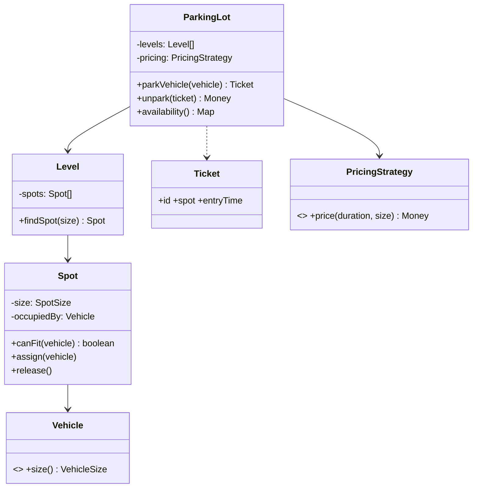

### 67.1.3 Concurrency in LLD answers, and why Node changes it

#### Concept

Many LLD problems (parking lot, booking, rate limiter) involve shared state that concurrent requests touch, so interviewers probe thread safety. The classic (Java/C++) answer is locks, synchronized blocks and atomic operations. In Node, the single-threaded event loop (Part 10, Part 2) changes the answer: your JavaScript runs one operation at a time with no preemption mid-function, so in-memory data races within a single process are largely a non-issue — but cross-process/cross-instance shared state (a real backend) still needs coordination. Part 32 — Concurrency in Node.js and NestJS covers the full model; this section is the interview-sized version.

#### Mental model

Imagine a single cashier serving a queue. While she is ringing up one customer, nobody else can touch the till, so she never needs to lock it. But if she says "wait here while I check the stockroom" and walks away, the next customer is served in the meantime, and both may be promised the last item on the shelf. Every `await` is "I will check the stockroom". And a shop with five tills (five Node instances) needs a shared stock count that all five agree on, which no single cashier's discipline can provide.

#### How it works

In a classic threaded language, two threads can interleave mid-operation on shared state (read-modify-write races), so you protect shared state with locks or atomics. In Node, because a function runs to completion before any other JavaScript runs (Part 2), a synchronous read-modify-write on an in-memory structure cannot be interleaved by another request — so a simple in-memory counter or map needs no lock within one process. The subtlety: the moment you `await` (a database call, a network call), you yield, and another request can run in between, so state that spans an `await` can still race (a check-then-act across an await is not atomic). And the real backend runs many processes/instances, so shared state that must be consistent across them lives in a database or Redis, protected by the database's atomicity or a distributed lock — which is the Part 21 and Part 65 (seat booking) concurrency control.

```text
Classic (threaded): shared in-memory state -> locks/atomics to prevent interleaving.
Node (single thread):
  - synchronous in-memory read-modify-write -> atomic within the process (no lock needed)
  - state spanning an `await` -> can race (yielded); use atomic ops or a lock
  - cross-process/instance shared state -> coordinate in DB/Redis (conditional update,
    distributed lock) exactly as in the seat-booking design (Part 65)
```

In the interview, state this clearly: "In Node, in-memory state within one process is safe for synchronous operations because of the event loop, so I will not add locks for that; for anything that spans an await or must be consistent across instances, I would use the database's atomicity or a distributed lock." This shows you understand concurrency *and* the runtime, which impresses more than reflexively adding locks everywhere.

#### Practical example

The race is easy to demonstrate, and demonstrating it in an interview is a strong signal. An inventory reserver checks stock, then writes the new value, with an `await` in between; two overlapping calls both read "1 left" and both succeed.

```ts
export interface StockStore {
  get(sku: string): Promise<number>;
  set(sku: string, qty: number): Promise<void>;
}

export class OutOfStockError extends Error {}

// BROKEN on purpose: the check and the act are separated by awaits.
export class NaiveReserver {
  constructor(private readonly store: StockStore) {}

  async reserve(sku: string, qty: number): Promise<void> {
    const available = await this.store.get(sku);     // yield point 1
    if (available < qty) throw new OutOfStockError(sku);
    await this.store.set(sku, available - qty);       // yield point 2: a second call read the same value
  }
}

// A per-key async mutex: calls for the same key run one after another.
export class KeyedMutex {
  private tails = new Map<string, Promise<void>>();

  async run<T>(key: string, fn: () => Promise<T>): Promise<T> {
    const previous = this.tails.get(key) ?? Promise.resolve();
    let release!: () => void;
    const mine = new Promise<void>((resolve) => (release = resolve));
    const tail = previous.then(() => mine);
    this.tails.set(key, tail);                         // the next caller waits on us
    await previous;                                    // wait for the caller before us
    try {
      return await fn();
    } finally {
      release();
      if (this.tails.get(key) === tail) this.tails.delete(key);  // no waiters: free memory
    }
  }
}

export class SafeReserver {
  private readonly mutex = new KeyedMutex();
  constructor(private readonly store: StockStore) {}

  reserve(sku: string, qty: number): Promise<void> {
    return this.mutex.run(sku, async () => {
      const available = await this.store.get(sku);
      if (available < qty) throw new OutOfStockError(sku);
      await this.store.set(sku, available - qty);
    });
  }
}
```

The test uses a fake store that yields on every call, exactly like a real database round trip, and `Promise.allSettled` to fire two reservations at once.

```ts
import { NaiveReserver, OutOfStockError, SafeReserver, StockStore } from './inventory';

class SlowMemoryStore implements StockStore {
  private readonly stock: Map<string, number>;
  constructor(initial: Record<string, number>) { this.stock = new Map(Object.entries(initial)); }
  private tick() { return new Promise<void>((resolve) => setImmediate(resolve)); }
  async get(sku: string) { await this.tick(); return this.stock.get(sku) ?? 0; }
  async set(sku: string, qty: number) { await this.tick(); this.stock.set(sku, qty); }
  peek(sku: string) { return this.stock.get(sku); }
}

describe('reserving the last unit', () => {
  it('naive version oversells when two calls overlap', async () => {
    const store = new SlowMemoryStore({ 'sku-1': 1 });
    const reserver = new NaiveReserver(store);
    const results = await Promise.allSettled([reserver.reserve('sku-1', 1), reserver.reserve('sku-1', 1)]);
    expect(results.every((r) => r.status === 'fulfilled')).toBe(true);  // both "won" one unit
    expect(store.peek('sku-1')).toBe(0);                                // but only one existed
  });

  it('mutex version sells it exactly once', async () => {
    const store = new SlowMemoryStore({ 'sku-1': 1 });
    const reserver = new SafeReserver(store);
    const results = await Promise.allSettled([reserver.reserve('sku-1', 1), reserver.reserve('sku-1', 1)]);
    expect(results.filter((r) => r.status === 'fulfilled')).toHaveLength(1);
    const rejected = results.find((r): r is PromiseRejectedResult => r.status === 'rejected');
    expect(rejected?.reason).toBeInstanceOf(OutOfStockError);
  });
});
```

The mutex fixes the race *inside one process only*. Say that explicitly, then give the production answer.

#### PostgreSQL example

Across instances, the right tool is to make the check and the act one statement, so the database does both under the row lock:

```sql
-- Decrement only if enough stock remains; zero rows updated means "out of stock".
UPDATE inventory
   SET qty = qty - $2, updated_at = now()
 WHERE sku = $1
   AND qty >= $2
RETURNING qty;
```

Under READ COMMITTED, a second concurrent `UPDATE` on the same row waits for the first to commit, then re-checks `qty >= $2` against the new value, so the last unit is sold exactly once with no application lock at all. On a hot SKU this serializes on one row (Part 21 — hot rows), which is roughly 1 to 3 ms per decrement, or a few hundred per second per SKU; above that you shard the stock into buckets or move the counter to Redis `DECRBY` with a floor check in a Lua script.

#### TypeORM example

```ts
const result = await dataSource
  .createQueryBuilder()
  .update(Inventory)
  .set({ qty: () => 'qty - :qty' })
  .where('sku = :sku AND qty >= :qty', { sku, qty })
  .execute();
if (result.affected === 0) throw new OutOfStockError(sku);   // nobody else needs to be locked out
```

#### Failure scenario

At 20:00 on a flash-sale night, 400 units of a phone went on sale. The reservation endpoint did `findOne`, checked `qty > 0`, then `save` with `qty - 1` — the naive reserver above, with TypeORM calls as the awaits. With 12 pods and about 3,000 requests per second, 31 extra units were sold before the sale closed. Every unit test had passed, because every test ran one request at a time. The fix was the conditional `UPDATE` above plus a concurrency test that fires 50 parallel requests at a SKU with 10 units and asserts exactly 10 succeed (Part 41 — Testing transactions and concurrency against a real database).

#### How a Senior Backend Engineer thinks about this

A senior tailors the concurrency answer to Node rather than parroting the Java answer: no locks for synchronous in-memory state (the event loop serializes it), explicit care for state spanning an `await` (where yielding allows interleaving), and real coordination (database atomic operations, distributed locks) for cross-instance shared state, exactly as in the seat-booking design (Part 65). They point out that a real deployment runs many instances, so the LLD's in-memory structure would, in production, be a database or Redis with proper concurrency control. Showing this runtime-aware nuance — not "I'd synchronize everything" — demonstrates depth.

#### Common mistakes

- Adding a mutex around synchronous code "to be safe". It cannot help, and it tells the interviewer you do not know the runtime.
- Believing `async` functions are atomic. They are atomic only between `await`s.
- Fixing a cross-instance race with an in-process mutex. It works on a laptop and fails with two pods.
- Testing concurrency with sequential calls. A race needs overlapping calls: `Promise.all` in a unit test, parallel requests against a real database in an integration test.

#### Interview questions

1. **How does Node's single-threaded model change the thread-safety answer in LLD?** Synchronous in-memory read-modify-write is atomic within a process (the event loop serializes it), so no locks are needed there; but state spanning an `await` can race, and cross-instance shared state needs coordination in a database or Redis.
2. **When does in-memory state still race in Node?** When a logical operation spans an `await` (a check-then-act across a yield point), because another request can run in between.
3. **How would the in-memory LLD structure work in a real multi-instance deployment?** It would move to a database or Redis with atomic operations or a distributed lock for cross-instance consistency (the seat-booking pattern).
4. **What about worker threads?** `worker_threads` do run in parallel, but they do not share ordinary objects; they communicate by message passing, or share memory only through `SharedArrayBuffer` with `Atomics`. LLD answers almost never need them; mention them only if the problem is CPU-bound.
5. **Prefer a lock or a conditional write?** A conditional write (`UPDATE ... WHERE qty >= $2`, a compare-and-set on a version column) whenever the invariant fits in one statement: no lock to leak, no lock timeout to tune. Use a lock (`SELECT ... FOR UPDATE`, a Redis lock with a fencing token) when the decision needs several reads.

#### Practical exercise

Write the `NaiveReserver` and `SafeReserver` above, then add a third `DbReserver` that uses the conditional `UPDATE` against a local PostgreSQL. Write an integration test that fires 50 parallel reservations at a SKU with 10 units. Acceptance criteria: the naive version oversells at least once in 20 runs, the mutex version never oversells in one process, the database version never oversells even when the test is run from two processes at once.

## 67.2 Worked problem: Parking Lot

### 67.2.1 Requirements

Design a parking lot: vehicles of different sizes park in appropriately-sized spots, the lot tracks availability, issues a ticket on entry, and charges a fee on exit based on duration. Clarify: multiple spot sizes (motorcycle, compact, large); a vehicle takes the smallest fitting spot (or a defined policy); ticket on entry, fee on exit; the lot reports availability. In/out of scope: we focus on allocation, ticketing and pricing; payment processing is stubbed.

### 67.2.2 Class diagram



The design uses the **strategy pattern** for pricing (because the interviewer will likely want a different pricing policy — the twist) and keeps allocation behind a method so the allocation policy can also vary. Composition throughout (a lot has levels, a level has spots), no inheritance hierarchy of vehicles beyond a simple size. The code below flattens levels into one list of spots to fit the time box; adding `Level` back is a grouping change, not a design change.

### 67.2.3 Code

```ts
import { randomUUID } from 'node:crypto';

export type VehicleSize = 'motorcycle' | 'car' | 'truck';
export type SpotSize = 'small' | 'medium' | 'large';

const FITS: Record<VehicleSize, SpotSize[]> = {
  motorcycle: ['small', 'medium', 'large'],
  car: ['medium', 'large'],
  truck: ['large'],
};

export interface PricingStrategy { price(durationMinutes: number, size: VehicleSize): Money; }

export class Money { constructor(readonly cents: number) {} }

export class SpotUnavailableError extends Error {}
export class UnknownTicketError extends Error {}

export class Spot {
  private occupiedBy: VehicleSize | null = null;
  constructor(readonly id: string, readonly size: SpotSize) {}
  canFit(v: VehicleSize): boolean { return this.occupiedBy === null && FITS[v].includes(this.size); }
  assign(v: VehicleSize) { this.occupiedBy = v; }
  release() { this.occupiedBy = null; }
  get free() { return this.occupiedBy === null; }
}

export class Ticket {
  constructor(readonly id: string, readonly spot: Spot, readonly size: VehicleSize, readonly entryTime: number) {}
}
```

```ts
export class ParkingLot {
  constructor(private readonly spots: Spot[], private readonly pricing: PricingStrategy) {}

  park(size: VehicleSize, now = Date.now()): Ticket {
    // smallest fitting free spot (allocation policy; could be its own strategy)
    const spot = this.spots
      .filter((s) => s.canFit(size))
      .sort((a, b) => sizeRank(a.size) - sizeRank(b.size))[0];
    if (!spot) throw new SpotUnavailableError(`no spot for ${size}`);
    spot.assign(size);
    return new Ticket(randomUUID(), spot, size, now);
  }

  unpark(ticket: Ticket, now = Date.now()): Money {
    const minutes = Math.ceil((now - ticket.entryTime) / 60000);
    const fee = this.pricing.price(minutes, ticket.size);
    ticket.spot.release();
    return fee;
  }

  availability(): Record<SpotSize, number> {
    const avail: Record<SpotSize, number> = { small: 0, medium: 0, large: 0 };
    for (const s of this.spots) if (s.free) avail[s.size]++;
    return avail;
  }
}

export function sizeRank(s: SpotSize) { return { small: 0, medium: 1, large: 2 }[s]; }

// A concrete pricing strategy (hourly, by size) -- swappable for the twist.
export class HourlyPricing implements PricingStrategy {
  constructor(private readonly ratePerHourCents: Record<VehicleSize, number>) {}
  price(minutes: number, size: VehicleSize): Money {
    const hours = Math.ceil(minutes / 60);
    return new Money(hours * this.ratePerHourCents[size]);
  }
}
```

### 67.2.4 Tests

Each test builds a fresh lot in `beforeEach`. An earlier version of these tests shared one lot across the file, so the outcome of each test depended on which spots the previous tests had left occupied — a classic order-dependent test that passes until someone reorders or runs one test alone.

```ts
import { HourlyPricing, ParkingLot, Spot, SpotUnavailableError } from './parking-lot';

describe('ParkingLot', () => {
  let lot: ParkingLot;

  beforeEach(() => {
    const spots = [new Spot('a', 'small'), new Spot('b', 'medium'), new Spot('c', 'large')];
    lot = new ParkingLot(spots, new HourlyPricing({ motorcycle: 100, car: 200, truck: 400 }));
  });

  it('parks a car in the smallest fitting spot', () => {
    const t = lot.park('car');
    expect(t.spot.size).toBe('medium');            // not large; smallest that fits
  });

  it('throws when no spot fits', () => {
    lot.park('truck');                              // takes the only large spot
    expect(() => lot.park('truck')).toThrow(SpotUnavailableError);
  });

  it('charges by duration and size', () => {
    const t = lot.park('motorcycle', 0);
    const fee = lot.unpark(t, 90 * 60000);          // 90 min -> 2 hours
    expect(fee.cents).toBe(200);                     // 2 * 100
  });

  it('releases the spot on unpark', () => {
    const t = lot.park('motorcycle');
    expect(lot.availability().small).toBe(0);
    lot.unpark(t);
    expect(lot.availability().small).toBe(1);
  });
});
```

### 67.2.5 Interviewer twist

"Now add tiered pricing: the first hour is free, and trucks pay double after 3 hours." Because pricing is a **strategy** behind an interface, you add a new `PricingStrategy` implementation (`TieredPricing`) and inject it — no change to `ParkingLot`, `Spot` or `Ticket`. If pricing had been hardcoded inside `unpark`, this twist would force editing core logic. This is exactly why the strategy pattern was chosen up front: the twist lands on the varying behavior you anticipated, and your design absorbs it with one new class. A second common twist — "support multiple entry/exit gates and reserved spots" — is absorbed by the allocation policy (make it a strategy too) and a reserved flag on `Spot`.

### 67.2.6 The twist, implemented

Three changes, each small. `TieredPricing` is a new class. Allocation becomes an `AllocationStrategy` with a default, so existing callers are unaffected. And while the lot is open for change, it starts tracking open tickets by id, which fixes a real bug in the first version: calling `unpark` twice with the same ticket would charge twice and "release" a spot that another car may now occupy.

```ts
import { randomUUID } from 'node:crypto';
import {
  Money, PricingStrategy, Spot, SpotUnavailableError, Ticket, UnknownTicketError, VehicleSize, sizeRank,
} from './parking-lot';

export class TieredPricing implements PricingStrategy {
  constructor(private readonly ratePerHourCents: Record<VehicleSize, number>) {}

  price(minutes: number, size: VehicleSize): Money {
    const hours = Math.ceil(minutes / 60);
    let cents = 0;
    for (let hour = 2; hour <= hours; hour++) {                 // hour 1 is free
      const multiplier = size === 'truck' && hour > 3 ? 2 : 1;  // trucks pay double after 3 hours
      cents += this.ratePerHourCents[size] * multiplier;
    }
    return new Money(cents);
  }
}

export interface AllocationStrategy { pick(candidates: Spot[], size: VehicleSize): Spot | undefined; }

export class SmallestFit implements AllocationStrategy {
  pick(candidates: Spot[]) { return [...candidates].sort((a, b) => sizeRank(a.size) - sizeRank(b.size))[0]; }
}

export class NearestToGate implements AllocationStrategy {
  constructor(private readonly distance: (spot: Spot) => number) {}
  pick(candidates: Spot[]) { return [...candidates].sort((a, b) => this.distance(a) - this.distance(b))[0]; }
}

export class ParkingLotV2 {
  private readonly active = new Map<string, Ticket>();   // open tickets only

  constructor(
    private readonly spots: Spot[],
    private readonly pricing: PricingStrategy,
    private readonly allocation: AllocationStrategy = new SmallestFit(),
  ) {}

  park(size: VehicleSize, now = Date.now()): Ticket {
    const spot = this.allocation.pick(this.spots.filter((s) => s.canFit(size)), size);
    if (!spot) throw new SpotUnavailableError(`no spot for ${size}`);
    spot.assign(size);
    const ticket = new Ticket(randomUUID(), spot, size, now);
    this.active.set(ticket.id, ticket);
    return ticket;
  }

  unpark(ticketId: string, now = Date.now()): Money {
    const ticket = this.active.get(ticketId);
    if (!ticket) throw new UnknownTicketError(ticketId);  // unknown, forged or already used
    this.active.delete(ticketId);
    ticket.spot.release();
    const minutes = Math.max(1, Math.ceil((now - ticket.entryTime) / 60000));
    return this.pricing.price(minutes, ticket.size);
  }
}
```

`test.each` turns the pricing rules into a readable table, which is also the fastest way to show the interviewer you thought about the boundaries.

```ts
import { HourlyPricing, Spot, UnknownTicketError } from './parking-lot';
import { NearestToGate, ParkingLotV2, TieredPricing } from './parking-twist';

const HOUR = 60 * 60_000;
const rates = { motorcycle: 100, car: 200, truck: 400 };

describe('TieredPricing', () => {
  const pricing = new TieredPricing(rates);

  it.each([
    ['car', 50, 0],                    // inside the free first hour
    ['car', 3 * 60, 400],              // hours 2 and 3 at 200
    ['truck', 3 * 60, 800],            // hours 2 and 3 at 400
    ['truck', 5 * 60, 2400],           // 2 x 400 + 2 x 800
  ] as const)('%s for %i minutes costs %i cents', (size, minutes, cents) => {
    expect(pricing.price(minutes, size).cents).toBe(cents);
  });
});

describe('ParkingLotV2', () => {
  it('uses the injected allocation policy', () => {
    const spots = [new Spot('far', 'large'), new Spot('near', 'large')];
    const gateDistance: Record<string, number> = { far: 90, near: 5 };
    const lot = new ParkingLotV2(spots, new HourlyPricing(rates), new NearestToGate((s) => gateDistance[s.id]));
    expect(lot.park('car').spot.id).toBe('near');
  });

  it('refuses to unpark the same ticket twice', () => {
    const lot = new ParkingLotV2([new Spot('a', 'medium')], new TieredPricing(rates));
    const ticket = lot.park('car', 0);
    expect(lot.unpark(ticket.id, 2 * HOUR).cents).toBe(200);
    expect(() => lot.unpark(ticket.id, 2 * HOUR)).toThrow(UnknownTicketError);
  });
});
```

### 67.2.7 Edge cases, production mapping and follow-ups

#### Edge cases & failure modes

- **Double exit**: the same ticket presented twice (a retry from the exit-gate terminal). Fixed above by tracking open tickets; in production the ticket row has a `closed_at` and the close is a conditional update.
- **Zero or negative duration**: a car leaves within the same second, or the gate clock is behind the entry clock. Clamp to a minimum of one minute and never trust two different machines' clocks for billing; use the server's time for both entry and exit.
- **Lot full for one size but not another**: a truck is refused while small spots are free. The error should say which size, so the gate display can say "no large spots" rather than "full".
- **Lost ticket**: a real requirement in every garage; it becomes a flat "lost ticket" fee and a lookup by number plate, which is why production tickets store the plate.
- **Fragmentation**: smallest-fit keeps large spots for trucks; "nearest to gate" fills large spots with motorcycles. The allocation strategy is a business choice, so name it in the design.

#### Production scenario

A 2,000-spot multi-storey garage with 6 entry gates sees peaks of about 10 entries per minute per gate, so 1 per second overall: trivial load. The hard part is that each gate is a separate machine, so the in-memory `spots` list becomes a table, and "pick the smallest free spot" must be safe when two gates allocate at the same moment.

#### PostgreSQL example

```sql
CREATE TABLE spots (
  id         text PRIMARY KEY,
  level      int NOT NULL,
  size_rank  smallint NOT NULL,            -- 0 small, 1 medium, 2 large
  ticket_id  uuid UNIQUE                    -- NULL means free
);
CREATE INDEX spots_free_idx ON spots (size_rank, id) WHERE ticket_id IS NULL;

-- Allocate the smallest free spot that fits ($2 = minimum size rank for the vehicle).
-- SKIP LOCKED lets two gates allocate concurrently without waiting on each other.
UPDATE spots SET ticket_id = $1
 WHERE id = (
   SELECT id FROM spots
    WHERE ticket_id IS NULL AND size_rank >= $2
    ORDER BY size_rank, id
    LIMIT 1
    FOR UPDATE SKIP LOCKED)
RETURNING id, level, size_rank;
```

Zero rows returned means "no spot for this size". The partial index holds only free spots, so it stays small as the garage fills up, and the subquery is an index scan of one or two rows.

#### Common mistakes

- An abstract `Vehicle` class with `Car`, `Truck` and `Motorcycle` subclasses that differ only in size. A union type is enough until vehicles have different *behavior*.
- Pricing inside `unpark` as a chain of `if` statements: the twist then edits core logic.
- Returning `null` from `park` when full. The caller forgets to check; a specific error cannot be ignored silently.
- `Date.now()` inside `unpark` with no way to pass time in: the duration tests then need real waiting or global mocking.

#### Interview questions

1. **Why not make `Car` and `Truck` subclasses?** They have no different behavior, only a different size; subclasses would add a hierarchy to maintain with nothing to override. If EVs later need a charger, that is a property of the *spot* and a filter in allocation, not a subclass.
2. **How do two gates avoid giving out the same spot?** In one process, synchronous allocation is atomic (67.1.3). Across gate machines, a conditional update or `FOR UPDATE SKIP LOCKED` in PostgreSQL, as above.
3. **How would you add monthly passes?** A `PricingStrategy` decorator that returns zero when the plate has a valid pass, and otherwise delegates to the wrapped strategy. Follow-up: where does the pass lookup live? Behind an injected repository interface, so the strategy is testable.
4. **What does `availability()` cost at 50,000 spots?** O(n) per call; fine for a gate display refreshed every few seconds, but in production keep counters per size updated on park and unpark, or run `SELECT size_rank, count(*) ... WHERE ticket_id IS NULL GROUP BY size_rank` against the partial index.

#### Practical exercise

Add `Level` back into the model: a lot has levels, each level has spots, and allocation prefers the lowest level. Add a `ReservedSpot` rule (a spot reserved for a given plate between two times). Acceptance criteria: `ParkingLotV2` and its existing tests are unchanged, the new rules are new classes injected through the constructor, and new tests cover a reserved spot being refused to a different plate.
