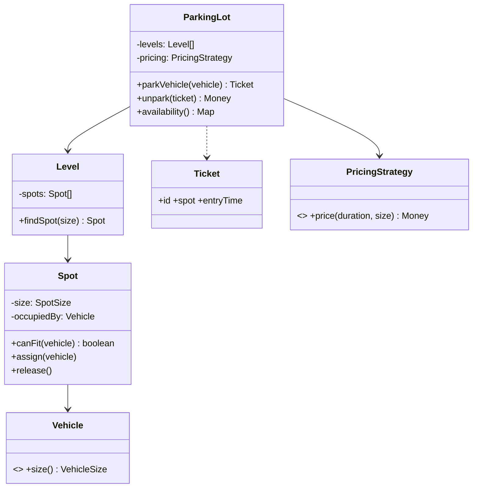
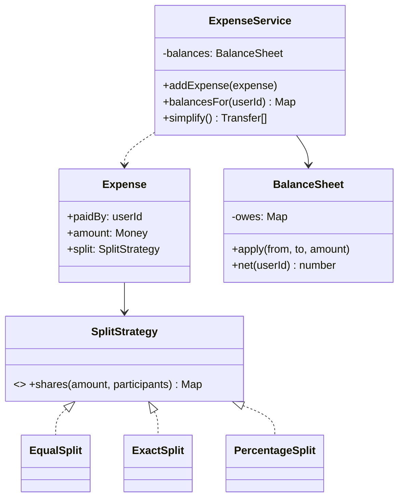
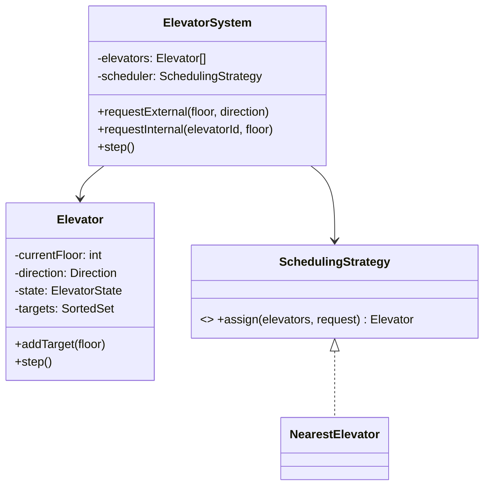

### 67.1.3 Concurrency in LLD answers, and why Node changes it

#### Concept

Many LLD problems (parking lot, booking, rate limiter) involve shared state that concurrent requests touch, so interviewers probe thread safety. The classic (Java/C++) answer is locks, synchronized blocks and atomic operations. In Node, the single-threaded event loop (Part 3, Part 70) changes the answer: your JavaScript runs one operation at a time with no preemption mid-function, so in-memory data races within a single process are largely a non-issue — but cross-process/cross-instance shared state (a real backend) still needs coordination.

#### How it works

In a classic threaded language, two threads can interleave mid-operation on shared state (read-modify-write races), so you protect shared state with locks or atomics. In Node, because a function runs to completion before any other JavaScript runs (Part 70), a synchronous read-modify-write on an in-memory structure cannot be interleaved by another request — so a simple in-memory counter or map needs no lock within one process. The subtlety: the moment you `await` (a database call, a network call), you yield, and another request can run in between, so state that spans an `await` can still race (a check-then-act across an await is not atomic). And the real backend runs many processes/instances, so shared state that must be consistent across them lives in a database or Redis, protected by the database's atomicity or a distributed lock — which is the Part 13 and Part 65 (seat booking) concurrency control.

```text
Classic (threaded): shared in-memory state -> locks/atomics to prevent interleaving.
Node (single thread):
  - synchronous in-memory read-modify-write -> atomic within the process (no lock needed)
  - state spanning an `await` -> can race (yielded); use atomic ops or a lock
  - cross-process/instance shared state -> coordinate in DB/Redis (conditional update,
    distributed lock) exactly as in the seat-booking design (Part 65)
```

In the interview, state this clearly: "In Node, in-memory state within one process is safe for synchronous operations because of the event loop, so I will not add locks for that; for anything that spans an await or must be consistent across instances, I would use the database's atomicity or a distributed lock." This shows you understand concurrency *and* the runtime, which impresses more than reflexively adding locks everywhere.

#### How a Senior Backend Engineer thinks about this

A senior tailors the concurrency answer to Node rather than parroting the Java answer: no locks for synchronous in-memory state (the event loop serializes it), explicit care for state spanning an `await` (where yielding allows interleaving), and real coordination (database atomic operations, distributed locks) for cross-instance shared state, exactly as in the seat-booking design (Part 65). They point out that a real deployment runs many instances, so the LLD's in-memory structure would, in production, be a database or Redis with proper concurrency control. Showing this runtime-aware nuance — not "I'd synchronize everything" — demonstrates depth.

#### Interview questions

1. **How does Node's single-threaded model change the thread-safety answer in LLD?** Synchronous in-memory read-modify-write is atomic within a process (the event loop serializes it), so no locks are needed there; but state spanning an `await` can race, and cross-instance shared state needs coordination in a database or Redis.
2. **When does in-memory state still race in Node?** When a logical operation spans an `await` (a check-then-act across a yield point), because another request can run in between.
3. **How would the in-memory LLD structure work in a real multi-instance deployment?** It would move to a database or Redis with atomic operations or a distributed lock for cross-instance consistency (the seat-booking pattern).

## 67.2 Worked problem: Parking Lot

### 67.2.1 Requirements

Design a parking lot: vehicles of different sizes park in appropriately-sized spots, the lot tracks availability, issues a ticket on entry, and charges a fee on exit based on duration. Clarify: multiple spot sizes (motorcycle, compact, large); a vehicle takes the smallest fitting spot (or a defined policy); ticket on entry, fee on exit; the lot reports availability. In/out of scope: we focus on allocation, ticketing and pricing; payment processing is stubbed.

### 67.2.2 Class diagram



The design uses the **strategy pattern** for pricing (because the interviewer will likely want a different pricing policy — the twist) and keeps allocation behind a method so the allocation policy can also vary. Composition throughout (a lot has levels, a level has spots), no inheritance hierarchy of vehicles beyond a simple size.

### 67.2.3 Code

```ts
type VehicleSize = 'motorcycle' | 'car' | 'truck';
type SpotSize = 'small' | 'medium' | 'large';

const FITS: Record<VehicleSize, SpotSize[]> = {
  motorcycle: ['small', 'medium', 'large'],
  car: ['medium', 'large'],
  truck: ['large'],
};

interface PricingStrategy { price(durationMinutes: number, size: VehicleSize): Money; }

class Money { constructor(readonly cents: number) {} }

class SpotUnavailableError extends Error {}

class Spot {
  private occupiedBy: VehicleSize | null = null;
  constructor(readonly id: string, readonly size: SpotSize) {}
  canFit(v: VehicleSize): boolean { return this.occupiedBy === null && FITS[v].includes(this.size); }
  assign(v: VehicleSize) { this.occupiedBy = v; }
  release() { this.occupiedBy = null; }
  get free() { return this.occupiedBy === null; }
}

class Ticket {
  constructor(readonly id: string, readonly spot: Spot, readonly size: VehicleSize, readonly entryTime: number) {}
}

class ParkingLot {
  constructor(private readonly spots: Spot[], private readonly pricing: PricingStrategy) {}

  park(size: VehicleSize, now = Date.now()): Ticket {
    // smallest fitting free spot (allocation policy; could be its own strategy)
    const spot = this.spots
      .filter((s) => s.canFit(size))
      .sort((a, b) => sizeRank(a.size) - sizeRank(b.size))[0];
    if (!spot) throw new SpotUnavailableError(`no spot for ${size}`);
    spot.assign(size);
    return new Ticket(crypto.randomUUID(), spot, size, now);
  }

  unpark(ticket: Ticket, now = Date.now()): Money {
    const minutes = Math.ceil((now - ticket.entryTime) / 60000);
    const fee = this.pricing.price(minutes, ticket.size);
    ticket.spot.release();
    return fee;
  }

  availability(): Record<SpotSize, number> {
    const avail: Record<SpotSize, number> = { small: 0, medium: 0, large: 0 };
    for (const s of this.spots) if (s.free) avail[s.size]++;
    return avail;
  }
}

function sizeRank(s: SpotSize) { return { small: 0, medium: 1, large: 2 }[s]; }

// A concrete pricing strategy (hourly, by size) -- swappable for the twist.
class HourlyPricing implements PricingStrategy {
  constructor(private readonly ratePerHourCents: Record<VehicleSize, number>) {}
  price(minutes: number, size: VehicleSize): Money {
    const hours = Math.ceil(minutes / 60);
    return new Money(hours * this.ratePerHourCents[size]);
  }
}
```

### 67.2.4 Tests

```ts
// Using any test runner (Jest, Part 24). Key behaviors and edge cases.
const spots = [new Spot('a', 'small'), new Spot('b', 'medium'), new Spot('c', 'large')];
const lot = new ParkingLot(spots, new HourlyPricing({ motorcycle: 100, car: 200, truck: 400 }));

test('parks a car in the smallest fitting spot', () => {
  const t = lot.park('car');
  expect(t.spot.size).toBe('medium');            // not large; smallest that fits
});

test('throws when no spot fits', () => {
  lot.park('truck');                              // takes the only large spot
  expect(() => lot.park('truck')).toThrow(SpotUnavailableError);
});

test('charges by duration and size', () => {
  const t = lot.park('motorcycle', 0);
  const fee = lot.unpark(t, 90 * 60000);          // 90 min -> 2 hours
  expect(fee.cents).toBe(200);                     // 2 * 100
});

test('releases the spot on unpark', () => {
  const before = lot.availability().small;
  const t = lot.park('motorcycle');
  lot.unpark(t);
  expect(lot.availability().small).toBe(before);
});
```

### 67.2.5 Interviewer twist

"Now add tiered pricing: the first hour is free, and trucks pay double after 3 hours." Because pricing is a **strategy** behind an interface, you add a new `PricingStrategy` implementation (`TieredPricing`) and inject it — no change to `ParkingLot`, `Spot` or `Ticket`. If pricing had been hardcoded inside `unpark`, this twist would force editing core logic. This is exactly why the strategy pattern was chosen up front: the twist lands on the varying behavior you anticipated, and your design absorbs it with one new class. A second common twist — "support multiple entry/exit gates and reserved spots" — is absorbed by the allocation policy (make it a strategy too) and a reserved flag on `Spot`.

## 67.3 Worked problem: Splitwise

### 67.3.1 Requirements

Design an expense-sharing system: users in groups add expenses split among members (equally, by exact amounts, or by percentage), the system tracks who owes whom, and can simplify debts (minimize the number of transactions to settle). Clarify: split types (equal, exact, percentage); track balances; simplify debts; handle settlements. In scope: expenses, balances, debt simplification; out of scope: payment processing.

### 67.3.2 Class diagram



The **strategy pattern** again for split types (the obvious variation point), and a `BalanceSheet` that tracks net balances. Debt simplification is a small algorithm on the net balances.

### 67.3.3 Code

```ts
interface SplitStrategy { shares(amountCents: number, participants: string[]): Record<string, number>; }

class EqualSplit implements SplitStrategy {
  shares(amount: number, participants: string[]) {
    const each = Math.floor(amount / participants.length);
    const rem = amount - each * participants.length;     // give the remainder to the first
    const out: Record<string, number> = {};
    participants.forEach((p, i) => (out[p] = each + (i === 0 ? rem : 0)));
    return out;
  }
}

class PercentageSplit implements SplitStrategy {
  constructor(private readonly pct: Record<string, number>) {}  // must sum to 100
  shares(amount: number, participants: string[]) {
    const out: Record<string, number> = {};
    for (const p of participants) out[p] = Math.round((amount * this.pct[p]) / 100);
    return out;
  }
}

class BalanceSheet {
  // net[user] > 0 means others owe this user; < 0 means this user owes.
  private net = new Map<string, number>();
  private add(user: string, delta: number) { this.net.set(user, (this.net.get(user) ?? 0) + delta); }

  applyExpense(paidBy: string, amount: number, shares: Record<string, number>) {
    this.add(paidBy, amount);                              // payer is owed the full amount
    for (const [user, share] of Object.entries(shares)) this.add(user, -share);  // each owes their share
  }

  net_(user: string) { return this.net.get(user) ?? 0; }
  entries() { return [...this.net.entries()]; }
}

interface Transfer { from: string; to: string; amountCents: number; }

class ExpenseService {
  private sheet = new BalanceSheet();

  addExpense(paidBy: string, amountCents: number, participants: string[], split: SplitStrategy) {
    this.sheet.applyExpense(paidBy, amountCents, split.shares(amountCents, participants));
  }

  // Simplify debts: greedily match biggest creditor with biggest debtor.
  simplify(): Transfer[] {
    const creditors = this.sheet.entries().filter(([, v]) => v > 0).map(([u, v]) => ({ u, v }));
    const debtors = this.sheet.entries().filter(([, v]) => v < 0).map(([u, v]) => ({ u, v: -v }));
    creditors.sort((a, b) => b.v - a.v); debtors.sort((a, b) => b.v - a.v);
    const transfers: Transfer[] = [];
    let i = 0, j = 0;
    while (i < debtors.length && j < creditors.length) {
      const amount = Math.min(debtors[i].v, creditors[j].v);
      transfers.push({ from: debtors[i].u, to: creditors[j].u, amountCents: amount });
      debtors[i].v -= amount; creditors[j].v -= amount;
      if (debtors[i].v === 0) i++;
      if (creditors[j].v === 0) j++;
    }
    return transfers;
  }
}
```

### 67.3.4 Tests

```ts
test('equal split tracks balances', () => {
  const s = new ExpenseService();
  s.addExpense('alice', 3000, ['alice', 'bob', 'carol'], new EqualSplit());  // alice paid 30
  // alice is owed 30 minus her own 10 share; bob and carol each owe 10
  const t = s.simplify();
  const total = t.reduce((a, x) => a + x.amountCents, 0);
  expect(total).toBe(2000);                       // bob + carol owe 20 total to alice
});

test('simplify minimizes transfers', () => {
  const s = new ExpenseService();
  s.addExpense('alice', 3000, ['alice', 'bob', 'carol'], new EqualSplit());
  s.addExpense('bob', 3000, ['alice', 'bob', 'carol'], new EqualSplit());
  const t = s.simplify();
  // alice and bob each net to even on the second expense; carol owes both
  expect(t.length).toBeLessThanOrEqual(2);
});
```

### 67.3.5 Interviewer twist

"Add support for different currencies, and for settling only part of a debt." Currencies are absorbed by making `Money` currency-aware (and converting, or keeping per-currency balance sheets) — a localized change to the value object and `BalanceSheet`. Partial settlement is a new operation on `BalanceSheet` (`applyPayment(from, to, amount)`) that adjusts the nets, which the simplify algorithm then reflects. Because splits are a **strategy** and balances are isolated in `BalanceSheet`, both twists are localized. A design that computed balances ad hoc inside expense handling would struggle; isolating the balance logic is what makes it extensible.

## 67.4 Worked problem: Elevator System

### 67.4.1 Requirements

Design an elevator system: one or more elevators serve floor requests, moving up/down, picking up and dropping off, with a scheduling policy deciding which elevator serves a request and the order of stops. Clarify: multiple elevators; external requests (a floor, a direction) and internal requests (a destination floor from inside); a scheduling strategy; door and movement states. In scope: request handling, scheduling, elevator state; out of scope: physical hardware control.

### 67.4.2 Class diagram



Scheduling is a **strategy** (the obvious variation and twist point); each elevator is a **state machine** (idle, moving up/down, doors open). Composition: the system has elevators and a scheduler.

### 67.4.3 Code

```ts
type Direction = 'up' | 'down' | 'idle';
type ElevatorState = 'idle' | 'moving' | 'doors_open';

interface SchedulingStrategy { assign(elevators: Elevator[], floor: number, dir: Direction): Elevator; }

class Elevator {
  currentFloor = 0;
  direction: Direction = 'idle';
  state: ElevatorState = 'idle';
  private targets = new Set<number>();
  constructor(readonly id: string) {}

  addTarget(floor: number) { this.targets.add(floor); this.updateDirection(); }

  private updateDirection() {
    if (this.targets.size === 0) { this.direction = 'idle'; this.state = 'idle'; return; }
    const next = this.nextTarget();
    this.direction = next > this.currentFloor ? 'up' : next < this.currentFloor ? 'down' : 'idle';
    this.state = this.direction === 'idle' ? 'doors_open' : 'moving';
  }

  private nextTarget(): number {
    // simplest: nearest target in the current direction, else nearest overall
    const arr = [...this.targets].sort((a, b) => Math.abs(a - this.currentFloor) - Math.abs(b - this.currentFloor));
    return arr[0];
  }

  step() {
    if (this.targets.size === 0) return;
    const next = this.nextTarget();
    if (this.currentFloor < next) this.currentFloor++;
    else if (this.currentFloor > next) this.currentFloor--;
    if (this.currentFloor === next) { this.targets.delete(next); this.state = 'doors_open'; }
    this.updateDirection();
  }

  distanceTo(floor: number) { return Math.abs(this.currentFloor - floor); }
}

class NearestElevator implements SchedulingStrategy {
  assign(elevators: Elevator[], floor: number): Elevator {
    return elevators.slice().sort((a, b) => a.distanceTo(floor) - b.distanceTo(floor))[0];
  }
}

class ElevatorSystem {
  constructor(private readonly elevators: Elevator[], private readonly scheduler: SchedulingStrategy) {}
  requestExternal(floor: number, dir: Direction) { this.scheduler.assign(this.elevators, floor, dir).addTarget(floor); }
  requestInternal(elevatorId: string, floor: number) {
    this.elevators.find((e) => e.id === elevatorId)?.addTarget(floor);
  }
  step() { for (const e of this.elevators) e.step(); }
}
```

### 67.4.4 Tests

```ts
test('assigns the nearest elevator and moves toward the target', () => {
  const a = new Elevator('a'); a.currentFloor = 0;
  const b = new Elevator('b'); b.currentFloor = 8;
  const sys = new ElevatorSystem([a, b], new NearestElevator());
  sys.requestExternal(2, 'up');                   // nearest is a (floor 0)
  sys.step(); sys.step();
  expect(a.currentFloor).toBe(2);                 // a moved up to floor 2
  expect(b.currentFloor).toBe(8);                 // b did not move
});

test('serves an internal request', () => {
  const a = new Elevator('a');
  const sys = new ElevatorSystem([a], new NearestElevator());
  sys.requestInternal('a', 5);
  for (let i = 0; i < 5; i++) sys.step();
  expect(a.currentFloor).toBe(5);
});
```

### 67.4.5 Interviewer twist

"Change the scheduling to a SCAN/elevator algorithm (keep going in one direction serving all requests, then reverse) instead of nearest-first." Because scheduling is a **strategy** and the elevator's target selection is encapsulated, you add a new `SchedulingStrategy` and adjust the `nextTarget` policy (ideally also behind a strategy), without rewriting the system. A second twist — "add express elevators that only serve certain floors" — is absorbed by giving an elevator a set of serviceable floors and having the scheduler respect it. The state machine and the pluggable scheduler are what make these twists localized changes rather than rewrites.
