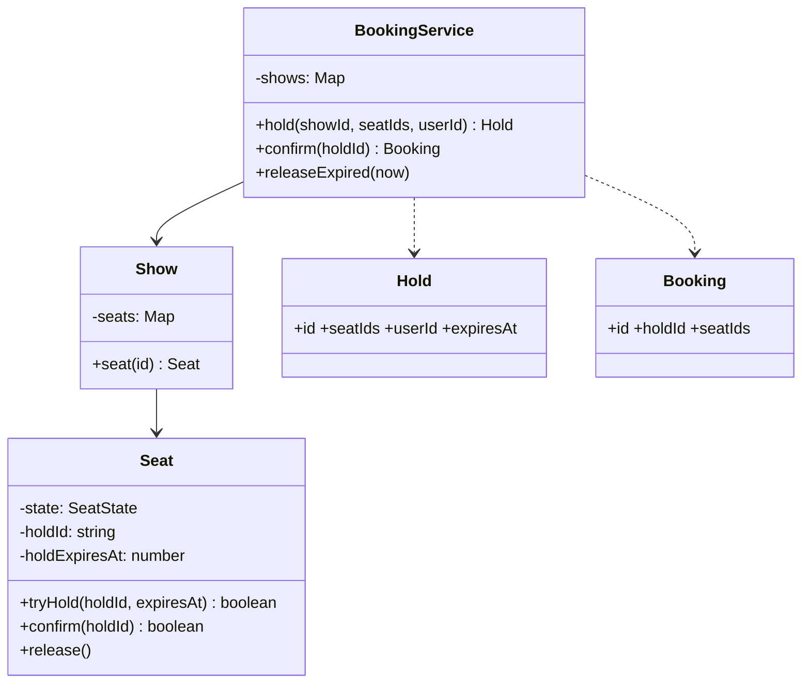
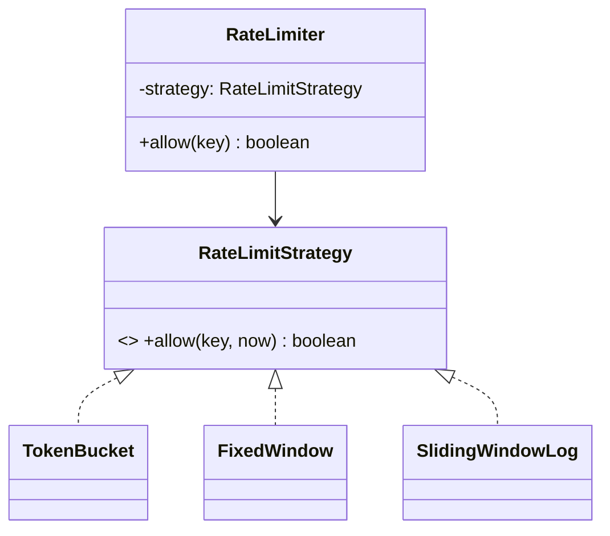

## 67.5 Worked problem: Movie Ticket Booking (seat locking)

### 67.5.1 Requirements

Design a movie ticket booking system: shows have seats, users select and book seats, and the same seat is never booked twice — with a brief hold on selected seats while the user pays, releasing the hold on timeout. Clarify: shows, seats per show, seat states (available, held, booked), a hold timeout, no double-booking. This is the LLD cousin of the seat-booking system design (Part 65); here we focus on the object model and the locking logic rather than the distributed scale.

### 67.5.2 Class diagram



The no-double-book invariant lives in `Seat.tryHold`, which is an atomic check-and-set: it only holds a seat that is currently available, returning false otherwise. This mirrors the conditional update from the system-design version (Part 65).

### 67.5.3 Code

```ts
type SeatState = 'available' | 'held' | 'booked';

class Seat {
  private state: SeatState = 'available';
  private holdId: string | null = null;
  private holdExpiresAt = 0;
  constructor(readonly id: string) {}

  // Atomic within the event loop: no await, so no interleaving (see 67.1.3).
  tryHold(holdId: string, expiresAt: number, now: number): boolean {
    if (this.state === 'available' || (this.state === 'held' && this.holdExpiresAt <= now)) {
      this.state = 'held'; this.holdId = holdId; this.holdExpiresAt = expiresAt;
      return true;
    }
    return false;                                   // already held (valid) or booked
  }

  confirm(holdId: string, now: number): boolean {
    if (this.state === 'held' && this.holdId === holdId && this.holdExpiresAt > now) {
      this.state = 'booked'; return true;
    }
    return false;                                    // hold expired or not this hold
  }

  releaseIfExpired(now: number) {
    if (this.state === 'held' && this.holdExpiresAt <= now) {
      this.state = 'available'; this.holdId = null;
    }
  }
  get stateValue() { return this.state; }
}

class Show {
  private seats = new Map<string, Seat>();
  constructor(readonly id: string, seatIds: string[]) { for (const s of seatIds) this.seats.set(s, new Seat(s)); }
  seat(id: string) { const s = this.seats.get(id); if (!s) throw new Error('no such seat'); return s; }
  allSeats() { return [...this.seats.values()]; }
}

interface Hold { id: string; showId: string; seatIds: string[]; userId: string; expiresAt: number; }
class HoldFailedError extends Error {}

class BookingService {
  private shows = new Map<string, Show>();
  private holds = new Map<string, Hold>();
  constructor(private readonly holdMs = 5 * 60000) {}

  addShow(show: Show) { this.shows.set(show.id, show); }

  hold(showId: string, seatIds: string[], userId: string, now = Date.now()): Hold {
    const show = this.shows.get(showId)!;
    const holdId = crypto.randomUUID();
    const expiresAt = now + this.holdMs;
    const held: string[] = [];
    for (const id of seatIds) {
      if (show.seat(id).tryHold(holdId, expiresAt, now)) held.push(id);
      else { held.forEach((h) => show.seat(h).releaseIfExpired(now)); throw new HoldFailedError(`seat ${id} unavailable`); }
    }
    const hold: Hold = { id: holdId, showId, seatIds, userId, expiresAt };
    this.holds.set(holdId, hold);
    return hold;
  }

  confirm(holdId: string, now = Date.now()) {
    const hold = this.holds.get(holdId);
    if (!hold) throw new Error('no such hold');
    const show = this.shows.get(hold.showId)!;
    for (const id of hold.seatIds) if (!show.seat(id).confirm(holdId, now)) throw new HoldFailedError('hold expired');
    this.holds.delete(holdId);
    return { id: crypto.randomUUID(), holdId, seatIds: hold.seatIds };
  }

  releaseExpired(now = Date.now()) { for (const show of this.shows.values()) for (const s of show.allSeats()) s.releaseIfExpired(now); }
}
```

### 67.5.4 Tests

```ts
test('two holds for the same seat: only one succeeds', () => {
  const svc = new BookingService();
  svc.addShow(new Show('s1', ['A1', 'A2']));
  svc.hold('s1', ['A1'], 'alice');
  expect(() => svc.hold('s1', ['A1'], 'bob')).toThrow(HoldFailedError);  // no double-book
});

test('hold expires and seat becomes available', () => {
  const svc = new BookingService(1000);
  svc.addShow(new Show('s1', ['A1']));
  svc.hold('s1', ['A1'], 'alice', 0);
  svc.releaseExpired(2000);                         // past expiry
  expect(() => svc.hold('s1', ['A1'], 'bob', 2000)).not.toThrow();  // now bob can hold
});

test('confirm fails after hold expires', () => {
  const svc = new BookingService(1000);
  svc.addShow(new Show('s1', ['A1']));
  const h = svc.hold('s1', ['A1'], 'alice', 0);
  expect(() => svc.confirm(h.id, 2000)).toThrow(HoldFailedError);
});
```

### 67.5.5 Interviewer twist

"Make this work across multiple server instances." This is where the Node single-process atomicity (67.1.3) breaks down: the in-memory `Seat` is per-instance, so two instances could each hold the same seat. The answer is to move the seat state and the atomic hold into a shared store — the conditional update in PostgreSQL (`UPDATE ... WHERE status = 'available'`) or an atomic Redis operation — exactly the seat-booking system design (Part 65). Narrating this transition from the single-process LLD to the distributed design shows you understand both the LLD craft and how it maps to real multi-instance production, which is a strong signal. A second twist — "hold the best-available seats automatically for a party of N" — is a new allocation method over the same seat primitives.

## 67.6 Worked problem: Rate Limiter Library (pluggable strategies)

### 67.6.1 Requirements

Design a reusable rate limiter library with pluggable algorithms: a caller asks "is this request (for this key) allowed?" and the limiter answers yes/no based on a configurable strategy (token bucket, fixed window, sliding window). Clarify: per-key limits (per user, per IP), multiple algorithms, a clean interface so callers do not care which algorithm. This is the LLD of the rate limiter whose algorithms are in Part 2 and whose distributed version is in Part 40.

### 67.6.2 Class diagram



The whole point is the **strategy pattern**: the algorithm is pluggable behind one interface, so the caller and the library are independent of which algorithm is used — this is the design the problem is really testing.

### 67.6.3 Code

```ts
interface RateLimitStrategy { allow(key: string, now: number): boolean; }

// Token bucket: refill tokens over time, allow if a token is available.
class TokenBucket implements RateLimitStrategy {
  private buckets = new Map<string, { tokens: number; last: number }>();
  constructor(private readonly capacity: number, private readonly refillPerSec: number) {}
  allow(key: string, now: number): boolean {
    const b = this.buckets.get(key) ?? { tokens: this.capacity, last: now };
    const elapsed = (now - b.last) / 1000;
    b.tokens = Math.min(this.capacity, b.tokens + elapsed * this.refillPerSec);  // refill
    b.last = now;
    if (b.tokens >= 1) { b.tokens -= 1; this.buckets.set(key, b); return true; }
    this.buckets.set(key, b);
    return false;
  }
}

// Fixed window: a count per fixed time window.
class FixedWindow implements RateLimitStrategy {
  private windows = new Map<string, { windowStart: number; count: number }>();
  constructor(private readonly limit: number, private readonly windowMs: number) {}
  allow(key: string, now: number): boolean {
    const start = Math.floor(now / this.windowMs) * this.windowMs;
    const w = this.windows.get(key);
    if (!w || w.windowStart !== start) { this.windows.set(key, { windowStart: start, count: 1 }); return true; }
    if (w.count < this.limit) { w.count++; return true; }
    return false;                                    // over the limit for this window
  }
}

// Sliding window log: timestamps within the window; precise but more memory.
class SlidingWindowLog implements RateLimitStrategy {
  private log = new Map<string, number[]>();
  constructor(private readonly limit: number, private readonly windowMs: number) {}
  allow(key: string, now: number): boolean {
    const times = (this.log.get(key) ?? []).filter((t) => t > now - this.windowMs);  // drop old
    if (times.length < this.limit) { times.push(now); this.log.set(key, times); return true; }
    this.log.set(key, times);
    return false;
  }
}

class RateLimiter {
  constructor(private readonly strategy: RateLimitStrategy) {}
  allow(key: string, now = Date.now()): boolean { return this.strategy.allow(key, now); }
}
```

### 67.6.4 Tests

```ts
test('token bucket allows up to capacity then refills', () => {
  const rl = new RateLimiter(new TokenBucket(2, 1));     // capacity 2, 1/sec refill
  expect(rl.allow('u1', 0)).toBe(true);
  expect(rl.allow('u1', 0)).toBe(true);
  expect(rl.allow('u1', 0)).toBe(false);                 // bucket empty
  expect(rl.allow('u1', 1000)).toBe(true);               // 1s later, 1 token refilled
});

test('fixed window resets each window', () => {
  const rl = new RateLimiter(new FixedWindow(2, 1000));
  expect(rl.allow('u1', 0)).toBe(true);
  expect(rl.allow('u1', 500)).toBe(true);
  expect(rl.allow('u1', 600)).toBe(false);               // 3rd in the window
  expect(rl.allow('u1', 1100)).toBe(true);               // new window
});

test('different keys are independent', () => {
  const rl = new RateLimiter(new FixedWindow(1, 1000));
  expect(rl.allow('u1', 0)).toBe(true);
  expect(rl.allow('u2', 0)).toBe(true);                  // separate key, own limit
});
```

### 67.6.5 Interviewer twist

"Make it distributed, shared across instances, and add a sliding-window-counter algorithm." Distributed is the key transition: the in-memory maps are per-instance, so a shared limit needs the state in Redis with atomic operations (the Lua-script approach in Part 40's rate limiter). Because the algorithm is behind the `RateLimitStrategy` interface, you add a `RedisTokenBucket` implementation that keeps state in Redis — the `RateLimiter` and callers are unchanged. Adding the sliding-window-counter algorithm is just another strategy class. The strategy interface is exactly what makes both twists additive: a new implementation, no change to the core. This is the payoff of designing the variation point as an interface from the start.

## 67.7 Interlude: patterns across these problems

Notice the recurring move in all five problems so far: identify the one behavior the interviewer is most likely to want to vary (pricing, split type, scheduling, the rate-limit algorithm, the allocation policy) and put it behind an interface as a **strategy**, so the twist lands on a pluggable implementation rather than on core logic. The state-machine pattern recurs too (elevator states, seat states, and the order state machine in 67.8). The remaining three problems add two more patterns — the **observer/pub-sub** pattern and careful use of **composition for transactional state** — rounding out the toolkit. The lesson is not "memorize these designs" but "anticipate the variation point, model it as an interface, and the twist becomes a one-class change."
