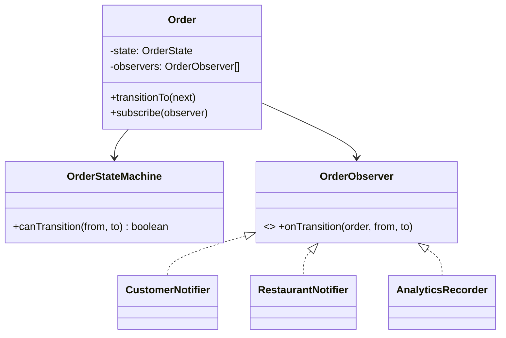
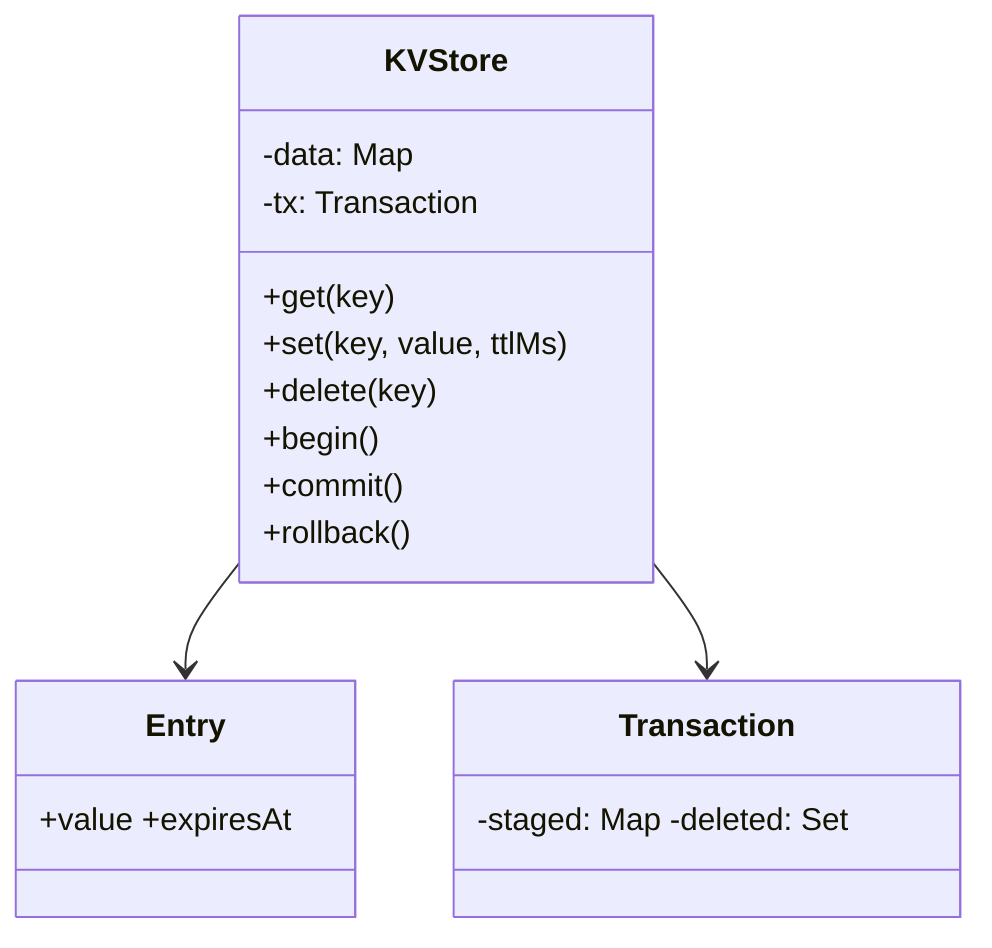
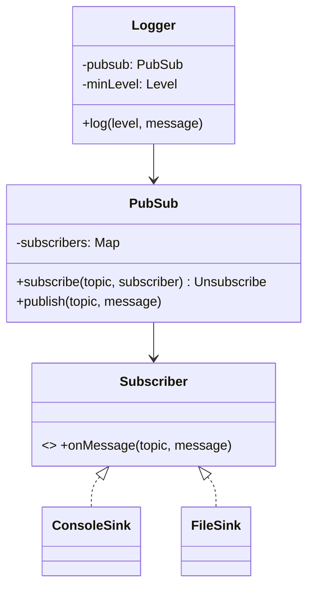

## 67.8 Worked problem: Food-Order State Machine with Notifications

### 67.8.1 Requirements

Design a food-delivery order lifecycle: an order moves through states (placed, confirmed, preparing, out-for-delivery, delivered, cancelled) with only valid transitions allowed, and interested parties (the customer, the restaurant, analytics) are notified on each transition. Clarify: the allowed transitions, who is notified, that illegal transitions are rejected. This combines the **state** pattern (valid transitions) and the **observer** pattern (notifications) — the two patterns the problem is testing.

### 67.8.2 Class diagram



The state machine centralizes the allowed transitions (a data-driven table, as in Part 69's order example), rejecting illegal ones; observers are notified on each valid transition, decoupling the order from who reacts to its changes.

### 67.8.3 Code

```ts
type OrderState = 'placed' | 'confirmed' | 'preparing' | 'out_for_delivery' | 'delivered' | 'cancelled';

const ALLOWED: Record<OrderState, OrderState[]> = {
  placed: ['confirmed', 'cancelled'],
  confirmed: ['preparing', 'cancelled'],
  preparing: ['out_for_delivery', 'cancelled'],
  out_for_delivery: ['delivered'],
  delivered: [],
  cancelled: [],
};

class InvalidTransitionError extends Error {}

interface OrderObserver { onTransition(orderId: string, from: OrderState, to: OrderState): void; }

class Order {
  private state: OrderState = 'placed';
  private observers: OrderObserver[] = [];
  constructor(readonly id: string) {}

  subscribe(o: OrderObserver) { this.observers.push(o); }

  transitionTo(next: OrderState) {
    if (!ALLOWED[this.state].includes(next)) {
      throw new InvalidTransitionError(`cannot go from ${this.state} to ${next}`);
    }
    const from = this.state;
    this.state = next;
    for (const o of this.observers) o.onTransition(this.id, from, next);  // notify (observer)
  }
  get current() { return this.state; }
}

class CustomerNotifier implements OrderObserver {
  onTransition(orderId: string, _from: OrderState, to: OrderState) {
    if (to === 'out_for_delivery' || to === 'delivered') {/* send customer notification */}
  }
}
class RestaurantNotifier implements OrderObserver {
  onTransition(orderId: string, _from: OrderState, to: OrderState) {
    if (to === 'confirmed') {/* tell the restaurant to start */}
  }
}
class AnalyticsRecorder implements OrderObserver {
  onTransition(orderId: string, from: OrderState, to: OrderState) {/* record the transition */}
}
```

### 67.8.4 Tests

```ts
test('allows valid transitions and rejects invalid ones', () => {
  const o = new Order('o1');
  o.transitionTo('confirmed');
  o.transitionTo('preparing');
  expect(o.current).toBe('preparing');
  expect(() => o.transitionTo('delivered')).toThrow(InvalidTransitionError);  // must go out_for_delivery first
});

test('notifies observers on transition', () => {
  const o = new Order('o1');
  const seen: string[] = [];
  o.subscribe({ onTransition: (_id, _f, to) => seen.push(to) });
  o.transitionTo('confirmed'); o.transitionTo('cancelled');  // confirmed allows cancelled
  expect(seen).toEqual(['confirmed', 'cancelled']);
});

test('cannot transition out of a terminal state', () => {
  const o = new Order('o1');
  o.transitionTo('cancelled');
  expect(() => o.transitionTo('confirmed')).toThrow(InvalidTransitionError);
});
```

### 67.8.5 Interviewer twist

"Add a new state (returned) and a new observer (a loyalty-points service that awards points on delivery), and make notifications asynchronous/retryable." The new state is a one-line change to the `ALLOWED` table (data-driven transitions, so no logic to rewrite). The new observer is a new class subscribed to the order — the **observer** pattern means the order does not change at all. Making notifications async/retryable is localized to how observers are invoked (dispatch to a queue, Part 20, instead of calling synchronously). All three twists are additive because the state transitions are data and the reactions are decoupled observers — the exact separation the two patterns provide.

## 67.9 Worked problem: In-Memory Key-Value Store with TTL and Transactions

### 67.9.1 Requirements

Design an in-memory key-value store supporting `get`, `set`, `delete`, per-key TTL (expiry), and simple transactions (`begin`, `commit`, `rollback`) so a group of operations applies atomically or not at all. Clarify: TTL per key with lazy/active expiry; transactions that can be committed or rolled back; nested or single-level transactions (we do single-level with a staging layer). This tests careful state management and atomicity in a bounded setting.

### 67.9.2 Class diagram



The store holds entries with optional expiry; a transaction stages changes (sets and deletes) that are applied to the main store on commit and discarded on rollback — composition of a staging layer over the base store gives atomicity.

### 67.9.3 Code

```ts
interface Entry { value: string; expiresAt: number | null; }

class KVStore {
  private data = new Map<string, Entry>();
  private staged: Map<string, Entry> | null = null;    // transaction staging (null = no tx)
  private deleted: Set<string> | null = null;

  get(key: string, now = Date.now()): string | null {
    // transaction reads see staged changes first
    if (this.staged) {
      if (this.deleted!.has(key)) return null;
      const s = this.staged.get(key);
      if (s) return this.live(s, now) ? s.value : null;
    }
    const e = this.data.get(key);
    if (!e) return null;
    if (!this.live(e, now)) { this.data.delete(key); return null; }  // lazy expiry on read
    return e.value;
  }

  set(key: string, value: string, ttlMs?: number, now = Date.now()) {
    const entry: Entry = { value, expiresAt: ttlMs ? now + ttlMs : null };
    if (this.staged) { this.staged.set(key, entry); this.deleted!.delete(key); }
    else this.data.set(key, entry);
  }

  delete(key: string) {
    if (this.staged) { this.staged.delete(key); this.deleted!.add(key); }
    else this.data.delete(key);
  }

  begin() { if (this.staged) throw new Error('transaction already open'); this.staged = new Map(); this.deleted = new Set(); }

  commit() {
    if (!this.staged) throw new Error('no transaction');
    for (const k of this.deleted!) this.data.delete(k);
    for (const [k, v] of this.staged) this.data.set(k, v);   // apply staged atomically
    this.staged = null; this.deleted = null;
  }

  rollback() {
    if (!this.staged) throw new Error('no transaction');
    this.staged = null; this.deleted = null;                  // discard staged changes
  }

  private live(e: Entry, now: number) { return e.expiresAt === null || e.expiresAt > now; }
}
```

### 67.9.4 Tests

```ts
test('set/get/delete with TTL expiry', () => {
  const kv = new KVStore();
  kv.set('a', '1', 1000, 0);
  expect(kv.get('a', 500)).toBe('1');
  expect(kv.get('a', 1500)).toBe(null);             // expired
});

test('transaction commit applies atomically', () => {
  const kv = new KVStore();
  kv.set('a', '1');
  kv.begin();
  kv.set('a', '2'); kv.set('b', '3');
  expect(kv.get('a')).toBe('2');                     // reads see staged
  kv.commit();
  expect(kv.get('a')).toBe('2'); expect(kv.get('b')).toBe('3');
});

test('transaction rollback discards changes', () => {
  const kv = new KVStore();
  kv.set('a', '1');
  kv.begin();
  kv.set('a', '99'); kv.delete('a');
  kv.rollback();
  expect(kv.get('a')).toBe('1');                     // unchanged after rollback
});
```

### 67.9.5 Interviewer twist

"Add active expiry (a background sweeper, not just lazy on read) and nested transactions." Active expiry is a periodic sweep over `data` removing expired entries (plus the lazy check already on read as a backstop) — a localized addition. Nested transactions turn the single staging layer into a stack of staging layers (each `begin` pushes a layer, `commit` merges into the parent, `rollback` pops), which is a change contained within the transaction logic because the staging concept is already isolated. Because transactional state was modeled as a separate staging layer rather than mutating `data` directly, both twists extend that layer rather than touching `get`/`set`/`delete`. A design that mutated the main map directly during a transaction would make rollback and nesting far harder — the staging isolation is the key design decision.

## 67.10 Worked problem: Logger / Pub-Sub Library

### 67.10.1 Requirements

Design a pub-sub (or logger) library: publishers emit messages to named topics (or log entries at levels), and any number of subscribers (or log sinks) registered for a topic receive them, decoupled so publishers do not know about subscribers. For a logger, the "topics" are levels (debug, info, warn, error) and the "subscribers" are sinks (console, file, remote). Clarify: multiple topics/levels, multiple subscribers, subscribe/unsubscribe, delivery to all subscribers. This is the **observer/pub-sub** pattern in its purest form.

### 67.10.2 Class diagram



The `PubSub` core maps topics to subscribers and fans out; the `Logger` is a thin layer over it treating levels as topics and sinks as subscribers, with a minimum level filter.

### 67.10.3 Code

```ts
type Subscriber<T> = (topic: string, message: T) => void;
type Unsubscribe = () => void;

class PubSub<T> {
  private subs = new Map<string, Set<Subscriber<T>>>();

  subscribe(topic: string, sub: Subscriber<T>): Unsubscribe {
    const set = this.subs.get(topic) ?? new Set();
    set.add(sub); this.subs.set(topic, set);
    return () => set.delete(sub);                     // return an unsubscribe handle
  }

  publish(topic: string, message: T) {
    for (const sub of this.subs.get(topic) ?? []) {
      try { sub(message as never, message); } catch { /* one bad subscriber must not break others */ }
    }
  }
}

// Logger built on PubSub: levels are topics, sinks are subscribers.
type Level = 'debug' | 'info' | 'warn' | 'error';
const RANK: Record<Level, number> = { debug: 0, info: 1, warn: 2, error: 3 };

class Logger {
  private pubsub = new PubSub<string>();
  constructor(private minLevel: Level = 'info') {}
  addSink(sink: (level: Level, message: string) => void, levels: Level[]) {
    const unsubs = levels.map((l) => this.pubsub.subscribe(l, (_t, m) => sink(l, m)));
    return () => unsubs.forEach((u) => u());
  }
  log(level: Level, message: string) {
    if (RANK[level] < RANK[this.minLevel]) return;    // filter below min level
    this.pubsub.publish(level, message);
  }
}
```

### 67.10.4 Tests

```ts
test('delivers to all subscribers of a topic', () => {
  const ps = new PubSub<string>();
  const got: string[] = [];
  ps.subscribe('t', (_t, m) => got.push('a:' + m));
  ps.subscribe('t', (_t, m) => got.push('b:' + m));
  ps.publish('t', 'hello');
  expect(got).toEqual(['a:hello', 'b:hello']);
});

test('unsubscribe stops delivery', () => {
  const ps = new PubSub<string>();
  const got: string[] = [];
  const off = ps.subscribe('t', (_t, m) => got.push(m));
  off();
  ps.publish('t', 'x');
  expect(got).toEqual([]);
});

test('logger filters below the minimum level and routes to sinks', () => {
  const log = new Logger('warn');
  const lines: string[] = [];
  log.addSink((lvl, m) => lines.push(`${lvl}:${m}`), ['warn', 'error']);
  log.log('info', 'ignored');                         // below warn
  log.log('error', 'boom');
  expect(lines).toEqual(['error:boom']);
});
```

### 67.10.5 Interviewer twist

"Make delivery asynchronous and ensure one slow or failing subscriber does not block or break the others; add wildcard topic subscriptions." The code already isolates a failing subscriber (the `try/catch` in `publish`), which you point out. Making delivery async is a localized change to how `publish` invokes subscribers (dispatch each via a microtask or a queue, Part 20, so a slow sink does not block the publisher). Wildcard subscriptions (`subscribe('order.*', ...)`) are a matching change in `subscribe`/`publish` to match patterns, contained in the `PubSub` core. Because the publisher is fully decoupled from subscribers (the essence of pub-sub), all three twists are additive within the library, with publishers and existing subscribers unaffected — which is exactly the decoupling the pattern exists to provide.
