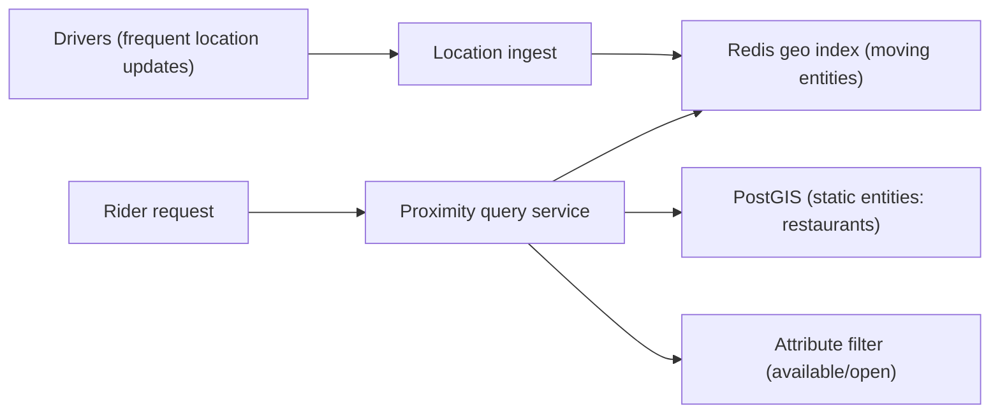

## 67.3 Proximity Search (Nearby Drivers and Restaurants)

> **Try it first** · Level: Intermediate · About 45 minutes
>
> **Build:** a "what is near me" service that finds moving drivers and fixed restaurants close to a point.
>
> **Requirements:**
> - Find entities within a radius of a point, or the nearest N.
> - Handle locations that change every few seconds (drivers).
> - Filter by attributes: available drivers only, open restaurants that deliver to this address.
> - Answer fast and scale to millions of entities.
>
> **Scale and constraints:** in one large metro, 100,000 active drivers updating every 4 s (25,000 updates per second), 10,000 proximity queries per second and 50,000 restaurants. Query p99 in the tens of ms; nearest can be slightly approximate.
>
> **Your task:** choose a spatial index for drivers and one for restaurants, sketch the API, the data model and the main components; estimate memory and throughput; name the two hardest problems and how you would solve them.
>
> Spend the time on paper before you read on. The model design follows.

### 67.3.1 Requirements

A proximity search system answers "what is near this location?" — the nearby available drivers for a ride request, the restaurants within delivery range, the friends near you — efficiently, over data where locations change constantly (drivers move every few seconds) and queries are frequent. The users are riders needing a nearby driver, diners browsing nearby restaurants, and the matching systems that pair them. This design probes geospatial indexing: how to query "near a point" fast over millions of moving or static locations, when a naive "compute distance to every location" is far too slow.

Imagine needing the nearest taxi in a huge city. Checking the distance from you to every taxi in the city on every request would be hopeless. Instead, imagine the city divided into a grid of cells; you only need to check taxis in your cell and the adjacent ones, not the whole city. That spatial bucketing — only looking near where you are — is the essence of proximity search, and geohashes and quadtrees are two ways to do the bucketing.

### 67.3.2 Functional requirements

1. Find entities (drivers, restaurants) within a radius of a point, or the nearest N.
2. Handle frequently-changing locations (drivers update their position every few seconds).
3. Filter by attributes (available drivers only; open restaurants that deliver here).
4. Answer queries fast (riders expect instant matching).
5. Scale to millions of entities and high query and update rates.

### 67.3.3 Non-functional requirements

| Property | Target | Why |
|---|---|---|
| Query latency | p99 low (tens of ms) | Riders wait for a match |
| Update rate | High (drivers update every ~4s) | Positions change constantly |
| Query rate | High (every ride request, every browse) | Core to the product |
| Accuracy | Close-enough nearest (slight approximation often fine) | "Nearby" tolerates small imprecision |
| Scale | Millions of entities, large metro areas | City-scale services |

### 67.3.4 Constraints

- Naive distance-to-all is O(n) per query — infeasible at millions of entities; a spatial index is required.
- Driver locations change every few seconds, so the index must support very high update rates, not just queries.
- Queries filter by attributes (available, open, delivers-here), so the spatial search combines with attribute filtering.
- "Nearby" tolerates slight approximation, which lets cheaper/faster approximate methods work.

### 67.3.5 Capacity estimation

| Quantity | Assumption | Calculation | Result |
|---|---|---|---|
| Drivers in a large metro | Active | given | 100,000 |
| Location updates | every 4s per driver | 100,000 / 4 | 25,000 updates/second |
| Proximity queries | ride requests + browsing | given | 10,000/second |
| Restaurants (static) | metro | given | 50,000 |
| Index memory | locations + ids | | modest (MBs) |

The numbers say: updates (25,000/second) outnumber queries (10,000/second) for the moving-driver case, so the index must handle very frequent updates cheaply — this is what makes a simple in-memory geohash-bucketed index (fast updates) attractive over a heavier tree that is costly to update. Restaurants are static, so a PostGIS index (query-optimized) fits them.

The second table sizes each component for one large metro:

| Quantity | Assumption | Calculation | Result |
|---|---|---|---|
| Redis geo memory | ~100 B per member (sorted-set entry plus an id like `drv:48213`) | 100,000 x 100 B | about 10 MB, plus driver hashes of ~200 B each: 30 MB in total |
| Redis ops from updates | each update is `GEOADD` + `HSET` + `ZADD` last-seen, pipelined | 25,000 x 3 | 75,000 ops/s, most of one shard |
| `GEOSEARCH` cost | O(N + log M), N = members in the searched cells | 3 km radius in a dense centre holds ~400 drivers | about 0.3-0.5 ms per query |
| Query capacity | 10,000 queries/s x 0.4 ms | | 4 seconds of Redis time per second, so 4-6 replicas serve reads |
| Update bandwidth | 25,000 x ~150 B per HTTPS request body | | under 4 MB/s, before TLS overhead |
| Location history | every update kept for trip disputes and ETA models | 25,000 x 86,400 x 60 B | about 130 GB/day, which goes to Kafka and a lake, never into Redis |
| PostGIS restaurants | 50,000 rows with a delivery polygon each | | under 100 MB, fits in memory entirely |

The table shows the shape of the system: the live index is tiny and lives in memory, the query cost depends on how many drivers sit in the searched cells (dense city centres are the slow case), and the update stream is valuable history that belongs in a log, not in the index.

### 67.3.6 API design

| Method | Path | Request | Response | Notes |
|---|---|---|---|---|
| POST | `/locations` | `{ entityId, lat, lng }` | | Update an entity's location (frequent) |
| GET | `/nearby` | `?lat&lng&radius&filter=available` | nearby entities, sorted by distance | The proximity query |
| GET | `/nearest` | `?lat&lng&n=5&filter=...` | nearest N | Nearest-N variant |

### 67.3.7 Data model

```text
Geohash approach (good for frequently-moving entities):
  A geohash encodes a lat/lng into a short string where a shared prefix = nearby.
  Bucket entities by geohash prefix (a grid cell). To query near a point, look at the
  point's cell and its 8 neighbors, then filter by exact distance.
  Store in Redis: GEOADD/GEOSEARCH use geohashes internally for exactly this.

PostGIS approach (good for static/queryable entities like restaurants):
  A PostgreSQL extension adding a geometry/geography type and spatial (GiST) indexes.
  restaurants(id, location geography(Point), is_open, delivers_radius_m, ...)
  CREATE INDEX ON restaurants USING gist (location);
  SELECT ... WHERE ST_DWithin(location, :point, :radius) ORDER BY location <-> :point;

Quadtree: a tree that recursively subdivides space into quadrants; dense areas get
  finer subdivision. Good for nearest-neighbor queries; costlier to update than geohash buckets.
```

The concrete Redis layout keeps one geo set per city and availability state, so the query never has to filter out busy drivers:

```text
drivers:geo:{blr}:available   geo set (sorted set)   member = driverId, score = 52-bit geohash
drivers:geo:{blr}:on_trip     geo set                used for "your driver is 2 min away"
drivers:seen:{blr}            sorted set             member = driverId, score = last update, epoch ms
driver:48213                  hash                   status, vehicle_type, rating, city, updated_at
```

Restaurants live in PostgreSQL with PostGIS. A delivery area is a polygon, not a radius, because rivers, highways and kitchen policy make real delivery zones irregular:

```sql
CREATE EXTENSION IF NOT EXISTS postgis;

CREATE TABLE restaurants (
  id             bigint PRIMARY KEY,
  name           text NOT NULL,
  city_id        int  NOT NULL,
  location       geography(Point, 4326)   NOT NULL,   -- WGS 84 longitude/latitude
  delivery_area  geography(Polygon, 4326) NOT NULL,
  is_open        boolean NOT NULL DEFAULT false,
  cuisine        text[] NOT NULL DEFAULT '{}'
);
CREATE INDEX restaurants_location_gist ON restaurants USING gist (location);
CREATE INDEX restaurants_area_gist     ON restaurants USING gist (delivery_area);
```

### 67.3.8 High-level architecture



Frequently-moving entities (drivers) live in a Redis geo index (fast updates via `GEOADD`, fast radius queries via `GEOSEARCH`, built on geohashes). Static entities (restaurants) live in PostGIS (spatial index, rich queries, joined to attributes). The proximity query service queries the appropriate index, applies attribute filters, and returns results sorted by distance.

### 67.3.9 Component design

| Component | Responsibility |
|---|---|
| Location ingest | Accept high-rate location updates, write to the geo index |
| Redis geo index | Hold moving entities; fast update and radius query (geohash-based) |
| PostGIS | Hold static entities with spatial index and attribute columns |
| Proximity query service | Run the near/nearest query, filter by attributes, sort by distance |
| Attribute filter | Combine spatial results with availability/open/range filters |

### 67.3.10 Deep dive: geohash, quadtrees, PostGIS

**Geohash** encodes a latitude/longitude into a short string such that locations with a common prefix are geographically close (a longer shared prefix means closer). This turns "find nearby" into "find entities whose geohash shares a prefix" — a cheap string/bucket lookup. The trick for correctness: a point near a cell boundary has close neighbors in adjacent cells, so a proper query checks the point's cell and its 8 neighbors, then filters by exact distance. Geohash bucketing updates very cheaply (just move an entity to a new bucket), which suits frequently-moving drivers. **Redis's geo commands** (`GEOADD`, `GEOSEARCH`) implement exactly this — they store positions by geohash and do radius/box searches — making Redis a ready-made moving-entity geo index with fast updates and queries.

**Quadtrees** recursively subdivide space into four quadrants, subdividing dense areas more finely, giving efficient nearest-neighbor queries with good adaptivity to uneven density. They are powerful for queries but costlier to update than flat geohash buckets, so they suit relatively static data or query-heavy workloads more than the 25,000-updates/second driver case.

**PostGIS** adds a spatial type and GiST spatial index to PostgreSQL, so you get exact, rich spatial queries (`ST_DWithin` for within-radius, `<->` distance ordering for nearest) joined directly to attribute columns (is_open, delivers_radius) and relational data, all in one SQL query. This is ideal for static or less-frequently-updated entities (restaurants) where the query richness and the join to attributes matter, and it keeps everything in PostgreSQL (the "stay in PostgreSQL" theme of pgvector, Part 38, and TimescaleDB, Part 26). It is less suited to 25,000 updates/second of moving points, where Redis's lightweight geo index shines.

```text
Choose the geo index by update rate and query needs:
  Frequently moving (drivers, 25k updates/s) -> Redis geo (geohash): cheap updates
  Static + rich queries + attribute joins (restaurants) -> PostGIS: query power, one DB
  Query-heavy, uneven density, less frequent updates -> quadtree: adaptive nearest-neighbor
```


#### Deep dive: geohash precision and the boundary problem

A geohash interleaves longitude and latitude bits and writes them in base 32, so every extra character makes the cell about 32 times smaller in area:

| Length | Cell size (at the equator) | Typical use |
|---|---|---|
| 5 | about 4.9 km x 4.9 km | City district, a coarse cache key |
| 6 | about 1.2 km x 0.61 km | Neighbourhood, the restaurant cache key in 67.3.11 |
| 7 | about 153 m x 153 m | Street block, pickup-point clustering |

The boundary problem is real, not theoretical. Two drivers 10 metres apart on either side of a cell edge can share no prefix at all; the worst place on Earth is the equator at the prime meridian, where neighbouring cells start with different first characters. So a prefix lookup alone misses close neighbours, and every correct geohash search covers the cell plus its 8 neighbours and then filters by true distance. Redis's `GEOSEARCH` does this internally: it picks a geohash precision from the radius, scans the 9 cells as score ranges in the sorted set, and discards members outside the exact circle. Note also that Redis takes **longitude first** (`GEOADD key lng lat member`), the opposite of the "lat, lng" order humans write; swapping them is the most common geo bug, and it puts Bengaluru in the Indian Ocean.

#### Deep dive: the moving-driver index in NestJS

The location ingest path does three things per update in one pipeline: move the driver in the geo set, update their hash, and record when they were last seen. Drivers who are on a trip live in a different set, so changing state is an atomic move between sets.

```ts
// location/driver-location.service.ts
import { Inject, Injectable } from '@nestjs/common';
import type { Redis } from 'ioredis';
import { REDIS_CLIENT } from '../redis/redis.module';

const MIN_MOVE_METERS = 20;   // drop updates that did not move the driver meaningfully

@Injectable()
export class DriverLocationService {
  constructor(@Inject(REDIS_CLIENT) private readonly redis: Redis) {}

  async update(city: string, driverId: string, lng: number, lat: number, status: 'available' | 'on_trip') {
    const geoKey = `drivers:geo:{${city}}:${status}`;
    const otherKey = `drivers:geo:{${city}}:${status === 'available' ? 'on_trip' : 'available'}`;
    const now = Date.now();
    await this.redis
      .multi()                                          // atomic: never in both sets, never in neither
      .geoadd(geoKey, lng, lat, driverId)               // longitude first
      .zrem(otherKey, driverId)
      .zadd(`drivers:seen:{${city}}`, now, driverId)    // drives the stale-driver sweeper (66.3.15)
      .hset(`driver:${driverId}`, 'status', status, 'updated_at', now)
      .exec();
  }

  async nearbyAvailable(city: string, lng: number, lat: number, want = 10) {
    for (const radiusKm of [1, 2, 4, 8]) {              // expand until enough drivers are found
      const rows = (await this.redis.geosearch(
        `drivers:geo:{${city}}:available`,
        'FROMLONLAT', lng, lat, 'BYRADIUS', radiusKm, 'km',
        'ASC', 'COUNT', want * 2, 'WITHDIST',           // over-fetch: some will fail the filters below
      )) as [string, string][];
      if (rows.length >= want || radiusKm === 8) return rows.map(([id, km]) => ({ id, km: Number(km) }));
    }
    return [];
  }
}
```

The `MIN_MOVE_METERS` check (done before calling `update`, in the controller, against the previous position in the hash) removes a large share of the write load: a driver waiting at a traffic light sends updates every 4 seconds that change nothing. The expanding radius keeps queries cheap in dense areas (1 km is enough downtown) while still finding someone in the suburbs. `COUNT` with `ASC` lets Redis stop sorting early instead of returning every driver in an 8 km circle.

#### Deep dive: restaurants with PostGIS

"Which open restaurants deliver to this point, nearest first" is one SQL statement (the application passes the point as a parameter; it is a literal here so `EXPLAIN` can run), and the plan shows the KNN index doing the work:

```sql
EXPLAIN (ANALYZE, BUFFERS)
SELECT id, name,
       ST_Distance(location, 'SRID=4326;POINT(77.6101 12.9352)'::geography) AS meters
  FROM restaurants
 WHERE is_open
   AND ST_Covers(delivery_area, 'SRID=4326;POINT(77.6101 12.9352)'::geography)  -- point inside the polygon
 ORDER BY location <-> 'SRID=4326;POINT(77.6101 12.9352)'::geography            -- KNN order from the GiST index
 LIMIT 20;
```

```text
Limit  (cost=0.41..96.12 rows=20 width=40) (actual time=0.412..2.874 rows=20 loops=1)
  Buffers: shared hit=412
  ->  Index Scan using restaurants_location_gist on restaurants  (cost=0.41..2391.80 rows=500 width=40) (actual time=0.410..2.861 rows=20 loops=1)
        Order By: (location <-> '0101000020E6100000...'::geography)
        Filter: (is_open AND st_covers(delivery_area, '0101000020E6100000...'::geography))
        Rows Removed by Filter: 187
        Buffers: shared hit=412
Planning Time: 0.231 ms
Execution Time: 2.951 ms
```

The index returns restaurants in distance order and the filter discards those that are closed or do not deliver here; after 207 candidates it has 20 answers, in 3 ms, all from cache. The failure mode to watch is "Rows Removed by Filter" growing: at 2 a.m., when 95 percent of restaurants are closed, the scan walks much further to find 20 open ones. A partial index `WHERE is_open` fixes that, at the cost of index churn twice a day as restaurants open and close.

#### Deep dive: two riders, one driver

Proximity search returns candidates; it does not reserve anything. Two riders 200 metres apart both see driver 48213 as the nearest, and both dispatch requests pick them. Without a claim step, one driver gets two trips. The claim is the conditional-update idea from Part 66, section 66.4, applied to a driver:

```text
SET dispatch:drv:48213 <tripId> NX PX 15000     -- the first dispatcher wins the 15-second offer window
  OK   -> send the offer to the driver; on accept, move the driver to on_trip
  nil  -> someone else is offering this driver; try the next candidate
```

The search can be approximate and stale by a few seconds; the claim must be exact. That split, a fast approximate read followed by an exact atomic write, appears in almost every design in this Part.
