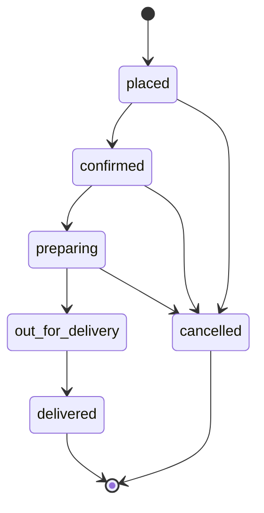
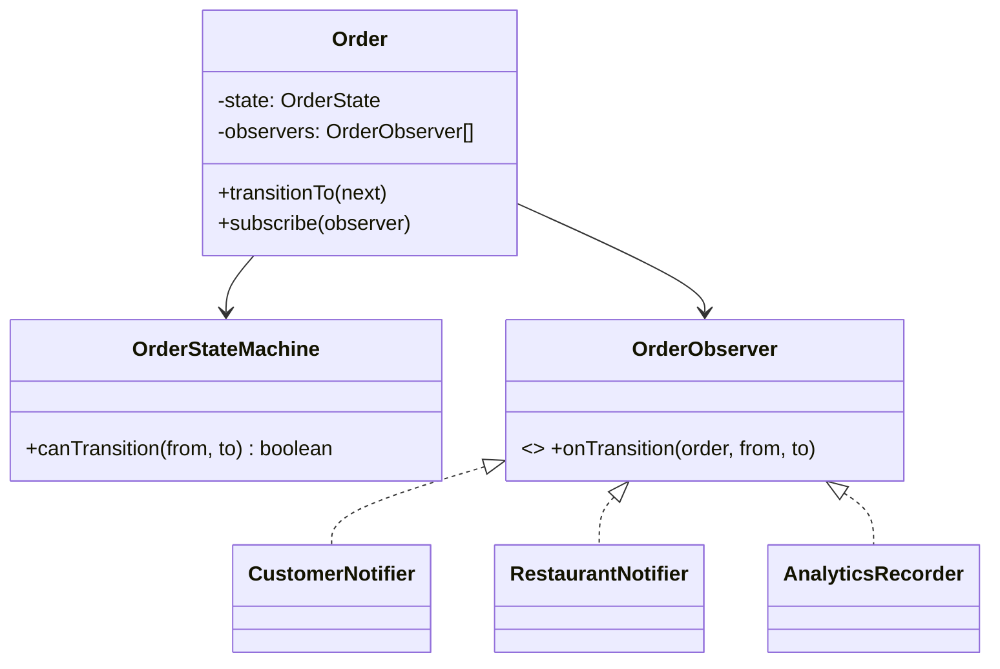
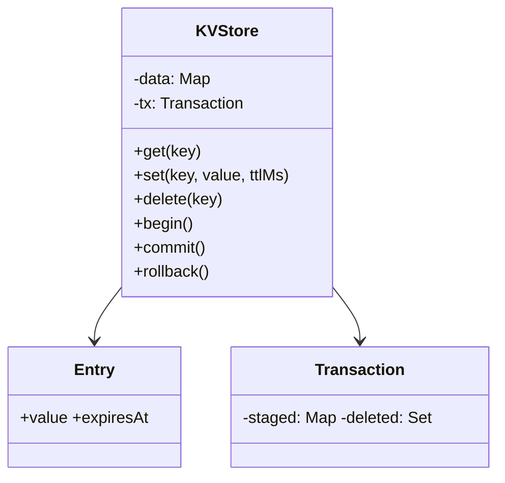

## 67.7 Interlude: patterns across these problems

Notice the recurring move in all five problems so far: identify the one behavior the interviewer is most likely to want to vary (pricing, split type, scheduling, the rate-limit algorithm, the allocation policy) and put it behind an interface as a **strategy**, so the twist lands on a pluggable implementation rather than on core logic. The state-machine pattern recurs too (elevator states, seat states, and the order state machine in 67.8). The remaining three problems add two more patterns — the **observer/pub-sub** pattern and careful use of **composition for transactional state** — rounding out the toolkit. The lesson is not "memorize these designs" but "anticipate the variation point, model it as an interface, and the twist becomes a one-class change."

Notice also the second recurring move from the implemented twists: every in-memory design had a sentence that began "in production, this map becomes...". The parking spots became a table with `SKIP LOCKED`, the seat holds a conditional `UPDATE`, the rate limiter a Redis script. Saying that sentence, unprompted, is what separates a senior LLD answer from a good one.

## 67.8 Worked problem: Food-Order State Machine with Notifications

### 67.8.1 Requirements

Design a food-delivery order lifecycle: an order moves through states (placed, confirmed, preparing, out-for-delivery, delivered, cancelled) with only valid transitions allowed, and interested parties (the customer, the restaurant, analytics) are notified on each transition. Clarify: the allowed transitions, who is notified, that illegal transitions are rejected. This combines the **state** pattern (valid transitions) and the **observer** pattern (notifications) — the two patterns the problem is testing.



Draw this diagram first, on the whiteboard or in a comment. It is the requirement; the code is a transcription of it.

### 67.8.2 Class diagram



The state machine centralizes the allowed transitions (a data-driven table; Part 13 — State pattern shows the class-per-state alternative, which pays off only when each state has substantial behavior of its own), rejecting illegal ones; observers are notified on each valid transition, decoupling the order from who reacts to its changes.

### 67.8.3 Code

```ts
export type OrderState = 'placed' | 'confirmed' | 'preparing' | 'out_for_delivery' | 'delivered' | 'cancelled';

export const ALLOWED: Record<OrderState, OrderState[]> = {
  placed: ['confirmed', 'cancelled'],
  confirmed: ['preparing', 'cancelled'],
  preparing: ['out_for_delivery', 'cancelled'],
  out_for_delivery: ['delivered'],
  delivered: [],
  cancelled: [],
};

export class InvalidTransitionError extends Error {}

export interface OrderObserver { onTransition(orderId: string, from: OrderState, to: OrderState): void; }

export class Order {
  private state: OrderState = 'placed';
  private observers: OrderObserver[] = [];
  constructor(readonly id: string) {}

  subscribe(o: OrderObserver) { this.observers.push(o); }

  transitionTo(next: OrderState) {
    if (!ALLOWED[this.state].includes(next)) {
      throw new InvalidTransitionError(`cannot go from ${this.state} to ${next}`);
    }
    const from = this.state;
    this.state = next;
    for (const o of this.observers) o.onTransition(this.id, from, next);  // notify (observer)
  }
  get current() { return this.state; }
}

type Send = (orderId: string, text: string) => void;

export class CustomerNotifier implements OrderObserver {
  constructor(private readonly push: Send) {}
  onTransition(orderId: string, _from: OrderState, to: OrderState) {
    if (to === 'out_for_delivery') this.push(orderId, 'Your order is on the way');
    if (to === 'delivered') this.push(orderId, 'Delivered. Enjoy your meal');
  }
}

export class RestaurantNotifier implements OrderObserver {
  constructor(private readonly notifyKitchen: Send) {}
  onTransition(orderId: string, _from: OrderState, to: OrderState) {
    if (to === 'confirmed') this.notifyKitchen(orderId, 'New order: start preparing');
  }
}

export class AnalyticsRecorder implements OrderObserver {
  readonly transitions: Array<{ orderId: string; from: OrderState; to: OrderState }> = [];
  onTransition(orderId: string, from: OrderState, to: OrderState) { this.transitions.push({ orderId, from, to }); }
}
```

### 67.8.4 Tests

```ts
import { CustomerNotifier, InvalidTransitionError, Order } from './order';

it('allows valid transitions and rejects invalid ones', () => {
  const o = new Order('o1');
  o.transitionTo('confirmed');
  o.transitionTo('preparing');
  expect(o.current).toBe('preparing');
  expect(() => o.transitionTo('delivered')).toThrow(InvalidTransitionError);  // must go out_for_delivery first
});

it('notifies observers on transition', () => {
  const o = new Order('o1');
  const seen: string[] = [];
  o.subscribe({ onTransition: (_id, _f, to) => seen.push(to) });
  o.transitionTo('confirmed'); o.transitionTo('cancelled');  // confirmed allows cancelled
  expect(seen).toEqual(['confirmed', 'cancelled']);
});

it('cannot transition out of a terminal state', () => {
  const o = new Order('o1');
  o.transitionTo('cancelled');
  expect(() => o.transitionTo('confirmed')).toThrow(InvalidTransitionError);
});

it('the customer hears only about the transitions they care about', () => {
  const push = jest.fn();
  const o = new Order('o1');
  o.subscribe(new CustomerNotifier(push));
  for (const s of ['confirmed', 'preparing', 'out_for_delivery'] as const) o.transitionTo(s);
  expect(push).toHaveBeenCalledTimes(1);
  expect(push).toHaveBeenCalledWith('o1', 'Your order is on the way');
});
```

### 67.8.5 Interviewer twist

"Add a new state (returned) and a new observer (a loyalty-points service that awards points on delivery), and make notifications asynchronous/retryable." The new state is a one-line change to the `ALLOWED` table (data-driven transitions, so no logic to rewrite). The new observer is a new class subscribed to the order — the **observer** pattern means the order does not change at all. Making notifications async/retryable is localized to how observers are invoked (dispatch to a queue — Part 28 — Messaging, Part 36 — Background Jobs — instead of calling synchronously). All three twists are additive because the state transitions are data and the reactions are decoupled observers — the exact separation the two patterns provide.

### 67.8.6 The twist, implemented

Because `ALLOWED` is typed `Record<OrderState, ...>`, adding `'returned'` to the union is a compile error until the table has a `returned` row: the compiler finds every place that must change. Observers become async and get a `name` for logs and dead letters. An `ObserverDispatcher` runs each observer independently, retries with exponential backoff, and dead-letters an observer that keeps failing — without ever undoing the transition. The `sleep` function is injected so the tests do not wait.

```ts
export type OrderState =
  | 'placed' | 'confirmed' | 'preparing' | 'out_for_delivery' | 'delivered' | 'returned' | 'cancelled';

export const ALLOWED: Record<OrderState, readonly OrderState[]> = {
  placed: ['confirmed', 'cancelled'],
  confirmed: ['preparing', 'cancelled'],
  preparing: ['out_for_delivery', 'cancelled'],
  out_for_delivery: ['delivered'],
  delivered: ['returned'],                       // the one-line twist
  returned: [],
  cancelled: [],
};

export interface TransitionEvent { orderId: string; from: OrderState; to: OrderState; at: number; }
export interface AsyncOrderObserver { readonly name: string; onTransition(e: TransitionEvent): Promise<void>; }
export interface DeadLetter { observer: string; event: TransitionEvent; error: string; }
export class InvalidTransitionError extends Error {}

export class LoyaltyPointsObserver implements AsyncOrderObserver {
  readonly name = 'loyalty';
  constructor(private readonly award: (orderId: string, points: number) => Promise<void>, private readonly points = 50) {}
  async onTransition(e: TransitionEvent) {
    if (e.to === 'delivered') await this.award(e.orderId, this.points);
    if (e.to === 'returned') await this.award(e.orderId, -this.points);   // claw back
  }
}

export class ObserverDispatcher {
  readonly deadLetters: DeadLetter[] = [];
  constructor(
    private readonly observers: AsyncOrderObserver[],
    private readonly maxAttempts = 3,
    private readonly sleep: (ms: number) => Promise<void> = (ms) => new Promise((r) => setTimeout(r, ms)),
  ) {}

  async dispatch(e: TransitionEvent): Promise<void> {
    await Promise.allSettled(this.observers.map((o) => this.deliver(o, e)));   // independent
  }

  private async deliver(o: AsyncOrderObserver, e: TransitionEvent) {
    for (let attempt = 1; ; attempt++) {
      try { return await o.onTransition(e); }
      catch (err) {
        if (attempt >= this.maxAttempts) {
          this.deadLetters.push({ observer: o.name, event: e, error: (err as Error).message });
          return;
        }
        await this.sleep(100 * 2 ** (attempt - 1));   // 100 ms, 200 ms, ...
      }
    }
  }
}

export class Order {
  private state: OrderState = 'placed';
  constructor(readonly id: string, private readonly dispatcher: ObserverDispatcher, private readonly now = () => Date.now()) {}

  // The state change is synchronous and final; notification happens after it.
  async transitionTo(next: OrderState): Promise<void> {
    if (!ALLOWED[this.state].includes(next)) throw new InvalidTransitionError(`cannot go from ${this.state} to ${next}`);
    const event: TransitionEvent = { orderId: this.id, from: this.state, to: next, at: this.now() };
    this.state = next;
    await this.dispatcher.dispatch(event);
  }
  get current() { return this.state; }
}
```

```ts
import { AsyncOrderObserver, LoyaltyPointsObserver, ObserverDispatcher, Order } from './order-twist';

const noSleep = () => Promise.resolve();

async function deliver(order: Order) {
  for (const s of ['confirmed', 'preparing', 'out_for_delivery', 'delivered'] as const) await order.transitionTo(s);
}

it('awards loyalty points on delivery and claws them back on return', async () => {
  const award = jest.fn().mockResolvedValue(undefined);
  const order = new Order('o1', new ObserverDispatcher([new LoyaltyPointsObserver(award)], 3, noSleep));
  await deliver(order);
  await order.transitionTo('returned');
  expect(award.mock.calls).toEqual([['o1', 50], ['o1', -50]]);
});

it('retries a flaky observer and still notifies the healthy one', async () => {
  const flaky: AsyncOrderObserver = {
    name: 'sms',
    onTransition: jest.fn().mockRejectedValueOnce(new Error('gateway 503')).mockResolvedValue(undefined),
  };
  const healthy: AsyncOrderObserver = { name: 'analytics', onTransition: jest.fn().mockResolvedValue(undefined) };
  const dispatcher = new ObserverDispatcher([flaky, healthy], 3, noSleep);
  await new Order('o2', dispatcher).transitionTo('confirmed');
  expect(flaky.onTransition).toHaveBeenCalledTimes(2);       // failed once, then succeeded
  expect(healthy.onTransition).toHaveBeenCalledTimes(1);
  expect(dispatcher.deadLetters).toEqual([]);
});

it('dead-letters an observer that keeps failing, without undoing the transition', async () => {
  const broken: AsyncOrderObserver = { name: 'email', onTransition: jest.fn().mockRejectedValue(new Error('smtp down')) };
  const dispatcher = new ObserverDispatcher([broken], 3, noSleep);
  const order = new Order('o3', dispatcher);
  await order.transitionTo('cancelled');
  expect(order.current).toBe('cancelled');
  expect(dispatcher.deadLetters[0]).toMatchObject({ observer: 'email', error: 'smtp down' });
});
```

### 67.8.7 Edge cases, production mapping and follow-ups

#### Edge cases & failure modes

- **Concurrent transitions**: the restaurant marks "preparing" while the customer cancels. In memory, synchronous `transitionTo` serializes them; in production, a compare-and-set on the status column decides the winner (below).
- **Duplicate events**: the rider app retries "delivered" after a timeout. Treat a transition to the *current* state as a no-op returning success, not an error, or the retry shows the rider a scary failure.
- **Observer failure after commit**: the state is saved, the SMS fails. That is correct: the order really is confirmed. Retries and a dead-letter list handle the notification; never roll back business state because a notification failed.
- **Crash between commit and notify**: with in-process dispatch, a crash loses the notification. The production fix is the transactional outbox.

#### PostgreSQL example

```sql
-- Compare-and-set transition and the outbox row, in one transaction.
BEGIN;
UPDATE orders
   SET status = 'confirmed', updated_at = now()
 WHERE id = $1 AND status = 'placed';            -- 0 rows: someone else moved it first
INSERT INTO outbox (aggregate_id, event_type, payload)
VALUES ($1, 'order.transitioned', jsonb_build_object('from', 'placed', 'to', 'confirmed'));
COMMIT;
```

If the `UPDATE` affects 0 rows, the service rolls back and returns `409 Conflict` with the current status. A relay publishes outbox rows to the broker, and each consumer (SMS, loyalty, analytics) is an observer in another process (Part 30 — The transactional outbox).

#### NestJS example

Inside one service, `@nestjs/event-emitter` is the framework's observer: the service calls `this.events.emit('order.transitioned', event)` on its injected `EventEmitter2`, and listeners subscribe declaratively.

```ts
import { Inject, Injectable } from '@nestjs/common';
import { OnEvent } from '@nestjs/event-emitter';
import { TransitionEvent } from './order-twist';

export interface LoyaltyClient { award(orderId: string, points: number): Promise<void>; }
export const LOYALTY_CLIENT = Symbol('LOYALTY_CLIENT');

@Injectable()
export class LoyaltyListener {
  constructor(@Inject(LOYALTY_CLIENT) private readonly loyalty: LoyaltyClient) {}

  @OnEvent('order.transitioned', { async: true })
  async handle(e: TransitionEvent): Promise<void> {
    if (e.to === 'delivered') await this.loyalty.award(e.orderId, 50);
  }
}
```

In-process events are lost on a crash, so use them for side effects you can afford to lose or rebuild (cache invalidation, metrics) and the outbox for anything with money or customer messages attached.

#### Interview questions

1. **Table or state classes?** A table when states differ only in which transitions they allow; state classes (Part 13 — State pattern) when each state has real behavior (different pricing, different validation). Start with the table; it is smaller and the twist is one line.
2. **Should an observer be able to veto a transition?** No; that is a guard, not an observer. Put pre-conditions (payment captured before `confirmed`) in the state machine as guard functions per transition, and keep observers as after-the-fact reactions.
3. **Why notify after the state change, not before?** Observers must never see a state that did not happen. Notify-before means a failed save leaves customers told about an order that does not exist.
4. **How would you show an order's history?** Append a row to `order_transitions` in the same transaction as the status update; the timeline view and the analytics observer both read from it.

#### Practical exercise

Add guard functions: `out_for_delivery` requires a rider assigned, and `cancelled` after `preparing` requires a reason. Acceptance criteria: guards live next to the `ALLOWED` table as data, a failed guard throws a specific error naming the guard, observers are not notified on a failed guard, and tests cover each guard.

## 67.9 Worked problem: In-Memory Key-Value Store with TTL and Transactions

### 67.9.1 Requirements

Design an in-memory key-value store supporting `get`, `set`, `delete`, per-key TTL (expiry), and simple transactions (`begin`, `commit`, `rollback`) so a group of operations applies atomically or not at all. Clarify: TTL per key with lazy/active expiry; transactions that can be committed or rolled back; nested or single-level transactions (we do single-level with a staging layer). This tests careful state management and atomicity in a bounded setting.

### 67.9.2 Class diagram



The store holds entries with optional expiry; a transaction stages changes (sets and deletes) that are applied to the main store on commit and discarded on rollback — composition of a staging layer over the base store gives atomicity.

### 67.9.3 Code

One correction: the first draft computed expiry as `ttlMs ? now + ttlMs : null`, so `set('k', 'v', 0)` silently stored the key *forever* because `0` is falsy. A zero or negative TTL is now rejected, and the check is `ttlMs === undefined`.

```ts
export interface Entry { value: string; expiresAt: number | null; }

export class KVStore {
  private data = new Map<string, Entry>();
  private staged: Map<string, Entry> | null = null;    // transaction staging (null = no tx)
  private deleted: Set<string> | null = null;

  get(key: string, now = Date.now()): string | null {
    if (this.staged) {                                  // transaction reads see staged changes first
      if (this.deleted!.has(key)) return null;
      const s = this.staged.get(key);
      if (s) return this.live(s, now) ? s.value : null;
    }
    const e = this.data.get(key);
    if (!e) return null;
    if (!this.live(e, now)) { this.data.delete(key); return null; }  // lazy expiry on read
    return e.value;
  }

  set(key: string, value: string, ttlMs?: number, now = Date.now()) {
    if (ttlMs !== undefined && ttlMs <= 0) throw new RangeError('ttlMs must be positive');
    const entry: Entry = { value, expiresAt: ttlMs === undefined ? null : now + ttlMs };
    if (this.staged) { this.staged.set(key, entry); this.deleted!.delete(key); }
    else this.data.set(key, entry);
  }

  delete(key: string) {
    if (this.staged) { this.staged.delete(key); this.deleted!.add(key); }
    else this.data.delete(key);
  }

  begin() { if (this.staged) throw new Error('transaction already open'); this.staged = new Map(); this.deleted = new Set(); }

  commit() {
    if (!this.staged) throw new Error('no transaction');
    for (const k of this.deleted!) this.data.delete(k);
    for (const [k, v] of this.staged) this.data.set(k, v);   // apply staged atomically
    this.staged = null; this.deleted = null;
  }

  rollback() {
    if (!this.staged) throw new Error('no transaction');
    this.staged = null; this.deleted = null;                  // discard staged changes
  }

  private live(e: Entry, now: number) { return e.expiresAt === null || e.expiresAt > now; }
}
```

### 67.9.4 Tests

```ts
import { KVStore } from './kv';

it('set/get/delete with TTL expiry', () => {
  const kv = new KVStore();
  kv.set('a', '1', 1000, 0);
  expect(kv.get('a', 500)).toBe('1');
  expect(kv.get('a', 1500)).toBe(null);             // expired
});

it('transaction commit applies atomically', () => {
  const kv = new KVStore();
  kv.set('a', '1');
  kv.begin();
  kv.set('a', '2'); kv.set('b', '3');
  expect(kv.get('a')).toBe('2');                     // reads see staged
  kv.commit();
  expect(kv.get('a')).toBe('2'); expect(kv.get('b')).toBe('3');
});

it('transaction rollback discards changes', () => {
  const kv = new KVStore();
  kv.set('a', '1');
  kv.begin();
  kv.set('a', '99'); kv.delete('a');
  kv.rollback();
  expect(kv.get('a')).toBe('1');                     // unchanged after rollback
});

it('rejects a zero TTL instead of silently storing forever', () => {
  expect(() => new KVStore().set('a', '1', 0)).toThrow(RangeError);
});
```

### 67.9.5 Interviewer twist

"Add active expiry (a background sweeper, not just lazy on read) and nested transactions." Active expiry is a periodic sweep over `data` removing expired entries (plus the lazy check already on read as a backstop) — a localized addition. Nested transactions turn the single staging layer into a stack of staging layers (each `begin` pushes a layer, `commit` merges into the parent, `rollback` pops), which is a change contained within the transaction logic because the staging concept is already isolated. Because transactional state was modeled as a separate staging layer rather than mutating `data` directly, both twists extend that layer rather than touching `get`/`set`/`delete`. A design that mutated the main map directly during a transaction would make rollback and nesting far harder — the staging isolation is the key design decision.

### 67.9.6 The twist, implemented

The single `staged` map and `deleted` set merge into one layer type with a **tombstone**, a marker meaning "deleted in this layer". That turns the stack into the simplest possible structure: reads walk from the newest layer to the base and stop at the first hit. The clock is injected; the sweeper uses `setInterval` with `unref()` so it never keeps a process alive on its own.

```ts
export interface Entry { value: string; expiresAt: number | null; }
const TOMBSTONE = Symbol('deleted');
type Layer = Map<string, Entry | typeof TOMBSTONE>;
export class NoTransactionError extends Error {}

export class NestedKVStore {
  private readonly base = new Map<string, Entry>();
  private readonly layers: Layer[] = [];                // one layer per open begin()
  constructor(private readonly clock: () => number = () => Date.now()) {}

  get(key: string): string | null {
    const now = this.clock();
    for (let i = this.layers.length - 1; i >= 0; i--) {  // newest layer wins
      const v = this.layers[i].get(key);
      if (v === TOMBSTONE) return null;
      if (v) return this.live(v, now) ? v.value : null;
    }
    const e = this.base.get(key);
    if (!e) return null;
    if (!this.live(e, now)) { this.base.delete(key); return null; }
    return e.value;
  }

  set(key: string, value: string, ttlMs?: number) {
    if (ttlMs !== undefined && ttlMs <= 0) throw new RangeError('ttlMs must be positive');
    const entry: Entry = { value, expiresAt: ttlMs === undefined ? null : this.clock() + ttlMs };
    const top = this.layers.at(-1);
    if (top) top.set(key, entry); else this.base.set(key, entry);
  }

  delete(key: string) {
    const top = this.layers.at(-1);
    if (top) top.set(key, TOMBSTONE); else this.base.delete(key);
  }

  begin() { this.layers.push(new Map()); }

  commit() {
    const top = this.layers.pop();
    if (!top) throw new NoTransactionError('commit without begin');
    const parent = this.layers.at(-1);
    for (const [k, v] of top) {
      if (parent) parent.set(k, v);                     // inner commit merges into the outer layer
      else if (v === TOMBSTONE) this.base.delete(k);
      else this.base.set(k, v);
    }
  }

  rollback() { if (!this.layers.pop()) throw new NoTransactionError('rollback without begin'); }
  get depth() { return this.layers.length; }
  get size() { return this.base.size; }

  sweep(): number {                                     // active expiry
    const now = this.clock();
    let removed = 0;
    for (const [k, e] of this.base) if (!this.live(e, now)) { this.base.delete(k); removed++; }
    return removed;
  }

  startSweeper(intervalMs: number): () => void {
    const timer = setInterval(() => this.sweep(), intervalMs);
    timer.unref();
    return () => clearInterval(timer);
  }

  private live(e: Entry, now: number) { return e.expiresAt === null || e.expiresAt > now; }
}
```

The sweeper test uses Jest's modern fake timers, which also fake `Date.now()`, so the default clock and the interval advance together.

```ts
import { NestedKVStore, NoTransactionError } from './kv-twist';

it('inner rollback keeps the outer changes', () => {
  const kv = new NestedKVStore();
  kv.set('stock:sku-1', '10');
  kv.begin();
  kv.set('stock:sku-1', '9');
  kv.begin();
  kv.delete('stock:sku-1');
  expect(kv.get('stock:sku-1')).toBeNull();
  kv.rollback();                                      // undo only the inner delete
  expect(kv.get('stock:sku-1')).toBe('9');
  kv.commit();
  expect(kv.get('stock:sku-1')).toBe('9');
  expect(kv.depth).toBe(0);
});

it('inner commit is not durable until the outer commit', () => {
  const kv = new NestedKVStore();
  kv.begin(); kv.begin();
  kv.set('a', '1');
  kv.commit();                                        // merged into the outer layer only
  kv.rollback();                                      // outer rollback discards it
  expect(kv.get('a')).toBeNull();
});

it('commit without begin is an error', () => {
  expect(() => new NestedKVStore().commit()).toThrow(NoTransactionError);
});

describe('active expiry', () => {
  beforeEach(() => jest.useFakeTimers());
  afterEach(() => jest.useRealTimers());

  it('the sweeper removes expired keys that nobody reads', () => {
    const kv = new NestedKVStore();
    kv.set('session:1', 'x', 1_000);
    kv.set('session:2', 'y', 60_000);
    const stop = kv.startSweeper(500);
    jest.advanceTimersByTime(1_500);
    expect(kv.size).toBe(1);                          // session:1 gone without a get()
    stop();
  });
});
```

### 67.9.7 Edge cases, production mapping and follow-ups

#### Edge cases & failure modes

- **Full sweeps do not scale**: scanning 10 million keys every second blocks the event loop for hundreds of milliseconds. Redis samples instead: about 10 times per second it tests 20 random keys that have a TTL, deletes the expired ones, and repeats if more than 25 percent were expired. An alternative is a min-heap ordered by `expiresAt`, so the sweeper only looks at the keys that are actually due.
- **TTL inside a transaction**: is the clock started at `set` or at `commit`? Here it is at `set`. Either is defensible; choose, document and test it.
- **Isolation**: this store has one global transaction stack, so it models one client. Multiple clients need a transaction object per client, and you must decide what one client sees of another's uncommitted writes (nothing, if you want read-committed behaviour).
- **Memory limit**: an in-memory store with no limit eventually exhausts the heap. Production stores evict under pressure (Redis `maxmemory-policy allkeys-lru` and friends).

#### Production scenario

This problem *is* Redis in miniature, and interviewers love the comparison. Redis transactions (`MULTI` … `EXEC`) queue commands and run them without interleaving, but they have **no rollback**: if one command fails at runtime, the others still apply, and `DISCARD` only works before `EXEC`. Optimistic concurrency comes from `WATCH`: if a watched key changes before `EXEC`, the whole transaction is aborted and the client retries. Saying "my design gives real rollback; Redis deliberately does not, and uses `WATCH` for check-and-set instead" shows you know both.

#### Common mistakes

- Writing directly to the main map during a transaction and keeping an undo log, then forgetting to undo deletes.
- A `setTimeout` per key for expiry: a million keys is a million timers, and they all vanish on restart.
- Returning an expired value because only the sweeper checks expiry. Lazy expiry on read is the correctness guarantee; the sweeper is only for memory.

#### Interview questions

1. **Lazy or active expiry?** Both: lazy on read for correctness (never return an expired value), active for memory (reclaim keys nobody reads).
2. **How do nested transactions commit?** An inner commit merges into its parent layer only; nothing reaches the base until the outermost commit. An outer rollback discards everything, including committed inner layers.
3. **What is the cost of a `get` with depth d?** O(d) map lookups, which is fine because nesting depth is tiny in practice.
4. **How would you add persistence?** An append-only log of committed operations, fsynced per commit or per second (the Redis AOF tradeoff), replayed on start; and periodic snapshots so replay stays short.

#### Practical exercise

Add `incr(key)` that treats a missing key as 0 and throws a specific error for a non-numeric value, and a `snapshot()`/`restore()` pair. Acceptance criteria: `incr` inside a rolled-back transaction leaves the value unchanged, a snapshot taken mid-transaction contains only committed data, and every behaviour has a Jest test.
