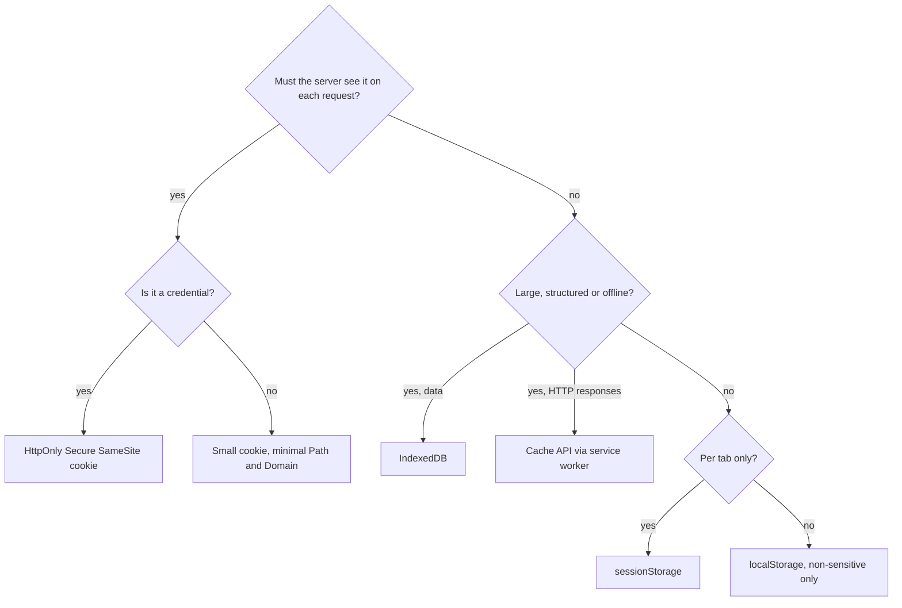
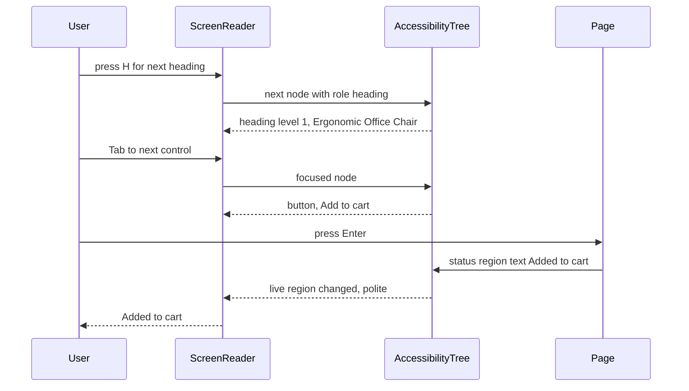

## 67.8 Browser storage: cookies, Web Storage, IndexedDB and the Cache API

#### Concept

The browser gives every **origin** (scheme plus host plus port, for example `https://shop.example.com`) several places to keep data on the user's device:

- **Cookies**: small name-value pairs the browser sends automatically with matching HTTP requests. Set by the server with `Set-Cookie` or by JavaScript with `document.cookie`.
- **`localStorage`**: a synchronous string key-value store that persists until cleared. Shared by all tabs of the origin.
- **`sessionStorage`**: the same API, but scoped to one tab and cleared when that tab closes.
- **IndexedDB**: an asynchronous, transactional database of structured objects with indexes, able to hold hundreds of megabytes.
- **Cache API**: a store of HTTP `Request` and `Response` pairs, used mainly by service workers for offline pages and assets.

#### Why does it exist?

HTTP is stateless (Part 3 — How the Web Works), so cookies were invented to let servers recognise a returning browser. Cookies travel on every request, so they are a terrible place for anything large; Web Storage was added for client-only data like a remembered filter. Apps that work offline or cache large datasets needed a real database (IndexedDB) and a programmable HTTP cache (Cache API). Each exists for a different job, and most storage bugs come from using one for another's job.

#### Mental model

Imagine a hotel guest. Cookies are the wristband: small, shown automatically at every door, and anyone who steals it can enter. `localStorage` is a notebook left in the room: handy, but any visitor allowed in the room can read it. `sessionStorage` is a sticky note that goes in the bin when you check out of this one visit. IndexedDB is a locked filing cabinet in the room with folders and an index. The Cache API is a shelf of photocopies of documents you fetched from the front desk, so you do not have to walk downstairs again.

#### How it works

| Store | Capacity (typical) | API | Sent to server | Readable by page JavaScript | Lifetime | Use for |
|---|---|---|---|---|---|---|
| Cookie | 4 KB per cookie; Chrome allows about 180 per domain | `Set-Cookie`, `document.cookie` | Yes, every matching request | No if `HttpOnly` | `Expires` or `Max-Age`, or session | Session ids, CSRF tokens, consent flags |
| `localStorage` | About 5 MB per origin | Synchronous, strings only | No | Yes | Until cleared | UI preferences, non-sensitive drafts |
| `sessionStorage` | About 5 MB per origin | Synchronous, strings only | No | Yes | Until tab closes | Per-tab wizard state |
| IndexedDB | Large: a share of free disk, often hundreds of MB to GB | Asynchronous, transactions, structured clone | No | Yes | Until cleared or evicted | Offline data, large client caches |
| Cache API | Shares the IndexedDB quota | Asynchronous, `caches.open()` | No | Yes, including service workers | Until cleared or evicted | Offline assets and pages |

Key mechanics:

1. **Cookies ride on every request.** A 3 KB cookie on the `.shop.example.com` domain is sent with every image, CSS and API request to every subdomain: on a page with 80 requests over HTTP/1.1, that is 240 KB of upload. HTTP/2 header compression (HPACK) reduces repeated cost but not the first request. Server limits are real: Node.js rejects request headers over 16 KB by default with `431 Request Header Fields Too Large`, and NGINX's default buffers produce `400 Request Header Or Cookie Too Large`.
2. **Cookie attributes** decide who can read and send them: `HttpOnly` (invisible to JavaScript), `Secure` (HTTPS only), `SameSite=Lax|Strict|None` (whether cross-site requests carry it), `Domain` and `Path` (scope), `Max-Age` (lifetime). Part 73 — Auth and Security in the Browser covers the security model in depth.
3. **Web Storage is synchronous.** `localStorage.getItem` blocks the main thread; reading a 2 MB value on a slow phone can take tens of milliseconds, and the first access may load the whole store from disk.
4. **Everything JavaScript can read, an XSS bug can read.** One injected script can dump `localStorage`, `sessionStorage`, IndexedDB and non-`HttpOnly` cookies and send them anywhere. Only `HttpOnly` cookies are out of its reach.
5. **Quotas and eviction.** `navigator.storage.estimate()` reports usage and quota. Under storage pressure, browsers evict "best-effort" origins, least recently used first, unless the origin has `navigator.storage.persist()`. Safari's Intelligent Tracking Prevention deletes all script-writable storage for a site after 7 days without user interaction.

What must **never** go in browser storage readable by JavaScript: passwords; long-lived refresh tokens or session tokens (use `HttpOnly` cookies); full card numbers or CVV (PCI DSS forbids storing CVV anywhere after authorisation); API secrets or keys with server-side power; personal data you would not be comfortable losing in a breach (government ids, health information). Also never trust anything read back from storage: the user can edit all of it in the Application panel.



#### Practical example

An e-commerce app stores: the session id in an `HttpOnly; Secure; SameSite=Lax` cookie; the "grid or list view" preference in `localStorage`; the multi-step return-request wizard's progress in `sessionStorage`, so two tabs with two returns do not overwrite each other; the last 200 viewed products in IndexedDB for an offline "recently viewed" page; and the app shell (HTML, CSS, JS) in the Cache API through a service worker. The cart lives on the server, keyed by the session, so it follows the user across devices.

#### React / Next.js example

Server rendering has no `window`, so reading `localStorage` during render crashes on the server or causes a hydration mismatch (the server HTML says "grid", the client says "list"). React 18's `useSyncExternalStore` handles this cleanly with a server snapshot:

```tsx
// useLocalPreference.ts  (React 18, safe with Next.js server rendering)
'use client';
import { useCallback, useSyncExternalStore } from 'react';

function subscribe(onChange: () => void) {
  window.addEventListener('storage', onChange);       // fires when another tab changes it
  return () => window.removeEventListener('storage', onChange);
}

export function useLocalPreference(key: string, fallback: string) {
  const value = useSyncExternalStore(
    subscribe,
    () => { try { return localStorage.getItem(key) ?? fallback; } catch { return fallback; } },
    () => fallback,                                    // server snapshot: always the fallback
  );
  const set = useCallback((next: string) => {
    try { localStorage.setItem(key, next); } catch { /* quota exceeded or storage disabled */ }
    window.dispatchEvent(new StorageEvent('storage', { key })); // notify this tab too
  }, [key]);
  return [value, set] as const;
}
```

On the server side of Next.js 14, `cookies()` from `next/headers` reads request cookies inside server components, Route Handlers and Server Actions, and can set them in Server Actions and Route Handlers. That is the right channel for anything the server needs during rendering.

#### Backend side (NestJS)

The backend owns cookies and can instruct the browser to wipe storage. A login and logout pair shows both:

```ts
// session.controller.ts  (requires app.use(cookieParser()) in main.ts)
import { Body, Controller, HttpCode, Post, Req, Res } from '@nestjs/common';
import type { Request, Response } from 'express';
import { SessionService } from './session.service';
import { LoginDto } from './login.dto';

@Controller('v1/session')
export class SessionController {
  constructor(private readonly sessions: SessionService) {}

  @Post()
  @HttpCode(204)
  async login(@Body() dto: LoginDto, @Res({ passthrough: true }) res: Response) {
    const session = await this.sessions.create(dto);    // random 32-byte id, stored server side
    res.cookie('sid', session.id, {
      httpOnly: true,            // invisible to document.cookie and to XSS
      secure: true,              // HTTPS only
      sameSite: 'lax',           // not sent on cross-site POSTs
      path: '/',
      maxAge: 1000 * 60 * 60 * 24 * 7, // 7 days, in milliseconds for Express
    });
  }

  @Post('logout')
  @HttpCode(204)
  async logout(@Req() req: Request, @Res({ passthrough: true }) res: Response) {
    await this.sessions.revoke(req.cookies?.sid);
    res.clearCookie('sid', { path: '/', httpOnly: true, secure: true, sameSite: 'lax' });
    // Ask the browser to delete cached responses, cookies and all storage for this origin.
    res.setHeader('Clear-Site-Data', '"cache", "cookies", "storage"');
  }
}
```

- **Keep cookies small and scoped.** One session id of about 40 bytes; no user profiles or feature flags in cookies. Set `Path` and avoid parent-domain cookies unless every subdomain truly needs them.
- **Use `Clear-Site-Data` on logout** for shared-device safety; it is supported in Chromium and Firefox, and partially in Safari, so do not rely on it alone.
- **Mark user-specific API responses `Cache-Control: private, no-store`** so they do not end up in the HTTP cache or a service worker cache on a shared machine.

#### Production scenario

A media site set analytics, A/B testing and personalisation cookies on `.example.com`. Over two years the average request carried 6.8 KB of cookies. Their image CDN on `img.example.com` received those cookies on every image request, which disabled caching at one CDN tier keyed on cookies and added 120 ms per image on 3G. Moving images to a cookieless domain and trimming cookies to under 1 KB cut median page weight by 310 KB of upload per page view and raised CDN hit rate from 71 % to 96 %.

#### Failure scenario

On a Tuesday morning, 4 % of logged-in users suddenly got a blank error page on every request: NGINX was answering `400 Request Header Or Cookie Too Large`. A marketing tool had started writing a new cookie per campaign, and long-time users had accumulated 30 of them. The backend team's dashboards showed nothing, because the requests never reached NestJS. Support could only tell users to clear cookies. The fix was a cookie allow-list at the edge, raising `large_client_header_buffers` temporarily, and a monitor on response code 400 and 431 at the load balancer split by cookie header size.

#### Edge cases & failure modes

- **`localStorage` throws** in some private modes or when storage is disabled, and on `setItem` when the quota is exceeded; always wrap it in try and catch.
- **Cross-tab overwrite**: two tabs write the same `localStorage` key; the `storage` event only fires in *other* tabs.
- **Stale schema**: a stored object from last year's app version lacks new fields; version the stored data.
- **Third-party storage partitioning**: embedded iframes from other sites get partitioned or blocked storage in modern browsers, breaking old embed-based login flows.
- **Eviction**: IndexedDB data can disappear under disk pressure; treat it as a cache unless persistence is granted.

#### How a Senior Full-Stack Engineer thinks about this

A senior asks three questions for any piece of client-side data: who must read it (server, page, both), what happens if an attacker reads it, and what happens if it disappears. Credentials go in `HttpOnly` cookies, user-owned business data goes on the server, and the browser keeps only caches and preferences that can be lost without harm. They watch cookie size like they watch payload size, because it is paid on every request and its failures happen before the application sees anything.

#### Common mistakes

- **Storing JWTs or refresh tokens in `localStorage`**, readable by any XSS.
- **Putting large or numerous cookies on the parent domain.**
- **Trusting values read from storage** (prices, roles, feature flags) without server validation.
- **Reading `localStorage` during server render**, causing crashes or hydration mismatches.
- **Never versioning stored data**, so a new release crashes on old shapes.

#### Interview questions

1. **Where would you store a session token in a browser app and why?** Expected answer: an `HttpOnly; Secure; SameSite` cookie, because JavaScript (and therefore XSS) cannot read it; pair it with CSRF protection. Follow-up: what are the tradeoffs versus a token in memory?
2. **What is the difference between `localStorage` and `sessionStorage`?** Expected answer: same API; `localStorage` is shared across tabs and persists, `sessionStorage` is per tab and cleared when it closes.
3. **When would you use IndexedDB over `localStorage`?** Expected answer: large or structured data, asynchronous access, offline support, transactions and indexes.
4. **How can cookies break a site without any application error?** Expected answer: oversized headers rejected by proxies (400 or 431), cookies disabling CDN caching, cookies sent to every subdomain.

#### Practical exercise

Implement login and logout in NestJS with an `HttpOnly` session cookie and `Clear-Site-Data` on logout. In the frontend, store a view preference in `localStorage` and a wizard step in `sessionStorage`. Use the DevTools Application panel to inspect each.

Acceptance criteria:

- `document.cookie` in the Console does not show the session cookie, but the Application panel does, with `HttpOnly`, `Secure` and `SameSite=Lax` ticked.
- After logout, the Application panel shows the session cookie and `localStorage` cleared (in Chromium).
- Sending 20 KB of cookies with `curl` to the NestJS server reproduces a 431 response.

## 67.9 Accessibility as engineering

#### Concept

**Accessibility** (often written **a11y**: "a", 11 letters, "y") means people can use your product regardless of disability: blindness and low vision, deafness, motor impairments that make a mouse impossible, cognitive differences, or a temporary condition like a broken wrist. About 1 in 6 people worldwide lives with a significant disability (WHO estimate). Accessibility is also a legal requirement in many markets, including the Americans with Disabilities Act in the US and the European Accessibility Act, which applies to e-commerce from June 2025. The common technical standard is **WCAG** (Web Content Accessibility Guidelines), usually at level AA.

The browser exposes the page to assistive technology through the **accessibility tree**: a parallel tree to the DOM in which each meaningful node has a **role** (button, link, heading, textbox), an **accessible name** ("Add to cart"), a **state** (expanded, checked, invalid, disabled) and sometimes a **value**. A screen reader reads that tree, not your pixels.

#### Why does it exist?

Without it, a screen reader user hears "button, button, button, image, link" and cannot shop. A keyboard-only user cannot reach the "Pay" button. A low-vision user cannot read light-grey text on white. These are not edge cases; they are customers who leave. Accessibility also overlaps with quality for everyone: keyboard support helps power users, captions help people in noisy places, good contrast helps everyone in sunlight, and semantic structure helps search engines and automated tests (Testing Library's `getByRole` queries the same tree).

#### Mental model

Imagine your page described over the phone to someone who cannot see it. The accessibility tree is that description. If you used a `<div>` instead of a `<button>`, the description says "some text" instead of "a button labelled Add to cart". If you moved focus nowhere after opening a dialog, the person on the phone is still standing in the previous room while you talk about a new one.

#### How it works

1. **The browser builds the accessibility tree** from the DOM and CSS. Native elements bring roles automatically: `<button>` is a button, `<a href>` a link, `<h2>` a heading level 2, `<input type="checkbox">` a checkbox, `<nav>` a navigation landmark. Elements hidden with `display: none` or `aria-hidden="true"` are removed.
2. **The accessible name** is computed in a fixed order: `aria-labelledby`, then `aria-label`, then native labelling (`<label for>`, `alt` on images, the text content of a button or link), then `title` as a last resort.
3. **ARIA attributes** add or override semantics when no native element exists: `role="tablist"`, `aria-expanded="true"`, `aria-controls`, `aria-invalid`, `aria-describedby`. The first rule of ARIA: if a native element does the job, use it. ARIA changes what is announced, never behaviour; `role="button"` on a `<div>` does not make it focusable or respond to Enter.
4. **Keyboard navigation.** Tab and Shift+Tab move between focusable elements in DOM order. Enter activates links and buttons; Space activates buttons and checkboxes; arrow keys move within composite widgets (menus, tabs, radio groups); Escape closes dialogs and menus. `tabindex="0"` adds an element to the tab order, `tabindex="-1"` makes it focusable by script only, and positive values break the natural order and should never be used. `:focus-visible` shows a focus ring for keyboard users without showing it on mouse clicks.
5. **Focus management.** When the UI changes context, the code must move focus: into a dialog when it opens (and back to the trigger when it closes), to the new page's heading after a client-side route change, to the first invalid field after a failed submit.
6. **Live regions** announce changes without moving focus: `role="status"` (or `aria-live="polite"`) for "Added to cart", `role="alert"` for urgent errors.
7. **Contrast.** WCAG AA requires a contrast ratio of at least 4.5:1 for normal text and 3:1 for large text (24 px, or about 18.7 px bold) and for UI component boundaries and focus indicators. `#767676` on white is about 4.5:1, the lightest grey that passes for body text.

How a screen reader reads a page: NVDA or JAWS on Windows, VoiceOver on macOS and iOS, TalkBack on Android. Users rarely listen top to bottom. They jump by headings (the H key in NVDA), by landmarks, by form fields or by links, pulling up lists of each. In a form, the reader announces each field as "PIN code, edit text, required, invalid entry, Enter a 6-digit PIN code". That sentence is built entirely from the label, the input type, `required`, `aria-invalid` and `aria-describedby`.



#### Practical example

A "Cancel order" flow opens a confirmation dialog. Accessible behaviour: the dialog has `role="dialog"` with a name from its heading; focus moves into it on open; Tab stays inside it; Escape closes it; the page behind is inert; focus returns to the "Cancel order" button on close; the result ("Order 8812 cancelled") is announced by a status region. The native `<dialog>` element with `showModal()` provides most of that for free: the rest of the page becomes inert, Escape closes it and modern browsers restore focus to the previously focused element.

#### React / Next.js example

```tsx
// CancelOrderDialog.tsx  (React 18, native <dialog>)
import { useId, useRef, useState } from 'react';

export function CancelOrder({ orderId, onCancel }: { orderId: string; onCancel: () => Promise<void> }) {
  const dialogRef = useRef<HTMLDialogElement>(null);
  const titleId = useId();
  const [status, setStatus] = useState('');

  async function confirm() {
    await onCancel();
    dialogRef.current?.close();              // focus returns to the trigger button
    setStatus(`Order ${orderId} cancelled`); // announced politely by the status region
  }

  return (
    <>
      <button type="button" onClick={() => dialogRef.current?.showModal()}>Cancel order</button>
      <dialog ref={dialogRef} aria-labelledby={titleId}>
        <h2 id={titleId}>Cancel order {orderId}?</h2>
        <p>Your refund will be issued to the original payment method within 5 to 7 days.</p>
        {/* showModal() focuses the first focusable element: the safe choice goes first */}
        <button type="button" onClick={() => dialogRef.current?.close()}>Keep order</button>
        <button type="button" onClick={confirm}>Yes, cancel</button>
      </dialog>
      <p role="status">{status}</p>
    </>
  );
}
```

In a Next.js App Router app, client-side navigation does not reload the page, so the screen reader is not told a new page has loaded. Next.js includes a route announcer that reads the new page's `<title>` (or first `<h1>`) on navigation, which is one more reason every page needs a distinct title (67.3).

#### Backend side (NestJS)

Accessible forms need the API to say *which* field is wrong and *why*, in words a person can understand. Configure the `ValidationPipe` to return field-level errors in a stable shape:

```ts
// main.ts: field-level validation errors the UI can attach to inputs
import { BadRequestException, ValidationPipe, type ValidationError } from '@nestjs/common';

export const validationPipe = new ValidationPipe({
  whitelist: true,
  transform: true,
  exceptionFactory: (errors: ValidationError[]) =>
    new BadRequestException({
      type: 'validation_error',
      title: 'Some fields need attention',
      fieldErrors: Object.fromEntries(
        errors.map((e) => [e.property, Object.values(e.constraints ?? {})[0] ?? 'Invalid value']),
      ),
    }),
});
// app.useGlobalPipes(validationPipe);
```

With `fieldErrors.postalCode = "Enter a 6-digit PIN code"`, the frontend sets `aria-invalid` and renders the message in the element referenced by `aria-describedby`, and moves focus to the first invalid field. Write constraint messages for humans in DTOs (`@Matches(/^[1-9][0-9]{5}$/, { message: 'Enter a 6-digit PIN code' })`), and return product `alt` text, captions and transcripts as content fields, written by people, not generated from file names. Part 72 — Frontend–Backend Contracts covers the full error contract.

#### Production scenario

A retailer received a legal demand letter citing 14 WCAG failures on checkout. An audit with axe DevTools and manual screen reader testing found: icon-only buttons without names ("button" announced for the cart, search and close icons), a custom dropdown for delivery slots unusable by keyboard, error messages shown only as red borders, focus lost after the coupon form re-rendered, and grey placeholder text at 2.9:1 contrast used as labels. The fixes took one sprint: `aria-label` on icon buttons, a native `<select>`, field errors from the API linked with `aria-describedby`, focus restoration, real `<label>` elements, darker text. Checkout completion for keyboard and screen reader users, tracked by a small usability panel, went from 3 of 10 to 9 of 10, and overall checkout errors fell 6 % because clearer error messages helped everyone.

#### Failure scenario

A team shipped a redesigned order-tracking page where the status updated live: "Packed", then "Out for delivery". The status was a styled `<div>` updated by React. A blind customer called support three times asking whether their insulin delivery had shipped; the page had changed, but nothing was announced, and the screen reader still read the old text it had cached in browse mode. The fix was a `role="status"` region for the current status and a real `<ol>` for the timeline with `aria-current="step"` on the active step. The team added an automated check with `@axe-core/playwright` to the CI journey tests (Part 75 — Frontend Testing and Quality).

#### Edge cases & failure modes

- **Icon-only buttons** without `aria-label` are announced as just "button".
- **`outline: none` without a replacement** makes keyboard focus invisible.
- **Placeholder used as a label** disappears on typing and usually fails contrast.
- **Toasts that vanish after 3 seconds** may never be read; use a status region and enough time.
- **Disabled submit buttons** cannot be focused, so screen reader users cannot discover why they cannot proceed; prefer enabled buttons that show errors.
- **Focus lost on re-render**: replacing a list or form with new DOM drops focus back to `<body>`.
- **Infinite scroll** makes the footer unreachable by keyboard.

#### How a Senior Full-Stack Engineer thinks about this

A senior treats accessibility like security: a property of the system built in from the start, tested automatically where possible and manually where not. Automated tools such as axe and Lighthouse catch about a third of issues (missing names, contrast, invalid ARIA); keyboard testing and a screen reader pass catch the rest. Their defaults are native elements, visible focus, labelled controls, managed focus, and errors that say what to do. They know the backend shapes accessibility through error messages, alt text and content fields. To a product manager: "If a customer can't use the checkout with a keyboard, that's a checkout outage for them, and in many countries a legal risk for us."

#### Common mistakes

- **Adding ARIA to fix non-semantic markup** instead of using the right element.
- **Removing focus outlines** for aesthetics.
- **Using colour alone** to show errors or order status.
- **Generic messages** like "Invalid input" with no field association.
- **Testing only with Lighthouse** and never with a keyboard or screen reader.

#### Interview questions

1. **What is the accessibility tree and how is an element's accessible name computed?** Expected answer: the browser's semantic representation of the page for assistive tech; name from `aria-labelledby`, `aria-label`, native labels or content, then `title`. Follow-up: why does `role="button"` on a `<div>` not make it a button?
2. **How do you make a modal dialog accessible?** Expected answer: dialog role and name, focus moved in, focus contained, Escape closes, background inert, focus restored; native `<dialog>` with `showModal()` provides most of this.
3. **What contrast ratios does WCAG AA require?** Expected answer: 4.5:1 normal text, 3:1 large text and UI components.
4. **How does the API help accessibility?** Expected answer: field-level, human-readable error messages; alt text and captions as content; stable error shapes.

#### Practical exercise

Make an address form and a cancel-order dialog fully operable by keyboard and screen reader, with errors from a NestJS `ValidationPipe` `exceptionFactory`. Test with VoiceOver (Cmd+F5 on macOS) or NVDA, and with the DevTools Accessibility pane and Lighthouse.

Acceptance criteria:

- Every control is reachable with Tab in a logical order and shows a visible focus ring.
- Submitting invalid data moves focus to the first invalid field, and the screen reader announces its label, "invalid entry" and the API's message.
- The dialog traps focus, closes with Escape and returns focus to its trigger.
- Lighthouse accessibility score is 100 and axe reports zero violations, and you can name one issue you found manually that neither tool reported.
