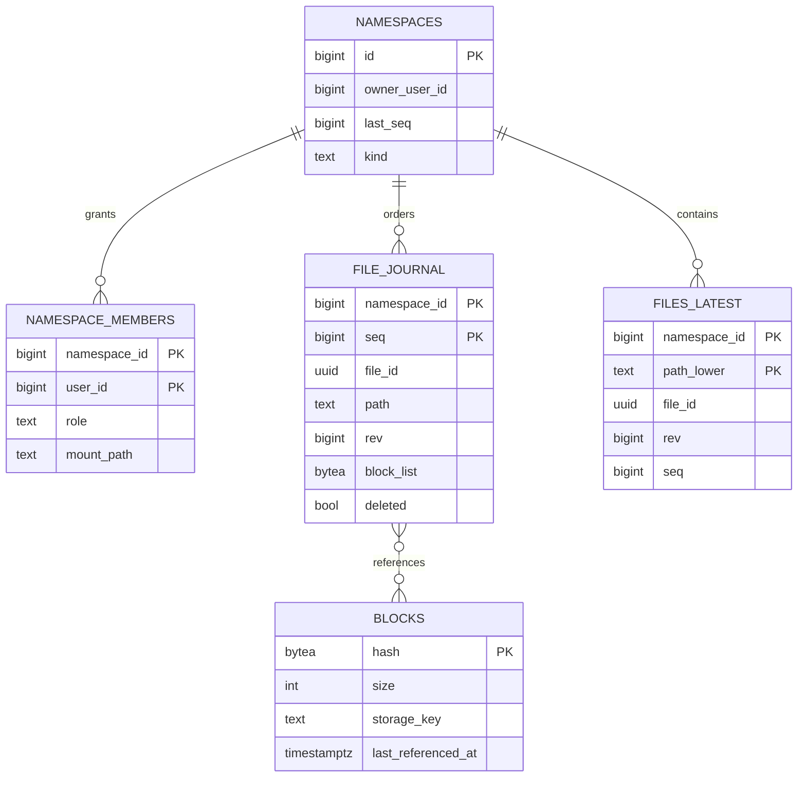
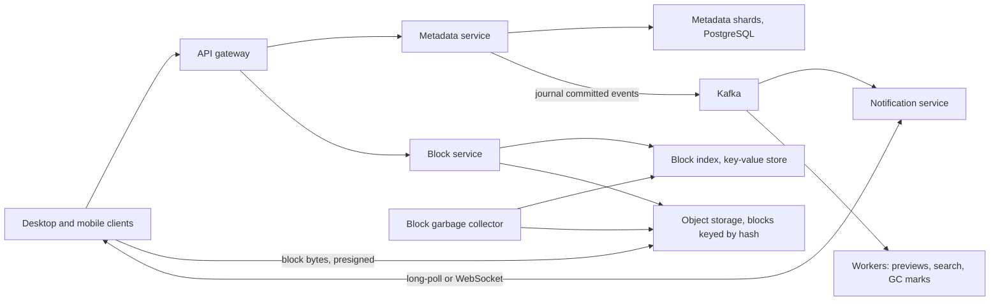
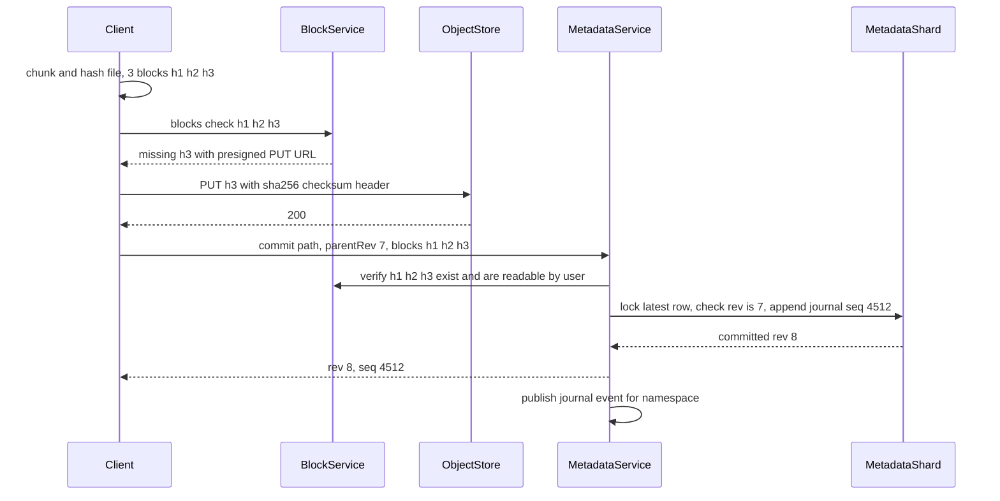
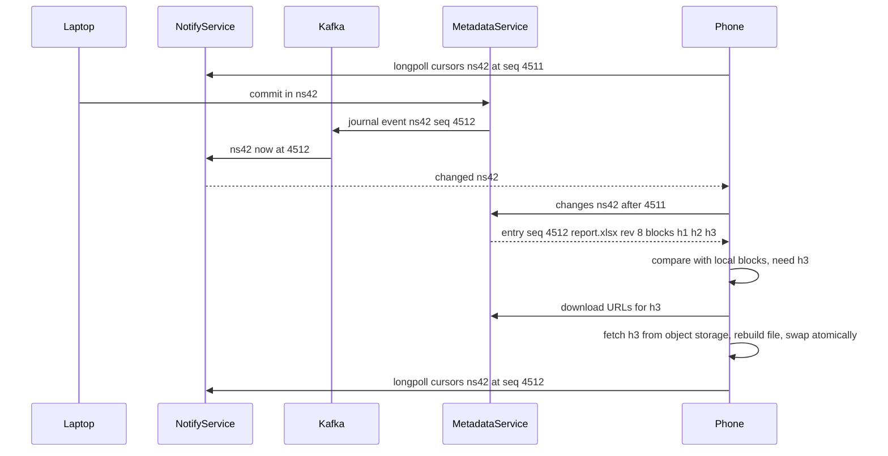

## 68.2 File Sync (Dropbox-style)

> **Try it first** · Level: Advanced · About 60 minutes
>
> **Build:** a service that keeps a folder of files identical across a user's laptops, phones and the web, and lets users share folders with each other.
>
> **Requirements:**
> - upload, download, update, rename and delete files of up to 50 GB, resuming interrupted transfers
> - propagate a change to the user's other online devices within seconds
> - keep working offline and reconcile edits on reconnect, never silently losing either side of a conflict
> - keep 30 days of version history and allow restoring any version
> - share folders with other users, with viewer and editor permissions
>
> **Scale and constraints:** 50 million users, 10 million daily active, about 2 devices each and 12 million clients connected at peak; 2 GB stored per user on average (100 PB logical, about 70 PB after deduplication); 200 million file changes a day (about 2,300 per second on average, 7,000 at peak) carrying about 200 TB of new data a day; a change visible on other online devices within 5 seconds p95 for small files; no acknowledged change ever lost.
>
> **Your task:** sketch the API, the data model and the main components; estimate storage and throughput; name the two hardest problems and how you would solve them.
>
> Spend the time on paper before you read on. The model design follows.

### 68.2.1 Requirements

A file sync service keeps a folder on every device a user owns in the same state, and makes a cloud copy the source of truth. Edit a spreadsheet on your laptop, and a few seconds later your phone shows the new version; delete a photo on your phone, and it disappears from the laptop; work on a plane, and everything reconciles when you land. Add sharing, and the same folder is kept in sync across many people's devices.

The users are individuals and teams, through three kinds of client: a desktop client that watches a real folder on disk, mobile apps that mostly browse and upload photos, and a web interface. Part 55 — System Design Case Studies, section 55.5 (File Upload System), covers getting one file into object storage safely. This design is harder in three ways. Files **change** and must be updated efficiently, not re-uploaded whole. Many devices **write** to the same folder, sometimes offline, so changes conflict. And every device must **learn about** every change quickly without polling a server every second.

#### Mental model

Imagine a family notebook kept in a bank vault, with each family member holding a photocopy at home. Nobody rewrites the whole notebook when they change one page; they send only the changed pages. The vault keeps a numbered ledger: "entry 4,512: page 37 replaced by Asha". Each family member remembers the last ledger number they saw and asks "what happened after 4,511?". If two people changed page 37 since they last checked, the vault does not pick a winner; it keeps both pages and labels one "Ravi's conflicting copy". The pages are the **blocks**, the ledger is the **journal**, the remembered number is the **cursor**, and the labelled page is the **conflicted copy**.

### 68.2.2 Functional requirements

1. Upload new files and updates of up to 50 GB; an interrupted transfer resumes where it stopped.
2. Upload only the parts of a file that changed, and never upload content the service already has for that user.
3. Download changed files to every device; propagate changes to online devices within seconds.
4. Support rename, move and delete, including whole folders.
5. Work offline; on reconnect, merge local and remote changes. When the same file changed on both sides, keep both versions as a conflicted copy.
6. Keep every version for 30 days; restore any version or any deleted file.
7. Share a folder with other users as viewer or editor; revoke access; share a read-only link.

Non-goals: real-time co-editing inside a document (section 67.2 covers collaborative editing), full-text search across file contents, and previews and thumbnails beyond a mention.

### 68.2.3 Non-functional requirements

| Property | Target | Why |
|---|---|---|
| Durability of file content | 99.999999999 percent (eleven nines) per object, as object storage provides | Losing a user's file is the one unforgivable failure |
| Durability of metadata | No acknowledged commit ever lost (synchronous replication) | A file whose metadata is lost is as gone as a deleted one |
| Sync latency | Change visible on other online devices within 5 s p95 for files under 10 MB | Users notice when the phone lags the laptop |
| Consistency | Per folder, every device applies changes in the same order | Out-of-order application corrupts trees (a file inside a deleted folder) |
| Availability | 99.95 percent for metadata; offline edits make short outages tolerable | The client queues work locally |
| Efficiency | Changed-bytes-only uploads; dedup within an account | Bandwidth on home connections and storage cost dominate |

### 68.2.4 Constraints

- Client networks are slow, flaky and asymmetric (a home upload link may be 10 to 20 Mbit/s), so the protocol must survive disconnects at any point.
- Clients run on users' machines: they can be old versions, have wrong clocks, and be modified by attackers. The server trusts nothing a client asserts about content without verifying it.
- File bytes go to object storage (S3); they must never stream through the application servers, which would make those servers a bandwidth bottleneck.
- Storage is the largest bill. Deduplication and storage tiering are financial requirements, not optimizations.

### 68.2.5 Capacity estimation

| Quantity | Assumption | Calculation | Result |
|---|---|---|---|
| Users, daily active | given | | 50M users, 10M DAU |
| Logical stored data | 2 GB average per user | 50M x 2 GB | 100 PB |
| After deduplication | identical blocks within an account, plus versions sharing blocks | about 30 percent saved | about 70 PB stored |
| File changes per day | 10M DAU x 20 changes | | 200M per day |
| Change rate | 200M / 86,400, peak 3x | | about 2,300 per second, 7,000 at peak |
| New data uploaded | about 1 MB of changed blocks per change on average | 200M x 1 MB | about 200 TB per day, 2.3 GB/s average, about 18 Gbit/s |
| Data downloaded | each change syncs to about 1.5 other devices | 200 TB x 1.5 | about 300 TB per day |
| Files stored | about 2,000 files per user (1 MB average) | 50M x 2,000 | 100 billion file entries |
| Metadata size | ~400 bytes per entry (path, ids, block list), plus 30 days of versions | 100B x 400 B, plus about 50 percent | about 60 TB |
| Metadata shards | PostgreSQL shards of about 500 GB | 60 TB / 500 GB | about 128 shards |
| Blocks stored | 70 PB / about 1.5 MB average block | | about 45 billion blocks |
| Block index | 45B x ~100 bytes (hash, size, location, references) | | about 4.5 TB, in a key-value store |
| Connected clients | desktop clients stay connected all day | given | about 12 million at peak |
| Notification servers | about 100,000 idle connections per server | 12M / 100,000, plus headroom | about 150 servers |

Read the table for what it forces. **200 TB a day of uploads** must go straight from clients to object storage. **100 billion file entries** do not fit one database, so metadata is sharded, and the shard key must keep each folder's history in one place so its journal can be ordered. **12 million connections** means notifications are their own tier, built for idle connections, separate from the request-handling API.

### 68.2.6 API design

| Method | Path | Request | Response | Status | Idempotent | Notes |
|---|---|---|---|---|---|---|
| POST | `/v1/blocks/check` | `{ namespaceId, hashes: [...] }` | `{ missing: [{ hash, uploadUrl }] }` | 200 | Yes | Presigned PUT URL per missing block, valid 15 minutes |
| PUT | (presigned S3 URL) | block bytes, `x-amz-checksum-sha256` header | | 200, 400 | Yes | Goes straight to object storage |
| POST | `/v1/files/commit` | `{ namespaceId, path, parentRev, size, blocks: [...], clientMtime }` | `{ rev, seq }` | 200, 409, 412 | Yes, same body gives same result | 409 = parent revision is stale (conflict), 412 = blocks missing |
| GET | `/v1/namespaces/{id}/changes?cursor=` | | `{ entries: [...], cursor, hasMore }` | 200, 410 | Yes | 410 = cursor too old, do a full resync |
| POST | `/v1/notify/longpoll` | `{ cursors: { nsId: cursor } }` | `{ changed: [nsIds] }` or `{ changed: [] }` after 60 s | 200 | Yes | Held open; WebSocket variant for mobile foreground |
| POST | `/v1/blocks/download-urls` | `{ namespaceId, hashes: [...] }` | `{ urls: [{ hash, url }] }` | 200, 403 | Yes | Presigned GET URLs |
| POST | `/v1/files/move`, `/v1/files/delete` | `{ namespaceId, path, toPath?, parentRev }` | `{ rev, seq }` | 200, 409 | Yes | Folder operations expand to journal entries server-side |
| GET | `/v1/files/{fileId}/revisions` | | `[{ rev, size, modifiedBy, at }]` | 200 | Yes | 30 days |
| POST | `/v1/shares` | `{ folderPath, members: [{ userId, role }] }` | `{ namespaceId }` | 201 | Yes, by request id | Turns a folder into a shared namespace |

Every write is **conditional**: the commit carries `parentRev`, the revision the client last saw, and succeeds only if that is still the latest. This single field is the whole conflict-detection mechanism. A retried commit with the same body after a timeout finds that its own revision is now the latest with identical content, and the server returns the original result rather than a conflict.

### 68.2.7 Data model

Files live inside **namespaces**. A user's home folder is one namespace; each shared folder is another namespace, mounted into the trees of everyone it is shared with. A namespace is the unit of sharding, ordering and permission.



```sql
-- On each metadata shard; rows for one namespace always live on one shard
CREATE TABLE file_journal (
  namespace_id  bigint      NOT NULL,
  seq           bigint      NOT NULL,           -- dense, per-namespace order
  file_id       uuid        NOT NULL,           -- stable across renames
  path          text        NOT NULL,           -- display path, case preserved
  rev           bigint      NOT NULL,
  size          bigint      NOT NULL,
  block_list    bytea       NOT NULL,           -- concatenated 32-byte SHA-256 hashes
  deleted       boolean     NOT NULL DEFAULT false,
  device_id     uuid        NOT NULL,
  committed_at  timestamptz NOT NULL DEFAULT now(),
  PRIMARY KEY (namespace_id, seq)               -- serves "changes after cursor"
);

CREATE TABLE files_latest (
  namespace_id  bigint      NOT NULL,
  path_lower    text        NOT NULL,           -- case-insensitive uniqueness, like most desktop filesystems
  file_id       uuid        NOT NULL,
  rev           bigint      NOT NULL,
  seq           bigint      NOT NULL,
  PRIMARY KEY (namespace_id, path_lower)        -- serves the conditional commit check
);
```

The journal is **append-only** and is the source of truth; `files_latest` is a materialized "current state" maintained in the same transaction. Version history is simply older journal rows for the same `file_id`, kept for 30 days. The `blocks` table lives in a separate sharded key-value store keyed by hash (the store from section 66.2 is exactly this shape), because it is looked up by hash from every shard and has no relational needs.

A **cursor** is an opaque, signed token encoding `(namespace_id, seq)`. Reading changes is a primary-key range scan: `WHERE namespace_id = $1 AND seq > $2 ORDER BY seq LIMIT 1000`.

### 68.2.8 High-level architecture



The design separates **what** a file is from **where its bytes are**. The metadata service owns names, folders, revisions, permissions and the journal; it never touches file bytes. The block service owns the mapping from content hash to stored object and hands out presigned URLs; the bytes themselves move directly between clients and object storage. The notification service holds millions of idle connections and does nothing but say "namespace 42 has news".

### 68.2.9 Component design

| Component | Responsibility | Notes |
|---|---|---|
| Desktop client | Watch the folder, chunk and hash files, keep a local database of the last synced state, run the sync engine, upload and download blocks | Most of the intelligence lives here |
| API gateway | Authentication, rate limits, routing by namespace to the right metadata shard | Stateless |
| Metadata service | Conditional commits, journal, changes feed, moves, deletes, versions, sharing | Shard map: namespace id to PostgreSQL shard |
| Block service | Answer "which of these hashes are missing", issue presigned PUT and GET URLs, record new blocks after verification | Never sees bytes |
| Block index | `hash -> size, storage key, last_referenced_at` | 45 billion entries, sharded by hash |
| Object storage | Durable block bytes | Keys derived from the hash |
| Notification service | Hold connections, map namespace to waiting clients, wake them on journal events | About 150 servers |
| Garbage collector | Find blocks no live or retained version references, delete after a grace period | The most dangerous component (68.2.21) |

The desktop client keeps three views of the world in a local SQLite database, which is a common approach in sync clients: the **remote** tree (what the server last told it), the **local** tree (what is on disk now), and the **synced** tree (the last state both agreed on). Comparing each with the synced base tells the client who changed what: changed locally only means upload, changed remotely only means download, changed on both means a conflict. Without the base, the client cannot tell "I deleted this file" from "the server added this file".

### 68.2.10 Deep dive: chunking and dedup, the commit protocol, sync and conflicts

#### Deep dive: chunking and content-addressed deduplication

Files are split into **blocks**, and each block is named by the SHA-256 hash of its bytes. A file is then just an ordered list of block hashes. This one idea gives four properties at once:

1. **Delta upload.** When a file changes, the client re-chunks it, and only blocks whose hashes the server lacks are uploaded.
2. **Deduplication.** Two identical blocks have the same hash and are stored once. Versions of a file share all unchanged blocks.
3. **Resumability.** Each block is uploaded independently, so a broken 50 GB upload resumes at the next missing block.
4. **Integrity.** A block's name is a checksum of its content, so corruption is detectable everywhere.

How to split matters. **Fixed-size chunking** cuts at every 4 MB. It is simple and fast, and it works well for files that change in place (databases, virtual-machine images). But insert one byte at the start of a document and every boundary shifts by one byte: every block's hash changes, and the "delta" upload is the whole file.

**Content-defined chunking (CDC)** picks boundaries from the content itself. A rolling hash is computed over a small sliding window of bytes, and a boundary is declared wherever the hash matches a pattern (for example, its low 20 bits are zero, which happens about once every 1 MB). Because boundaries depend on nearby bytes, not on position, an insertion only changes the block it lands in; boundaries after it re-synchronize. Minimum and maximum sizes (say 256 KB and 4 MB) stop pathological content from producing tiny or giant blocks. FastCDC, a widely used CDC algorithm, uses a cheap "gear" rolling hash:

```ts
// client/chunker.ts: simplified gear-hash content-defined chunking
import { createHash } from 'node:crypto';

const MIN = 256 * 1024, MAX = 4 * 1024 * 1024;
const MASK = (1 << 20) - 1;                       // boundary roughly every 1 MB after MIN
const GEAR = new Uint32Array(256);                 // fixed pseudo-random table, identical on every client
for (let i = 0, x = 0x9e3779b9; i < 256; i++) { x ^= x << 13; x ^= x >>> 17; x ^= x << 5; GEAR[i] = x >>> 0; }

export interface Block { hash: string; offset: number; size: number }

export function chunk(data: Buffer): Block[] {
  const blocks: Block[] = [];
  let start = 0;
  while (start < data.length) {
    const end = Math.min(start + MAX, data.length);
    let cut = end;
    let h = 0;
    for (let i = start + MIN; i < end; i++) {      // never cut before MIN bytes
      h = ((h << 1) + GEAR[data[i]]) >>> 0;        // gear hash: old bytes shift out after 32 steps
      if ((h & MASK) === 0) { cut = i + 1; break; }
    }
    const piece = data.subarray(start, cut);
    blocks.push({ hash: createHash('sha256').update(piece).digest('hex'), offset: start, size: piece.length });
    start = cut;
  }
  return blocks;
}
```

A real client streams the file rather than loading it into one `Buffer`, but the boundary logic is exactly this. The table and parameters must be identical across every client version forever, or the same file chunks differently on two devices and deduplication silently stops working.

**Where to deduplicate** is a security decision, not just a storage one. If the server tells a client "you do not need to upload block H, we already have it" whenever *anyone* has H, two attacks open up. A client can learn whether a specific file exists anywhere in the service (upload a known document's hashes and see what is "missing"). Worse, a client that knows only the hash of someone else's file can claim to have it and then download it. So `blocks/check` deduplicates only **within the caller's own namespaces**: a hash counts as present only if a block with that hash is already referenced from a namespace the user can read. Cross-user deduplication still happens, but invisibly on the server side after the upload: if the uploaded block already exists, the second copy is dropped. Storage is saved; bandwidth for that case is not, and nothing leaks.

#### Deep dive: the upload and commit protocol

Uploading a changed file is a three-step conversation, designed so that any step can fail and be retried safely:



Three details make it safe:

- **The presigned PUT pins the content.** The URL is signed for the key derived from `h3` and requires an `x-amz-checksum-sha256` header equal to the expected hash, so object storage itself rejects bytes that do not match. A malicious client cannot upload garbage under someone else's hash. The block service still confirms with a `HEAD` request before recording the block.
- **The commit verifies blocks exist.** If a block is missing (the upload failed, or the garbage collector removed it), the commit returns 412 with the list, and the client uploads again. A file version never points at a block that is not there.
- **The commit is conditional and serialized per namespace.** Inside one transaction, the metadata service first locks the namespace row (so two devices creating the same new path cannot both see "no row yet"), then reads the file's latest row, checks `parentRev`, increments the namespace's `last_seq`, appends the journal row and updates `files_latest`.

```sql
BEGIN;
SELECT 1 FROM namespaces WHERE id = $1 FOR UPDATE;      -- namespace lock first: serializes commits, even for a path with no row yet
SELECT rev FROM files_latest
 WHERE namespace_id = $1 AND path_lower = lower($2)
   FOR UPDATE;                                         -- no row means a new file; parentRev must be 0
-- application: if rev <> parentRev, ROLLBACK and return 409 with the current rev
UPDATE namespaces SET last_seq = last_seq + 1
 WHERE id = $1
RETURNING last_seq;                                    -- the row lock orders all commits in this namespace
INSERT INTO file_journal (namespace_id, seq, file_id, path, rev, size, block_list, device_id)
VALUES ($1, $3, $4, $2, $5, $6, $7, $8);
INSERT INTO files_latest (namespace_id, path_lower, file_id, rev, seq)
VALUES ($1, lower($2), $4, $5, $3)
ON CONFLICT (namespace_id, path_lower)
DO UPDATE SET file_id = EXCLUDED.file_id, rev = EXCLUDED.rev, seq = EXCLUDED.seq;
COMMIT;
```

The `last_seq` row lock serializes commits within one namespace. That is deliberate: it gives a dense, gap-free order that every device applies identically. A personal namespace commits a few times a minute, so the lock costs nothing. A very busy team folder (thousands of members) might commit tens of times per second, still fine for a single-row update of about a millisecond; the ceiling is several hundred commits per second per namespace, far above any real folder.

Large files reuse the same protocol. A 50 GB file is about 33,000 blocks at the roughly 1.5 MB average block size (12,500 even if every block hit the 4 MB maximum); the client uploads several blocks in parallel (four to eight connections), records each finished hash locally, and commits once at the end. A laptop that sleeps halfway through simply asks `blocks/check` again on wake and uploads what is still missing. There is no separate "resumable upload session" to expire, because every block is its own durable object.

#### Deep dive: the sync protocol, journal, cursors and notifications

Every device learns about changes the same way: "give me everything in this namespace after my cursor". The journal's dense per-namespace `seq` makes that a cheap range scan and guarantees that every device sees the same changes in the same order.

Polling that endpoint every few seconds from 12 million clients would be 3 to 4 million requests per second of mostly empty answers. Instead, the client holds one **long-poll** (or WebSocket, section 35.4 and section 35.2 compare them) to the notification service, listing its cursors. The notification service answers only when one of those namespaces has a journal entry beyond the client's cursor, or after about 60 seconds with "nothing new", at which point the client reconnects.



The notification only says "something changed"; it never carries the change itself. That keeps the notification tier simple and stateless apart from its connection table, and it means a lost or duplicated notification is harmless: the next long-poll compares cursors and the changes feed is the single source of what happened. If a notification server dies, its clients reconnect to another one and immediately get an answer for any namespace that moved while they were away.

When a cursor is older than the retained journal (a laptop offline for months), the changes endpoint returns 410, and the client performs a **full resync**: it lists the current state of the namespace, compares it with its local tree by hash, and downloads or uploads differences. It is slow but correct, and it is also the recovery path for any client whose local database gets corrupted.

The client applies remote changes **atomically per file**: it writes the reconstructed file to a temporary file in the same directory, verifies the block hashes, then renames it over the old one. A crash midway leaves either the old file or the new one, never half of each. It also reuses blocks it already has locally, from this file or others, so a downloaded new version usually fetches only one or two blocks.

#### Deep dive: conflicts and offline edits

A conflict happens when two devices both changed a file since the revision they last agreed on. The server detects it with `parentRev`; the client resolves it, and the rule is simple: **never silently discard anyone's work.**

1. The laptop and the phone both start from `report.xlsx` at revision 7.
2. The phone, online, commits revision 8.
3. The laptop, offline on a plane, edits the file. On landing it commits with `parentRev = 7` and receives 409 with "current is revision 8".
4. The laptop downloads revision 8 into `report.xlsx` and saves its own edit as `report (Asha's laptop's conflicted copy 2026-11-11).xlsx`, committed as a new file.
5. Both versions exist on every device. A person, not an algorithm, decides how to merge them.

Why not "last writer wins" by timestamp? Because client clocks are wrong (section 29.13 explains why wall clocks cannot order events across machines), and because silently replacing an hour of someone's work with a different hour of someone else's work is exactly the failure users never forgive. Why not merge contents automatically? Because the service does not understand most file formats; merging two spreadsheets byte by byte produces a corrupt file.

Other combinations need explicit rules, decided once and applied everywhere:

| Local change | Remote change | Rule |
|---|---|---|
| Edit | Edit | Conflicted copy for the local edit |
| Edit | Delete | Edit wins: the file is restored with the local content, since deleting someone's fresh work is worse than resurrecting a file |
| Delete | Edit | Remote edit wins; the local delete is dropped |
| Rename | Edit | Both apply: the file id is stable, so the edit follows the file to its new path |
| Create at same path | Create at same path | Different content: conflicted copy; identical block list: no conflict at all |
| Delete folder | Add file inside it | The folder is recreated with only the new file in it |

Offline work is just a queue of these operations in the client's local database, replayed in order on reconnect: first fetch remote changes and apply the non-conflicting ones, then commit local changes one by one with their `parentRev`, handling each 409 by the table above. Because every commit is conditional and every retry is idempotent, the client can crash at any point in the replay and simply start again.
