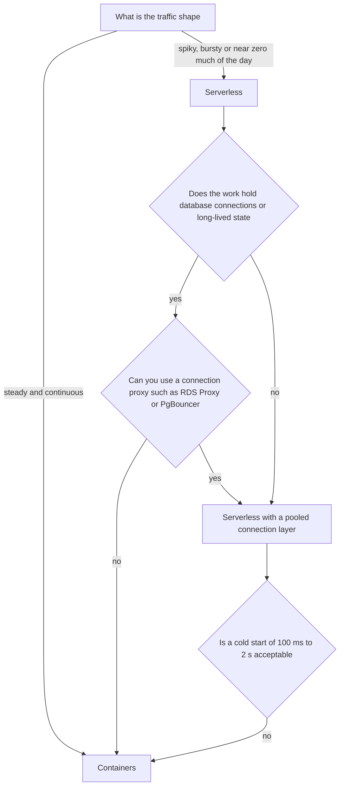
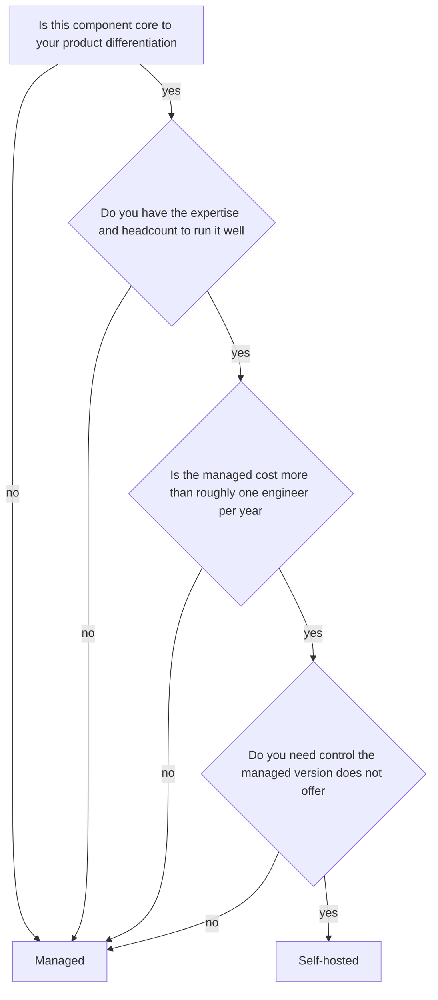
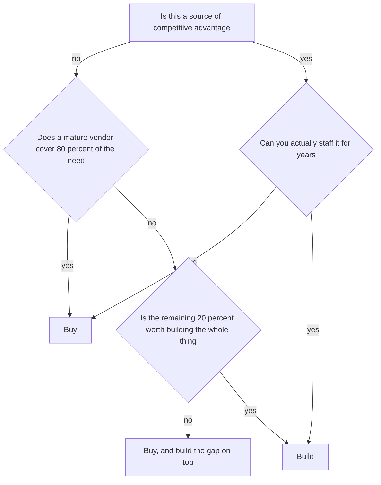
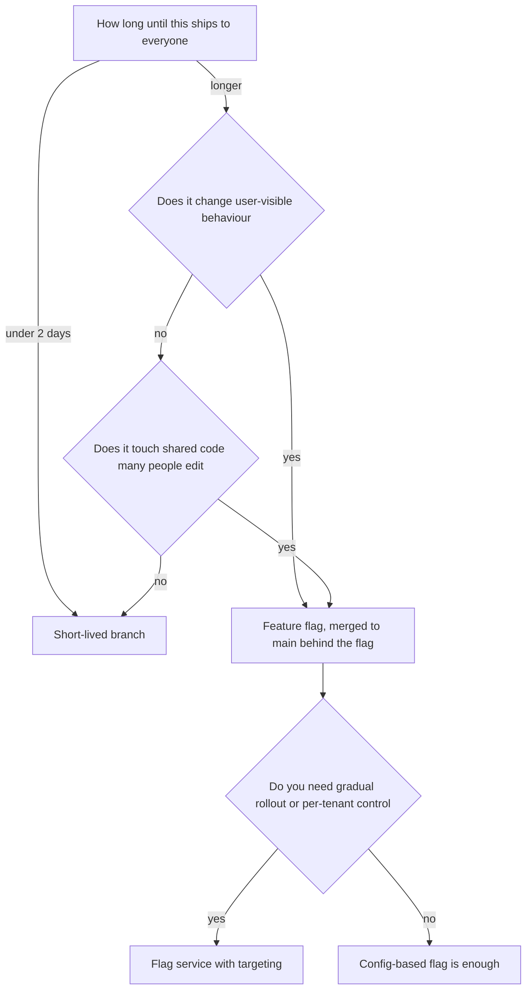

## 68.17 Serverless versus containers

### Decision tree



### If... then choose

```text
If traffic is spiky or near zero for most of the day
   -> Choose serverless; you pay only for what runs
If the workload is event-driven glue, such as reacting to an S3 upload
   -> Choose serverless
If traffic is steady and continuous above roughly one request per second sustained
   -> Choose containers; the economics flip
If you need long-lived connections, WebSockets or in-process caches
   -> Choose containers
If the work regularly runs longer than the platform's execution limit
   -> Choose containers
If cold-start latency on a user-facing path is unacceptable
   -> Choose containers, or keep a provisioned concurrency floor
If you need one runtime for both HTTP and background workers with shared code
   -> Choose containers; a NestJS image can run as an API or a worker with a flag
```

### Trade-offs

| Dimension | Serverless (Lambda) | Containers (ECS, Kubernetes) |
|---|---|---|
| Consistency | Same code, but each invocation is isolated; no shared in-process state | Shared process state, in-memory caches, warm pools |
| Latency | Cold starts of 100 ms to 2 s; warm invocations are fast | Consistently warm; no cold-start class of problem |
| Throughput | Scales to thousands of concurrent executions in seconds | Scales in tens of seconds; needs headroom planning |
| Operational cost | Very low; no servers, patching or capacity planning | Moderate; images, rollouts, autoscaling, probes |
| Team skill | Low to start; hard to debug distributed event flows | Standard backend and platform skills |
| Flexibility | Constrained: execution time limits, payload limits, no persistent connections | Anything you can run in Linux |
| Money cost | Cheap when idle, expensive under sustained load; the crossover is usually a few hundred thousand invocations per day | Fixed cost regardless of traffic; better value at steady load |
| Ecosystem | Deep cloud integration with triggers and events | Portable, huge ecosystem |
| Failure modes | Cold starts, concurrency limits, connection exhaustion against PostgreSQL, timeout ceilings, retry semantics that surprise people | OOMKilled, CrashLoopBackOff, slow scaling under a spike |

The database connection issue deserves emphasis because it is the most common serverless production failure. Each concurrent Lambda holds its own PostgreSQL connection; 500 concurrent invocations means 500 connections against a `max_connections` of 200, and the database rejects them all. The fix is a proxy (RDS Proxy or PgBouncer in transaction mode), and it must be in the design from the start.

### Signals you chose wrong

- Your Lambda bill exceeds what two containers would cost, which means sustained load.
- You added provisioned concurrency to remove cold starts, which is paying for always-on compute inside a pay-per-use model.
- PostgreSQL is at its connection limit and the connections come from function invocations.
- Your function times out at 15 minutes and you are splitting work into artificial chunks to fit.
- You chose containers and pay for 20 idle pods overnight for a workload that runs twice an hour.

### How to change your mind later

Keep business logic in plain classes and treat the handler as a thin adapter. Then a function becomes a container by adding an HTTP entry point, and a container becomes a function by adding a handler file.

```ts
// Shared, platform-free application service
export class ResizeImageService { async execute(input: ResizeInput): Promise<ResizeResult> { /* ... */ } }

// Lambda adapter
export const handler = async (event: S3Event) =>
  service.execute({ bucket: event.Records[0].s3.bucket.name, key: event.Records[0].s3.object.key });

// Container adapter: a NestJS worker consuming the same events from a queue
@Processor('resize')
export class ResizeProcessor { @Process() run(job: Job<ResizeInput>) { return service.execute(job.data); } }
```

With that structure, migrating in either direction is a week of adapter and pipeline work rather than a rewrite.

### Senior perspective

Serverless is a billing model and a scaling model before it is anything else, and the decision usually comes down to duty cycle. Below roughly 20 percent utilisation, paying per invocation is cheaper and simpler; above that, a container running continuously wins on both cost and latency. I use serverless enthusiastically for event glue — image processing, webhook receivers, scheduled jobs, S3 triggers — and containers for the core API, because APIs hold connections, benefit from warm caches, and cannot afford cold starts on a checkout path. The mistake I have watched most often is building an entire product on functions and then discovering that the connection pool, the cold starts and the local development story each cost more than the servers ever would have.

## 68.18 Managed service versus self-hosted

### Decision tree



### If... then choose

```text
If it is a database, a broker, a cache or a search cluster and you have no dedicated team
   -> Choose managed
If the managed version costs less than the fully loaded cost of the engineer who would run it
   -> Choose managed
If you need an extension, a version or a configuration the managed service forbids
   -> Choose self-hosted, and budget the operational time honestly
If compliance or data residency rules forbid the managed option
   -> Choose self-hosted
If the component is your competitive advantage and you must tune it deeply
   -> Choose self-hosted
If you are self-hosting to save money and have not costed on-call, upgrades and backups
   -> Choose managed; the saving is usually imaginary
```

### Trade-offs

| Dimension | Managed | Self-hosted |
|---|---|---|
| Consistency | Provider guarantees, documented and contractual | Whatever you configure and verify yourself |
| Latency | Sometimes a small penalty from proxies and multi-tenancy | Can be tuned; co-location with your application is possible |
| Throughput | Bounded by instance classes and provider quotas | Bounded only by hardware and your skill |
| Operational cost | Patching, backups, failover and monitoring are included | You own upgrades, backups, restore testing, failover drills and 03:00 pages |
| Team skill | Basic operational literacy | Deep expertise in that specific system, sustained over years |
| Flexibility | Constrained: fixed versions, allowlisted extensions, limited parameters | Total |
| Money cost | Typically 20 to 100 percent more than raw compute | Cheaper on paper; the real cost is engineer time and incidents |
| Ecosystem | Integrated with the cloud's identity, networking and observability | Portable; no lock-in |
| Failure modes | Provider outages you cannot fix, quota surprises, forced upgrade windows, limited debugging access | Everything is your failure mode: disk full, failed failover, an untested backup |

The comparison people skip: a fully loaded senior engineer costs roughly 150,000 to 250,000 per year. If self-hosting a database consumes 20 percent of one engineer's time in steady state — a conservative estimate once you include upgrades, capacity work and incidents — that is 30,000 to 50,000 per year of hidden cost, before the first outage.

### Signals you chose wrong

- You self-host and your last successful restore test was never, or more than a year ago.
- A major version upgrade has been deferred for two years because nobody wants to own it.
- Your on-call rotation is dominated by pages from infrastructure you chose to run yourself.
- You chose managed and are paying for capacity you cannot tune, with a bill growing faster than traffic.
- The managed service blocks an extension you now need, and there is no workaround.

### How to change your mind later

Self-hosted to managed is usually straightforward for stateful systems that support standard replication: set up logical replication into the managed instance, let it catch up, then cut over during a short maintenance window. For PostgreSQL this is a well-trodden path with tools like AWS DMS or plain logical replication. Expect a few weeks including rehearsal.

Managed to self-hosted is more work because you must build the operational apparatus first: backups, restore testing, monitoring, alerting, upgrade procedure and a runbook. Build all of that *before* migrating, not after. Two to three months is realistic.

Avoid provider-specific features that have no open equivalent unless you have decided the lock-in is acceptable. Being on standard PostgreSQL, standard Redis and standard Kafka protocols is what keeps this decision reversible.

### Senior perspective

The question is not "can we run this" — a competent team can run almost anything for a month. It is "will we still run this well in year three, after the person who set it up has left". Operational excellence is a sustained commitment, and most teams systematically underestimate it because the costs arrive as interruptions rather than invoices. I default to managed for anything stateful and only self-host when there is a specific, written reason: a required extension, a compliance boundary, or a scale at which the managed premium genuinely exceeds a salary. And I apply one test to any self-hosting proposal: show me the restore. If the team cannot restore a backup to a fresh instance and prove the data is intact, they are not running that system, they are hosting it and hoping.

## 68.19 Build versus buy

### Decision tree



### If... then choose

```text
If it is payments, and you would otherwise handle card numbers
   -> Buy. Stripe, Adyen or Braintree. PCI scope alone justifies it
If it is authentication for a standard product with social login and MFA
   -> Buy, or use a library. Auth0, Cognito, Clerk, or Passport with your own store
If it is authorization with complex, product-specific rules
   -> Build. Permission models are domain logic and vendors fit them badly
If it is search and you need keyword plus facets at ordinary scale
   -> Buy a managed cluster, or use PostgreSQL. Do not build a search engine
If it is transactional email and SMS
   -> Buy. Deliverability is a specialist business you cannot replicate
If it is notification orchestration, such as preferences, batching and channels
   -> Build the orchestration, buy the delivery
If the vendor's pricing at your projected scale exceeds two engineers per year
   -> Model it carefully; buying can still win, but the maths deserves attention
If your differentiation depends on it and the vendor constrains you
   -> Build, and accept the ongoing cost with open eyes
```

The nuance is that build versus buy is rarely all or nothing. The pattern that works is to buy the commodity layer and build the thin domain layer on top: buy card processing, build your order and refund lifecycle; buy identity, build your permission model; buy email delivery, build your preference and batching logic.

```ts
// Buy the delivery, build the orchestration you actually care about.
@Injectable()
export class NotificationService {
  constructor(
    private readonly prefs: PreferenceRepository,   // yours: quiet hours, channels, opt-outs
    private readonly email: EmailProvider,          // theirs: SendGrid or SES
    private readonly sms: SmsProvider,              // theirs: Twilio
  ) {}

  async notify(userId: string, event: NotifiableEvent): Promise<void> {
    const p = await this.prefs.get(userId);
    if (!p.allows(event.type)) return;                       // your rules
    if (p.isQuietHours(new Date())) return this.queue.schedule(userId, event, p.nextWindow());
    for (const channel of p.channelsFor(event.type)) {
      await this.dispatch(channel, userId, event);           // provider is an implementation detail
    }
  }
}
```

### Trade-offs

| Dimension | Build | Buy |
|---|---|---|
| Consistency | Exactly your semantics | Vendor semantics you must adapt to |
| Latency | Local, no third-party hop | An external call, typically 50 to 300 ms, plus their availability |
| Throughput | Bounded by your capacity | Bounded by their rate limits and plan |
| Operational cost | Yours forever, including 03:00 pages | Theirs, mostly; you still own the integration |
| Team skill | Requires domain expertise you may not have, such as deliverability or fraud | Requires integration skill only |
| Flexibility | Total | Constrained by their roadmap and API |
| Money cost | Salary, ongoing; large and invisible on the infrastructure bill | A visible invoice, often growing with usage |
| Ecosystem | You own the tooling | Documentation, SDKs, dashboards and support included |
| Failure modes | Bugs in a domain you do not specialise in; the author leaves | Vendor outage, price increase, deprecation, acquisition, rate limits |

### Signals you chose wrong

- You built it and the maintainer has left; nobody understands the fraud rules or the retry logic any more.
- You built authentication and are now reading OAuth specifications to fix an edge case, which is not your product.
- You bought it and spend more time working around the vendor's model than you would have spent building.
- Vendor cost is growing faster than revenue, which usually means per-unit pricing on a unit you generate a lot of.
- You bought a platform and have built a large adapter layer to make it behave — you are paying twice.

### How to change your mind later

Always integrate a vendor behind your own interface. This single practice is what makes the decision reversible.

```ts
export interface PaymentGateway {
  authorize(cmd: AuthorizeCommand): Promise<Authorization>;
  capture(authId: string, amountMinor: number): Promise<Capture>;
  refund(captureId: string, amountMinor: number, reason: string): Promise<Refund>;
}
```

Build to buy is easy: implement the interface with the vendor's SDK, run both in parallel with a percentage split, then remove your implementation.

Buy to build, or vendor to vendor, is harder mainly because of *data*: tokenised cards, user credentials and historical records live on their side. Ask about export and migration before you sign, and check whether card tokens are portable (most major providers support a supervised token migration; it takes weeks and paperwork). For authentication, plan a password-rehash-on-next-login migration, because you cannot export password hashes from most identity vendors.

### Senior perspective

The test I use is whether a customer would ever choose you because of this component. Nobody picks a food delivery app because of its email sending or its card processing; they might pick it for its routing algorithm or its inventory accuracy. Build the second kind and buy the first. The trap on the build side is that these systems look simple at the demo stage — sending an email is one API call, checking a password is one comparison — and the real cost is in the long tail: deliverability reputation, bounce handling, PCI scope, MFA recovery flows, fraud rules, regulatory change. That tail is where a vendor's entire company is focused and where your team has an afternoon. The trap on the buy side is skipping the interface, which turns a reversible decision into a permanent one.

## 68.20 Feature flag versus branch

### Decision tree



### If... then choose

```text
If the change is small and merges within a day or two
   -> Choose a short-lived branch and a normal pull request
If the work spans weeks and touches files other people are editing
   -> Choose trunk-based development with a feature flag
If you need to release to 5 percent of users and watch the metrics
   -> Choose a flag with percentage targeting
If you need to enable a feature for one enterprise customer first
   -> Choose a flag with per-tenant targeting
If you need an instant kill switch for a risky code path
   -> Choose a flag, and treat the kill switch as part of the feature's definition of done
If the change is a pure refactor with no behaviour change
   -> Choose a branch; a flag adds branching complexity for no benefit
If the change is a database migration
   -> Choose neither: use expand and contract; flags cannot roll back a dropped column
```

```ts
@Injectable()
export class CheckoutController {
  constructor(private readonly flags: FeatureFlagService) {}

  @Post()
  async checkout(@Body() dto: CheckoutDto, @Principal() p: Principal) {
    // Evaluate once, log the decision, so traces and metrics can be split by variant.
    const useNewPricing = await this.flags.isEnabled('pricing-engine-v2', {
      userId: p.userId, tenantId: p.tenantId,
    });
    return useNewPricing
      ? this.newPricing.checkout(dto, p)
      : this.legacyPricing.checkout(dto, p);
  }
}
```

### Trade-offs

| Dimension | Long-lived branch | Feature flag |
|---|---|---|
| Consistency | The branch drifts from main; the merge is a big-bang event | One codebase; everyone sees the same code |
| Latency | No runtime cost | A flag evaluation per request, sub-millisecond if cached locally |
| Throughput | No effect | Negligible with a local cache; a remote call per request would be a mistake |
| Operational cost | Painful merges, conflicts and rebases | Flags must be cleaned up, or they accumulate |
| Team skill | Familiar to everyone | Requires discipline about flag lifecycle and testing both paths |
| Flexibility | All or nothing at merge time | Gradual rollout, targeting, instant rollback without a deploy |
| Money cost | Engineer time lost to merge conflicts | A flag service subscription, or a simple self-built one |
| Ecosystem | Git | LaunchDarkly, Unleash, Flagsmith, or a config table |
| Failure modes | Merge hell, a three-week integration, conflicts nobody can resolve | Flag debt, untested combinations, a flag left on for a subset of users forever |

### Signals you chose wrong

- Your branch is three weeks old and rebasing takes half a day.
- The merge required a two-day "integration period" that nobody scheduled.
- You have 60 flags and nobody knows which are safe to remove.
- A flag defaulted to off in a new environment and a feature silently disappeared in production.
- Your tests cover only one side of each flag, so the other path is effectively untested code shipping to users.

### How to change your mind later

Branch to flag: merge what you have behind a flag that is off, then continue on main. This is almost always an improvement and can be done mid-project.

Flag to branch is rarely wanted. What you actually want is flag *removal*: once a feature is at 100 percent and stable for a couple of weeks, delete the flag and the dead path in a dedicated pull request. Put an expiry date on every flag at creation and fail CI when a flag passes it. That single rule is what prevents flag debt from becoming the next generation of environment-specific branches from Part 67.

### Senior perspective

Trunk-based development with flags is the practice most strongly associated with high-performing teams, and the reason is simple: integration pain grows superlinearly with branch age, so merging daily makes it disappear. The cost is flag hygiene, and teams that fail here end up with a codebase full of conditionals nobody can reason about. I insist on three rules: every flag has an owner and an expiry date, both branches of a flag are tested, and the flag's default when the service is unreachable is written down and matches the safe behaviour. And I keep flags out of database migrations entirely — a flag can hide a code path, but nothing can hide a dropped column, which is why expand and contract exists.
