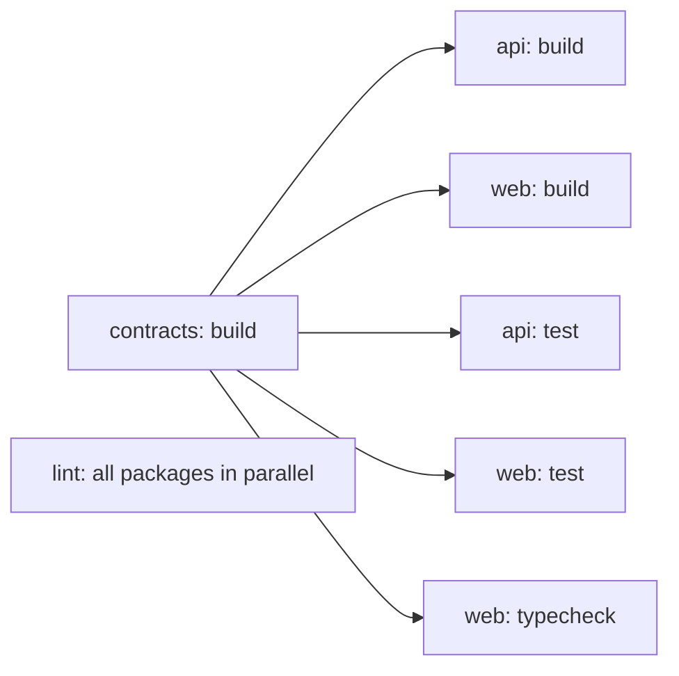

## 68.9 Monorepos: workspaces, Turborepo and Nx, and a shared contracts package

#### Concept

A **monorepo** is one Git repository that holds several projects, for example a NestJS API, a React web app, an admin app and shared packages. It is a repository layout, not an architecture: the API and the web app still build, deploy and scale independently.

Three layers of tooling make it work:

1. **Workspaces** (npm 7+, Yarn, pnpm) let the package manager install all projects with one lock file and link local packages to each other, so `apps/web` can depend on `packages/contracts` as if it were published to npm.
2. **A task runner** (Turborepo, Nx) understands the dependency graph between projects, runs tasks such as `build`, `test` and `lint` in the right order and in parallel, and **caches** their results so unchanged projects are not rebuilt.
3. **Shared packages**, most importantly a `contracts` package that holds the types and schemas both the NestJS API and the React app use.

#### Why does it exist?

With the API and web app in separate repositories, a contract change is a three-step dance: change the API, publish a types package, bump the version in the web repo. In between, the two disagree, and nobody's CI notices. In one repository, one pull request changes the contract, the API and the UI together, and CI type-checks both against the new contract before anything merges.

Without a task runner, though, a monorepo gets slow. Running every build and every test on every pull request turns a 4-minute pipeline into a 25-minute one as projects multiply. Task graphs and caching keep CI proportional to what changed.

#### Mental model

Imagine a restaurant group with three kitchens in one building and a shared pantry. Workspaces are the pantry: one stock list, every kitchen draws from it, and the house sauce made in-house is on the same shelf as bought ingredients. The task runner is the head chef's board: "the sauce must be made before the pasta station starts; the dessert station does not depend on either; if nothing in the sauce recipe changed since yesterday, use yesterday's batch."

#### How it works

**Workspaces.** With pnpm, the root declares which folders are packages:

```yaml
# pnpm-workspace.yaml
packages:
  - "apps/*"
  - "packages/*"
```

A package depends on a sibling with the `workspace:` protocol: `"@shop/contracts": "workspace:*"`. pnpm symlinks `apps/web/node_modules/@shop/contracts` to `packages/contracts`. With npm workspaces the root `package.json` has `"workspaces": ["apps/*", "packages/*"]` and local packages are linked into the root `node_modules`.

The important difference is **strictness**. npm and Yarn Classic hoist everything into one flat root `node_modules`, so `apps/web` can import a package it never declared because `apps/api` happened to install it: a **phantom dependency**. It works on your laptop and breaks when the web app is built alone in Docker. pnpm keeps each package's `node_modules` limited to what it declared (with symlinks into a content-addressable store, which also saves disk: a monorepo that needs 2.1 GB with npm often needs 600 to 800 MB with pnpm). pnpm 10 also stopped running dependencies' install scripts by default unless allow-listed in `onlyBuiltDependencies`, which closes a common supply-chain attack path (Part 39 — Security).

Useful commands:

```bash
pnpm install --frozen-lockfile          # CI: fail if pnpm-lock.yaml does not match package.json files
pnpm --filter web dev                   # run a script in one package
pnpm --filter "web..." build            # build web and everything it depends on
pnpm --filter "...[origin/main]" test   # test packages changed since main, plus their dependents
pnpm add zod --filter @shop/contracts   # add a dependency to one package
```

**Task graph and caching.** Turborepo reads each package's scripts and a root `turbo.json`:

```json
{
  "$schema": "https://turbo.build/schema.json",
  "tasks": {
    "build": { "dependsOn": ["^build"], "outputs": ["dist/**"] },
    "typecheck": { "dependsOn": ["^build"] },
    "lint": {},
    "test": { "dependsOn": ["^build"], "outputs": ["coverage/**"] },
    "dev": { "cache": false, "persistent": true }
  }
}
```

(Turborepo 2.0 renamed the top-level `pipeline` key to `tasks`.) `"^build"` means "build my dependencies first". So `turbo run build` produces this graph:



Before running a task, Turborepo computes a **hash** of its inputs: the package's source files, its resolved dependencies from the lock file, the hashes of the tasks it depends on, the task configuration, and declared environment variables. If the hash was seen before, it restores the outputs and the logs from the cache (local in `.turbo/cache`, or a **remote cache** shared by CI and developers) in a fraction of a second. A pull request that only touches `apps/web` rebuilds nothing in `apps/api`.

**Nx** offers the same core (a project graph, `nx affected -t lint test build` to run only what changed, local and remote caching), plus code generators and a lint rule, `@nx/enforce-module-boundaries`, that forbids imports across tagged boundaries (for example "web must not import from api"). Turborepo is smaller and configuration-light; Nx does more and asks more. Both work with pnpm workspaces.

**The contracts package.** It must be consumable by two very different builds: NestJS (CommonJS, run by Node) and Vite (ESM, bundled). The simplest robust setup builds it with `tsup` (an esbuild-based library bundler) into both formats with declarations:

```json
{
  "name": "@shop/contracts",
  "version": "0.0.0",
  "private": true,
  "sideEffects": false,
  "main": "./dist/index.js",
  "module": "./dist/index.mjs",
  "types": "./dist/index.d.ts",
  "exports": {
    ".": {
      "types": "./dist/index.d.ts",
      "import": "./dist/index.mjs",
      "require": "./dist/index.js"
    }
  },
  "scripts": {
    "build": "tsup src/index.ts --format cjs,esm --dts --clean",
    "typecheck": "tsc --noEmit"
  },
  "dependencies": { "zod": "^3.23.8" },
  "devDependencies": { "tsup": "^8.3.0", "typescript": "^5.6.0" }
}
```

An alternative, the "internal package" pattern, points `exports` straight at `./src/index.ts` and lets each consumer compile it. Vite and Next.js (with `transpilePackages`) handle that well; a NestJS build with plain `tsc` does not compile TypeScript inside `node_modules`, so for a NestJS consumer the built package is the safer choice.

#### Practical example

A team of 11 has `apps/api`, `apps/web`, `apps/admin` and `packages/contracts`, `packages/ui`, `packages/eslint-config`. Before Turborepo, CI ran everything: 19 minutes per pull request. After: a PR touching only `apps/admin` runs admin's lint, typecheck, test and build, with everything else restored from the remote cache, in 3 min 40 s. A PR touching `packages/contracts` rebuilds and tests everything, correctly, in 14 minutes. The remote cache hit rate across all CI runs settled at 71 %.

#### React / Next.js example

The web app declares the dependency and imports both types and runtime schemas:

```json
{
  "name": "web",
  "private": true,
  "type": "module",
  "dependencies": {
    "@shop/contracts": "workspace:*",
    "@tanstack/react-query": "^5.59.0",
    "react": "^18.3.1",
    "react-dom": "^18.3.1"
  }
}
```

```ts
// apps/web/src/api/orders.ts
import { OrderSummarySchema, type OrderSummary } from '@shop/contracts';
import { z } from 'zod';

const OrderListSchema = z.object({ items: z.array(OrderSummarySchema), nextCursor: z.string().nullable() });

export async function fetchOrders(cursor?: string): Promise<{ items: OrderSummary[]; nextCursor: string | null }> {
  const url = new URL('/api/v1/orders', location.origin);
  if (cursor) url.searchParams.set('cursor', cursor);
  const res = await fetch(url, { credentials: 'same-origin', signal: AbortSignal.timeout(8000) });
  if (!res.ok) throw new Error(`orders ${res.status}`);
  return OrderListSchema.parse(await res.json()); // the network boundary: unknown until validated
}
```

For a Next.js app in the same monorepo consuming the source-only pattern, add `transpilePackages: ['@shop/contracts']` to `next.config.js`.

#### Backend side (NestJS)

The API consumes the same package and, in Docker, must be built from the monorepo without copying the whole repository into the image. `turbo prune` creates a minimal subset containing only the API and its workspace dependencies, with a pruned lock file:

```dockerfile
# apps/api/Dockerfile, built from the repository root: docker build -f apps/api/Dockerfile .
FROM node:20.18.1-alpine3.20 AS prune
WORKDIR /repo
RUN corepack enable
COPY . .
RUN pnpm dlx turbo@2 prune api --docker   # writes out/json (manifests) and out/full (sources)

FROM node:20.18.1-alpine3.20 AS build
WORKDIR /repo
RUN corepack enable
COPY --from=prune /repo/out/json/ ./                  # manifests only: install layer cached until they change
COPY --from=prune /repo/out/pnpm-lock.yaml ./pnpm-lock.yaml
RUN pnpm install --frozen-lockfile
COPY --from=prune /repo/out/full/ ./
RUN pnpm dlx turbo@2 run build --filter=api           # builds contracts first, then api
RUN pnpm --filter api deploy --prod /out              # api plus production deps, workspace packages copied in

FROM node:20.18.1-alpine3.20 AS runtime
WORKDIR /app
ENV NODE_ENV=production
COPY --from=build /out ./
USER node
CMD ["node", "dist/main.js"]
```

(`corepack` ships with Node 20 and 22; newer Node versions may need `npm i -g corepack` first. pnpm 10's `deploy` requires `inject-workspace-packages=true` in `.npmrc`, or the `--legacy` flag.) Part 43 — Containers and Docker explains the multi-stage pattern; the monorepo-specific part is pruning and `pnpm deploy`, which turn a 1.4 GB "copy everything" image into roughly 190 MB.

#### Production scenario

A payments company moved its checkout web app, NestJS API and shared contracts from three repositories into one pnpm and Turborepo monorepo. Contract-related production incidents (field renamed in the API, UI not updated, or the reverse) went from five in the previous half-year to zero in the next, because every such change now failed `typecheck` in the same pull request. The tradeoff they accepted: a contracts change triggers every app's pipeline, and CODEOWNERS on `packages/contracts` requires one backend and one frontend reviewer.

#### Failure scenario

On a Tuesday the production web app started calling the staging payment gateway's public endpoint. Payments failed with "invalid merchant". The deploy pipeline had restored `apps/web`'s build output from the Turborepo remote cache.

The web app's `vite.config.ts` read a non-prefixed `PAYMENT_ENV` variable through `process.env` and inlined it with `define`. Turborepo automatically includes framework-prefixed variables such as `VITE_*` in the hash, but not arbitrary names. `PAYMENT_ENV` was not listed in the task's `env`, so the staging build and the production build had the same hash, and production received the cached staging bundle.

The fix: list it (`"build": { "env": ["PAYMENT_ENV"], ... }`), and better, remove per-environment values from the build entirely in favour of runtime config (68.6). Turborepo 2's strict environment mode, which only passes declared variables to tasks, would have turned this into a loud build failure instead of a silent wrong value.

#### Edge cases & failure modes

- **Phantom dependencies** with hoisting work locally and fail in isolated builds; pnpm's strict layout surfaces them early.
- **Undeclared inputs** (environment variables, files outside the package, generated code) make cache hits wrong.
- **Circular workspace dependencies** (`contracts` importing from `api`) break the task graph; lint against them.
- **Version skew**: two apps on different React or TypeScript majors in one repo; pnpm catalogs (pnpm 9.5+) or a single root version keeps them aligned.
- **A huge repo with no caching** makes every PR slow; the monorepo then gets blamed for a missing task runner.
- **Deploy coupling**: one repo does not mean one deploy. Keep pipelines per app.

#### How a Senior Full-Stack Engineer thinks about this

A senior chooses a monorepo for the contract, not for fashion: the value is that one change to an API shape is type-checked against every consumer before merge. They pick pnpm for strictness and disk usage, add Turborepo (or Nx when the team wants generators and boundary rules), declare every task input, and keep deploys independent per app. They refuse "shared utils" packages that grow into a dumping ground; shared packages have an owner and a narrow purpose: contracts, UI components, lint config.

#### Common mistakes

- **Sharing backend code** (entities, services) instead of contracts.
- **Running every task on every PR** without a task graph and cache.
- **Not declaring environment variables** as task inputs.
- **One deploy for the whole repo.**
- **Using npm hoisting and discovering phantom dependencies in Docker.**

#### Interview questions

1. **What does `"dependsOn": ["^build"]` mean in Turborepo?**
   Expected answer: run the `build` task of every workspace dependency before this package's task. Follow-up: what goes into the cache hash?
2. **What is a phantom dependency and how does pnpm prevent it?** Expected answer: importing a package you did not declare because hoisting put it in reach; pnpm's non-flat `node_modules` makes undeclared packages unresolvable.
3. **How would you make a shared contracts package consumable by both NestJS and Vite?** Expected answer: build CJS and ESM outputs with declarations and an `exports` map, or source-only consumed by bundlers with NestJS compiling it some other way; no decorators, no backend imports.
4. **How do you keep monorepo CI fast?** Expected answer: affected-only task execution, remote caching, correct inputs and outputs, and parallelism.
5. **How do you build one app's Docker image from a monorepo?** Expected answer: prune to the app and its dependencies (`turbo prune --docker`), install from the pruned lock file, build, `pnpm deploy --prod`.

#### Practical exercise

Create a pnpm workspace with `apps/api`, `apps/web` and `packages/contracts`, and add Turborepo.

Acceptance criteria:

- `pnpm turbo run build` builds contracts before both apps; a second run is fully cached (`FULL TURBO` in the output).
- Changing only a file in `apps/web` rebuilds only `web`.
- Adding an undeclared import of a package used only by `api` into `web` fails to resolve.
- The API Docker image built with `turbo prune` and `pnpm deploy` is under 250 MB and starts.

## 68.10 Linting, formatting and pre-commit checks

#### Concept

A **linter** (ESLint) analyses code for likely bugs and agreed rules: a promise that is never awaited, a React hook called conditionally, an import that crosses a forbidden boundary. A **formatter** (Prettier) rewrites code into one canonical layout: indentation, quotes, line breaks. They do different jobs, and since ESLint deprecated its formatting rules in v8.53 (they moved to `@stylistic`), the standard split is ESLint for correctness and Prettier for layout. **Pre-commit checks** run a fast subset of both on the files you are committing, before the commit is created.

#### Why does it exist?

Code review time is expensive and should be spent on design and behaviour, not on spaces versus tabs or on spotting a missing `await` by eye. A formatter ends layout debates permanently. A linter catches whole classes of bugs mechanically, including some the type checker cannot: `react-hooks/exhaustive-deps` finds effects that read stale values; `@typescript-eslint/no-floating-promises` finds `repository.save(order)` without `await` in NestJS and `queryClient.invalidateQueries()` dropped on the floor in React.

#### Mental model

Imagine a publishing house. The formatter is the typesetter: every book gets the same fonts and margins, and nobody argues about it. The linter is the copy editor with a checklist: dangling sentences, contradictions, banned words. The pre-commit hook is the copy editor glancing at the pages you just changed before they leave your desk. CI is the final proofread that every manuscript gets, no exceptions.

#### How it works

**ESLint 9 flat config.** ESLint 9 made `eslint.config.js` (an array of config objects) the default; the old `.eslintrc` format is deprecated and removed in ESLint 10. One root config can serve the whole monorepo, with per-folder blocks for browser and Node code:

```js
// eslint.config.mjs (repository root; ESLint 9.22+ for defineConfig, typescript-eslint v8)
import js from '@eslint/js';
import tseslint from 'typescript-eslint';
import reactHooks from 'eslint-plugin-react-hooks';
import reactRefresh from 'eslint-plugin-react-refresh';
import prettier from 'eslint-config-prettier';
import globals from 'globals';
import { defineConfig } from 'eslint/config';

export default defineConfig(
  { ignores: ['**/dist/**', '**/coverage/**', '**/.turbo/**'] },
  js.configs.recommended,
  tseslint.configs.recommendedTypeChecked,
  {
    languageOptions: { parserOptions: { projectService: true, tsconfigRootDir: import.meta.dirname } },
    rules: {
      '@typescript-eslint/no-floating-promises': 'error',  // unawaited promises: lost writes, silent failures
      '@typescript-eslint/switch-exhaustiveness-check': 'error',
    },
  },
  {
    files: ['apps/web/**/*.{ts,tsx}'],
    languageOptions: { globals: globals.browser },
    plugins: { 'react-hooks': reactHooks, 'react-refresh': reactRefresh },
    rules: {
      ...reactHooks.configs.recommended.rules,             // rules-of-hooks, exhaustive-deps
      'react-refresh/only-export-components': 'warn',      // keeps Fast Refresh boundaries clean (76.4)
      'no-restricted-globals': ['error', 'process', 'Buffer'],
      'no-restricted-imports': ['error', { patterns: [
        { group: ['@nestjs/*', 'typeorm', 'class-validator', '**/apps/api/**'], message: 'Browser code must not import backend code. Use @shop/contracts.' },
      ] }],
    },
  },
  { files: ['apps/api/**/*.ts'], languageOptions: { globals: globals.node } },
  prettier, // last: turns off any rule that conflicts with Prettier's formatting
);
```

`projectService: true` (typescript-eslint v8) finds the right `tsconfig` for each file automatically, which is what makes **type-aware rules** such as `no-floating-promises` possible. They are slower: a type-aware lint of a 2,000-file repo can take 40 to 90 s against 8 to 15 s without type information, which is why they belong in CI and the editor rather than in every pre-commit run on large repos.

**Prettier 3.** A tiny config and a check in CI:

```json
{ "singleQuote": true, "printWidth": 110, "trailingComma": "all" }
```

`prettier --check .` fails CI if any file is not formatted; `prettier --write` fixes. `eslint-config-prettier` disables ESLint rules that would fight it. Faster all-in-one alternatives exist (Biome for linting and formatting, oxlint for linting) and are worth evaluating for large repos, but ESLint plus Prettier remains the default most teams and plugins target.

**Pre-commit with husky and lint-staged.**

```bash
pnpm add -D -w husky lint-staged
pnpm exec husky init        # husky v9: adds "prepare": "husky" and creates .husky/pre-commit
echo "pnpm exec lint-staged" > .husky/pre-commit
```

```json
{
  "lint-staged": {
    "*.{ts,tsx}": ["eslint --max-warnings=0", "prettier --write"],
    "*.{json,md,yaml,css}": ["prettier --write"]
  }
}
```

lint-staged runs the commands only on staged files, so the hook takes 1 to 5 s instead of a minute. Whole-project checks (`tsc`, type-aware lint, tests) are too slow for a pre-commit hook and run in CI, optionally also in a pre-push hook.


Hooks are a convenience, not a control: `git commit --no-verify` skips them, and they do not run for commits made in the web UI. **CI is the gate** (Part 46 — CI/CD).

#### Practical example

In a NestJS and React monorepo, enabling `no-floating-promises` reported 63 errors. In the API: an `auditLog.record()` call in an exception filter without `await` (audit entries lost when the request ended first), and `this.events.emit()` inside a transaction callback whose failure was never observed. In the web app: 14 `onClick={() => mutation.mutateAsync(...)}` handlers whose rejections became unhandled promise rejections instead of error toasts. Each was a real bug or a silent failure.

#### React / Next.js example

The fix pattern for floating promises in a React handler, which the rule forces you to make explicit:

```tsx
// apps/web/src/orders/CancelOrderButton.tsx
import { useMutation, useQueryClient } from '@tanstack/react-query';
import { cancelOrder } from '../api/orders';

export function CancelOrderButton({ orderId }: { orderId: string }) {
  const qc = useQueryClient();
  const mutation = useMutation({
    mutationFn: () => cancelOrder(orderId, crypto.randomUUID()), // idempotency key per attempt (Part 8.5)
    onSuccess: () => qc.invalidateQueries({ queryKey: ['orders'] }), // returned promise: awaited by TanStack Query
  });

  return (
    <button
      disabled={mutation.isPending}
      // mutate() (not mutateAsync) returns void and routes errors to mutation.error, so nothing floats.
      onClick={() => mutation.mutate()}
    >
      {mutation.isPending ? 'Cancelling...' : 'Cancel order'}
    </button>
  );
}
```

Next.js 14 ships `eslint-config-next` and runs ESLint during `next build` (configurable with `eslint.ignoreDuringBuilds`); Next.js 16 removed the automatic lint step from `next build`, so lint must be its own CI task.

#### Backend side (NestJS)

The same root config lints the API, and the type-aware rules matter even more there, because an unawaited promise in a request handler is a write that may never happen:

```ts
// apps/api/src/orders/orders.service.ts (excerpt)
async cancel(orderId: string, userId: string): Promise<void> {
  await this.dataSource.transaction(async (em) => {
    const order = await em.findOneOrFail(Order, { where: { id: orderId, userId }, lock: { mode: 'pessimistic_write' } });
    order.status = 'CANCELLED';
    await em.save(order);
    // Without await, a failure here would surface after the transaction committed, unobserved.
    await em.insert(OutboxEvent, { type: 'order.cancelled', payload: { orderId } });
  });
}
```

Keep the backend's formatting identical to the frontend's (one Prettier config at the root), so a full-stack pull request is not half reformatting.

#### Production scenario

A team with 30 engineers adopted Prettier and the flat ESLint config in one pass. They formatted the entire repository in a single dedicated commit, added that commit's SHA to `.git-blame-ignore-revs` so `git blame` skips it (Part 5 — Git for Everyday Work), and only then turned on the CI check. Review comments about style dropped to nearly zero within a month, and median review time on frontend pull requests fell from 26 to 17 hours.

#### Failure scenario

A different team added a pre-commit hook that ran `eslint --fix` and `prettier --write` on every *file touched* by a commit, not just changed lines, in a legacy codebase that had never been formatted. A developer fixing a one-line bug in the coupon calculation committed a 1,400-line diff: the one-line fix plus 1,399 lines of reformatting. The reviewer approved the "formatting" without seeing that the fix had also flipped a `>=` to `>`, so coupons stopped applying on orders of exactly the minimum value. Support took three days to connect complaints about "my coupon doesn't work at exactly 500 rupees" to the change.

The lesson: introduce formatting as a single dedicated commit, never mixed with behaviour changes, and keep feature diffs minimal so reviewers can see what changed.

#### Edge cases & failure modes

- **Hooks skipped** with `--no-verify` or by GUI tools; CI must re-run every check.
- **Type-aware lint too slow for pre-commit** on large repos; keep it in CI and the editor.
- **ESLint and Prettier fighting** when `eslint-config-prettier` is missing or not last.
- **Mixed `.eslintrc` and flat config** during migration; ESLint 9 ignores `.eslintrc` unless `ESLINT_USE_FLAT_CONFIG=false`.
- **Auto-fix on whole legacy files** produces unreviewable diffs.
- **`prepare` scripts in Docker**: `husky` in `prepare` fails in images without `.git`; install production deps with `--ignore-scripts` (Part 43).

#### How a Senior Full-Stack Engineer thinks about this

A senior automates everything that is not judgement. Formatting is not judgement: Prettier decides. A handful of high-value lint rules (`no-floating-promises`, the React hooks rules, import boundaries, no Node globals in browser code) catch real bugs and are non-negotiable; long lists of stylistic rules are not worth the friction. Pre-commit hooks are kept fast and treated as a courtesy; CI is the authority. And they protect reviewers: formatting changes and behaviour changes never share a commit.

#### Common mistakes

- **Using ESLint for formatting** and Prettier on top, so they fight.
- **Slow pre-commit hooks** that people learn to skip.
- **Relying on hooks instead of CI.**
- **Reformatting whole files inside feature commits.**
- **Turning on every rule** and drowning real errors in warnings; use `--max-warnings=0` with a small, meaningful rule set.

#### Interview questions

1. **Why separate linting from formatting?**
   Expected answer: they solve different problems; formatters are deterministic layout, linters find bugs and enforce agreed rules; combining them causes conflicts. Follow-up: how do you stop them fighting? (`eslint-config-prettier`.)
2. **Name a lint rule that catches bugs the type checker misses.** Expected answer: `no-floating-promises`, `react-hooks/exhaustive-deps`, `rules-of-hooks`.
3. **What should run in a pre-commit hook and what should not?** Expected answer: fast checks on staged files (lint and format); whole-project type checks and tests in CI.
4. **How do you introduce Prettier to a large existing codebase?** Expected answer: one dedicated formatting commit, `.git-blame-ignore-revs`, then enforce in CI.

#### Practical exercise

Set up a root `eslint.config.mjs` for a monorepo with `apps/api` and `apps/web`, plus Prettier, husky and lint-staged.

Acceptance criteria:

- An unawaited `repository.save()` in the API and an unawaited `mutateAsync()` in the web app both fail lint.
- `import { Entity } from 'typeorm'` in `apps/web` fails lint with your custom message.
- The pre-commit hook completes in under 5 s for a two-file commit.
- CI runs `prettier --check .` and full lint, and a commit made with `--no-verify` that breaks formatting fails CI.
