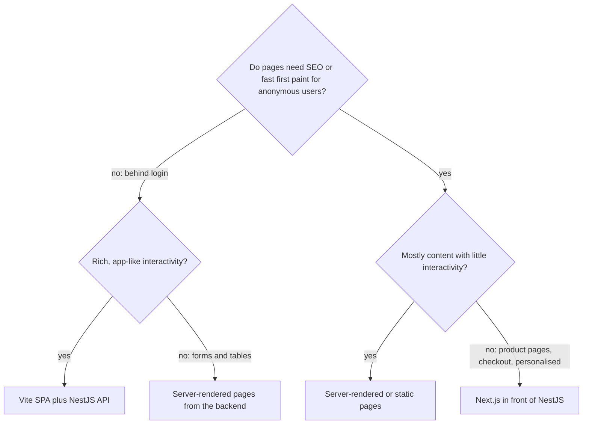
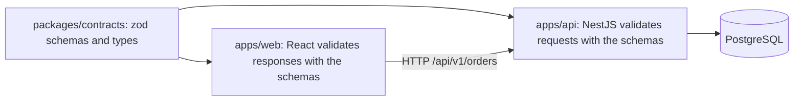

## 68.11 Choosing a frontend stack: Vite SPA vs Next.js vs plain server-rendered pages

#### Concept

Most teams that build a web product choose between three shapes:

- **Vite SPA**: a single-page application. The server (CDN) sends a nearly empty `index.html` and a JavaScript bundle; React renders everything in the browser and calls your NestJS API for data.
- **Next.js**: a React framework that renders on the server (and at build time) as well as in the browser, with routing, data fetching, caching and a Node server or serverless runtime of its own. Part 71 — Next.js and Rendering Strategies goes deep on how.
- **Plain server-rendered pages**: HTML produced by your backend with templates (Handlebars, EJS or Pug through NestJS's `@Render()`, or another server framework), with a little JavaScript for interactivity, often loaded as a module or with a library such as htmx or Alpine.js.

The tooling in this Part applies differently to each. A Vite SPA uses all of it. Next.js hides most of the bundler behind its own CLI. Server-rendered pages may need no bundler at all.

#### Why does it exist?

Because the cost profiles are different. An SPA is cheap to host (static files) but shows nothing until JavaScript runs, which hurts first load on slow phones and complicates SEO. Next.js gives fast first paint and SEO but adds a server tier you must run, monitor and scale. Server-rendered pages are the simplest and fastest to first byte, but rich interactivity gets awkward as screens grow. Choosing by fashion rather than by these costs is how teams end up running a Node rendering tier for an internal admin tool, or shipping a 400 KB SPA for a marketing page.

#### Mental model

Imagine three ways to serve food. The SPA is a meal kit: cheap to deliver, but the customer cooks before eating. Next.js is a restaurant: food arrives ready, but you run a kitchen with staff and opening hours. Server-rendered pages are a canteen: simple, fast, limited menu. Each is right for someone.

#### How it works



| Criterion | Vite SPA | Next.js (App Router) | Server-rendered pages |
|---|---|---|---|
| First paint on a slow phone | Slow: waits for JS (often 2 to 4 s) | Fast: HTML from server or cache | Fastest: HTML straight from the backend |
| SEO for public pages | Weak without prerendering | Strong | Strong |
| Hosting | Static files on S3 + CDN, cents per day | Node server, serverless or edge; a tier to operate | Your existing backend |
| Build tooling you own | Vite config, all of this Part | Mostly `next.config.js` | Little or none |
| Rich interactivity | Excellent | Excellent | Limited; grows awkward |
| Secrets and server logic in the frontend tier | None (all in NestJS) | Server components, Route Handlers can hold secrets (BFF) | Backend already holds them |
| Team skills needed | React | React plus server rendering, caching semantics | Backend templates |
| Typical fit | Dashboards, admin, logged-in apps | Storefronts, marketing plus app, SEO-critical pages | Internal tools, simple CRUD, emails, status pages |

#### Backend side (NestJS)

Each shape asks something different of the API:

- **Vite SPA**: the API is called from the browser. It must handle cookies or tokens for browser auth (Part 73 — Auth and Security in the Browser), CORS if on another origin (or better, same-origin routing through the CDN), and response shapes that the browser can render without extra round trips.
- **Next.js**: the API is mostly called server-to-server from the Next.js tier. Latency between Next.js and NestJS lands directly in time to first byte (67.1), so co-locate them and parallelise calls. The Next.js server can act as a backend-for-frontend that aggregates several NestJS endpoints.
- **Server-rendered pages**: NestJS renders HTML itself, with `@Render('orders/list')` and a view engine configured through `app.setViewEngine()` on the Express platform. No separate frontend build or contract package is needed for those pages.

#### Production scenario

An electronics retailer ran its whole site as a Vite SPA: storefront, account area and an internal merchandising tool. Product pages had p75 LCP of 3.6 s on mobile and organic search traffic was flat. They moved only the storefront (home, category, product pages) to Next.js with cached server rendering, kept the logged-in account area as part of the Next.js app with client components, and left the merchandising tool as a Vite SPA because it is behind login, used on desktops, and nobody searches for it. LCP on product pages fell to 1.9 s. The tool stayed cheap: static files on S3.

#### Failure scenario

A team building a four-screen internal returns approval tool chose Next.js "because it's the standard". Six months later, they were running a Node server tier with autoscaling, debugging cache invalidation for pages that were only ever viewed by logged-in staff, and paying for a server that served 300 users. A rewrite to server-rendered pages inside the existing NestJS service took two weeks and removed a deployment, a container and an on-call surface.

#### How a Senior Full-Stack Engineer thinks about this

A senior chooses per surface, not per company. Public, SEO-sensitive, first-load-sensitive pages justify server rendering and its operational cost. Logged-in, interaction-heavy tools are well served by an SPA on a CDN. Simple internal CRUD is often best as server-rendered HTML from the service that owns the data. They ask: who loads this page, on what device, how often, does search matter, and who will operate the extra tier at 02:00?

#### Interview questions

1. **When would you choose a Vite SPA over Next.js?** Expected answer: logged-in, interaction-heavy apps where SEO does not matter and static hosting is attractive. Follow-up: what does the SPA cost you on first load?
2. **What new operational responsibilities come with Next.js?** Expected answer: a server or serverless rendering tier to deploy, scale and monitor, caching layers to understand, and server-to-server latency to the API.
3. **When are plain server-rendered pages the best choice?** Expected answer: simple internal tools and content pages with little interactivity, especially when the backend already owns the data.

## 68.12 Worked example: a pnpm monorepo with NestJS, React and shared contracts

#### Concept

We now put the Part together in one repository: `apps/api` (NestJS 10), `apps/web` (React 18 with Vite), and `packages/contracts` (zod schemas and the types inferred from them). The goal: one pull request can change an API shape, and CI proves that both the API and the UI agree with it before merge.

#### The layout

```text
shop/
├── package.json             root: scripts, devDependencies for lint, format, turbo
├── pnpm-workspace.yaml      apps/*, packages/*  (76.9)
├── pnpm-lock.yaml
├── turbo.json               build, typecheck, lint, test tasks  (76.9)
├── eslint.config.mjs        one flat config for all packages  (76.10)
├── .prettierrc.json
├── .husky/pre-commit        pnpm exec lint-staged
├── apps/
│   ├── api/                 NestJS: depends on @shop/contracts
│   │   ├── src/orders/...
│   │   ├── tsconfig.json    commonjs, decorators, strict
│   │   └── Dockerfile       turbo prune + pnpm deploy  (76.9)
│   └── web/                 Vite React: depends on @shop/contracts
│       ├── src/...
│       ├── tsconfig.app.json  bundler resolution, DOM, strict  (76.8)
│       └── vite.config.ts     proxy /api to :3000, hidden source maps  (76.3)
└── packages/
    └── contracts/           zod schemas + inferred types, built with tsup to CJS and ESM
        ├── src/index.ts
        └── package.json     exports map  (76.9)
```



The root `package.json`:

```json
{
  "name": "shop",
  "private": true,
  "packageManager": "pnpm@9.12.3",
  "scripts": {
    "dev": "turbo run dev --parallel",
    "build": "turbo run build",
    "verify": "prettier --check . && turbo run lint typecheck test build",
    "prepare": "husky"
  },
  "devDependencies": {
    "@eslint/js": "^9.13.0", "eslint": "^9.13.0", "typescript-eslint": "^8.11.0",
    "eslint-plugin-react-hooks": "^5.0.0", "eslint-plugin-react-refresh": "^0.4.14",
    "eslint-config-prettier": "^9.1.0", "globals": "^15.11.0",
    "prettier": "^3.3.3", "husky": "^9.1.6", "lint-staged": "^15.2.10",
    "turbo": "^2.2.3", "typescript": "^5.6.3"
  }
}
```

`packageManager` pins the pnpm version; Corepack and `pnpm/action-setup` read it, so every developer and CI runner uses the same one.

#### The contracts package

```ts
// packages/contracts/src/index.ts  (zod 3.23)
import { z } from 'zod';

export const OrderStatusSchema = z.enum(['PENDING', 'PAID', 'SHIPPED', 'DELIVERED', 'CANCELLED']);
export type OrderStatus = z.infer<typeof OrderStatusSchema>;

// Money as integer minor units in a string: exact, and safe beyond 2^53.
export const MinorUnitsSchema = z.string().regex(/^\d+$/, 'integer minor units');

export const OrderItemSchema = z.object({
  sku: z.string().min(1),
  name: z.string().min(1),
  quantity: z.number().int().positive(),
  unitPriceMinor: MinorUnitsSchema,
});
export type OrderItem = z.infer<typeof OrderItemSchema>;

export const OrderSummarySchema = z.object({
  id: z.string().uuid(),
  displayId: z.string(),
  status: OrderStatusSchema,
  totalMinor: MinorUnitsSchema,
  currency: z.string().length(3),
  items: z.array(OrderItemSchema),
  placedAt: z.string().datetime({ offset: true }),
});
export type OrderSummary = z.infer<typeof OrderSummarySchema>;

export const OrderListResponseSchema = z.object({
  items: z.array(OrderSummarySchema),
  nextCursor: z.string().nullable(),
});
export type OrderListResponse = z.infer<typeof OrderListResponseSchema>;

export const CancelOrderRequestSchema = z.object({ reason: z.enum(['CHANGED_MIND', 'TOO_SLOW', 'OTHER']) });
export type CancelOrderRequest = z.infer<typeof CancelOrderRequestSchema>;
```

No NestJS, no React, no TypeORM: only zod, which runs in both places. The schemas are the single source of truth; the types are derived from them, so they cannot disagree.

#### The API side

A small validation pipe uses the shared schemas, following the "object schema validation" pattern from the NestJS documentation:

```ts
// apps/api/src/common/zod-validation.pipe.ts
import { BadRequestException, PipeTransform } from '@nestjs/common';
import type { ZodType } from 'zod';

export class ZodValidationPipe<T> implements PipeTransform<unknown, T> {
  constructor(private readonly schema: ZodType<T>) {}

  transform(value: unknown): T {
    const result = this.schema.safeParse(value);
    if (!result.success) {
      // One error shape for the frontend to map onto form fields (Part 72 covers error contracts).
      throw new BadRequestException({
        code: 'VALIDATION_FAILED',
        issues: result.error.issues.map((i) => ({ path: i.path.join('.'), message: i.message })),
      });
    }
    return result.data;
  }
}
```

```ts
// apps/api/src/orders/orders.controller.ts
import { Body, Controller, Get, Headers, HttpCode, Param, ParseUUIDPipe, Post, Query, UseGuards } from '@nestjs/common';
import { CancelOrderRequestSchema, type CancelOrderRequest, type OrderListResponse } from '@shop/contracts';
import { ZodValidationPipe } from '../common/zod-validation.pipe';
import { JwtAuthGuard } from '../auth/jwt-auth.guard';
import { CurrentUser } from '../auth/current-user.decorator';
import { OrdersService } from './orders.service';

@Controller('v1/orders')
@UseGuards(JwtAuthGuard)
export class OrdersController {
  constructor(private readonly orders: OrdersService) {}

  @Get()
  list(@CurrentUser() userId: string, @Query('cursor') cursor?: string): Promise<OrderListResponse> {
    return this.orders.listForUser(userId, cursor, 20); // return type is checked against the contract
  }

  @Post(':id/cancel')
  @HttpCode(202)
  cancel(
    @CurrentUser() userId: string,
    @Param('id', new ParseUUIDPipe()) id: string,
    @Headers('idempotency-key') idempotencyKey: string,
    @Body(new ZodValidationPipe(CancelOrderRequestSchema)) body: CancelOrderRequest,
  ): Promise<void> {
    return this.orders.cancel({ userId, orderId: id, reason: body.reason, idempotencyKey });
  }
}
```

`OrdersService.listForUser` maps entities to `OrderSummary` explicitly, converting `numeric` columns to minor-unit strings and timestamps to ISO strings, so the database shape never leaks into the contract (68.8). The `Promise<OrderListResponse>` return type means a renamed field in the contract is a compile error in the API.

#### The web side

```ts
// apps/web/src/orders/useOrders.ts
import { useInfiniteQuery } from '@tanstack/react-query';
import { OrderListResponseSchema, type OrderListResponse } from '@shop/contracts';

async function fetchOrderPage(cursor: string | null, signal: AbortSignal): Promise<OrderListResponse> {
  const qs = cursor ? `?cursor=${encodeURIComponent(cursor)}` : '';
  const res = await fetch(`/api/v1/orders${qs}`, { credentials: 'same-origin', signal });
  if (!res.ok) throw new Error(`orders ${res.status}`);
  return OrderListResponseSchema.parse(await res.json()); // the same schema the API was built against
}

export function useOrders() {
  return useInfiniteQuery({
    queryKey: ['orders'],
    queryFn: ({ pageParam, signal }) => fetchOrderPage(pageParam, signal),
    initialPageParam: null as string | null,
    getNextPageParam: (last) => last.nextCursor,
  });
}
```

The `OrderRow` component from 68.8 renders each item with its `satisfies Record<OrderStatus, string>` label map. Part 70 — Client State, Data Fetching and Caching covers the TanStack Query side in depth.

Numbers for this repository on a 2023 laptop: `pnpm install` cold 38 s, warm 4 s; contracts build 0.6 s; API build (`nest build` with `tsc`) 9 s; web production build 21 s, producing a 71 KB gzip entry chunk; `turbo run typecheck` 26 s cold and 0.3 s fully cached.

#### CI

```yaml
# .github/workflows/ci.yml
name: ci
on:
  pull_request:
jobs:
  verify:
    runs-on: ubuntu-latest
    timeout-minutes: 20
    steps:
      - uses: actions/checkout@v4
        with: { fetch-depth: 0 }             # turbo --affected compares against the base branch
      - uses: pnpm/action-setup@v4            # reads "packageManager" from package.json
      - uses: actions/setup-node@v4
        with: { node-version: 20, cache: pnpm }
      - run: pnpm install --frozen-lockfile
      - run: pnpm exec prettier --check .
      - run: pnpm turbo run lint typecheck test build --affected
        env:
          TURBO_TOKEN: ${{ secrets.TURBO_TOKEN }}   # remote cache shared with other runs
          TURBO_TEAM: ${{ vars.TURBO_TEAM }}
```

`--affected` (Turborepo 2.1+) runs tasks only for packages changed in the pull request and their dependents. Part 46 — CI/CD covers the deploy stages that follow; Part 76 — Shipping and Operating Frontends covers deploying the web build.

#### A breaking change caught in CI

A backend engineer renames `displayId` to `orderNumber` in `packages/contracts`, updates the API mapper, and opens a pull request. Because `contracts` changed, Turborepo runs `typecheck` for every dependent package. The web job fails in 26 s:

```text
web:typecheck: src/orders/OrderRow.tsx(16,22): error TS2339: Property 'displayId' does not exist on type
web:typecheck:   '{ id: string; orderNumber: string; status: "PENDING" | "PAID" | ... }'.
web:typecheck: ERROR: command finished with error: command (apps/web) pnpm run typecheck exited (2)
```

The engineer now has three honest options instead of a production incident: update the UI in the same pull request; add `orderNumber` alongside `displayId` and remove the old field later (the expand-and-contract approach from Part 24 — Backward Compatibility: APIs, Schemas, Events and Clients, needed anyway because old browser tabs and the mobile app still expect `displayId`); or decide the rename is not worth it. Without the shared package, the first sign would have been "Order undefined" on every order card in production.

#### Failure drills

- **Contracts package not rebuilt.** If a developer runs `pnpm --filter web dev` without building contracts first, the web app imports a stale `dist/`. Fix: a `dev` task in `turbo.json` with `dependsOn: ["^build"]`, or `tsup --watch` in contracts during development.
- **Backend-only import leaks into web.** Someone imports `@nestjs/common` in a shared helper. The `no-restricted-imports` rule (68.10) fails lint before the bundle grows by 200 KB.
- **Turbo cache serves a wrong build.** Covered in 68.9: declare every environment input, prefer runtime config.
- **Docker image includes the whole monorepo.** `turbo prune api --docker` plus `pnpm deploy` keeps the image to the API and its real dependencies.

#### How a Senior Full-Stack Engineer thinks about this

The value of this setup is not the tools; it is the feedback loop. A contract change produces a red build in under a minute, in the same pull request, with an error message that names the exact line in the UI that disagrees. The senior keeps that loop fast (caching, affected-only runs), honest (runtime validation at both ends, not just types) and narrow (contracts contain only shapes, never backend logic). They also remember what the type check cannot see: clients already in the field. Shared types prevent drift inside the repository; compatibility rules from Part 24 still govern what is already deployed.

#### Practical exercise

Build this repository from scratch.

Acceptance criteria:

- `pnpm verify` passes from a clean clone in under 3 minutes, and a second run in under 20 seconds thanks to caching.
- Renaming a field in `packages/contracts` fails `typecheck` in both `apps/api` and `apps/web` with errors pointing at the exact lines.
- Sending `{"reason": "BORED"}` to `POST /api/v1/orders/:id/cancel` returns a 400 with `code: "VALIDATION_FAILED"` and an `issues` array.
- The web production build's entry chunk is under 90 KB gzip and contains no `@nestjs`, `typeorm` or `class-validator` code.
- The API Docker image is under 250 MB.

## Senior Checklist — Part 68

- [ ] I understand the concept
- [ ] I can explain it simply
- [ ] I can implement it
- [ ] I understand its failure modes
- [ ] I understand its scaling limitations
- [ ] I understand its security implications
- [ ] I understand its operational implications
- [ ] I can choose between alternatives
- [ ] I can explain the tradeoffs
- [ ] I can answer senior-level interview questions
- [ ] I can explain why browsers need a build step even though they support ES modules
- [ ] I know that frontend bundlers transpile without type checking, and I run `tsc --noEmit` as a separate CI gate
- [ ] I can set browser targets from real traffic data and know that targets lower syntax but do not polyfill APIs
- [ ] I can explain how Vite's dev server differs from its production build, and I test the production bundle before release
- [ ] I can make a module HMR-safe with `import.meta.hot.dispose` and cap per-user connections on the backend
- [ ] I can read a bundle treemap, fix a barrel or CommonJS import, and set a first-route budget in CI
- [ ] I never put a secret in a `VITE_` or `NEXT_PUBLIC_` variable, and I can serve runtime config from NestJS with an allow-list
- [ ] I can produce hidden source maps, upload them privately per release, and symbolicate a minified stack trace
- [ ] I can write a browser `tsconfig` with `strict`, `noUncheckedIndexedAccess`, `types` and `moduleResolution: "bundler"`
- [ ] I can share types between NestJS and React without sharing decorated classes or entities
- [ ] I can set up a pnpm workspace with Turborepo, declare task inputs correctly, and build one app's Docker image from it
- [ ] I can configure ESLint 9 flat config with type-aware rules, Prettier, and fast pre-commit hooks, with CI as the real gate
- [ ] I can choose between a Vite SPA, Next.js and server-rendered pages for a given surface and defend the choice

## Part 68 — Key Takeaways

- The build step exists because of five real problems: TypeScript and JSX, the module waterfall, bare imports, old browsers and bytes on slow phones.
- Frontend bundlers transpile one file at a time and do not check types; a green build is not a green type check.
- Build targets rewrite syntax, not APIs; choose them from the browser data your API already sees.
- Vite is fast in development because it does not bundle your source there; always test the production build, which is a different program.
- HMR re-executes modules; anything with side effects must dispose of them, and the backend should cap connections anyway.
- Tree shaking needs ES modules and honest `sideEffects` hints; code splitting by route and by heavy feature keeps the first route small.
- Every value in a frontend bundle is public. Secrets live only in the backend, behind auth, rate limits and audit logs.
- Source maps are sensitive build artefacts: generate them hidden, store them privately per release, and build once so they always match.
- Configure TypeScript to describe the browser accurately and strictly, and remember that types end at the network boundary.
- A monorepo earns its keep by type-checking one contract against every consumer in the same pull request; a task graph and correct cache inputs keep it fast.
- Automate formatting and a few high-value lint rules, keep hooks fast, and let CI be the gate.
- Pick the frontend shape per surface: SPA for logged-in tools, Next.js for public and SEO-critical pages, server-rendered HTML for simple internal screens.
