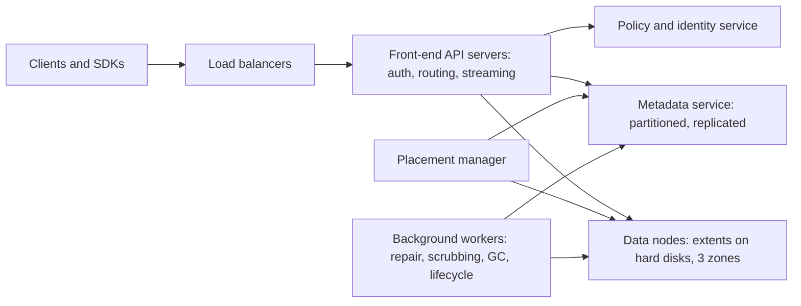
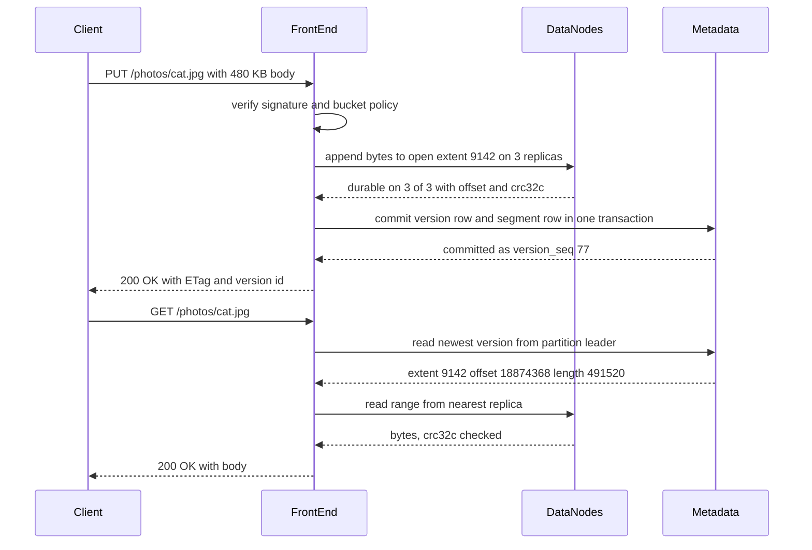
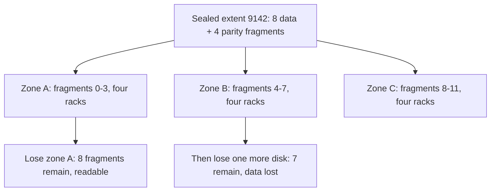
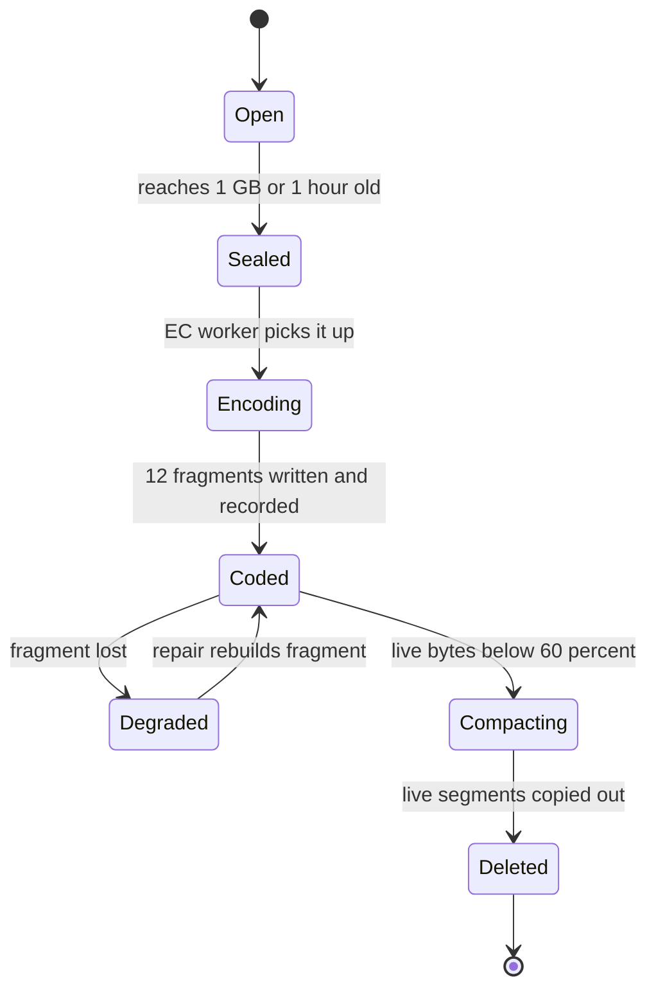
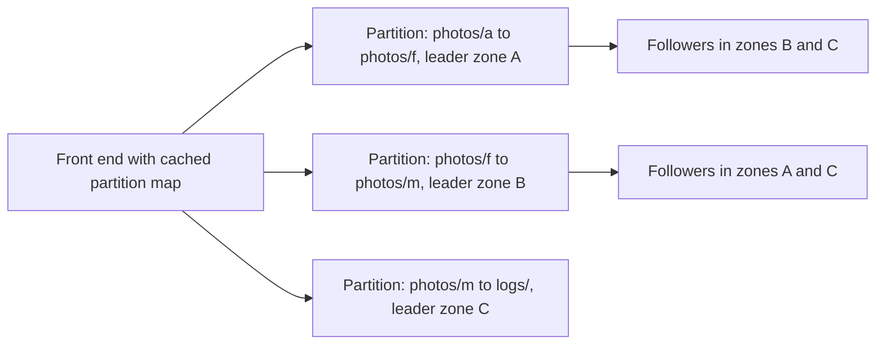

## 68.5 Object Storage (S3-style)

> **Try it first** · Level: Advanced · About 60 minutes
>
> **Build:** a multi-tenant object store where clients put, get, list and delete blobs addressed by bucket and key, in the style of Amazon S3.
>
> **Requirements:**
> - PUT, GET (including byte ranges), HEAD, DELETE and LIST by prefix on objects addressed by bucket and key
> - multipart upload for objects up to 5 TB, uploaded and retried part by part
> - strong read-after-write consistency, including for LIST
> - versioning, lifecycle rules (move to cheaper tiers, expire old data) and presigned URLs
> - self-repair after the loss of a disk, a server or a whole availability zone
>
> **Scale and constraints:** 100 billion objects, 50 PB of logical data (average object 500 KB), peak 100,000 GET/s and 20,000 PUT/s, 99.99 percent availability, 99.999999999 percent (eleven nines) annual durability, p99 time to first byte under 100 ms for small objects, three availability zones in one region.
>
> **Your task:** sketch the API, the data model and the main components; estimate storage and throughput; name the two hardest problems and how you would solve them.
>
> Spend the time on paper before you read on. The model design follows.

### 68.5.1 Requirements

An object store keeps **objects**: a blob of bytes (a photo, a video segment, a database backup, a log file) plus a little metadata, addressed by a **bucket** (a named container owned by one account) and a **key** (a string such as `invoices/2026/11/inv-88412.pdf`). There are no real directories and no in-place edits: you replace a whole object or nothing. That strict contract is what makes exabytes cheap and durable. Part 33 — File Storage and Uploads, section 33.3, teaches how to *use* such a store from a NestJS backend; this design is about how you would *build* one.

Its users are every other system in the company: backends storing uploads, pipelines writing Parquet files, databases shipping backups, CDNs pulling content. They expect it never to lose a byte and to cost far less per gigabyte than a database.

Imagine a gigantic left-luggage office. You hand over a sealed suitcase and a label (bucket plus key). Behind the counter, the office cuts a copy of the contents into pieces, stores them in three warehouses across town, and keeps a ledger of where every piece is. If a warehouse floods, it rebuilds the missing pieces from the others before anyone notices. The ledger is the **metadata service**; the warehouses are **data nodes**; the cutting into pieces is **replication or erasure coding**. The whole design is about keeping that ledger correct and those pieces sufficient.

### 68.5.2 Functional requirements

1. Create and delete buckets; each bucket belongs to one account and lives in one region.
2. PUT an object (up to 5 GB in one request), GET it whole or by byte range, HEAD it for metadata, DELETE it.
3. Multipart upload for large objects: initiate, upload parts independently and in parallel, complete or abort; final objects up to 5 TB.
4. LIST keys in a bucket by prefix, with an optional delimiter (`/`) that groups keys into "folders", paginated with a continuation token.
5. Strong read-after-write consistency: after a successful PUT or DELETE, every following GET, HEAD and LIST sees the change.
6. Versioning per bucket: overwrites and deletes keep older versions retrievable by version id.
7. Lifecycle rules per bucket: transition objects to cheaper storage classes after N days, expire current or noncurrent versions, abort incomplete multipart uploads.
8. Access control: account-level identities, bucket policies, and presigned URLs that grant time-limited access to one operation on one object.
9. Automatic repair: lost copies or fragments are rebuilt without operator action.

**Non-goals.** No in-place modification or append to an existing object (a new version replaces it). No POSIX semantics: no rename of a "directory", no file locking, no hard links. No cross-region replication in the first version (an evolution step, 68.5.13). No query engine over object contents.

### 68.5.3 Non-functional requirements

| Property | Target | Why |
|---|---|---|
| Durability | 99.999999999 percent (eleven nines) per object per year | Backups and user files must survive any routine hardware failure |
| Availability | 99.99 percent for GET and PUT (about 52 minutes of downtime a year) | Every product depends on it |
| Consistency | Strong read-after-write for GET, HEAD and LIST | Pipelines write a file then immediately list or read it |
| Latency | p99 time to first byte under 100 ms for objects under 1 MB | Images and API payloads are served from it |
| Throughput | 100,000 GET/s and 20,000 PUT/s peak, region-wide | Sum of all tenants at peak |
| Scale | 100 billion objects, 50 PB logical, growing about 3 PB a month | Nobody wants to plan capacity per bucket |

**Durability** is "the bytes still exist somewhere"; **availability** is "I can read them right now". A zone outage may hurt availability; it must never hurt durability.

### 68.5.4 Constraints

- **Hardware fails constantly.** Disks fail at roughly 1 to 2 percent a year; across about 5,400 disks that is one every few days. Repair is routine, not an incident.
- **Disks are cheap per terabyte but poor at random I/O**: about 200 MB/s sequential, only 100 to 200 random reads per second.
- **One region, three availability zones** (separate data centres about 1 to 2 ms apart). Placement must survive losing a whole zone.
- **The metadata does not fit on one machine** (about 100 TB), so it must be partitioned and stay strongly consistent.
- **Clients retry**, so PUT, DELETE and multipart operations must be safe to repeat.

### 68.5.5 Capacity estimation

| Quantity | Assumption | Calculation | Result |
|---|---|---|---|
| Logical data | 100 billion objects x 500 KB average | 1e11 x 5e5 B | 50 PB |
| Raw bytes with 3x replication | every byte stored three times | 50 PB x 3 | 150 PB |
| Raw bytes with erasure coding 8+4 | 12 fragments for 8 of data | 50 PB x 1.5 | 75 PB |
| Disks needed (erasure coded) | 20 TB disks, filled to 70 percent | 75 PB / 0.7 / 20 TB | about 5,400 disks |
| Storage servers | 24 disks each | 5,400 / 24 | about 225 servers, 75 per zone |
| Metadata | about 1 KB per object (key, version, size, checksum, placement) | 1e11 x 1 KB | about 100 TB, 300 TB with 3 replicas |
| Metadata operations | GET, PUT, HEAD, LIST, DELETE at peak | 100k + 20k + overhead | about 150,000 per second |
| Ingress | 20,000 PUT/s x 500 KB | | about 10 GB/s (80 Gbit/s) |
| Egress | 100,000 GET/s, average 250 KB returned (many range reads) | | about 25 GB/s (200 Gbit/s) |
| Disk reads per GET | small objects need one disk read if stored contiguously | 100,000 / 5,400 disks | about 19 random reads per disk per second |
| Daily disk failures | 5,400 disks x 2 percent AFR / 365 | | about 0.3 a day, one every 3 days |
| Repair data per failed disk | 20 TB disk at 70 percent | | 14 TB to rebuild |

These numbers drive the design. Replication needs 75 PB more disk than erasure coding, so most bytes must be erasure coded. The 19 random reads per disk per second look comfortable against about 150 available, but only if a small-object GET costs **one** disk read: an erasure-coding scheme that scatters every object across eight disks would turn 100,000 GETs into 800,000 disk reads and break the IOPS budget (68.5.10 explains how to avoid that). The metadata is too big for one machine but small enough (300 TB) to keep on SSDs, so the metadata service is a partitioned, replicated database on flash, while data nodes are dense hard disks. And 14 TB per failed disk would take about 20 hours to rebuild onto one disk, so repair must be spread across hundreds of disks.

### 68.5.6 API design

The API is HTTP with the bucket and key in the path, mirroring the S3 REST interface that most tooling already speaks.

| Operation | Request | Success | Notes |
|---|---|---|---|
| Create bucket | `PUT /{bucket}` | 200 | Bucket names unique in the region |
| Put object | `PUT /{bucket}/{key}` with body | 200, `ETag`, `x-amz-version-id` | `Content-MD5` or a checksum header verified on arrival; optional `If-None-Match: *` for create-only |
| Get object | `GET /{bucket}/{key}` | 200 or 206 with `Range` | `versionId` query selects an old version; `If-Match` / `If-None-Match` for caching |
| Head object | `HEAD /{bucket}/{key}` | 200 | Metadata only |
| Delete object | `DELETE /{bucket}/{key}` | 204 | Idempotent; with versioning it adds a delete marker |
| List objects | `GET /{bucket}?list-type=2&prefix=&delimiter=/&continuation-token=` | 200 | At most 1,000 keys per page, in UTF-8 binary key order |
| Initiate multipart | `POST /{bucket}/{key}?uploads` | 200, `UploadId` | |
| Upload part | `PUT /{bucket}/{key}?partNumber=N&uploadId=U` | 200, part `ETag` | Parts 5 MiB to 5 GiB (the last may be smaller), up to 10,000 parts |
| Complete multipart | `POST /{bucket}/{key}?uploadId=U` with the part list | 200 | Atomic: the object appears whole or not at all |
| Abort multipart | `DELETE /{bucket}/{key}?uploadId=U` | 204 | Parts become garbage |
| Presigned request | any of the above with `X-Amz-Signature`, `X-Amz-Expires` query parameters | as above | Verified without calling the identity service (68.5.14) |

Retries are safe: a repeated PUT stores the same content again, and a repeated multipart completion reads the upload's `completed` state and returns the same result. Conditional writes (`If-None-Match: *` to create only if absent, `If-Match: <etag>` to replace a known version) give clients compare-and-swap on a key; Amazon S3 added them in 2024.

### 68.5.7 Data model

The data model splits cleanly in two: **metadata** (small, strongly consistent, on SSD) and **data** (huge, immutable, on hard disks). Buckets hold object versions; each version is made of segments; segments live in extents; extents are split into fragments on disks. Written as SQL for one metadata partition (each partition can be a PostgreSQL primary with synchronous replicas, or a range of a distributed transactional key-value store; the logical model is the same):

```sql
-- One row per version; the newest version_seq is the current object.
CREATE TABLE object_versions (
  bucket         text        NOT NULL,
  object_key     text        NOT NULL COLLATE "C",     -- binary order, so LIST order is stable
  version_seq    bigint      NOT NULL,                  -- monotonic per partition
  version_id     text        NOT NULL UNIQUE,           -- opaque id returned to clients
  size           bigint      NOT NULL,
  etag           text        NOT NULL,
  storage_class  text        NOT NULL DEFAULT 'STANDARD',
  delete_marker  boolean     NOT NULL DEFAULT false,
  created_at     timestamptz NOT NULL DEFAULT now(),
  PRIMARY KEY (bucket, object_key, version_seq)        -- scanned backwards for "newest first"
);

-- Where the bytes live: an object is one or more segments inside extents.
CREATE TABLE object_segments (
  version_id        text   NOT NULL,
  segment_no        int    NOT NULL,
  extent_id         bigint NOT NULL,
  offset_in_extent  bigint NOT NULL,
  length            bigint NOT NULL,
  crc32c            text   NOT NULL,                    -- end-to-end checksum of this segment
  PRIMARY KEY (version_id, segment_no)
);

CREATE TABLE multipart_uploads (
  upload_id   text        PRIMARY KEY,
  bucket      text        NOT NULL,
  object_key  text        NOT NULL COLLATE "C",
  state       text        NOT NULL CHECK (state IN ('open', 'completed', 'aborted')),
  created_at  timestamptz NOT NULL DEFAULT now()
);
```

Index by query: GET and HEAD read the first row of `(bucket, object_key)` in `version_seq DESC` order, a single seek with a backward scan of the primary-key index (PostgreSQL does not accept `DESC` inside a `PRIMARY KEY` clause, and does not need it). LIST is a range scan of the same primary key from `(bucket, prefix)` onwards. A GET by `versionId` uses the unique index. Nothing scans a whole bucket during normal traffic.

Two terms need defining. An **extent** is a large append-only container (about 1 GB) on the data tier into which many objects' bytes are written one after another, like a log file. When it is full it is **sealed** (made immutable) and only then erasure coded into **fragments** spread across disks in different zones. A **segment** is one contiguous piece of one object inside one extent; a small object is one segment, a 5 TB object is thousands. This indirection is the key to the whole data tier: placement, erasure coding, repair and garbage collection all work on extents (about 50 million of them for 50 PB, a manageable number) rather than on 100 billion individual objects.

### 68.5.8 High-level architecture



A stateless **front-end server** checks the signature and bucket policy. For a PUT it takes an open extent from a cached **placement** lease, streams the bytes to that extent's data nodes, then commits a metadata record. For a GET it reads the metadata record, then streams bytes from one data node. **Background workers** run the slow loops: repair, scrubbing (re-reading data to find silent corruption), garbage collection and lifecycle.



The order in the PUT is the most important line in the design: **data first, then metadata**. The metadata commit is the **commit point**: before it nothing points to the bytes, so no reader sees a half-written object; after it every reader sees the whole object. A crash between the two steps leaves unreferenced garbage for the collector (68.5.12). Metadata first would let a reader find a pointer to bytes that are not there yet.

### 68.5.9 Component design

| Component | Responsibility | State |
|---|---|---|
| Front-end API servers | TLS, request parsing, signature verification, authorisation, streaming bytes in and out, checksums | Stateless; caches of policies and placement leases |
| Metadata service | Buckets, object versions, segments, multipart uploads; strongly consistent reads and writes per key range | Range-partitioned, each partition a replicated group with one leader |
| Placement manager | Chooses disks for new extents across zones, racks and servers; tracks disk health and fill level; schedules repair | Small, replicated, leader-elected |
| Data nodes | Append to open extents, serve range reads, store sealed fragments, verify checksums, report disk health | Disks; nothing else |
| Background workers | Erasure coding of sealed extents, repair, scrubbing, garbage collection, lifecycle rules (68.5.12) | Stateless; work queues from the placement manager and metadata |

A sketch of the front end's PUT path in TypeScript shows the commit-point rule and the checksums. It is simplified (a real front end pipelines bytes as they arrive rather than buffering 480 KB), but every call is a real Node API.

```ts
// frontend/put-object.handler.ts
import { createHash } from 'node:crypto';
import { crc32c } from './crc32c';                  // small table-driven implementation
import { PlacementClient, DataNodeClient, MetadataClient } from './clients';
import { BadDigestError, ReplicaMismatchError } from './errors';

export class PutObjectHandler {
  constructor(
    private readonly placement: PlacementClient,
    private readonly dataNodes: DataNodeClient,
    private readonly metadata: MetadataClient,
  ) {}

  async handle(bucket: string, key: string, body: Buffer, contentMd5?: string) {
    const md5 = createHash('md5').update(body).digest('base64');
    if (contentMd5 && contentMd5 !== md5) throw new BadDigestError();   // corrupted in transit

    const crc = crc32c(body);
    const lease = await this.placement.openExtentLease(bucket);         // cached for seconds
    // 1. Data first: append to every replica of the open extent; all must confirm fsync.
    const offsets = await Promise.all(
      lease.replicas.map((node) =>
        this.dataNodes.append(node, lease.extentId, body, crc, { timeoutMs: 2_000 })),
    );
    if (new Set(offsets).size !== 1) throw new ReplicaMismatchError(lease.extentId); // seal and retry elsewhere

    // 2. Commit point: one transaction on the key's metadata partition.
    const version = await this.metadata.commitVersion({
      bucket, key, size: body.length, etag: Buffer.from(md5, 'base64').toString('hex'),
      segments: [{ extentId: lease.extentId, offset: offsets[0], length: body.length, crc32c: crc }],
    });
    return { etag: version.etag, versionId: version.versionId };
  }
}
```

If any replica append fails or times out, the front end does not commit; it retries on a different extent, leaving unreferenced garbage behind. The client never sees a 200 OK for bytes that are not on all replicas.

### 68.5.10 Deep dive: durability, placement and erasure coding

The hard problems are reaching eleven nines without paying for 3x the disks, keeping partitioned metadata strongly consistent, and cleaning up and repairing safely. The first two are here; multipart upload, garbage collection and repair follow in 68.5.12.

#### Deep dive: what eleven nines means and where it comes from

Eleven nines of durability means the probability of losing a given object in a year is about 1 in 100 billion (1e-11). Put differently, if you store 10 million objects, you expect to lose one about every 10,000 years. For this store's 100 billion objects, the expected loss is about one object a year, which is why serious systems push well beyond eleven nines in their design math and keep the eleven nines as the public promise.

Durability is a race between **failure** and **repair**. Data is lost only if enough copies or fragments fail *before* the first lost one is rebuilt. A simple model makes the race concrete. Assume:

- annualised disk failure rate (AFR) of 2 percent;
- a repair window of 6 hours (time from a disk failing to its data being fully rebuilt elsewhere);
- independent failures (the big caveat, discussed below).

The chance that one particular disk fails during a given 6-hour window is `p = 0.02 x 6 / 8760`, about `1.37e-5`.

**Three-way replication.** An object is lost if, after one of its three disks fails, the other two also fail within the repair window. Per year, the object sees about `3 x 0.02 = 0.06` first failures, and each is fatal with probability `p x p`:

```text
P(loss per object per year) = 0.06 x (1.37e-5)^2 = about 1.1e-11   -> about 11 nines
```

**Erasure coding 8+4.** The data is split into 8 data fragments and 4 parity fragments (12 in total, stored on 12 different disks). Any 8 of the 12 can rebuild the original, so the object survives any 4 losses and is lost only if a fifth fragment disappears before repair. After a first failure (about `12 x 0.02 = 0.24` times a year), loss requires 4 of the remaining 11 disks to fail within the window:

```text
P(loss per object per year) = 0.24 x C(11,4) x p^4 = 0.24 x 330 x (1.37e-5)^4 = about 2.8e-18   -> about 17 nines
```

So 8+4 costs 1.5x raw storage instead of 3x and is, on this model, six orders of magnitude more durable. That is why every large object store erasure codes cold, large data.

The model teaches two more things. First, **repair time matters a lot**: with 3x replication the loss probability scales with the *square* of the repair window, so a 24-hour window instead of 6 hours gives about 1.8e-10, below ten nines. Fast, parallel repair is a durability feature, not just an operational nicety. Second, **the independence assumption is the weak point**. Real losses come from correlated events: a rack losing power, a bad batch of disks, a firmware bug, a fire in one zone, and above all software bugs such as a garbage collector deleting live data (68.5.12). The model shows random hardware failure is a solved problem; the real engineering is removing correlation.

#### Deep dive: placement across failure domains

**Placement** decides which disks hold an extent's fragments. Its one rule: no single failure domain may hold more fragments than the code can lose. With 12 fragments across 3 zones, place 4 per zone. Losing a whole zone removes 4 fragments, leaving 8, exactly enough to read and rebuild. Inside a zone, the 4 fragments go to 4 different racks (different power and top-of-rack switch), and never two on one server.



That second arrow is honest: 8+4 across three zones survives one zone failure but has no margin left during it. Systems that must survive "a zone down plus a disk failure" need more parity fragments than there are fragments per zone. Simply widening the code does not help: 12+6 puts 6 fragments in each zone, so a zone loss leaves exactly the 12 needed and no margin again. A code such as 9+6 (15 fragments, 5 per zone, 1.67x overhead) leaves 10 after a zone loss, one more than the 9 needed; zone-aware codes that keep extra local parity inside each zone are another option. The general rule: with `n` fragments spread evenly over `z` zones, the number of parity fragments must be at least `n/z` to survive a zone, plus the extra margin you want during that outage. This is the kind of arithmetic interviewers love, and it is the reason designs state the failure they survive explicitly: "any one zone, or any four disks".

Placement also balances fill level and read heat, and deliberately gives each disk many different partner disks. That makes repair parallel: a dead disk held about 110,000 fragments (14 TB at 128 MB each), whose surviving partners are scattered over hundreds of disks, so hundreds of disks share the rebuild.

#### Deep dive: hot writes replicated, cold extents erasure coded

Erasure coding needs the whole stripe before it can compute parity, and writing 12 fragments on every small PUT would cost 12 network writes per object. The common solution is a two-stage write path:

1. **Open extents are replicated.** New bytes are appended to an open extent held on 3 disks in 3 zones. Appends are sequential, which hard disks love, and a PUT needs just 3 writes.
2. **Sealed extents are erasure coded.** When an extent reaches about 1 GB (or ages out), it is sealed. An erasure-coding worker reads it, computes 4 parity fragments with a Reed-Solomon code, writes 12 fragments of about 128 MB each to 12 disks, records the fragment map in the metadata service, and only then deletes the 3 replicas.

The code is **systematic**: the 8 data fragments are the original bytes cut into 8 consecutive ranges, and the parity fragments are extra. So a small object, written contiguously, lands inside one 128 MB data fragment (rarely straddling two), and a GET costs one disk read, keeping the IOPS budget from 68.5.5 intact. Only when that fragment is missing does the read become a **degraded read** that fetches 8 fragments and decodes: eight times the I/O, acceptable for the rare case.



Large objects skip packing (each 1 GB segment fills its own extent); very hot objects are absorbed by caches and CDNs (68.5.11).

One weakness: rebuilding one 128 MB fragment with Reed-Solomon reads 8 fragments, 1 GB of traffic for 128 MB of output. **Local reconstruction codes** (LRC), described in Azure storage's published papers, add parity over small groups so most single-fragment repairs read only a few fragments.

#### Deep dive: strong consistency in a partitioned metadata service

Strong read-after-write consistency means: once a PUT returns 200, no GET, HEAD or LIST anywhere returns the older state. Amazon S3 has given this guarantee since December 2020, and clients now rely on it, for example a data pipeline that writes `part-0007.parquet` and immediately lists the directory to commit a table.

The metadata service delivers it with three choices:

1. **Range partitioning by `(bucket, key)`**. Keys are kept in sorted order and split into contiguous ranges, each owned by one **partition** (a replicated group of three servers in three zones, one of which is the leader). A partition map, cached in every front end, says which range lives where. Range partitioning, unlike hashing, keeps a LIST of a prefix inside one or a few partitions.
2. **Consensus inside each partition**. Every write is replicated with a consensus protocol (Raft or Paxos, Part 29 — Distributed Systems Fundamentals, section 29.12) and acknowledged once a majority has it. Reads go to the leader, which holds a lease guaranteeing no other leader exists, so it always returns the latest committed version.
3. **One partition owns one key**. A PUT and the following GET for the same key go to the same leader, so read-after-write needs no cross-partition coordination.



**Hot ranges and splitting.** All keys starting with `logs/2026-11-11/` arrive together, so one partition takes all of today's log writes. The metadata service watches per-partition request rates and **splits** a hot range in two (and moves one half to another server group), merging cold neighbours back later. Amazon documents that S3 supports at least 3,500 PUT/COPY/POST/DELETE and 5,500 GET/HEAD requests per second per prefix and scales by partitioning further as load rises; a sudden burst on a brand new prefix can see 503 Slow Down responses until the split happens. Clients that spread load across prefixes (`logs/7f/2026-11-11/...`) avoid the wait.

**LIST at scale.** A LIST is a range scan starting at `(bucket, prefix)` returning at most 1,000 keys and a continuation token (the last key returned, encrypted so clients cannot forge it). With a delimiter, the scan **skips**: on finding `photos/2026/` it reports the common prefix once and seeks directly past `photos/2026/\xff`, rather than reading a million keys underneath. A LIST that crosses a partition boundary continues on the next partition. Because writes and lists hit the same leaders, a LIST right after a PUT includes the new key.

A LIST of 2 billion keys with no prefix is still 2 million pages; that is a job for a daily **inventory report** file, not the API. And splits stay invisible: a front end with a stale partition map gets a "wrong partition" reply, refreshes and retries.
