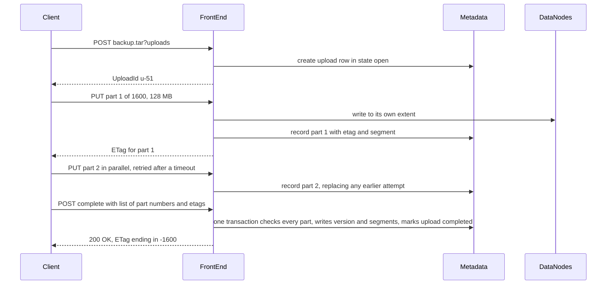
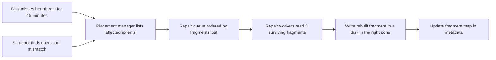
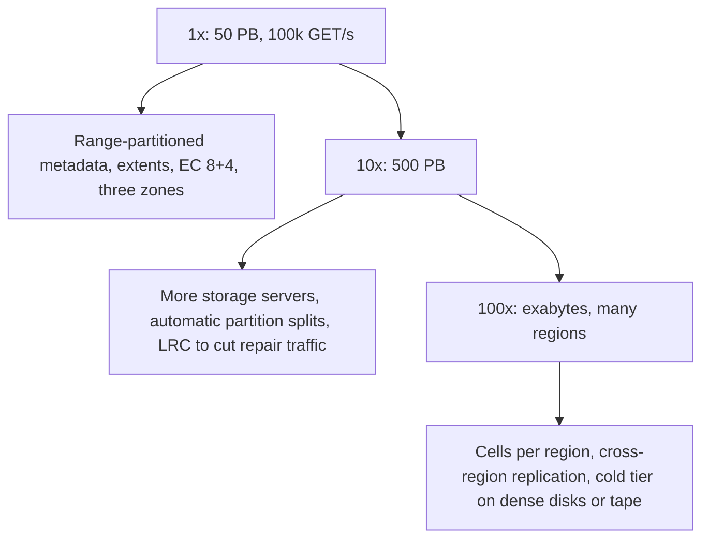

### 68.5.11 Caching

The data tier is not a cache-friendly place: hard disks, 100,000 GETs per second spread over 5,400 disks. Three caches keep the hot path cheap.

- **Metadata cache in the front ends.** Partition maps, bucket policies and placement leases change rarely and are cached for seconds to minutes, so a GET normally costs one metadata read (the object version), not three. Object versions themselves are **not** cached in front ends: a cached "latest version" would break read-after-write the moment another front end accepted an overwrite.
- **SSD read cache on data nodes.** Most objects are read in the first hours after they are written, so a few terabytes of flash per server absorb a large share of reads.
- **CDN in front, for public content** (Part 33, section 33.9). The store must be a good origin: correct `ETag` and `Cache-Control`, 304 responses to conditional GETs.

A single hot object (30,000 requests a second) would overload the one disk holding it, so front ends detect hot keys with a count-min sketch (Part 67, section 67.1) and keep them in memory for seconds, still checking the version in metadata on every request.

### 68.5.12 Messaging and background work

Very little of an object store is request-driven. Most of the engineering lives in background loops that run forever: multipart cleanup, lifecycle, garbage collection, repair and scrubbing. They communicate through durable work queues in the metadata service rather than a general message broker, because every task (rebuild fragment 7 of extent 9142) must survive restarts and be claimed by exactly one worker at a time. Change events for customers ("object created", "object deleted") go out on a partitioned log so tenants can trigger processing pipelines (Part 33, section 33.11), with at-least-once delivery and the version id as the idempotency key.

#### Deep dive: multipart upload without copying

Uploading a 200 GB file in one HTTP request fails on the first network hiccup. Multipart upload (Part 33, section 33.6, shows it from the client side) splits it into parts uploaded independently and in parallel, each retryable on its own.



Completion does **not** copy bytes. It writes one object version whose segment list points at the parts' existing segments, in part order, so completing even a 5 TB upload takes milliseconds. The final ETag is not an MD5 of the whole object (nobody has that without reading 5 TB) but an MD5 of the concatenated part MD5s followed by `-N`. A re-uploaded part replaces the earlier attempt's row and the old bytes become garbage. Parts of an upload that is never completed cost money forever unless an `AbortIncompleteMultipartUpload` lifecycle rule removes them, which is why every bucket should have one.

#### Versioning and lifecycle

With versioning on, a PUT adds a new row in `object_versions` and a DELETE adds a **delete marker** row (a version with `delete_marker = true`). A plain GET finds the newest row; if it is a delete marker, the answer is 404. A GET with `versionId` still returns the old bytes. Undeleting is deleting the delete marker. This turns "someone ran `rm -rf` on the bucket" from a disaster into a recoverable event, which is why Part 33 recommends versioning on every bucket that holds data you cannot regenerate.

Lifecycle rules are evaluated by workers that walk each bucket's metadata once a day:

```json
{
  "Rules": [
    { "ID": "logs-tiering", "Filter": { "Prefix": "logs/" }, "Status": "Enabled",
      "Transitions": [ { "Days": 30, "StorageClass": "STANDARD_IA" },
                       { "Days": 180, "StorageClass": "GLACIER" } ],
      "Expiration": { "Days": 730 } },
    { "ID": "old-versions", "Filter": {}, "Status": "Enabled",
      "NoncurrentVersionExpiration": { "NoncurrentDays": 30 },
      "AbortIncompleteMultipartUpload": { "DaysAfterInitiation": 7 } }
  ]
}
```

A transition rewrites the object's bytes into extents of the cheaper class (68.5.18) and updates its segment rows in one metadata transaction; the old bytes become garbage. An expiration adds a delete marker or removes a noncurrent version row. Because a single rule can touch billions of objects, lifecycle work is rate-limited per partition so that it never competes with customer traffic.

#### Garbage collection

Deleting an object removes or hides a metadata row; it does not touch disks. Bytes become **garbage** when no metadata row points at them: overwritten objects, expired versions, aborted uploads, abandoned PUTs from crashed front ends, transitioned objects. Reclaiming the space works per extent:

1. The collector computes, per sealed extent, how many bytes are still referenced. Each metadata partition reports the segments it references; the collector sums them per extent.
2. Extents with less than about 60 percent live bytes are **compacted**: live segments are copied into new extents, their segment rows are updated in metadata, and only then is the old extent scheduled for deletion.
3. Physical deletion waits a grace period (for example 7 days) in a "trash" state, so a bug discovered within a week can be undone.

Three safety rules are not optional; a collector that lacks them eventually deletes live data. **Fail closed**: if any metadata partition fails to report, the run stops; a missing report must never be read as "no references". **Respect in-flight writes**: bytes appended in the last 24 hours are never collected, because a PUT may have written data and not yet committed its metadata. **Bound the damage**: a run that would free more than a set fraction of the cluster (for example 2 percent) halts and pages a human.

#### Repair and scrubbing

Two loops keep the redundancy promised by 68.5.10. **Repair** starts when a disk or server stops sending heartbeats for, say, 15 minutes (shorter would rebuild terabytes every time a server reboots for a kernel patch). The placement manager lists the affected extents and queues them **by risk**: an extent missing 3 of its 4 parity fragments is rebuilt before one missing a single fragment. Repair bandwidth is throttled per disk so that customer reads keep their latency, but the throttle opens automatically as the risk rises. **Scrubbing** re-reads every fragment every two weeks or so and checks its checksum, because disks also fail silently: a sector returns wrong bytes without an error. A scrub failure is repaired like a lost fragment. Every GET also verifies the segment's `crc32c` on the way out, so corrupted bytes are never returned to a customer.



### 68.5.13 Scaling and how it evolves



The data tier scales linearly: add storage servers, and placement fills them. The metadata tier scales by splitting partitions, which works until a single bucket's key range becomes the bottleneck of one partition leader; at that point the hot range is split again. Beyond one region-sized system, large providers commonly partition into **cells**: independent copies of the whole stack, each holding a subset of buckets, so a bad deployment or a runaway bug harms one cell instead of the region.

A typical evolution: replication only at first; erasure coding when the disk bill matters; versioning and lifecycle when customers lose data to their own mistakes; cheaper tiers as data ages; then **cross-region replication**, an asynchronous copy of new versions driven by the change log (synchronous writes across 80 to 150 ms would multiply PUT latency).

### 68.5.14 Security

**Authentication** uses access keys: every request is signed with an HMAC over its method, path, selected headers and a timestamp (the scheme AWS calls Signature Version 4). The secret never travels on the wire, and a captured request cannot be replayed after its timestamp window (about 15 minutes). **Authorisation** evaluates identity policies and the bucket policy with the standard rule: an explicit deny wins, otherwise any allow grants, otherwise deny. A **block public access** setting at account level overrides any bucket policy that would make data public, because a public bucket full of customer data is the most common way object storage leaks (Part 40 — Security, section 40.26).

A **presigned URL** packs the signature into the query string so a browser can upload or download one object without credentials (Part 33, section 33.7). The front end verifies it with a key derived from the access key's secret, without calling the identity service per request. A simplified version of the idea in TypeScript:

```ts
// frontend/presign.ts  -- simplified scheme; real SigV4 also signs region, service and headers
import { createHmac, timingSafeEqual } from 'node:crypto';

export function presign(secret: string, method: string, path: string, expiresAt: number): string {
  const sig = createHmac('sha256', secret).update(`${method}\n${path}\n${expiresAt}`).digest('hex');
  return `${path}?expires=${expiresAt}&sig=${sig}`;
}

export function verifyPresigned(secret: string, method: string, path: string,
                                expiresAt: number, sig: string, nowSec: number): boolean {
  if (nowSec > expiresAt) return false;                       // expired links fail
  if (expiresAt - nowSec > 7 * 24 * 3600) return false;       // cap lifetime at 7 days
  const expected = createHmac('sha256', secret).update(`${method}\n${path}\n${expiresAt}`).digest();
  const given = Buffer.from(sig, 'hex');
  return given.length === expected.length && timingSafeEqual(given, expected);  // constant time
}
```

The method is signed, so a GET link cannot be used to PUT, and a link stays valid until it expires unless its key is disabled, so keep lifetimes short.

**Encryption at rest** uses envelope encryption (Part 40, section 40.16): each object or extent has a data key, encrypted by a per-bucket key in a key management service. Deleting the bucket key makes the data unreadable even on disks that are later lost or resold. Disks leaving the data centre are wiped or shredded regardless.

### 68.5.15 Failure scenarios

| Failure | Detection | Impact | Mitigation | User sees |
|---|---|---|---|---|
| One disk dies | Heartbeats, I/O errors | Fragments on it missing | Degraded reads from 8 fragments; repair by risk | Slightly slower GETs for some objects |
| Racks unreachable for minutes | Many missed heartbeats at once | Repair storm saturates links (68.5.21) | 15-minute trigger, risk-ordered queue, throttles | Nothing, or brief latency |
| Silent corruption (bit rot) | Scrub or read-time checksum | Wrong bytes on one fragment | Checksum on every read; rebuild fragment | Nothing |
| Whole zone down | Health checks, heartbeats | A third of replicas and fragments unavailable | Placement of 4 per zone keeps 8 of 12; metadata leaders move to other zones | Higher latency; writes continue on 2 zones |
| Metadata partition leader dies | Consensus heartbeat | That key range briefly unavailable | Raft elects a new leader in seconds | A few 503s, retried by SDKs |
| Hot prefix overloads one partition | Per-partition request rate | 503 Slow Down on that prefix | Automatic split; clients spread prefixes | Retries during the split |
| Front end crashes mid-PUT | Connection reset | Unreferenced bytes | Commit point: no metadata, no object; GC reclaims | Client retries PUT |
| Correlated disk batch failures | AFR rising on one disk model | Repair queue grows | Mix disk models and batches across each extent's placement | Nothing, if caught early |
| GC bug collects live data | Read errors on referenced segments | Data loss | Fail-closed GC, 7-day trash, run size limits | Nothing, if trash is restored in time |
| Lifecycle rule misconfigured | Sudden drop in bytes stored | Customer data expired | Versioning, delete markers, rule preview tool | Recoverable if versioning is on |

### 68.5.16 Observability

Per front end: request rate, error rate and latency (time to first byte, total) by operation and storage class. Per partition: request rate, leader changes, split events, replication lag. Per disk: I/O latency, error counts, temperature, fill level. System-wide durability signals, which matter more than anything else: **extents at reduced redundancy** by number of missing fragments, **repair queue age**, scrub coverage (percent of fragments verified in the last 14 days), and GC bytes freed per run. The page-worthy alerts are durability alerts: "any extent with 3 or more fragments missing", "repair queue oldest item over 6 hours" (it is the repair window in the durability model), and "scrub coverage below 90 percent". A latency alert wakes someone for availability; a redundancy alert wakes someone because data is at risk.

### 68.5.17 Deployment

Front ends and workers deploy zone by zone with canaries. Storage software rolls through one rack at a time, waiting for full redundancy before the next, so a bad release never hits more than one failure domain. Metadata partitions upgrade followers first, leader last. New disk models are mixed across placements so a bad model cannot dominate any extent.

### 68.5.18 Cost considerations

| Class | Placement and coding | Durability design | Typical use | Rough US list price per GB-month |
|---|---|---|---|---|
| Standard | EC across 3 zones, SSD read cache | Survives a zone | Active data | about 0.023 dollars |
| Infrequent access | Same coding, busier denser disks, retrieval fee and 30-day minimum | Survives a zone | Backups, older media | about 0.0125 dollars |
| One zone | Wider code in one zone (for example 16+4, 1.25x) | Lost if the zone is destroyed | Re-creatable data | about 0.01 dollars |
| Archive | Dense disks mostly idle, or tape, retrieval in hours | Survives a zone | Compliance archives | about 0.001 dollars |

(Prices are approximate Amazon S3 list prices in a US region in recent years, for orientation only.)

For a self-built store, the raw-disk bill is a few dollars per logical terabyte per month with 1.5x coding (about 225 servers amortised over five years for 50 PB). Disks are not the biggest line: **network egress**, power, data-centre space and the people who run it often cost more. The biggest levers are the coding overhead (3x versus 1.5x), the fill level (70 percent versus 85 percent), repair traffic (LRC), and moving cold data to archive tiers, which is why lifecycle rules are a cost feature as much as a convenience.

### 68.5.19 Tradeoffs

- **Erasure coding over replication** for sealed data: half the disks and more durability, paid for with encode work, degraded reads and heavier repair.
- **Replicated open extents, coded sealed extents**: fast small writes and cheap long-term storage, at the cost of two write paths and a background encoding pipeline.
- **Strong consistency through range-partitioned consensus metadata**: simple client semantics, paid for with leader-only reads and hot-range splitting.
- **Extents instead of per-object placement**: background jobs scale with about 50 million extents rather than 100 billion objects; the price is garbage collection by compaction.

| Decision | Options | Chosen | Why | Cost |
|---|---|---|---|---|
| Redundancy | 3x replication, EC 8+4, EC 9+6 | EC 8+4 for sealed extents, 3x for open | 1.5x overhead, survives one zone | No margin during a zone outage |
| Metadata partitioning | Hash, range | Range | LIST by prefix is a scan | Hot ranges need splits |
| Commit point | Metadata first, data first | Data first | Readers never see missing bytes | Garbage from crashed PUTs |
| GC safety | Immediate delete, trash period | 7-day trash, fail closed | Bugs are recoverable | 7 days of extra disk |
| Repair trigger | Immediate, after a delay | After 15 minutes | Reboots do not cause rebuild storms | 15 minutes at reduced redundancy |

### 68.5.20 Alternative architectures

**Use the cloud's object store.** For almost every company this is the answer: Amazon S3, Google Cloud Storage or Azure Blob Storage already run this design at a scale no in-house team will match. Build your own only if you are a cloud provider, run your own data centres at large scale, or have strict data-residency needs no provider meets.

**Run an open-source object store.** MinIO, Ceph (with its RADOS Gateway offering an S3-compatible API) and SeaweedFS give an S3-compatible service on your own hardware. You get erasure coding and replication without writing them, but you inherit the operations: repair, upgrades, capacity planning.

**Files in PostgreSQL.** For a few gigabytes of small files, a `bytea` column or large objects in PostgreSQL is simpler and transactional with the rest of your data. It fails beyond that size because backups, replication and vacuum all carry the bytes (Part 33, section 33.1).

### 68.5.21 Incident story: the racks that came back

At 02:10 one night, a planned firmware upgrade on top-of-rack switches in zone B went wrong: four racks holding 40 storage servers and 960 disks dropped off the network for nine minutes. At the time, the repair trigger was two minutes of missed heartbeats.

At 02:12 the placement manager declared 960 disks dead and queued repair for every fragment on them, about 13 PB. Repair workers in zones A and C started reading 8 fragments for every fragment they rebuilt, and the cross-zone links filled within a minute. Customer GETs that needed a fragment from another zone waited behind repair traffic: p99 time to first byte went from 80 ms to over 4 seconds, SDKs timed out and retried, and the retries added load. Availability for GETs fell to about 97 percent for 40 minutes.

At 02:19 the racks came back. Their disks were healthy and every fragment on them was intact, but the repair queue did not know that; it kept rebuilding fragments that now existed twice. Worse, two genuinely failed disks in zone A, which held fragments of extents already missing one fragment each, sat in the same first-in, first-out queue behind 13 PB of unnecessary work. For about an hour, a few thousand extents were one disk failure closer to loss than they needed to be. No data was lost; the on-call engineer paused repair at 02:52, the queue was purged of fragments whose disks had returned, and latency recovered within minutes.

The postmortem changed three things, all visible in this design. The trigger became **15 minutes** for an unreachable server, while a disk that reports its own failure is still repaired at once: "unreachable" and "dead" are different states. The queue became **ordered by risk** (fragments missing per extent), so the two dangerous disks would have been first. And repair bandwidth became **throttled per disk and per cross-zone link**, opening only as risk rises. The lesson: **repair is a load like any other; in a storage system, an overeager healer can cause the outage it exists to prevent.**

### 68.5.22 Interview follow-ups

1. **Explain eleven nines and show how replication or erasure coding reaches it.**
   Expected answer: loss probability about 1e-11 per object per year; a failure-versus-repair race; with 2 percent AFR and a 6-hour repair window, 3x gives about 1e-11 and 8+4 about 1e-18; correlated failures are the real risk. Follow-up: what happens if the repair window doubles? (3x loss probability rises four times.)
2. **How do you give strong read-after-write consistency for LIST?**
   Expected answer: range-partitioned metadata with consensus, leader reads, and the object PUT committing to the same partition that LIST scans.
3. **Why not erasure code each object as it is written?**
   Expected answer: 12 writes per small PUT and 8 disk reads per small GET; pack into extents, replicate while open, code when sealed, systematic code so a GET reads one fragment.
4. **How does multipart completion avoid copying 5 TB?**
   Expected answer: the new version's segment list points at the parts' segments; completion is a metadata transaction.
5. **A customer reports a sudden flood of 503s on writes to a new prefix. Why?**
   Expected answer: a hot range on one partition before it splits; fix by automatic splits and advising key prefixes that spread load.
6. **How would you make garbage collection safe?**
   Expected answer: data-first commit with an in-flight grace window, fail closed on incomplete reference data, trash period, run-size limits, sample verification before deletion.

### 68.5.23 Practical exercise

Build a miniature object store in TypeScript: a NestJS front end, PostgreSQL for metadata using the schema in 68.5.7, and three "data node" processes that store extents as files on local disk.

1. Implement PUT, GET with `Range`, DELETE, LIST with prefix and delimiter, and multipart upload.
2. Write data first to all three data nodes, then commit metadata in one transaction.
3. Add a garbage collector with a 24-hour in-flight window (configurable to seconds for tests) and a trash state.
4. Kill a data node while uploading 10,000 objects; delete one node's extent files and run a repair job that re-copies them from the others.

Acceptance criteria:

- A GET immediately after a successful PUT always returns the new bytes; a LIST immediately after includes the key.
- Killing the front end between data write and metadata commit never produces a visible partial object.
- After the repair job, every extent has three verified copies (checksums match).
- The collector refuses to run when one metadata query fails, and a test proves it.

#### Worked answer to the exercise

The front end follows 68.5.9: compute MD5 and CRC32C, append to all three data nodes with a timeout, and only then insert the `object_versions` and `object_segments` rows in one PostgreSQL transaction. LIST is `SELECT DISTINCT ON (object_key) ... WHERE bucket = $1 AND object_key >= $2 ORDER BY object_key, version_seq DESC LIMIT 1001`, with the delimiter folding handled in code. To prove the commit point, inject a crash hook (`process.exit(1)` when an environment flag is set) between the data write and the transaction, run 1,000 PUTs, and assert that every object a GET returns has matching checksums and that no row points at missing bytes.

The garbage collector is the part most people get wrong. It must fail closed:

```ts
// gc/live-bytes.ts
import { GcAbortedError, MetadataPartition } from './gc.types';

export async function liveBytesPerExtent(partitions: MetadataPartition[]): Promise<Map<string, number>> {
  const results = await Promise.allSettled(partitions.map((p) => p.referencedSegments()));
  const failed = results.filter((r) => r.status === 'rejected').length;
  if (failed > 0) throw new GcAbortedError(`${failed} partition(s) did not report`);  // never treat as empty
  const live = new Map<string, number>();
  for (const r of results) {
    if (r.status !== 'fulfilled') continue;
    for (const seg of r.value) live.set(seg.extentId, (live.get(seg.extentId) ?? 0) + seg.length);
  }
  return live;
}
```

The test mocks one partition to reject and asserts `GcAbortedError` and zero extents moved to trash. Extents younger than the in-flight window are skipped before this map is consulted. Repair lists each extent's expected copies, verifies checksums on the survivors, and copies from a verified survivor to a node that does not already hold the extent; the acceptance check re-reads every copy and compares CRC32C.
