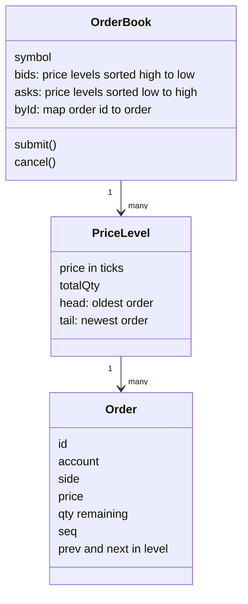
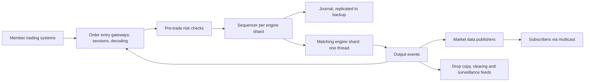
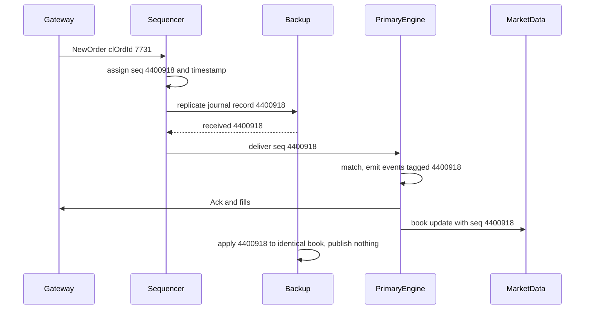

## 68.6 Stock Exchange Matching Engine

> **Try it first** · Level: Staff · About 60 minutes
>
> **Build:** the core of a stock exchange that accepts buy and sell orders, matches them by price-time priority, and publishes trades and market data.
>
> **Requirements:**
> - accept limit orders, market orders and cancels for 5,000 listed instruments
> - match by price-time priority and report every fill to both sides
> - run pre-trade risk checks (price bands, size limits, credit) before an order reaches the book
> - publish market data (trades, best prices, depth) to thousands of subscribers, in sequence
> - recover from a crash with exactly the same order book, losing no acknowledged order
>
> **Scale and constraints:** 5,000 instruments; peak 500,000 order messages per second exchange-wide, 50,000 per second on the busiest instrument; about 2.3 billion messages in a 6.5-hour trading day; under 10 microseconds of matching work per message and p99 under 100 microseconds from order entry to acknowledgement inside the data centre; failover to a hot backup in under 1 second without losing or reordering any acknowledged order.
>
> **Your task:** sketch the API, the data model and the main components; estimate storage and throughput; name the two hardest problems and how you would solve them.
>
> Spend the time on paper before you read on. The model design follows.

### 68.6.1 Requirements

A **matching engine** is the heart of an exchange. Traders (through brokers) send **orders**: "buy 300 shares of ACME at no more than 101.25" or "sell 500 at the best price available". The engine keeps, for each instrument, an **order book**: all buy orders not yet filled (the **bids**) and all sell orders not yet filled (the **asks**). When a new order can trade against a resting one, the engine produces a **trade** (also called a fill or execution), tells both sides, and publishes the trade to the market.

Imagine a fish market with one auctioneer per fish type. Buyers shout prices they will pay; sellers shout prices they will accept. The auctioneer keeps two lists on a board: buyers sorted from highest price down, sellers from lowest price up, and within the same price, whoever shouted first is first. When a seller shouts a price at or below the top buyer's, the auctioneer matches them immediately at the buyer's already-posted price. One auctioneer per fish, writing everything in a numbered logbook, is exactly the design that follows: one single-threaded engine per instrument, and a journal that can replay the day.

This design is unusual in this book. Almost every other system here is limited by I/O, databases and networks measured in milliseconds. A matching engine is limited by CPU caches and network cards measured in **microseconds** (millionths of a second), and its central correctness rule, that the same inputs always produce the same outputs, shapes everything.

### 68.6.2 Functional requirements

1. Accept new orders: **limit** (trade at this price or better, rest on the book otherwise), **market** (trade immediately at the best available prices), with time-in-force **GTC** (good till cancelled, rests until filled or cancelled) or **IOC** (immediate or cancel: fill what you can now, cancel the rest).
2. Accept **cancel** and **cancel/replace** (change quantity or price) for resting orders.
3. Match by **price-time priority**: better price first; at the same price, earlier arrival first.
4. Send execution reports to both parties for every acknowledgement, fill, cancel and reject.
5. Run pre-trade risk checks before matching: price bands, maximum order size and value, per-account credit limits, self-trade prevention, and a kill switch per member firm.
6. Publish market data: trades, best bid and offer, and depth per price level, each update sequenced.
7. Keep an audit trail from which every order's life can be reconstructed exactly.

**Non-goals.** Opening and closing auctions, stop orders, iceberg orders and other advanced types (they are evolution steps, 68.6.13). Clearing and settlement (moving money and shares after the trade, done by a clearing house hours or days later). Brokerage functions: customer accounts, user interfaces, routing between exchanges. Market data for the public web at full detail (served by a separate, conflated feed).

### 68.6.3 Non-functional requirements

| Property | Target | Why |
|---|---|---|
| Matching latency | Under 10 microseconds of engine work per message, p99 | Participants compete on speed; slow engines lose order flow |
| Order entry to acknowledgement | p99 under 100 microseconds inside the data centre | Measured by members from their colocated servers |
| Throughput | 500,000 messages/s exchange-wide, 50,000/s on one instrument, with 10x microbursts | Opening minutes and news events |
| Determinism | Same input sequence gives the identical book and outputs, always | Recovery, backups and audit depend on it |
| Durability | No acknowledged order or trade is ever lost | A lost fill is a financial and legal problem |
| Fairness | Strict price-time priority by arrival at the exchange | Regulatory and commercial requirement |
| Availability | Failover in under 1 second during trading hours | A halted market makes headlines |

### 68.6.4 Constraints: what a microsecond buys

The numbers below are approximate orders of magnitude on modern servers. They explain every unusual choice in this design.

| Operation | Approximate time |
|---|---|
| L1 cache read | about 1 ns |
| Main memory read (cache miss) | about 100 ns |
| One matching step on a warm order book | 0.1 to 1 microsecond |
| Network hop within a rack with kernel-bypass networking | 1 to 5 microseconds |
| Same hop through the normal Linux network stack | 10 to 50 microseconds |
| Light in optical fibre, per kilometre | about 5 microseconds |
| PostgreSQL commit on a local SSD | about 1,000 microseconds (1 ms) |
| A garbage-collection pause in a typical Node.js process | 1,000 to 50,000 microseconds |

The whole budget from order entry to acknowledgement (100 microseconds) is a tenth of one PostgreSQL commit. So: **no database on the hot path, no locks, no memory allocation in the loop, no garbage collector pauses, no kernel network stack**. The order book lives in memory, durability comes from replicating a sequential journal, and every message is handled by one CPU core that never waits.

A typical web backend is the opposite on almost every axis, which is why this design is a good test of whether a candidate can drop habits:

| Concern | Typical web backend | Matching engine |
|---|---|---|
| Unit of time | Milliseconds | Microseconds and nanoseconds |
| State | In a database, servers stateless | In memory of one thread, rebuilt from a journal |
| Concurrency | Many threads, locks, transactions | One thread per instrument, no locks |
| Scaling | Add stateless instances | Partition by instrument; one instrument never splits |
| Durability | Database commit | Replicated sequential journal |
| Correctness of retries | Idempotency keys | Sequence numbers and deterministic replay |
| Language | Node.js, Java, Go, anything | C++, Rust, or Java written to avoid allocation |

Honest note on the code below: the TypeScript in 68.6.10 teaches the data structures and the matching loop. A real engine is not written in Node.js, because garbage-collection pauses and the kernel network stack alone exceed the latency budget. Production engines use C++, Rust or carefully allocation-free Java (the LMAX exchange's published "Disruptor" design is a well-known example), pin threads to dedicated CPU cores that spin instead of sleeping, and use kernel-bypass network cards; some move risk checks or market-data encoding into FPGAs.

### 68.6.5 Capacity estimation

| Quantity | Assumption | Calculation | Result |
|---|---|---|---|
| Messages per day | average 100,000/s over 6.5 hours | 100,000 x 23,400 s | about 2.3 billion |
| Peak rate | opening minute and news | given | 500,000/s exchange-wide |
| Busiest instrument | 10 percent of peak | | 50,000/s, one message every 20 microseconds on average |
| Engine load on that instrument | 5 microseconds per message including journal hand-off | 50,000 x 5 microseconds | 25 percent of one core |
| Microburst | 10x for a millisecond | 500 messages arrive in 1 ms | queue builds to about 1.5 ms of work, drains in a few ms |
| Journal record | binary, fixed layout | about 64 bytes | |
| Journal per day | 2.3 billion x 64 B | | about 150 GB, kept for years for audit |
| Resting orders | exchange-wide at peak | 10 million x about 100 B | about 1 GB of memory in total |
| Trades | about 10 percent of messages (most messages are cancels and replaces) | | up to 50,000/s at peak |
| Market-data updates | about 1.5 per input message | 500,000 x 1.5 x 40 B | about 30 MB/s per feed, independent of subscriber count with multicast |
| Engine shards | 5,000 instruments in 32 groups, one core each | | 32 cores on two servers, plus identical backups |

The estimate says three important things. First, throughput is not the problem: one core can match far more than 50,000 messages a second. **Latency and its tail** are the problem, especially during microbursts when hundreds of orders arrive within a millisecond and queueing, not matching, dominates. Second, the whole book fits in memory many times over; the hot part of one instrument's book (the best few price levels) fits in CPU cache. Third, the journal (150 GB a day) is small for disks but must be written sequentially and replicated in microseconds, which rules out a database and argues for an append-only file plus replication to a backup.

### 68.6.6 API design

Exchanges speak binary protocols over long-lived TCP sessions, not REST. The industry standard is **FIX** (Financial Information eXchange), a tag-value protocol; most exchanges also offer a faster fixed-layout binary protocol (NASDAQ's OUCH for order entry and ITCH for market data are well-known public examples).

| Message | Direction | Key fields | Notes |
|---|---|---|---|
| NewOrder | member to exchange | `clOrdId`, symbol, side, type, price (integer ticks), quantity, time in force | `clOrdId` is unique per session; a duplicate is rejected, which makes retries safe |
| Cancel | member to exchange | `clOrdId` of the order | Rejected with "too late" if already filled |
| CancelReplace | member to exchange | `clOrdId`, new price or quantity | Price change or quantity increase loses time priority; a quantity decrease keeps it |
| Ack / Reject | exchange to member | exchange order id, reason | Ack means the order is sequenced and journaled |
| Fill | exchange to member | order id, price, quantity, remaining, trade id | Sent to both buyer and seller |
| Cancelled | exchange to member | order id, cancelled quantity | |
| Market data | exchange to all | instrument, sequence number, update | Multicast, with snapshots and gap fill (68.6.12) |

Every session has its own message sequence numbers in both directions. A member that reconnects says "the last execution report I received was 88,412" and the gateway resends from 88,413. Combined with `clOrdId` uniqueness, this gives exactly-once processing over an unreliable connection without any idempotency-key table.

**Prices are integers.** ACME's tick size is 0.01, so 101.25 is sent as `10125`. Floating point never appears in an exchange's matching logic: `0.1 + 0.2 !== 0.3` in binary floating point, and an order book that compares prices inexactly is a lawsuit.

### 68.6.7 Data model

Everything lives in memory, in structures chosen for the three operations that dominate: find the best price, take the oldest order at it, and cancel any order by id.



- **Price levels**, one per distinct price with resting orders, kept sorted (best first) so the best price is the first element. Real engines often use an array indexed by tick offset within a price band, giving direct access to any level; a sorted array or tree is the simple version.
- **A FIFO queue per level**, implemented as a doubly linked list. The head is the oldest order, so time priority is "take the head". Appending at the tail is O(1).
- **A hash map from order id to order node**. Cancels are the most common message (often more than 90 percent of order traffic in electronic markets), and the map plus the doubly linked list makes a cancel O(1): find the node, unlink it.

The **journal** is the other half of the data model, and the only part on disk:

```text
journal record (fixed 64 bytes, little-endian)
  seq            u64   global sequence number for this engine shard
  recv_time_ns   u64   stamped by the sequencer from a PTP-disciplined clock
  msg_type       u8    NEW / CANCEL / REPLACE / TIMER / ADMIN
  instrument     u32
  session_id     u32
  cl_ord_id      u64
  side, tif      u8, u8
  price_ticks    i64
  quantity       u64
  account_id     u32
  checksum       u32
```

The journal records **inputs**, not outputs. Outputs (fills, book updates) can always be recomputed by replaying inputs through the deterministic engine; recording them too is useful for fast audit queries and is done downstream.

### 68.6.8 High-level architecture



Orders arrive at **gateways** that hold member sessions, decode messages and check session sequence numbers. **Risk checks** reject orders that break price bands, size limits or credit limits. The **sequencer** for the order's engine shard assigns the next sequence number and a timestamp, writes the message to the **journal** and replicates it to the backup. The **matching engine** thread consumes sequenced messages one by one and emits output events: acknowledgements and fills back to gateways, book changes to **market data publishers**, and copies to clearing and surveillance.

### 68.6.9 Component design

| Component | Responsibility | Notes |
|---|---|---|
| Gateway | Member sessions, authentication, decoding, session sequence numbers, throttles per session | Many instances; stateless apart from session state |
| Risk engine | Price bands, size limits, credit, self-trade rules, kill switch | Must be fast and must see the member's position across instruments (68.6.14) |
| Sequencer | Total order of inputs per shard, timestamping, journal write, replication to backup | The single point that defines "who was first" |
| Matching engine | Order books for its instruments; pure function of the input sequence | One pinned core per shard |
| Journal | Append-only input log, replicated, snapshotted | The source of truth and the audit trail |
| Market data publisher | Encodes book changes, multicasts A and B feeds, serves snapshots and gap fills | |
| Drop copy | Real-time copy of a member's executions for their risk systems | |
| Backup engine | Consumes the same journal, builds the same state, does not publish | Takes over on failure |

### 68.6.10 Deep dive: the book, the sequencer and the journal

Three problems are hard: matching correctly and fast, making the system deterministic so that it can be replicated and audited, and recovering without losing or reordering anything.

#### Deep dive: price-time matching in code

The loop is short. For an incoming buy, look at the lowest ask; if its price is at or below the buy's limit, trade against the oldest order at that level, at the **resting order's price** (the price already on the book), and repeat until the buy is filled or no longer crosses. Whatever remains rests on the book (GTC) or is cancelled (IOC).

```ts
// engine/order-book.ts -- teaching version: one instance per instrument, called from one thread only
export type Side = 'BUY' | 'SELL';
export interface Order { id: string; account: number; side: Side; price: number; qty: number; seq: number;
  prev?: Order; next?: Order; level?: Level }
interface Level { price: number; totalQty: number; head?: Order; tail?: Order }
export type EngineEvent =
  | { type: 'TRADE'; seq: number; price: number; qty: number; buyId: string; sellId: string }
  | { type: 'RESTED' | 'CANCELLED'; seq: number; orderId: string; qty: number };

export class OrderBook {
  private readonly levels = { BUY: new Map<number, Level>(), SELL: new Map<number, Level>() };
  private readonly prices = { BUY: [] as number[], SELL: [] as number[] };  // best price first
  private readonly byId = new Map<string, Order>();

  submit(o: Order, tif: 'GTC' | 'IOC', out: EngineEvent[]): void {
    const opp: Side = o.side === 'BUY' ? 'SELL' : 'BUY';
    while (o.qty > 0) {
      const best = this.prices[opp][0];
      if (best === undefined || (o.side === 'BUY' ? best > o.price : best < o.price)) break;
      const level = this.levels[opp].get(best)!;
      const resting = level.head!;                              // oldest order: time priority
      const qty = Math.min(o.qty, resting.qty);
      out.push({ type: 'TRADE', seq: o.seq, price: best, qty,   // trade at the resting price
        buyId: o.side === 'BUY' ? o.id : resting.id, sellId: o.side === 'SELL' ? o.id : resting.id });
      o.qty -= qty; resting.qty -= qty; level.totalQty -= qty;
      if (resting.qty === 0) this.unlink(resting);
    }
    if (o.qty === 0) return;
    if (tif === 'IOC') { out.push({ type: 'CANCELLED', seq: o.seq, orderId: o.id, qty: o.qty }); return; }
    this.rest(o);
    out.push({ type: 'RESTED', seq: o.seq, orderId: o.id, qty: o.qty });
  }

  cancel(orderId: string, seq: number, out: EngineEvent[]): boolean {
    const o = this.byId.get(orderId);
    if (!o) return false;                                       // already filled or cancelled: "too late"
    this.unlink(o);
    out.push({ type: 'CANCELLED', seq, orderId, qty: o.qty });
    return true;
  }

  private rest(o: Order): void {
    let level = this.levels[o.side].get(o.price);
    if (!level) {
      level = { price: o.price, totalQty: 0 };
      this.levels[o.side].set(o.price, level);
      const ps = this.prices[o.side];                           // keep best-first order
      const better = (a: number) => (o.side === 'BUY' ? a > o.price : a < o.price);
      let i = 0; while (i < ps.length && better(ps[i])) i++;
      ps.splice(i, 0, o.price);
    }
    o.level = level; o.prev = level.tail; o.next = undefined;
    if (level.tail) level.tail.next = o; else level.head = o;   // append at tail: FIFO
    level.tail = o; level.totalQty += o.qty;
    this.byId.set(o.id, o);
  }

  private unlink(o: Order): void {
    const level = o.level!;
    if (o.prev) o.prev.next = o.next; else level.head = o.next;
    if (o.next) o.next.prev = o.prev; else level.tail = o.prev;
    level.totalQty -= o.qty;
    this.byId.delete(o.id);
    if (!level.head) {                                          // empty level: remove the price
      this.levels[o.side].delete(level.price);
      const ps = this.prices[o.side]; ps.splice(ps.indexOf(level.price), 1);
    }
  }
}
```

A worked example makes the rules concrete. The ask side of ACME holds 200 at 101.20 (order A, arrived first), 100 at 101.20 (order B), and 500 at 101.30 (order C). A buy limit for 400 at 101.25 arrives:

```text
step 1  best ask 101.20 <= 101.25, head is A  -> trade 200 @ 101.20 (A filled, removed)
step 2  best ask 101.20, head is now B        -> trade 100 @ 101.20 (B filled, level empty, removed)
step 3  best ask 101.30 >  101.25             -> stop; 100 remain
step 4  GTC: rest 100 @ 101.25 as the new best bid
```

The buyer paid 101.20, better than its limit: **price improvement** goes to the incoming order because the resting orders' prices were already public. Two details a real engine adds: **self-trade prevention** (if `resting.account === o.account`, cancel one side instead of trading the firm with itself, a wash trade) and **market orders as protected IOC orders**: the risk layer converts a market buy into an IOC limit at a collar price (for example the best ask plus 5 percent), so a market order hitting a thin book cannot sweep to absurd prices.

#### Deep dive: one thread per instrument and why

Why not let many threads match orders in parallel, like a web server handles requests? Because the order book of one instrument is a single sequence of decisions, and each decision depends on every earlier one. Two threads matching ACME at once would need a lock on the book; with a lock, the threads take turns anyway, and you have added lock hand-offs (hundreds of nanoseconds each, more under contention), cache lines bouncing between cores, and, worst of all, an order of execution that depends on thread scheduling. Run the same inputs twice and you could get different trades.

A **single thread per instrument** removes all of that. It owns its books outright, keeps them hot in its core's cache, never takes a lock, and processes messages in exactly the order the sequencer gave them. Parallelism comes from **sharding by instrument**: 5,000 instruments over 32 engine threads, each instrument on exactly one thread. The cost is that one instrument can never use more than one core, which is fine because one core handles far more than the busiest instrument's 50,000 messages a second.

The sequencer is what makes the engine **deterministic**: the engine's state after message `n` is a pure function of its state after message `n - 1` and message `n`.

```text
state(n) = apply(state(n - 1), input(n))
```

That property must be defended in code, line by line:

- **No reading the clock inside the engine.** Time arrives as the sequencer's timestamp on each message, and timed events (an order expiring at the close) arrive as sequenced `TIMER` messages.
- **No randomness, no floating point, no iteration over structures with unspecified order.** (JavaScript's `Map` iterates in insertion order, which is deterministic; a hash set ordered by memory address would not be.)
- **No external calls.** The engine never asks a database or service anything; everything it needs is in its inputs or its state.

Determinism is what makes the next deep dive possible.

#### Deep dive: event-sourced journal, replay and the hot backup

The engine is **event sourced** (Part 30 — Distributed Transactions, section 30.16, gives the general pattern): the journal of sequenced inputs is the source of truth, and the order book is a cache that can be rebuilt from it. Recovery is **snapshot plus replay**: load the latest snapshot of the books (taken every few minutes, tagged with its sequence number), then replay journal records after that sequence. Replaying a whole day of 2.3 billion messages from the morning snapshot takes minutes because no I/O or matching wait is involved, but a hot backup avoids even that.



The sequencer releases a message to the engine (and so to the member's acknowledgement) only after the backup has **received** it. Network replication inside the data centre with kernel bypass costs a few microseconds; waiting for an `fsync` to disk would cost tens to hundreds of microseconds, so many designs accept "in memory on two machines in different racks, flushed to disk asynchronously" as the durability point. That trade is explicit: losing both machines within the flush window (milliseconds) could lose acknowledged orders, and the exchange decides whether that risk is acceptable or whether a synchronous disk write on the backup is worth the latency.

The backup applies the same records in the same order to the same code, so its books are identical to the primary's at every sequence number. **Failover** is then simple: when the primary stops sending heartbeats (or misses a few hundred microseconds of them), an arbiter promotes the backup, which already has every acknowledged message. Downstream systems de-duplicate output events by sequence number, so if both engines briefly publish, nothing is counted twice; if the primary had emitted outputs for a sequence the backup did not receive, that message was never acknowledged to anyone, because acknowledgement waited for replication.

Two dangers remain. **Split brain**, where both think they are primary, is prevented by an external arbiter with a fencing token (Part 29, section 29.11), or by running the sequencer itself as a small consensus cluster; open-source Aeron Cluster, for example, replicates a log with Raft for exactly this kind of system. **Divergence**, where primary and backup compute different books from the same inputs, means determinism was broken somewhere. It is detected by comparing a hash of the book state every few thousand messages, and 68.6.21 tells the story of what causes it.
