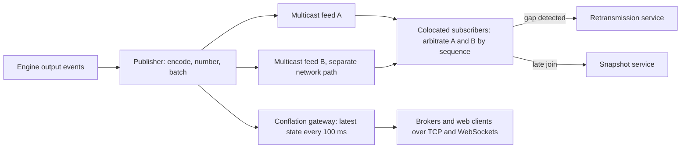
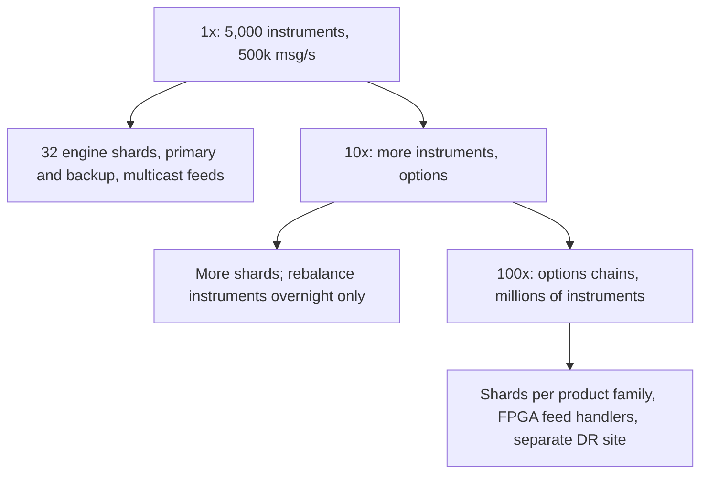

### 68.6.11 Caching

There is no cache in front of the engine because the engine *is* the in-memory state. What matters instead is the **CPU cache**, and engineers who build these systems talk about "mechanical sympathy": arranging data so the hardware stays fast. The best few price levels of a busy book are touched by almost every message, so they stay in the core's L1 and L2 caches; a cache miss to main memory costs about 100 ns, a meaningful slice of a microsecond budget. That is why real engines prefer arrays and pre-allocated pools of order objects over linked structures scattered across the heap, and why each engine thread is pinned to one core: a thread that migrates between cores leaves its warm cache behind.

Two ordinary caches do exist, off the hot path. **Reference data** (instrument list, tick sizes, price bands, member permissions) is loaded at the start of day and changed only by sequenced admin messages, so every component sees the same version at the same sequence number. The **market data snapshot service** keeps the latest full book per instrument so a subscriber joining mid-day can start from a snapshot instead of replaying the day.

### 68.6.12 Messaging: market data fan-out

Market data is the exchange's public output: every trade and every change to the book, to thousands of subscribers who all want it at the same moment. Sending a separate TCP stream to each subscriber would make the last subscriber's data later than the first's and would multiply the publisher's work by the number of subscribers. Inside the data centre, exchanges therefore use **UDP multicast**: the publisher sends each packet once and the network switches copy it to every subscribed port.



UDP does not guarantee delivery, so the feed is built to survive loss:

- **Sequence numbers on every packet**, per channel. A subscriber who sees 1,001 then 1,003 knows 1,002 is missing.
- **Two identical feeds (A and B)** on physically separate networks. Subscribers take whichever copy of each sequence number arrives first; a loss on one path is almost never a loss on both.
- **A retransmission service** for small gaps and a **snapshot service** for large ones or late joiners: take a snapshot tagged with sequence `s`, then apply buffered live updates after `s`.

Feeds come in levels of detail: **Level 1** is the best bid and offer and trades; **Level 2** adds aggregated quantity per price level; **Level 3** (order by order) shows every individual order add, cancel and fill, from which a subscriber can rebuild the exact book. Slower consumers, such as a broker's mobile app, cannot use a raw feed at hundreds of thousands of updates per second. A **conflation gateway** keeps the latest state per instrument and sends it every 100 ms or on change, over TCP or WebSockets (Part 35 — Real-Time Systems, covers the fan-out mechanics). Conflation drops intermediate states by design, which is fine for a screen and wrong for an algorithm, so it is never the only feed.

Non-latency-critical consumers (clearing, surveillance, the member's back office, the data warehouse) read output events from a durable log such as Kafka, fed from the journal and outputs. These consumers care about completeness, not microseconds, so an ordinary at-least-once pipeline with the engine sequence number as the idempotency key is the right tool (Part 28).

### 68.6.13 Scaling and how it evolves



Scaling out means more shards: an instrument moves between shards only outside trading hours, by snapshot and reload, because moving a live book would break the single-sequence rule. Scaling **up** a single instrument is not possible by adding cores, so a very hot instrument gets its own dedicated shard and core, and the remaining lever is making each message cheaper (fewer cache misses, simpler risk checks). Options exchanges are the extreme case: one underlying stock can have thousands of option contracts that all change when the stock moves, producing far more market data than orders.

The product evolves inside the same deterministic core. **Opening and closing auctions** collect orders without matching, then compute a single price that maximises traded volume at a sequenced auction time. **Stop orders** are held outside the book and released as sequenced inputs when a trade crosses their trigger. **Iceberg orders** show a small visible quantity and refill from a hidden reserve, losing time priority on each refill. Each new feature must obey the same rules: no clock, no randomness, inputs only. A **disaster-recovery site** in another data centre receives the journal asynchronously and can resume trading within minutes, accepting that the last milliseconds of messages before a site-wide disaster may need reconciliation with members.

### 68.6.14 Security, risk checks and fairness

**Pre-trade risk checks** are the exchange's seatbelt. Typical checks, each a few hundred nanoseconds:

- **Price bands**: reject a limit price more than a set percentage away from a reference price (a fat-finger 1,012.50 instead of 101.25).
- **Maximum order size and value** per order and per member.
- **Credit and position limits** per account.
- **Message rate throttles** per session, so one malfunctioning algorithm cannot flood the engine.
- **Kill switch**: one admin message cancels all of a member's resting orders and blocks new ones.

Credit is the hard one, because an account trades many instruments living on different engine shards, while its limit is one number. Checking it inside each shard would require shards to coordinate. The common approach is a **risk engine sharded by account**, in front of the sequencers: it reserves the order's value against the account's limit when the order passes, and releases it when fill or cancel events come back from the engines. The risk engine is itself single-threaded per account shard and journals its decisions, so its state is also replayable. The cost is one more hop (a few microseconds) on every order.

**Fairness** means price-time priority by arrival *at the exchange*, as decided by the sequencer, never by a timestamp the client sends. Colocation facilities give every member the same cable length to the matching engine, so paying for a closer rack buys nothing. Market data is released to all subscribers at the same moment on the same multicast group. Some venues go further: the IEX exchange in the United States adds a deliberate 350-microsecond delay ("speed bump") on incoming orders, and academic work (Budish, Cramton and Shim's 2015 paper on frequent batch auctions) proposes matching in discrete batches every fraction of a second so that tiny speed advantages stop mattering.

**Security** in the usual sense: members connect over private cross-connects or dedicated lines, never the public internet; sessions are authenticated by credentials and certificates; administrative actions (halts, band changes, kill switches) require two people and are sequenced and journaled like orders; and every input is kept, which makes the journal the evidence in any dispute.

### 68.6.15 Failure scenarios

| Failure | Detection | Impact | Mitigation | Members see |
|---|---|---|---|---|
| Primary engine crashes | Missed heartbeats (sub-millisecond) | Shard stops matching | Promote hot backup, which has every acknowledged input | A pause of well under a second |
| Backup lost | Heartbeats | No redundancy | Start a new backup from snapshot plus journal; alert | Nothing |
| Primary and backup diverge | Book-hash mismatch | Backup unsafe to promote | Halt the shard, diagnose, rebuild backup from primary snapshot (68.6.21) | Possibly a short halt |
| Gateway crashes | Session drop | Member disconnected | Member reconnects to another gateway, resends from session sequence | Reconnect, no lost orders |
| Multicast packet loss | Sequence gap | Subscriber's book incomplete | A/B arbitration, retransmission, snapshot | Brief gap fill |
| Microburst | Queue depth on the sequencer | Latency spike | Headroom (25 percent busy at peak), throttles per session | Slower acks for milliseconds |
| Runaway member algorithm | Throttle and risk hits | Flood of orders or bad prices | Throttles, price bands, kill switch | That member is cut off |
| Sequencer and arbiter partition | Arbiter loses primary | Risk of split brain | Fencing token; old primary stops on losing its lease | Short pause |
| Wrong reference data (bad tick table) | Reject spike, surveillance | Orders wrongly rejected or accepted | Reference data reviewed, applied as sequenced admin messages, reversible | Instrument halt |

### 68.6.16 Observability and auditing

Latency is measured with **hardware timestamps** taken by network cards as packets enter and leave, because software timers disturb what they measure. Latencies are recorded as histograms with nanosecond resolution (the open-source HdrHistogram library is common) and reported as p50, p99, p99.9 and maximum per shard per second; averages are meaningless here, the tail is the product. Other signals: sequencer queue depth, replication lag to the backup in microseconds, book-hash agreement between primary and backup, gaps per feed, throttle and risk rejects per member.

**Clocks** must be accurate, not just consistent. Servers synchronise with **PTP** (Precision Time Protocol) from GPS-disciplined grandmaster clocks; European rules under MiFID II (RTS 25) require high-frequency traders, and trading venues whose gateway-to-gateway latency is under 1 millisecond, to keep business clocks within 100 microseconds of UTC. The sequencer's timestamp is the official time of each event.

**Auditing** follows directly from event sourcing. The journal holds every input with its sequence number and timestamp, and replaying it through the same engine version reproduces every output exactly. Regulators require exchanges to reconstruct the full life of any order on request (in the United States, exchanges also report to the Consolidated Audit Trail). Journals and the engine builds that produced them are retained for years, because "replay" is only exact with the exact same code.

### 68.6.17 Deployment

No code is deployed during trading hours. A new engine build is certified by **replay**: run the last several days of production journals through the new build and compare every output event, byte for byte, with what the old build produced. Any difference is either an intended behaviour change (documented and announced to members) or a bug. Then the build runs as a shadow backup for a day or more, consuming the live journal and comparing book hashes, before it becomes primary. Members get test environments and weekend dress rehearsals for anything that changes the protocol. Configuration such as tick tables and price bands is applied as sequenced admin messages, so it takes effect at a known sequence number on primary and backup alike.

### 68.6.18 Cost considerations

The servers are a tiny part of the bill: the engine runs on a few dozen cores. The money goes to low-latency network cards and switches, colocation space and power, redundant cross-connects, precise time infrastructure, a second data centre for disaster recovery, and, above all, people and regulatory compliance: certification, audits, surveillance and testing. On the other side of the ledger, market data and colocation fees are a large share of a modern exchange's revenue, which is why feed reliability gets as much engineering as matching.

### 68.6.19 Tradeoffs

- **One thread per instrument** over parallel matching: deterministic and lock-free, and the cost is that one instrument is limited to one core.
- **Journal replicated to a backup's memory** before acknowledging, over a synchronous disk write: microseconds instead of hundreds, with a small window in which losing two machines could lose acknowledged messages.
- **Primary and hot backup with deterministic replay** over a database: instant failover with identical state, at the cost of guarding determinism in every line of code.
- **Multicast with A/B feeds and gap fill** over TCP per subscriber: equal timing and constant publisher cost, at the cost of building recovery services.

| Decision | Options | Chosen | Why | Cost |
|---|---|---|---|---|
| Concurrency | Locks, one thread per instrument | One thread per shard of instruments | Determinism, cache locality, no lock overhead | Hot instrument limited to one core |
| Durability point | Disk fsync, replicated memory | Replicated memory, async disk | Fits the latency budget | Tiny window of double failure |
| What to journal | Inputs, outputs | Inputs (outputs downstream) | Outputs are recomputable | Replay needs the exact engine version |
| Time inside engine | Wall clock, sequenced time | Sequenced time and timer messages | Identical replay on backup | Timers must be generated as inputs |
| Credit checks | Per shard, central risk by account | Central risk sharded by account | One limit across instruments | An extra hop per order |
| Prices | Floating point, integer ticks | Integer ticks | Exact comparison | Conversions at the edges |

### 68.6.20 Alternative architectures

**A database-backed order book for modest volume.** A marketplace with a few hundred orders per second (an internal carbon-credit market, a peer-to-peer lending book, a small digital-asset venue) can keep orders in PostgreSQL and match in a worker that takes one advisory lock per instrument, so one worker owns each instrument at a time. Latency is milliseconds, throughput is thousands per second, and you get transactions, backups and SQL for free. Build this first unless the requirement really says microseconds.

**A consensus-replicated engine cluster.** Instead of primary, backup and an external arbiter, run the sequencer and engine as a three-node cluster replicating the input log with Raft (Aeron Cluster is an open-source framework built for this). Leader election and fencing come built in; each message waits for a majority, which costs a few more microseconds than a single backup.

**Frequent batch auctions.** Collect orders for a short interval (for example 100 milliseconds), then match them all at one clearing price. Speed races inside the interval disappear and the engine becomes simpler, but continuous price discovery is lost and most existing participants and rules expect continuous matching.

### 68.6.21 Incident story: the order that expired twice

The exchange supported **good-till-date** orders that expire at a given time. The engine checked expiry the simple way: before processing each message, it compared resting orders' expiry times with the current wall-clock time and cancelled the expired ones.

On a busy Thursday, at 15:59:59.9997 by the primary's clock, an order to sell 2,000 shares of a mid-cap stock with an expiry of 16:00:00.000 was still resting. A buy order arrived at sequence 81,224,310. On the primary, the clock still read 15:59:59.9998, the sell order had not expired, and the two traded. On the backup, whose clock was 400 microseconds ahead, the same message saw 16:00:00.0002: the sell order was cancelled as expired first, and the buy order rested on the book instead.

Nothing visible happened until 16:02, when the periodic book-hash comparison failed for that shard. The backup was no longer a valid copy, and the operations team had no hot standby for that shard for 25 minutes while they rebuilt the backup from a primary snapshot. Had the primary failed during that window, failing over to the divergent backup would have published a book in which a trade members had already been told about had never happened.

The root cause was a single line reading the wall clock inside the engine. The fix removed it: the sequencer now emits a sequenced `TIMER` message every millisecond carrying the official time, and expiry is evaluated only when a `TIMER` message is processed. Primary and backup see the same timer at the same sequence number and expire the same orders. The team also added a static check that fails the build if engine code references any clock, random number generator or network API. The lesson: **in a replicated state machine, every source of nondeterminism is a future divergence; time is an input, not a function call.**

### 68.6.22 Interview follow-ups

1. **Why is the matching engine single-threaded, and how does it scale?**
   Expected answer: one book is a single sequence of dependent decisions; locks add cost and nondeterminism; scale by sharding instruments across threads; one instrument fits easily in one core. Follow-up: what if one instrument outgrows a core? (Make each message cheaper; it cannot be split without breaking price-time priority.)
2. **How do you recover after a crash without losing acknowledged orders?**
   Expected answer: sequence and journal inputs, replicate to a backup before acknowledging, snapshot plus replay, hot backup applies the same inputs and takes over.
3. **What can break determinism?**
   Expected answer: wall-clock reads, randomness, floating point, unordered iteration, external calls, different code versions; defend with sequenced time, integer prices, replay certification and book-hash comparison.
4. **How does a market order behave on a thin book?**
   Expected answer: it sweeps price levels; protect with a collar that turns it into an IOC limit, plus price bands.
5. **How do you deliver market data fairly to 2,000 subscribers?**
   Expected answer: multicast, A/B feeds, sequence numbers, retransmission and snapshot services; conflated feeds for slow consumers.
6. **Contrast this with a typical NestJS and PostgreSQL backend.**
   Expected answer: memory not database, one thread not many, journal not transactions, microseconds not milliseconds, partition by instrument not stateless replicas; and say when the PostgreSQL version is the right answer.

### 68.6.23 Practical exercise

Build a teaching matching engine in TypeScript using the order book in 68.6.10.

1. Write a sequencer that assigns sequence numbers and timestamps and appends each input as a fixed-size binary record to a journal file.
2. Run two engine processes (primary and backup) that both read the journal and apply it; only the primary writes output events.
3. Add a book-hash computed every 10,000 messages and compare primary and backup.
4. Generate 5 million random orders and cancels for 20 instruments, kill the primary at a random point, and promote the backup.

Acceptance criteria:

- Replaying the journal from an empty book reproduces every output event byte for byte.
- After failover, no acknowledged order is missing and no trade is duplicated (check by sequence number).
- Introducing a `Date.now()` call into the engine makes the book-hash comparison fail in a test.
- Price-time priority holds: a property-based test shows no order ever trades ahead of an older order at the same or better price.

#### Worked answer to the exercise

Encode each input as a fixed 64-byte record so the journal can be read by offset and replayed without parsing ambiguity:

```ts
// sequencer/journal-record.ts
export function encodeNewOrder(seq: bigint, recvNs: bigint, o: NewOrderInput): Buffer {
  const b = Buffer.alloc(64);
  b.writeBigUInt64LE(seq, 0);
  b.writeBigUInt64LE(recvNs, 8);
  b.writeUInt8(1, 16);                                  // msg_type NEW
  b.writeUInt32LE(o.instrument, 17);
  b.writeUInt32LE(o.sessionId, 21);
  b.writeBigUInt64LE(o.clOrdId, 25);
  b.writeUInt8(o.side === 'BUY' ? 0 : 1, 33);
  b.writeUInt8(o.tif === 'GTC' ? 0 : 1, 34);
  b.writeBigInt64LE(BigInt(o.priceTicks), 35);
  b.writeBigUInt64LE(BigInt(o.qty), 43);
  b.writeUInt32LE(o.accountId, 51);
  return b;                                             // bytes 55-63: checksum and padding
}
```

Both engine processes tail the same file and apply records in order; only the process holding the primary role writes outputs. The book hash walks each side's prices in best-first order and each level's FIFO list from head to tail, feeding `price`, `id` and `qty` into a SHA-256 hash, so two books with the same orders in a different queue order produce different hashes, which is exactly what must be caught. Failover checks compare the set of acknowledged sequence numbers with the outputs after promotion. For the priority property, generate random order streams with a property-based testing library such as fast-check, and for every trade assert that no other resting order on the passive side had a better price, or the same price and an earlier sequence number, at that moment. Adding `Date.now()` to expiry logic and running primary and backup with different fake clocks makes the hash comparison fail, which proves the check works.
