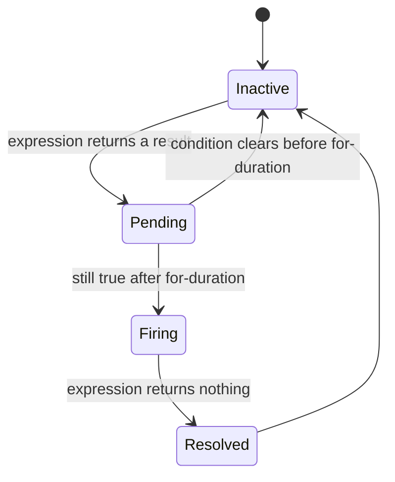
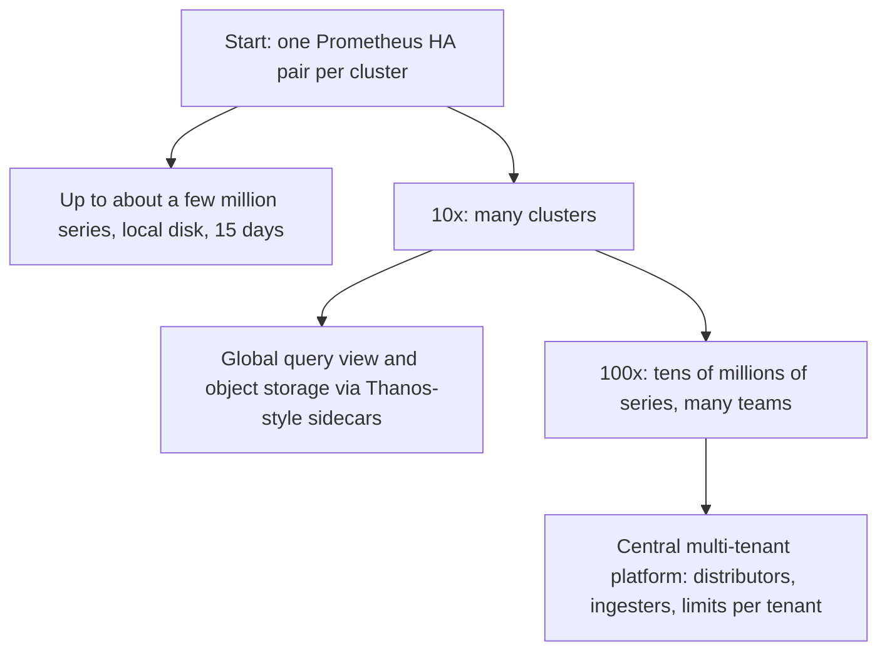

### 68.7.11 Caching

The query frontend keeps a **results cache** (Memcached or Redis) keyed by query, step-aligned time range and tenant. Results for time ranges older than about 10 minutes are cached for a long time, because old samples no longer change; the most recent minutes are always recomputed, because late samples can still arrive. Store gateways keep an **index cache** (postings lists and series lookups) and a **chunk cache**, since dashboards open the same blocks again and again. With these caches, a team's 30-panel dashboard refreshed every 30 seconds touches the ingesters only for the last few minutes of each panel.

### 68.7.12 Messaging: the alert pipeline

An alert travels from a rule to a person through four stages, and each stage exists to remove a specific kind of noise.

**1. Rule evaluation.** The ruler evaluates each rule group on its interval. A rule with `for: 5m` moves an alert to **pending** the first time its expression returns a result, and to **firing** only if it is still true 5 minutes later, which filters out brief spikes. While firing, the ruler resends the alert on every evaluation, so a lost message is repaired on the next cycle.

```yaml
# rules/checkout.yaml  -- reviewed in Git, tested with `promtool test rules`
groups:
  - name: checkout-slo
    interval: 30s
    rules:
      - alert: CheckoutHighErrorBudgetBurn
        expr: |
          sum(rate(http_requests_total{service="checkout",status=~"5.."}[5m]))
            / sum(rate(http_requests_total{service="checkout"}[5m])) > 14.4 * 0.001
        for: 2m
        labels: { severity: page, team: payments }
        annotations:
          summary: "Checkout is burning its 99.9% error budget 14x too fast"
          runbook: "https://runbooks.internal/checkout/high-error-rate"
```



**2. Deduplication.** The alert manager runs as a cluster of three replicas, and every ruler sends every alert to all three, so losing one replica loses nothing. Replicas gossip a **notification log**, so only one of them sends each notification. Alerts with identical label sets are one alert, which also collapses the duplicates from HA pairs of scrapers.

**3. Grouping, inhibition and silencing.** **Grouping** batches related alerts into one notification: when a database fails and 200 services start alerting, the on-call engineer should get one message listing 200 alerts, not 200 pages. **Inhibition** suppresses symptoms when the cause is already alerting: if `ClusterUnreachable` is firing for a cluster, pod-level alerts in that cluster are held back. **Silences** mute alerts that match label matchers for a fixed time, for planned maintenance, and always expire on their own.

**4. Routing and paging.** A routing tree matches alert labels to receivers: `severity="page"` goes to the team's paging schedule, `severity="ticket"` creates a ticket, everything else goes to a chat channel. The paging service handles schedules and **escalation**: if the primary does not acknowledge within 5 minutes, page the secondary, then the team lead.

```yaml
# alertmanager.yaml (excerpt) -- real Alertmanager configuration keys
route:
  receiver: default-chat
  group_by: ['alertname', 'cluster', 'service']
  group_wait: 30s          # wait to collect related alerts before the first notification
  group_interval: 5m       # wait before notifying about new alerts added to a group
  repeat_interval: 4h      # re-notify if still firing
  routes:
    - matchers: ['severity="page"', 'team="payments"']
      receiver: payments-pager
    - matchers: ['severity="ticket"']
      receiver: ticket-queue
inhibit_rules:
  - source_matchers: ['alertname="ClusterUnreachable"']
    target_matchers: ['severity=~"page|ticket"']
    equal: ['cluster']
```

The 1-minute alert-latency target is a budget across these stages: rule interval (up to 30 s), `group_wait` (30 s), plus a few seconds of delivery. Setting `group_wait` to 5 minutes "to reduce noise" silently breaks the target, which is why these settings are reviewed like code. Which alerts deserve a page at all (symptoms, burn rates, not causes) is the subject of Part 49, section 49.5.3.

### 68.7.13 Scaling and how it evolves



Most companies should start where the ladder starts: a pair of identical Prometheus servers per cluster, scraping the same targets, both sending alerts to an Alertmanager cluster that deduplicates them. It is simple, robust, and enough for millions of series. The next pressure is usually **global view and retention**: engineers want one query across clusters and data older than local disks hold, which sidecars uploading blocks to object storage solve. The last step, the architecture in 68.7.8, comes when many teams share the platform and need isolation, limits and chargeback. Each step adds components that must themselves be monitored, so do not take it early.

### 68.7.14 Security

Metrics leak more than people expect: label values can contain email addresses, customer names, internal hostnames and URL paths with tokens. Treat the platform as holding internal confidential data. Writes are authenticated per tenant (an auth proxy injects a tenant id after verifying the agent's credentials), reads are authorised per team, and cross-tenant queries are reserved for the platform team. Targets' `/metrics` endpoints are reachable only from the scrape agents' network, never from the internet, since they reveal versions, routes and internal state. Webhook receivers verify signatures on incoming notifications (Part 40, section 40.18), and the alerting path cannot be used to send arbitrary messages to pagers.

### 68.7.15 Failure scenarios

| Failure | Detection | Impact | Mitigation | Engineers see |
|---|---|---|---|---|
| One ingester crashes | Ring health | One replica of its series lost | Replication factor 3; WAL replay on restart | Nothing |
| Cardinality explosion | Series count, ingester memory, discarded samples | Ingesters out of memory, possibly all | Per-tenant and per-metric series limits (68.7.21) | That team's new series rejected |
| Object storage slow or down | Upload errors | Blocks not flushed, long queries fail | Ingesters keep data in memory and WAL longer; recent queries still work | Old dashboards fail, alerts continue |
| Query of death (huge range, huge cardinality) | Querier memory, query duration | Queriers crash, dashboards slow | Per-query limits, fair queueing, separate pool for rules | One query rejected with a clear error |
| Ruler falls behind | Missed iterations metric | Alerts late | Shard rule groups, keep rule queries cheap with recording rules | Nothing, if caught |
| Alert manager replica down | Cluster membership | None | Three replicas, all receive all alerts | Nothing |
| Paging provider outage | Failed notification counter | Pages not delivered | Secondary notification channel, phone fallback | Pages arrive by second channel |
| Scrape agent down in a cluster | `up` absent, agent heartbeat | No data from that cluster | Alert on absent data, not just bad data | "No data" alert |
| Monitoring and production share an outage | Dead man's switch stops | Silence exactly when needed | Separate failure domain, external heartbeat (68.7.16) | Page from the external service |

### 68.7.16 Observability: monitoring the monitor

A monitoring system's worst failure is not an error but **silence**: nothing alerts, so everyone assumes all is well. Three mechanisms guard against it.

1. **A dead man's switch.** A rule that is always true (`vector(1)`, commonly named `Watchdog`) fires permanently and is routed to an **external** heartbeat service, outside the company's infrastructure. That service expects a notification every few minutes and pages the platform on-call when they stop. It tests the whole chain (ingestion, ruler, alert manager, notification) with one alert.
2. **Meta-monitoring in a separate failure domain.** A small, independent Prometheus pair in another region or account scrapes the platform's own components and alerts on their health. It must not depend on the platform it watches, the same Kubernetes cluster, or the same identity provider.
3. **End-to-end probes.** Every minute, a prober writes a synthetic sample, queries it back, and measures the delay; every 15 minutes it fires a test alert that must reach a test receiver. This catches the subtle failures, such as ingestion that accepts writes but loses them.

The platform's own key signals: samples ingested and discarded per second by reason, active series per tenant, ingester memory and WAL replay time, query latency and rejects, rule evaluation duration and missed iterations (`prometheus_rule_group_iterations_missed_total`), and failed notifications (`alertmanager_notifications_failed_total`).

### 68.7.17 Deployment

Distributors, queriers and frontends are stateless and roll freely. Ingesters are stateful: each holds hours of in-memory data, so a restart means a WAL replay of minutes. Rolling them one at a time is slow; **zone-aware replication** (the three replicas of every series in three different zones) lets a whole zone of ingesters restart at once while the other two zones serve every series. Rule and alert-routing changes go through Git with `promtool check rules` and `promtool test rules` in CI, plus `amtool` to check routing, so a typo cannot silently disable a team's alerts. The platform deploys during working hours, never on a Friday evening, because a broken monitoring deploy hides every other problem.

### 68.7.18 Cost considerations

Storage is the cheap part: a few terabytes in object storage. The costs scale with **active series** (ingester memory) and **query load** (querier CPU), so the sensible chargeback unit for teams is active series, shown in a weekly report per team. The biggest savings come from dropping series nobody queries (often a large share of what exporters emit by default), shortening raw retention where downsampled data suffices, and replacing expensive dashboard queries with recording rules. Hosted monitoring services commonly price custom metrics per series, which makes cardinality a line on the invoice as well as an outage risk.

### 68.7.19 Tradeoffs

- **Pull at the edge, push to the core**: liveness detection and load control locally, simple central ingestion, at the cost of running agents in every cluster.
- **Approximate, lossy-tolerant storage** over exact storage: a missed scrape is a gap, not an incident, which allows cheap compression and simple replication; exact business counts belong to 67.4.
- **Hard per-tenant limits** over unlimited ingestion: one team loses new series so all teams keep alerts.
- **Downsampled long-term data** over raw forever: cheap 13-month trends, but short spikes in old data survive only as min and max.

| Decision | Options | Chosen | Why | Cost |
|---|---|---|---|---|
| Collection | Pull, push, both | Pull in clusters, push to center | `up`, load control, easy ingest | Agents everywhere |
| Storage | Row database, columnar warehouse, Gorilla-style TSDB | TSDB with blocks in object storage | 1 to 2 bytes per sample, cheap retention | Specialised system to run |
| Protection | Trust teams, hard limits | Hard limits per tenant and metric | Isolation from cardinality explosions | Rejected data for the offender |
| Alert noise | Page on everything, group and inhibit | Group, inhibit, page on symptoms | Pages that mean action | Configuration to maintain |
| Failure domain | Same as production, separate | Separate, plus external heartbeat | Must work during outages | Extra infrastructure |

### 68.7.20 Alternative architectures, and where logs and traces fit

**One Prometheus pair per cluster.** For most companies the whole platform above is unnecessary: two Prometheus servers per cluster, an Alertmanager cluster, Grafana, and perhaps object-storage sidecars for retention. Fewer moving parts, fewer ways to fail.

**A hosted monitoring service.** Hosted platforms remove the operational burden entirely; the trade is per-series pricing, data leaving your network, and dependence on a vendor for the system you need during your own outages (keep a minimal independent alert path regardless).

**A general-purpose columnar database.** Some teams store metrics in a columnar analytics database (ClickHouse is a common choice) to query metrics, logs and events with SQL in one place; it handles high cardinality better than a Prometheus-style TSDB, at the cost of PromQL compatibility and the alerting ecosystem.

**Logs and traces** are separate stores tied to metrics by identifiers, not merged into one system (Part 43, sections 43.2 "Logs" and 43.4 "Traces"). Metrics tell you *that* something is wrong and *where*; traces tell you *which request* and *which hop*; logs tell you *what exactly happened*. The links: histograms carry **exemplars** (a trace id attached to a sample in a latency bucket), so a click on a slow bucket opens a real slow trace; every log line carries the trace id; and dashboards link from a service panel to its logs filtered by the same labels. Logs and traces have very different storage shapes (logs index only a few labels and scan text; traces are sampled), which is why they are built as separate systems.

### 68.7.21 Incident story: the label that ate the monitoring

At 16:20 on a Wednesday, the search team deployed a change that added a `query` label to its request-latency histogram, to debug slow searches. The label held the raw search text. Search received about 3,000 distinct queries a minute, and the histogram had 12 buckets on 60 pods: within 30 minutes the metric had grown from 9,000 series to about 6 million.

The platform at the time had a per-tenant series limit but no per-metric limit, and the search tenant's limit was generous. The ingesters holding search's series ran out of memory at 16:52 and were killed. On restart they replayed a WAL full of the same 6 million series and ran out of memory again. Because each series lived on three ingesters chosen by hash, the crash loop spread until two thirds of the ingesters were cycling, and queries and rule evaluations across **every** team began to fail.

At 17:05 the payments service started returning errors because of an unrelated database failover. Its `CheckoutHighErrorBudgetBurn` alert never fired: the ruler could not evaluate it. The **dead man's switch** did its job: the external heartbeat service stopped hearing from the Watchdog alert and paged the platform on-call at 17:08, who declared an incident, saw the series count by metric in the meta-monitoring Prometheus, and dropped the `query` label with a relabel rule at the agents at 17:21. Ingesters stabilised by 17:35. Payments' own error dashboards, served from a different system, had shown the problem to a support engineer at 17:12, so the checkout outage was 19 minutes long instead of being noticed by customers first.

The postmortem added **per-metric series limits** (a new metric over 100,000 series is rejected and reported to its owners), a CI check that warns on label names such as `id`, `query`, `path` or `email`, and a requirement that ingester memory limits leave room to replay the WAL. The lesson: **in a shared monitoring platform, cardinality is a resource quota, not a style guideline, and the system that alerts on everything needs its own alarm that does not depend on it.**

### 68.7.22 Interview follow-ups

1. **Why does monitoring cost scale with series rather than samples?**
   Expected answer: each active series holds memory and index entries regardless of query; compressed samples are 1 to 2 bytes each. Follow-up: how do you find the offender? (`topk` by series count per metric, then per label.)
2. **Pull or push?**
   Expected answer: pull gives `up` and load control; push suits short jobs and firewalled targets; pull at the edge and push to the core combines them.
3. **How do you make a 13-month graph cheap?**
   Expected answer: downsampled blocks with min, max, sum and count; the frontend picks resolution by step; cache results for old ranges.
4. **An engineer gets 200 pages for one database failure. Fix it.**
   Expected answer: group by cluster and service, inhibit symptom alerts when the cause alert fires, page on symptoms with burn-rate rules, route causes to tickets.
5. **How do you know your monitoring is working?**
   Expected answer: dead man's switch to an external heartbeat, separate meta-monitoring, end-to-end write-and-read probes and test alerts.
6. **How is this different from the ad-click aggregation in 67.4?**
   Expected answer: monitoring tolerates gaps and approximation and optimises for recent queries and alerting; billing counts need exactly-once and reconciliation.

### 68.7.23 Practical exercise

Run a small monitoring platform locally with Docker Compose: two NestJS services exposing `/metrics` (Part 43, section 43.3.4), a Prometheus pair, Alertmanager and Grafana.

1. Write an SLO burn-rate alert for one service and unit-test it with `promtool test rules`.
2. Configure grouping and an inhibition rule so that a "service down" alert suppresses its latency alerts.
3. Add a Watchdog alert routed to a small webhook receiver that logs "missing heartbeat" if no notification arrives for 3 minutes.
4. Add a deliberately bad label (a request id) to one metric, generate traffic, and watch series counts grow; then add a relabel rule that drops it.

Acceptance criteria:

- Stopping one service produces exactly one notification, not one per alert.
- Stopping Alertmanager makes the webhook receiver report a missing heartbeat within 3 minutes.
- The `topk(10, count by (__name__) ({__name__=~".+"}))` query identifies the bad metric, and after the relabel rule its series count stops growing.
- The rule unit tests fail if the `for` duration or threshold is changed.

#### Worked answer to the exercise

The rule is the one in 68.7.12. Its unit test feeds a 3 percent error rate and checks that the alert is still pending at 1 minute and firing at 9 minutes:

```yaml
# rules/checkout.test.yaml  -- run with: promtool test rules rules/checkout.test.yaml
rule_files: [checkout.yaml]
evaluation_interval: 30s
tests:
  - interval: 30s
    input_series:
      - series: 'http_requests_total{service="checkout",status="500"}'
        values: '0+30x20'
      - series: 'http_requests_total{service="checkout",status="200"}'
        values: '0+970x20'
    alert_rule_test:
      - eval_time: 1m
        alertname: CheckoutHighErrorBudgetBurn
        exp_alerts: []
      - eval_time: 9m
        alertname: CheckoutHighErrorBudgetBurn
        exp_alerts:
          - exp_labels: { severity: page, team: payments }
            exp_annotations:
              summary: "Checkout is burning its 99.9% error budget 14x too fast"
              runbook: "https://runbooks.internal/checkout/high-error-rate"
```

Grouping by `['alertname', 'service']` with an inhibit rule whose source is `ServiceDown` and whose `equal` list is `['service']` makes a stopped service produce one notification. The heartbeat receiver is a small NestJS controller that records the time of each Watchdog webhook, plus an `@Interval(30_000)` job from `@nestjs/schedule` that logs "missing heartbeat" when the last one is older than 3 minutes. The bad-label step is fixed at the scrape config with `metric_relabel_configs: [{ action: labeldrop, regex: request_id }]`.

## 68.8 Closing: what these seven designs teach

The seven systems in this Part look unrelated: search autocomplete, file sync, a distributed message queue, a distributed cache, an object store, a stock exchange's matching engine and a monitoring platform. Read side by side, they keep making the same few moves.

**An append-only log sits underneath almost all of them.** The message queue (68.3) *is* a log. The file-sync service (68.2) keeps a journal that clients follow with cursors. The object store appends small objects into extents before sealing and erasure coding them. The matching engine's source of truth is a journal of sequenced inputs, and the monitoring platform writes every sample to a write-ahead log before it compresses it. Appending is the fastest thing a disk does, replicating a log is the simplest way to keep copies identical, and replaying a log is how each of these systems recovers.

**Metadata and data are separated.** File sync keeps file metadata apart from content-addressed blocks; the object store keeps a small, strongly consistent metadata service on flash and huge immutable data on hard disks; the monitoring platform keeps an inverted index apart from compressed chunks. The small part gets consensus and careful transactions; the big part gets cheap, immutable, bulk storage. Mixing the two is how designs end up paying consensus prices for petabytes.

**One writer per partition beats coordination.** A message-queue partition has one leader; a distributed-cache slot (68.4) has one primary that its replicas follow; an object-store key range has one metadata leader; an instrument has one matching thread; a series lives on a fixed set of ingesters. Parallelism comes from having many partitions, never from many writers fighting over one. The matching engine is the extreme version: one thread, no locks, determinism as a feature, and failover by replaying the same inputs on a backup.

**Precompute for the read path.** Autocomplete precomputes the top suggestions per prefix offline; the monitoring platform precomputes downsampled blocks and recording rules; the exchange keeps snapshots so late joiners need not replay the day; the object store resolves a GET in one metadata read and one disk read because placement was decided at write time. Expensive work moves to the background, where it can be batched and retried.

**Background loops are where the dangerous bugs live.** Garbage collection (68.2 and the object store's safety rules), repair (the storm in 68.5.21), compaction, index rebuilds and trending jobs (68.1.21) do the most damage when wrong, because they act on many records at once with nobody watching. The defences recur: fail closed when information is missing, keep a grace period before anything is physically deleted, bound how much one run may change, and order work by risk.

**Shared platforms must protect themselves from their tenants.** Hot prefixes in the object store, a noisy partition in the message queue, a hot key or a memory-hungry client in the distributed cache, a runaway trading algorithm, a cardinality explosion in monitoring: in each case one client can hurt everyone, and the answer is a limit enforced at the entry point (splits and 503s, quotas, memory limits with eviction, throttles and kill switches, series limits) that turns a platform outage into one tenant's rejected requests.

And, as in Parts 66 and 67, every design has an invariant check that catches silent failure: the scrubber's checksums, the matching engine's book hash compared between primary and backup, the monitoring platform's dead man's switch, and the in-sync replica set and high watermark that tell the message queue (68.3) which copies can be trusted. Every design also has a simpler alternative that wins at ordinary scale: a cloud object store instead of building one, a PostgreSQL order book for a few hundred orders a second, one Prometheus pair per cluster. The method, not the memory of these seven answers, is what lets you choose correctly next time: clarify, estimate, model, design, deep-dive the hardest part, cover the cross-cutting concerns, state the trade-offs, and say when not to build it.

## Senior Checklist — Part 68

- [ ] I understand the concept
- [ ] I can explain it simply
- [ ] I can implement it
- [ ] I understand its failure modes
- [ ] I understand its scaling limitations
- [ ] I understand its security implications
- [ ] I understand its operational implications
- [ ] I can choose between alternatives
- [ ] I can explain the tradeoffs
- [ ] I can answer senior-level interview questions
- [ ] I can design search autocomplete with precomputed top suggestions per prefix and a freshness path for trending queries
- [ ] I can design file sync with content-addressed chunks, a commit protocol, a journal with cursors and conflict handling
- [ ] I can explain a distributed message queue's log, replication with in-sync replicas, idempotent producers and consumer groups
- [ ] I can design a distributed cache with consistent hashing or hash slots, eviction and expiry, and replica failover
- [ ] I can derive object-store durability from failure rate and repair time, and explain why erasure coding beats replication on both cost and durability
- [ ] I can explain the data-first, metadata-second commit point and how range-partitioned metadata gives read-after-write and fast LIST
- [ ] I can design safe garbage collection and repair: fail closed, grace periods, risk-ordered and throttled repair
- [ ] I can implement price-time priority matching with price levels, FIFO queues and O(1) cancels
- [ ] I can explain why a matching engine is single-threaded and deterministic, and how a journal plus a hot backup recovers without losing acknowledged orders
- [ ] I can explain Gorilla-style compression, blocks, downsampling and why monitoring cost scales with active series
- [ ] I can configure alert grouping, inhibition, silences and routing, and build a dead man's switch for the monitoring system itself
- [ ] For each of the seven designs I can name the simpler alternative and when it wins

## Part 68 — Key Takeaways

- An append-only, replicated log is the backbone of message queues, file-sync journals, object-store extents, exchange journals and time-series write-ahead logs; replay is how they all recover.
- Separate small, strongly consistent metadata from large, immutable data, and give each the storage and replication it deserves.
- Eleven nines is a race between failure and repair: erasure coding 8+4 is cheaper than 3x replication and far more durable, repair time matters quadratically or more, and correlated failures and software bugs are the real threat.
- In an object store, write data first and commit metadata second; the metadata commit is the moment an object exists.
- One writer per partition (a leader, a thread, a fixed set of replicas) scales through many partitions instead of locks.
- A matching engine is a deterministic state machine: sequenced inputs, no clock, no randomness, integer prices, and a hot backup that replays the same journal.
- Microsecond systems drop web-backend habits: no database on the hot path, no locks, no allocation in the loop, and honest language choices.
- Monitoring cost and stability scale with active series; cardinality limits per tenant and per metric are the platform's most important protection.
- Alerts should arrive fast and rarely: page on symptoms, group and inhibit related alerts, and keep the timing settings inside the detection budget.
- The monitor needs its own monitor: a dead man's switch to an external service and meta-monitoring in a separate failure domain.
- Background jobs (garbage collection, repair, compaction, rebuilds) cause the worst incidents; make them fail closed, delay physical deletion, bound each run and order work by risk.
- Every large design has a simpler alternative that wins at normal scale; the senior skill is knowing which one the requirements actually call for.
