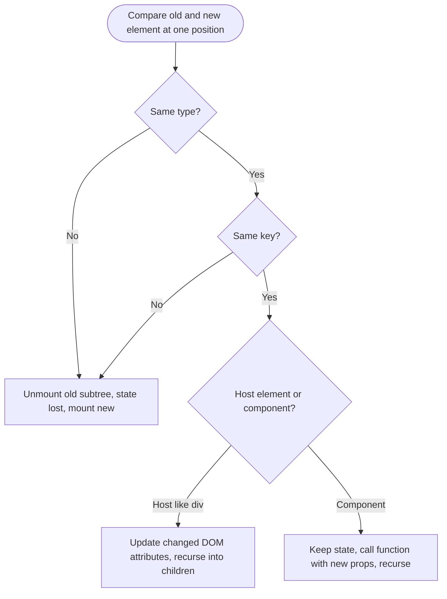
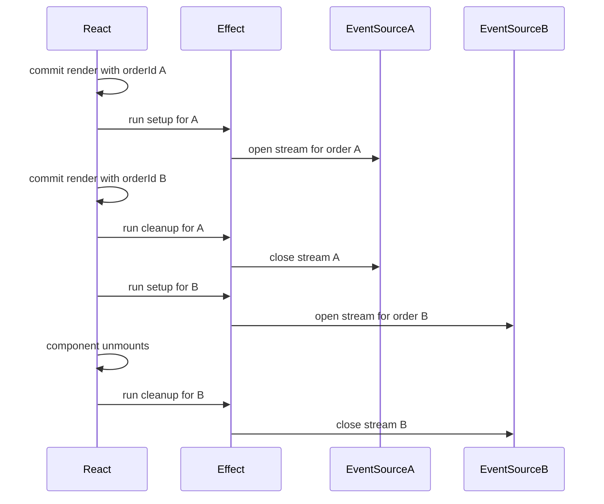

## 69.3 Reconciliation and keys

#### Concept

**Reconciliation** is how React turns "here is the new element tree" into "here are the DOM changes". After every render, React compares the new tree with the previous one and works out the smallest set of operations: update this text, change that attribute, insert this node, remove that one.

A **key** is a string or number you give to items in a list so React can match each item in the new list with the same item in the old list. Keys answer one question: "is this the same thing as before, or a different thing?"

```tsx
{items.map((item) => <LineItemRow key={item.sku} item={item} />)}
```

Keys are also how React decides whether a component keeps its state. Same type at the same position with the same key means "same component instance, keep state and DOM". Anything else means "throw the old one away, mount a new one".

#### Why does it exist?

Comparing two arbitrary trees optimally is an O(n³) problem. For a page with 3,000 elements that is 27 billion operations: impossible at 60 frames per second. React uses two assumptions to make it O(n):

1. **Elements of different types produce different trees.** If a `<div>` becomes a `<section>`, or `<OrderSummary>` becomes `<OrderSkeleton>`, React does not compare their insides. It destroys the old subtree (and its state) and builds the new one.
2. **The developer can mark which children are stable across renders with keys.** Without keys, React can only compare children by position.

Without keys, prepending one item to a 500-row list looks like 500 changed rows plus one new one, and any state inside the rows (an expanded panel, typed text) stays at the *position*, attached to the wrong item.

#### Mental model

Imagine a sync job copying the `orders` table into a search index. Match rows by position and one insert at the top rewrites everything; match by primary key and it is one insert. Keys are primary keys for list items: stable, unique within the list, owned by the data.

#### How it works



For a list of children:

1. React builds a map from key to old child.
2. For each new child, it looks up the old child with the same key. If found and the type matches, it is **moved** if needed and **updated**; its state and DOM node are kept.
3. Old children whose keys are not in the new list are **unmounted**.
4. New keys are **mounted**.

Consequences:

- **Index as key** (`key={index}`) is the same as no key for reordering purposes: it matches by position. It is acceptable only when the list is static, never reordered, filtered or prepended, and items have no state.
- **Random keys** (`key={Math.random()}` or `crypto.randomUUID()` in render) are the worst option: every render, every key is new, so every row is unmounted and remounted. All state is lost and the DOM is rebuilt each time.
- **Keys must be unique among siblings only**, not globally. Two different lists can both have an item with key `"A7K2Q9P"`.
- **Keys are not passed as props.** `props.key` is `undefined` inside the child. If the child needs the ID, pass it separately.
- **A key on any component forces identity.** `<CheckoutForm key={cartId} />` means "when `cartId` changes, this is a different form": React unmounts the old one and mounts a fresh one with fresh state. This is the cleanest way to reset a component, far better than an effect that resets ten state variables.

#### Practical example

An admin order-line editor has a "note" textarea per row and can be sorted by price. With `key={index}`, an agent types "gift wrap" into the coffee machine's row, sorts, and the textarea stays at its position next to a different SKU; the note is saved against the wrong line. With `key={line.sku}` (or a line ID), React moves the DOM node with its content.

For lines that do not exist on the server yet (added in the UI, not saved), generate a client ID **once, when the item is created**, not during render:

```tsx
function addLine(product: Product) {
  setDraftLines((lines) => [{ clientId: crypto.randomUUID(), sku: product.sku, quantity: 1 }, ...lines]);
}
```

#### React / Next.js example

Two key patterns: stable list keys, and a key used to reset a form when the order changes.

```tsx
// src/admin/OrderLinesEditor.tsx  (React 18)
import { useState } from 'react';
import type { OrderLine } from '@shop/contracts';

type DraftLine = OrderLine & { clientId: string };

export function OrderLinesEditor({ initialLines }: { initialLines: OrderLine[] }) {
  // clientId is created once per line, here or when a line is added; never in render.
  const [lines, setLines] = useState<DraftLine[]>(() =>
    initialLines.map((l) => ({ ...l, clientId: l.id ?? crypto.randomUUID() })),
  );
  const [sortBy, setSortBy] = useState<'name' | 'price'>('name');

  const sorted = [...lines].sort((a, b) =>
    sortBy === 'name' ? a.name.localeCompare(b.name) : Number(a.unitPriceMinor) - Number(b.unitPriceMinor),
  ); // derived during render, not stored

  return (
    <>
      <select value={sortBy} onChange={(e) => setSortBy(e.target.value as 'name' | 'price')}>
        <option value="name">Name</option>
        <option value="price">Price</option>
      </select>
      <ul>
        {sorted.map((line) => (
          <li key={line.clientId}> {/* stable identity: state and DOM follow the line */}
            {line.name}
            <textarea aria-label={`Note for ${line.name}`} defaultValue={line.note ?? ''} />
          </li>
        ))}
      </ul>
    </>
  );
}
```

```tsx
// src/admin/OrderEditPage.tsx: reset all form state when navigating between orders
export function OrderEditPage({ order }: { order: OrderView }) {
  // Without the key, moving from order A to order B would keep A's draft lines in state,
  // because useState only reads its initial value on mount.
  return <OrderLinesEditor key={order.id} initialLines={order.items} />;
}
```

React's console warnings about missing or duplicate keys are bugs, not noise: duplicate keys make React drop or duplicate rows.

#### Backend side (NestJS)

Keys are only as good as the IDs the API returns. Three backend rules:

- **Every item in every list response has a stable, unique ID.** Not a position, not a value that can change (a product name), not a composite the client must assemble. If line items are identified by `(order_id, sku)`, return that identity as a field or return a line ID.
- **IDs are stable across requests.** An API that generates a fresh UUID per response for "virtual" rows (computed fee lines, promotional freebies) forces remounts on every refetch. Derive them deterministically: `fee:delivery`, `promo:BUY2GET1:sku-123`.
- **Pagination does not duplicate items.** Offset pagination over a table receiving inserts shifts rows between pages, so page 2 repeats the last item of page 1. In an infinite list that is a duplicate key, and React may drop a row. Use cursor pagination (Part 14 — API Design (REST first), 14.5):

```ts
// apps/api/src/orders/orders.repository.ts  (TypeORM)
import { Injectable } from '@nestjs/common';
import { DataSource } from 'typeorm';
import { Order } from './order.entity';

@Injectable()
export class OrdersRepository {
  constructor(private readonly ds: DataSource) {}

  // Keyset pagination on (placed_at, id): stable under concurrent inserts, no duplicates across pages.
  async pageForCustomer(customerId: string, limit: number, after?: { placedAt: Date; id: string }) {
    const qb = this.ds.getRepository(Order).createQueryBuilder('o')
      .where('o.customer_id = :customerId', { customerId })
      .orderBy('o.placed_at', 'DESC').addOrderBy('o.id', 'DESC')
      .take(limit + 1); // one extra row tells us whether a next page exists
    if (after) {
      qb.andWhere('(o.placed_at, o.id) < (:placedAt, :id)', after);
    }
    const rows = await qb.getMany();
    return { items: rows.slice(0, limit), hasMore: rows.length > limit };
  }
}
```

With an index on `(customer_id, placed_at DESC, id DESC)`, each page is a 1 to 3 ms index range scan regardless of how deep the customer scrolls.

#### Production scenario

A restaurant dashboard listed incoming orders newest-first, each card with a "prep notes" input, keyed by index. At peak a new order arrived every 20 to 40 s, shifting cards while notes stayed in place; cooks saw notes "jump" to other orders about 30 times a night across 400 restaurants. `key={order.id}` fixed it, and commit time per new order fell from 22 ms to 3 ms.

#### Failure scenario

A checkout page wrapped its content in a conditional layout:

```tsx
return isMobile ? <div className="sheet"><CheckoutForm /></div> : <section><CheckoutForm /></section>;
```

On tablets, rotation crossed the breakpoint, the wrapper changed from `section` to `div`, and React unmounted the form: every typed field vanished, and tablet abandonment at the address step rose 4 %. The fix kept the same element type and changed only `className`.

#### Edge cases & failure modes

- **Index keys with filtering**: filtering a list shifts positions exactly like sorting does.
- **Duplicate keys from the API** (a join that returns one row per tag) make React silently drop children.
- **Keys from mutable fields** (email, name) remount the row when the field is edited, losing focus mid-typing.
- **Conditional wrappers** that change element type unmount everything below.

#### How a Senior Full-Stack Engineer thinks about this

A senior treats keys as primary keys: `key={index}` on anything dynamic and random keys anywhere are blocking review comments. They use `key` deliberately to reset components, and push identity into the API with stable IDs and cursor pagination.

#### Common mistakes

- **Using the array index as key** for lists that sort, filter, prepend or contain inputs.
- **Generating keys during render.**
- **Expecting `props.key`** to be readable in the child.
- **Resetting state with an effect** when a key change would do it in one line.
- **Changing wrapper element types** conditionally and losing all child state.

#### Interview questions

1. **Why does React need keys, and what happens with index keys when you prepend an item?**
   Expected answer: keys let React match children across renders; with index keys every position appears changed, causing extra updates and state attached to the wrong item. Follow-up: when is an index key acceptable? (Static lists without state.)
2. **What are React's two heuristics that make reconciliation O(n)?** Expected answer: different types mean different trees; keys identify stable children.
3. **How do you reset all state in a form when the user switches from editing order A to order B?** Expected answer: give the form `key={orderId}`.
4. **Why can offset pagination cause bugs in an infinite list?** Expected answer: inserts shift rows, so items repeat across pages, producing duplicate keys and dropped or duplicated rows; use cursors.

#### Practical exercise

Build a list of 50 orders, each with a text input, that can be sorted and that receives a new order at the top every 5 seconds.

Acceptance criteria:

- With `key={index}`, you can demonstrate typed text moving to a different order after an insert or sort.
- With `key={order.id}`, the text stays with its order.
- The React DevTools Profiler shows fewer components rendered per insert with stable keys.
- The NestJS endpoint uses keyset pagination on `(placed_at, id)` and a test proves that inserting 10 orders between page fetches produces no duplicate IDs.

## 69.4 Effects: `useEffect` done right

#### Concept

An **effect** is code that synchronises a component with something outside React: a WebSocket, a browser API (`document.title`, `IntersectionObserver`, a timer), a third-party widget (a map, a chart, a payment SDK), or analytics. You declare it with `useEffect`:

```tsx
useEffect(() => {
  const source = new EventSource(`/api/v1/orders/${orderId}/events`);
  source.onmessage = (e) => onStatus(JSON.parse(e.data));
  return () => source.close(); // cleanup
}, [orderId]);                 // dependencies
```

The function runs **after** React has committed the render to the screen. It may return a **cleanup** function. The **dependency array** lists every reactive value the effect uses (props, state, values derived from them). React re-runs the effect after a render where any dependency changed, running the previous cleanup first. On unmount, the last cleanup runs.

The official React documentation puts it well: effects are an escape hatch for **synchronising with external systems**. If no external system is involved, you probably do not need an effect.

#### Why does it exist?

Rendering must be pure (69.1), yet apps must open sockets, set timers and drive non-React code. Event handlers handle side effects caused by a user action ("clicked Pay, so send the payment"). Some side effects are caused by *being on screen* ("while tracking is visible, keep a live connection"), and there is no event for that. Effects fill that gap.

#### Mental model

Imagine a NestJS provider with `OnModuleInit` and `OnModuleDestroy`: open the Kafka consumer on init, close it on destroy. An effect is that lifecycle per component instance and per set of inputs. But the better model is not "on mount do X"; it is **"keep X in sync with these values"**, like a Kubernetes controller reconciling desired state: for this `orderId` there should be exactly one open stream.

#### How it works



1. **Render** returns elements, and the effect function is recorded, not run.
2. **Commit** updates the DOM. The browser usually paints.
3. **Effects run** after paint (for `useEffect`). React compares each dependency with the previous render's value using `Object.is`. If any changed (or on first mount), it runs the previous cleanup, then the new setup.
4. **Unmount** runs the final cleanup.

Dependency array forms:

| Form | Runs setup | Typical use |
|---|---|---|
| `useEffect(fn, [a, b])` | On mount and when `a` or `b` changes | Almost everything |
| `useEffect(fn, [])` | Once on mount (twice in dev Strict Mode) | Subscriptions that depend on nothing reactive |
| `useEffect(fn)` | After every render | Rarely correct |

**`useLayoutEffect`** has the same signature but runs after DOM changes and *before* the browser paints. Use it only to measure layout and adjust before the user sees a flicker (positioning a tooltip). It blocks paint, so keep it short.

**Strict Mode double-mount (React 18+, development only).** React mounts each component, runs all effect cleanups, then runs the effects again: setup, cleanup, setup. It simulates a component being hidden and shown again (React 19.2's `<Activity>` does this for real) and exposes effects without proper cleanup. If you see two sockets in development, fix the cleanup; do not remove Strict Mode.

**Effects you do not need.** Most incorrect effect code is one of these, and the fix is to delete the effect:

- **Deriving data**: `useEffect(() => setTotal(sum(items)), [items])` renders twice and briefly shows a stale total. Compute `const total = sum(items)` in render.
- **Responding to a user event**: `useEffect(() => { if (submitted) postOrder(); }, [submitted])` turns a click into a state flag into a side effect. Call `postOrder()` in the click handler.
- **Resetting state when a prop changes**: use a `key` (69.3).
- **Notifying a parent** of a state change: call the parent's callback in the same event handler that changed the state.

#### Why most data fetching should not be hand-written effects

Fetching in an effect looks simple and is the most common source of bugs in React apps. A correct hand-written fetch effect must handle all of this:

```tsx
// src/orders/useOrderOnce.ts: what a "correct" hand-written fetch effect needs (React 18)
import { useEffect, useState } from 'react';
import { OrderViewSchema, type OrderView } from '@shop/contracts';

type State =
  | { status: 'loading' }
  | { status: 'error'; error: Error }
  | { status: 'success'; order: OrderView };

export function useOrderOnce(orderId: string): State {
  const [state, setState] = useState<State>({ status: 'loading' });

  useEffect(() => {
    const controller = new AbortController();           // 1. cancel on change or unmount
    setState({ status: 'loading' });                     // 2. reset when orderId changes
    fetch(`/api/v1/orders/${orderId}`, { signal: controller.signal, credentials: 'include' })
      .then(async (res) => {
        if (!res.ok) throw new Error(`HTTP ${res.status}`); // 3. fetch does not reject on 4xx/5xx
        return OrderViewSchema.parse(await res.json());     // 4. types end at the network boundary
      })
      .then((order) => setState({ status: 'success', order }))
      .catch((error: unknown) => {
        if (controller.signal.aborted) return;           // 5. ignore results for a stale orderId
        setState({ status: 'error', error: error instanceof Error ? error : new Error(String(error)) });
      });
    return () => controller.abort();                     // 6. cleanup closes the race
  }, [orderId]);

  return state;
}
```

And it still lacks caching, deduplication across components, retries with backoff, refetch on focus, invalidation after mutations, pagination and server rendering support: each a day of work and a source of bugs.

Without step 5, there is a **race condition**: the user clicks order A, then quickly order B. Request A is slow (900 ms), request B is fast (120 ms). B's response arrives and renders, then A's arrives and overwrites it. The page now says "Order B" in the URL and shows order A's items. This is the frontend version of a lost update.

Effects also create **waterfalls**: the parent's effect fetches the order, renders, then the child's effect fetches the restaurant, renders, then the grandchild fetches rider location. Each round trip waits for the previous render. On a 150 ms mobile RTT that is 450 ms before the page is complete, against 150 ms if all three started together.

So the rule in modern React is:

- **Client-side SPA**: use a data-fetching library. TanStack Query (`useQuery`, `useMutation`) is the default; SWR and RTK Query are alternatives. Part 70 — Client State, Data Fetching and Caching covers them in depth.
- **Next.js App Router**: fetch in server components or route loaders, not in client effects (Part 71).
- **React 19**: the `use(promise)` API reads a promise inside render and suspends until it resolves, with Suspense showing a fallback (69.11). The promise must come from a cache or a parent (a server component, a router loader, a library); creating a new promise during a client render loops forever. In React 18, Suspense for data only works through libraries that implement it (TanStack Query's `useSuspenseQuery`, Relay, Next.js).

Hand-written fetch effects are acceptable for one-off, non-shared, non-cached reads in small apps, and only with all six steps above.

#### Practical example

Correct uses of effects on an order tracking page:

| Need | External system | Effect? |
|---|---|---|
| Live status updates while the page is open | `EventSource` to NestJS SSE | Yes, with `close()` in cleanup |
| Tab title shows "(Out for delivery) Order A7K2Q9P" | `document.title` | Yes, restore on cleanup |
| Rider location on a Mapbox map | Map SDK instance | Yes, create in setup, `map.remove()` in cleanup |
| "Order viewed" analytics event | Analytics SDK | Yes, but beware double-firing in dev; the backend must dedupe |
| Load the order | HTTP API | No: data library or server component |
| Show "Delivered" banner when status becomes `DELIVERED` | None | No: derive from status during render |
| Send a POST when "Confirm received" is clicked | HTTP API | No: event handler |

#### React / Next.js example

A live order status subscription with correct cleanup, reconnection handled by the browser, and a stable callback:

```tsx
// src/tracking/useOrderStatusStream.ts  (React 18)
import { useEffect, useRef } from 'react';
import { OrderStatusEventSchema, type OrderStatusEvent } from '@shop/contracts';

export function useOrderStatusStream(orderId: string, onEvent: (e: OrderStatusEvent) => void) {
  // Keep the latest callback in a ref so the stream is not reopened when the parent
  // passes a new function on every render (77.5 covers refs).
  const onEventRef = useRef(onEvent);
  useEffect(() => { onEventRef.current = onEvent; });

  useEffect(() => {
    const source = new EventSource(`/api/v1/orders/${orderId}/events`, { withCredentials: true });
    const handler = (msg: MessageEvent<string>) => {
      const parsed = OrderStatusEventSchema.safeParse(JSON.parse(msg.data));
      if (parsed.success) onEventRef.current(parsed.data); // ignore unknown shapes, never crash
    };
    source.addEventListener('status', handler as EventListener);
    // EventSource reconnects by itself and sends Last-Event-ID; nothing to do on error here.
    return () => {
      source.removeEventListener('status', handler as EventListener);
      source.close(); // without this, Strict Mode and HMR leave orphaned streams (76.4)
    };
  }, [orderId]); // one stream per order; reopened only when the order changes
}
```

#### Backend side (NestJS)

Effects create traffic patterns the backend must be ready for.

**Duplicate requests.** Strict Mode runs every effect twice on mount in development, and remounts happen in production too. Reads must be safe to repeat; any write triggered from an effect needs a client-generated ID the server dedupes on, or belongs in an event handler.

**Cancelled requests.** `AbortController.abort()` closes the connection. The server keeps working unless it notices. For expensive endpoints (search, reports), stop work when the client goes away:

```ts
// apps/api/src/search/search.controller.ts
import { Controller, Get, Query, Res } from '@nestjs/common';
import type { Response } from 'express';
import { SearchService } from './search.service';

@Controller('v1/search')
export class SearchController {
  constructor(private readonly search: SearchService) {}

  @Get('orders')
  async orders(@Query('q') q: string, @Res({ passthrough: true }) res: Response) {
    const controller = new AbortController();
    // The response 'close' event fires when the connection ends. If we have not finished
    // writing yet, the browser went away (user typed another letter, navigated away).
    // Listen on res, not req: since Node 16, req 'close' fires once the body is read.
    res.on('close', () => { if (!res.writableFinished) controller.abort(); });
    // Pass the signal down to anything that accepts one: fetch to another service,
    // or cancel a long PostgreSQL query with pg_cancel_backend via the driver.
    return this.search.searchOrders(q, { signal: controller.signal });
  }
}
```

Aborted requests show as `499` in nginx logs; a spike usually means a frontend refetching on every keystroke without debouncing.

**Long-lived connections need cleanup on both sides.** An SSE endpoint should send a heartbeat every 15 to 30 s so proxies keep the connection, and release resources on close. `@Sse()` returns an `Observable` that Nest unsubscribes on disconnect, so the teardown is where your Redis unsubscribe goes:

```ts
// apps/api/src/orders/order-events.controller.ts
import { Controller, MessageEvent, Param, ParseUUIDPipe, Sse, UseGuards } from '@nestjs/common';
import { Observable, interval, map, merge } from 'rxjs';
import { JwtAuthGuard } from '../auth/jwt-auth.guard';
import { OrderEventsBus } from './order-events.bus';

@Controller('v1/orders')
@UseGuards(JwtAuthGuard)
export class OrderEventsController {
  constructor(private readonly bus: OrderEventsBus) {}

  @Sse(':id/events')
  stream(@Param('id', ParseUUIDPipe) id: string): Observable<MessageEvent> {
    const updates = new Observable<MessageEvent>((subscriber) => {
      const off = this.bus.subscribe(id, (evt) => subscriber.next({ type: 'status', id: evt.seq, data: evt }));
      return () => off(); // teardown runs when the browser closes the EventSource
    });
    const heartbeat = interval(20_000).pipe(map(() => ({ type: 'ping', data: '' })));
    return merge(updates, heartbeat);
  }
}
```

Setting `id` on each event lets the browser send `Last-Event-ID` on reconnect so the server can replay missed events (Part 34 — Real-Time Systems: WebSockets, SSE and Pub/Sub). React 19 apps can also render `<title>` in any component instead of syncing `document.title` in an effect.

#### Production scenario

A grocery app's tracking page opened an SSE stream in an effect with `[order]` as its dependency, and `order` was a new object after every 10 s poll. The stream closed and reopened six times a minute per customer: with 25,000 evening trackers, the SSE gateway took 2,500 new connections per second, each with JWT verification and a Redis subscribe, and CPU went from 20 % to 85 %. Depending on `[order.id]` fixed it.

#### Failure scenario

On launch day of a new checkout, the payments team saw 3 % of payment intents created twice. The `PaymentStep` component created a payment intent in an effect:

```tsx
useEffect(() => { api.createPaymentIntent(cartId).then(setIntent); }, [cartId]);
```

Production has no Strict Mode double-mount, so it seemed safe. But the parent showed a skeleton while the cart revalidated on tab focus, which unmounted and remounted `PaymentStep`: one new intent per refocus. Customers switching to their banking app and back created several, and two were sometimes confirmed.

The fixes: the backend made `POST /payment-intents` idempotent per cart version (`Idempotency-Key: cart:{id}:v{version}`, Part 14.12), returning the same intent for the same cart; the frontend moved intent creation to the "Continue to payment" click handler and cached the result per cart version.

#### Edge cases & failure modes

- **Object or function dependencies** recreated each render make the effect run every render. Depend on primitive fields (`order.id`), or stabilise with `useMemo`/`useCallback`/refs (69.5, 69.6).
- **Missing dependencies** (silenced with `// eslint-disable-next-line react-hooks/exhaustive-deps`) leave the effect using stale values. The lint rule is right far more often than the developer.
- **Async functions as the effect**: `useEffect(async () => ...)` returns a promise, not a cleanup; React warns. Define an async function inside and call it.
- **Race conditions** between overlapping requests; always abort or ignore stale results.
- **Effects that set state unconditionally** without dependencies cause infinite render loops.

#### How a Senior Full-Stack Engineer thinks about this

A senior asks of every effect: "Which external system is this synchronising with?" No answer means no effect. Otherwise they check that cleanup exactly undoes setup, dependencies are complete and primitive, and the effect survives running twice. In a real app they use TanStack Query or the framework's loaders instead of fetch effects.

On the backend, they assume every effect-driven request may be duplicated, cancelled or reopened, because it will be.

#### Common mistakes

- **Fetching in effects without abort**, causing race conditions.
- **Using effects to derive state** or to react to clicks.
- **Disabling the exhaustive-deps lint rule** instead of fixing the dependency.
- **Missing cleanup** for sockets, timers, listeners and SDK instances.
- **Creating server-side resources (payment intents, carts) in effects** without idempotency.

#### Interview questions

1. **When should you use `useEffect`, and when not?**
   Expected answer: to synchronise with an external system (sockets, browser APIs, third-party widgets); not for derived data, user events or resetting state. Why it matters: misuse causes most React bugs. Follow-up: name three effects you would delete.
2. **Why does my effect run twice in development?** Expected answer: React 18 Strict Mode mounts, unmounts and remounts to verify cleanup; fix cleanup, not Strict Mode.
3. **Describe the race condition in fetch-in-effect code and how to fix it.** Expected answer: overlapping requests resolve out of order; abort with `AbortController` in cleanup or ignore stale results.
4. **Why prefer a data library over hand-written fetch effects?** Expected answer: caching, deduplication, retries, invalidation, focus refetch, Suspense and SSR support; fewer races and waterfalls.
5. **How does an SSE endpoint in NestJS release resources when the browser navigates away?** Expected answer: the `@Sse()` Observable is unsubscribed on disconnect; teardown logic releases subscriptions; heartbeats keep proxies from closing idle streams.

#### Practical exercise

Build an order tracking page that subscribes to a NestJS SSE endpoint.

Acceptance criteria:

- Switching between three orders leaves exactly one open stream in the Network panel, in development with Strict Mode on.
- The NestJS controller logs subscribe and unsubscribe; counts match after navigating away.
- A hand-written fetch effect for the order shows the race condition with an artificial 900 ms delay on one order, then fixes it with `AbortController`.
- The same page rewritten with a data library (Part 70) has no `fetch` inside any `useEffect`.
