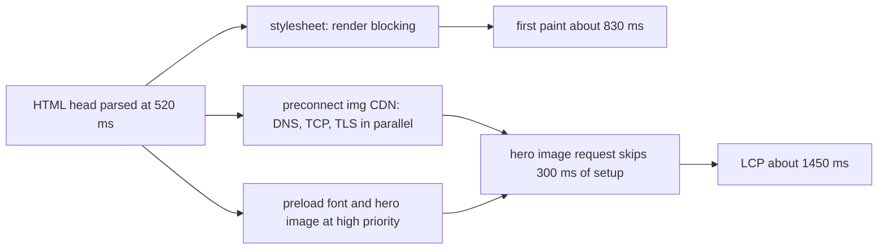

## 69.3 The head: meta tags, preload and preconnect

#### Concept

The `<head>` element holds information about the page rather than content on the page. It is small, often under 3 KB, but it controls how the page is decoded, how it is sized on a phone, what appears in a browser tab and a link preview, and, most importantly for speed, which resources the browser fetches first.

The parts that matter to engineers fall into three groups:

- **Document setup**: `<meta charset="utf-8">`, the viewport meta tag, `<title>`, `<html lang>`.
- **Metadata for other systems**: `<meta name="description">`, Open Graph tags for link previews, `<link rel="canonical">`, `<meta name="robots">`.
- **Resource hints**: `preconnect`, `dns-prefetch`, `preload`, `modulepreload`, `prefetch`, and the `fetchpriority` attribute. These tell the browser about work it will need to do before it discovers that work on its own.

#### Why does it exist?

By the time the parser reaches the `<body>`, the browser has already made decisions it cannot easily undo: which character encoding to use, how wide the layout viewport is, which stylesheets block the first paint. The `<head>` is where you make those decisions explicit.

Resource hints exist because the browser discovers resources late. A web font is referenced inside a CSS file, which is referenced from the HTML. The browser only learns about the font after downloading and parsing the CSS. An image served from a separate CDN domain needs its own DNS, TCP and TLS setup, which the browser only starts when it finds the first image. On a 150 ms round-trip mobile network, each of those discoveries can cost 300 to 600 ms. A hint lets you start that work at the first byte of HTML.

#### Mental model

Imagine a chef receiving a dinner order (the HTML). Without hints, the chef reads the recipe, sees "saffron", walks to the store, comes back, reads further, sees "fresh basil", walks to the store again. Resource hints are a note stapled to the top of the order: "You'll need saffron and basil, and the fish supplier's phone line is slow, so call them now." `preconnect` is calling the supplier to open the line. `preload` is ordering the exact ingredient. `prefetch` is ordering something for tomorrow's menu, at low priority.

#### How it works

A production `<head>` for a product page, with each line explained:

```html
<!doctype html>
<html lang="en-IN">
<head>
  <meta charset="utf-8">                                   <!-- must be in the first 1024 bytes -->
  <meta name="viewport" content="width=device-width, initial-scale=1">
  <title>Ergonomic Office Chair | Shop</title>
  <meta name="description" content="Mesh back, adjustable lumbar support, 5-year warranty.">
  <link rel="canonical" href="https://shop.example.com/products/ergonomic-office-chair">
  <meta property="og:image" content="https://img.shop-cdn.example/chair-1200x630.jpg">

  <!-- Open connections early to origins we will certainly use -->
  <link rel="preconnect" href="https://img.shop-cdn.example">
  <link rel="preconnect" href="https://api.shop.example.com" crossorigin>

  <!-- Fetch late-discovered critical resources now -->
  <link rel="preload" href="/fonts/inter-var.woff2" as="font" type="font/woff2" crossorigin>
  <link rel="preload" as="image" href="https://img.shop-cdn.example/chair-800.avif"
        imagesrcset="https://img.shop-cdn.example/chair-400.avif 400w, https://img.shop-cdn.example/chair-800.avif 800w"
        imagesizes="(max-width: 600px) 100vw, 50vw" fetchpriority="high">

  <link rel="stylesheet" href="/assets/app.3f9c1a.css">   <!-- render-blocking, keep it small -->
  <script type="module" src="/assets/app.81bd2e.js"></script> <!-- modules are deferred -->
  <link rel="modulepreload" href="/assets/vendor.c41a77.js">
</head>
```

Line by line, what the browser does:

1. **`<meta charset="utf-8">`** tells the decoder which encoding to use. It must appear within the first 1,024 bytes; otherwise the browser may guess, then re-parse when it finds the tag. The `Content-Type` header's charset wins over the meta tag when both exist.
2. **Viewport meta.** Without `width=device-width`, mobile browsers lay the page out on a virtual 980-pixel-wide canvas and shrink it, so text is tiny and media queries (69.4) never match the phone's real width. Do not add `maximum-scale=1` or `user-scalable=no`; they block pinch zoom, which is an accessibility failure.
3. **`<title>` and `lang`.** The title is the tab label, the bookmark name, the search result headline and the first thing a screen reader announces. `lang` tells screen readers which pronunciation rules to use and lets the browser offer translation.
4. **`preconnect`** performs DNS, TCP and TLS to an origin now, so the first real request skips those round trips. The `crossorigin` attribute matters: browsers keep separate connection pools for credentialed and anonymous (CORS) requests, so a preconnect without `crossorigin` does not help a `fetch()` with CORS mode or a font load, and one with `crossorigin` does not help a plain ``. Chrome closes a preconnected socket that is not used within about 10 seconds, and each preconnect costs CPU and a TLS handshake, so limit them to two or three origins you will use in the first second.
5. **`dns-prefetch`** does only the DNS lookup. It is cheaper than `preconnect` and fine for origins you might use later.
6. **`preload`** fetches a specific resource at high priority without executing or applying it. The `as` attribute is mandatory in practice: it sets priority, the `Accept` header and the right cache matching. Without a correct `as`, the browser downloads the resource twice, once for the preload and once when it is really needed. Fonts must be preloaded with `crossorigin` even on your own origin, because font requests are always made in CORS mode. If a preloaded resource is not used within a few seconds of the `load` event, Chrome logs a console warning that the resource "was preloaded using link preload but not used within a few seconds".
7. **`fetchpriority="high"`** on an `` or a preload raises its priority. Images normally start at low priority until layout shows they are in the viewport; for the LCP image this boost can save hundreds of milliseconds.
8. **`modulepreload`** is preload for ES modules: it fetches, parses and compiles the module and puts it in the module map, so the import graph does not discover its dependencies one round trip at a time.
9. **`prefetch`** fetches something for a likely *next* navigation at the lowest priority, into the HTTP cache. Good for the checkout bundle while the user is on the cart page.



The same hints can come from the server as HTTP headers, which arrive even earlier than the HTML body:

```text
HTTP/1.1 103 Early Hints
Link: </assets/app.3f9c1a.css>; rel=preload; as=style
Link: <https://img.shop-cdn.example>; rel=preconnect

HTTP/1.1 200 OK
Content-Type: text/html; charset=utf-8
Link: </fonts/inter-var.woff2>; rel=preload; as=font; type="font/woff2"; crossorigin
```

A quick decision table:

| Hint | Use it for | Cost if wrong | Typical count |
|---|---|---|---|
| `preconnect` | Third-party origin used in the first second (image CDN, API on another origin) | Wasted handshake, CPU, socket | 1 to 3 |
| `dns-prefetch` | Origins used later (analytics, chat widget) | Negligible | Any |
| `preload` | Late-discovered critical resource: web font, LCP image set in CSS, critical script imported by another | Steals bandwidth from more important resources; double download with wrong `as` | 1 to 4 |
| `modulepreload` | Deep ES module graph | Same as preload | Main chunk dependencies |
| `prefetch` | Next likely page's resources | Wasted bytes on metered connections | A few |
| `fetchpriority="high"` | The LCP image | Starves other high-priority resources if overused | 1 |

#### Practical example

A product page loads its Inter font from `/fonts/inter-var.woff2`, referenced inside `app.css`. On a throttled 4G profile the waterfall shows: HTML at 520 ms, CSS finishes at 800 ms, the font request only starts at 810 ms and finishes at 1,150 ms. Text is invisible or swaps visibly until then. Adding a `preload` with `as="font"` and `crossorigin` moves the font request start to 530 ms, in parallel with the CSS, and it finishes at 870 ms. Text renders in the final font on the first paint. Cost: one line in the head.

#### React / Next.js example

The Next.js 14 App Router manages the `<head>` for you through the Metadata API, and its built-in components emit the right hints.

```tsx
// app/layout.tsx  (Next.js 14 App Router)
import type { Metadata, Viewport } from 'next';
import { Inter } from 'next/font/google';
import './globals.css';

// next/font downloads the font at build time, self-hosts it, preloads it
// and generates a size-adjusted fallback to reduce layout shift.
const inter = Inter({ subsets: ['latin'], display: 'swap' });

export const metadata: Metadata = {
  metadataBase: new URL('https://shop.example.com'),
  title: { default: 'Shop', template: '%s | Shop' },
  description: 'Office furniture delivered in 48 hours.',
};

// Next.js 14 moved viewport settings out of `metadata` into a separate export.
export const viewport: Viewport = { width: 'device-width', initialScale: 1 };

export default function RootLayout({ children }: { children: React.ReactNode }) {
  return (
    <html lang="en-IN" className={inter.className}>
      <body>{children}</body>
    </html>
  );
}
```

A page can add its own metadata with `export async function generateMetadata({ params })`, which runs on the server and can call the API for the product name and Open Graph image. `next/image` with the `priority` prop adds a preload and high fetch priority for the LCP image. The App Router's bundled React canary also exposes `preconnect()` and `preload()` from `react-dom`, which insert the matching `<link>` tags from inside any component; in plain React 18 these functions are not available.

#### Backend side (NestJS)

When the backend or a BFF knows which resources a page needs, it can send them as `Link` headers or as 103 Early Hints, so the browser starts before it parses a single byte of HTML. A small NestJS middleware can attach `Link` headers for every HTML page:

```ts
// link-hints.middleware.ts
import { Injectable, NestMiddleware } from '@nestjs/common';
import type { Request, Response, NextFunction } from 'express';
import { ConfigService } from '@nestjs/config';

@Injectable()
export class LinkHintsMiddleware implements NestMiddleware {
  private readonly hints: string[];

  constructor(config: ConfigService) {
    // The build writes hashed asset names to config; never hard-code hashes.
    const css = config.getOrThrow<string>('ASSET_MAIN_CSS');      // e.g. /assets/app.3f9c1a.css
    const imgCdn = config.getOrThrow<string>('IMAGE_CDN_ORIGIN'); // e.g. https://img.shop-cdn.example
    this.hints = [`<${css}>; rel=preload; as=style`, `<${imgCdn}>; rel=preconnect`];
  }

  use(req: Request, res: Response, next: NextFunction): void {
    if (req.method === 'GET' && req.accepts('html')) {
      res.writeEarlyHints({ link: this.hints }); // 103, only useful if every proxy passes it on
      res.setHeader('Link', this.hints.join(', ')); // also on the final 200 for CDNs that cache hints
    }
    next();
  }
}
```

What the API must get right for the head to work:

- **The API origin and CORS mode.** If the page calls `https://api.shop.example.com` with `fetch` and CORS, a `preconnect` to it needs `crossorigin`. If you can serve the API from the same origin (for example `/api/*` routed by the CDN or load balancer), you avoid both the extra connection and CORS preflights entirely (see Part 11 — Networking and HTTP, 11.13).
- **Metadata endpoints must be fast.** `generateMetadata` in Next.js awaits your API before the head can be sent. A 400 ms product lookup there is 400 ms in front of the first byte. Cache it, or share the request with the page body (Next.js memoises identical `fetch` calls within one render).
- **Know your path to the browser.** 103 responses must survive every hop. Some load balancers and CDNs strip or ignore informational responses; check with `curl -v --http2` against the real public URL before relying on them.

#### Production scenario

A travel site served images from `images.travel-cdn.example` and fonts from a third-party font host. Their p75 LCP on mobile was 3.1 s. A field trace showed two cold connections started only after CSS parsing: one to the font host (310 ms of setup) and one to the image CDN (290 ms). Adding two `preconnect` tags and self-hosting the fonts removed one origin entirely and moved the other's setup to overlap with the HTML download. p75 LCP dropped to 2.4 s. They then tried adding `preload` for six images "to be safe"; LCP went back up to 2.7 s because the six images competed for bandwidth with the CSS. They kept a single preload for the actual LCP image.

#### Failure scenario

A team added `<link rel="preload" href="/fonts/brand.woff2" as="font">` to speed up text rendering. The waterfall in DevTools then showed the font downloaded *twice*, 96 KB each time, and the console said the preloaded resource was not used. The missing piece was `crossorigin`. Font fetches always use CORS mode, while a preload without `crossorigin` was made in no-CORS mode, so the cache entries did not match. Every page view wasted 96 KB, and on slow connections the second download delayed text rendering further than before the "optimisation". Adding `crossorigin` (and `type="font/woff2"`) fixed it. The postmortem added a CI check that runs Lighthouse and fails on the "preloaded resource not used" warning.

#### Edge cases & failure modes

- **Preload without `as` or with the wrong `as`**: double download, wrong priority.
- **Font preload without `crossorigin`**: double download even on the same origin.
- **Over-preloading**: every preload is high priority; preloading eight resources is the same as preloading none, except you also delayed the CSS.
- **Preloading responsive images without `imagesrcset`**: the browser preloads the wrong size, then downloads the right one.
- **Too many preconnects**: each costs a TLS handshake on a constrained phone CPU; unused ones are closed after about 10 seconds.
- **Viewport tag missing**: mobile renders a shrunken desktop page; media queries never fire.
- **Charset mismatch** between header and meta: the header wins, so a server sending `charset=iso-8859-1` breaks every non-ASCII character regardless of the meta tag.

#### How a Senior Full-Stack Engineer thinks about this

A senior treats the head as a priority list, not a dumping ground. They ask: what does the first paint need (CSS, maybe a font), what is the LCP element, and which origins will the page connect to in the first second? Then they hint exactly those, verify in the waterfall that the hints moved request start times, and remove hints that did not help. They know a hint is a promise to the browser; a broken promise costs bandwidth.

They prefer removing an origin to preconnecting to it: self-hosting fonts, serving the API under the same origin, and putting images on the same CDN as the HTML. To a product manager: "Each extra domain on the page is a phone call the browser has to make before it can fetch anything from there. We can make the call early, but it is better to need fewer calls."

#### Common mistakes

- **Copy-pasting hints from a blog post** without checking that the resources and origins match the page.
- **Preloading everything** "for performance", which reorders priorities and slows the first paint.
- **Forgetting `crossorigin` on font preloads and on preconnects for CORS API calls.**
- **Blocking zoom in the viewport tag.**
- **Hard-coding hashed asset names** in server-side hints instead of reading the build manifest.
- **Leaving `<title>` identical on every page**, which hurts search, tabs, history and screen reader users.

#### Interview questions

1. **What is the difference between `preload`, `prefetch` and `preconnect`?**
   Expected answer: `preconnect` opens a connection (DNS, TCP, TLS) to an origin; `preload` fetches a specific resource needed for the current page at high priority; `prefetch` fetches a resource likely needed for a future navigation at low priority. Follow-up: when would `preload` make a page slower?
2. **Why does a font preload need `crossorigin` on the same origin?**
   Expected answer: font requests are made in CORS mode; without matching mode, the preload and the real request do not share a cache entry, so it downloads twice.
3. **What does the viewport meta tag do?** Expected answer: tells mobile browsers to use the device width as the layout viewport so pages are not shrunk from a 980-pixel canvas and media queries work.
4. **What are 103 Early Hints and what can break them?** Expected answer: an informational response with `Link` headers sent before the final response so the browser can preload and preconnect during server think time; proxies, load balancers or CDNs that do not forward 1xx responses break them.
5. **How do you decide which image gets `fetchpriority="high"`?** Expected answer: the LCP element, identified from a Performance trace or Lighthouse; only one.

#### Practical exercise

Take a page you own (or a sample Next.js app) and record the Network panel with a slow 4G preset and "Disable cache" ticked. Note the start time of the font request, the LCP image request and the first request to each third-party origin. Add at most one `preconnect`, one font `preload` and `fetchpriority="high"` on the LCP image. Record again.

Acceptance criteria:

- A before-and-after table of request start times showing each hint moved its target earlier.
- No resource appears twice in the waterfall, and the console has no "preloaded but not used" warnings.
- LCP in the Performance panel improves, or you can explain from the waterfall why it did not.
- You can show, with `curl -sI`, the `Link` headers your NestJS middleware adds to an HTML response.
