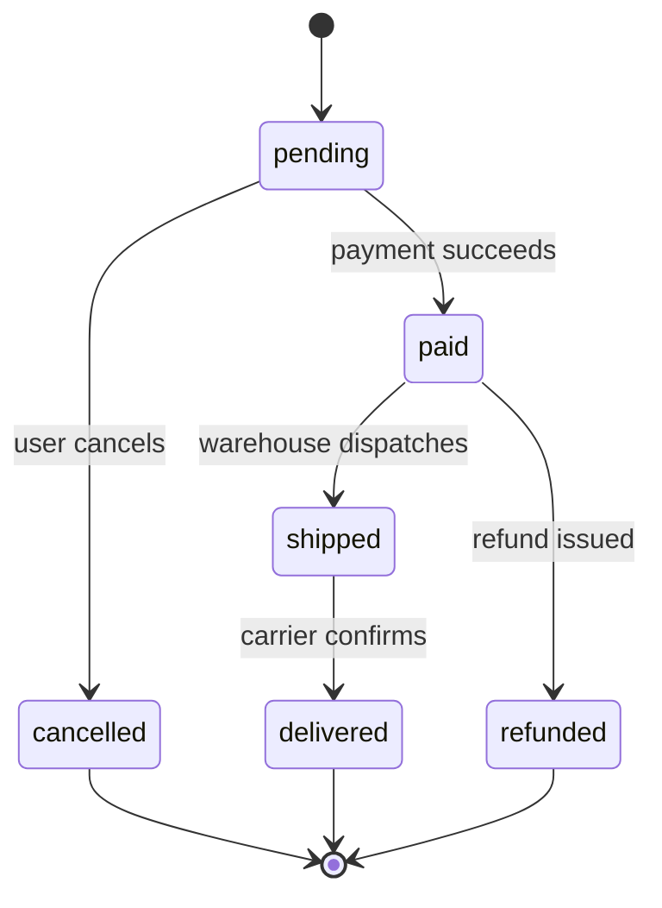

## 69.6 Control flow

### 69.6.1 Conditionals and branching

#### Concept

Control flow is how a program decides what to do next. Conditionals (`if`, `else`, `switch`) choose between paths. Loops (`for`, `while`) repeat. Together they turn a static list of statements into a program that reacts to its data.

#### Why does it exist?

Real logic is full of decisions. Is the order paid? Then ship it. Is the user an admin? Then allow the delete. Is the inventory zero? Then reject the purchase. Without branching, every program would do exactly the same thing every time regardless of its input, which is to say it would not be a program at all.

#### How it works

```ts
function describeOrder(status: OrderStatus): string {
  if (status === 'paid') {
    return 'ready to ship';
  } else if (status === 'pending') {
    return 'awaiting payment';
  } else {
    return 'closed';
  }
}
```

The **ternary** operator is a compact `if/else` that yields a value:

```ts
const label = isPaid ? 'Paid' : 'Unpaid';
```

`switch` is cleaner than a long `if/else if` chain when branching on one value:

```ts
function nextStatus(status: OrderStatus): OrderStatus {
  switch (status) {
    case 'pending':
      return 'paid';
    case 'paid':
      return 'paid';        // already paid, no change
    case 'cancelled':
      return 'cancelled';
    default:
      // With a union type, TypeScript ensures every case is handled.
      throw new Error(`unknown status: ${status}`);
  }
}
```

The `default` case with a union type gives you **exhaustiveness checking**: if someone later adds `'refunded'` to `OrderStatus` and forgets to handle it, TypeScript can flag the gap (with the `never` trick shown in 69.7). This is a quiet superpower — the compiler reminds you to update every switch when the set of statuses grows.

#### Guard clauses

A guard clause handles the exceptional or invalid case first and returns early, so the main logic is not buried inside nested `if`s. Senior code is full of guard clauses.

```ts
// Nested, hard to read:
function charge(order: Order) {
  if (order.status === 'pending') {
    if (order.totalCents > 0) {
      // ... the real work, two levels deep
    }
  }
}

// Guard clauses, flat and clear:
function chargeBetter(order: Order) {
  if (order.status !== 'pending') throw new Error('order not pending');
  if (order.totalCents <= 0) throw new Error('nothing to charge');
  // ... the real work, at the top level
}
```

#### Practical example — an order state machine

A state machine lists which transitions are allowed. This pattern prevents illegal states, like shipping a cancelled order. We draw it as a diagram because that is how backend engineers reason about states.



```ts
type Status = 'pending' | 'paid' | 'shipped' | 'delivered' | 'cancelled' | 'refunded';

const allowed: Record<Status, Status[]> = {
  pending: ['paid', 'cancelled'],
  paid: ['shipped', 'refunded'],
  shipped: ['delivered'],
  delivered: [],
  cancelled: [],
  refunded: [],
};

function canTransition(from: Status, to: Status): boolean {
  return allowed[from].includes(to);
}
canTransition('pending', 'shipped'); // false: must be paid first
```

This data-driven approach (a lookup table of allowed transitions) is cleaner than a tangle of `if`s and is easy to extend. We return to state machines in Part 67.

#### How a Senior Backend Engineer thinks about this

A senior keeps the happy path at the top indentation level and pushes error and edge cases into guard clauses at the top of the function. They prefer `switch` with exhaustiveness checking over long `if/else` chains on a single value, because the compiler then forces every branch to be handled when the set of values grows. They model important state changes as explicit state machines rather than scattering `if (status === ...)` checks across the codebase, because scattered checks drift out of sync and allow illegal states.

#### Common mistakes

- Deeply nested `if`s instead of guard clauses; hard to read and easy to get the logic wrong.
- `switch` with a missing `break` in plain JavaScript (falling through to the next case unintentionally); in the `return`-per-case style above this cannot happen.
- Scattering status checks everywhere instead of one state machine, so illegal transitions slip through.

#### Interview questions

1. **What is a guard clause and why use it?** An early return for an invalid or edge case, keeping the main logic unindented and readable.
2. **What is exhaustiveness checking in a `switch`?** Using a union type and a `never` default so the compiler forces you to handle every case, catching missed branches when the union grows.

#### Practical exercise

Implement `transition(order, to)` that uses the `allowed` table above, throws a clear error for an illegal transition, and returns a new order object (not mutated) with the updated status. Acceptance criteria: adding a new status to the `Status` union without updating `allowed` must cause a TypeScript error.

### 69.6.2 Loops

#### Concept

Loops repeat a block of code. The main forms are `for` (counted), `for...of` (over the values of an array or other iterable), `for...in` (over the keys of an object — use sparingly), and `while` (until a condition is false).

#### How it works

```ts
const ids = ['a', 'b', 'c'];

// for...of: the modern default for iterating values.
for (const id of ids) {
  console.log(id);
}

// Classic for: when you need the index.
for (let i = 0; i < ids.length; i++) {
  console.log(i, ids[i]);
}

// while: when you do not know the count in advance.
let remaining = 3;
while (remaining > 0) {
  remaining--;
}

// for...in iterates object KEYS (as strings). Rarely what you want for arrays.
const prices = { p1: 1000, p2: 2500 };
for (const key in prices) {
  console.log(key, prices[key as keyof typeof prices]);
}
```

`break` exits a loop early; `continue` skips to the next iteration. Use `break` when you have found what you are looking for and need not continue — this is the main reason to write a manual loop instead of an array method.

#### When to use a loop vs an array method

```text
Transform every element into a new value        -> map
Keep some elements                               -> filter
Combine into one value                           -> reduce
Find the first match, then stop                  -> find (or for...of + break)
Do a side effect for each (log, call an API)     -> for...of
Need the index, or step by 2, or go backwards    -> classic for
Repeat until a condition with no fixed count     -> while
```

#### Practical example — retry with a loop

```ts
async function withRetry<T>(fn: () => Promise<T>, maxAttempts = 3): Promise<T> {
  let lastError: unknown;
  for (let attempt = 1; attempt <= maxAttempts; attempt++) {
    try {
      return await fn();           // success: return immediately
    } catch (err) {
      lastError = err;
      // backoff would go here (Part 70)
    }
  }
  throw lastError;                 // all attempts failed
}
```

A counted `for` loop is the right tool here because we need the attempt number and an early `return` on success.

#### Edge cases & failure modes

- **Infinite loops.** A `while (true)` with no `break`, or a `for` whose condition never becomes false, hangs the process. On a single-threaded Node server, an infinite loop freezes the entire server for every user, not just one request (Part 3).
- **`for...in` over arrays** iterates indices as strings and includes inherited properties; use `for...of` for array values.
- **Modifying an array while iterating it** with a classic `for` can skip or repeat elements. Build a new array instead.
- **`await` inside a loop** runs iterations one after another (serial). If they are independent, that is needlessly slow; use `Promise.all` (Part 70) to run them together.

#### How a Senior Backend Engineer thinks about this

A senior defaults to array methods for data transformation and reserves explicit loops for early exit, index math, and side effects that read more clearly as a loop. They are acutely aware that on Node a long synchronous loop blocks the event loop and therefore every concurrent request (Part 3), so a loop over a million rows gets rewritten to stream or to yield control. They watch for the accidental-serial-`await`-in-a-loop pattern, one of the most common causes of a slow endpoint.

#### Common mistakes

- `await` in a loop for independent work, making an endpoint 10x slower than needed.
- A long synchronous loop blocking the event loop and freezing the server.
- `for...in` on arrays.
- Mutating the array being iterated.

#### Interview questions

1. **Why can a long synchronous loop freeze an entire Node server?** Node runs your JavaScript on one thread; while the loop runs, the event loop cannot handle any other request (see Part 3).
2. **What is wrong with `for (const x of items) { await save(x); }` when saves are independent?** It runs serially; `await Promise.all(items.map(save))` runs them concurrently and is far faster.
3. **When do you write a manual `for` loop instead of `map`/`filter`?** When you need early exit (`break`), the index, custom stepping, or side effects that are clearer as a loop.

#### Practical exercise

Rewrite a serial loop that fetches 20 product details one at a time (`for...of` with `await`) into a concurrent version using `Promise.all`, and explain in one sentence why the concurrent version is faster. Acceptance criteria: the concurrent version preserves the order of results.

## 69.7 Modules, interfaces and generics

### 69.7.1 Modules: splitting code across files

#### Concept

A module is a single file of code that explicitly states what it shares (`export`) and what it needs from other files (`import`). Modules are how a backend of thousands of lines stays organized — each file does one job and declares its public surface.

#### Why does it exist?

One giant file is unmaintainable. Modules let you put the order logic in `orders.service.ts`, the shipping logic in `shipping.service.ts`, and have each use the other through clear imports. The `export`/`import` boundary is also where you decide what is public (part of the module's contract) and what is private (an internal helper nobody else should call).

#### How it works

Modern JavaScript and TypeScript use **ES modules** (`import`/`export`). You will also see the older **CommonJS** (`require`/`module.exports`) in Node code; recognize it but write ES modules in new code.

```ts
// money.ts  -- a module that exports helpers
export function formatCents(cents: number): string {
  return `$${(cents / 100).toFixed(2)}`;
}

export const USD = 'USD';

// A default export (one per file, imported without braces):
export default function sum(amounts: number[]): number {
  return amounts.reduce((a, b) => a + b, 0);
}
```

```ts
// orders.ts  -- imports from money.ts
import sum, { formatCents, USD } from './money';   // default + named imports

const total = sum([1000, 2500]);
console.log(formatCents(total)); // "$35.00"
```

Named exports (in braces) are the common case; prefer them because they are explicit and tooling can rename them safely. The file path in the import is relative (`./money`) for your own files and a bare name (`'@nestjs/common'`) for installed packages.

#### Barrel files and import organization

A "barrel" is an `index.ts` that re-exports from several files so callers import from one place. Useful in moderation; overused, it creates circular imports.

```ts
// orders/index.ts
export * from './orders.service';
export * from './orders.controller';
```

#### How a Senior Backend Engineer thinks about this

A senior treats a module's exports as its public API and keeps it small: export the service, not every helper. They avoid circular imports (file A imports B which imports A), which cause subtle `undefined` bugs at startup, by keeping dependencies flowing in one direction — controllers depend on services, services depend on repositories, never the reverse. The module boundary is the first and cheapest form of architecture, long before you reach for layers or microservices (Part 5).

#### Common mistakes

- Circular imports, causing values to be `undefined` during module initialization.
- Exporting internal helpers that should stay private, widening the contract accidentally.
- Mixing CommonJS `require` and ES `import` in ways that break under the module system configured in `tsconfig.json`.

#### Interview questions

1. **What is the difference between a named export and a default export?** Named exports are imported by name in braces and there can be many; a default export is imported without braces and there is one per file. Named exports are generally preferred for clarity and tooling.
2. **What problem do circular imports cause and how do you avoid them?** A value may be `undefined` when first accessed because one module is still initializing. Avoid them by keeping dependency direction one-way.

#### Practical exercise

Split a single file containing money formatting, order totalling and a `main` that prints a summary into three modules (`money.ts`, `orders.ts`, `main.ts`) with explicit exports and imports. Acceptance criteria: `main.ts` imports only from `orders.ts`, and `orders.ts` imports only from `money.ts` — no circular imports.

### 69.7.2 Interfaces, type aliases and unions

#### Concept

We met interfaces in 69.5. Here we complete the picture: interfaces and type aliases describe object shapes; unions describe "one of several"; intersections combine shapes. These are the tools you use to model a domain precisely.

#### How it works

```ts
// Union: a value that is one of several types.
type Id = string | number;
type Status = 'pending' | 'paid' | 'cancelled';   // union of string literals

// Intersection: a value that satisfies several shapes at once.
interface Timestamped { createdAt: Date; updatedAt: Date; }
interface Order { id: string; totalCents: number; }
type PersistedOrder = Order & Timestamped;        // has all four fields

// Discriminated union: the pro move for modelling events or results.
type PaymentResult =
  | { kind: 'success'; chargeId: string }
  | { kind: 'declined'; reason: string }
  | { kind: 'error'; message: string };

function handle(result: PaymentResult) {
  switch (result.kind) {
    case 'success':
      return result.chargeId;      // TypeScript knows chargeId exists here
    case 'declined':
      return result.reason;        // and reason here
    case 'error':
      return result.message;
    default:
      // Exhaustiveness: if a new kind is added, this line errors.
      const _never: never = result;
      return _never;
  }
}
```

The **discriminated union** (a union of objects that share a common literal field, here `kind`) is one of the most valuable patterns in TypeScript backend code. It models "a thing that is one of several shapes" — a payment result, a webhook event, a command — and the compiler narrows to the right shape inside each `case`. The `never` default gives you exhaustiveness checking for free.

#### How a Senior Backend Engineer thinks about this

A senior models the domain with unions so that illegal combinations cannot be represented. Instead of an object with `success: boolean`, `chargeId?: string` and `reason?: string` (where every combination is technically possible, including the nonsensical ones), they use a discriminated union where a success always has a charge id and a decline always has a reason, and nothing else is expressible. "Make illegal states unrepresentable" is the principle; discriminated unions are the main tool for it in TypeScript.

#### Common mistakes

- Boolean-and-optional-field soup (`{ ok: boolean; data?: T; error?: string }`) instead of a discriminated union, allowing impossible combinations.
- Using `interface` and `type` inconsistently across a codebase; pick a convention.

#### Interview questions

1. **What is a discriminated union and why is it useful?** A union of object types sharing a literal "tag" field; the compiler narrows to the correct shape per branch, and it prevents illegal field combinations.
2. **Interface vs type alias — when does it matter?** Rarely for plain object shapes; interfaces can be re-opened and are conventional for public contracts, type aliases can express unions and intersections. Consistency matters more than the choice.

#### Practical exercise

Model a `WebhookEvent` as a discriminated union with three kinds (`order.created`, `order.paid`, `order.cancelled`), each carrying different fields, and write a `process` function with exhaustiveness checking. Acceptance criteria: adding a fourth kind without handling it causes a compile error.

### 69.7.3 Generics: types that take parameters

#### Concept

A generic is a type with a blank to fill in. `Array<T>` is a generic: `T` is the blank, so `Array<string>` is an array of strings and `Array<Order>` is an array of orders. Generics let you write one reusable function or type that works for many element types while staying fully type-safe.

#### Why does it exist?

Without generics, you would either write a separate `firstString`, `firstNumber`, `firstOrder` for each type (repetitive), or use `any` and lose all safety. A generic `first<T>(items: T[]): T | undefined` works for every type and keeps the exact type: `first(orders)` returns `Order | undefined`, not `any`.

#### How it works

```ts
// A generic function. T is a placeholder filled in at the call site.
function first<T>(items: T[]): T | undefined {
  return items.length > 0 ? items[0] : undefined;
}

const o = first([{ id: 'ord_1' }]); // o is typed as { id: string } | undefined
const n = first([1, 2, 3]);          // n is number | undefined

// A generic interface: a reusable "page of results" shape.
interface Page<T> {
  items: T[];
  total: number;
  cursor: string | null;
}

const orderPage: Page<Order> = { items: [], total: 0, cursor: null };

// Constrained generic: T must have an id. "extends" sets the constraint.
function indexById<T extends { id: string }>(items: T[]): Map<string, T> {
  const map = new Map<string, T>();
  for (const item of items) map.set(item.id, item);
  return map;
}
```

The constraint `T extends { id: string }` means "T can be any type, as long as it has a string `id`". That lets the body safely read `item.id` while still working for any entity with an id.

#### Practical example — a typed generic repository

This previews a pattern used throughout the book: one generic base repository that every entity's repository extends.

```ts
interface Repository<T extends { id: string }> {
  findById(id: string): Promise<T | null>;
  save(entity: T): Promise<T>;
  delete(id: string): Promise<void>;
}

// A concrete repository just fills in T:
type OrderRepository = Repository<Order>;
```

#### How a Senior Backend Engineer thinks about this

A senior uses generics to remove duplication without sacrificing type safety — the generic `Page<T>`, the generic `Result<T, E>`, the generic repository. They do not over-engineer: a generic with four type parameters and nested constraints is usually a sign something is too clever. The rule is "reach for a generic when you are about to copy a function only to change its element type." The tools (`Page<T>`, `Promise<T>`, `Record<K, V>`, `Partial<T>`, `Pick<T, K>`) become second nature and let them describe real API shapes exactly.

#### Common mistakes

- Using `any` where a generic would keep the type (`function first(items: any[]): any`).
- Over-complicated generics that are harder to read than three concrete versions would be.
- Forgetting a constraint (`T extends ...`) and then being unable to touch the value's properties.

#### Interview questions

1. **What problem do generics solve?** Reuse across element types without losing type safety or resorting to `any`.
2. **What does `T extends { id: string }` mean?** A constraint: `T` may be any type that has a string `id` property, letting the function safely use `id`.
3. **Give a real backend use of a generic type.** A `Page<T>` pagination wrapper, a `Result<T, E>` type, or a base `Repository<T>`.

#### Practical exercise

Write a generic function `groupBy<T, K extends string>(items: T[], keyFn: (item: T) => K): Record<K, T[]>` that groups array elements by a computed key. Test it by grouping orders by status. Acceptance criteria: the return type correctly reflects the key type, and the original array is not mutated.

## Senior Checklist — Part 69

- [ ] I understand the concept
- [ ] I can explain it simply
- [ ] I can implement it
- [ ] I understand its failure modes
- [ ] I understand its scaling limitations
- [ ] I understand its security implications
- [ ] I understand its operational implications
- [ ] I can choose between alternatives
- [ ] I can explain the tradeoffs
- [ ] I can answer senior-level interview questions
- [ ] I store money as integer cents and know why floating-point dollars are wrong
- [ ] I use `const` by default and know `const` protects the binding, not the object
- [ ] I use `===` and `??`, and I can list the falsy values
- [ ] I write small, well-named, side-effect-free functions and read stack traces
- [ ] I use `map`/`filter`/`reduce` and know which array methods mutate
- [ ] I model domain shapes with interfaces, unions and discriminated unions
- [ ] I use generics to remove duplication without losing type safety
- [ ] I split code into modules with small, explicit exports and no circular imports

## Part 69 — Key Takeaways

- Store money as integer cents; floating-point dollars accumulate rounding errors that break reconciliation.
- Default to `const`; it protects the variable binding, not the contents of an object.
- Use `===` always and `??` for defaults when `0`, `""` or `false` are valid values.
- TypeScript types are erased at runtime; their value is catching shape errors before the code runs. Enable `strict` and treat external data as `unknown`.
- Keep functions small, named for their output, and free of hidden side effects; pure functions are trivial to test.
- Closures carry their captured variables with them — useful for private state, dangerous for memory if captured by something long-lived.
- `map`/`filter`/`reduce` say what you mean; know that `sort`/`reverse`/`splice` mutate the original and copy first when the array is shared.
- Model the domain with interfaces and discriminated unions so illegal states cannot be represented.
- Use generics (`Page<T>`, `Repository<T>`) to reuse code across element types without resorting to `any`.
- Modules with small, explicit exports and one-way dependencies are the cheapest form of architecture.
