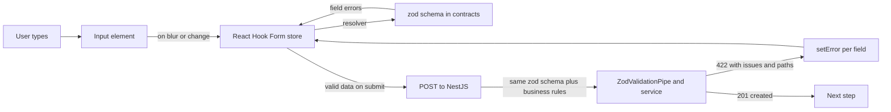
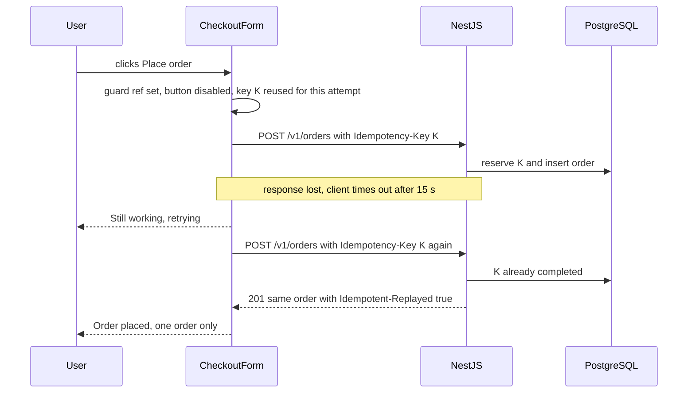

## 69.7 Forms: controlled and uncontrolled inputs, validation, React Hook Form with zod

#### Concept

A form in React can manage its inputs in two ways:

- **Controlled input**: React state is the source of truth. The input's `value` comes from state, and every keystroke calls `onChange`, which sets state, which re-renders the input with the new value.

  ```tsx
  const [postcode, setPostcode] = useState('');
  <input value={postcode} onChange={(e) => setPostcode(e.target.value)} />
  ```

- **Uncontrolled input**: the DOM is the source of truth. You give an initial `defaultValue` and read the current value when you need it: from a ref, or from `FormData` on submit.

  ```tsx
  <input name="postcode" defaultValue={saved?.postcode ?? ''} />
  // on submit: new FormData(event.currentTarget).get('postcode')
  ```

**Validation** happens in three places with three different jobs: the browser's built-in constraint validation (`required`, `type="email"`, `pattern`, 67.2), a client-side schema for fast, specific feedback, and the **server, which is the only validation that counts**.

**React Hook Form** (RHF 7) registers inputs as uncontrolled, so typing does not re-render the form, and tracks errors and submission state. **zod** defines a schema once and gives both runtime validation and a static type (`z.infer`). `@hookform/resolvers/zod` connects them, and the same schema in `@shop/contracts` validates the request in NestJS (68.12).

#### Why does it exist?

Forms are where most frontend bugs and support tickets live: values lost on navigation, errors before the user has typed, "Something went wrong" for a server rejection, a button that submits twice.

Controlled inputs give full control (live formatting, dependent fields) at the cost of a re-render per keystroke for the state owner; with 25 fields owned at the top, each keystroke re-renders all 25. Uncontrolled inputs are faster and closer to HTML, but reacting to each change is harder.

Libraries exist because the bookkeeping is large (per-field errors, touched and dirty flags, validation timing, focus on the first error, field arrays, mapping server errors) and hand-written versions behave differently on every screen.

#### Mental model

A controlled input is **synchronous replication**: React state is the primary and every DOM change is copied into it. An uncontrolled input is primary-only: read the DOM when you need a value. Validation layers form a NestJS pipeline: browser checks reject malformed input, the client schema is a bypassable `ValidationPipe`, and server validation is the database constraint, the only layer you trust.

#### How it works



**RHF's model:**

1. `useForm({ resolver, defaultValues, mode })` creates a form store held in a ref, not in React state. `register('postcode')` returns `{ name, ref, onChange, onBlur }` to spread on a native input; RHF reads the DOM through the ref, so typing does not re-render your component.
2. `formState` (errors, `isSubmitting`, `isDirty`, `touchedFields`) is a proxy: your component re-renders only when a piece of `formState` it actually reads changes.
3. `mode` decides when validation runs: `'onSubmit'` (default), `'onBlur'`, `'onTouched'` (first blur, then every change), `'onChange'` or `'all'`. `'onTouched'` is the best checkout default: quiet while typing the first time, immediate while fixing.
4. `handleSubmit(onValid)` prevents the browser submit, validates, focuses the first invalid field, and holds `isSubmitting` true while your `onValid` runs.
5. `setError('address.postcode', { type: 'server', message })` attaches a server error to a field; `setError('root.server', ...)` attaches a form-level one (read as `errors.root?.server`).
6. For components that do not expose a native input (a date picker, a custom select), `Controller` or `useController` wraps them as controlled inputs inside RHF.

**zod's model:**

- `z.object({...})` describes the shape; `.safeParse()` returns `{ success, data | error }`; `z.infer<typeof Schema>` gives the type, so form values and the API request share one type; `.refine` / `.superRefine` add cross-field rules.
- Inputs always produce strings. Use `z.coerce.number()` or RHF's `valueAsNumber` for numeric fields.

**React 19 forms.** **Actions** let you write `<form action={fn}>`, where `fn` receives the `FormData`, may be async and runs in a transition. `useActionState(action, initialState)` returns `[state, formAction, isPending]` (named `useFormState` in the canary build Next.js 14 bundles); `useFormStatus()` from `react-dom` gives a nested button `{ pending }`; uncontrolled fields reset after success. They suit simple forms and Next.js Server Actions (Part 71); RHF remains the usual choice for complex client forms.

#### Practical example

A delivery address form: name, phone, address lines, city, postcode, and a "save to address book" checkbox. Rules: phone is a 10-digit Indian mobile number; postcode is 6 digits; the postcode must be serviceable, which only the server knows.

| Rule | Where it is checked | Feedback timing |
|---|---|---|
| Required fields | Browser `required` + zod | On blur after first touch |
| Phone and postcode format | zod regex (shared) | On blur, then on change |
| Max lengths (match DB columns) | zod + DB `varchar(n)` | On change |
| Postcode is serviceable | Server only | After submit, mapped to the postcode field |
| Address belongs to this user (when editing) | Server only | 404 or 403, shown as a form error |

#### React / Next.js example

The shared schema (zod 3.23, also valid in zod 4):

```ts
// packages/contracts/src/address.ts
import { z } from 'zod';

export const AddressSchema = z.object({
  fullName: z.string().trim().min(2, 'Enter your full name').max(80),
  phone: z.string().trim().regex(/^[6-9]\d{9}$/, 'Enter a 10-digit mobile number'),
  line1: z.string().trim().min(3, 'Enter house number and street').max(120),
  line2: z.string().trim().max(120).optional().default(''),
  city: z.string().trim().min(2).max(60),
  postcode: z.string().trim().regex(/^\d{6}$/, 'Postcode must be 6 digits'),
  saveToBook: z.boolean().default(false),
});
export type Address = z.infer<typeof AddressSchema>;
```

The form, with React Hook Form 7 and `@hookform/resolvers`:

```tsx
// src/checkout/AddressForm.tsx  (React 18, react-hook-form 7, @hookform/resolvers)
import { useForm } from 'react-hook-form';
import { zodResolver } from '@hookform/resolvers/zod';
import { AddressSchema, type Address } from '@shop/contracts';
import { ApiError, applyServerErrors } from '../api/errors';

type Props = { initial?: Partial<Address>; onSaved: (a: Address) => Promise<void> };

export function AddressForm({ initial, onSaved }: Props) {
  const { register, handleSubmit, setError, formState: { errors, isSubmitting } } = useForm<Address>({
    resolver: zodResolver(AddressSchema),
    defaultValues: { fullName: '', phone: '', line1: '', line2: '', city: '', postcode: '', saveToBook: false, ...initial },
    mode: 'onTouched',                                   // quiet until the first blur
  });

  const onValid = async (values: Address) => {
    try {
      await onSaved(values);                             // POST /v1/checkout/address
    } catch (e) {
      if (e instanceof ApiError && applyServerErrors(e, setError)) return; // field errors mapped
      setError('root.server', { type: 'server', message: 'Could not save the address. Please try again.' });
    }
  };

  return (
    <form onSubmit={handleSubmit(onValid)} noValidate> {/* noValidate: one consistent error UI */}
      <label htmlFor="fullName">Full name</label>
      <input id="fullName" autoComplete="name" {...register('fullName')} aria-invalid={!!errors.fullName}
        aria-describedby="fullName-err" />
      <p id="fullName-err" role="alert">{errors.fullName?.message}</p>

      <label htmlFor="phone">Mobile number</label>
      <input id="phone" type="tel" inputMode="numeric" autoComplete="tel-national" {...register('phone')}
        aria-invalid={!!errors.phone} aria-describedby="phone-err" />
      <p id="phone-err" role="alert">{errors.phone?.message}</p>

      {/* line1, line2, city follow the same pattern */}

      <label htmlFor="postcode">Postcode</label>
      <input id="postcode" inputMode="numeric" autoComplete="postal-code" {...register('postcode')}
        aria-invalid={!!errors.postcode} aria-describedby="postcode-err" />
      <p id="postcode-err" role="alert">{errors.postcode?.message}</p>

      <label><input type="checkbox" {...register('saveToBook')} /> Save to address book</label>

      {errors.root?.server && <p role="alert">{errors.root.server.message}</p>}
      <button type="submit" disabled={isSubmitting}>{isSubmitting ? 'Saving...' : 'Continue'}</button>
    </form>
  );
}
```

The server-error mapper, which relies on a stable error contract:

```ts
// src/api/errors.ts
import type { FieldValues, Path, UseFormSetError } from 'react-hook-form';

export type ApiIssue = { path: string; message: string; code?: string };
export class ApiError extends Error {
  constructor(public status: number, public code: string, public issues: ApiIssue[] = [], public requestId?: string) {
    super(code);
  }
}

// Returns true if at least one issue was attached to a field.
export function applyServerErrors<T extends FieldValues>(err: ApiError, setError: UseFormSetError<T>): boolean {
  let mapped = false;
  err.issues.forEach((issue, i) => {
    if (!issue.path) return;
    setError(issue.path as Path<T>, { type: 'server', message: issue.message }, { shouldFocus: i === 0 });
    mapped = true;
  });
  return mapped;
}
```

As controlled inputs with top-level `useState`, every keystroke would re-render all fields: on a 20-field form on a mid-range phone, 20 to 40 renders per second while typing, against zero with RHF.

#### Backend side (NestJS)

The form can only show precise server errors if the API returns them in one predictable shape with **field paths that match the form's field names**. Reuse the shared schema for syntax, then check business rules and return them in the same shape:

```ts
// apps/api/src/checkout/checkout-address.controller.ts
import { Body, Controller, Post, UnprocessableEntityException, UseGuards } from '@nestjs/common';
import { AddressSchema, type Address, type CartTotals } from '@shop/contracts';
import { ZodValidationPipe } from '../common/zod-validation.pipe';
import { JwtAuthGuard } from '../auth/jwt-auth.guard';
import { CurrentUser, type AuthUser } from '../auth/current-user.decorator';
import { ServiceabilityService } from '../logistics/serviceability.service';
import { CheckoutService } from './checkout.service';

@Controller('v1/checkout')
@UseGuards(JwtAuthGuard)
export class CheckoutAddressController {
  constructor(private readonly serviceability: ServiceabilityService, private readonly checkout: CheckoutService) {}

  @Post('address')
  async setAddress(
    @CurrentUser() user: AuthUser,
    @Body(new ZodValidationPipe(AddressSchema)) address: Address, // 400 VALIDATION_FAILED with issues on syntax
  ): Promise<{ totals: CartTotals }> {
    const area = await this.serviceability.lookup(address.postcode); // cached, about 2 ms
    if (!area.serviceable) {
      // Semantic rule: same issue shape, path matches the form field name exactly.
      throw new UnprocessableEntityException({
        code: 'ADDRESS_NOT_SERVICEABLE',
        issues: [{ path: 'postcode', code: 'NOT_SERVICEABLE', message: 'We do not deliver to this postcode yet' }],
      });
    }
    // Delivery fee depends on the area, so the response carries recomputed totals for the next step.
    return { totals: await this.checkout.setAddress(user.id, address, area) };
  }
}
```

Backend rules for forms:

- **Validate everything again on the server**, with the same schema where possible. The client schema is a UX feature.
- **One error shape** for syntax (400) and business rules (422): `{ code, issues: [{ path, code, message }], requestId }`. Part 72 — Frontend–Backend Contracts formalises this as RFC 7807 problem details.
- **Paths match field names**, including nesting (`address.postcode`) and arrays (`items.2.quantity`), which RHF understands. Messages are safe to show; internals go to logs under the `requestId`.
- **Column limits and schema limits match.** If `line1` is `varchar(120)`, the schema says `.max(120)`. Otherwise the client accepts what the database rejects with a 500.

#### Production scenario

A pharmacy delivery app validated addresses with `mode: 'onChange'`, so "Postcode must be 6 digits" appeared after the first digit, and the step had 9 % abandonment. Switching to `'onTouched'`, adding `autoComplete` attributes and mapping the server's "not serviceable" error to the postcode field (instead of a generic toast) brought it to 5.5 %. The backend change was 15 lines: a `422` with a path instead of a `400` with a sentence.

#### Failure scenario

A team added a `landmark` field to the form and its zod schema, but the NestJS DTO used `class-validator` with `forbidNonWhitelisted: true`. Every submit failed with `400 property landmark should not exist`, shown as "Could not save the address" with no field highlighted. Checkout conversion dropped 30 % for 50 minutes until rollback.

The fix: the schema moved to `@shop/contracts` so API and form cannot disagree without a type error in the same pull request (68.12), and a CI contract test posts the form's default values to the API (Part 72).

#### Edge cases & failure modes

- **Switching an input from uncontrolled to controlled** (`value={undefined}` then `value="x"`) triggers a React warning and loses the cursor position; always give controlled inputs a defined value (`''`, not `undefined`).
- **Number inputs** return strings; `"0"` vs `""` vs `NaN` need explicit handling.
- **Browser autofill** sets values without key events; RHF reads the DOM so it sees them, but some custom controlled inputs miss them.
- **Server errors for fields not on screen** (a hidden field, a different step) must fall back to a form-level message.
- **Editing a record that changed on the server** while the form was open; use a `version` and handle `409`.

#### How a Senior Full-Stack Engineer thinks about this

A senior designs a form from its error states backwards: what can go wrong per field, where the user sees it, what the API returns for it. They use RHF for anything non-trivial, controlled inputs only where live formatting needs them, and one schema shared with the backend. "Something went wrong" on a form is a bug in the API contract.

#### Common mistakes

- **Trusting client validation** and skipping server checks.
- **Validating on every change from the first keystroke.**
- **Generic error toasts** for field-level problems.
- **Duplicating the schema** in the form and the API, then letting them drift.
- **Making every field controlled with top-level state** in a large form.

#### Interview questions

1. **Controlled vs uncontrolled inputs: what is the difference and when would you choose each?**
   Expected answer: controlled means React state is the source of truth and every keystroke re-renders; uncontrolled means the DOM holds the value and you read it on demand. Choose controlled for live formatting or dependent UI, uncontrolled (often via RHF) for performance and simplicity. Follow-up: how does RHF avoid re-renders?
2. **Why validate on both client and server?** Expected answer: client for fast feedback, server because clients can be bypassed; the server is authoritative.
3. **How do you map a server validation error onto the right field?** Expected answer: a stable error contract with field paths that match form names; `setError` per issue; a form-level fallback.
4. **What do React 19 Actions and `useActionState` add to forms?** Expected answer: form actions that receive `FormData`, run in a transition with a pending state, integrate with Server Actions, and reset uncontrolled fields after success. Version: React 19 (Next.js 14 used canary APIs under different names).

#### Practical exercise

Build the address form with a shared zod schema and a NestJS endpoint.

Acceptance criteria:

- The same `AddressSchema` is imported by the React form and the NestJS controller.
- Submitting postcode `999999` (configured as not serviceable) shows the server's message under the postcode field and moves focus there.
- A `curl` request with a 500-character `line1` gets a `400` with an issue whose `path` is `line1`, and the database column limit matches the schema.
- Typing into one field does not re-render the other fields (verified with the Profiler or a render counter).

## 69.8 Double-submit protection and idempotency from the form

#### Concept

A **double submit** is one intention ("place this order") reaching the server as several requests: double taps, Enter plus click, impatient retries, client-library retries, or the browser re-sending after a network change.

Protection is layered, and only the last layer is a guarantee:

1. **UI guard**: disable the button and ignore re-entry while the submission is in flight.
2. **Attempt identity**: send an **idempotency key** that identifies this attempt, the same key on every retry of it.
3. **Server idempotency**: the server records the key and returns the original result for repeats (Part 14 — API Design (REST first), 14.12 Idempotency).
4. **Database constraint**: a unique constraint that makes a duplicate physically impossible even if everything above fails.

Part 135.2 showed the plain HTML version with a hidden input and Post/Redirect/Get. This section is the React version.

#### Why does it exist?

Because "disable the button" is not enough, for four reasons:

- **Timing**: in React 18 a click is a "discrete" event, so `setSubmitting(true)` in the handler commits before the next click is processed. But a guard set *after* an `await` (async validation, fetching a payment token) leaves a gap, and so do two triggers (Enter and a click).
- **Remounts** (a route change, a parent showing a skeleton) forget "submitting" state; **retries after timeouts** follow requests that may already have succeeded; and **other clients** (a second tab, a script) are outside the UI's control.

#### Mental model

Imagine a lift button. Pressing it ten times calls one lift, because the controller records "lift requested for floor 3", not "button pressed". The button light (the UI guard) is feedback; the floor number (the idempotency key) is what makes repeats collapse into one.

#### How it works



The client side, step by step:

1. **Create the key per attempt**: on the first submit for a given cart version, generate `crypto.randomUUID()` and keep it (69.5); every retry reuses it.
2. **Guard synchronously**: check and set a ref flag at the very start of the handler, before any `await`. State drives the disabled button; the ref closes the gap.
3. **Send the key** as an `Idempotency-Key` header with the request.
4. **Handle outcomes by meaning:**
   - `201`/`200`: success. Clear the key, navigate to the confirmation page with `replace` so Back does not return to a live form.
   - `409` with `Retry-After` (key in progress): wait and retry with the same key.
   - Network error or timeout: the outcome is unknown. Retry with the same key, or show "Checking your order..." and retry; never generate a new key.
   - `4xx` that ends the attempt (payment declined, validation): show the error and clear the key, because the next submit is a new attempt with possibly different data.
   - `422` "key reused with a different body": a client bug; log it with the request ID.
5. **Change the key when the request content changes.** Editing the address after a failed attempt makes the next submit a different operation, so clear the key after any final error.

#### Practical example

| Situation | UI behaviour | Key | Server response |
|---|---|---|---|
| Double click | Second click ignored by guard | Same | One request only |
| Enter key + click | Guard ref blocks the second | Same | One request only |
| Timeout after 15 s, user taps Retry | "Retrying..." | Same | Original order replayed |
| Card declined, user picks another card | Error shown, form re-enabled | New | New attempt |
| User opens checkout in two tabs | Each tab its own key | Different | Second fails on cart version or stock, by design |
| Component remounts mid-request | Guard lost | Key lost unless stored per cart version | Server replay or unique constraint catches it |

The last row is why the key often lives in `sessionStorage` keyed by cart ID and version, not only in a ref: it survives a remount or a reload during the attempt.

#### React / Next.js example

A `usePlaceOrder` hook that implements the client side, used by the payment step:

```tsx
// src/checkout/usePlaceOrder.ts  (React 18)
import { useCallback, useRef, useState } from 'react';
import { placeOrder, ApiTimeoutError } from '../api/orders';
import { ApiError } from '../api/errors';

type Result = { ok: true; orderId: string } | { ok: false; message: string };
const keyStorage = (cartId: string, version: number) => `idem:checkout:${cartId}:v${version}`;

function getAttemptKey(cartId: string, version: number): string {
  const k = keyStorage(cartId, version);
  let key = sessionStorage.getItem(k);                     // survives remounts and reloads
  if (!key) { key = crypto.randomUUID(); sessionStorage.setItem(k, key); }
  return key;
}

export function usePlaceOrder(cartId: string, cartVersion: number) {
  const inFlight = useRef(false);                          // synchronous guard, no render needed
  const [pending, setPending] = useState(false);           // drives the disabled button and label

  const submit = useCallback(async (paymentMethodId: string): Promise<Result> => {
    if (inFlight.current) return { ok: false, message: 'Already placing your order' };
    inFlight.current = true;                               // set before the first await
    setPending(true);
    const key = getAttemptKey(cartId, cartVersion);
    try {
      for (let attempt = 1; attempt <= 3; attempt++) {
        try {
          const order = await placeOrder({ cartId, cartVersion, paymentMethodId }, key, { timeoutMs: 15_000 });
          sessionStorage.removeItem(keyStorage(cartId, cartVersion)); // final answer: attempt is over
          return { ok: true, orderId: order.id };
        } catch (e) {
          const retryable = e instanceof ApiTimeoutError || (e instanceof ApiError && e.status === 409 && e.code === 'IDEMPOTENCY_IN_PROGRESS');
          if (!retryable || attempt === 3) throw e;
          await new Promise((r) => setTimeout(r, 1000 * attempt)); // same key, backoff 1 s then 2 s
        }
      }
      throw new Error('unreachable');
    } catch (e) {
      if (e instanceof ApiError && e.status >= 400 && e.status < 500 && e.status !== 409) {
        sessionStorage.removeItem(keyStorage(cartId, cartVersion)); // declined or invalid: next submit is new
        return { ok: false, message: e.issues[0]?.message ?? 'Your order could not be placed.' };
      }
      // Unknown outcome (timeouts exhausted, 5xx): keep the key so the next try replays, not duplicates.
      return { ok: false, message: 'We could not confirm your order yet. Please check My Orders before trying again.' };
    } finally {
      inFlight.current = false;
      setPending(false);
    }
  }, [cartId, cartVersion]);

  return { submit, pending };
}
```

The API helper sends the header and enforces a timeout with `AbortSignal.timeout` (supported in all current browsers):

```ts
// src/api/orders.ts (excerpt)
export async function placeOrder(body: PlaceOrderRequest, key: string, opts: { timeoutMs: number }) {
  let res: Response;
  try {
    res = await fetch('/api/v1/orders', {
      method: 'POST',
      headers: { 'Content-Type': 'application/json', 'Idempotency-Key': key },
      body: JSON.stringify(body),
      credentials: 'include',
      signal: AbortSignal.timeout(opts.timeoutMs),       // aborts the request after the timeout
    });
  } catch (e) {
    if (e instanceof DOMException && e.name === 'TimeoutError') throw new ApiTimeoutError();
    throw e;
  }
  if (!res.ok) throw await toApiError(res);              // parses { code, issues, requestId }
  return OrderCreatedSchema.parse(await res.json());
}
```

RHF's `isSubmitting`, and React 19's `isPending` (`useActionState`) and `pending` (`useFormStatus`), drive the disabled button; none of them replaces the ref guard or the idempotency key.

#### Backend side (NestJS)

The server side is the guarantee. Part 14.12 builds the full `IdempotencyInterceptor` with Redis reservation, fingerprinting and replay. What the browser adds:

- **CORS must expose the headers the client reads** if the web app and API are on different origins: `exposedHeaders: ['Idempotent-Replayed', 'Retry-After', 'X-Request-Id']`, and `Idempotency-Key` must be in `allowedHeaders` (it is a non-simple header, so it triggers a preflight; Part 10.13).
- **Require the key on money endpoints.** Reject `POST /v1/orders` without one with `400 IDEMPOTENCY_KEY_REQUIRED`; otherwise one old client version silently bypasses the protection.
- **Back it with a constraint**, so even a Redis outage cannot produce two orders:

```sql
-- Duplicate orders become impossible, not just unlikely.
ALTER TABLE orders ADD COLUMN idempotency_key uuid;
CREATE UNIQUE INDEX CONCURRENTLY orders_customer_idem_uq
  ON orders (customer_id, idempotency_key)
  WHERE idempotency_key IS NOT NULL;
```

```ts
// apps/api/src/orders/orders.controller.ts (excerpt)
import { BadRequestException, Body, Controller, Headers, Post, UseGuards, UseInterceptors } from '@nestjs/common';
import { PlaceOrderRequestSchema, type PlaceOrderRequest, type OrderCreated } from '@shop/contracts';
import { IdempotencyInterceptor } from '../common/idempotency.interceptor'; // from Part 8.12
import { ZodValidationPipe } from '../common/zod-validation.pipe';
import { JwtAuthGuard } from '../auth/jwt-auth.guard';
import { CurrentUser, type AuthUser } from '../auth/current-user.decorator';
import { OrdersService } from './orders.service';

@Controller('v1/orders')
@UseGuards(JwtAuthGuard)
export class OrdersController {
  constructor(private readonly orders: OrdersService) {}

  @Post()
  @UseInterceptors(IdempotencyInterceptor)            // replays completed keys, 409 for in-progress
  async place(
    @CurrentUser() user: AuthUser,
    @Headers('idempotency-key') key: string | undefined,
    @Body(new ZodValidationPipe(PlaceOrderRequestSchema)) body: PlaceOrderRequest,
  ): Promise<OrderCreated> {
    // Require a UUID key on every money endpoint; old clients without one fail loudly, not silently.
    if (!key || !/^[0-9a-f]{8}-[0-9a-f]{4}-[0-9a-f]{4}-[0-9a-f]{4}-[0-9a-f]{12}$/i.test(key)) {
      throw new BadRequestException({ code: 'IDEMPOTENCY_KEY_REQUIRED' });
    }
    // Inside one transaction: check cart version, reserve stock, insert order with the key.
    // A unique violation on orders_customer_idem_uq is caught and turned into a replay of the existing order.
    return this.orders.placeFromCart(user.id, body, key);
  }
}
```

- **Check the cart version.** `PlaceOrderRequest` carries `cartVersion`; if the cart changed since the page loaded (another tab added an item), return `409 CART_CHANGED` with the fresh cart, rather than placing an order for contents the user did not review.
- **Payment providers need the key too.** Pass a derived key to the payment provider's own idempotency mechanism (most card APIs accept one), so a retry inside your service cannot double-charge either.

#### Production scenario

A food delivery platform found 0.4 % duplicate orders (same customer, restaurant and items within 60 s), about 1,900 a day: 55 % retries after client timeouts, 30 % double taps missed because the guard was set after an async address check, 15 % two tabs.

After per-attempt keys in `sessionStorage`, a ref guard before any `await`, server replay and the unique index, duplicates fell to 0.02 %, almost all genuine reorders.

#### Failure scenario

At 21:05 during a cricket final, a promotion drove checkout traffic to 6x normal and order-service p99 rose from 400 ms to 9 s. The mobile web client timed out at 10 s, showed "Something went wrong", re-enabled the button and generated a new key per click. In 25 minutes 3,200 customers got two or more orders, and the duplicate load pushed latency higher still: a retry storm built by the UI.

The changes: keys per attempt; unknown outcomes show "Checking your order..." and poll `GET /v1/orders?cartId=...`; a 20 s timeout with a progress message after 5 s; and server load shedding with `503` and `Retry-After` before latency reaches the client timeout (Part 41 — Performance Engineering).

#### Edge cases & failure modes

- **Guard set after an `await`** leaves a window for a second submit.
- **Key per click** turns every retry into a new operation.
- **Key never rotated** after the request content changes returns the old result for a different order (the server should 422 on fingerprint mismatch).
- **Key lost on remount** if stored only in component state; use a ref plus `sessionStorage` keyed by cart version.
- **Client library auto-retries** (axios-retry, TanStack Query mutation `retry`) on `POST` without a key create duplicates; only retry `POST` with a key.

#### How a Senior Full-Stack Engineer thinks about this

A senior asks the mantra about the submit button: can it duplicate, time out after succeeding, partially succeed? They model the attempt lifecycle (new, in flight, succeeded, failed definitively, unknown), map every HTTP outcome to one state, and make "unknown" honest, because "try again" when the order might exist is how retry storms and double charges start. The UI guard is UX; the key plus a constraint is correctness.

#### Common mistakes

- **Only disabling the button.**
- **Generating the key on each click** or on each render.
- **Showing a retry button after a timeout** without checking whether the order exists.
- **Retrying `POST` automatically without a key.**

#### Interview questions

1. **A customer was charged twice after double-tapping "Pay". Walk through the layers you would add.**
   Expected answer: synchronous UI guard, per-attempt idempotency key reused on retries, server-side idempotency with replay, unique constraint, idempotency key forwarded to the payment provider. Why it matters: each layer covers a different failure. Follow-up: where do you store the key so a remount does not lose it?
2. **What should the UI do when a place-order request times out?** Expected answer: treat the outcome as unknown; retry with the same key or check order status; do not invite a fresh submit with a new key.
3. **When should the client generate a new key?** Expected answer: after a definitive answer (success, or a 4xx that ends the attempt) or when the request content changes.

#### Practical exercise

Implement `usePlaceOrder` against a NestJS `POST /v1/orders` with the Part 14.12 interceptor.

Acceptance criteria:

- A Playwright test that double-clicks "Place order" produces exactly one order row.
- With the API delayed by 20 s and the client timeout at 15 s, the client retries with the same key and the database contains one order.
- A card decline clears the key; the next submit sends a new key.
- Removing the interceptor (simulating a Redis outage) still produces one order, because of the unique index, and the duplicate request receives the existing order.
- The browser can read `Retry-After` and `Idempotent-Replayed` in a cross-origin setup.
