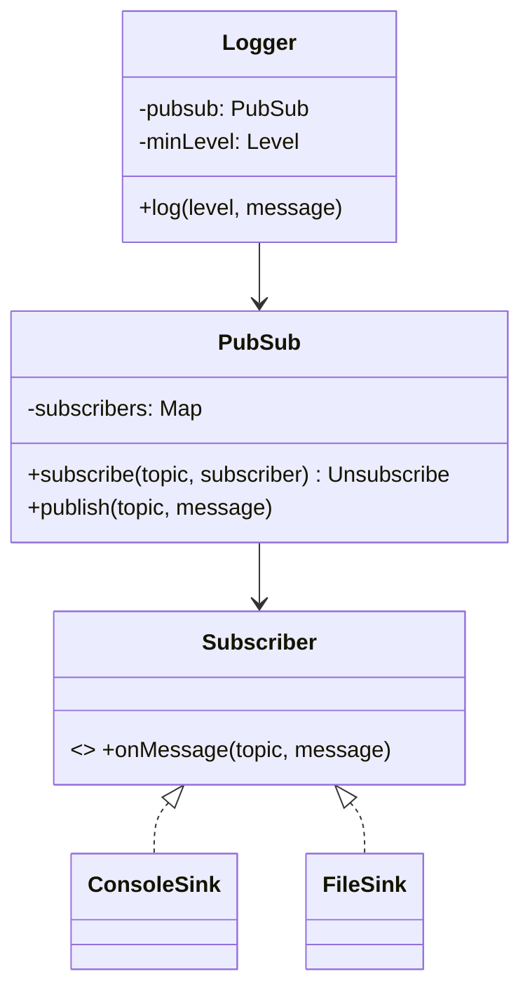

## 69.10 Worked problem: Logger / Pub-Sub Library

> **Try it first** · Level: Beginner · About 45 minutes
>
> **Build:** a pub-sub library, and a logger built on it, where publishers emit messages to topics and every subscriber to that topic receives them.
>
> **Requirements:**
> - Publish to named topics; any number of subscribers per topic; subscribe and unsubscribe.
> - Deliver each message to every subscriber of its topic; publishers know nothing about subscribers.
> - Logger: levels (debug, info, warn, error) act as topics, sinks (console, file, remote) act as subscribers, with a minimum-level filter.
>
> **Constraints:** one throwing subscriber must not stop delivery to the others; new sinks and topics should not mean editing publishers; runnable TypeScript within the time box.
>
> **Your task:** draw the classes and interfaces, write the key methods (`subscribe`, which returns an unsubscribe function, `publish`, and the logger's `log(level, message)`), and list the tests you would write.
>
> Spend the time on paper before you read on. The model design follows.

### 69.10.1 Requirements

Design a pub-sub (or logger) library: publishers emit messages to named topics (or log entries at levels), and any number of subscribers (or log sinks) registered for a topic receive them, decoupled so publishers do not know about subscribers. For a logger, the "topics" are levels (debug, info, warn, error) and the "subscribers" are sinks (console, file, remote). Clarify: multiple topics/levels, multiple subscribers, subscribe/unsubscribe, delivery to all subscribers. This is the **observer/pub-sub** pattern in its purest form.

### 69.10.2 Class diagram



The `PubSub` core maps topics to subscribers and fans out; the `Logger` is a thin layer over it treating levels as topics and sinks as subscribers, with a minimum level filter.

### 69.10.3 Code

One correction: the first draft's `publish` called `sub(message as never, message)`, passing the message where the topic belongs, and the `as never` cast silenced the compiler error that would have caught it. A cast that exists only to make an error go away is a bug report waiting to be written. The fixed call is `sub(topic, message)`, and a test now checks the topic.

```ts
export type Subscriber<T> = (topic: string, message: T) => void;
export type Unsubscribe = () => void;

export class PubSub<T> {
  private subs = new Map<string, Set<Subscriber<T>>>();

  subscribe(topic: string, sub: Subscriber<T>): Unsubscribe {
    const set = this.subs.get(topic) ?? new Set();
    set.add(sub); this.subs.set(topic, set);
    return () => set.delete(sub);                     // return an unsubscribe handle
  }

  publish(topic: string, message: T) {
    for (const sub of this.subs.get(topic) ?? []) {
      try { sub(topic, message); } catch { /* one bad subscriber must not break others */ }
    }
  }
}

// Logger built on PubSub: levels are topics, sinks are subscribers.
export type Level = 'debug' | 'info' | 'warn' | 'error';
const RANK: Record<Level, number> = { debug: 0, info: 1, warn: 2, error: 3 };

export class Logger {
  private pubsub = new PubSub<string>();
  constructor(private minLevel: Level = 'info') {}
  addSink(sink: (level: Level, message: string) => void, levels: Level[]) {
    const unsubs = levels.map((l) => this.pubsub.subscribe(l, (_t, m) => sink(l, m)));
    return () => unsubs.forEach((u) => u());
  }
  log(level: Level, message: string) {
    if (RANK[level] < RANK[this.minLevel]) return;    // filter below min level
    this.pubsub.publish(level, message);
  }
}
```

### 69.10.4 Tests

```ts
import { Logger, PubSub } from './pubsub';

it('delivers to all subscribers of a topic, with the topic', () => {
  const ps = new PubSub<string>();
  const got: string[] = [];
  ps.subscribe('t', (topic, m) => got.push(`a:${topic}:${m}`));
  ps.subscribe('t', (topic, m) => got.push(`b:${topic}:${m}`));
  ps.publish('t', 'hello');
  expect(got).toEqual(['a:t:hello', 'b:t:hello']);
});

it('unsubscribe stops delivery', () => {
  const ps = new PubSub<string>();
  const got: string[] = [];
  const off = ps.subscribe('t', (_t, m) => got.push(m));
  off();
  ps.publish('t', 'x');
  expect(got).toEqual([]);
});

it('a throwing subscriber does not stop the others', () => {
  const ps = new PubSub<string>();
  const got: string[] = [];
  ps.subscribe('t', () => { throw new Error('bad sink'); });
  ps.subscribe('t', (_t, m) => got.push(m));
  ps.publish('t', 'still delivered');
  expect(got).toEqual(['still delivered']);
});

it('logger filters below the minimum level and routes to sinks', () => {
  const log = new Logger('warn');
  const lines: string[] = [];
  log.addSink((lvl, m) => lines.push(`${lvl}:${m}`), ['warn', 'error']);
  log.log('info', 'ignored');                         // below warn
  log.log('error', 'boom');
  expect(lines).toEqual(['error:boom']);
});
```

### 69.10.5 Interviewer twist

"Make delivery asynchronous and ensure one slow or failing subscriber does not block or break the others; add wildcard topic subscriptions." The code already isolates a failing subscriber (the `try/catch` in `publish`), which you point out. Making delivery async is a localized change to how `publish` invokes subscribers (dispatch each via a microtask or a queue, Part 28, so a slow sink does not block the publisher). Wildcard subscriptions (`subscribe('order.*', ...)`) are a matching change in `subscribe`/`publish` to match patterns, contained in the `PubSub` core. Because the publisher is fully decoupled from subscribers (the essence of pub-sub), all three twists are additive within the library, with publishers and existing subscribers unaffected — which is exactly the decoupling the pattern exists to provide.

### 69.10.6 The twist, implemented

Async delivery on its own is not enough: if every message is handed to every subscriber at once, a stuck remote sink accumulates an unbounded backlog of pending promises until the process is `OOMKilled`. So each subscription owns a **bounded queue** and drains it itself, one message at a time; when the queue is full it drops the oldest message and counts the drop. The topic matcher follows the AMQP convention (Part 28): `*` matches exactly one dot-separated segment, `#` matches one or more.

```ts
export type Handler<T> = (topic: string, message: T) => void | Promise<void>;

export function matches(pattern: string, topic: string): boolean {
  const p = pattern.split('.');
  const t = topic.split('.');
  for (let i = 0; i < p.length; i++) {
    if (p[i] === '#') return t.length > i;
    if (i >= t.length || (p[i] !== '*' && p[i] !== t[i])) return false;
  }
  return p.length === t.length;
}

class Subscription<T> {
  private queue: Array<{ topic: string; message: T }> = [];
  private draining = false;
  dropped = 0;
  failed = 0;

  constructor(readonly pattern: string, private readonly handler: Handler<T>, private readonly capacity: number) {}

  enqueue(topic: string, message: T) {
    if (this.queue.length >= this.capacity) { this.queue.shift(); this.dropped++; }   // drop oldest
    this.queue.push({ topic, message });
    if (!this.draining) { this.draining = true; setImmediate(() => void this.drain()); }
  }

  private async drain() {
    while (this.queue.length > 0) {
      const { topic, message } = this.queue.shift()!;
      try { await this.handler(topic, message); } catch { this.failed++; }
    }
    this.draining = false;
  }

  get idle() { return !this.draining && this.queue.length === 0; }
}

export class AsyncPubSub<T> {
  private subs = new Set<Subscription<T>>();
  constructor(private readonly capacityPerSubscriber = 1_000) {}

  subscribe(pattern: string, handler: Handler<T>) {
    const sub = new Subscription(pattern, handler, this.capacityPerSubscriber);
    this.subs.add(sub);
    return { unsubscribe: () => this.subs.delete(sub), stats: () => ({ dropped: sub.dropped, failed: sub.failed }) };
  }

  publish(topic: string, message: T): void {        // returns at once: the publisher never waits
    for (const sub of this.subs) if (matches(sub.pattern, topic)) sub.enqueue(topic, message);
  }

  async flush(): Promise<void> {                     // for tests and graceful shutdown
    while ([...this.subs].some((s) => !s.idle)) await new Promise((r) => setImmediate(r));
  }
}
```

```ts
import { AsyncPubSub, matches } from './pubsub-twist';

it.each([
  ['order.*', 'order.created', true],
  ['order.*', 'order.item.added', false],
  ['order.#', 'order.item.added', true],
  ['order.created', 'order.cancelled', false],
])('%s vs %s -> %s', (pattern, topic, expected) => {
  expect(matches(pattern, topic)).toBe(expected);
});

it('publish returns before a slow subscriber finishes, and the fast one is not delayed', async () => {
  const ps = new AsyncPubSub<string>();
  const order: string[] = [];
  let releaseSlow!: () => void;
  ps.subscribe('order.*', () => new Promise<void>((r) => (releaseSlow = r)).then(() => { order.push('slow'); }));
  ps.subscribe('order.created', () => { order.push('fast'); });

  ps.publish('order.created', 'o1');
  expect(order).toEqual([]);                         // nothing ran synchronously
  await new Promise((r) => setImmediate(r));
  expect(order).toEqual(['fast']);                   // fast ran while slow is still pending
  releaseSlow();
  await ps.flush();
  expect(order).toEqual(['fast', 'slow']);
});

it('bounds memory for a stuck subscriber by dropping the oldest messages', async () => {
  const ps = new AsyncPubSub<number>(2);
  const seen: number[] = [];
  const sub = ps.subscribe('metrics.#', (_t, n) => { seen.push(n); });
  for (let i = 1; i <= 5; i++) ps.publish('metrics.cpu', i);   // all queued before any drain
  await ps.flush();
  expect(seen).toEqual([4, 5]);
  expect(sub.stats().dropped).toBe(3);
});
```

Plugging the library into Nest is one small adapter: Nest's `LoggerService` interface (`log`, `error`, `warn`, and optional `debug` and `verbose`) published as topics, registered with `app.useLogger(new PubSubLogger(bus))`.

```ts
import { LoggerService } from '@nestjs/common';
import { AsyncPubSub } from './pubsub-twist';

export interface LogRecord { level: 'error' | 'warn' | 'info' | 'debug'; message: string; context?: string; at: string; }

export class PubSubLogger implements LoggerService {
  constructor(private readonly bus: AsyncPubSub<LogRecord>) {}
  private emit(level: LogRecord['level'], message: unknown, context?: string) {
    this.bus.publish(`log.${level}`, { level, message: String(message), context, at: new Date().toISOString() });
  }
  log(message: unknown, context?: string) { this.emit('info', message, context); }
  error(message: unknown, _trace?: string, context?: string) { this.emit('error', message, context); }
  warn(message: unknown, context?: string) { this.emit('warn', message, context); }
  debug(message: unknown, context?: string) { this.emit('debug', message, context); }
}
```

### 69.10.7 Edge cases, production mapping and follow-ups

#### Edge cases & failure modes

- **Unsubscribe during publish**: a subscriber that removes itself while `publish` iterates. Deleting from a JavaScript `Set` during `for...of` is safe (deleted items not yet visited are skipped), but say why you know.
- **Drop policy**: drop-oldest suits metrics and debug logs; audit logs must never be dropped, so their sink applies backpressure or writes to local disk first. The policy is per subscriber, not global.
- **Shutdown**: on `SIGTERM`, call `flush()` with a deadline before exiting, or the last seconds of logs vanish (Nest calls `onApplicationShutdown` hooks when `app.enableShutdownHooks()` is on).
- **Recursive logging**: a sink that logs its own errors through the same logger can loop forever. Sinks report their failures via counters, not via the logger.

#### Production scenario

A service at 2,000 requests per second writing 5 log lines per request produces 10,000 records per second. Synchronous delivery to a remote sink at 20 ms per call caps the whole service at 50 records per second; async bounded queues decouple the request path entirely, and the drop counter becomes the metric you alert on. In practice you would use `pino` with a transport for this, and the in-process pub-sub becomes Redis Pub/Sub or a broker topic as soon as subscribers live in other processes (Part 35 — Real-Time Systems).

#### Interview questions

1. **Observer or pub-sub?** Observer: subjects hold direct references to observers (the order and its notifiers). Pub-sub: a broker in the middle and topic names as the contract, so publishers and subscribers never reference each other.
2. **How do you guarantee ordering?** Per subscription, the queue drains one message at a time, so each subscriber sees messages in publish order. Across subscribers there is no ordering, and there should not need to be.
3. **What happens to messages if the process crashes?** They are lost; this is in-memory pub-sub. If loss is unacceptable, publish to a durable broker (Kafka, RabbitMQ) or write to an outbox first.

#### Practical exercise

Add a `retry` option per subscription (attempts and backoff) and a `deadLetter` handler called after the final attempt. Acceptance criteria: a failing handler is retried the configured number of times without blocking other subscribers, the dead-letter handler receives the topic, message and last error, and tests use an injected sleep so they run instantly.

## 69.11 Common LLD mistakes and the pattern decision table

### 69.11.1 Common mistakes

#### Concept

Across the eight problems, the same mistakes recur, and avoiding them is most of what separates a strong LLD answer from a weak one. Knowing them explicitly lets you check your own design as you go.

#### The mistakes

- **God classes**: one class that does everything (a `ParkingLotManager` that allocates, prices, ticket-issues and reports). It violates single responsibility (Part 13), is hard to test, and fails the extensibility test. Decompose into classes with one responsibility each.
- **Patterns for show**: applying patterns to look sophisticated rather than because the problem needs them (a factory, a visitor and a decorator on a problem that needed none). It is "pattern soup" and scores poorly on patterns-with-reason. Use a pattern only where its variation point genuinely exists.
- **No extension point**: hardcoding the behavior the interviewer will want to vary (pricing inside `unpark`, the algorithm inside the rate limiter) so the twist forces a rewrite. Anticipate the variation point and put it behind an interface.
- **Untestable code**: tangling logic with I/O, time, or global state so it cannot be unit-tested (reading `Date.now()` directly everywhere, hidden singletons). Inject dependencies (the clock, the store) so the code is testable, and write the tests — the round scores them.
- **Deep inheritance**: a tall class hierarchy (an abstract `Vehicle` with many subclasses overriding behavior) that is rigid and hard to extend. Prefer composition and strategy.
- **Mutable shared state without thought**: mutating shared objects carelessly; in Node, reason about the event loop (69.1.3), and isolate transactional/staging state.
- **Not clarifying or not narrating**: solving the wrong problem, or solving it silently so the interviewer cannot follow or course-correct.
- **Half-done all-or-nothing operations**: the bugs fixed in this Part were mostly this one — a multi-seat hold that left seats held on failure, a confirm that booked some seats and not others. Whenever an operation touches several things, ask "what state is left if it fails halfway?"
- **Order-dependent tests**: one shared fixture mutated by every test (the first parking-lot tests). Build fresh state in `beforeEach`.

The god class is easiest to see side by side:

```text
God class                                  Decomposed
ParkingLotManager                          ParkingLot      -> park / unpark, owns the flow
  park()       allocate + ticket + log     AllocationStrategy -> which spot
  unpark()     price + release + receipt   PricingStrategy    -> how much
  report()     availability + revenue      Ticket             -> what was issued
  price()      if/else per vehicle type    AvailabilityReport -> read-only view
  ~400 lines, 1 test                       ~40 lines each, tested one by one
```

#### How a Senior Backend Engineer thinks about this

A senior runs a mental checklist against these mistakes as they design: does any class do more than one thing (god class)? Is any pattern here not justified by a real variation (pattern soup)? Where will the twist land, and is that behavior behind an interface (extension point)? Can I unit-test this without real I/O or time (testability)? Am I using composition over deep inheritance? They narrate this reasoning, which both improves the design and shows the interviewer a disciplined thought process. The goal throughout is the middle path: clean, single-responsibility classes, the few patterns the problem genuinely needs, testable, with the variation points behind interfaces so the twist is a small change.

### 69.11.2 Decision table: which pattern fits which requirement

#### Concept

A compact map from a kind of LLD requirement to the pattern that usually fits, so you can reach for the right tool quickly. The patterns are from Part 13; here is where each earns its place in an LLD answer.

| Requirement signal | Pattern | Example in this Part |
|---|---|---|
| "The X policy should be swappable / we might want a different X" | Strategy | Pricing, split type, scheduling, stop order, rate-limit algorithm, allocation |
| "The thing moves through states with only valid transitions" | State machine | Elevator states, seat states, order lifecycle |
| "Several parties react when something happens" | Observer / Pub-Sub | Order notifications, logger sinks, pub-sub library |
| "Create objects without the caller knowing the concrete class" | Factory | Creating the right strategy/handler from config (the Nest `useFactory` in 69.12) |
| "Add behavior to an object without changing it" | Decorator | Wrapping a rate-limit strategy with logging/metrics; a monthly-pass pricing decorator |
| "Make an existing thing fit a new contract" | Adapter | In-memory limiter behind the async contract; `PubSubLogger` as a Nest `LoggerService` |
| "A group of operations must apply atomically or not at all" | (Staging/Memento-like) transaction layer | KV store transactions, nested layers with tombstones |
| "Several limits or rules must all pass" | Composite | `CompositeLimiter` (69.6 exercise), transition guards (69.8 exercise) |
| "Many implementations behind one contract" | Interface + dependency inversion | Repositories, sinks, strategies everywhere |
| "A single shared instance" | Singleton (use sparingly; prefer DI) | A shared logger (but inject it) |

#### How a Senior Backend Engineer thinks about this

A senior uses this mapping as a starting instinct, not a rulebook: the requirement signal suggests a pattern, but they confirm the variation or decoupling is real before applying it, because a pattern applied where there is no variation is just complexity (pattern soup). The two patterns that appear most in LLD rounds are strategy (for any swappable policy — the single most common) and state machine (for anything with a lifecycle), with observer/pub-sub close behind (for decoupled reactions). They lean on interfaces and dependency injection throughout (the foundation under most patterns, Part 13) because that is what makes designs both extensible and testable. The skill is matching the pattern to the real requirement and justifying it, which is exactly what "patterns with reason" scores.

#### Interview questions

1. **What pattern fits a swappable policy (pricing, scheduling, algorithm)?** Strategy — put the varying behavior behind an interface so implementations are interchangeable and the twist is a new class.
2. **What pattern fits a lifecycle with valid transitions?** A state machine (data-driven transition table or state objects), rejecting illegal transitions centrally.
3. **What pattern fits decoupled reactions to events?** Observer / pub-sub — publishers emit, subscribers react, with no coupling between them.
4. **How do you avoid pattern soup?** Apply a pattern only where a real variation or decoupling need exists, and be able to justify each; otherwise prefer simple, direct code.

#### Practical exercise

Take a new LLD prompt (a vending machine, or an online chess game) and, without full coding, produce: the core classes with single responsibilities, the one or two variation points and the pattern for each (justified), one lifecycle modeled as a state machine if present, and one likely interviewer twist with how your design absorbs it. Acceptance criteria: no god class, every pattern justified by a real variation, the twist is a localized change.

## 69.12 From the interview answer to a production NestJS service

### 69.12.1 Where each design's state goes in production

Every LLD answer in this Part keeps state in a `Map`, because that is what fits in 90 minutes. The strongest candidates close by saying where that state goes in a real multi-instance service, and how the invariant is protected there:

| Problem | In-memory state | Production home | Concurrency control |
|---|---|---|---|
| Parking lot | `Spot[]` | PostgreSQL `spots` table | `FOR UPDATE SKIP LOCKED` allocation |
| Splitwise | net `Map` | Append-only `ledger_entries` | Inserts only; nets by aggregation |
| Elevator / dispatch | `Elevator[]` | One controller process per building, or a dispatch service | Single writer per pool |
| Movie booking | `Seat` objects | `show_seats` table, or Redis holds plus PostgreSQL bookings | Conditional `UPDATE`, sorted row locks |
| Rate limiter | per-key `Map` | Redis hash per key | Lua script, Redis `TIME` |
| Order state machine | `state` field | `orders.status` plus `outbox` | Compare-and-set `WHERE status = $from` |
| KV store | `Map` and layers | Redis itself | `MULTI`/`EXEC` with `WATCH` |
| Logger / pub-sub | subscriber queues | pino transport; broker topic | Broker ordering per partition |

The domain classes themselves rarely change. The `PricingStrategy`, the split strategies, `LookStop`, `findAdjacent` and the `ALLOWED` table move into a NestJS service unchanged, because they were pure logic with injected time from the start. That is the real payoff of the modelling habits in 69.1.2.

### 69.12.2 Wiring a strategy through Nest's container

The strategy pattern maps directly onto a custom provider with an injection token. The twist from 69.2 becomes configuration: switching pricing is an environment variable, and tests swap the strategy with `overrideProvider` without touching the service.

```ts
import { Inject, Injectable, Module } from '@nestjs/common';
import { HourlyPricing, Money, PricingStrategy, VehicleSize } from './parking-lot';
import { TieredPricing } from './parking-twist';

export const PRICING_STRATEGY = Symbol('PRICING_STRATEGY');
const RATES: Record<VehicleSize, number> = { motorcycle: 100, car: 200, truck: 400 };

@Injectable()
export class ParkingFeeService {
  constructor(@Inject(PRICING_STRATEGY) private readonly pricing: PricingStrategy) {}
  quote(minutes: number, size: VehicleSize): Money { return this.pricing.price(minutes, size); }
}

@Module({
  providers: [
    {
      provide: PRICING_STRATEGY,
      useFactory: (): PricingStrategy => (process.env.PRICING === 'tiered' ? new TieredPricing(RATES) : new HourlyPricing(RATES)),
    },
    ParkingFeeService,
  ],
  exports: [ParkingFeeService],
})
export class ParkingModule {}
```

```ts
import { Test } from '@nestjs/testing';
import { Money } from './parking-lot';
import { PRICING_STRATEGY, ParkingFeeService, ParkingModule } from './parking.module';

it('swaps the pricing strategy in a test without touching the service', async () => {
  const moduleRef = await Test.createTestingModule({ imports: [ParkingModule] })
    .overrideProvider(PRICING_STRATEGY)
    .useValue({ price: () => new Money(999) })
    .compile();
  expect(moduleRef.get(ParkingFeeService).quote(30, 'car').cents).toBe(999);
});
```

In a real service the factory would read `ConfigService` from `@nestjs/config` (add it to `inject`) rather than `process.env` directly, so the value is validated at startup.

### 69.12.3 More prompts and where their twist lands

| Prompt | Core entities | Variation point (pattern) | Likely twist |
|---|---|---|---|
| Vending machine | Machine, Slot, Coin, Inventory | Machine state (state machine) | Card payments; refund on jam |
| Library management | Book, Copy, Member, Loan | Fine policy (strategy) | Reservations queue per title |
| Snakes and ladders | Board, Player, Dice | Dice (strategy, for tests) | Multiple dice; special cells |
| Meeting-room booking | Room, Booking, Calendar | Conflict rule (strategy) | Recurring meetings |
| Notification service | Channel, Template, Message | Channel (strategy) plus fan-out (observer) | Per-user quiet hours |
| LRU / LFU cache | Cache, Node, EvictionPolicy | Eviction (strategy) | TTL per key; size in bytes |
| Chess | Board, Piece, Move, Game | Move rules per piece (polymorphism) | Undo (command pattern) |

Practise each with the method of 69.1.2 and the 90-minute timeline of 69.1.1. Acceptance criteria for each practice run: it runs, it has at least five tests including one boundary case, and the twist in the last column is absorbed by adding a class or a provider.

## Senior Checklist — Part 69

- [ ] I understand the concept
- [ ] I can explain it simply
- [ ] I can implement it
- [ ] I understand its failure modes
- [ ] I understand its scaling limitations
- [ ] I understand its security implications
- [ ] I understand its operational implications
- [ ] I can choose between alternatives
- [ ] I can explain the tradeoffs
- [ ] I can answer senior-level interview questions
- [ ] I can run the LLD method (clarify, entities, interfaces, patterns, core, twist, test) while narrating
- [ ] I can pace a 60- or 90-minute round so the core runs before the twist arrives
- [ ] I model with composition over inheritance, interfaces at variation points, and specific error types
- [ ] I inject the clock and pass `now` so expiry, pricing and rate limits are testable without waiting
- [ ] I give the Node-aware concurrency answer (event-loop atomicity, await races, cross-instance coordination)
- [ ] I can demonstrate an await race in a Jest test and fix it in-process and in PostgreSQL
- [ ] I can solve the eight worked problems with clean classes, patterns-with-reason, and tests
- [ ] I anticipate the interviewer's twist and place it behind an interface so it is a one-class change
- [ ] I check every multi-step operation for what is left behind if it fails halfway
- [ ] I can say where each in-memory design's state lives in production and how its invariant is protected
- [ ] I avoid god classes, pattern soup, missing extension points and untestable code
- [ ] I can map a requirement signal to the right pattern and justify it

## Part 69 — Key Takeaways

- The LLD/machine-coding round scores the daily craft: decomposition into single-responsibility classes, patterns used with justification, extensibility, naming, and tests — clean working code, not a distributed design.
- Use a repeatable method and narrate it: clarify requirements, identify entities, define interfaces at variation points, pick patterns with reason, code the core, extend for the twist, test.
- Model with composition over inheritance, program to interfaces exactly where variation is expected, use union types and immutability, define specific error types, and inject time.
- Give the Node-aware concurrency answer: synchronous in-memory state is atomic within a process (no locks needed), state spanning an `await` can race, and cross-instance state needs database/Redis coordination (the seat-booking pattern).
- The strategy pattern is the most common LLD tool: put the behavior the interviewer will vary (pricing, split, scheduling, algorithm, allocation) behind an interface so the twist is a new implementation.
- State machines model lifecycles with valid transitions (elevator, seats, orders), ideally as a data-driven transition table; observer/pub-sub decouples reactions (notifications, sinks) from the thing that changes, and notifications happen after the state change, never before.
- Anticipate the interviewer's twist: it lands on the variation point, and a good design absorbs it with a small localized change while a bad one needs a rewrite — this is the real test of extensibility.
- All-or-nothing operations are where LLD code breaks: a failed multi-seat hold must release what it took, a confirm must check every seat before booking any.
- Isolate transactional/staging state (the KV store) rather than mutating core state directly, so commit, rollback and nesting stay simple.
- Every in-memory design has a production sentence — "this map becomes a table with a conditional update" — and saying it unprompted is a senior signal.
- Avoid the recurring mistakes: god classes, pattern soup, missing extension points, untestable code (inject the clock and dependencies), deep inheritance, and order-dependent tests.
- Match the pattern to a real requirement signal and justify it; a pattern applied without a genuine variation or decoupling need is just complexity, and the round rewards the middle path between a structureless blob and over-engineered pattern soup.
