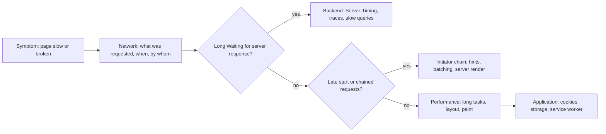
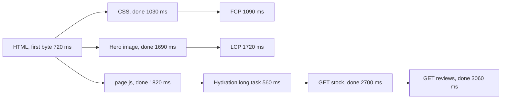

## 69.10 DevTools for backend engineers: Network, Performance and Application panels

#### Concept

Browser DevTools (F12, or Cmd+Option+I on macOS, in Chrome and Edge; Firefox and Safari have equivalents) is the browser's own observability stack. For a backend engineer three panels do most of the work:

- **Network**: every request the page made, with timing phases, headers, payloads, priorities and who triggered it. It is the browser-side equivalent of a distributed trace's client spans.
- **Performance**: a recording of the main thread, network, frames, layout shifts and interactions over time. It is a CPU profiler and a frame timeline in one.
- **Application**: storage (cookies, Web Storage, IndexedDB, Cache API), service workers and the web app manifest.

#### Why does it exist?

Server logs end at the last byte you sent. Everything after that, including requests the browser never made, requests it made twice, and JavaScript that froze the page, is invisible from the backend. Most "the API is slow" tickets turn out, in DevTools, to be queueing behind other requests, a chain of dependent calls, or a long task delaying the callback. DevTools turns arguments about blame into evidence.

#### Mental model

Imagine your backend has a flight recorder for every request: when it was queued, when it got a connection, how long the server thought, how long the bytes took. The Network panel is that recorder for the browser's side of the conversation. The Performance panel is the cockpit video: what the pilot (the main thread) was doing every millisecond, and when the passengers (users) pressed buttons.

#### How it works

**Network panel.** Open it *before* loading the page, tick **Disable cache** for cold-load testing, choose a throttling preset, and reload.

- **Columns**: Name, Status, Type, Initiator, Size, Time and Waterfall by default. Right-click the header to add **Priority**, **Protocol** (h2, h3), **Remote Address** and **Connection ID** (which requests shared a connection).
- **Size** shows bytes transferred and, on hover, the decompressed resource size; "(memory cache)", "(disk cache)" or "(ServiceWorker)" means no network transfer.
- **Timing tab** for a request breaks down its phases:

| Phase | Meaning | If it is large, suspect |
|---|---|---|
| Queueing | Waiting before the browser starts the request | Lower priority than other requests, or HTTP/1.1 limit of 6 connections per host |
| Stalled | Waiting for a connection or a cache lock | Connection limits, proxy negotiation |
| DNS Lookup | Resolving the host | New origin; use fewer origins or `preconnect` |
| Initial connection, SSL | TCP and TLS handshakes | New connection; keep-alive, HTTP/2, `preconnect` |
| Request sent | Uploading the request | Large bodies or cookies |
| Waiting for server response | Time to first byte: network round trip plus server time | Your backend, or the CDN miss path |
| Content Download | Receiving the body | Payload size, bandwidth, compression |

  If the server sends a `Server-Timing` header, its entries appear in the Timing tab next to these phases.
- **Initiator** column and tab show what caused each request: the parser (HTML line number), a script (with a stack trace), or another request. Holding **Shift** while hovering a row highlights its initiators in green and the requests it caused in red, which makes request chains obvious.
- **Filters**: `domain:api.shop.example.com`, `status-code:500`, `larger-than:100k`, `method:POST`, `has-response-header:set-cookie`, `-domain:*.analytics.example` (a leading `-` negates).
- **Tools**: right-click a request for **Copy as cURL** (replay it from a terminal against staging), **Block request URL** (simulate a failed dependency), **Override content** or **Override headers** (test a header change locally without deploying), and **Save all as HAR** (attach to a ticket; HAR files contain cookies and tokens, so scrub them).

**Performance panel.** Click **Record and reload**, with CPU throttling set to 4x or 6x to approximate a mid-range phone. The recording shows:

- **Network** track: requests as bars, aligned with main-thread work.
- **Timings** track: FCP, LCP, `DOMContentLoaded` and `load` markers, plus your own `performance.mark()` and `performance.measure()` entries.
- **Main** track: a flame chart of tasks; long tasks have a red corner and red striping beyond 50 ms. Purple is style and layout, green is paint, yellow is scripting.
- **Layout shifts** and **Interactions** tracks: each shift with the elements that moved; each click or key press with its input delay, processing time and presentation delay (the parts of INP).
- **Bottom-Up** and **Call Tree** tabs: which functions consumed the most self time.

Recent Chrome versions also open the panel on a **live metrics** view that shows LCP, CLS and INP as you use the page, alongside field data from the Chrome UX Report when available.

**Application panel.** Under **Storage**, inspect and edit cookies (with `HttpOnly`, `Secure`, `SameSite` and partition columns), local and session storage, IndexedDB databases and Cache Storage. **Storage** at the top shows usage per type and a **Clear site data** button. **Service workers** offers "Update on reload", "Bypass for network" and "Offline" toggles, which is how you reproduce "users still see the old version" bugs (Part 78 — Shipping and Operating Frontends). **Back/forward cache** runs a test that tells you why a page cannot be restored instantly on Back, often an `unload` listener or `Cache-Control: no-store` on the HTML.



#### Practical example

A ticket says "order history takes 4 seconds". In the Network panel, `GET /v1/orders` shows Waiting for server response 180 ms and Content Download 20 ms, so the API is not the problem. The Initiator chain shows it started at 2.9 s, triggered from `app.js`, which itself finished downloading at 1.1 s. The Performance panel shows a 1.6 s long task in between: the app was parsing a 2.4 MB translation file before mounting. The fix was loading only the active locale. The API team closed the ticket with a screenshot of the Timing tab.

#### React / Next.js example

User Timing marks put your own milestones on the Performance panel's Timings track, and Next.js 14 exposes Web Vitals from real users through `useReportWebVitals`:

```tsx
// app/web-vitals.tsx  (Next.js 14 App Router, client component rendered in the root layout)
'use client';
import { useReportWebVitals } from 'next/web-vitals';

export function WebVitals() {
  useReportWebVitals((metric) => {
    // metric.name is one of 'TTFB', 'FCP', 'LCP', 'CLS', 'INP' (and 'FID' in older versions)
    const body = JSON.stringify({ name: metric.name, value: metric.value, id: metric.id,
      page: location.pathname });
    navigator.sendBeacon('/api/v1/rum/vitals', body); // survives page unload
  });
  return null;
}

// Anywhere in client code: custom milestones visible in the Performance panel.
export function markCartReady() {
  performance.mark('cart-ready');
  performance.measure('cart-time-to-ready', { start: 0, end: 'cart-ready' });
}
```

#### Backend side (NestJS)

The most useful thing a backend can add for DevTools users is a `Server-Timing` header, which turns "Waiting for server response: 640 ms" into a breakdown everyone can see:

```ts
// server-timing.interceptor.ts
import { CallHandler, ExecutionContext, Injectable, NestInterceptor } from '@nestjs/common';
import type { Response } from 'express';
import { Observable, tap } from 'rxjs';

@Injectable()
export class ServerTimingInterceptor implements NestInterceptor {
  intercept(ctx: ExecutionContext, next: CallHandler): Observable<unknown> {
    const started = process.hrtime.bigint();
    const res = ctx.switchToHttp().getResponse<Response>();
    return next.handle().pipe(
      tap(() => {
        const ms = Number(process.hrtime.bigint() - started) / 1e6;
        const dbMs: number = res.locals.dbMs ?? 0; // accumulated by the data layer for this request
        // Shown in DevTools Network, Timing tab. Never put secrets or SQL in descriptions.
        res.setHeader('Server-Timing', `app;dur=${ms.toFixed(1)}, db;dur=${dbMs.toFixed(1)}`);
        // Lets cross-origin pages read the timing values from JavaScript (Resource Timing API).
        res.setHeader('Timing-Allow-Origin', 'https://shop.example.com');
      }),
    );
  }
}
```

Also expose a request id (`X-Request-Id`, see Part 43 — Observability: Logs, Metrics and Traces) so a request seen in DevTools can be found in your logs and traces, and make sure CORS exposes it with `Access-Control-Expose-Headers` if frontend code needs to read it. Be deliberate about `Server-Timing` in production: durations are harmless, but descriptions that name internal services or queries leak architecture.

#### Production scenario

A payments team added `Server-Timing` with `auth`, `db`, `psp` (payment service provider) and `app` entries to the checkout API. Within a week, frontend engineers stopped filing "checkout API slow" tickets without evidence; they attached screenshots showing `psp;dur=1840` during a provider incident, which routed the problem to the right team in minutes instead of hours.

#### Failure scenario

An engineer debugging a customer issue exported a HAR file from the customer's session and attached it to a public issue tracker. The HAR contained the customer's session cookie and an `Authorization` header. Security rotated the session within an hour, but the lesson stuck: HAR files are credentials. The team now uses Chrome's sanitized HAR export (which omits sensitive data by default in recent versions), scrubs any HAR before sharing, and keeps session lifetimes short.

#### Edge cases & failure modes

- **Cache enabled while testing** hides cold-load problems; **Disable cache** only applies while DevTools is open.
- **Throttling presets are approximations**; they add latency per request but do not model packet loss or real radio behaviour.
- **Preserve log** is needed to see requests across redirects and full-page form posts (69.2).
- **Service workers** can answer requests without touching the network, showing "(ServiceWorker)" in Size; use "Bypass for network" when debugging the backend.

#### How a Senior Full-Stack Engineer thinks about this

A senior opens DevTools before opinions form. They read a waterfall like a trace: find the critical path, find the gaps, find who started what. They profile on a throttled CPU, compare with field data, and they make the backend legible to the browser with `Server-Timing` and request ids, because the fastest way to resolve a cross-team incident is a shared screen showing the same evidence.

#### Common mistakes

- **Testing on an unthrottled laptop with a warm cache.**
- **Reading only the Time column** instead of the Timing phases.
- **Ignoring the Initiator column**, so request chains go unnoticed.
- **Sharing raw HAR files.**
- **Concluding "backend is fine" from TTFB alone**, without checking what the page did with the response.

#### Interview questions

1. **A request shows 900 ms in the Time column. How do you find where the time went?** Expected answer: the Timing tab phases: queueing and stalled (browser), DNS, connection and TLS (network setup), waiting (round trip plus server), download (size and bandwidth); `Server-Timing` breaks the server part down further.
2. **How do you find request chains?** Expected answer: the Initiator column and tab, Shift-hover in the waterfall, and the Network track in a Performance recording.
3. **What is `Server-Timing` and what must you be careful about?** Expected answer: a response header whose metrics appear in DevTools and the Resource Timing API; avoid leaking internal details, and add `Timing-Allow-Origin` for cross-origin access from JavaScript.
4. **Why record performance with CPU throttling?** Expected answer: median phones are several times slower at JavaScript than developer laptops; long tasks invisible on a laptop dominate on phones.

#### Practical exercise

Add the `ServerTimingInterceptor` to a NestJS API with a database timing counter. Load a page that calls it, with Disable cache, a slow 4G preset and 4x CPU throttling.

Acceptance criteria:

- The Timing tab shows `app` and `db` entries for each API request.
- You can identify, with Shift-hover, at least one request started by another request's callback.
- A Performance recording shows FCP and LCP markers and a custom `performance.measure` entry, and you can name the longest task and its source script.

## 69.11 Worked example: tracing a product page from first byte to interactive

#### Concept

This section puts the whole Part together. We load one product page cold, read the network waterfall and the performance trace, explain every gap using 69.1 to 69.10, and decide which fixes belong to the frontend and which to the backend. Part 76 — Web Performance takes the optimisation much further; the goal here is to *read* a page load fluently.

#### The setup

A Next.js 14 App Router storefront in front of NestJS services. Page: `https://shop.example.com/products/ergonomic-office-chair`. The HTML is server-rendered on a CDN miss; the stock badge and reviews are fetched by client components after hydration. Test profile in DevTools: Disable cache, a slow 4G preset (about 150 ms round trip, 1.6 Mbps down) and 4x CPU throttling, roughly Lighthouse's mobile profile.

#### The annotated waterfall

```text
#   Request                               Prio     Start  TTFB   End    Transfer  Notes
1   GET /products/ergonomic-office-chair  Highest      0   720    850    26 KB   [A] DNS 40, TCP 150, TLS 150; Server-Timing app;dur=230, api;dur=190
2   /_next/static/css/app.3f9c1a.css      Highest    735   890   1030    18 KB   [B] found by preload scanner, same h2 connection
3   /_next/static/media/inter.woff2       High       735   905   1150    48 KB   preloaded by next/font, crossorigin
4   (preconnect) img.shop-cdn.example                735               -          DNS, TCP, TLS overlap with HTML download
5   chair-800.avif                        High       760  1060   1690   110 KB   [C] next/image priority, fetchpriority=high
6   /_next/static/chunks/main-app.js      High       740   900   1500    62 KB   framework runtime
7   /_next/static/chunks/page.js          High       740   910   1820   142 KB   [D] page code, about 520 KB after decompression
8   analytics.js (third party, async)     Low       1900  2300   2380    38 KB   next/script afterInteractive
9   GET /api/v1/products/123/stock        High      2420  2690   2700   0.3 KB   [E] initiator page.js, useEffect after hydration
10  GET /api/v1/products/123/reviews      High      2700  3020   3060    14 KB   [F] initiator: request 9 callback, a chain

Main thread: FCP 1,090 | LCP 1,720 | long task 1,840 to 2,400 (hydration, 560 ms) | DCL 2,410
User-visible: price at 1,090 | hero at 1,720 | Add to cart works at 2,400 | stock badge 2,760 | reviews 3,120
```



#### Reading it, letter by letter

**[A] First byte at 720 ms.** About 340 ms is connection setup (DNS 40, TCP 150, TLS 150) before the request leaves. Then half a round trip each way (150 ms total) plus 230 ms of server time. `Server-Timing` says 190 of those 230 ms were API calls from Next.js to NestJS. The NestJS trace shows three sequential calls: product (60 ms), price (70 ms), related items (60 ms). They do not depend on each other. **Backend fix:** run them with `Promise.all` in the page, or add one aggregated BFF endpoint (Part 73 — Next.js and Rendering Strategies). Expected server time: about 100 ms.

**[B] CSS at 1,030 ms, FCP at 1,090 ms.** The preload scanner found the stylesheet in the first HTML chunk and fetched it on the existing HTTP/2 connection, so no new handshake. CSS is render-blocking (69.1), so FCP waits for it: CSS end plus about 60 ms of style, layout and paint on a throttled CPU. Healthy.

**[C] LCP at 1,720 ms.** The hero image request started at 760 ms, early, because `next/image` with `priority` put a preload in the head and the image origin was preconnected (69.3). The image is 110 KB; at 1.6 Mbps shared with JavaScript downloads, that takes most of a second. **Frontend fix:** serve a 600-pixel variant to phones via `sizes` (about 55 KB). LCP is already under 2.5 s, so this is a nice-to-have.

**[D] Interactive at 2,400 ms.** The page code finished downloading at 1,820 ms, then executed and hydrated in one 560 ms long task (69.7). A user tapping "Add to cart" at 2,000 ms waits until 2,400 ms for the handler and then for the next paint: an INP of roughly 450 ms, "needs improvement". The Bottom-Up tab attributes 210 ms to a 3D viewer component imported on the page but used only after a click. **Frontend fix:** `next/dynamic` for the viewer (69.6), making it a separate chunk; hydration drops to about 330 ms.

**[E] Stock badge at 2,760 ms.** The stock request's initiator is `page.js`, inside a `useEffect`, so it cannot start until hydration finishes. Stock is above the fold and changes slowly enough to cache for 30 s. **Backend and frontend fix:** fetch stock during server rendering, with the NestJS endpoint sending `Cache-Control: public, max-age=0, s-maxage=30`. The badge arrives in the HTML; the reserved slot (69.5) no longer shifts.

**[F] Reviews at 3,120 ms.** Shift-hover on request 10 shows request 9 highlighted in green as its initiator: the reviews fetch was written inside the stock fetch's `.then()`. That is a client-side waterfall costing a full round trip for no reason. **Fix:** fetch reviews on the server inside a `<Suspense>` boundary so they stream after the shell (69.1), or at least in parallel with stock.

#### Backend side (NestJS)

The backend changes from this trace, in priority order:

| Change | Where | Expected effect |
|---|---|---|
| Parallelise product, price and related calls | Next.js server code or a BFF endpoint | Server time 230 to about 110 ms; every later milestone moves 120 ms earlier |
| Cacheable stock endpoint with `s-maxage=30` | NestJS stock controller | Stock rendered in HTML; one client request removed |
| `Server-Timing` on every API (already present) | Global interceptor | Keeps the next investigation short |
| Reviews endpoint returns first page only (`limit=10`, cursor) | NestJS reviews controller | 14 KB to 5 KB; less parsing during streaming |
| Image dimensions and `alt` in product response (already present) | Product DTO | No CLS from the gallery |

#### After the fixes

```text
                      Before     After
First byte            720 ms     600 ms
FCP                   1,090 ms   970 ms
LCP                   1,720 ms   1,450 ms
Hydration long task   560 ms     330 ms
Interactive           2,400 ms   2,050 ms
Stock visible         2,760 ms   970 ms (in HTML)
Reviews visible       3,120 ms   1,300 ms (streamed)
Client API requests   2          0 on load
CLS                   0.04       0.01
```

#### Failure scenario

Before this investigation, the same page had a two-week "performance war" between teams. The backend team showed p95 API latency of 80 ms and declared the API fast. The frontend team showed a Lighthouse score of 61 and blamed the API. Both were right about their own numbers and wrong about the cause. The waterfall settled it in one meeting: the API calls were fast but sequential on the server and chained on the client, and the biggest delay to interactivity was hydration of code nobody used on load. Neither team's dashboard could show that alone.

#### How a Senior Full-Stack Engineer thinks about this

A senior reads a page load as one critical path that crosses the network, the server and the main thread. They annotate it, assign each gap to a cause, and fix the largest gaps first regardless of which team owns them. They know that the backend's best contributions are often not "make the endpoint faster" but "make fewer, parallel, cacheable calls available at server-render time".

#### Interview questions

1. **Given a waterfall, how do you find the critical path to LCP?** Expected answer: follow the LCP element's request back through its initiators to the HTML; anything on that chain (TTFB, render-blocking CSS, late discovery) delays LCP; requests off the chain matter only through bandwidth and main-thread contention.
2. **Why did moving the stock fetch to the server help so much?** Expected answer: it removed a dependency on JavaScript download and hydration and a client round trip, and allowed CDN caching.
3. **How would you prove to a skeptical backend team that the problem is partly theirs?** Expected answer: `Server-Timing` breakdown plus backend traces showing sequential calls, side by side with the waterfall.

#### Practical exercise

Pick a real page you own. Record a cold load with the profile above, export the waterfall into a table like the one in this section, label every gap with a letter, write one sentence of cause for each, and propose one frontend and one backend fix.

Acceptance criteria:

- Every request on the critical path to LCP and to "interactive" is explained.
- At least one request chain is identified with the Initiator view.
- One backend change is implemented and the after-numbers are recorded with the same profile.

## Senior Checklist — Part 69

- [ ] I understand the concept
- [ ] I can explain it simply
- [ ] I can implement it
- [ ] I understand its failure modes
- [ ] I understand its scaling limitations
- [ ] I understand its security implications
- [ ] I understand its operational implications
- [ ] I can choose between alternatives
- [ ] I can explain the tradeoffs
- [ ] I can answer senior-level interview questions
- [ ] I can walk through navigation, parsing, DOM, CSSOM, render tree, layout, paint and compositing, and say which stage a given change re-runs
- [ ] I can explain what the preload scanner finds and what it misses
- [ ] I know what a plain HTML form submits, how it encodes it, and why a form POST should answer with 303
- [ ] I can write a correct `<head>` with charset, viewport, `preconnect` and `preload`, and spot a double download
- [ ] I can predict which CSS declaration wins and choose between flexbox and grid
- [ ] I can find and fix the causes of layout shift, and I return image dimensions from the API
- [ ] I can choose between classic, `defer`, `async` and module scripts, and serve them with the right MIME type and caching
- [ ] I can explain the browser event loop versus Node's and break up a long task
- [ ] I know which browser storage to use for what, and what must never go into storage readable by JavaScript
- [ ] I can make a form and a dialog keyboard and screen reader accessible, with field-level errors from NestJS
- [ ] I can read a Network waterfall, the Timing phases and the Initiator chain, and I add `Server-Timing` to my APIs

## Part 69 — Key Takeaways

- The backend is the first stage of the rendering pipeline: every millisecond of time to first byte delays every later milestone.
- CSS blocks rendering and classic scripts block parsing; nothing else should.
- The preload scanner finds resources in raw HTML only, so put the LCP image and critical assets where it can see them.
- Layout is the expensive stage; animate `transform` and `opacity`, and never interleave style writes with geometry reads.
- A plain HTML form is a complete HTTP client; use native elements, `type="button"` for non-submit buttons, and Post/Redirect/Get with idempotency keys.
- Resource hints are promises to the browser: one wrong `as` or a missing `crossorigin` means a double download.
- Unreserved space is a bug; layout shift is fixed with dimensions and stable shapes the API provides.
- The main thread is single-threaded like Node: tasks over 50 ms freeze input, and the cure is less work, later work, or work elsewhere.
- Anything JavaScript can read, XSS can read; credentials belong in `HttpOnly` cookies and cookies must stay small.
- Accessibility is built from semantics, focus and words; the API's error messages and alt text are part of it.
- DevTools turns blame into evidence: read Timing phases and Initiator chains, and make your backend visible with `Server-Timing` and request ids.
