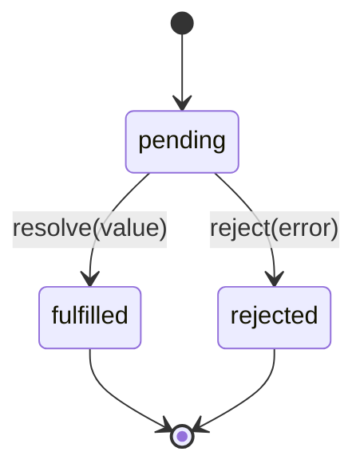

## 70.3 Promises

### 70.3.1 What a promise is

#### Concept

A promise is an object that represents a value that is not ready yet but will be (or will fail) in the future. It is a placeholder for an asynchronous result. Instead of handing a callback into a function, the function hands you back a promise, and you attach what to do on success (`.then`) and on failure (`.catch`).

A promise is always in one of three states: **pending** (still working), **fulfilled** (succeeded, has a value), or **rejected** (failed, has an error). Once it settles (fulfilled or rejected) it never changes again.

#### Why does it exist?

Promises exist to fix the problems with callbacks: the nesting pyramid, the duplicated error handling, and the fact that `try/catch` could not catch asynchronous errors. A promise is a first-class object you can pass around, return, store and combine. That object-ness is what lets you flatten the pyramid into a chain, handle all errors in one place, and run several asynchronous operations together.

#### Mental model

A promise is a tracking number for a parcel. The moment you order, you do not have the parcel, but you have a tracking number — a handle to the eventual delivery. You can check its status (pending, delivered, failed). You can say "when it is delivered, do this" (`.then`) and "if delivery fails, do that" (`.catch`). You can even say "when all five of my parcels arrive, start the party" (`Promise.all`). The tracking number exists now; the parcel comes later.

#### How it works



```ts
// A promise that resolves after a delay. This is the promise version of setTimeout.
function delay(ms: number): Promise<void> {
  return new Promise((resolve) => {
    setTimeout(resolve, ms);
  });
}

// Using .then / .catch
delay(1000)
  .then(() => console.log('one second passed'))
  .catch((err) => console.error('something failed', err));
```

A promise that already comes from a library (a database driver, an HTTP client) is the common case; you rarely build one with `new Promise` yourself. When you do, you call `resolve(value)` on success or `reject(error)` on failure.

#### Chaining and flattening

The key improvement over callbacks: `.then` returns a new promise, so you chain instead of nesting. Dependent steps go **down**, not **right**.

```ts
fetchOrder(orderId)                       // returns Promise<Order>
  .then((order) => fetchCustomer(order.customerId))  // returns Promise<Customer>
  .then((customer) => sendReceipt(customer.email))   // returns Promise<void>
  .then(() => console.log('done'))
  .catch((err) => console.error('any step failed:', err.message));
```

Two things to notice. First, the flow reads top to bottom even though each step depends on the previous — no pyramid. Second, **one** `.catch` at the end handles a failure in **any** of the steps. If `fetchCustomer` rejects, the chain skips the remaining `.then`s and jumps straight to `.catch`. This is the single biggest practical win over callbacks: error handling in one place.

A subtle but critical rule: you must **return** the inner promise from a `.then` (`return fetchCustomer(...)`), or the chain does not wait for it. Forgetting the `return` is a classic bug where the next step runs before the previous one finished.

#### Combining promises

```ts
// Promise.all: run several in parallel, wait for all, fail if any fails.
const [order, inventory, pricing] = await Promise.all([
  fetchOrder(id),
  fetchInventory(id),
  fetchPricing(id),
]);
// All three ran concurrently. Total time ~= the slowest one, not the sum.

// Promise.allSettled: wait for all, never short-circuit; get each result or error.
const results = await Promise.allSettled([sendEmail(a), sendEmail(b), sendEmail(c)]);
// results[i] is { status: 'fulfilled', value } or { status: 'rejected', reason }

// Promise.race: settle as soon as the FIRST one settles (used for timeouts).
const data = await Promise.race([
  fetchFromSlowService(),
  rejectAfter(2000, new Error('timeout')),
]);

// Promise.any: resolve as soon as the first SUCCESS; useful for redundant sources.
```

The difference between `Promise.all` and `Promise.allSettled` matters in production. `Promise.all` **short-circuits**: the moment one promise rejects, the combined promise rejects, and you lose the other results (they still run, but you do not see their outcomes). Use `Promise.all` when you need every one to succeed (fetch three things to build a page — if one fails, the page fails). Use `Promise.allSettled` when you want all outcomes regardless (send three notifications — report which succeeded and which failed, do not abandon the rest).

#### Practical example — parallel vs serial

```ts
// SERIAL: three queries one after another. Total ~= sum of all three.
async function serial(id: string) {
  const a = await fetchOrder(id);        // wait 5 ms
  const b = await fetchInventory(id);    // then wait 5 ms
  const c = await fetchPricing(id);      // then wait 5 ms
  return { a, b, c };                     // ~15 ms total
}

// PARALLEL: three queries at once because they are independent. Total ~= slowest.
async function parallel(id: string) {
  const [a, b, c] = await Promise.all([
    fetchOrder(id),
    fetchInventory(id),
    fetchPricing(id),
  ]);
  return { a, b, c };                      // ~5 ms total
}
```

This is one of the most common real performance wins. Three independent 40 ms calls take 120 ms serially and 40 ms in parallel. On an endpoint that does several independent lookups, switching from serial `await`s to `Promise.all` can cut latency by 3x with a one-line change. Only parallelize **independent** work; if step B needs step A's result, they must be serial.

#### Production scenario

A product-detail endpoint originally did six `await` calls in sequence — product, inventory, reviews, recommendations, price, shipping estimate — for a p50 of 95 ms. Four of the six were independent of each other. Grouping those four into a `Promise.all` and keeping the two dependent ones serial dropped p50 to 38 ms. No new infrastructure, no caching, just stopping the thread from waiting serially on things that could wait together.

#### Failure scenario

A notification service sent three messages with `Promise.all([sms, email, push])`. One day the SMS provider had an outage. Because `Promise.all` short-circuits on the first rejection, the whole call rejected, the error handler logged "notifications failed", and **the email and push were treated as failed too** even though they had actually succeeded — and worse, a retry then re-sent the email and push, so users got duplicate emails. Switching to `Promise.allSettled` fixed it: each channel's outcome was handled independently, only the failed SMS was retried, and the duplicates stopped. The lesson: `Promise.all` is for "all must succeed"; for independent best-effort work, use `allSettled`.

#### Edge cases & failure modes

- **Forgetting to return the inner promise** in a `.then`, so the chain does not wait and later steps run too early.
- **An unhandled rejection** (a promise that rejects with no `.catch` and no surrounding `try/catch`) crashes the Node process in modern versions. Every promise chain needs error handling.
- **`Promise.all` loses sibling results** on the first rejection; use `allSettled` when you need them all.
- **Creating promises in a loop and not awaiting them** fires them all at once with no concurrency limit, which can open 10,000 database connections and exhaust the pool. For large batches, limit concurrency (a batching helper or a library like `p-limit`).
- **A promise never settles** (a bug where `resolve`/`reject` is never called) hangs that chain forever; always have a timeout on external calls.

#### How a Senior Backend Engineer thinks about this

A senior sees `await a; await b; await c` on independent operations as a latency bug and reaches for `Promise.all`. They choose `all` vs `allSettled` deliberately based on whether partial success is acceptable. They never fire an unbounded number of promises in a loop against a shared resource (database, downstream service) without a concurrency limit, because that turns a batch job into a self-inflicted denial-of-service. And they put a timeout on every call that leaves the process, because a promise that waits forever on a hung dependency is how one slow service takes down yours (Part 38 covers timeouts, retries and circuit breakers in depth).

#### Common mistakes

- Serial `await`s for independent work (slow endpoints).
- Forgetting `return` inside `.then`.
- Unhandled rejections crashing the process.
- Unbounded `Promise.all` over a huge array, exhausting connections.
- Using `all` where `allSettled` is needed, abandoning or duplicating sibling work on one failure.

#### Interview questions

1. **What are the three states of a promise?** Pending, fulfilled, rejected; once settled it never changes.
2. **What is the difference between `Promise.all` and `Promise.allSettled`?** `all` rejects as soon as any input rejects and loses the other results; `allSettled` waits for all and reports each outcome. Use `all` when every one must succeed, `allSettled` for independent best-effort work.
3. **How do you convert serial awaits into parallel execution, and when must you not?** Group independent operations into `Promise.all`; you must keep operations serial when one depends on another's result.
4. **What happens to an unhandled promise rejection in modern Node?** It crashes the process; every chain needs a `.catch` or a surrounding `try/catch`.
5. **Why is firing thousands of promises in a loop against the database dangerous?** It opens all those operations at once with no concurrency limit, exhausting the connection pool and overwhelming the database.

#### Practical exercise

Given functions `fetchUser(id)`, `fetchOrders(id)` and `fetchRecommendations(id)` (all independent, each ~30 ms), write a `getDashboard(id)` that runs them in parallel with `Promise.all` and returns a combined object. Then write a `notifyAll(users)` that sends an email to each user with `Promise.allSettled`, limiting concurrency to 10 at a time, and returns counts of succeeded and failed. Acceptance criteria: the dashboard completes in ~30 ms not ~90 ms, and `notifyAll` never has more than 10 emails in flight at once.
