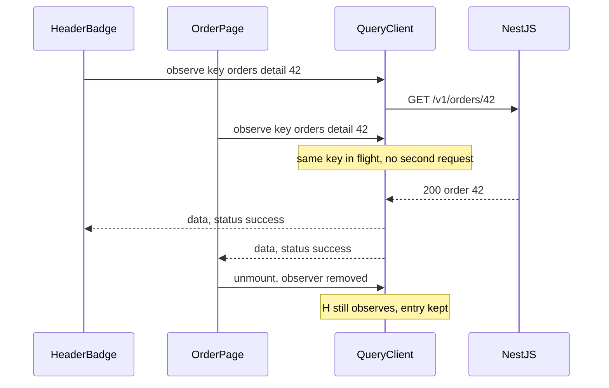

## 70.2 TanStack Query: queries, query keys and deduplication

#### Concept

**TanStack Query** (formerly React Query) is a server-state cache for the browser. This Part uses **v5** (`@tanstack/react-query` 5.x, React 18+). Its core pieces:

- **`QueryClient`**: one per app (per tab). It owns a **query cache**: a map from a hashed query key to a **query** object holding data, error, status and timestamps.
- **`useQuery`**: a hook that subscribes a component to one query. You give it a **query key** (an array that identifies the data) and a **query function** (an async function that fetches it and throws on failure).
- **Observers**: every mounted `useQuery` is an observer of its query. Many observers can share one query.

```tsx
const { data, error, status, fetchStatus } = useQuery({
  queryKey: ['orders', 'detail', orderId],
  queryFn: ({ signal }) => fetchOrder(orderId, signal),
});
```

v5 accepts **only the object form** shown above. The positional overloads from v4 (`useQuery(key, fn, options)`) were removed, and the same applies to `queryClient` methods such as `invalidateQueries({ queryKey })`. Old blog posts with positional arguments will not compile against v5.

#### Why does it exist?

Part 137.4 listed what a correct hand-written fetch effect needs (abort, reset on input change, non-2xx handling, runtime validation, ignoring stale responses) and what it still lacks: caching, deduplication across components, retries, refetch on focus, invalidation after writes, pagination and server rendering support. TanStack Query exists to provide all of that once, tested, for every request in the app. You write the query function (how to fetch) and the key (what it is); the library decides when to fetch, when to reuse, and when to throw away.

#### Mental model

Imagine a read-through Redis cache in a NestJS service: `getOrCompute(key, loader, ttl)`. On a hit, return the cached value. On a miss, call the loader, store the result, return it. If two requests miss at the same moment, a single-flight lock makes the second wait for the first's result instead of calling the loader again.

`useQuery` is `getOrCompute` with three differences. The "TTL" (`staleTime`) does not delete the value; it only marks it as due for a background refresh. The value is **pushed** to every subscribed component whenever it changes. And entries with no subscribers are deleted after `gcTime`, the way Redis evicts keys under a TTL.

The query key is the Redis key. If two different things share a key, one overwrites the other. If one thing has two keys, you have two copies that drift. Key design is cache design.

#### How it works



Step by step, for one `useQuery` call:

1. **Hash the key.** The key array is turned into a deterministic string. Object properties are sorted, so `{ status: 'PAID', range: '30d' }` and `{ range: '30d', status: 'PAID' }` hash the same. Array order matters: `['orders', 42]` is not `[42, 'orders']`. Properties whose value is `undefined` are dropped, so `{ status: undefined }` equals `{}`.
2. **Find or create the query** in the cache for that hash.
3. **Attach an observer** for this component. The observer decides what the component needs to re-render for; by default it tracks which result properties you actually read (`data`, `isFetching`...) and re-renders only when those change.
4. **Decide whether to fetch.** If there is no data, fetch. If there is data and it is stale and a trigger fired (this observer just mounted, the window regained focus, the network reconnected), refetch in the background while returning the cached data. 70.3 covers the triggers.
5. **Deduplicate.** If a fetch for this query is already in flight, the new observer joins it. One request serves all observers.
6. **Call the query function** with a context object: `{ queryKey, signal, meta }`. `signal` is an `AbortSignal` the library aborts if every observer unmounts before the request finishes, or if you call `queryClient.cancelQueries` for the key.
7. **Store the result.** On success, the data is merged into the previous data with **structural sharing**: unchanged parts of the JSON keep their old object references, so memoised rows for unchanged orders do not re-render (69.12). On failure, retries run (70.3), then the error is stored.
8. **Notify observers**, which re-render.

Query keys should come from one place per domain, a **key factory**, so every reader and every invalidation uses the same shape:

```ts
// src/orders/orderKeys.ts
import type { OrderListFilters } from '@shop/contracts';

export const orderKeys = {
  all: ['orders'] as const,
  lists: () => [...orderKeys.all, 'list'] as const,
  list: (filters: OrderListFilters) => [...orderKeys.lists(), filters] as const,
  details: () => [...orderKeys.all, 'detail'] as const,
  detail: (id: string) => [...orderKeys.details(), id] as const,
};
// invalidateQueries({ queryKey: orderKeys.lists() }) matches every list, whatever the filters,
// because matching is by prefix: ['orders', 'list'] is a prefix of ['orders', 'list', {...}].
```

**Prefix matching** is what makes the hierarchy useful. Every `queryClient` method that takes filters (`invalidateQueries`, `cancelQueries`, `setQueriesData`, `removeQueries`) matches all keys that *start with* the given key, unless you pass `exact: true`.

Three more options shape a query:

- **`enabled`**: `false` stops automatic fetching, for dependent queries (`enabled: !!customerId`).
- **`select`**: transforms the cached data for this observer only (`select: (d) => d.items.filter(o => o.status === 'PAID')`). The cache keeps the full response; `select` runs on the client and saves no bytes on the wire.
- **`queryOptions(...)`**: a v5 helper that bundles key, function and options into one typed object, reusable in `useQuery`, `prefetchQuery` and `getQueryData` with the data type inferred.

#### Practical example

On an order detail screen, three components need order `42`: the header ("Order A7K2Q9P, Paid"), the timeline and the "Cancel order" button. With hand-written effects that is three requests and three possibly different answers. With one query key from the factory it is one request, one cached copy, and every component re-renders together when the status changes. If the user goes back to the list and returns within the five-minute garbage-collection window, the detail renders instantly from cache and refreshes in the background if stale.

#### React / Next.js example

App setup, one `QueryClient` per tab, created once:

```tsx
// src/main.tsx  (React 18, TanStack Query v5, Vite SPA)
import { StrictMode } from 'react';
import { createRoot } from 'react-dom/client';
import { QueryClient, QueryClientProvider } from '@tanstack/react-query';
import { ReactQueryDevtools } from '@tanstack/react-query-devtools';
import { App } from './App';

const queryClient = new QueryClient({
  defaultOptions: {
    queries: { staleTime: 30_000 }, // app-wide default; individual queries override it (78.3)
  },
});

createRoot(document.getElementById('root')!).render(
  <StrictMode>
    <QueryClientProvider client={queryClient}>
      <App />
      <ReactQueryDevtools initialIsOpen={false} /> {/* tree-shaken out of production builds */}
    </QueryClientProvider>
  </StrictMode>,
);
```

A reusable query definition and two consumers:

```tsx
// src/orders/orderQueries.ts
import { queryOptions, useQuery } from '@tanstack/react-query';
import { OrderSummarySchema } from '@shop/contracts';
import { apiGet } from '../api/http';
import { orderKeys } from './orderKeys';

export const orderDetailQuery = (id: string) =>
  queryOptions({
    queryKey: orderKeys.detail(id),
    queryFn: ({ signal }) => apiGet(`/v1/orders/${id}`, OrderSummarySchema, signal),
  });

export const useOrder = (id: string) => useQuery(orderDetailQuery(id));

// Elsewhere: a component that only needs the status re-renders only when status changes,
// because select returns a primitive and the observer compares results.
export const useOrderStatus = (id: string) =>
  useQuery({ ...orderDetailQuery(id), select: (o) => o.status });
```

The shared `apiGet` helper is the one place that knows about credentials, errors and validation:

```ts
// src/api/http.ts
import type { ZodType } from 'zod';
import { ApiError } from './errors'; // { status, code, issues, requestId } from 77.7

export async function apiGet<T>(path: string, schema: ZodType<T>, signal?: AbortSignal): Promise<T> {
  const res = await fetch(`/api${path}`, { credentials: 'include', signal });
  if (!res.ok) {
    const body = await res.json().catch(() => ({}));               // error bodies are not always JSON
    throw new ApiError(res.status, body.code ?? `HTTP_${res.status}`, body.issues ?? [],
      body.requestId ?? res.headers.get('X-Request-Id') ?? undefined);
  }
  return schema.parse(await res.json()); // a contract mismatch throws here, not deep in a component
}
```

Install `@tanstack/eslint-plugin-query`: its `exhaustive-deps` rule flags query functions that use a variable missing from the key, which is the bug in the failure scenario below.

#### Backend side (NestJS)

A query key is a client-side name for one GET. The backend makes that mapping clean in three ways.

**Canonical query parameters.** The client should build keys from the same normalised filter object it sends as query parameters. The server should treat equivalent requests identically: defaults applied (`range` missing means `30d`), multi-value filters order-insensitive (`status=PAID,SHIPPED` equals `status=SHIPPED,PAID`), unknown parameters rejected rather than ignored. One schema in `@shop/contracts` does both jobs:

```ts
// packages/contracts/src/index.ts  (continued)
export const OrderListFiltersSchema = z.object({
  status: OrderStatusSchema.optional(),
  range: z.enum(['30d', '6m', 'all']).default('30d'),
}).strict(); // unknown query params are a 400, not silently ignored
export type OrderListFilters = z.infer<typeof OrderListFiltersSchema>;
```

```ts
// apps/api/src/orders/orders.controller.ts  (excerpt)
@Get()
@Header('Cache-Control', 'private, no-cache')
list(
  @CurrentUser() userId: string,
  @Query(new ZodValidationPipe(OrderListQuerySchema)) q: OrderListQuery, // filters + cursor + limit (78.7)
): Promise<OrderListResponse> {
  return this.orders.listForUser(userId, q);
}
```

**Deterministic responses.** Structural sharing only helps if unchanged data serialises identically. An API that adds `generatedAt: new Date()` to every list response, or returns items in an unstable order when timestamps tie, makes every refetch look like a change: every row re-renders. Sort by a total order (`placed_at DESC, id DESC`) and keep per-response metadata in headers.

**Purpose-built small reads.** `select` does not shrink the payload. If the header badge needs "3 active orders", a `GET /v1/orders/summary` returning `{ active: 3 }` (one indexed `count(*)` on a partial index `WHERE status IN ('PENDING','PAID','SHIPPED')`, about 1 ms) beats downloading the first page of orders to count them.

#### Production scenario

A food delivery web app's home screen had nine widgets (greeting, wallet balance, active order, loyalty points, saved addresses...), and each called `GET /v1/me` in its own effect to read one field. On an evening peak of 52,000 page loads per minute that was about 7,800 RPS to `/v1/me`, each doing a JWT check and a PostgreSQL read (2 to 4 ms). Moving to one `useQuery({ queryKey: ['me'] })` with `select` per widget cut it to one request per page load, about 870 RPS. Database CPU on the primary dropped from 46 % to 31 % in the evening, and the home screen's last widget appeared 400 ms sooner on 4G, because nine parallel requests had been competing for the same six HTTP/1.1 connections to the API origin.

#### Failure scenario

An internal support console showed a customer's orders. The query key was `['orders']` and the query function read the customer ID from the route:

```tsx
useQuery({ queryKey: ['orders'], queryFn: () => fetchOrders(customerId) }); // customerId missing from key
```

An agent opened customer A, then customer B. The key did not change, so TanStack Query returned the cached data for `['orders']`: customer A's orders under customer B's name. With `staleTime: 60_000`, no refetch happened for a minute. An agent read out a delivery address belonging to someone else before noticing. It was reported as a data-protection incident.

The fix had three layers: the key became `orderKeys.list({ customerId, ...filters })`; the ESLint `exhaustive-deps` rule for queries was turned on as an error; and the backend added a response header `X-Customer-Id`, which the console's `apiGet` compared with the requested customer and threw on mismatch, a cheap guard against the whole class of bug.

#### Edge cases & failure modes

- **A variable used in `queryFn` but missing from the key** returns another entity's data. The most dangerous query bug.
- **Unstable values in keys** (a `Date` created during render, a full object with functions) create a new cache entry each render: an endless refetch loop. Put only serialisable, stable values in keys.
- **Two keys for one resource** (`['order', id]` here, `['orders', 'detail', id]` there) cause two copies and missed invalidations. Use the factory.
- **`select` returning a new object each time** makes the component re-render on every cache notification; return primitives or memoise the selector with `useCallback`.
- **`enabled: false` with no data** leaves `status: 'pending'` forever; render based on `isLoading` (which is `isPending && isFetching`) or handle the disabled case explicitly.
- **Query functions that return `undefined`** are an error in v5; return `null` for "nothing".
- **A schema parse failure** is a thrown error like any other, so it is retried three times by default. Make contract errors non-retryable (70.3).

#### How a Senior Full-Stack Engineer thinks about this

The senior treats the key factory as the schema of the client cache and reviews it like a Redis key-naming convention: hierarchical, prefix-matchable, containing every input. They insist the key and the request parameters are built from the same normalised object, so the cache cannot disagree with the URL.

They keep the query function thin and boring: one HTTP call, one schema parse, throw on non-2xx. Business logic does not belong there. And they remember that deduplication is per tab: ten open tabs are still ten clients to the API, so the backend's rate limits and caches must assume that.

#### Common mistakes

- **Leaving inputs out of the key** because "the component only ever shows one".
- **Inline string keys** scattered across files instead of a factory.
- **Using `select` to avoid building a small endpoint**, downloading kilobytes to read one number.
- **Creating the `QueryClient` inside a component** without `useState`, so it is recreated on every render and the cache is lost.
- **Copying `data` into `useState`** and rendering the copy.
- **Using v4 positional signatures and `cacheTime`** with v5.

#### Interview questions

1. **How does TanStack Query deduplicate requests?**
   Expected answer: queries are keyed by a hashed key; observers of the same key share one query, and a fetch already in flight is joined rather than repeated. Why it matters: it replaces hand-written single-flight logic. Follow-up: is deduplication shared across tabs? (No; each tab has its own `QueryClient` and cache.)
2. **What must go into a query key?** Expected answer: every value the query function depends on, as serialisable, stable data; usually built by a factory for prefix invalidation.
3. **What is structural sharing and why does it matter for performance?** Expected answer: new data is merged with old so unchanged subtrees keep their references; memoised components for unchanged items skip rendering. It needs deterministic API responses.
4. **Why does `select` not reduce network cost, and what would you do instead?** Expected answer: it runs on cached data after download; add a small purpose-built endpoint.
5. **What changed in the v5 API surface?** Expected answer: object-only signatures, `cacheTime` renamed `gcTime`, `isLoading` for status renamed `isPending`, `keepPreviousData` replaced by `placeholderData: keepPreviousData`, query-level `onSuccess`/`onError` callbacks removed, `useErrorBoundary` renamed `throwOnError`, `initialPageParam` required for infinite queries.

#### Practical exercise

Build the order detail screen with three components reading the same order.

Acceptance criteria:

- Network panel shows one `GET /api/v1/orders/:id` when all three mount together.
- All keys come from `orderKeys`; the ESLint query plugin is enabled and fails the build when a query function uses a variable not in its key.
- A component using `select: (o) => o.status` does not re-render when only `updatedAt` changes (verified with the React Profiler).
- The NestJS list endpoint rejects an unknown query parameter with `400 VALIDATION_FAILED` and treats a missing `range` the same as `range=30d`.
- Two consecutive identical list responses serialise byte-for-byte identically.
