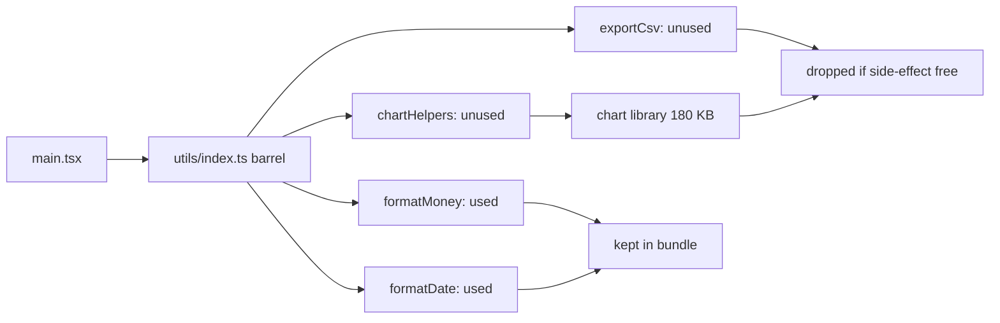
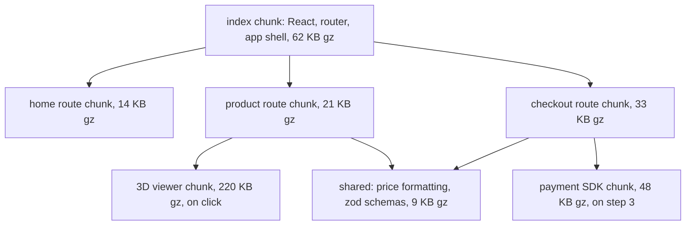
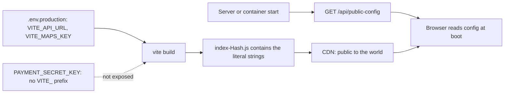

## 70.5 Tree shaking and code splitting at build time

#### Concept

**Tree shaking** is the removal of exported code that nothing imports. If your app imports `debounce` from a utility library that exports 300 functions, tree shaking keeps `debounce` (and whatever it calls) and drops the other 299. The name comes from shaking a tree so the dead leaves fall off.

**Code splitting** is dividing the bundle into several files (**chunks**) so each page downloads only the code it needs. The shopper on a product page does not download the admin reports screen or the 3D product viewer until they need it. At build time, the bundler decides the chunk boundaries; at run time, the browser fetches chunks on demand.

Both decide the same thing from opposite directions: tree shaking decides what code exists in the output at all, and code splitting decides when each piece of it is downloaded.

#### Why does it exist?

JavaScript cost is paid twice: in network time and in main-thread time to parse, compile and execute (69.7). Libraries are written for everybody, so they contain much more than any one app uses. Apps grow screens that most users never visit. Without tree shaking you ship whole libraries. Without code splitting every user pays for every screen. A typical e-commerce SPA with neither optimisation ships 900 KB to 1.5 MB of gzip JavaScript; with both, the first route is often 150 to 250 KB.

#### Mental model

Imagine packing for a trip from a big wardrobe. Tree shaking is leaving behind every item you will never wear on this trip, however nice it is. Code splitting is packing a carry-on with what you need on day one and having the rest shipped to the hotel only when your itinerary says you will need it. Both depend on knowing your itinerary in advance: if a bag might contain something with a hidden purpose (a side effect), you cannot safely leave it behind.

#### How it works

Tree shaking depends on **static ES module syntax**. `import { debounce } from 'lodash-es'` and `export function debounce` can be analysed without running any code, so the bundler can build a precise graph of which exports are used. CommonJS (`require`, `module.exports`) is dynamic: `module.exports[name] = fn` is decided at run time, so bundlers can rarely shake it. That is why `lodash` (CommonJS) costs about 24 KB gzip whatever you import from it, while `lodash-es` costs about 1 KB for `debounce`.



The catch is **side effects**. A module has a side effect if importing it does something: registers a polyfill, adds a global CSS rule, patches a prototype, starts a timer. If a module might have side effects, the bundler must keep it even when none of its exports are used, because removing it would change behaviour. Two hints let bundlers drop more:

- **`"sideEffects"` in `package.json`**: `"sideEffects": false` promises that no file in the package has import-time side effects. An array lists the exceptions: `"sideEffects": ["*.css", "./src/polyfills.ts"]`. webpack, Rollup, Rolldown and esbuild all honour it.
- **`/*#__PURE__*/` annotations** before a call (`const Icon = /*#__PURE__*/ createIcon(...)`) tell the minifier the call has no side effects, so if `Icon` is unused the call can be dropped.

**Barrel files** (an `index.ts` that re-exports everything in a folder) are where tree shaking most often struggles. In production a bundler can shake a barrel when the package is marked side-effect free. But in a Vite dev server every module in the barrel is still requested and transformed, so importing one icon from an icon library's barrel can load 1,500 modules in development. Next.js 13.5+ has `experimental.optimizePackageImports` (and applies it by default to libraries like `lucide-react` and `date-fns`) to rewrite barrel imports into direct ones.

**Code splitting** happens at **split points**. Every dynamic `import()` creates one:



1. The bundler follows static imports to build the **entry chunk**.
2. Each `import('./routes/Checkout')` starts a new chunk containing that module and its static imports not already in a parent chunk.
3. Modules used by several chunks are moved into **shared chunks** so they are downloaded once.
4. The bundler writes a small runtime that fetches a chunk by its hashed name when `import()` runs, and Vite injects `<link rel="modulepreload">` for a chunk's own dependencies so they load in parallel instead of in a waterfall.

You can steer the grouping. Rollup (Vite up to 7) has `build.rollupOptions.output.manualChunks`; webpack has `optimization.splitChunks`. A common use is a separate **vendor chunk** for large, rarely-changing libraries, so a deploy that changes only your code does not invalidate the cached React chunk.

Split too much and you create a request waterfall: chunk A loads, then discovers chunk B, then C. Split too little and the first route carries code for every screen. A practical rule: split by route, split anything over about 30 KB gzip that is not needed for first paint (editors, charts, maps, payment SDKs), and stop there.

**Measure, do not guess.** `rollup-plugin-visualizer` (Vite), `webpack-bundle-analyzer` and `@next/bundle-analyzer` render a treemap of what is inside each chunk. `size-limit` or a simple script that fails CI when the entry chunk exceeds a budget keeps it from creeping back (Part 76 — Web Performance covers budgets).

#### Practical example

A pharmacy app's first-route bundle was 480 KB gzip. The treemap showed:

| Culprit | Size gzip | Fix | After |
|---|---|---|---|
| `moment` with all locales | 72 KB | `date-fns` with direct imports, or `Intl.DateTimeFormat` | 6 KB |
| `lodash` (CommonJS) | 24 KB | `lodash-es` or native methods | 2 KB |
| Icon library through a barrel without `sideEffects` | 96 KB | direct imports `icons/Pill` | 4 KB |
| Rich text editor in the static graph of the product page | 110 KB | `lazy(() => import('./ReviewEditor'))` | 0 KB on first route |
| Payment SDK imported in the app shell | 48 KB | load in the checkout payment step | 0 KB on first route |

Total first-route JavaScript fell to 188 KB gzip. On a mid-range Android phone, main-thread script time at startup dropped from 1.1 s to 420 ms.

#### React / Next.js example

Route-level splitting with React Router and `lazy`, plus a vendor chunk that changes rarely:

```tsx
// src/router.tsx  (React 18, React Router 6.4+)
import { lazy, Suspense } from 'react';
import { createBrowserRouter } from 'react-router-dom';
import { AppShell } from './AppShell';      // static: part of the entry chunk
import { RouteError } from './RouteError';

const Home = lazy(() => import('./routes/Home'));
const Product = lazy(() => import('./routes/Product'));
const Checkout = lazy(() => import('./routes/Checkout')); // payment SDK lives in here, not in the shell

const page = (el: JSX.Element) => <Suspense fallback={<div className="route-skeleton" />}>{el}</Suspense>;

export const router = createBrowserRouter([
  {
    path: '/', element: <AppShell />, errorElement: <RouteError />, // catches failed chunk loads too
    children: [
      { index: true, element: page(<Home />) },
      { path: 'p/:slug', element: page(<Product />) },
      { path: 'checkout', element: page(<Checkout />) },
    ],
  },
]);
```

```ts
// vite.config.ts (excerpt, Vite up to 7: Rollup output options)
build: {
  rollupOptions: {
    output: {
      // React and the router change a few times a year; keep them in their own long-cached chunk.
      manualChunks(id) {
        if (/node_modules\/(react|react-dom|react-router|react-router-dom|scheduler)\//.test(id)) return 'vendor-react';
      },
    },
  },
},
```

Next.js splits by route automatically: each `page.tsx` in the App Router is its own entry, and `next/dynamic` (shown in 69.6) splits components inside a page. Server components never ship their code to the browser at all, which is the most effective tree shaking there is.

#### Backend side (NestJS)

Two backend responsibilities follow from splitting.

**Data does not belong in the bundle.** Teams often import a 180 KB `countries.json`, a product category tree or a list of pincodes straight into the frontend. It is then parsed on every page load and re-downloaded on every deploy because the chunk hash changes. Serve it from the API with HTTP caching instead:

```ts
// reference-data.controller.ts
import { Controller, Get, Header, Headers, Res, HttpStatus } from '@nestjs/common';
import type { Response } from 'express';
import { createHash } from 'node:crypto';
import { ReferenceDataService } from './reference-data.service';

@Controller('v1/reference')
export class ReferenceDataController {
  constructor(private readonly refs: ReferenceDataService) {}

  @Get('countries')
  @Header('Cache-Control', 'public, max-age=86400, stale-while-revalidate=604800')
  async countries(@Headers('if-none-match') ifNoneMatch: string | undefined, @Res() res: Response) {
    const countries = await this.refs.countries(); // from PostgreSQL, cached in memory for 1 h
    const body = JSON.stringify(countries);
    const etag = `"${createHash('sha1').update(body).digest('base64url')}"`;
    if (ifNoneMatch === etag) return res.status(HttpStatus.NOT_MODIFIED).end();
    res.setHeader('ETag', etag);
    res.type('application/json').send(body); // about 9 KB gzip, fetched only on the address step
  }
}
```

**Old chunks must stay reachable.** A user who loaded the app before a deploy has an entry chunk that references `Checkout-OLDHASH.js`. If the deploy deleted it, their next navigation fails with "Failed to fetch dynamically imported module" (Vite) or `ChunkLoadError` (webpack). Keep the previous one or two releases' assets in the bucket or container, and return a real 404 for missing assets, never the SPA's `index.html`. Part 78 — Shipping and Operating Frontends covers the full deploy story; the `errorElement` above is the client half of it, offering a reload.

#### Production scenario

A fashion retailer added a "complete the look" carousel to the product page using a new design-system package. The product page chunk grew from 41 KB to 167 KB gzip; nobody noticed until p75 LCP on mobile went from 2.3 s to 2.9 s and the conversion dashboard showed a 3 % drop on product pages. The treemap showed the whole design-system package, all 90 components, inside the chunk: its `package.json` had no `sideEffects` field and its `index.js` was a barrel. Adding `"sideEffects": ["*.css"]` to the package brought the chunk to 52 KB. The team then added a CI budget of 60 KB gzip for that chunk.

#### Failure scenario

The same design-system team, wanting to be thorough, set `"sideEffects": false` in the next release. Their components imported their own styles with `import './Button.css'`. In development everything looked perfect, because the dev server loads every module it is asked for. In the production build, the bundler believed the CSS imports had no effect, since nothing used their exports, and dropped them. At 09:30 the release went live and every button and input on the checkout page was unstyled: grey system buttons, no spacing, a "Pay now" button that looked disabled. Payments fell by a third in 20 minutes before a rollback.

The correct value was the array form, `["*.css"]`. The process fix: a Playwright visual snapshot of checkout against the production build in CI (Part 77 — Frontend Testing and Quality).

#### Edge cases & failure modes

- **Wrong `sideEffects` claims** drop CSS imports and polyfills silently in production only.
- **CommonJS dependencies** defeat tree shaking; check for an ESM build (`module` or `exports.import` in their `package.json`).
- **Over-splitting** creates waterfalls of small chunks; watch the Network panel's initiator chain.
- **Vendor chunk instability**: one changed dependency changes the vendor hash and invalidates the whole cached chunk for everyone.
- **Chunk load failures** after deploys or on flaky networks need an error boundary with a retry or reload.
- **Dynamic import paths built from variables** (`` import(`./locales/${lang}.ts`) ``) make the bundler include every matching file as a chunk; fine for 6 locales, bad for 600 files.

#### How a Senior Full-Stack Engineer thinks about this

A senior reads a bundle treemap the way they read an `EXPLAIN ANALYZE` plan: the biggest box is where the time goes, and guesses are usually wrong. They set a budget for the first route and enforce it in CI, because bundle size only ever grows by small, reasonable-looking additions. They split by route and by heavy feature, not by every component. They push data out of the bundle and into cacheable API responses, and they treat "keep old chunks available" as part of the deploy contract, not an afterthought.

#### Common mistakes

- **Importing a whole library for one function** (`import _ from 'lodash'`).
- **Putting large data files into the bundle** instead of fetching them.
- **Setting `"sideEffects": false` on a package that imports CSS.**
- **Splitting every component**, producing hundreds of tiny chunks.
- **Deleting old assets on deploy**, breaking every open tab.

#### Interview questions

1. **Why can bundlers tree-shake ES modules but not CommonJS?**
   Expected answer: ESM imports and exports are static and analysable at build time; CommonJS exports are assigned at run time. Follow-up: what does `sideEffects` add on top?
2. **What is a split point and what does it cost?** Expected answer: a dynamic `import()` that becomes a separate chunk, fetched on demand; it costs a request and possible waterfall when the code is needed.
3. **Your product page bundle doubled after adding one component. How do you find out why?** Expected answer: bundle analyzer treemap, look for a barrel import or a package without side-effect hints, check whether a heavy dependency is statically imported.
4. **What happens to users with an open tab during a deploy that deletes old chunks, and how do you prevent it?** Expected answer: dynamic imports 404, navigation fails; keep previous assets for a grace period and catch chunk errors with a reload prompt.
5. **When would you create a manual vendor chunk?** Expected answer: when large, rarely-changing libraries would otherwise be re-downloaded on every deploy.

#### Practical exercise

Add `rollup-plugin-visualizer` to a Vite app, build it, and open the treemap.

Acceptance criteria:

- You identify the three largest modules in the entry chunk and their gzip sizes.
- You move at least one heavy, non-critical component behind `lazy()` and show the entry chunk shrinking.
- You add a CI check (a script reading `dist/assets/*.js` gzip sizes) that fails when the entry chunk exceeds a chosen budget.
- You move one static JSON data file out of the bundle into a NestJS endpoint with `ETag` and `Cache-Control`, and show a `304` on the second load.

## 70.6 Environment variables in frontends

#### Concept

In a backend, an environment variable is read **at run time**: NestJS's `ConfigService` reads `process.env.DATABASE_URL` when the process starts, on a server only your team can access (Part 4 — Linux and the Command Line, 4.5). In a frontend build, "environment variables" are usually something else entirely: values that the build tool **replaces with string literals at build time**, so they become part of the JavaScript file that every visitor downloads.

That gives two rules that every full-stack engineer must know by heart:

1. **Build-time values are frozen.** Changing an environment variable after the build changes nothing; you must rebuild.
2. **Every value in a frontend bundle is public.** There is no such thing as a secret environment variable in browser code. If the browser can use it, anyone can read it.

#### Why does it exist?

The browser has no `process.env`. There is no operating system environment it can read from your server. The build tool bridges the gap by substituting values during the build, which is simple and fast: no extra request at startup, and dead-code elimination can remove branches like `if (import.meta.env.DEV)` entirely.

The prefixes exist as a safety net. Vite only exposes variables starting with `VITE_` to client code, Next.js only `NEXT_PUBLIC_`, and Create React App only `REACT_APP_`. Without a prefix, a careless `process.env.DATABASE_URL` in a component would have pulled your database password into the bundle. The prefix makes exposure an explicit decision. It does not make the exposed value secret.

#### Mental model

Imagine printing a flyer. Whatever you write on it before the print run (the build) is on every copy, and every person who picks one up can read it. You cannot change the phone number on flyers already in people's hands; you have to print again. A runtime config is a QR code on the flyer that points to a web page: you can change the page without reprinting, but anyone can still scan it and read it. Neither is a place for the combination to your safe.

#### How it works



**Vite.** Variables are loaded from `.env`, `.env.local`, `.env.[mode]` and `.env.[mode].local` (later files win; actual process environment variables win over all files). Only `VITE_`-prefixed names (configurable with `envPrefix`) are exposed, through `import.meta.env`. Built-ins: `import.meta.env.MODE`, `DEV`, `PROD`, `SSR`, `BASE_URL`. At build time, `import.meta.env.VITE_API_URL` is replaced with the literal `"https://api.shop.example"`. Types come from an augmentation file:

```ts
// src/vite-env.d.ts
/// <reference types="vite/client" />
interface ImportMetaEnv {
  readonly VITE_API_URL: string;
  readonly VITE_MAPS_BROWSER_KEY: string; // referrer-restricted browser key, public by design
}
interface ImportMeta { readonly env: ImportMetaEnv }
```

**Next.js.** Variables prefixed `NEXT_PUBLIC_` are inlined into client bundles at `next build`. Variables without the prefix are available only in server code (server components, Route Handlers, Server Actions, `getServerSideProps`), and those are read at run time when the page renders dynamically. Two traps: dynamic lookups such as `process.env[name]` are not inlined, and a page that is statically rendered at build time freezes even server-side values into the HTML. The `server-only` package (`import 'server-only'`) makes the build fail if a module meant for the server is imported into a client component.

**webpack.** `DefinePlugin` does the same text substitution: `new DefinePlugin({ 'process.env.API_URL': JSON.stringify(url) })`.

**What "public" really means.** After a build, run:

```bash
# Everything in dist is what the world can read.
grep -rhoE '(sk_live|AKIA)[A-Za-z0-9_]{8,}' dist/ || echo "no Stripe secret or AWS access key patterns"
grep -rho 'https://[a-z0-9.-]*\.internal[^"]*' dist/ | sort -u   # internal hostnames leaking?
```

Some values are designed to be public and safe in a bundle, because the provider protects them another way: a Stripe **publishable** key (`pk_live_...`), a Google Maps browser key restricted by HTTP referrer, a Firebase web config (protected by security rules), a Sentry DSN (write-only ingestion, rate-limited). Anything that grants access to your systems or bills you per call without such protection (a Stripe secret key `sk_live_...`, an AWS key, an internal service token, an OpenAI or LLM API key, an admin API key) must stay on the server.

**Runtime configuration** solves the "frozen" problem, not the "public" problem. Instead of baking `VITE_API_URL` into the build, the app fetches `/config.json` or reads `window.__APP_CONFIG__` injected into `index.html` by the server at start-up. Then one build can be promoted from staging to production unchanged. Part 78 — Shipping and Operating Frontends covers "build once, deploy many" in detail.

#### Practical example

A food delivery web app needs four configuration values:

| Value | Where it lives | Why |
|---|---|---|
| API base URL | runtime config (`/api/public-config`) or same-origin `/api` | Differs per environment; same build promoted through stages |
| Maps browser key | `VITE_MAPS_BROWSER_KEY`, restricted to `*.food.example` referrers | Public by design; the restriction is the protection |
| Geocoding server key | NestJS only, called through `/api/geocode` | Bills per call with no referrer restriction; would be abused within hours |
| Feature flags | runtime, from the flag service through the API | Must change without a rebuild |

#### React / Next.js example

A typed, validated config module for a Vite SPA that reads runtime configuration once at boot and fails loudly if it is wrong:

```ts
// src/config.ts
import { z } from 'zod';

const PublicConfig = z.object({
  apiBaseUrl: z.string().url(),
  mapsBrowserKey: z.string().min(10),
  sentryDsn: z.string().url().optional(),
  features: z.record(z.boolean()).default({}),
});
export type PublicConfig = z.infer<typeof PublicConfig>;

let config: PublicConfig | undefined;

export async function loadConfig(): Promise<PublicConfig> {
  const res = await fetch('/api/public-config', { signal: AbortSignal.timeout(3000) }); // never hang boot
  if (!res.ok) throw new Error(`config ${res.status}`);
  config = PublicConfig.parse(await res.json()); // a broken config fails at boot, not on the payment step
  return config;
}

export function getConfig(): PublicConfig {
  if (!config) throw new Error('getConfig() called before loadConfig()');
  return config;
}
```

```tsx
// src/main.tsx
import { createRoot } from 'react-dom/client';
import { loadConfig } from './config';
import { App } from './App';

loadConfig()
  .then(() => createRoot(document.getElementById('root')!).render(<App />))
  .catch(() => {
    document.getElementById('root')!.innerHTML =
      '<p role="alert">We could not start the app. Please refresh the page.</p>';
  });
```

In Next.js, read server-only values directly in server code and pass only what the client needs as props:

```tsx
// app/checkout/page.tsx  (Next.js 14 App Router, server component)
import 'server-only';
import { PaymentStep } from './PaymentStep'; // client component

export default async function CheckoutPage() {
  // Read at request time on the server (this page is dynamic because it uses cookies elsewhere).
  const publishableKey = process.env.STRIPE_PUBLISHABLE_KEY!; // public by design
  // process.env.STRIPE_SECRET_KEY stays in server code and Route Handlers only.
  return <PaymentStep publishableKey={publishableKey} />;
}
```

#### Backend side (NestJS)

The backend owns the public config endpoint and every secret the frontend must not hold.

```ts
// public-config.controller.ts
import { Controller, Get, Header } from '@nestjs/common';
import { ConfigService } from '@nestjs/config';
import { FeatureFlagsService } from '../flags/feature-flags.service';

@Controller('public-config')
export class PublicConfigController {
  constructor(private readonly config: ConfigService, private readonly flags: FeatureFlagsService) {}

  @Get()
  @Header('Cache-Control', 'public, max-age=60') // short: flags may change; CDN can absorb load
  async get() {
    // Explicit allow-list. Never spread process.env or the whole config object into a response.
    return {
      apiBaseUrl: this.config.getOrThrow<string>('PUBLIC_API_BASE_URL'),
      mapsBrowserKey: this.config.getOrThrow<string>('MAPS_BROWSER_KEY'),
      sentryDsn: this.config.get<string>('SENTRY_BROWSER_DSN'),
      features: await this.flags.publicFlags(), // only flags marked safe for clients
    };
  }
}
```

For anything that needs a real secret, the browser calls your API and your API calls the provider. That proxy is also where you add authentication, rate limiting and caching, which a key in the browser can never have:

```ts
// geocode.controller.ts: the browser never sees GEOCODING_SERVER_KEY
import { Controller, Get, Query, UseGuards, BadRequestException } from '@nestjs/common';
import { Throttle } from '@nestjs/throttler';
import { JwtAuthGuard } from '../auth/jwt-auth.guard';
import { GeocodingService } from './geocoding.service';

@Controller('geocode')
@UseGuards(JwtAuthGuard)
export class GeocodeController {
  constructor(private readonly geocoding: GeocodingService) {}

  @Get()
  @Throttle({ default: { limit: 30, ttl: 60_000 } }) // 30 lookups per minute per user (@nestjs/throttler v5+)
  async lookup(@Query('q') q?: string) {
    if (!q || q.length < 3 || q.length > 200) throw new BadRequestException('q must be 3 to 200 chars');
    return this.geocoding.lookup(q); // uses the server key, caches results in Redis for 24 h
  }
}
```

#### Production scenario

A grocery chain ran the same React build across three environments using runtime config served by NestJS. Promotion from staging to production became "copy the same `dist/` artefact"; build time per release fell from three builds of 4 minutes to one, and a whole class of "staging works, production broken" bugs (caused by builds with different inlined values) disappeared. The `/api/public-config` endpoint served about 4,000 requests per minute at peak, 97 % from the CDN cache with its 60 s `max-age`.

#### Failure scenario

At 14:05 a developer added `VITE_REFUNDS_API_TOKEN` to a back-office web app so a new "issue refund" button could call the payments service directly, "just until the backend endpoint is ready". The app was internal but its bundle sat on the public CDN. At 19:40 an automated scanner that crawls JavaScript bundles for tokens found it. Between 20:10 and 21:30, 214 refunds totalling a little over 3 lakh rupees were issued to accounts the attacker controlled.

The token was revoked at 21:32 after an alert on refund volume. The postmortem's actions: no service tokens in any `VITE_` or `NEXT_PUBLIC_` variable, enforced by a CI step that greps the build output for known token formats and fails the build; refunds only through a NestJS endpoint with role checks and an audit log (Part 40 — Security covers both); and a reminder printed in the team handbook: *internal app* does not mean *private bundle*.

#### Edge cases & failure modes

- **Changing an env var without rebuilding** changes nothing for build-time values.
- **Dynamic access** (`import.meta.env[name]`, `process.env[name]`) is not replaced; it is `undefined` in the browser.
- **Statically rendered Next.js pages** freeze server-side values read at build time.
- **`.env.local` committed by accident** puts developer secrets into the repository; keep `*.local` in `.gitignore`.
- **Different values in CI and locally** produce bundles that behave differently; print the resolved mode and public values in the build log.
- **Spreading config into a response** (`return this.config`) leaks every server secret through a "public" endpoint.

#### How a Senior Full-Stack Engineer thinks about this

A senior classifies every configuration value before it is added: public-by-design, environment-specific, or secret. Public values can be inlined or served. Environment-specific values come from runtime config so one artefact moves through every stage. Secrets live only in the backend, behind authentication, rate limits and audit logs. They do not argue about whether a token is "probably safe because the app is internal"; the bundle is a public document. To a product manager: "If the browser can use a key, the whole internet can. So anything that can cost money or move data goes through our server."

#### Common mistakes

- **Putting secret keys in `VITE_` or `NEXT_PUBLIC_` variables.**
- **Rebuilding per environment** when the only difference is a URL.
- **Assuming obfuscation or minification hides values.** A minified string is still a string.
- **Exposing a config endpoint without an allow-list.**
- **Not validating config at boot**, so a missing value fails later on a critical step.

#### Interview questions

1. **How does `import.meta.env.VITE_API_URL` get its value, and when?**
   Expected answer: Vite replaces it with a literal string at build time from `.env` files and the build environment; it is not read in the browser at run time. Follow-up: how would you change the API URL without rebuilding?
2. **Why is there no such thing as a secret in a frontend bundle?** Expected answer: the bundle is downloaded by every visitor and readable by anyone; minification does not hide strings.
3. **Which keys are safe in the browser?** Expected answer: keys designed for it and protected by other means (publishable payment keys, referrer-restricted keys, DSNs); never keys that authorise access or billing.
4. **How do you call a third-party API that needs a secret key from a web app?** Expected answer: through a backend endpoint that holds the key, authenticates the user, rate-limits and caches.
5. **What is the difference between `NEXT_PUBLIC_X` and `X` in Next.js?** Expected answer: the first is inlined into client bundles at build time; the second is available only in server code, read at render time for dynamic pages.

#### Practical exercise

Build a Vite app with `VITE_API_URL` set and search `dist/` for the value. Then replace it with runtime config from a NestJS `/api/public-config` endpoint.

Acceptance criteria:

- `grep` shows the literal URL in the first build and not in the second.
- The same `dist/` folder works against two different NestJS instances returning different `apiBaseUrl` values.
- A CI script fails the build when `dist/` contains a string matching `sk_live_` or `AKIA`.
- The config endpoint returns only allow-listed fields, verified by a NestJS e2e test.
