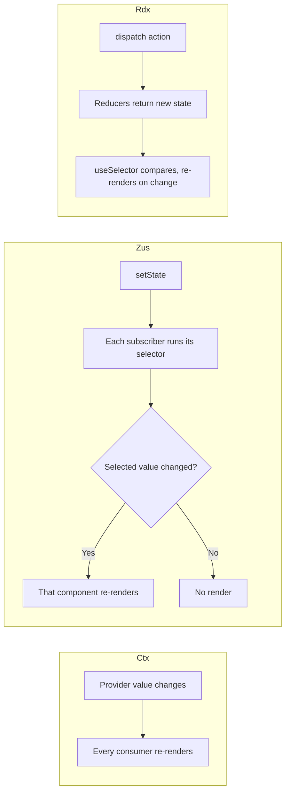
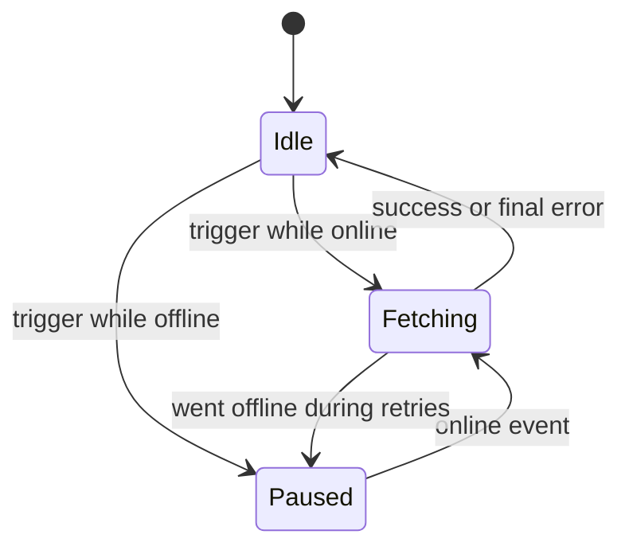

## 70.9 Client state stores: Context, Zustand and Redux Toolkit

#### Concept

Once server state lives in a query cache and filters live in the URL, what remains is genuine **global client state**: preferences, a toast queue, a multi-step wizard's progress, rows selected across pages for a bulk action, an in-browser editor's document. Three tools dominate:

- **React Context** (built in): passes a value down the tree. Every component that reads the context re-renders when the provider's value changes (69.5).
- **Zustand** (about 1 KB gzip): a store that lives outside React. Components subscribe with a **selector** and re-render only when the selected slice changes.
- **Redux Toolkit (RTK)**: the official way to write Redux. A single store, state changed only by dispatching **actions** to **reducers** written with `createSlice`, excellent devtools, middleware. It ships **RTK Query**, a server-state cache comparable to TanStack Query, for teams already on Redux.

#### Why does it exist?

Passing a value through six layers of props is noisy and brittle. Context fixes that for values that change rarely. For values that change often and are read in many places, Context's "everyone re-renders" behaviour becomes a performance problem, and a store with selectors fixes it. For large apps with many developers, Redux adds a strict, inspectable structure: every change is a named action you can log, replay and test.

#### Mental model

- **Context** is NestJS dependency injection scoped to a subtree: ask for a token, get the nearest provider's value.
- **Zustand** is a singleton service with an event emitter: anyone can call its methods, and listeners decide whether the change concerns them.
- **Redux** is event sourcing in miniature (Part 79.16): actions are events, reducers fold them into state, and the devtools can replay the log.

#### How it works



**Zustand v5 specifics.** `create<State>()((set, get) => ({ ... }))` returns a hook. `useStore((s) => s.density)` subscribes to one field. A selector that returns a **new object or array** each time (`(s) => ({ a: s.a, b: s.b })`) looks changed on every check; in v5, which is built on React's `useSyncExternalStore`, that can cause an infinite render loop. Wrap such selectors in `useShallow` from `zustand/react/shallow`. The `persist` middleware (`zustand/middleware`) saves the store to `localStorage` or `sessionStorage` via `createJSONStorage`, with `partialize` to choose fields and `version` plus `migrate` for schema changes.

**Redux Toolkit specifics.** `configureStore` sets up the store with devtools and serialisability checks; `createSlice` generates actions and a reducer using Immer, so "mutating" code in reducers produces immutable updates. RTK 2 and React Redux 9 add `useSelector.withTypes<RootState>()` for typed hooks. **RTK Query** defines endpoints with `createApi` and `fetchBaseQuery`; caching uses **tags** (`providesTags`, `invalidatesTags`) rather than key prefixes; unused data is kept for `keepUnusedDataFor` seconds (default 60); `refetchOnFocus` needs `setupListeners(store.dispatch)`; optimistic updates use `onQueryStarted` with `api.util.updateQueryData` and `patch.undo()`. Infinite query endpoints were added in RTK 2.6.

The decision:

| Situation | Choose | Why |
|---|---|---|
| Current user, locale, theme, feature flags | Context | Rare changes, read everywhere |
| A few fast-changing global UI values (toasts, selection, drawer) | Zustand | Selector subscriptions, no provider, tiny |
| Large team, complex client-side workflows, need for action logs and replay | Redux Toolkit | Structure, devtools, middleware |
| Already on Redux and need server-state caching | RTK Query | Same store and devtools, tag invalidation |
| Not on Redux and need server-state caching | TanStack Query | Richer infinite queries, persistence and offline support |
| State used by one component or one subtree | `useState` / `useReducer` | No library at all |

#### Practical example

On the order list page the global client state is small: the row density preference (persisted per device), a toast queue (any component can push, one component renders), and, in the admin version, a set of selected order IDs that must survive paging and filter changes for a bulk "Export CSV" action. That is a 30-line Zustand store. The orders themselves stay in TanStack Query.

#### React / Next.js example

```ts
// src/state/uiStore.ts  (Zustand v5)
import { create } from 'zustand';
import { createJSONStorage, persist } from 'zustand/middleware';

type Toast = { id: string; kind: 'info' | 'warn' | 'error'; text: string };
type UiState = {
  density: 'comfortable' | 'compact';
  toasts: Toast[];
  selectedOrderIds: Set<string>;
  setDensity: (d: UiState['density']) => void;
  pushToast: (t: Omit<Toast, 'id'>) => void;
  dismissToast: (id: string) => void;
  toggleSelected: (id: string) => void;
};

export const useUiStore = create<UiState>()(
  persist(
    (set) => ({
      density: 'comfortable',
      toasts: [],
      selectedOrderIds: new Set(),
      setDensity: (density) => set({ density }),
      pushToast: (t) => set((s) => ({ toasts: [...s.toasts, { ...t, id: crypto.randomUUID() }] })),
      dismissToast: (id) => set((s) => ({ toasts: s.toasts.filter((t) => t.id !== id) })),
      toggleSelected: (id) => set((s) => {
        const next = new Set(s.selectedOrderIds);           // new Set so subscribers see a change
        next.has(id) ? next.delete(id) : next.add(id);
        return { selectedOrderIds: next };
      }),
    }),
    {
      name: 'ui-prefs',
      version: 1,
      storage: createJSONStorage(() => localStorage),
      partialize: (s) => ({ density: s.density }),         // persist the preference only, never toasts or IDs
    },
  ),
);

// Components subscribe to exactly what they read:
// const density = useUiStore((s) => s.density);
// const { toasts, dismissToast } = useUiStore(useShallow((s) => ({ toasts: s.toasts, dismissToast: s.dismissToast })));
```

The same orders API in RTK Query, for a team already on Redux:

```ts
// src/state/ordersApi.ts  (Redux Toolkit 2, RTK Query)
import { createApi, fetchBaseQuery } from '@reduxjs/toolkit/query/react';
import type { OrderListFilters, OrderListResponse, OrderSummary } from '@shop/contracts';

export const ordersApi = createApi({
  reducerPath: 'ordersApi',
  baseQuery: fetchBaseQuery({ baseUrl: '/api/v1', credentials: 'include' }),
  tagTypes: ['Order'],
  endpoints: (build) => ({
    getOrders: build.query<OrderListResponse, OrderListFilters>({
      query: (filters) => ({ url: '/orders', params: filters }),
      providesTags: (res) => [{ type: 'Order', id: 'LIST' }, ...(res?.items ?? []).map((o) => ({ type: 'Order' as const, id: o.id }))],
    }),
    cancelOrder: build.mutation<OrderSummary, { id: string; filters: OrderListFilters; key: string }>({
      query: ({ id, key }) => ({ url: `/orders/${id}/cancel`, method: 'POST', body: { reason: 'CHANGED_MIND' }, headers: { 'Idempotency-Key': key } }),
      async onQueryStarted({ id, filters }, { dispatch, queryFulfilled }) {
        const patch = dispatch(ordersApi.util.updateQueryData('getOrders', filters, (draft) => {
          const o = draft.items.find((x) => x.id === id);
          if (o) o.status = 'CANCELLED';                       // Immer draft: write as if mutable
        }));
        try { await queryFulfilled; } catch { patch.undo(); }   // rollback on failure
      },
      invalidatesTags: (_res, _err, { id }) => [{ type: 'Order', id }],
    }),
  }),
});
export const { useGetOrdersQuery, useCancelOrderMutation } = ordersApi;
```

#### Backend side (NestJS)

Client stores touch the backend in three places:

- **Cross-device preferences belong on the server.** If density or default filters should follow the user to their phone, persist them with `PUT /v1/me/preferences` and load them into the query cache; the store holds only device-local choices.
- **Never treat store contents as authority.** A `role: 'admin'` in a store decides which buttons render, nothing else; every endpoint enforces permissions with guards (Part 73 covers why hiding a button is not authorization).
- **Bulk actions from client selections must be bounded and re-checked.** A "cancel 300 selected orders" request carries IDs the server must re-authorise one by one, cap (say 100 per request), and process idempotently:

```ts
// packages/contracts/src/index.ts  (continued)
export const BulkExportRequestSchema = z.object({
  orderIds: z.array(z.string().uuid()).min(1).max(100), // the server's cap, enforced at the edge
});
```

```sql
-- The service filters IDs by ownership in one query; foreign IDs are silently excluded, never leaked.
SELECT id FROM orders WHERE customer_id = $1 AND id = ANY($2::uuid[]);
```

#### Production scenario

A logistics customer portal had grown to 118 Redux slices over four years; 41 of them held API data with hand-written loading flags and "last fetched" timestamps. Migrating API data to TanStack Query and the rest to three Zustand stores and two Contexts removed about 9,000 lines of reducers and thunks (to 2,100), cut the main bundle by 31 KB gzip, and closed 23 open "stale data" bugs, most of which simply stopped existing because their slices were deleted.

#### Failure scenario

A team upgraded Zustand from v4 to v5 on a Friday. The order page's toolbar used `useUiStore((s) => ({ density: s.density, setDensity: s.setDensity }))`. In v4 this re-rendered on every store change, which nobody noticed. In v5 it threw "Maximum update depth exceeded" on load, and the error boundary replaced the whole page. Error tracking showed 100 % of order-page sessions failing for 25 minutes until rollback.

The fix was one wrapper, `useShallow(...)`, and a lint rule flagging object-literal selectors without it. The postmortem also noted that no test rendered the toolbar with the real store; a single component test (Part 75) would have caught it in CI.

#### Edge cases & failure modes

- **Module-level stores in Next.js server rendering** are shared across all requests on the server: one user's data can leak into another's HTML. Create stores per request and provide them through Context (Part 71).
- **Persisted stores rehydrate after first render**, so the first frame shows defaults; render a neutral state until hydrated, or use `sessionStorage` only for non-visual state.
- **Schema changes to persisted state** without `version` and `migrate` crash on old saved data.
- **Context value recreated each render** re-renders every consumer (69.5).
- **Sets and Maps in Redux** break serialisability checks; use arrays or records.
- **PII in `localStorage`** survives logout and is readable by any script on the origin (67.8); persist preferences, not personal data.

#### How a Senior Full-Stack Engineer thinks about this

The senior shrinks global client state first, by moving server data to a query cache and view state to the URL, then picks the lightest tool that fits what remains. They choose Redux for organisational reasons (a large team that benefits from enforced structure and action logs), not because "real apps use Redux". And they treat every persisted store as a schema with versions, because data saved on a user's device is data you must migrate.

#### Common mistakes

- **A global store as a second copy of server data.**
- **Context for fast-changing values** read across the app.
- **Object-literal selectors without `useShallow`** in Zustand v5.
- **Persisting everything**, including tokens, PII and transient UI.
- **Using both RTK Query and TanStack Query** in one app for overlapping data.

#### Interview questions

1. **When would you pick Context, Zustand or Redux Toolkit?**
   Expected answer: Context for rarely changing cross-cutting values; Zustand for small, fast-changing global UI state with selector subscriptions; Redux Toolkit for large apps needing structure, devtools and middleware. Follow-up: where does server data go in each case? (A query cache, or RTK Query on Redux.)
2. **Why does Context cause extra re-renders, and how do stores avoid it?** Expected answer: every consumer re-renders on value change; stores notify subscribers who compare selected slices.
3. **How does RTK Query invalidate compared with TanStack Query?** Expected answer: tags (`providesTags`/`invalidatesTags`) instead of key prefixes.
4. **What can go wrong with a module-level store in server rendering?** Expected answer: shared across requests, leaking data between users.

#### Practical exercise

Replace a Context that holds fast-changing UI state with a Zustand store.

Acceptance criteria:

- The React Profiler shows that toggling density re-renders only components that read density.
- Only `density` appears in `localStorage`; toasts and selections do not.
- A version bump with a `migrate` function upgrades an old saved shape without errors.
- The bulk export endpoint rejects 101 IDs with `400 VALIDATION_FAILED` and silently excludes IDs owned by other customers.

## 70.10 Offline and flaky networks: timeouts, retries, AbortController and honest stale data

#### Concept

Mobile networks fail in four ways, and the client must handle each:

1. **Offline**: no connectivity. Requests fail immediately with a `TypeError: Failed to fetch`.
2. **Slow**: 300 to 2,000 ms round trips on congested 3G or 4G.
3. **Hanging**: the request is sent and nothing comes back. `fetch` has **no default timeout**; a request can sit for minutes.
4. **Lying**: the browser says online (`navigator.onLine === true`) behind a hotel captive portal or a dead Wi-Fi uplink.

The tools: **timeouts** on every request (`AbortSignal.timeout`), **cancellation** (`AbortController`, and `AbortSignal.any` to combine signals), **bounded retries with backoff** (70.3), TanStack Query's **network mode** and **paused** queries and mutations, a **persisted cache** for instant start-up, and a UI that shows stale data **honestly** instead of pretending it is live.

#### Why does it exist?

A spinner that never ends is the worst possible UI: the user cannot tell whether to wait, retry or give up. A blank error page that discards the orders loaded two minutes ago is nearly as bad. Users on trains, in lifts and in basements are a large share of real traffic, and the difference between "your data, 3 minutes old, reconnecting" and "something went wrong" is the difference between a working app and a support ticket.

#### Mental model

Imagine your NestJS service calling a payment gateway (Part 72.2). You would never call it without a timeout, you would retry only safe calls with backoff, and you would serve degraded but useful answers when it is down (Part 72.10). In the browser, **your API is the unreliable dependency**, and the phone's radio is the flaky network. Apply the same reliability toolbox from the other side.

#### How it works

Combining the library's cancellation signal with a timeout:

```ts
// src/api/http.ts  (apiGet with a deadline; AbortSignal.any needs Chrome 116+, Firefox 124+, Safari 17.4+)
export class ApiTimeoutError extends Error {}

export async function apiGet<T>(path: string, schema: ZodType<T>, signal?: AbortSignal, timeoutMs = 10_000): Promise<T> {
  const deadline = AbortSignal.timeout(timeoutMs);                 // aborts with a 'TimeoutError' DOMException
  const combined = signal ? AbortSignal.any([signal, deadline]) : deadline;
  let res: Response;
  try {
    res = await fetch(`/api${path}`, { credentials: 'include', signal: combined });
  } catch (e) {
    if (deadline.aborted) throw new ApiTimeoutError(`GET ${path} timed out after ${timeoutMs} ms`); // retryable
    throw e;                                                       // AbortError from the library: not an error to show
  }
  if (!res.ok) throw await toApiError(res);
  return schema.parse(await res.json());
}
```

TanStack Query's **`networkMode`** decides what happens without a connection:

| `networkMode` | Queries when offline | Mutations when offline | Use when |
|---|---|---|---|
| `'online'` (default) | Do not start; `fetchStatus: 'paused'`; resume on reconnect | Paused, resumed in order on reconnect | Normal API-backed apps |
| `'offlineFirst'` | Try once (a service worker or HTTP cache may answer), then pause retries | Same | Apps with a service worker cache |
| `'always'` | Fetch regardless, fail normally | Same | Local-first data, or when online detection is unreliable |

Online state comes from `onlineManager`, which listens to the browser's `online` and `offline` events. A query can be `status: 'success'` **and** `fetchStatus: 'paused'`: it has data, it wanted to refetch, and it is waiting for the network. That combination is the "showing saved data" state.



A **persisted cache** writes the query cache to storage and restores it at start-up, so a returning user sees their orders instantly, marked as saved, while fresh data loads. `PersistQueryClientProvider` from `@tanstack/react-query-persist-client` with `createSyncStoragePersister` (`@tanstack/query-sync-storage-persister`, for `localStorage`) or `createAsyncStoragePersister` (for IndexedDB through a small wrapper) does this. Three rules: `gcTime` must be at least the persister's `maxAge` or restored entries are collected immediately; set `buster` to the app version so a deploy with changed schemas discards old caches; and clear it on logout.

#### Practical example

A customer opens "My Orders" on an underground train. The persisted cache renders the list from 40 minutes ago in under 100 ms, with a banner "Saved at 08:12. Reconnecting...". The status query is paused, not failing. They tap "Cancel" on an order; the mutation is paused and the row shows "Cancel queued, will send when you are back online". At the next station the network returns, `onlineManager` fires, the paused mutation runs with its original idempotency key, and the list refetches. The server says the order shipped 10 minutes ago: `409 ORDER_NOT_CANCELLABLE`, and the row explains it.

#### React / Next.js example

```tsx
// src/main.tsx  (excerpt, TanStack Query v5 persistence)
import { PersistQueryClientProvider } from '@tanstack/react-query-persist-client';
import { createSyncStoragePersister } from '@tanstack/query-sync-storage-persister';
import { queryClient } from './api/queryClient';

const persister = createSyncStoragePersister({ storage: window.localStorage, key: 'rq-cache' });

// queryClient defaults include gcTime: 24 * 60 * 60_000 so restored entries survive (gcTime >= maxAge).
<PersistQueryClientProvider
  client={queryClient}
  persistOptions={{
    persister,
    maxAge: 24 * 60 * 60_000,
    buster: import.meta.env.VITE_APP_VERSION,               // new deploy, new cache
    dehydrateOptions: { shouldDehydrateQuery: (q) => q.queryKey[0] === 'orders' && q.state.status === 'success' },
  }}
  onSuccess={() => queryClient.resumePausedMutations()}     // send writes queued before a reload
>
  <App />
</PersistQueryClientProvider>;
```

Paused mutations restored after a reload have no function attached, so register defaults by key: `queryClient.setMutationDefaults(['orders', 'cancel'], { mutationFn: cancelOrder })`, and give the cancel mutation `mutationKey: ['orders', 'cancel']`.

Honest staleness in the UI:

```tsx
// src/ui/FreshnessBanner.tsx
import { useIsRestoring, onlineManager } from '@tanstack/react-query';
import { useSyncExternalStore } from 'react';

export function FreshnessBanner({ updatedAt, failed }: { updatedAt: number; failed: boolean }) {
  const online = useSyncExternalStore(onlineManager.subscribe.bind(onlineManager), () => onlineManager.isOnline());
  const restoring = useIsRestoring();
  if (restoring || (online && !failed)) return null;
  const at = new Date(updatedAt).toLocaleTimeString([], { hour: '2-digit', minute: '2-digit' });
  return <p role="status">Showing orders saved at {at}. {online ? 'Could not refresh, retrying.' : 'Reconnecting...'}</p>;
}
// <FreshnessBanner updatedAt={query.dataUpdatedAt} failed={query.isError} />
```

Logout must clear every layer: `queryClient.clear()`, `persister.removeClient()`, and the persisted Zustand stores.

#### Backend side (NestJS)

Offline clients change the backend's assumptions:

- **Writes can arrive hours late.** A queued cancel replays when the phone reconnects. Idempotency records (Part 14.12) must live at least as long as the client's offline window: 24 hours, not 5 minutes. Business rules are evaluated at replay time, so a late cancel of a shipped order is a clean `409`, not a corruption.
- **Server deadlines must be shorter than client timeouts.** If the browser gives up at 10 s, a handler still working at 25 s is wasted work and a likely duplicate when the user retries. A timeout interceptor returns `503` with `Retry-After` first:

```ts
// apps/api/src/common/timeout.interceptor.ts
import { CallHandler, ExecutionContext, Injectable, NestInterceptor, ServiceUnavailableException } from '@nestjs/common';
import { Observable, TimeoutError, catchError, throwError, timeout } from 'rxjs';

@Injectable()
export class TimeoutInterceptor implements NestInterceptor {
  intercept(ctx: ExecutionContext, next: CallHandler): Observable<unknown> {
    return next.handle().pipe(
      timeout(8_000),                                                     // below the browser's 10 s deadline
      catchError((err) => {
        if (!(err instanceof TimeoutError)) return throwError(() => err);
        ctx.switchToHttp().getResponse().setHeader('Retry-After', '5');   // tell clients when to retry
        return throwError(() => new ServiceUnavailableException({ code: 'UPSTREAM_TIMEOUT', issues: [] }));
      }),
    );
  }
}
```

The RxJS `timeout` stops waiting, not the work; pass an `AbortSignal` or a PostgreSQL `statement_timeout` down to really stop it (Part 72.2).

- **Small, compressible responses** matter more on slow links than CPU does: 22 KB gzip is 0.3 s on a 600 kbps connection; 400 KB is 5 s.

#### Production scenario

A pharmacy delivery app's analytics showed 9 % of sessions spent at least one minute offline or on a "lying" connection, concentrated in commuter hours. Before the changes, those sessions hit endless spinners (no timeouts) and blank error screens. After adding 10 s deadlines, persisted order caches, paused mutations and the freshness banner, "app not working" reviews in the store fell by 60 % in a quarter, and support calls asking "did my cancel go through?" fell by half, because queued writes were visible as queued.

#### Failure scenario

A pharmacy chain ran the web app on shared in-store tablets for customers checking prescriptions and orders. The persisted query cache was not cleared on logout. A customer logged out; the next customer opened the app and, for the 300 ms before the auth check redirected to login, saw the previous customer's orders, including medicine names, restored from `localStorage`. A customer took a screenshot and complained to the regulator.

The fixes: logout cleared the query cache, the persister and all stores; the `buster` included a hash of the user ID so a different user could never restore another's cache; persistence excluded queries tagged as sensitive (`meta: { persist: false }`); and the shared-device mode disabled persistence entirely.

#### Edge cases & failure modes

- **`navigator.onLine` is true behind captive portals**; rely on request timeouts, not the flag, to detect a dead network.
- **Retries multiply timeouts**: 10 s timeout with 2 retries and backoff is about 33 s before an error. Tell the user after the first timeout, keep trying in the background.
- **`TimeoutError` vs `AbortError`**: a timeout is a failure to show and retry; a library abort (unmount, superseded request) is not an error at all.
- **Paused mutations after a reload** need `setMutationDefaults` or they cannot resume.
- **Persisted caches with changed schemas** crash on restore; `buster` plus schema parsing on read protect you.
- **Offline writes conflict**: a queued edit to an order changed elsewhere must hit the version check (70.5), not overwrite.
- **Quota limits**: `localStorage` is about 5 MB per origin and synchronous; large caches belong in IndexedDB.

#### How a Senior Full-Stack Engineer thinks about this

The senior designs for the network the users actually have, not the office Wi-Fi: every request has a deadline, every retry is bounded and safe, every screen has a "showing saved data" state, and queued writes are visible. They align timeouts across layers (browser above API above database) and make idempotency windows match offline windows. And they treat persisted caches as personal data at rest, with clearing and scoping rules.

#### Common mistakes

- **No timeout on `fetch`.**
- **Showing an error page when stale data exists.**
- **Trusting `navigator.onLine`.**
- **Persisting caches without a buster or logout clearing.**
- **Short idempotency TTLs** that expire before queued writes replay.
- **Server handlers that outlive the client's patience.**

#### Interview questions

1. **How do you add a timeout to `fetch` that also respects the library's cancellation?**
   Expected answer: `AbortSignal.timeout(ms)` combined with the query signal through `AbortSignal.any`; distinguish `TimeoutError` from `AbortError`. Follow-up: browser support? (Recent evergreen browsers; polyfill or a manual controller for older ones.)
2. **What does `networkMode: 'online'` do?** Expected answer: pauses queries and mutations while offline and resumes them on reconnect; `fetchStatus` becomes `paused`.
3. **What must the backend change when clients can queue writes offline?** Expected answer: idempotency records that outlive the offline window, rules evaluated at replay time, version checks for conflicts.
4. **How do you show stale data honestly?** Expected answer: keep rendering cached data, label it with `dataUpdatedAt`, show reconnecting or failed-refresh status, never replace it with an error page.

#### Practical exercise

Make "My Orders" survive a bad network.

Acceptance criteria:

- With DevTools "Offline", a reload shows the persisted list within 200 ms with a "saved at" banner.
- A cancel tapped offline shows as queued, survives a page reload, and is sent once on reconnect with the original idempotency key.
- A request to an endpoint delayed by 30 s fails at 10 s with a retryable timeout; the NestJS interceptor returns `503 UPSTREAM_TIMEOUT` at 8 s.
- Logging out and in as another user never shows the first user's data, verified by a Playwright test.
