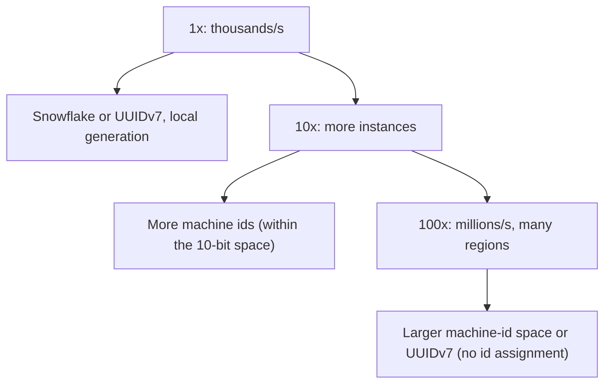

#### Deep dive: generating ids inside PostgreSQL

Instagram's widely cited approach puts the Snowflake idea inside PostgreSQL, one schema per logical shard, so each id is generated in the same transaction as the insert and carries its shard number. That gives sortable 64-bit ids with no generator service at all.

```sql
-- One sequence and one function per logical shard schema (here shard 5)
CREATE SEQUENCE shard_0005.order_id_seq;

CREATE OR REPLACE FUNCTION shard_0005.next_id(OUT result bigint) AS $$
DECLARE
  our_epoch  bigint := 1735689600000;           -- 2025-01-01 in ms
  seq_id     bigint;
  now_ms     bigint;
  shard_id   int    := 5;                       -- 13 bits: up to 8,192 logical shards
BEGIN
  SELECT nextval('shard_0005.order_id_seq') % 1024 INTO seq_id;     -- 10 bits
  SELECT floor(extract(epoch FROM clock_timestamp()) * 1000) INTO now_ms;
  result := (now_ms - our_epoch) << 23;
  result := result | (shard_id << 10);
  result := result | seq_id;
END;
$$ LANGUAGE plpgsql;

CREATE TABLE shard_0005.orders (
  id          bigint PRIMARY KEY DEFAULT shard_0005.next_id(),
  customer_id bigint NOT NULL,
  created_at  timestamptz NOT NULL DEFAULT now()
);
```

The shard id inside the id is the real prize: given any order id, `(id >> 10) & 8191` tells you which logical shard holds it, with no lookup table. The limit is the `% 1024`: more than 1,024 inserts in one millisecond on one logical shard would wrap the sequence and could collide, so the design needs enough logical shards that no single one sees that rate.

For a single database without sharding, plain sequences are still the right answer, and three behaviors are worth knowing. `nextval` is not rolled back with the transaction, so ids have gaps by design and must never be used to count rows. `CREATE SEQUENCE ... CACHE 50` hands each session a block of 50, which makes `nextval` cheaper but means ids from different sessions interleave out of creation order. And PostgreSQL WAL-logs sequence advances in batches of 32, so after a crash the sequence may jump forward by up to 32.

When many app instances need ids from one database without a round trip per id, **segment allocation** (the "hi-lo" family, used by Meituan's Leaf among others) amortizes it:

```sql
CREATE TABLE id_segments (
  biz_tag     text PRIMARY KEY,                 -- 'order', 'invoice', 'shipment'
  max_id      bigint NOT NULL,
  step        integer NOT NULL DEFAULT 10000,
  updated_at  timestamptz NOT NULL DEFAULT now()
);

-- Each app instance reserves 10,000 ids per round trip; the row lock serializes reservations
UPDATE id_segments SET max_id = max_id + step, updated_at = now()
 WHERE biz_tag = 'order'
RETURNING max_id - step + 1 AS range_start, max_id AS range_end;
```

An instance issuing 5,000 ids per second makes one reservation every 2 seconds; 200 instances make 100 short updates per second, trivial for PostgreSQL. Instances fetch the next segment in the background when 20 percent of the current one remains (double buffering), so a slow database never stalls id generation. A crashed instance wastes the rest of its segment, which is fine because ids were never gapless anyway.

#### Deep dive: id order is not commit order

This is the trap that catches senior engineers. Every generator in this section (sequence, Snowflake, UUIDv7) assigns the id when the row is *created in memory or in the transaction*, not when the transaction *commits*. So ids appear in the table out of order.

```text
10:00:00.000  T1 begins, gets id 1001, then waits 2 s on a slow payment call
10:00:00.500  T2 begins, gets id 1002
10:00:00.600  T2 commits                        -> table shows 1002
10:00:01.000  Poller: SELECT * FROM outbox WHERE id > 1000 ORDER BY id   -> sees 1002, saves cursor = 1002
10:00:02.000  T1 commits                        -> table shows 1001
10:00:03.000  Poller: WHERE id > 1002           -> 1001 is never seen again
```

Any consumer that tails a table with `WHERE id > :last_seen` (outbox relays, sync jobs, "changes since" APIs, keyset pagination over live data) will occasionally skip rows, and the skip rate rises with load. The fixes, in order of preference: read changes from the write-ahead log with logical replication or Debezium (Part 42, section 42.7) instead of polling; or record the transaction id with each row and only read rows whose transaction is older than every transaction still in flight:

```sql
ALTER TABLE outbox ADD COLUMN txid xid8 NOT NULL DEFAULT pg_current_xact_id();

-- Only rows from transactions that can no longer be in progress (PostgreSQL 13+)
SELECT * FROM outbox
 WHERE txid < pg_snapshot_xmin(pg_current_snapshot())
   AND id > $1
 ORDER BY id
 LIMIT 500;
```

The weaker but common fix is a safety lag (`AND created_at < now() - interval '30 seconds'`), which works until a transaction runs longer than 30 seconds. The general lesson: sortable ids are sortable by creation time on one machine, roughly sortable across machines, and never a substitute for a commit-ordered log.

### 70.3.11 Caching

Not applicable in the usual sense; the per-ms sequence counter is in-memory per instance. A ticket-server approach caches a pre-fetched range of ids locally so most generations need no network.

### 70.3.12 Messaging

Not applicable on the hot path (generation is local). Machine-id assignment at startup uses a coordination service (ZooKeeper/etcd) or infrastructure-provided unique values (pod ordinal, instance metadata).

### 70.3.13 Scaling



Because generation is local and coordination-free (except startup), it scales trivially by adding instances — each with its own machine id (Snowflake) or no coordination at all (UUIDv7/v4). The only scaling limit for Snowflake is the machine-id bit space (1,024 with 10 bits); more machines need more bits or UUIDv7.

| Stage | Load | Approach | What changes |
|---|---|---|---|
| 1x | One database, a few thousand inserts per second | `bigint GENERATED ALWAYS AS IDENTITY` or UUIDv7 | Nothing to operate; use UUIDv7 if ids are public or clients create records offline |
| 10x | Sharded database or 50+ services creating records | UUIDv7 everywhere, or Snowflake with leased worker ids | Worker-id leases and a clock-skew alert appear; JSON ids become strings |
| 100x | Several regions and thousands of instances | UUIDv7, or Snowflake with region bits (for example 3 region + 7 worker bits, or Sonyflake's 16 machine bits) | Machine-id space is now a scarce, managed resource per region; any blue/green or second cluster needs its own id range |

The generator itself never becomes the bottleneck at any of these stages. What scales badly is the identity management around it, which is why the 100x row is about bits and leases, not about CPU.

### 70.3.14 Security

If ids must not be guessable or enumerable (exposing ids publicly), avoid raw sequences (enumerable) and consider UUIDv4 (random, unguessable) or encrypting/obfuscating a Snowflake id for external use while keeping the sortable form internally. A sortable id leaks creation order and volume, which may be sensitive (a competitor can estimate your order volume from id gaps), so public ids are often random or obfuscated even when internal ids are sortable.

### 70.3.15 Failure scenarios

| Failure | Detection | Impact | Mitigation | Effect |
|---|---|---|---|---|
| Clock jumps backward (Snowflake) | Timestamp < last used | Risk of duplicate id | Wait for clock to catch up, or refuse to generate until time advances | Brief pause, no duplicate |
| Two machines share a machine id | Collision monitoring | Duplicate ids | Strict unique machine-id assignment (coordination service) | Prevented |
| Sequence exhausted in one ms | Sequence overflow | Cannot issue more this ms | Wait until next ms (4,096/ms is usually ample) | Microsecond wait |
| Ticket server down (range approach) | Generation errors | Instances run out of their range | Pre-fetch next range early; fall back to another approach | Degraded, not stopped |
| DB sequence bottleneck (sequence approach) | Latency on create | Slow record creation | Batch ranges, per-shard offsets, or switch approach | Mitigated |
| ID space exhaustion (41-bit timestamp) | ~69 years out | Eventually | Plan epoch/layout; far-future problem | None near-term |
| Ids rounded by JavaScript clients | Client reports wrong record, `404` for ids that exist | Users open the wrong order, or none | Ids as strings in JSON; a contract test that round-trips an id above 2^53 | Correct ids |
| Same worker id in two clusters (blue/green, second region) | Unique violations, or silent duplicates where no constraint exists | Data loss in dedup-by-id consumers (70.3.21) | Region or cluster bits in the layout; leases from one shared table | Prevented |
| Lease lost during a long GC pause or network partition | Heartbeat failure | Two holders of one worker id | Holder stops generating after 40 s without a heartbeat; lease grace of 10 s | No overlap |
| Process restarts with clock behind its last issued id | Startup check against persisted last timestamp | Reissue of a recent range | Persist last timestamp with the lease; refuse to start below it | Brief startup delay |
| VM live migration or pause | Large backward or forward jump | Generator refuses (backward) or skips range (forward, harmless) | Alert; forward jumps are safe, backward jumps are fatal | Safe failure |
| Consumers skip rows when tailing by id | Reconciliation finds missing outbox events | Lost events downstream | Logical replication, or `pg_snapshot_xmin` filtering | No skips |

### 70.3.16 Observability

Metrics: id generation rate, per-ms sequence usage (near-exhaustion warning), clock-skew/backward-jump events (critical alert for Snowflake), machine-id assignment conflicts, ticket-range consumption rate. Alerts: any backward-clock event, any machine-id collision, sequence saturation. These are small but critical signals — a clock problem or id collision is a data-integrity emergency.

### 70.3.17 Deployment

Snowflake needs a reliable machine-id assignment at startup (from a coordination service or infrastructure-unique value like a pod ordinal), and reliable time sync (NTP) with backward-jump handling. UUIDv7/v4 need neither, which is why they are operationally simpler. Ensure the id approach is consistent across all services that must not collide.

### 70.3.18 Cost considerations

Negligible compute (local arithmetic). The real cost consideration is indirect: id size and sortability affect database index size and locality (Part 23) — a 64-bit sortable Snowflake id gives better index locality (sequential inserts) than a 128-bit random UUIDv4 (random inserts scatter across the index, hurting cache locality and causing page splits). This is why UUIDv7 (sortable) is preferred over UUIDv4 for primary keys: it keeps the index-locality benefit while needing no coordination.

### 70.3.19 Tradeoffs

- **Snowflake (64-bit, sortable, coordination-free hot path) vs UUIDv7 (128-bit, sortable, no coordination at all)**: Snowflake is more compact but needs machine-id assignment and is clock-sensitive; UUIDv7 is larger but operationally simpler. Both are sortable.
- **Sortable ids (index locality, debuggability) vs random ids (unguessable, no ordering leak)**: sortable helps the database and operators but leaks creation order/volume; choose by whether ids are public.
- **UUIDv7 over UUIDv4 for primary keys**: sortability gives far better index locality (sequential inserts) than random UUIDv4, at the same size.
- **Database sequence (simple) vs distributed generator (scalable)**: sequences are simplest but bottleneck and do not shard; use them until scale or sharding forces a distributed approach.

| Need | Best fit | Why | Avoid |
|---|---|---|---|
| Single PostgreSQL, internal ids | Identity column | Zero moving parts, compact, sortable | UUIDv4 primary keys on hot tables |
| Public ids, or ids created on clients and offline | UUIDv7 (or UUIDv4 if creation time must not leak) | No coordination at all; client can create before the server sees it | Raw sequences (enumerable) |
| 64-bit ids across a sharded or multi-service fleet | Snowflake with leased worker ids | Compact keys at billions of rows | Worker ids from config files edited by hand |
| Ids that must encode the shard | Instagram-style in-database function | Routing from the id alone | Separate lookup tables for routing |
| Gapless numbers (invoice numbers required by tax law) | A counter row per series, updated in the same transaction, `SELECT ... FOR UPDATE` | Legal requirement; throughput is low | Any id generator; none of them are gapless |

### 70.3.20 Alternative architectures

**Just use UUIDv7** (or the database's native sortable UUID support): for the vast majority of systems, UUIDv7 is the right default — unique with zero coordination, time-ordered for index locality, widely supported, no clock-skew handling or machine-id assignment to operate. Build the fancy Snowflake generator only when the 64-bit size genuinely matters (huge tables where the extra 8 bytes per row across billions of rows is significant). This is the pragmatic recommendation: understand Snowflake (for interviews and the rare case), default to UUIDv7.

**Database auto-increment**: for a single-database system at moderate scale, the database's own sequence is the simplest correct choice — no generator to build. Reach for distributed generation only when you shard or outgrow the single database's coordination.

**Ticket server with batched ranges**: a central service hands out id ranges to instances, which generate locally from their range. A middle ground that avoids per-id coordination while keeping ids compact and sortable, at the cost of running the service and losing a range if a holder dies.

### 70.3.21 Incident story: two clusters, one worker id

During a planned migration from an old Kubernetes cluster to a new one, both clusters ran the `events` service for four days while traffic shifted gradually. The service generated Snowflake ids with the worker id taken from the StatefulSet pod ordinal: `events-0` was worker 0, `events-1` worker 1, and so on. Both clusters had an `events-0`.

At 14:20 on day two, the `orders` database began logging occasional unique-constraint violations on `order_events.id`, about 30 per hour, which retried successfully and were ignored as noise. The worse problem had no error at all. The analytics pipeline deduplicated events by id, a reasonable choice for at-least-once delivery. When the two `events-0` pods generated an id in the same millisecond with the same sequence number, which at their load happened a few hundred times a day, the second event was dropped as a "duplicate". Over four days about 1,100 order events disappeared from revenue reports, and finance found the gap at month-end reconciliation, three weeks later.

The fix had three parts. The id layout gained 3 bits of cluster id (taken from a cluster-level config value, validated at startup against a registry table), leaving 7 bits of worker id per cluster, which was plenty. Worker ids moved from pod ordinals to the lease table, shared by all clusters, so uniqueness no longer depended on naming. And the dedup consumer started comparing a content hash when it saw a repeated id: same id with different content now raises an alert instead of silently dropping data. The senior lesson: **"unique within my deployment" is not "unique"**, and any identity derived from naming (pod ordinals, hostnames, config files) breaks the first time a second copy of the deployment exists, which is every migration, every disaster-recovery test, and every new region.

### 70.3.22 Interview follow-ups

1. **Design an id generator for 1M ids per second. What are the bits?**
   Expected answer: Snowflake-style 64 bits: 41 time, 10 machine, 12 sequence, recent custom epoch; or UUIDv7 if 128 bits is acceptable. Why it matters: shows you can budget bits against throughput, fleet size and lifetime. Follow-up: you need 10,000 machines. (Steal from time or sequence: Sonyflake-style 16 machine bits with 10 ms ticks.)
2. **What happens when the clock goes backwards?**
   Expected answer: small jumps: wait until the clock passes the last timestamp; large jumps: refuse to generate and alert. Never emit a timestamp lower than one already used with the same worker id. Follow-up: how to avoid it? (Slewing NTP configuration that never steps the clock, monotonic clocks anchored at startup, persisted last timestamp.)
3. **Are Snowflake ids sorted?**
   Expected answer: k-sorted: sorted within one worker, roughly sorted across workers within clock skew, and never in commit order. Follow-up: so can I paginate an outbox by id? (Not safely; see 70.3.10.)
4. **UUIDv7 or Snowflake for a new system?**
   Expected answer: UUIDv7 by default (no worker ids, no clock-backward fatality since the random bits make collisions negligible, native in PostgreSQL 18); Snowflake when the 8 extra bytes per key matter at billions of rows or the id must be a 64-bit integer.
5. **Why are your API ids strings when the database column is `bigint`?**
   Expected answer: JavaScript and many JSON parsers use doubles; integers above 2^53 lose precision. Every real Snowflake id is above 2^53.
6. **How would you generate gapless invoice numbers?**
   Expected answer: not with a generator. A per-series counter row locked with `SELECT ... FOR UPDATE` in the invoice transaction; accept that it serializes, because invoice creation is low volume and the law requires it.

### 70.3.23 Practical exercise

Build an `IdModule` for NestJS that provides an `IdGenerator` interface with two implementations: `SnowflakeIdGenerator` (with leased worker ids from PostgreSQL) and `UuidV7IdGenerator`.

1. Implement the lease claim, a 20-second heartbeat with `@nestjs/schedule`, and the 40-second self-fencing rule.
2. Inject the clock as a dependency so tests can move time backwards and forwards.
3. Add a `toJSON`-safe response pattern so every id in an API response is a string.

Acceptance criteria:

- A Jest test generates 1,000,000 ids across 8 generator instances in one process and asserts zero duplicates and per-instance strict monotonicity.
- Moving the injected clock back by 3 ms causes a wait and no duplicate; moving it back by 50 ms throws `ClockMovedBackwardsError`.
- Running two app instances against one database, killing one with `SIGKILL`, and starting a third: the third never receives the dead instance's worker id until 70 seconds have passed.
- An e2e test posts an order, reads the JSON response with `JSON.parse`, and fetches the order again by that id successfully (which fails if the id was a number above 2^53).
- A test inserts 1,000 outbox rows from 20 concurrent transactions with random delays and shows that `WHERE id > :cursor` polling misses some rows, while the `pg_snapshot_xmin` version misses none.
