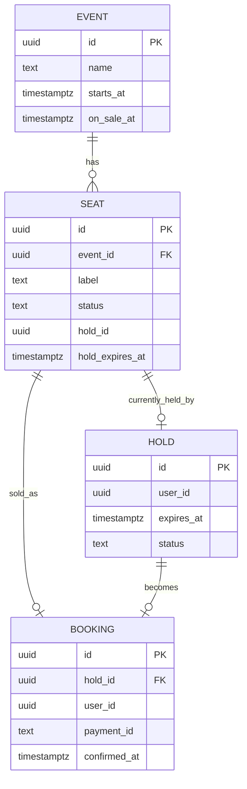
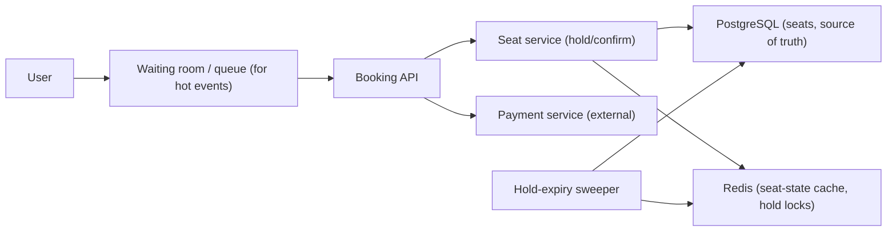
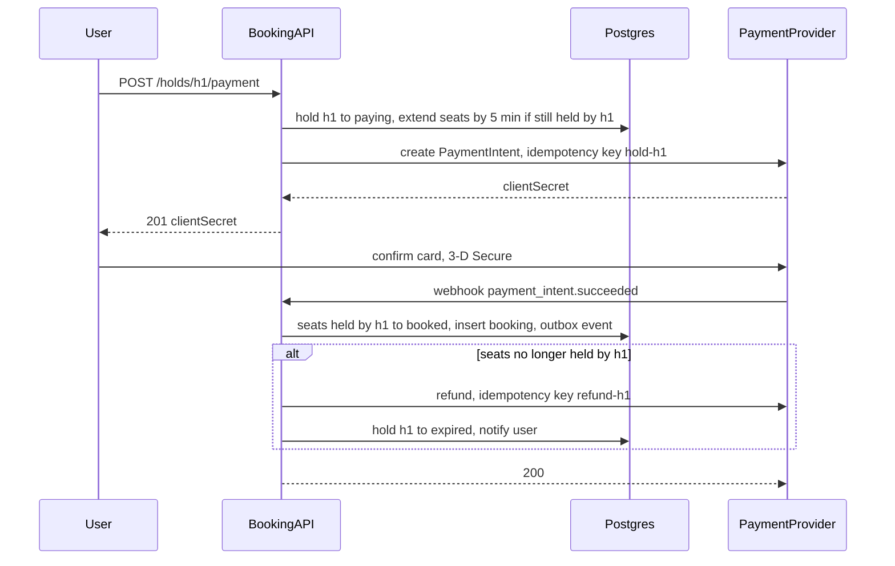

## 70.4 Ticket and Seat Booking System

> **Try it first** · Level: Intermediate · About 45 minutes
>
> **Build:** a ticketing system where users pick seats for an event, hold them while they pay, and never get a seat someone else already bought.
>
> **Requirements:**
> - Browse events and see which seats are available, held or booked.
> - Hold one or more seats for a fixed time while the user pays; confirm the booking when payment succeeds.
> - Release held seats automatically when the hold expires.
> - Never sell the same seat twice.
> - Survive thousands of people competing for the same seats when a popular event goes on sale.
>
> **Scale and constraints:** a 50,000-seat venue; 500,000 users in the first minutes and 100,000+ requests per second at on-sale; thousands hitting the same ~100 best seats; a 10-minute hold window; payment takes seconds to a minute and can fail. Hold p99 in the hundreds of ms; holds released within seconds of expiry; strong consistency on seat state.
>
> **Your task:** sketch the API, the data model and the main components; estimate throughput and what reaches the database; name the two hardest problems and how you would solve them.
>
> Spend the time on paper before you read on. The model design follows.

### 70.4.1 Requirements

A ticket and seat booking system lets users browse available seats for an event, hold one or more seats while they pay, and confirm the booking — without ever selling the same seat twice, even under intense contention when thousands of people rush for a popular event the moment tickets go on sale. The users are ticket buyers, and the business is event organizers. This design is the sharpest test of concurrency control under contention: the hard part is not scale in general but the hot moment when a popular event sells out and everyone wants the same few good seats at once.

Imagine a theatre box office on the morning tickets for a sold-out show go on sale. A crowd rushes the counter, all wanting seat A1. The clerk must give A1 to exactly one person, briefly reserve it while they find their wallet, release it if they do not pay in time, and never, ever hand the same seat to two people. The counter is the booking service; the brief reservation is the seat hold; the time limit is the hold expiry; "never two people" is the concurrency control that this whole design exists to guarantee.

### 70.4.2 Functional requirements

1. Browse events and see which seats are available, held, or booked.
2. Hold one or more seats for a short, fixed time while the user pays.
3. Confirm the booking by paying within the hold window; the seats become booked.
4. Release held seats automatically when the hold expires (the user did not pay).
5. Never sell the same seat twice (the absolute invariant).
6. Handle intense contention on popular events (thousands competing for the same seats).
7. Handle payment coupling: the seat is only truly sold when payment succeeds.

### 70.4.3 Non-functional requirements

| Property | Target | Why |
|---|---|---|
| Correctness | A seat is sold at most once, always | Double-selling is a serious business failure |
| Hold latency | p99 low (hundreds of ms) | Users expect an instant "seat held" |
| Contention handling | Thousands competing for one event without collapse | The on-sale moment is the whole challenge |
| Availability | High during on-sale spikes | The spike is exactly when the business needs it up |
| Hold expiry accuracy | Holds release promptly (seconds after expiry) | Expired holds must free seats for others |
| Consistency | Strong for seat state (no double-sell) | This is a correctness, not a performance, property |

### 70.4.4 Constraints

- The no-double-sell invariant is non-negotiable and requires strong consistency on seat state — this is a case where you cannot trade consistency for availability on the seat itself (contrast the KV store, 70.2).
- Extreme contention is concentrated: a popular event's best seats are a hot row/key that thousands hit simultaneously (the hot-row problem, Part 24).
- Payment is external, slow and can fail; the seat must be held during payment and released or confirmed based on the outcome.
- Spikes are massive and brief (the on-sale instant), so the system must absorb a thundering herd without over-provisioning for the quiet rest of the time.

### 70.4.5 Capacity estimation

| Quantity | Assumption | Calculation | Result |
|---|---|---|---|
| Popular event seats | A large venue | given | 50,000 seats |
| Users rushing at on-sale | Demand far exceeds supply | given | 500,000 users in the first minutes |
| Peak requests | Browsing + hold attempts | | 100,000+ requests/second at on-sale |
| Hold window | Time to pay | given | 10 minutes |
| Contention on best seats | Everyone wants the front rows | | thousands hitting the same ~100 seats |
| Payment time | External provider | given | seconds to a minute |

The second table turns those headline numbers into the sizes of each component:

| Quantity | Assumption | Calculation | Result |
|---|---|---|---|
| Orders needed to sell out | 50,000 seats, 3 seats per order on average | 50,000 / 3 | about 17,000 orders |
| Successful holds needed | 70 percent of holds convert to bookings | 17,000 / 0.7 | about 24,000 holds |
| Admission rate into the purchase flow | Database comfortably serves 3,000 hold transactions per second at about 3 ms each, 1.5 attempts per admitted user | 3,000 / 1.5 | admit 2,000 users per second |
| Time to admit enough buyers | 24,000 holds at 2,000 per second, plus failures and retries | | sold out within 1 to 3 minutes of admission |
| Users waiting in the queue | 500,000, each polling position every 15 s | 500,000 / 15 | about 33,000 tiny requests per second, served from Redis or the edge, never PostgreSQL |
| Users inside the flow at once | 2,000 per second x about 10 s spent choosing seats | | about 20,000 concurrent shoppers |
| Seat-map reads | 20,000 shoppers refreshing every 2 s | 20,000 / 2 | 10,000 per second |
| Seat-map payload | static geometry (1 to 2 MB, cached forever at the CDN) plus status: 50,000 seats x 2 bits | 100,000 bits | about 12.5 KB of status, refreshed every second |
| Hold-expiry work | 24,000 holds over 10 minutes, 30 percent abandoned | | about 7,000 releases over the sale, trivial |

The numbers say: the system must handle a 100,000 rps spike concentrated on a tiny set of hot seats, with strong consistency so none is double-sold, holds that expire reliably, and a queue to tame the thundering herd. The contention, not the total scale, is the design driver. Notice what the waiting room does to the numbers: 500,000 people become 33,000 cheap polls per second plus 2,000 admissions per second, and only the admissions ever reach the database.

### 70.4.6 API design

| Method | Path | Request | Response | Status | Idempotent | Notes |
|---|---|---|---|---|---|---|
| GET | `/events/{id}/seats` | | seat map with states | 200 | Yes | Available/held/booked |
| POST | `/events/{id}/holds` | `{ seatIds[] }` + Idempotency-Key | `{ holdId, expiresAt }` | 201, 409 (taken), 429 | Yes (idempotency key) | Creates a hold |
| POST | `/holds/{holdId}/confirm` | `{ paymentToken }` + Idempotency-Key | booking | 200, 409, 410 (expired) | Yes | Pay and confirm |
| DELETE | `/holds/{holdId}` | | | 204 | Yes | Release early |
| GET | `/holds/{holdId}` | | hold status | 200, 404, 410 | Yes | Check before confirm |

Idempotency keys (Part 33 — Distributed Transactions, section 33.12, and the payment system in Part 59, section 59.7.6) are essential: users on flaky mobile connections retry the hold and confirm requests, and a retry must not create a second hold or a double charge.

Three more endpoints belong to the waiting room and the payment step:

| Method | Path | Request | Response | Status | Notes |
|---|---|---|---|---|---|
| POST | `/events/{id}/queue` | | `{ queueToken, position }` | 201, 409 already queued | Join; the token is a signed JWT carrying the ticket number |
| GET | `/events/{id}/queue/status` | `Authorization: queue token` | `{ position, admitted, admissionToken? }` | 200 | Stateless check against one Redis counter; cacheable for 1 s |
| POST | `/holds/{holdId}/payment` | `{ paymentMethodId }` + Idempotency-Key | `{ clientSecret, status }` | 201, 410 expired | Moves the hold to `paying` and extends it while the provider works |

Every hold, payment and confirm call also requires the **admission token**, a short-lived JWT issued when the user's turn comes. A request without one gets `403`, which is what stops bots from skipping the queue by calling the booking API directly.

### 70.4.7 Data model



```sql
CREATE TABLE seats (
  id               uuid PRIMARY KEY,
  event_id         uuid NOT NULL,
  label            text NOT NULL,
  status           text NOT NULL DEFAULT 'available'
                   CHECK (status IN ('available','held','booked')),
  hold_id          uuid,
  hold_expires_at  timestamptz,
  version          integer NOT NULL DEFAULT 0,          -- optimistic locking
  UNIQUE (event_id, label)
);
-- Serves the expiry sweeper; partial index stays small
CREATE INDEX seats_hold_expiry_idx ON seats (hold_expires_at) WHERE status = 'held';
```

The `seats` table is the source of truth, and a seat's `status` plus `version` is where the no-double-sell guarantee lives.

The rest of the schema adds holds, bookings, and one constraint that acts as the final safety net whatever the application does:

```sql
CREATE TABLE events (
  id                  uuid PRIMARY KEY,
  name                text NOT NULL,
  starts_at           timestamptz NOT NULL,
  on_sale_at          timestamptz NOT NULL,
  max_seats_per_user  smallint NOT NULL DEFAULT 6
);

CREATE TABLE holds (
  id               uuid PRIMARY KEY,
  event_id         uuid NOT NULL REFERENCES events(id),
  user_id          uuid NOT NULL,
  status           text NOT NULL CHECK (status IN ('active','paying','confirmed','released','expired')),
  seat_count       smallint NOT NULL CHECK (seat_count BETWEEN 1 AND 10),
  expires_at       timestamptz NOT NULL,
  idempotency_key  text NOT NULL,
  created_at       timestamptz NOT NULL DEFAULT now(),
  UNIQUE (user_id, idempotency_key)                 -- a retried POST returns the same hold
);
-- One live hold per user per event: a bot cannot hoard seats through parallel holds
CREATE UNIQUE INDEX holds_one_live_per_user ON holds (event_id, user_id)
  WHERE status IN ('active', 'paying');

CREATE TABLE bookings (
  id                 uuid PRIMARY KEY,
  hold_id            uuid NOT NULL UNIQUE REFERENCES holds(id),
  event_id           uuid NOT NULL,
  user_id            uuid NOT NULL,
  payment_intent_id  text NOT NULL UNIQUE,          -- one payment, one booking
  amount_minor       bigint NOT NULL,
  confirmed_at       timestamptz NOT NULL DEFAULT now()
);

CREATE TABLE booking_seats (
  booking_id    uuid NOT NULL REFERENCES bookings(id),
  event_id      uuid NOT NULL,
  seat_id       uuid NOT NULL REFERENCES seats(id),
  cancelled_at  timestamptz,
  PRIMARY KEY (booking_id, seat_id)
);
-- The last line of defence: a seat can be in at most one non-cancelled booking, ever
CREATE UNIQUE INDEX booking_seats_one_live ON booking_seats (seat_id) WHERE cancelled_at IS NULL;
```

`booking_seats_one_live` is belt-and-braces. If every other mechanism works, it never fires. If a Redis failover, a sweeper bug, or a hand-written admin script ever tries to sell a seat twice, the second `INSERT` fails and the transaction rolls back. The incident in 70.4.21 is the day this index earned its keep.

### 70.4.8 High-level architecture



For a hot event, users first pass through a **waiting room / virtual queue** that admits them to the booking API at a controlled rate, taming the thundering herd. The seat service performs holds and confirms against PostgreSQL (the source of truth for seat state) with strong concurrency control, caching the seat map in Redis for browsing. Payment is external; the hold spans the payment. A sweeper releases expired holds.

### 70.4.9 Component design

| Component | Responsibility |
|---|---|
| Waiting room / queue | Admit users to the on-sale at a controlled rate (thundering-herd control) |
| Seat service | Hold and confirm seats with strong concurrency control (no double-sell) |
| Seat state store | PostgreSQL: the authoritative seat status with locking/versioning |
| Seat map cache | Redis: the seat map for browsing (eventually consistent is fine for browsing) |
| Payment integration | Charge during the hold; confirm or release based on outcome |
| Hold-expiry sweeper | Release holds past their expiry, freeing seats |

### 70.4.10 Deep dive: the no-double-sell concurrency control

This is the heart of the design. Holding a seat must be atomic and exclusive: among thousands trying to hold seat A1, exactly one succeeds. The robust approach is a conditional update in PostgreSQL that only succeeds if the seat is currently available (Part 24 on locking and the hot-row problem):

```sql
-- Atomic hold: only succeeds if the seat is still available.
-- If two requests race, only one updates a row (0 rows updated = lost the race -> 409).
UPDATE seats
   SET status = 'held', hold_id = $1, hold_expires_at = now() + interval '10 minutes',
       version = version + 1
 WHERE id = $2 AND status = 'available';
-- rows affected = 1 -> you got the seat; = 0 -> someone else did -> return 409
```

The `WHERE status = 'available'` makes the update conditional and atomic: PostgreSQL serializes the row update, so exactly one of the racing transactions finds the seat available and claims it; the rest update zero rows and are told the seat is taken. This is optimistic concurrency on the seat row and is the core guarantee. For multiple seats in one hold, do them in one transaction (all-or-nothing) with consistent lock ordering to avoid deadlocks (Part 24).

**Confirming** turns a valid (unexpired) hold into a booking, coupled with payment:

```sql
-- Confirm only if the hold is still valid (not expired, still held by this hold).
UPDATE seats SET status = 'booked'
 WHERE hold_id = $1 AND status = 'held' AND hold_expires_at > now();
-- then record the booking with the payment id, in the same transaction
```

**Payment coupling** is the subtle part: the seat is held, then payment is attempted (external, slow, fallible), then the seat is confirmed or released. The flow must handle payment success after hold expiry (rare race: hold expired and seat was resold — the payment must be refunded and the user told) and payment failure (release the hold). Idempotency keys ensure a retried confirm does not double-charge. The invariant throughout: a seat moves available -> held -> booked only via atomic conditional updates, so it is never booked twice.

#### Deep dive: holding several seats at once, under contention

A family wants four adjacent seats. Either all four are held or none, and the transaction must not deadlock with another family grabbing an overlapping block in a different order. Two refinements over the single-seat update make this work at on-sale load.

1. **Lock in a fixed order and do not wait.** `SELECT ... ORDER BY id FOR UPDATE SKIP LOCKED` locks the requested seats in id order and silently skips any seat another transaction is holding a lock on right now. If fewer rows come back than were requested, someone else is mid-hold on at least one seat, and the right answer is an immediate `409`, not a 2-second wait behind 3,000 other transactions on the same hot row. With `SKIP LOCKED` nobody waits, so nobody deadlocks.
2. **Treat expired holds as available inside the query.** The condition `status = 'available' OR (status = 'held' AND hold_expires_at < now())` makes expiry lazy: a seat whose hold ran out is immediately claimable even if the sweeper has not visited it yet. The sweeper becomes housekeeping for the seat map, not part of correctness.

```ts
// booking/holds.service.ts
@Injectable()
export class HoldsService {
  constructor(private readonly dataSource: DataSource) {}

  async hold(eventId: string, userId: string, seatIds: string[], idemKey: string): Promise<HoldResult> {
    return this.dataSource.transaction(async (em) => {
      const replay = await em.query(
        `SELECT id, expires_at FROM holds WHERE user_id = $1 AND idempotency_key = $2`, [userId, idemKey]);
      if (replay.length) return { holdId: replay[0].id, expiresAt: replay[0].expires_at, replayed: true };

      const free: { id: string }[] = await em.query(
        `SELECT id FROM seats
          WHERE event_id = $1 AND id = ANY($2::uuid[])
            AND (status = 'available' OR (status = 'held' AND hold_expires_at < now()))
          ORDER BY id
          FOR UPDATE SKIP LOCKED`, [eventId, seatIds]);
      if (free.length !== seatIds.length) {
        const taken = seatIds.filter((s) => !free.some((f) => f.id === s));
        throw new ConflictException({ code: 'SEATS_TAKEN', seatIds: taken });   // rolls back, releases locks
      }

      const holdId = uuidv7();
      await em.query(   // fails on holds_one_live_per_user if this user already has a live hold
        `INSERT INTO holds (id, event_id, user_id, status, seat_count, expires_at, idempotency_key)
         VALUES ($1, $2, $3, 'active', $4, now() + interval '10 minutes', $5)`,
        [holdId, eventId, userId, seatIds.length, idemKey]);
      await em.query(
        `UPDATE seats SET status = 'held', hold_id = $1,
                hold_expires_at = now() + interval '10 minutes', version = version + 1
          WHERE id = ANY($2::uuid[])`, [holdId, seatIds]);
      return { holdId, expiresAt: new Date(Date.now() + 600_000), replayed: false };
    });
  }
}
```

The whole transaction holds row locks for about 3 ms. It never spans a network call to anything except PostgreSQL, which is the property that lets 3,000 of them run per second.

#### Deep dive: payment coupling as a small saga

The hold-pay-confirm flow is a three-step saga (Part 33, section 33.3) with one external participant, and each step must be safe to repeat.



The details that make it correct:

- **Extend the hold when payment starts, not before.** A user who chose seats and walked away loses them at 10 minutes. A user who started paying gets their seats extended by 5 minutes, but only if the hold is still valid at that instant (`WHERE hold_id = $1 AND hold_expires_at > now()`). This removes most of the "paid after expiry" races without letting anyone squat on seats.
- **The webhook, not the browser, confirms.** The browser may close after 3-D Secure; the provider's webhook always arrives (with retries). The confirm transaction checks that the number of seats it moved to `booked` equals `holds.seat_count`; anything less means the hold was lost, and the code path is a refund, never a partial booking.
- **Deterministic idempotency keys.** `hold-{holdId}` for the charge and `refund-{holdId}` for the refund mean a retried webhook or a retried API call collapses to one charge and at most one refund at the provider, the same discipline as Part 59, section 59.7.
- **The unknown outcome.** If the call to create the PaymentIntent times out, we do not know whether the customer can be charged. The hold stays `paying`, and a resolver polls the provider by idempotency key before the extended expiry, as in Part 33, section 33.13.

#### Deep dive: the waiting room

The waiting room is a fairness mechanism and a load-shaping mechanism at once. The design below needs one Redis key per event for the queue and does no database work per poll.

1. **Before on-sale: a lottery, not a race.** Users who arrive between 09:30 and 10:00 join a pre-queue with a random score: `ZADD wr:{evt42}:pre <random 0..1> <userId>`. At 10:00 the pre-queue is converted to ticket numbers in score order. Arriving at 09:59:59.999 with a bot gives no advantage over arriving at 09:45.
2. **After on-sale: first come, first served.** `INCR wr:{evt42}:seq` returns the next ticket number. The user receives a queue token: a JWT signed by the server holding `{ eventId, ticket, userId, exp }`, so the server never needs to look the ticket up.
3. **Admission is one counter.** An admitter job raises `wr:{evt42}:admitted` by R every second. A status poll verifies the queue token's signature and compares `ticket <= admitted`, one `GET` against Redis, and the response is cacheable at the edge for a second because every user sees the same counter.
4. **R adapts.** The admitter is a feedback loop: it lowers R when hold-transaction p99 rises above 50 ms or when the hold-conflict rate exceeds 40 percent (too many people chasing too few seats), and raises it when the database is relaxed. When `available` seats reach zero, it stops admitting and tells the queue "sold out" rather than letting 400,000 people discover it one by one.
5. **The admission token gates the API.** When admitted, the user gets a second JWT valid for 15 minutes, bound to their user id and event, and every booking endpoint checks it.

```ts
// booking/admission.guard.ts
@Injectable()
export class AdmissionGuard implements CanActivate {
  constructor(private readonly jwt: JwtService) {}

  async canActivate(ctx: ExecutionContext): Promise<boolean> {
    const req = ctx.switchToHttp().getRequest();
    const token = req.headers['x-admission-token'];
    if (typeof token !== 'string') throw new ForbiddenException('admission required');
    try {
      const claims = await this.jwt.verifyAsync<{ sub: string; evt: string; typ: string }>(token);
      // Bound to this user and this event: a token shared with a friend or a bot farm is useless
      if (claims.typ !== 'admission' || claims.sub !== req.user.id || claims.evt !== req.params.eventId) {
        throw new ForbiddenException('admission token not valid for this request');
      }
      return true;
    } catch (err) {
      if (err instanceof ForbiddenException) throw err;
      throw new ForbiddenException('admission token expired or invalid');
    }
  }
}
```

#### Deep dive: general admission and the hot counter

Not every event has numbered seats. A general-admission tier ("Standing, 20,000 tickets") has no seat rows at all, just a counter, and the counter is the hottest row in the system:

```sql
-- Conditional increment: succeeds only while capacity remains
UPDATE ticket_tiers SET sold = sold + $2
 WHERE id = $1 AND sold + $2 <= capacity
RETURNING sold;
```

Every buyer updates the same row, so these updates serialize on its row lock. At roughly 0.5 to 1 ms each, one row tops out around 1,000 to 2,000 sales per second, and the lock queue makes p99 latency explode long before that. The fix is the same as for inventory counters in Part 59, section 59.9: split capacity across N bucket rows (`ticket_tier_buckets(tier_id, bucket_no, capacity, sold)`), have each request try a random bucket, and fall through to the next bucket when one is full. Ten buckets give ten times the throughput, and the only cost is that the last few tickets are found by a short scan.

#### Alternative engine: holds in Redis with a Lua script

For the most extreme on-sales, some platforms take holds in Redis, which serves 100,000 operations per second on one shard without breaking a sweat, and only touch PostgreSQL at confirm time. The script must be all-or-nothing across seats, so every seat key of one event shares a hash tag (`{evt42}`) and lives in one cluster slot:

```bash
# KEYS: hold:{evt42}:A1 hold:{evt42}:A2 ...  ARGV[1] = holdId, ARGV[2] = ttl in ms
EVAL "for _, k in ipairs(KEYS) do if redis.call('EXISTS', k) == 1 then return 0 end end
      for _, k in ipairs(KEYS) do redis.call('SET', k, ARGV[1], 'PX', ARGV[2]) end
      return 1" 2 hold:{evt42}:A1 hold:{evt42}:A2 h-7f3a 600000
```

Redis's native TTL gives expiry for free. The weakness is durability: Redis replication is asynchronous, so a primary failover can lose the most recent hold keys, and two people can then hold the same seat. That is acceptable only because PostgreSQL's `booking_seats_one_live` index refuses the second confirm, which is exactly what happened in 70.4.21.
