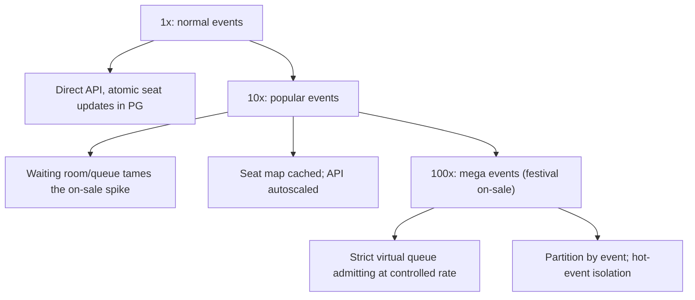

### 70.4.11 Caching

The seat map for **browsing** is cached in Redis (eventually consistent is fine — a user seeing a seat as available that was just held will simply fail the atomic hold and get a 409, which is correct). The **hold/confirm** operations go to PostgreSQL, not the cache, because they need strong consistency. This split — cache the browse, verify at the write — is the Part 30 pattern: the hot read path is cached, the correctness-critical write path hits the source of truth.

### 70.4.12 Messaging

A hold expiry can be scheduled (a delayed message or a sweeper). Booking confirmations and cancellations emit events (outbox, Part 33) for downstream (email, inventory, analytics). The waiting room admits users by releasing queue tokens at a controlled rate.

| Event | Produced by | Consumers | Why it is asynchronous |
|---|---|---|---|
| `booking.confirmed` | Confirm transaction via outbox | Ticket delivery (PDF and wallet pass), email, analytics, organizer dashboard | None of these may delay or fail the confirm |
| `hold.expired` | Sweeper | Seat-map cache refresher, abandoned-cart email | Seat map freshness is best-effort |
| `booking.refund_required` | Confirm path when the hold was lost | Refund worker with retries | The provider call may fail and must be retried |
| `event.sold_out` | Admitter | Waiting room broadcast, marketing | Tells 400,000 waiting users at once |

The sweeper itself is a one-minute CronJob that releases holds in batches with `FOR UPDATE SKIP LOCKED`, so two sweeper replicas can run for redundancy without fighting:

```sql
UPDATE seats SET status = 'available', hold_id = NULL, hold_expires_at = NULL, version = version + 1
 WHERE id IN (SELECT id FROM seats
               WHERE status = 'held' AND hold_expires_at < now() - interval '5 seconds'
               ORDER BY hold_expires_at
               LIMIT 5000
               FOR UPDATE SKIP LOCKED);
```

### 70.4.13 Scaling



The challenge is the concentrated spike, not steady throughput. The waiting room/queue is the key scaling tool: rather than let 500,000 users hit the booking API at once, admit them at a rate the system can handle, so the atomic seat updates never face more concurrency than PostgreSQL can serialize comfortably. Partitioning by event isolates a hot event so it does not affect others. The seat updates themselves are fast; the queue prevents them from being swamped.

| Stage | Typical biggest on-sale | Architecture | What changes |
|---|---|---|---|
| 1x | 5,000-seat theatre, 20,000 interested users | API pods plus one PostgreSQL primary, conditional updates, no waiting room | Nothing exotic; `SKIP LOCKED` holds and lazy expiry are enough |
| 10x | 50,000-seat stadium, 500,000 users | Waiting room with adaptive admission, seat map in Redis and at the edge, admission tokens | The queue appears; the database sees 2,000 admissions per second instead of 100,000 requests |
| 100x | Several stadium tours on sale the same morning, millions of users | Events sharded across several PostgreSQL clusters by `event_id`, waiting room at the edge (CDN workers), Redis holds for the hottest events with PostgreSQL as the confirm-time authority | Isolation: one mega on-sale must not slow a theatre sale elsewhere; per-event capacity is planned like a launch |

The 100x row also changes the organization: on-sales become scheduled operational events with a runbook, a war room, pre-scaled capacity and a load test against a production-sized copy the week before.

### 70.4.14 Security

Prevent scalping and bots: rate-limit per user, require authentication, CAPTCHA or bot detection at the waiting room, limit seats per user per event. Prevent hold abuse (holding seats to deny others without buying) via per-user hold limits and the expiry. Ensure authorization (a user can only confirm their own hold). Protect against payment fraud (see the payment system in Part 59, section 59.7.14, and Part 44 — Security, section 44.35 on abuse prevention). The waiting room itself must be fair and resistant to queue-jumping.

Concretely: one account can join a queue once (`409` on a second join), queue and admission tokens are bound to the user id, accounts created in the last 24 hours or with no purchase history get a CAPTCHA, and `max_seats_per_user` is enforced at confirm time across all of the user's bookings for the event, not just per hold, because a scalper will otherwise buy six seats ten times.

### 70.4.15 Failure scenarios

| Failure | Detection | Impact | Mitigation | Effect |
|---|---|---|---|---|
| Two users race for one seat | Normal contention | Only one can win | Atomic conditional update; loser gets 409 | Correct: one seat, one buyer |
| Hold expires before payment | Sweeper | Seat released, user pays late | Confirm checks expiry; if seat resold, refund and apologize | Rare, handled |
| Payment succeeds after hold expired | Payment callback vs seat state | User paid but seat gone | Refund automatically, notify user | Rare race, contained |
| Payment fails | Provider response | Hold wasted | Release hold immediately, free the seat | Seat freed promptly |
| Thundering herd at on-sale | Traffic spike | API/DB overload | Waiting room admits at controlled rate | Smoothed |
| Sweeper down | Expiry lag alert | Expired holds not released | Redundant sweeper; confirm also checks expiry | Degraded, self-healing |
| Duplicate hold/confirm (retry) | Idempotency key | Double hold/charge risk | Idempotency keys dedupe | None |
| DB hot row on the best seats | Lock contention on A1 | Serialization queue on one row | Queue admits slowly; contention is on a fast update | Bounded |
| Redis failover loses recent hold keys (Redis-hold variant) | Failover event, confirm-time unique violations | Two users hold and pay for one seat | `booking_seats_one_live` rejects the second confirm; automatic refund and apology (70.4.21) | One user refunded, no double-sell |
| Payment provider down during on-sale | Circuit breaker, intent creation errors | Holds expire while users cannot pay | Pause admission; extend all `paying` holds once; fail over to secondary provider | Short pause in the queue |
| Webhook delayed beyond the extended hold | Webhook age metric | Seat may be released and resold | Confirm path detects lost hold, refunds; resolver polls provider before expiry | Rare refund |
| Admission token shared or replayed by a bot farm | Many users per token, token use from many IPs | Queue-jumping | Tokens bound to user id and event, short expiry, single active session per admission | Rejected |
| Seat map stale | Map version age | Users click seats that are gone | Expected: hold returns `409` with the taken seat ids and the client refreshes | Mild annoyance |
| Sold out while 400,000 still queue | `available = 0` | Wasted waiting and polling load | Admitter publishes `event.sold_out`; queue status returns sold out at the edge | Clear message |

### 70.4.16 Observability

Metrics: hold success/failure (409) rate, confirm success rate, hold-to-confirm conversion, hold expiry rate, payment success/failure, waiting-room queue depth and admit rate, seat-update latency and contention, double-sell count (must always be zero — alert immediately on any). Alerts: any double-sell (critical), sweeper lag (holds not releasing), payment-after-expiry races, queue overload. Dashboards: on-sale health (admit rate, holds/s, conversions), inventory (available/held/booked per event).

### 70.4.17 Deployment

Autoscaled stateless booking API; PostgreSQL (the source of truth) with enough capacity for the serialized seat updates; Redis for the seat-map cache and queue; a redundant sweeper (CronJob plus confirm-time expiry check as backup). The waiting room is deployed ahead of popular on-sales and tuned for the expected demand. Load-test the on-sale path specifically, because the spike is the whole risk.

### 70.4.18 Cost considerations

The system is quiet most of the time and spikes hard at on-sale, so autoscaling and the waiting room (which smooths the spike) control cost — you do not provision permanently for the peak. PostgreSQL must handle the serialized seat updates during the spike (the hot-row throughput), which is modest per update but concentrated. The waiting room lets you serve a huge demand spike with far less infrastructure than handling it all at once would require, which is its cost benefit as well as its correctness benefit.

### 70.4.19 Tradeoffs

- **Strong consistency on seat state** (no double-sell) over availability: here, unlike the KV store (70.2), correctness wins absolutely — a seat's state must be strongly consistent, so we accept that seat updates serialize on the hot row.
- **Waiting room/queue** (controlled admission) over letting everyone in: smooths the thundering herd and protects correctness, at the cost of users waiting in a queue (which, done well, is a better experience than errors).
- **Optimistic conditional update** (atomic, no explicit lock held across the hold) over pessimistic row locks held for the whole payment: we do not hold a database lock during the slow external payment (that would be disastrous for throughput); instead the seat is marked held and the lock is released, with expiry handling the abandonment.
- **Cache the browse, verify at the write**: eventually-consistent seat map for browsing (fast, scalable) with strongly-consistent holds (correct), accepting that a browsed-available seat may fail the hold (a correct 409).

| Decision | Options | Chosen | Why | Cost |
|---|---|---|---|---|
| Where holds live | PostgreSQL rows, Redis keys with TTL | PostgreSQL by default, Redis only for the largest on-sales | One source of truth until the numbers force otherwise | Redis variant needs the confirm-time constraint and failover drills |
| How to wait for a hot seat | Block on the lock, `NOWAIT` error, `SKIP LOCKED` | `SKIP LOCKED` | Losers get an instant `409`; no lock queues, no deadlocks | A seat locked by a transaction that then rolls back looks taken for 3 ms |
| Expiry | Sweeper only, lazy in queries, delayed message | Lazy in queries plus sweeper | Correctness does not depend on a background job | Seat map lags by up to a minute without the sweeper |
| Queue fairness | Pure FIFO, lottery before on-sale, lottery always | Lottery pre-queue, then FIFO | Removes the bot advantage at the opening second | Harder to explain to users |
| Payment timing | Charge before hold, pay inside hold, pay after booking | Pay inside an extended hold | No charge without a seat, no seat without a charge | Rare refunds when a webhook is late |

### 70.4.20 Alternative architectures

**Redis-based holds with atomic operations**: hold seats via atomic Redis operations (a `SET NX` lock per seat with a TTL that is the hold expiry), with PostgreSQL as the durable record on confirm. Redis's atomic ops and native TTL make holds and expiry fast and simple, handling huge contention in memory; the tradeoff is Redis is not the durable source of truth, so you reconcile to PostgreSQL on confirm and handle Redis failures carefully. This is a common real approach for extreme-contention on-sales.

**Pessimistic locking (`SELECT ... FOR UPDATE`)**: lock the seat row during the hold. Simple and correct for low contention, but holding locks under the on-sale thundering herd causes severe lock contention and does not scale to the spike; the optimistic conditional update is preferred for high contention. Pessimistic locking is fine for normal events and simpler to reason about.

**Partitioned/sharded by event with per-event capacity**: for a platform with many simultaneous on-sales, partition by event so each hot event is isolated on its own capacity and cannot starve others. Combined with the waiting room, this is how large ticketing platforms handle many big on-sales at once.

### 70.4.21 Incident story: the failover that tried to sell 37 seats twice

A stadium on-sale used the Redis-hold variant for its hottest section. At 10:03:12, two minutes into the sale, the Redis primary that owned the `{evt881}` slot was terminated by a failed host. The replica was promoted in about 9 seconds. Replication lag at that moment was about 150 ms, and in those 150 ms the old primary had accepted 212 new hold keys that never reached the replica.

On the new primary those 212 seats looked free. Within a minute, 180 of them had been held again by other users. Both sets of users went on to pay: the first set's payment flow did not re-check Redis (the hold id was in their session), and the second set had a perfectly valid hold. At 10:05 the confirm workers began logging `duplicate key value violates unique constraint "booking_seats_one_live"`: 37 times in total, because 37 seat pairs reached confirmation with both buyers paid.

Each failed confirm rolled back and took the "hold lost" path: automatic refund with the deterministic refund key, the hold marked expired, and an email offering the buyer the best available seats in the same price band with a priority link. Customer support received 41 tickets. No seat was sold twice.

The postmortem changed three things. The confirm path now re-verifies the Redis hold value matches the hold id immediately before charging, which would have caught most of the 37 before payment. After any failover of a hold shard, the admitter automatically pauses admission for 30 seconds and a reconciliation job compares Redis holds with PostgreSQL holds for the event. And the team wrote down the principle that justified the design in the first place: **Redis may decide who gets to try; only PostgreSQL decides who gets the seat.** If the unique index had not existed, the same incident would have been 37 double-sold seats on the front page of a newspaper.

### 70.4.22 Interview follow-ups

1. **Two users click the same seat at the same millisecond. Walk me through what happens.**
   Expected answer: both run `UPDATE ... WHERE id = $1 AND status = 'available'` (or the `SKIP LOCKED` select). PostgreSQL row locking lets one update first; the second re-evaluates the `WHERE` against the committed row, finds it held, and updates zero rows, so it returns `409`. Why it matters: it shows you understand that the database, not application code, is the arbiter. Follow-up: what isolation level do you need? (Read committed is enough because the condition is re-checked on the locked row; Part 24, section 24.2.)
2. **Why not `SELECT ... FOR UPDATE` and hold the lock until payment finishes?**
   Expected answer: the lock would be held for seconds to minutes across an external call, every other request for that seat would queue, connections would pile up, and the pool would exhaust. Mark the seat held, commit, and let expiry handle abandonment.
3. **How does the hold expire if the sweeper is down?**
   Expected answer: lazily: the hold query treats `held` with a past `hold_expires_at` as available. The sweeper only tidies the seat map.
4. **How do you stop bots?**
   Expected answer: bound queue and admission tokens, lottery pre-queue, per-user seat caps enforced at confirm, CAPTCHA on risky accounts, rate limits, purchase limits across bookings, and post-sale cancellation of detected scalper orders.
5. **The organizer wants 20,000 general-admission tickets. What changes?**
   Expected answer: no seat rows; a capacity counter that is a single hot row, so split it into buckets, or decrement in Redis with a Lua check and reconcile to PostgreSQL.
6. **Payment succeeded but the seats are gone. What does the user see?**
   Expected answer: a refund issued automatically with an idempotent refund key, a clear message, and an offer of comparable seats. Never a partial booking.

### 70.4.23 Practical exercise

Build the hold-and-confirm core as a NestJS module with PostgreSQL and run a contention test.

1. Create the schema from 70.4.7 for one event with 1,000 seats.
2. Implement `POST /events/:id/holds` with the `SKIP LOCKED` transaction, lazy expiry and idempotency keys, and `POST /holds/:id/confirm` that moves seats to booked and writes `booking_seats`.
3. Implement the waiting room counter and the `AdmissionGuard`.
4. Write a k6 or autocannon script that simulates 5,000 virtual users each trying to hold 2 random seats from the best 50, then confirming.

Acceptance criteria:

- After the run, `SELECT seat_id, count(*) FROM booking_seats WHERE cancelled_at IS NULL GROUP BY 1 HAVING count(*) > 1` returns zero rows.
- p99 latency of the hold endpoint stays under 100 ms with 500 concurrent users, and no request waits on a lock (check `pg_stat_activity` for `wait_event_type = 'Lock'` during the test).
- Killing the sweeper for the whole test does not prevent expired seats from being re-held.
- Replaying any hold or confirm request with the same idempotency key returns the original response and creates nothing new.
- Calling the hold endpoint without an admission token returns `403`; with another user's token, `403`.

## 70.5 Closing: what these four designs teach

The four systems in this Part each stress a different core skill, and together they round out the distributed-systems toolkit that Part 59 began. Each was taken through the full method: estimation that forces decisions, an API and schema with real constraints, deep dives on the two or three paths that carry the risk, a failure table, a scaling ladder, a decision table, and an incident story that shows how the design fails in practice. The web crawler is about taming an unbounded, adversarial space with politeness, deduplication and a prioritized frontier — the discipline of being a good citizen while covering enormous ground. The distributed key-value store is the heart of distributed systems: partitioning by consistent hashing, replication, and the quorum knob that makes the CAP tradeoff tunable per operation — the design behind every NoSQL store in Part 29. The unique ID generator shows that even a tiny component is a distributed-systems problem, with real tradeoffs between coordination, sortability, size and clock dependence, and a pragmatic modern default in UUIDv7. The ticket booking system is the sharpest concurrency problem in the book: an absolute no-double-sell invariant under a concentrated thundering herd, solved with atomic conditional updates and a waiting room rather than by trading away correctness.

Read across them, the recurring senior lessons are clear. Contention and coordination, not raw throughput, are usually the hard part — the booking system's spike on a few seats and the KV store's quorum coordination are the real challenges, not the gross request count. The CAP tradeoff is a per-system choice: the KV store makes it tunable and often favors availability, while the booking system refuses to trade consistency on a seat because double-selling is unacceptable, and naming which invariant cannot be relaxed is the key design decision. The database's atomic operations and constraints are your best concurrency control, as the conditional seat update shows. And the "when not to build" alternative is always present: use a proven distributed KV store rather than writing your own, default to UUIDv7 rather than a bespoke Snowflake, crawl one site with a single simple process rather than a distributed fleet — build the complex version only when a specific requirement genuinely demands it.

The four incident stories share one shape, and it is worth naming because you will meet it again. In every case the system looked healthy on the metrics people watched: the crawler's throughput was perfect while coverage collapsed, the key-value store was available while it resurrected deleted keys, the id generator produced ids happily while two clusters shared a worker id, and the booking system kept selling while a failover tried to double-sell 37 seats. Each was caught, or would have been caught, by an **invariant check** rather than a performance metric: a never-seen canary, time since last repair, a content hash on repeated ids, a unique index. The senior habit is to write down the invariant each system exists to protect and then build something that screams when it is violated.

## Senior Checklist — Part 70

- [ ] I understand the concept
- [ ] I can explain it simply
- [ ] I can implement it
- [ ] I understand its failure modes
- [ ] I understand its scaling limitations
- [ ] I understand its security implications
- [ ] I understand its operational implications
- [ ] I can choose between alternatives
- [ ] I can explain the tradeoffs
- [ ] I can answer senior-level interview questions
- [ ] I can design a web crawler with politeness, deduplication (Bloom filter + store) and a prioritized, durable frontier
- [ ] I can explain consistent hashing, replication, and how R/W quorums make consistency tunable (R + W > N)
- [ ] I can reason about conflict resolution (vector clocks vs last-write-wins) and partition behavior in a distributed KV store
- [ ] I can compare Snowflake, UUIDv4, UUIDv7 and database sequences and handle clock skew
- [ ] I can guarantee no double-sell with an atomic conditional update and handle hold expiry and payment coupling
- [ ] I can use a waiting room/queue to tame a thundering herd without trading away correctness
- [ ] For each system I can name the alternative that avoids building it and when to prefer it
- [ ] I can size a Bloom filter (bits per item, hash functions) and explain why its positives must be confirmed
- [ ] I can design a two-level crawl frontier and an atomic per-host claim that enforces politeness across fetchers
- [ ] I can explain why a sloppy quorum breaks R + W > N, and why a node must not rejoin after `gc_grace_seconds`
- [ ] I can budget Snowflake bits, manage worker-id leases with self-fencing, and explain why ids are strings in JSON
- [ ] I can explain why id order is not commit order and how to tail a table without skipping rows
- [ ] I can hold several seats atomically with `FOR UPDATE SKIP LOCKED`, lazy expiry and a confirm-time unique index
- [ ] I can write down the invariant each design protects and the check that detects its violation

## Part 70 — Key Takeaways

- A web crawler is a politeness and deduplication problem as much as a throughput one: obey robots.txt and per-domain rate limits absolutely, dedup with a Bloom filter backed by an exact store, and keep a durable, prioritized, domain-partitioned frontier.
- Consistent hashing places keys on a ring so adding or removing a node moves only about 1/N of the data; virtual nodes keep load even — this is what makes a distributed store elastic.
- Replication plus quorum (R/W) makes consistency tunable per operation: R + W > N guarantees a read sees the latest write (strong), lower values trade consistency for availability and latency — the CAP tradeoff made operational.
- High availability under partitions means accepting conflicting writes and reconciling them (vector clocks, read repair, anti-entropy, hinted handoff); last-write-wins is simple but can silently lose writes under clock skew.
- A correct distributed KV store is extremely hard; use a proven one (DynamoDB, Cassandra) or even just PostgreSQL plus caching unless a specific requirement forces you to build one.
- A unique ID generator is a distributed-systems problem: Snowflake gives compact, sortable, coordination-free ids but depends on the clock and machine-id assignment; UUIDv7 is the pragmatic modern default — sortable, zero coordination, at 128 bits.
- Sortable ids (Snowflake, UUIDv7) give far better database index locality than random UUIDv4; handle clock backward-jumps in any time-based generator, and avoid raw sequences for public ids (they are enumerable).
- The ticket-booking no-double-sell invariant is guaranteed by an atomic conditional update (`WHERE status = 'available'`), where exactly one racing transaction claims the seat and the rest get a correct 409 — the database's atomic row update is the concurrency control.
- A waiting room/virtual queue tames the on-sale thundering herd by admitting users at a controlled rate, protecting both correctness and cost without permanently provisioning for the peak.
- Across all four: contention and coordination are the hard part, not raw throughput; name the invariant that cannot be relaxed (a seat sold once) to decide where strong consistency is mandatory; and always consider the alternative that avoids building the complex system at all.
- Every sortable id is assigned before commit, so tailing a table by id skips rows; read changes from the write-ahead log or filter by in-flight transactions instead.
- Throughput metrics cannot see correctness failures: protect each design's invariant with an explicit check (a canary, a repair-age alert, a unique constraint) that pages when it is violated.
