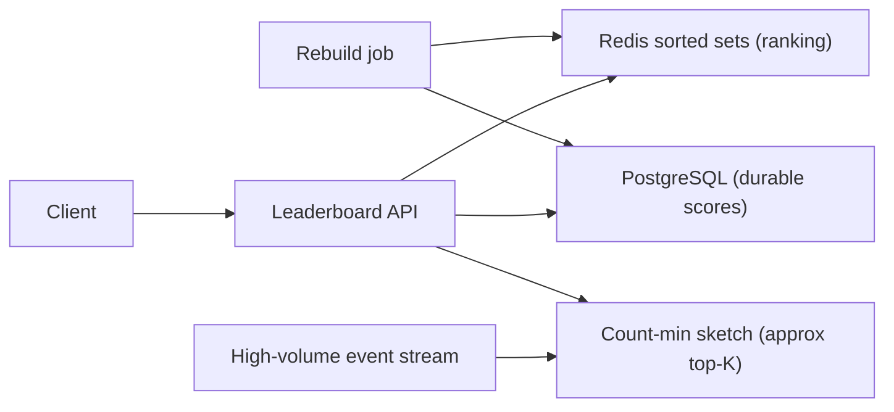
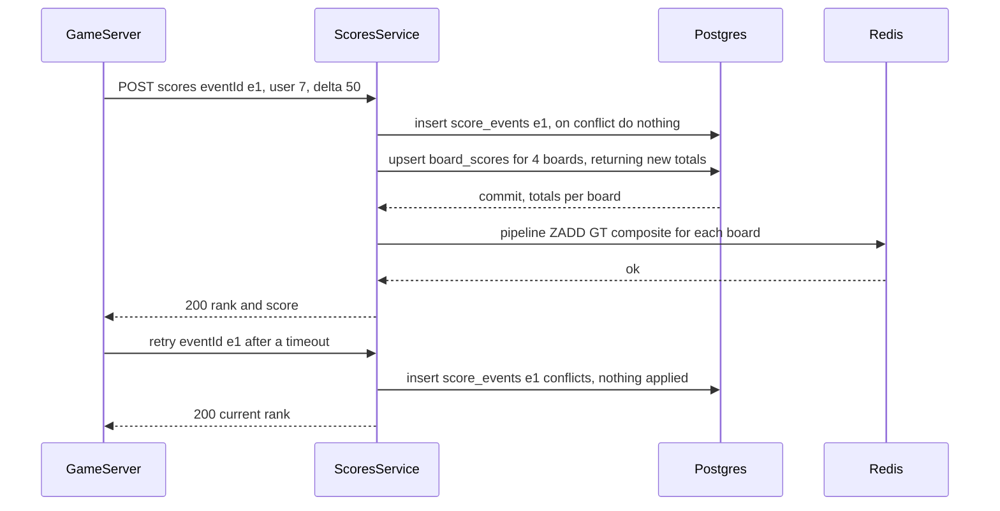

# Part 71 — More System Designs II

This Part continues the system-design case studies, using the same method and twenty-section template as Part 59 and Part 70. If you have not read section 59.0, read it first for the nine-move method and the template. The four systems here each probe a distinct skill: a **leaderboard and top-K** system (Redis sorted sets, approximate top-K, sharded leaderboards), **collaborative document editing** (operational transform versus CRDTs, presence, offline sync), **proximity search** for nearby drivers and restaurants (geohash, quadtrees, PostGIS, high-rate location updates), and **ad-click and metrics aggregation** (high-volume ingestion, exactly-once counting, windowed aggregation, reconciliation). Together with Parts 59 and 70, these complete a broad library of worked designs.

## 71.1 Leaderboard and Top-K

> **Try it first** · Level: Beginner · About 30 minutes
>
> **Build:** a real-time game leaderboard that ranks millions of players, plus a top-K service for the most-viewed items in a high-volume event stream.
>
> **Requirements:**
> - Update a user's score (set or increment) in real time.
> - Get the top N users, a given user's rank and score, and the users ranked just above and below them.
> - Time-scoped boards: all-time, this week, today.
> - Top-K variant: find the most-viewed items in a stream, approximately when exact is too costly.
>
> **Scale and constraints:** 10 million users on a board; 10,000 score updates and 50,000 rank queries per second at peak; a 1,000,000 events per second stream for top-K. Update and rank-query p99 in single-digit ms; a score change visible in the rank within about 1 s; no lost updates; exact ranks, approximate top-K acceptable.
>
> **Your task:** sketch the API, the data model and the main components; estimate memory and throughput; name the two hardest problems and how you would solve them.
>
> Spend the time on paper before you read on. The model design follows.

### 71.1.1 Requirements

A leaderboard ranks users by a score — game scores, points, sales, engagement — and answers "what is the top N?", "what rank is this user?", and "who is near this user's rank?", updating in real time as scores change. The users are players (seeing their rank), the product (showing leaderboards), and sometimes analytics (top-K items by some metric). The design probes ranking at scale: how to maintain and query rankings efficiently when scores change constantly and the user base is huge, and when exact ranking becomes too expensive, how to approximate the top-K.

Imagine a scoreboard at a stadium that must instantly reflect every point scored and, on demand, show the top ten, your position, and the players just above and below you — for millions of competitors. Recomputing the whole ranking on every point would be impossible; the scoreboard keeps players in sorted order as scores change so any ranking question is answered by looking at a position in the sorted list. That sorted-order structure is what a Redis sorted set provides.

### 71.1.2 Functional requirements

1. Update a user's score (set or increment) in real time.
2. Get the top N users by score.
3. Get a specific user's rank and score.
4. Get the users ranked near a given user (the window around their rank).
5. Support time-scoped leaderboards (all-time, this week, today).
6. Scale to millions of users and frequent score updates.
7. (Top-K variant) Find the top-K items from a high-volume stream (most-viewed products) approximately when exact is too costly.

### 71.1.3 Non-functional requirements

| Property | Target | Why |
|---|---|---|
| Update latency | p99 low (single-digit ms) | Scores change constantly, in real time |
| Rank query latency | p99 low (single-digit ms) | Users check their rank frequently |
| Scale | Millions of users, thousands of updates/second | Popular games/apps |
| Freshness | Rank reflects a score change within ~1s | "Real-time" leaderboard |
| Accuracy | Exact where feasible; approximate top-K acceptable for streams | Exact ranking is costly at extreme scale |

### 71.1.4 Constraints

- Ranking must be fast for both updates and queries; recomputing a full sort per query is infeasible at millions of users.
- Score updates are frequent and must not lose updates.
- Exact top-K over a high-volume stream (billions of events) is expensive in memory; approximation (count-min sketch) trades a little accuracy for huge savings.
- Time-scoped leaderboards (weekly) need expiry/reset without disrupting the all-time board.

### 71.1.5 Capacity estimation

| Quantity | Assumption | Calculation | Result |
|---|---|---|---|
| Users on a leaderboard | Popular game | given | 10 million |
| Score updates | Peak | given | 10,000/second |
| Rank queries | Peak | given | 50,000/second |
| Redis sorted set memory | ~100 B per member (skip-list node, hash-table entry, a 10-15 byte member string) | 10M x ~100 B | about 1 GB per leaderboard |
| Top-K stream (approximate) | high-volume product views | given | 1,000,000 events/second |
| Count-min sketch memory | fixed, independent of item count | | a few MB (vs tracking every item) |

The numbers say: a Redis sorted set holds a 10M-user leaderboard in about 1 GB with O(log n) updates and rank queries, handling the update/query rates easily; but exact top-K over a 1M-event/second stream of many distinct items needs approximation (count-min sketch) to stay in a few MB rather than tracking counts for every item.

The second table turns the headline numbers into the size of each component:

| Quantity | Assumption | Calculation | Result |
|---|---|---|---|
| Boards per game | all-time, weekly, daily, plus 30 regional weeklies | 1 + 1 + 1 + 30 | 33 boards, each score event touches 4 of them |
| Redis writes from scores | 10,000 score events/second x 4 boards | 10,000 x 4 | 40,000 sorted-set writes per second |
| Redis capacity used | one Redis shard serves ~100,000 simple ops/second at ~0.3 ms | 40,000 writes + 50,000 reads | about 90 percent of one shard, so plan two |
| Board memory | all-time and weekly at 10M members, daily at 3M, regional at ~300k each | 1 + 1 + 0.3 + 30 x 0.03 GB | about 3.2 GB per game |
| PostgreSQL score events | 10,000 per second x ~120 bytes per row with index | 10,000 x 86,400 x 120 B | about 100 GB per day, so partition by day and drop after 30 days |
| PostgreSQL current scores | one row per user per board | 10M users x 4 boards x ~80 B | about 3.2 GB, small and hot |
| Rebuild time | `ZADD` in batches of 1,000 at ~200,000 members/second | 10M / 200,000 | about 50 seconds per 10M-member board |
| Top-100 response | 100 members x ~40 bytes JSON | | about 4 KB, cacheable for 1 second |

Two numbers drive the design. The write fan-out (each event touches four boards) means Redis writes, not reads, use most of the capacity. The 50-second rebuild means losing Redis is an outage of about a minute per board, not a data loss, so long as PostgreSQL holds the truth.

### 71.1.6 API design

| Method | Path | Request | Response | Notes |
|---|---|---|---|---|
| POST | `/leaderboards/{id}/scores` | `{ userId, score }` or `{ userId, delta }` | updated rank | Set or increment |
| GET | `/leaderboards/{id}/top?n=10` | | top N users | Top-N |
| GET | `/leaderboards/{id}/users/{userId}` | | `{ rank, score }` | User's rank |
| GET | `/leaderboards/{id}/users/{userId}/neighbors?window=5` | | users around the user's rank | Window around user |

The score-write endpoint is the dangerous one, so it deserves the full treatment:

| Method | Path | Request | Response | Status | Idempotent | Notes |
|---|---|---|---|---|---|---|
| POST | `/leaderboards/{id}/scores` | `{ eventId, userId, delta }` from the game server, signed | `{ rank, score }` | 200, 400, 401, 429 | Yes, by `eventId` | Only trusted game servers call it, never the client |
| GET | `/leaderboards/{id}/top?n=10` | | `[{ rank, userId, displayName, score }]` | 200 | Yes | `n` capped at 100 |
| GET | `/leaderboards/{id}/users/{userId}` | | `{ rank, score, percentile }` | 200, 404 unranked | Yes | Rank is 1-based in the API, 0-based in Redis |

The `eventId` matters because increments are not naturally idempotent. A game server that retries "add 50 points" after a timeout would otherwise add 100. `ZADD` with an absolute score is idempotent; `ZINCRBY` is not, so every increment carries an id that is deduplicated before it touches Redis, and a replayed id returns the current rank with `200` rather than adding again.

### 71.1.7 Data model

```text
Redis sorted set (ZSET) per leaderboard:
  key: "leaderboard:game42:weekly"
  members: userIds, scores: their score
  ZADD leaderboard:game42:weekly 1500 user:7     -- set/update a score (O(log n))
  ZINCRBY leaderboard:game42:weekly 50 user:7     -- increment a score
  ZREVRANGE leaderboard:game42:weekly 0 9 WITHSCORES  -- top 10 (O(log n + k))
  ZREVRANK leaderboard:game42:weekly user:7       -- a user's rank (O(log n))
  ZREVRANGE ... around the user's rank            -- neighbors

Durable source of truth in PostgreSQL (scores table) for recovery:
  scores(leaderboard_id, user_id, score, updated_at)  -- rebuild the ZSET from this
```

The Redis sorted set is the fast ranking structure; PostgreSQL holds the durable scores so the sorted set can be rebuilt if Redis is lost (Redis is a cache/index here, not the sole source of truth for anything that matters, per Part 30).

`ZREVRANGE` still works but has been deprecated since Redis 6.2 in favour of `ZRANGE key 0 9 REV WITHSCORES`; new code should use the `ZRANGE ... REV` form. The PostgreSQL side is two tables: an append-only log of score events that makes increments idempotent, and the current score per user per board that the rebuild job reads.

```sql
CREATE TABLE score_events (
  event_id     uuid        NOT NULL,
  game_id      text        NOT NULL,
  user_id      bigint      NOT NULL,
  delta        bigint      NOT NULL,
  created_at   timestamptz NOT NULL DEFAULT now(),
  PRIMARY KEY (event_id, created_at)          -- partition key must be in the PK
) PARTITION BY RANGE (created_at);            -- one partition per day, dropped after 30 days

CREATE TABLE board_scores (
  board_id     text        NOT NULL,
  user_id      bigint      NOT NULL,
  score        bigint      NOT NULL,
  achieved_at  timestamptz NOT NULL,          -- when the current score was reached, for tie-breaks
  PRIMARY KEY (board_id, user_id)
);
-- Serves the rebuild job and the PostgreSQL fallback for small boards
CREATE INDEX board_scores_rank_idx ON board_scores (board_id, score DESC, achieved_at);
```

Because the partition key has to be part of the primary key, the dedup guarantee only holds for retries that land on the same day. That is fine, because game servers retry within seconds, not days; the service also stamps `created_at` from the event, not from `now()`, so a retry hits the same partition.

### 71.1.8 High-level architecture



Score updates go to both Redis (for instant ranking) and PostgreSQL (for durability), and rank queries hit Redis. For approximate top-K over a high-volume stream, a count-min sketch counts items in fixed memory. A rebuild job can reconstruct the Redis sorted sets from PostgreSQL after a Redis loss.

### 71.1.9 Component design

| Component | Responsibility |
|---|---|
| Leaderboard API | Handle score updates and rank queries |
| Redis sorted sets | Maintain sorted ranking; answer top-N, rank, neighbors fast |
| PostgreSQL scores | Durable source of truth for scores; enables rebuild |
| Count-min sketch | Approximate counts for top-K over high-volume streams in fixed memory |
| Rebuild job | Reconstruct Redis sorted sets from PostgreSQL on recovery |
| Time-scope manager | Create/reset/expire weekly/daily leaderboards |

### 71.1.10 Deep dive: sorted sets, approximate top-K, sharding

**Redis sorted sets** are the core: they keep members ordered by score in a skip-list, so `ZADD`/`ZINCRBY` (update), `ZREVRANK` (rank), and `ZREVRANGE` (top-N and neighbors) are all O(log n) or O(log n + k). This gives exact, real-time ranking for millions of users in one data structure — the reason Redis is the standard leaderboard tool. Scores update instantly and any ranking question is a fast position lookup, not a re-sort.

**Approximate top-K (count-min sketch)**: for the top-K-items-in-a-stream variant (most-viewed products over a billion-event stream), tracking an exact count per item needs memory proportional to the number of distinct items. A **count-min sketch** (a cousin of the Bloom filter in Part 10 — Computer Science Fundamentals: Data Structures, section 10.16) is a fixed-size probabilistic structure that estimates item counts using a few hash functions and counters, so it tracks approximate counts for any number of items in a few MB, over-estimating slightly but never under-estimating. Combined with a small heap of the current top-K, it answers "approximate top-K" in bounded memory. You accept small inaccuracy for enormous memory savings — the right trade when exact top-K is infeasible.

**Sharded leaderboards**: a single sorted set can become a bottleneck at extreme update rates or sizes. Sharding splits the leaderboard across multiple Redis instances (by user hash), with each shard maintaining a partial ranking; a global top-N merges the top-N from each shard (every member of the global top-N is also in the top-N of its own shard, so the union of the shard top-N lists always contains the answer). Sharding adds the merge complexity but removes the single-instance limit. Most leaderboards never need this; a single sorted set handles millions of users.


#### Deep dive: the score write path, idempotent and tie-broken

Two problems hide inside "update a score". The first is **ties**. A sorted set orders equal scores by the member string, so two players on 15,230 points are ranked by whose user id sorts first, which players rightly call unfair. The usual rule is "whoever reached the score first ranks higher". The second is **duplicates and reordering**: a retried event must not add twice, and two writes for the same user that reach Redis in the wrong order must not leave the lower score in place.

The fix for ties is a **composite score**. Redis scores are IEEE 754 doubles, which represent every integer up to 2^53 exactly. We spend 21 bits on a tie-breaker and keep 32 bits (about 4.29 billion) for the real score:

```text
composite = score * 2^21 + (2^21 - 1 - tieUnits)

tieUnits  = seconds since the board period started (a week is 604,800 s, under 2^21)
            or minutes since game launch for the all-time board (2^21 minutes is about 4 years)

score 15,230 reached at second 1,000  -> 15230 * 2097152 + 2096151 = 31,941,721,111   ranks higher
score 15,230 reached at second 9,000  -> 15230 * 2097152 + 2088151 = 31,941,713,111
```

The earlier achiever gets the larger tail and ranks higher. Any increase in the real score always produces a larger composite, whatever the tail, because one point is worth 2^21 tie units.

The fix for duplicates and reordering is to let PostgreSQL compute the **absolute** new score and send Redis an absolute value with `ZADD ... GT` (Redis 6.2+), which only updates a member when the new score is greater. Absolute writes are idempotent, and `GT` makes a late, stale write harmless. This works because points only go up; penalties and cheat corrections take a separate admin path that rewrites the member without `GT` and is rare enough to run under a per-user lock.



```ts
// leaderboard/scores.service.ts
import { BadRequestException, Inject, Injectable, Logger } from '@nestjs/common';
import { DataSource } from 'typeorm';
import type { Redis } from 'ioredis';
import { REDIS_CLIENT } from '../redis/redis.module';
import { BoardClock } from './board-clock';

export const TIE_RANGE = 2 ** 21;   // leaves 2^32 for the real score inside a double's 2^53
export const encode = (score: number, tieUnits: number) => score * TIE_RANGE + (TIE_RANGE - 1 - tieUnits);
export const decode = (composite: number) => Math.floor(composite / TIE_RANGE);

@Injectable()
export class ScoresService {
  private readonly logger = new Logger(ScoresService.name);
  constructor(
    private readonly dataSource: DataSource,
    @Inject(REDIS_CLIENT) private readonly redis: Redis,
    private readonly clock: BoardClock,   // maps (game, time) to board keys, tie units and expiry
  ) {}

  async record(e: { eventId: string; gameId: string; userId: string; delta: number; at: Date }) {
    if (e.delta <= 0) throw new BadRequestException('penalties use the admin correction path');
    const boards = this.clock.boardsFor(e.gameId, e.at);   // all-time, week, day, region-week
    const totals: { board_id: string; score: string }[] = await this.dataSource.transaction(async (em) => {
      const fresh = await em.query(
        `INSERT INTO score_events (event_id, game_id, user_id, delta, created_at)
         VALUES ($1, $2, $3, $4, $5) ON CONFLICT DO NOTHING RETURNING event_id`,
        [e.eventId, e.gameId, e.userId, e.delta, e.at]);
      if (fresh.length === 0) return [];                     // a replay: already applied
      return em.query(
        `INSERT INTO board_scores (board_id, user_id, score, achieved_at)
         SELECT b, $2, $3, $4 FROM unnest($1::text[]) AS b
         ON CONFLICT (board_id, user_id) DO UPDATE
           SET score = board_scores.score + EXCLUDED.score, achieved_at = EXCLUDED.achieved_at
         RETURNING board_id, score`,
        [boards.map((b) => b.key), e.userId, e.delta, e.at]);
    });

    const pipe = this.redis.pipeline();
    for (const t of totals) {
      const b = boards.find((x) => x.key === t.board_id)!;
      pipe.zadd(b.key, 'GT', encode(Number(t.score), b.tieUnits(e.at)), e.userId);   // never moves backwards
      if (b.expireAt) pipe.expireat(b.key, b.expireAt);                               // weekly keys clean themselves up
    }
    const results = totals.length ? await pipe.exec() : [];
    if (results?.some(([err]) => err)) {
      // PostgreSQL already committed; the reconciler copies board_scores into Redis within a minute
      this.logger.error({ eventId: e.eventId }, 'redis apply failed after commit');
    }
  }
}
```

PostgreSQL is written first and Redis second, so the failure mode is "Redis briefly behind", never "Redis has a score the database does not". At the full 10,000 events per second, one transaction per event is 50,000 row writes per second on the primary, which is more than this feature deserves. The production version puts the events on a Kafka topic and lets a consumer apply them in batches of 500 per transaction (71.1.12); the code is the same with arrays instead of single values.

#### Deep dive: rank, neighbours and time-scoped boards

A player's profile screen needs rank, score and the five players either side. That is two Redis calls, both O(log n):

```text
ZREVRANK lb:{game42}:week:2026-W45 user:7 WITHSCORE      -- Redis 7.2+: rank and score in one call
1) (integer) 1523                                         -- 0-based, so the API shows 1524
2) "31941721111"                                          -- decode: floor(x / 2^21) = 15230

ZRANGE lb:{game42}:week:2026-W45 1518 1528 REV WITHSCORES -- the 11-member window around the player
ZCARD  lb:{game42}:week:2026-W45                          -- 9,412,006 -> top 0.02 percent
```

Rank is fast because Redis's skip list stores, on every forward pointer, how many elements it jumps over. Walking down the levels and adding the spans gives the rank in about log2(n) steps, roughly 23 for 10 million members. Remember this, because it is exactly what a PostgreSQL B-tree does not have, and it is the reason the database struggles with the same question below.

**Time-scoped boards need no reset.** Each period gets its own key, `lb:{game42}:week:2026-W45`, and the score path writes the current week's key. On Monday 00:00 UTC the clock simply starts producing `2026-W46`. The old key keeps serving "last week's winners" until its `EXPIREAT` (period end plus 7 days) removes it. There is no race, because nothing is ever reset in place; the "atomic reset" in the failure table below is this key switch. The `{game42}` hash tag keeps all of one game's boards in one Redis Cluster slot, which lets one pipeline or script touch several of them.

**Rolling windows are the trap.** "Top players over the last 7 days" sounds like `ZUNIONSTORE` over seven daily keys, and it is, but two details bite. Summing composite scores adds the tie tails together and corrupts them, so daily boards used for unions must store plain scores. And `ZUNIONSTORE` over seven 3-million-member sets is O(N) + O(M log M) on a single-threaded server, several seconds during which the shard serves nothing else. Compute rolling boards in a batch job every five minutes (from PostgreSQL or on a dedicated Redis), not on the serving shard.

#### Deep dive: approximate top-K in bounded memory

"Top 100 most-viewed products in the last hour" over 1,000,000 views per second is a different problem from a leaderboard: the members are not known in advance, there may be 50 million distinct products, and exact counting needs a counter per product. A **count-min sketch** replaces those counters with a fixed grid of `d` rows by `w` columns:

1. To add an item, hash it with `d` independent hash functions, one per row, and increment one counter in each row.
2. To estimate an item's count, hash it the same way and take the **minimum** of its `d` counters. Collisions only ever add, so the minimum is the least-polluted counter and the estimate never undercounts.
3. Sizing: `w = ceil(e / epsilon)` and `d = ceil(ln(1 / delta))`. With `epsilon = 0.0001` and `delta = 0.001`, `w = 27,183` and `d = 7`: about 190,000 counters, 760 KB at 4 bytes each.
4. The guarantee: the overcount is at most `epsilon x N`, where N is the total number of events, with probability `1 - delta`.

Step 4 is the part people miss. In an hour, N is 3.6 billion, so the error bound is 360,000 views. That is negligible for the top products (tens of millions of views) and enormous for an item with 2,000. A sketch finds **heavy hitters**; it says nothing useful about the long tail. Pair it with a small min-heap of the current top-K candidates:

```ts
// trending/top-k.ts
import { createHash } from 'node:crypto';

export class CountMinTopK {
  private readonly table: Uint32Array;
  private readonly heap = new Map<string, number>();   // at most k candidates; k is small, so a Map is fine

  constructor(private readonly width = 27_183, private readonly depth = 7, private readonly k = 100) {
    this.table = new Uint32Array(width * depth);
  }

  add(item: string, count = 1): void {
    let estimate = Number.MAX_SAFE_INTEGER;
    const digest = createHash('sha256').update(item).digest();   // 32 bytes gives 8 independent 32-bit hashes
    for (let row = 0; row < this.depth; row++) {
      const col = digest.readUInt32BE(row * 4) % this.width;
      const i = row * this.width + col;
      this.table[i] += count;
      estimate = Math.min(estimate, this.table[i]);
    }
    if (this.heap.has(item) || this.heap.size < this.k) { this.heap.set(item, estimate); return; }
    const [minItem, minCount] = [...this.heap.entries()].reduce((a, b) => (b[1] < a[1] ? b : a));
    if (estimate > minCount) { this.heap.delete(minItem); this.heap.set(item, estimate); }
  }

  top(): Array<[string, number]> {
    return [...this.heap.entries()].sort((a, b) => b[1] - a[1]);
  }
}
```

In production you rarely write this yourself. The RedisBloom module (bundled with Redis 8 and Redis Stack) provides both structures as commands: `CMS.INITBYPROB views:h14 0.0001 0.001`, `CMS.INCRBY views:h14 sku:991 1`, `CMS.QUERY`, and a dedicated top-K structure (`TOPK.RESERVE trending 100 2000 7 0.925`, `TOPK.ADD`, `TOPK.LIST trending WITHCOUNT`) based on the HeavyKeeper algorithm. For "last hour", keep one sketch per minute and merge 60 of them with `CMS.MERGE`, or keep per-minute top-K lists and merge those. If a number derived from a sketch is ever going to be billed or shown as exact, use the sketch only to nominate candidates and count the candidates exactly in a second pass.

#### Deep dive: why PostgreSQL alone struggles with rank

The PostgreSQL-only alternative (71.1.20) is the right answer for small boards, and it is worth seeing exactly where it stops being right. The rank of a player is one more than the number of players with a higher score:

```sql
EXPLAIN (ANALYZE, BUFFERS)
SELECT count(*) + 1 AS rank
  FROM board_scores
 WHERE board_id = 'game42:week:2026-W45' AND score > 15230;
```

```text
Aggregate  (cost=118432.55..118432.56 rows=1 width=8) (actual time=412.881..412.883 rows=1 loops=1)
  Buffers: shared hit=21877 read=4120
  ->  Index Only Scan using board_scores_rank_idx on board_scores  (cost=0.56..112190.12 rows=2496972 width=0) (actual time=0.041..301.517 rows=2481190 loops=1)
        Index Cond: ((board_id = 'game42:week:2026-W45'::text) AND (score > 15230))
        Heap Fetches: 0
        Buffers: shared hit=21877 read=4120
Planning Time: 0.142 ms
Execution Time: 412.951 ms
```

The plan is as good as PostgreSQL can do: an index-only scan with zero heap fetches. It still takes 413 ms, because a B-tree does not store subtree counts, so "how many entries are above this one" means walking 2.48 million index entries. The cost grows with the player's rank. The top 100 is instant with `ORDER BY score DESC LIMIT 100`; rank for a mid-table player is not. At 50,000 rank queries per second this is impossible, while `ZREVRANK` answers in about 0.2 ms. Below about 100,000 members, or with a few rank queries per second, PostgreSQL alone is fine and saves a moving part.

#### Deep dive: rank on a sharded board

When one board outgrows one shard (hundreds of millions of members, or a write rate beyond about 100,000 per second), split members across S shards by `hash(userId) % S`. Two queries change:

- **Top-N** asks every shard for its top N in parallel and merges S x N entries in the API, which is cheap for N = 100 and S = 8.
- **Rank** of one player becomes a sum: their score is read from their shard, then every shard answers `ZCOUNT key (score +inf` (the parenthesis means "strictly greater"), and the rank is the sum plus one. `ZCOUNT` is O(log n) because it uses the same span counts, so 8 parallel calls cost about 1 ms.

Neighbours are the expensive query on a sharded board, since the five players above someone may live on five different shards. Most products answer "neighbours" approximately on sharded boards, or drop the feature for players outside the top million, which is a product conversation worth having before building it.
