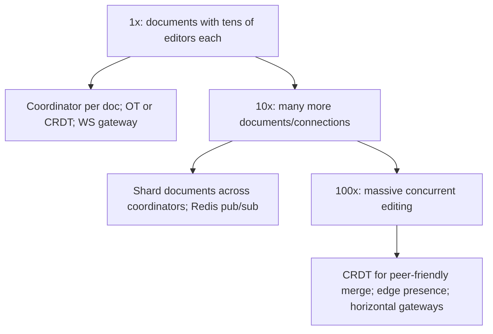

### 71.2.11 Caching

The current document state is kept in memory in the coordinator for the active session (fast application and broadcast of ops), with periodic snapshots to PostgreSQL. Presence is in Redis.

The in-memory copy is a real cache with a real eviction rule: a document is loaded on the first `sync` and unloaded 60 seconds after its last editor disconnects, after a final snapshot. A coordinator pod with 4 GB of memory and documents averaging 1 MB holds about 3,000 open documents with headroom. A single 50 MB document (a pasted novel, a giant table) is the outlier that can take a pod down, so the registry tracks bytes per document and refuses to open anything above a hard limit, serving it read-only instead.

**Presence** is deliberately not part of the document. Yjs ships it as a separate "awareness" protocol (`y-protocols/awareness`): each client broadcasts a small JSON state (user name, colour, cursor anchor, selection) and a client that has not refreshed its state within 30 seconds is considered gone. Cursor moves are throttled on the client to about 10 per second. Nothing about presence is persisted, and losing it entirely on a coordinator restart costs users nothing but a second of missing cursors. The rule to remember: **presence is ephemeral and high-frequency, content is durable and convergent, and mixing them puts cursor noise into the update log forever.**

### 71.2.12 Messaging

Operations flow over WebSocket in real time. For scaling across coordinator instances, a pub/sub (Redis or a broker) propagates operations to all instances holding editors of the same document, or editors are routed so one document maps to one coordinator (simpler). Snapshots persist asynchronously; each update, by contrast, is appended to the update log (batched every 50 ms) before it is acknowledged, because an acknowledged edit that exists only in memory breaks the durability requirement in 71.2.3.

Everything else is ordinary asynchronous work published through an outbox (Part 33):

| Event | Produced by | Consumers | Why it is asynchronous |
|---|---|---|---|
| `doc.updated` (debounced, at most once a minute per document) | Coordinator | Search indexer, "recent documents" lists, webhooks | Indexing every keystroke is wasteful; a minute of lag is fine |
| `doc.comment_added`, `doc.mentioned` | API | Notification service | Email and push must not slow editing |
| `doc.snapshot_written` | Compactor | Version-history service, backup exporter | History is built from snapshots, not raw updates |
| `doc.permission_changed` | Sharing API | Gateways | Disconnect a user who just lost access, within seconds |

The last one matters more than it looks: a user removed from a document must be kicked off their open socket, not merely refused on the next connect.

### 71.2.13 Scaling

Scaling is the many-persistent-connections problem (like chat, Part 59): horizontal WebSocket gateways and routing documents to coordinators. Since per-document concurrency is modest, the work is spreading many documents across instances, not merging huge numbers of editors on one document. CRDTs ease scaling by removing the need for a single central transform point.

| Stage | Load | Architecture | What changes |
|---|---|---|---|
| 1x | 5,000 open documents, 15,000 sockets | Two pods running gateway and coordinator together, Redis for leases and presence, one PostgreSQL | Nothing exotic; a single pod could almost do it |
| 10x | 100,000 open documents, 300,000 sockets, 50,000 updates/s | Separate gateway and coordinator fleets, ownership leases, batched log writes, hourly compaction | Routing by document owner; the update log becomes the largest table |
| 100x | Millions of open documents, global users | Regional coordinator fleets with documents homed in one region, update log partitioned by document hash, cold snapshots in object storage | Cross-region editors pay ~100 ms of latency to the home region, which typing tolerates |

A different 100x problem is one document with 2,000 viewers (an all-hands agenda). Viewers do not send content updates, so the answer is a read-only fan-out tier that relays the coordinator's updates and samples presence to "and 1,950 others", not a bigger coordinator.

### 71.2.14 Security

Authorize who can view/edit each document; validate that operations come from an authorized editor. Prevent one user from corrupting the document via malformed operations (validate ops). Protect the op log and snapshots. Presence should not leak more than intended (who is viewing). For sensitive documents, encryption and access control (Part 44 — Security, and Part 95 — Enterprise and Multi-Tenant SaaS Architecture).

Two points are specific to CRDTs. First, a perfectly **valid** update can be destructive: "delete every character" is a legal operation, so authorization (is this socket an editor?) is the real control, and the update log plus snapshots are what let you restore a vandalised document. Second, a malformed or enormous update can crash every client that applies it, so the server applies each update to its own copy first, inside a size limit, and drops the connection of any client whose update throws; it never relays bytes it has not applied successfully. Viewers get a socket on which `update` messages are rejected by the guard, not a client that merely hides the edit buttons.

### 71.2.15 Failure scenarios

| Failure | Detection | Impact | Mitigation | Effect |
|---|---|---|---|---|
| Client disconnects mid-edit | Connection drop | Its buffered edits pending | Offline buffer; merge on reconnect | No loss |
| Coordinator crash | Health check | Active session lost | Rebuild from last snapshot + op log; reconnect clients | Brief interruption |
| Concurrent conflicting edits | Normal | Divergence risk | OT transform / CRDT merge guarantees convergence | Consistent result |
| Op lost in transit | Sequence gap | Divergence | Op sequencing + resend; CRDT idempotent merge | Recovered |
| Stale offline client reconnects | Reconnect | Many missed ops | Merge buffered ops against current state | Merged correctly |
| Op log corruption | Validation | History/recovery impaired | Validate ops; snapshot regularly | Bounded |
| Two coordinators own one document (lease expired during a pause) | Lease renewal fails, owner mismatch on write | Two in-memory copies | CRDT: both persist, updates commute, next load merges; OT: fencing token rejects the stale owner | Survivable with CRDT |
| Compaction deletes updates not in the snapshot | Snapshot plus tail differs from a live client's state | Lost edits | Delete only `seq <= up_to_seq`; verification after each compaction (71.2.21) | Prevented |
| Huge document exhausts pod memory | Pod OOMKilled, all its documents reload | Every editor on the pod reconnects | Per-document size limit, read-only mode above it | Contained |
| Malicious or buggy update | Apply throws on the server | Could crash clients | Apply server-side first, never relay unapplied bytes, disconnect sender | Contained |
| Reconnect storm after a gateway deploy | Socket count drops, then spikes | Load spike on coordinators | Rolling deploy with connection draining, client reconnect with jittered backoff | Smoothed |

### 71.2.16 Observability

Metrics: edit propagation latency, concurrent editors per document, convergence errors (divergence detected — should be zero, alert on any), WebSocket connection counts, reconnect/offline-merge rates, snapshot/op-log lag. Alerts: any divergence (critical correctness failure), propagation latency spikes, coordinator overload. Dashboards: active documents/editors, real-time latency, merge health.

Divergence is only measurable if you check for it. Clients send a hash of their document text every 30 seconds while idle; the coordinator compares it with its own and counts mismatches (`collab_divergence_total`). After every compaction, the compactor loads "snapshot plus tail" into a fresh document and compares its state vector and text with the coordinator's live copy (`collab_compaction_mismatch_total`). Both counters must be zero. Add `collab_update_ack_ms` (p99 under 100 ms), `collab_open_docs` and `collab_doc_bytes` per pod, and `collab_update_log_rows` so compaction falling behind is visible before the table is.

### 71.2.17 Deployment

WebSocket gateways and coordinators as horizontally-scaled services; Redis for presence and pub/sub; PostgreSQL for snapshots and op logs. Careful rollout so a merge-engine change does not cause divergence (the highest-risk change — test convergence thoroughly). Sticky routing so a document's editors reach the same coordinator (or pub/sub across coordinators).

Library upgrades are the risky change in practice, because the encoding of updates is a wire and storage format. Pin the CRDT library version, upgrade the server before the clients, keep old clients able to sync, and before rollout replay a sample of real production update logs through the new version and compare the resulting text with the old one. Gateway deploys use Kubernetes `preStop` hooks and a long `terminationGracePeriodSeconds` so sockets close gradually rather than all at once.

### 71.2.18 Cost considerations

Dominated by holding many persistent WebSocket connections (memory per connection) and the coordinators' in-memory document state, plus Redis for presence/pub-sub. CRDT metadata adds storage/bandwidth overhead per operation (a tradeoff versus OT's smaller ops). Overall driven by concurrent-connection scale, like chat, rather than by heavy computation.

From 71.2.5: about 35 coordinator pods and a dozen gateway pods at 4 GB each, a small Redis, and PostgreSQL whose size is set by snapshots (a few hundred bytes to a few MB per document) once compaction works. Without compaction the update log alone would be hundreds of GB a day, which is why compaction is a cost feature as much as a correctness feature.

### 71.2.19 Tradeoffs

- **OT (small ops, needs central coordination, tricky transforms) vs CRDT (no central transform, offline/peer-friendly, more metadata)**: OT is efficient and proven but complex to implement correctly; CRDTs are cleaner for offline and peer-to-peer at the cost of per-element overhead. The choice depends on whether you need peer-to-peer/offline-first (favor CRDT) or have a reliable central server and want minimal per-op overhead (OT is viable).
- **Central coordinator per document (simple merge) vs fully peer-to-peer (CRDT, no central point)**: central is simpler to operate; peer-to-peer (enabled by CRDTs) removes the central dependency at the cost of more client-side complexity.
- **Persist op log + snapshots (full history, recovery, undo) vs snapshots only (less storage)**: the op log enables history and robust recovery at storage cost.

| Decision | Options | Chosen | Why | Cost |
|---|---|---|---|---|
| Merge model | OT, CRDT, locking | CRDT (Yjs) | Offline sync for free, survivable split ownership, maintained library | Metadata and tombstones, library lock-in |
| Routing | Ownership lease, shared pub/sub channel | Lease, pub/sub as fallback | One merge point, one broadcast | A lease service to run |
| Durability point | Ack after memory, ack after log write | Ack after batched log write | Acknowledged edits survive a crash | About 50 ms added to the ack |
| History | Keep all updates, snapshots only | Hourly snapshots kept 30 days, updates compacted | Bounded storage, "restore to 14:00" works | No keystroke-level replay older than the last snapshot |
| Presence | In the document, separate protocol | Separate awareness channel in memory and Redis | Never pollutes the durable log | Cursors briefly vanish on restart |

### 71.2.20 Alternative architectures

**Last-write-wins / lock-based editing**: far simpler — lock the document (or a section) to one editor at a time, or just take the last save. This is adequate when true simultaneous editing of the same region is rare (most documents are edited by one person at a time), and avoids the entire OT/CRDT complexity. Build this first unless genuine real-time co-editing of the same regions is a core requirement; most "collaborative" needs are satisfied by section locking or presence-plus-last-write.

**Use an existing collaborative-editing library/framework** (a mature OT or CRDT library): implementing OT or CRDTs correctly from scratch is extremely hard (the transform/merge edge cases are a research-grade problem), so using a proven library is strongly preferred over building the merge engine yourself. Understand the models (to choose and use them well); do not reimplement them.

**Managed real-time collaboration service**: offloads the entire merge and connection problem to a provider; viable when you want collaboration without owning the hardest part, at the cost of dependency and expense.

### 71.2.21 Incident story: the compaction that ate four minutes

A team shipped hourly compaction to stop the update log from growing. The compactor did three things per document: load the latest snapshot and all updates, write a new snapshot, then run `DELETE FROM doc_updates WHERE doc_id = $1`. In testing, with nobody typing, it was perfect.

In production, compaction ran while people were editing. For a busy document the sequence went: the compactor read updates up to `seq` 88,140; Alice typed, and updates 88,141 to 88,163 were appended; the compactor wrote its snapshot (which knew nothing of Alice's updates) and deleted every row for the document, including hers. Her coordinator still had the edits in memory and her screen looked fine, so nothing failed.

The loss surfaced only when a document was next loaded from storage. Over a week, 212 documents lost between a few seconds and four minutes of edits. The first ticket said, "My paragraph from yesterday is gone, but my colleague saw it." That clue mattered: the colleague's laptop had been open the whole time. When the team re-opened the affected documents in clients that were still running, the CRDT sync sent the "missing" updates back to the server through the normal state-vector exchange, and 141 documents healed themselves. The other 71 had no surviving client and were restored only partly from hourly snapshots.

The fix was one clause, `AND seq <= $2`, with `$2` being the snapshot's `up_to_seq`. The lasting changes were the post-compaction verification in 71.2.16, which loads snapshot plus tail and compares it with the live document before deleting anything, and a test that compacts while a simulated client types. The lesson generalises: **a cleanup job that deletes "everything for this key" while new data is arriving needs an upper bound, always.**

### 71.2.22 Interview follow-ups

1. **Two users type at the same position at the same moment. How do OT and a CRDT each make the result identical everywhere?**
   Expected answer: OT transforms each operation against the other with a deterministic tie-break (site id) under a server-imposed order; a CRDT gives each character a permanent id and orders concurrent inserts by a deterministic rule on those ids. Why it matters: it tests whether you understand convergence, not just the acronyms. Follow-up: which one survives two servers ordering independently? (The CRDT.)
2. **A user edits offline on a plane for five hours. What happens when they land?**
   Expected answer: state-vector exchange; the client receives exactly the updates it missed and sends exactly its own; the merge needs no special case.
3. **Where is the durability point, and what does the user lose if the coordinator dies?**
   Expected answer: the ack after the batched log write; at most the last 50 ms of unacknowledged edits, which the client still holds and resends.
4. **How do you stop the update log from growing forever without losing edits?**
   Expected answer: snapshot plus bounded delete (`seq <= up_to_seq`), verification, and the single-writer property that makes `seq` order match commit order.
5. **Would you build OT yourself?**
   Expected answer: no; use Yjs, Automerge or a managed service, and spend the effort on routing, persistence, authorization and observability.
6. **Most documents have one editor. Would you still build this?**
   Expected answer: start with save-with-version-check (optimistic concurrency) plus presence, and add real-time merging when product research shows simultaneous editing of the same text is common.

### 71.2.23 Practical exercise

Build a minimal collaborative editor backend with NestJS and Yjs.

1. Create the schema from 71.2.7 and the `CollabGateway` from 71.2.10 with `sync` and `update` messages, ownership leases in Redis, and batched log writes.
2. Implement compaction with the bounded delete and post-compaction verification.
3. Write a test harness that runs three simulated clients typing random edits into the same document for 60 seconds, with one client going offline for 20 seconds and a compaction every 10 seconds.

Acceptance criteria:

- At the end, all three clients and a fresh load from PostgreSQL produce byte-identical text.
- Killing the coordinator pod mid-test loses no acknowledged update.
- `doc_updates` holds fewer than 500 rows for the document after the final compaction.
- A viewer socket that sends an `update` is rejected, and an update larger than 512 KB is rejected without being relayed.
- Running two coordinators that both believe they own the document for 10 seconds still ends with identical text everywhere.
