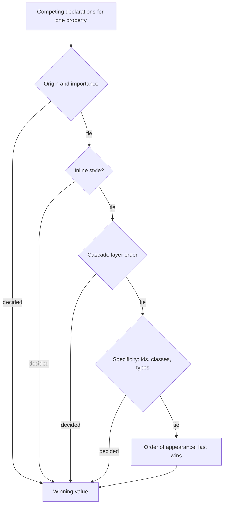
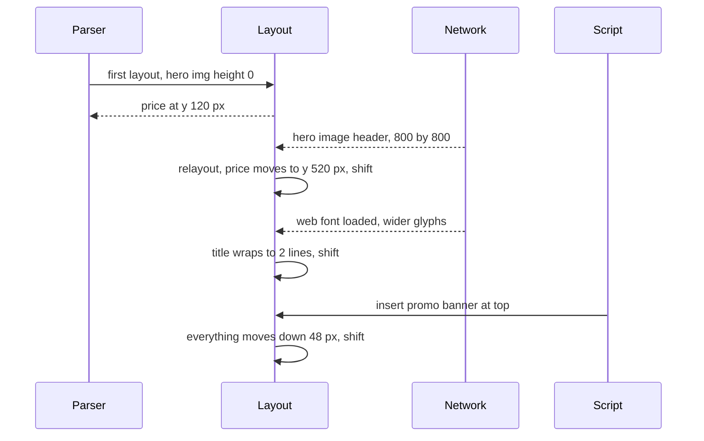

## 71.4 CSS essentials: box model, cascade, flexbox, grid and responsive design

#### Concept

CSS (Cascading Style Sheets) decides how every element looks and where it sits. Four ideas cover most of what a backend engineer needs to read and review CSS with confidence:

- **The box model.** Every element is a rectangle made of content, padding, border and margin.
- **The cascade and specificity.** Many rules can target the same element; the cascade is the algorithm that decides which declaration wins.
- **Layout systems.** Flexbox arranges items along one direction (a row or a column). Grid arranges items in two dimensions (rows and columns at once).
- **Responsive design.** Media queries and container queries change styles depending on the screen or the container size, so one page works on a 360-pixel phone and a 1,920-pixel monitor.

#### Why does it exist?

HTML gives structure; without CSS every page would be one long column of default-styled text. CSS separates presentation from structure, so the same HTML can be styled differently for phones, printers and dark mode, and so a design system can change a brand colour in one place.

The cascade exists because styles come from several sources at once: the browser's default stylesheet, your site's stylesheets, component libraries, inline styles, and user settings such as a larger default font. Something has to decide who wins, predictably. When engineers do not understand that algorithm, they fight it with `!important` and ever-longer selectors, and the stylesheet becomes impossible to change safely.

#### Mental model

Imagine every element as a framed picture on a wall. The picture is the content, the matting around it is padding, the frame is the border, and the empty wall you leave around the frame is margin. "How wide is this picture?" depends on whether you measure only the picture (`content-box`) or the whole thing including matting and frame (`border-box`).

The cascade is a set of house rules with a clear chain of authority. The museum's default rules (browser styles) apply unless the curator (your stylesheet) overrides them; a specific note on one picture beats a general note for a whole room; and among equally specific notes, the latest one wins.

Flexbox is a bookshelf: books line up in one row and you decide how they share the leftover space. Grid is a chessboard: you define rows and columns first, then place pieces on squares.

#### How it works

**1. The box model.** By default, `width` sets only the content width. A card with `width: 300px; padding: 16px; border: 1px solid` is actually 334 pixels wide, which is why layouts overflow by a few pixels. Nearly every modern stylesheet starts with:

```css
*, *::before, *::after { box-sizing: border-box; } /* width now includes padding and border */
```

Two more rules trip people up. Vertical margins between block elements **collapse**: a 24-pixel bottom margin above a 16-pixel top margin produces a 24-pixel gap, not 40. And `display` decides the box type: `block` takes the full width and starts on a new line, `inline` flows inside text and ignores `width` and `height`, `inline-block` flows like text but accepts a size, and `display: flex` or `grid` turns an element into a layout container for its children.

**2. The cascade.** When several declarations set the same property on the same element, the browser decides in this order:

1. **Origin and importance**: browser defaults, then user styles, then author (your) styles; `!important` declarations reverse that order.
2. **Inline styles** (`style="..."`) beat stylesheet rules.
3. **Cascade layers** (`@layer`): later-declared layers beat earlier ones, and unlayered styles beat all layered ones.
4. **Specificity**: a score of three numbers (IDs, classes and attributes and pseudo-classes, element types and pseudo-elements), compared left to right.
5. **Order of appearance**: the last declaration wins.

Specificity examples:

| Selector | Specificity (id, class, type) | Notes |
|---|---|---|
| `button` | (0, 0, 1) | Element type |
| `.btn` | (0, 1, 0) | One class beats any number of types |
| `.checkout .btn.primary` | (0, 3, 0) | Three classes |
| `#pay-now` | (1, 0, 0) | One id beats any number of classes |
| `:where(.card) .title` | (0, 1, 0) | `:where()` contributes zero |
| `:is(#a, .b) span` | (1, 0, 1) | `:is()` takes the most specific argument |

Inheritance is separate from the cascade: some properties (`color`, `font-family`, `line-height`) inherit from the parent when nothing sets them; others (`margin`, `border`, `width`) do not.

**3. Flexbox and grid.**

```css
/* Flexbox: one direction. A header with logo left, cart right. */
.site-header { display: flex; align-items: center; justify-content: space-between; gap: 16px; }

/* Grid: two dimensions. A product listing that fits as many 220px+ columns as possible. */
.product-grid {
  display: grid;
  grid-template-columns: repeat(auto-fill, minmax(220px, 1fr));
  gap: 24px;
}

/* Grid with named areas: the product page layout. */
.product-page {
  display: grid;
  grid-template-columns: 1fr 380px;
  grid-template-areas: "gallery buybox" "details buybox";
}
.gallery { grid-area: gallery; } .buybox { grid-area: buybox; } .details { grid-area: details; }
```

| Need | Use | Why |
|---|---|---|
| Items in a row or column, sizes driven by content (nav bar, button group, toolbar) | Flexbox | One axis; items share space with `flex: 1`, `flex-shrink`, `flex-wrap` |
| Rows and columns that must align across items (product grid, dashboard, page layout) | Grid | Tracks are defined by the container, so items line up in both directions |
| Centre one thing in a box | Either: `display: grid; place-items: center` | Shortest reliable recipe |
| Text wrapping around an image | Floats | The only remaining good use of `float` |
| Overlays, badges, sticky headers | `position: absolute`, `sticky`, `fixed` | Out of normal flow |

**4. Responsive design.** A **media query** applies rules when the viewport (or device) matches a condition. Mobile-first stylesheets write the small-screen styles as the default and add complexity as the screen grows:

```css
.product-page { display: block; }                       /* phones: one column */
@media (min-width: 768px) {                              /* tablets and up */
  .product-page { display: grid; grid-template-columns: 1fr 380px; }
}
@media (prefers-reduced-motion: reduce) {               /* respect OS accessibility setting */
  * { animation-duration: 0.01ms !important; transition-duration: 0.01ms !important; }
}
@media (prefers-color-scheme: dark) { :root { --bg: #111; --fg: #eee; } }
```

**Container queries** (supported in all evergreen browsers since 2023) apply rules based on the size of a containing element rather than the viewport, which is what component libraries usually want: a product card that switches to a horizontal layout when its column is wider than 400 pixels, wherever it is placed.

```css
.card-slot { container-type: inline-size; }
@container (min-width: 400px) { .product-card { display: flex; gap: 16px; } }
```

Relative units do much of the responsive work: `rem` (relative to the root font size, respects user font settings), `%`, `vw` and `vh` (viewport width and height), `dvh` (dynamic viewport height, which accounts for mobile browser toolbars appearing and disappearing), `fr` (a fraction of free grid space) and `clamp(1rem, 2.5vw, 1.5rem)` for fluid type.



#### Practical example

An order-history table looks fine on desktop but overflows horizontally on phones, so the whole page scrolls sideways. In DevTools, the Elements panel's Computed tab shows the table's `min-width` is 920 pixels because each of its eight columns has `white-space: nowrap`. The fix is responsive, not a JavaScript hack: below 768 pixels, render each order as a stacked card using grid (`grid-template-columns: auto 1fr`), keeping the table markup for larger screens. Alternatively, wrap the table in a container with `overflow-x: auto` so only the table scrolls and the page does not.

#### React / Next.js example

In a Next.js 14 app, CSS Modules give each component locally scoped class names, which removes most specificity fights because classes never collide across components.

```tsx
// components/ProductCard.tsx  (Next.js 14, CSS Modules)
import Image from 'next/image';
import styles from './ProductCard.module.css';

export type ProductCardProps = {
  name: string; price: string;
  image: { url: string; width: number; height: number; alt: string };
};

export function ProductCard({ name, price, image }: ProductCardProps) {
  return (
    <article className={styles.card}>
      {/* width and height let the browser reserve space before the image loads (see 75.5) */}
      <Image src={image.url} width={image.width} height={image.height} alt={image.alt}
             sizes="(max-width: 600px) 50vw, 220px" className={styles.thumb} />
      <h3 className={styles.name}>{name}</h3>
      <p className={styles.price}>{price}</p>
    </article>
  );
}
```

```css
/* components/ProductCard.module.css  -- compiled to unique names like ProductCard_card__x7Kq2 */
.card { display: grid; gap: 8px; padding: 12px; border: 1px solid var(--border); border-radius: 8px; }
.thumb { width: 100%; height: auto; aspect-ratio: 1 / 1; object-fit: cover; }
.name { font-size: 1rem; line-height: 1.4; display: -webkit-box; -webkit-line-clamp: 2;
        -webkit-box-orient: vertical; overflow: hidden; }   /* two lines max, never grows */
.price { font-weight: 600; }
```

#### Backend side (NestJS)

CSS can only reserve the right space if it knows the dimensions of what is coming. The API should give the frontend the facts it needs to lay out content before every byte arrives:

```ts
// product-image.dto.ts and the listing response
import { ApiProperty } from '@nestjs/swagger';

export class ProductImageDto {
  @ApiProperty() url!: string;            // CDN URL, already resized variants
  @ApiProperty() width!: number;          // intrinsic pixel width, from the upload pipeline
  @ApiProperty() height!: number;         // intrinsic pixel height
  @ApiProperty() alt!: string;            // human-written alt text (see 75.9)
}

export class ProductCardDto {
  @ApiProperty() id!: string;
  @ApiProperty() name!: string;
  @ApiProperty() priceMinor!: number;     // integer minor units: 1249900 = Rs 12,499.00
  @ApiProperty() currency!: string;
  @ApiProperty({ type: ProductImageDto }) image!: ProductImageDto;
  @ApiProperty({ maxLength: 120 }) badge!: string | null; // null, never a missing key
}
```

- **Store intrinsic image dimensions at upload time** (read them once with an image library in the upload worker) and return them in every product response. Without them, the frontend cannot set `width` and `height` or `aspect-ratio`, and every image causes a layout shift.
- **Bound text lengths** in the API contract (product names at most 120 characters, for example) so designers can size containers and line-clamp safely.
- **Return stable shapes.** Always send `badge: null` rather than omitting the key; a component that sometimes renders a badge and sometimes does not should still reserve the same space, and that is much easier when the contract is explicit.

#### Production scenario

An e-commerce company's design system had grown for four years in one global stylesheet of 410 KB uncompressed (58 KB with Brotli). The CSS Overview and Coverage panels in DevTools showed that 81 % of the rules were unused on the product page. Style recalculation for the product page took 34 ms on a mid-range phone, partly because of selectors like `.page .content div > ul li a span`. Moving to CSS Modules per component and a small global layer brought product page CSS to 14 KB compressed and style recalculation to 9 ms. Because CSS is render-blocking, the smaller file also moved first paint 180 ms earlier on slow 4G.

#### Failure scenario

On a Friday afternoon, a developer fixed a misaligned button in the admin panel by adding `.btn { margin-top: 4px !important; }` to the shared stylesheet. The admin panel and the customer checkout shared that stylesheet. On Monday, the payment page's "Pay now" button, which used a `.btn` class inside a fixed-height footer, was pushed 4 pixels down and clipped by `overflow: hidden`. On some Android phones the visible part of the button was 6 pixels tall. Payment conversion on Android dropped 7 % over the weekend before anyone noticed. The fix took one minute. The prevention took longer: scoped CSS per app, a lint rule banning `!important` outside a utilities layer, and visual regression tests on the checkout (Part 79 — Frontend Testing and Quality).

#### Edge cases & failure modes

- **`content-box` surprises**: padding added to a `width: 100%` element overflows its parent unless `box-sizing: border-box` is set.
- **Margin collapse**: spacing between sections is smaller than expected; flex and grid containers do not collapse their children's margins.
- **`!important` wars**: each fix requires a stronger override, and the cascade becomes unpredictable.
- **Long unbroken strings**: an order id or email address without spaces overflows a narrow card; use `overflow-wrap: anywhere`.
- **Flex items not shrinking**: a flex child's default `min-width: auto` prevents it from shrinking below its content width; set `min-width: 0` on the child that contains long text.
- **`100vh` on mobile**: includes the area under the browser toolbar, so "full-screen" panels are cut off; use `100dvh`.

#### How a Senior Full-Stack Engineer thinks about this

A senior does not try to memorise CSS; they understand its algorithms well enough to predict results and debug with DevTools' Computed tab, which shows the winning declaration and every overridden one. They value scoping (CSS Modules, a design-system component library, cascade layers) over clever selectors, because the real cost of CSS is the fear of changing it.

They pick flexbox for one-dimensional alignment, grid for page and listing layouts, and they review layout code by asking "what happens with a 200-character product name, a missing image, a 320-pixel screen and a user with 150 % font size?" They also see the backend's role: an API that supplies image dimensions, bounded strings and stable shapes is what makes a robust layout possible.

#### Common mistakes

- **Using `!important` to win a specificity battle** instead of fixing the selector or using a layer.
- **Styling by ID or deep descendant chains**, which creates high specificity that nobody can override cleanly.
- **Fixed pixel heights on text containers**, which clip content when text wraps or fonts are larger.
- **Designing desktop-first** and squeezing down, leaving phones with overflow and tiny tap targets.
- **Forgetting `min-width: 0`** on flex children with long text.

#### Interview questions

1. **Explain the cascade. In what order does the browser decide which declaration wins?**
   Expected answer: origin and importance, inline styles, cascade layers, specificity, then order of appearance. Follow-up: how do `:where()` and `@layer` help a design system?
2. **What is the difference between `content-box` and `border-box`?** Expected answer: whether `width` includes padding and border; `border-box` makes sizes predictable.
3. **When would you choose grid over flexbox?** Expected answer: when items must align in two dimensions or the container defines the tracks; flexbox for one-axis, content-driven arrangements.
4. **What is the difference between a media query and a container query?** Expected answer: media queries respond to the viewport or device; container queries respond to the size of a containing element, which suits reusable components.

#### Practical exercise

Build an order-history page that renders a table at 768 pixels and above and stacked cards below, using only CSS (one HTML structure, or a component that renders the same data with a media or container query). Feed it data from a NestJS endpoint that includes one order with a 60-character unbroken reference string.

Acceptance criteria:

- No horizontal page scroll at 360, 768 and 1,280 pixels wide (check with DevTools device toolbar).
- The long reference wraps without overflowing.
- Setting the browser default font size to 24 px does not clip any text.
- No `!important` in your stylesheet.

## 71.5 Layout shift: why a CSS change moves the page

#### Concept

A **layout shift** happens when an element that is already visible changes position between two frames without the user asking for it. The text you were reading jumps down 200 pixels; the "Cancel order" button moves into the place where "Confirm" was a moment ago. **Cumulative Layout Shift (CLS)** is the Core Web Vital that measures it. A score at or under 0.1 is "good"; above 0.25 is "poor".

Layout shifts are caused by content whose size the browser did not know when it first laid out the page: images and videos without dimensions, ads and embeds, late-arriving banners, web fonts that render text at a different size, and content inserted above what the user is looking at. They are a direct consequence of the pipeline in 71.1: every time new information arrives, layout runs again, and anything below the change moves.

#### Why does it exist?

The metric exists because layout shift is not just ugly; it causes wrong actions. Users tap the wrong button, lose their reading position, or dismiss a dialog they meant to accept. On a checkout page, a shift can turn "Apply coupon" into "Place order". Google uses CLS as a ranking signal and in the Chrome User Experience Report (CrUX), which makes it a business metric as well as a user experience one.

The underlying mechanism exists because HTML and CSS were designed for documents whose size flows from content. If the browser does not know an image is 800 by 800 pixels, it lays it out as 0 pixels tall, then lays everything out again when the image header arrives.

#### Mental model

Imagine reading a printed menu while a waiter keeps sliding new pages into the middle of it. Every insertion pushes the page you were reading further down. If the waiter had left blank, correctly sized pages in place from the start, nothing would move when the real pages arrived. Reserving space is leaving those blank pages.

#### How it works

1. The browser lays out the page with what it knows. An `` without `width`, `height` or an `aspect-ratio` gets a height of zero until its size is known.
2. New information arrives: an image's header reveals its dimensions, a font finishes loading, JavaScript inserts a "Free delivery over Rs 499" banner, an API response fills an empty list.
3. Layout runs again and elements move.
4. For each frame, the browser computes a **layout shift score** for unexpected movement: **impact fraction** (how much of the viewport the moving elements cover, before and after) multiplied by **distance fraction** (how far they moved, relative to the viewport's largest dimension). A banner that pushes content covering 75 % of the viewport down by 25 % of its height scores 0.75 multiplied by 0.25, about 0.19, already "needs improvement" from one event.
5. Shifts within 500 ms of a discrete user input (click, tap, key press) are excluded, because the user caused them. Scrolling does not count as input for this purpose.
6. CLS is the largest **session window** of shifts: shifts less than 1 second apart are grouped, each window lasts at most 5 seconds, and the worst window is the page's CLS.



The common causes and their fixes:

| Cause | Why it shifts | Fix |
|---|---|---|
| Image or video without dimensions | Height unknown until the file header arrives | `width` and `height` attributes (the browser derives `aspect-ratio`), or CSS `aspect-ratio` |
| Ad slots, iframes, embeds | Third party decides size late | Reserve a `min-height` for the slot; never collapse an empty slot above content |
| Content injected above existing content | Banners, cookie notices, "app install" bars | Reserve space in the server-rendered HTML, overlay with `position: fixed`, or insert below the fold |
| Web fonts | Fallback and web font have different metrics, text rewraps | `font-display: optional`, or a size-matched fallback with `size-adjust` (Next.js `next/font` does this) |
| Client-rendered data | Empty container, then a list of 20 items | Skeletons with the same height as real content; or render the data on the server |
| Animations of layout properties | Changing `top` or `height` moves neighbours | Animate `transform` instead; transforms do not affect layout of other elements |
| Late CSS | A non-blocking or lazily loaded stylesheet restyles visible content | Keep above-the-fold styles in the render-blocking CSS |

#### Practical example

A product listing page shows 24 cards. Each image is an `` with CSS `width: 100%` and no height. On a slow connection, the page first renders 24 cards each about 80 pixels tall (title plus price), then grows each card by about 220 pixels as images arrive, in random order. Measured CLS: 0.42. Adding `width="800" height="800"` to each `` (values from the API) plus `height: auto` in CSS lets the browser compute the aspect ratio before loading. CLS drops to 0.02. No JavaScript changed.

#### React / Next.js example

Two patterns cover most of it in React and Next.js 14: `next/image` (which requires `width` and `height`, or `fill` inside a sized container) and skeletons that match the final size.

```tsx
// app/orders/OrderList.tsx  (client component, React 18)
'use client';
import { useEffect, useState } from 'react';

type Order = { id: string; placedAt: string; totalLabel: string; status: string };
const ROW_HEIGHT = 72; // matches .order-row min-height in CSS, so skeleton and data are the same size

export function OrderList() {
  const [orders, setOrders] = useState<Order[] | null>(null);

  useEffect(() => {
    const ctrl = new AbortController();
    fetch('/api/v1/orders?limit=10', { signal: ctrl.signal })
      .then((r) => r.json())
      .then((body: { items: Order[] }) => setOrders(body.items))
      .catch(() => { /* aborted on unmount, or show an error state; Part 74 covers this properly */ });
    return () => ctrl.abort();
  }, []);

  if (!orders) {
    // Reserve the space of 10 rows: when data arrives, nothing below this list moves.
    return <ul aria-busy="true" style={{ minHeight: ROW_HEIGHT * 10 }}>
      {Array.from({ length: 10 }, (_, i) => <li key={i} className="order-row skeleton" />)}
    </ul>;
  }
  return <ul>{orders.map((o) => (
    <li key={o.id} className="order-row">{o.id} {o.placedAt} {o.totalLabel} {o.status}</li>
  ))}</ul>;
}
```

The better fix for data that is known at request time is not to fetch it on the client at all: render the list in a server component so it is in the first HTML and never shifts. Part 74 — Client State, Data Fetching and Caching covers the client-side cases properly with TanStack Query.

For fonts, `next/font` generates a fallback `@font-face` with `size-adjust`, `ascent-override` and `descent-override` computed from the real font, so swapping from the fallback to the web font barely moves any text.

#### Backend side (NestJS)

Most layout shift fixes need information only the backend has, at the moment the HTML is generated:

- **Image dimensions in every response** (71.4). This is the single most effective backend contribution to CLS.
- **Know the page size up front.** A list endpoint that returns a predictable `limit` lets the frontend reserve the right number of rows. Return `totalCount` or `hasMore` so the frontend knows whether to reserve space for a "Load more" button.
- **Decide personalised slots on the server.** If a "Free delivery unlocked" banner depends on the user's cart, expose it in the same request that renders the page (or a BFF call made during server rendering) instead of a separate client-side call that inserts the banner after first paint.

```ts
// page-slots.controller.ts: one call returns every slot the page must reserve
import { Controller, Get, Req, UseGuards } from '@nestjs/common';
import type { Request } from 'express';
import { OptionalAuthGuard } from '../auth/optional-auth.guard';
import { PromoService } from './promo.service';

@Controller('v1/page-slots')
export class PageSlotsController {
  constructor(private readonly promos: PromoService) {}

  @Get('product')
  @UseGuards(OptionalAuthGuard)
  async productSlots(@Req() req: Request & { user?: { id: string } }) {
    const banner = await this.promos.bannerFor(req.user?.id); // ~3 ms, Redis-backed
    return {
      // Always present, so the page can reserve 48 px even when there is nothing to show.
      topBanner: banner ? { text: banner.text, href: banner.href } : null,
      topBannerHeightPx: 48,
    };
  }
}
```

#### Production scenario

A news-style marketplace homepage had a CLS of 0.31 at p75 in CrUX. The Performance panel's Layout Shifts track showed three clusters: a cookie consent bar inserted at the top by a consent manager script (0.12), 12 product images without dimensions (0.11) and a font swap on the headline (0.06). The team overlaid the consent bar with `position: fixed` at the bottom, added dimensions from the API to every image, and switched the headline font to `font-display: optional` with a metric-matched fallback. CLS dropped to 0.04 at p75 within the 28-day CrUX window, and the click-through rate on the first product row rose 3 %, because users stopped tapping the wrong card.

#### Failure scenario

A food-delivery app added a "Your order is arriving in 5 minutes" live banner at the top of the restaurant menu page, inserted by a WebSocket message. On busy evenings the banner appeared while users were scrolling and tapping "Add" buttons. Each insertion shifted the entire menu down 56 pixels. Support received complaints of wrong items in carts, and the backend saw a spike in `DELETE /cart/items` within 3 seconds of `POST /cart/items`, about 4,000 per evening. The fix moved the banner into a fixed-position toast that overlays the bottom of the screen without affecting layout. Undo-within-3-seconds requests fell by 85 %.

#### Edge cases & failure modes

- **Shifts after user input are excluded only for 500 ms**: an accordion that opens after a 700 ms API call counts as an unexpected shift.
- **Infinite scroll**: appending items below the viewport is fine; inserting "new items" at the top while the user reads is not.
- **Lazy-loaded images above the fold** have no space reserved if dimensions are missing, and arrive late too, so they shift twice as visibly.
- **Responsive images with different aspect ratios** per breakpoint (art direction with `<picture>`) need per-source dimensions, or the reserved box is wrong.

#### How a Senior Full-Stack Engineer thinks about this

A senior treats unreserved space as a bug, not a polish item. In code review they check every image for dimensions, every async slot for a reserved size and every insertion for its position relative to the user's view. They know lab tools (Lighthouse) only see shifts during load, while users experience shifts during the whole visit, so they check field data from real-user monitoring or CrUX. They push personalisation decisions to the server so the first HTML is already the final layout, and they ask the backend for the dimensions and stable shapes that make reservation possible.

#### Common mistakes

- **Omitting `width` and `height` on images** because "CSS sets the width".
- **Inserting banners and notices at the top of the page** after first paint.
- **Skeletons that are a different height** from the real content, which only moves the shift later.
- **Animating `height` for expand and collapse** instead of animating `transform` or using `grid-template-rows: 0fr` to `1fr` transitions inside a reserved container.

#### Interview questions

1. **What is CLS and how is a layout shift scored?**
   Expected answer: the largest session window of unexpected layout shifts; each shift scores impact fraction multiplied by distance fraction; shifts within 500 ms of user input are excluded; good is at most 0.1. Follow-up: why does lab CLS often differ from field CLS?
2. **Name four causes of layout shift and the fix for each.** Expected answer: images without dimensions, late-injected content, web fonts, ad and embed slots; dimensions or aspect-ratio, reserved space or overlays, size-matched fallbacks or `font-display: optional`, `min-height` slots.
3. **How can the backend reduce CLS?** Expected answer: return image dimensions, stable response shapes, predictable page sizes, and decide personalised content during server rendering.
4. **Why does animating `transform` not cause layout shift while animating `top` on a relatively positioned element can?** Expected answer: transforms do not affect the layout of other elements and are not counted as layout shifts; changes that alter geometry can move other elements.

#### Practical exercise

Create a product listing page that fetches 24 products from a NestJS endpoint and renders cards with images, a top promo banner from a separate endpoint, and a custom web font. Measure CLS with the Performance panel (Layout Shifts track) and Lighthouse under slow 4G and 4x CPU throttling.

Acceptance criteria:

- Starting CLS is above 0.1 and you can name each shift's source from the Layout Shifts track.
- After adding dimensions from the API, reserving the banner slot and fixing the font fallback, CLS is under 0.05.
- The DevTools Rendering drawer's "Layout Shift Regions" option shows no blue flashes during load.
