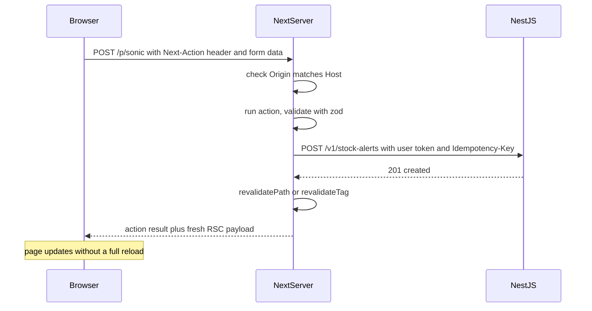

## 71.5 Data fetching on the server: `fetch`, route segment config and static params

#### Concept

In the App Router, server components fetch data by calling `await fetch(...)` (or any async function) directly in the component. Next.js extends the standard `fetch` with two options that connect it to its caches:

- `cache: 'force-cache' | 'no-store'`: whether the response is stored in the **Data Cache** (71.7), a persistent server-side cache of fetch results that survives across requests and, on most hosts, across deployments.
- `next: { revalidate: number | false, tags: string[] }`: how long the cached entry stays fresh (seconds; `false` means indefinitely) and which tags can invalidate it on demand.

**Route segment config** sets defaults for a whole route segment through exported constants in `page.tsx` or `layout.tsx`: `dynamic`, `dynamicParams`, `revalidate`, `fetchCache`, `runtime`, `preferredRegion` and `maxDuration`. **`generateStaticParams`** tells Next.js which values of a dynamic segment (`[slug]`) to prerender at build time.

The defaults moved between versions, which is why this section always names one:

| Behaviour | Next.js 14 | Next.js 15 | Next.js 16 with `cacheComponents: true` |
|---|---|---|---|
| `fetch` with no cache option | Cached (`force-cache`) unless something dynamic came first | Not cached | Not cached; wrap code in `"use cache"` to cache |
| GET Route Handlers | Static by default if they read no request data | Dynamic by default | Dynamic by default |
| `params`, `searchParams`, `cookies()`, `headers()` | Synchronous | Promises (sync access deprecated) | Promises only |
| Opt into dynamic without reading request data | `unstable_noStore()` | `await connection()` from `next/server` | `await connection()` |
| Route segment `dynamic`, `revalidate`, `fetchCache` | Supported | Supported | Replaced by `"use cache"` and `cacheLife` |

#### Why does it exist?

Without a framework cache, every server render calls the API afresh, and SSR load equals page views times API calls. The extended `fetch` lets each data dependency declare its own freshness, so one page can combine product data cached for 5 minutes, a category tree cached for an hour and an uncached stock figure. Route segment config exists for the cases where you need to state the route's behaviour explicitly instead of letting Next.js infer it, which is most production cases: inference is how routes silently flip from static to dynamic.

#### Mental model

Imagine each `fetch` as an order slip handed to a clerk who keeps a filing cabinet. The slip says either "use the file if it is younger than 5 minutes" (`revalidate: 300`), "always phone the supplier" (`no-store`), or "file it under 'product:sonic' so the manager can pull it later" (`tags`). Route segment config is a sign on the office door: "this office only serves pre-printed forms" (`force-static`) or "every customer gets a fresh phone call" (`force-dynamic`).

#### How it works

1. During a render, each `fetch` computes a cache key from the URL and options (method, headers, body). With caching enabled, a fresh hit returns the stored body without a network call; a stale hit returns the stored body and refreshes it in the background; a miss calls the origin and stores the result.
2. In Next.js 14, the route's **ISR interval** is the lowest `revalidate` among the route's segment config and its fetches. A page with `revalidate = 3600` that contains one fetch with `revalidate: 60` regenerates every 60 seconds.
3. Using `cookies()`, `headers()`, `searchParams`, `no-store` or `revalidate: 0` makes the route dynamic: rendered per request. Cached fetches inside a dynamic route still hit the Data Cache, so a dynamic page can be cheap if most of its data is cached.
4. **`generateStaticParams`** runs at build time and returns the param sets to prerender. With `dynamicParams = true` (the default), other values render on first request and are then cached like ISR pages; with `dynamicParams = false`, they return `404`. Returning an empty array prerenders nothing at build and caches every page on first visit.
5. Non-`fetch` data sources (a database driver, a gRPC client, a vendor SDK) do not go through the Data Cache. In 14 and 15, wrap them with `unstable_cache(fn, keyParts, { revalidate, tags })` from `next/cache`; in 16, mark the function with `"use cache"` (71.7). React's `cache()` only deduplicates within one render (71.7); it does not persist anything.

**Waterfalls are the main performance trap.** Awaits that run one after another add their latencies into TTFB:

```text
Sequential:   product 60 ms ─▶ price 70 ms ─▶ related 60 ms      = 190 ms before render
Parallel:     product 60 ms
              price   70 ms   ──────────────────────────────────  = 70 ms before render
              related 60 ms
```

Nested server components create waterfalls too: a parent that awaits data before rendering a child that awaits its own data is sequential by construction. Start independent requests together with `Promise.all`, or start them in the parent and pass the promises down.

#### Practical example

A catalogue of 40,000 products, of which the top 2,000 get 85 % of traffic. The product route uses `generateStaticParams` to prerender those 2,000 at build (about 90 seconds at 25 concurrent renders) and leaves `dynamicParams = true`, so the long tail renders on first request and is cached. Category data is cached for an hour with tag `catalog-tree`; product data for 5 minutes with tag `product:<slug>`; the "delivery by" estimate depends on the visitor's region cookie and is a client component, keeping the page static.

#### React / Next.js example

```tsx
// apps/web/app/(shop)/p/[slug]/page.tsx  (Next.js 14)
import { notFound } from 'next/navigation';
import { getProduct, getPrice, getRelated } from '@/lib/catalog.server';

export const revalidate = 300;
export const dynamicParams = true;   // long tail rendered on demand, then cached (must be explicit, see below)
export const dynamic = 'error';      // fail the build on cookies()/headers(); also flips the dynamicParams default to false

export async function generateStaticParams() {
  const res = await fetch(`${process.env.CATALOG_API_URL}/v1/catalog/top-products?limit=2000`, {
    headers: { Authorization: `Bearer ${process.env.CATALOG_SERVICE_TOKEN}` },
    signal: AbortSignal.timeout(10_000),
  });
  if (!res.ok) throw new Error(`top-products ${res.status}`); // fail the build, do not ship empty pages
  const { slugs } = (await res.json()) as { slugs: string[] };
  return slugs.map((slug) => ({ slug }));
}

export default async function ProductPage({ params }: { params: { slug: string } }) {
  // Start all three at once: TTFB pays for the slowest, not the sum.
  const [product, price, related] = await Promise.all([
    getProduct(params.slug),
    getPrice(params.slug),
    getRelated(params.slug).catch(() => []),   // optional data must not fail the page
  ]);
  if (!product) notFound();
  return <ProductView product={product} price={price} related={related} />;
}
```

Caching a non-fetch source (here a search SDK) in Next.js 14 or 15. Note that the function's **arguments** are part of the cache key automatically; values captured from the surrounding scope are not:

```ts
// apps/web/lib/search.server.ts  (Next.js 14/15)
import 'server-only';
import { unstable_cache } from 'next/cache';
import { searchClient } from './search-client'; // vendor SDK, not fetch

export const getFacets = unstable_cache(
  async (category: string) => searchClient.facets({ category }), // category is an argument: part of the key
  ['facets-v2'],                                                // bump when the return shape changes
  { revalidate: 900, tags: ['facets'] },
);
```

Next.js 15 version of the same page signature: `{ params }: { params: Promise<{ slug: string }> }` with `const { slug } = await params;`, and in 15 each `fetch` inside `getProduct` must say `cache: 'force-cache'` or `next: { revalidate: 300 }` to be cached; with no option it is fetched on every render (though the page itself is still prerendered at build if nothing dynamic is used).

#### Backend side (NestJS)

The NestJS catalogue service needs endpoints and limits shaped for these patterns:

- **A slug-listing endpoint for `generateStaticParams`**, returning only slugs (40 KB for 2,000 products, not 40 MB of product bodies), ordered by popularity.
- **Build bursts are legitimate traffic.** A build renders 2,000 pages with 3 calls each in about 90 seconds: roughly 70 RPS of uncacheable reads. Exempt the build's service token from `ThrottlerGuard` limits with a custom `shouldSkip` or a separate throttler profile, or the build fails at random with `429`s.
- **Next.js ignores your `Cache-Control` for its Data Cache.** `s-maxage=60` on a NestJS response does not make Next.js cache it for 60 seconds; the `fetch` options do. Keep sending honest headers anyway: CDNs and browsers calling the same endpoint use them.
- **Make the fast path explicit.** Per-request server calls should hit indexed lookups that return in 1 to 5 ms. A product endpoint that runs a 40 ms query is invisible on a cached page and terrible on a dynamic one.

```ts
// apps/api/src/catalog/catalog.controller.ts  (excerpt)
import { Controller, Get, Header, Query, UseGuards } from '@nestjs/common';
import { SkipThrottle } from '@nestjs/throttler';
import { TopProductsQuerySchema, type TopProductsQuery } from '@shop/contracts';
import { ZodValidationPipe } from '../common/zod-validation.pipe';
import { ServiceTokenGuard } from '../auth/service-token.guard';
import { CatalogService } from './catalog.service';

@Controller('v1/catalog')
export class CatalogController {
  constructor(private readonly catalog: CatalogService) {}

  @Get('top-products')
  @UseGuards(ServiceTokenGuard)        // internal: only the web tier's build and render calls this
  @SkipThrottle()                      // build bursts are expected; the guard limits who can do it
  @Header('Cache-Control', 'private, max-age=0')
  async topProducts(@Query(new ZodValidationPipe(TopProductsQuerySchema)) q: TopProductsQuery) {
    // SELECT slug FROM products WHERE active ORDER BY views_30d DESC LIMIT $1  (index on views_30d)
    return { slugs: await this.catalog.topSlugs(q.limit) };
  }
}
```

#### Production scenario

A sports-goods site's product page awaited product, then price, then stock, then reviews, each in its own nested server component. p50 server time was 240 ms and p95 610 ms, since every slow call delayed all later ones. Rewriting the page to start all four in `Promise.all` at the top and moving reviews behind a `<Suspense>` boundary cut p50 to 85 ms and p95 to 190 ms. They then cached product and price with `revalidate: 120` and tags, which brought the median dynamic render (the page read a region cookie) to 22 ms, because only the stock call reached NestJS.

#### Failure scenario

To speed up a personalised home page, a developer cached recommendations with `unstable_cache`:

```ts
const user = await getSessionUser();                       // reads cookies()
const recs = await unstable_cache(
  async () => fetchRecommendations(user.id),               // user.id captured from scope, NOT in the key
  ['home-recs'],
  { revalidate: 600 },
)();
```

The first visitor after deploy filled the entry with their recommendations, and for 10 minutes every visitor saw them, including "Buy again: Pregnancy test kit". It was reported within 20 minutes. The fix passed `user.id` as an argument (so it became part of the key), and the team added a lint rule banning closures inside `unstable_cache` calls. The deeper lesson: any server cache keyed by something other than all of its inputs is a cross-user leak waiting to happen, exactly like the query keys in 70.2.

#### Edge cases & failure modes

- **Mixing `revalidate` values** across fetches: the lowest one sets the route's regeneration interval in 14.
- **`generateStaticParams` calling a slow or rate-limited API** makes builds flaky; give it a timeout and fail loudly.
- **`dynamicParams = false` with a stale build** returns `404` for products added since the deploy.
- **Large fetch responses** are not stored in the Data Cache: Next.js skips items over 2 MB and logs a warning, so a big catalogue response is fetched on every render.
- **POST requests used for reads** (GraphQL) are not cached by `fetch` in Route Handlers or after dynamic APIs; use `unstable_cache` around the call if you need it.
- **`dynamic = 'force-static'`** makes `cookies()` return empty values instead of failing: authenticated content renders as logged-out without an error. Prefer `dynamic = 'error'` to make violations fail the build.

#### How a Senior Full-Stack Engineer thinks about this

The senior states caching intent explicitly on every `fetch` and every route, rather than relying on defaults that changed between 14 and 15. They prefer `dynamic = 'error'` on pages meant to be static so the build enforces it. They draw the data dependencies of a page and refuse sequential awaits for independent data. And they ask whether the Next.js tier should talk to a database at all: usually not. NestJS owns the data and its rules; the web tier fetches through the API, with a cache key that includes every input.

#### Common mistakes

- **Relying on Next.js 14's implicit `fetch` caching**, then upgrading to 15 and watching API traffic multiply.
- **Sequential awaits** in a page or in nested components.
- **Caching per-user data with a key that omits the user.**
- **Prerendering every product at build** instead of the popular ones.

#### Interview questions

1. **How do you make one fetch cached for 5 minutes and another uncached in the same page?** Expected answer: per-fetch options, `next: { revalidate: 300 }` and `cache: 'no-store'`; the uncached one makes the route dynamic. Follow-up: what decides the route's revalidation interval in 14? (The lowest `revalidate`.)
2. **What do `generateStaticParams` and `dynamicParams` control?** Expected answer: which params are prerendered at build, and whether others render on demand or `404`.
3. **How do you cache a database or SDK call in Next.js 14/15?** Expected answer: `unstable_cache` with arguments in the key, `revalidate` and tags; `"use cache"` in 16.
4. **What changed in data fetching defaults in Next.js 15?** Expected answer: fetch and GET Route Handlers uncached by default; async request APIs; `connection()` for opting into dynamic.

#### Practical exercise

Optimise a dynamic product page with four data dependencies.

Acceptance criteria:

- All independent fetches start in one `Promise.all`; a test with each mocked endpoint delayed by 100 ms shows server render under 150 ms.
- Every `fetch` has an explicit cache option and a timeout, and a lint rule or code search proves it.
- `generateStaticParams` prerenders the top 500 products; the 501st renders on first request and is a cache hit on the second (`x-nextjs-cache: HIT`).
- A per-user cached function takes the user id as an argument; a test with two users proves they get different results.

## 71.6 Server Actions and Route Handlers

#### Concept

**Server Actions** are async functions marked with `'use server'` that run on the server but can be called from client code or used as a form's `action`. Next.js gives each one an ID and exposes it as an HTTP endpoint: calling it sends a `POST` to the current page with a `Next-Action` header, the serialised arguments as the body, and gets back the return value, plus an updated RSC payload if the action revalidated anything. They were stable in Next.js 14.

**Route Handlers** are files named `route.ts` that export functions named after HTTP methods (`GET`, `POST`, `PUT`, `PATCH`, `DELETE`, `HEAD`, `OPTIONS`). They receive a Web `Request` (or `NextRequest`) and return a Web `Response` (or `NextResponse`). They are plain HTTP endpoints living in the Next.js app, for webhooks, BFF proxies, OAuth callbacks and anything that is not a React render.

#### Why does it exist?

Mutations from a React page used to need three things: an API endpoint, a client-side fetch with loading and error handling, and code to refresh the page's data afterwards. Server Actions collapse that for the common case: a form posts to a server function that can validate, call the backend, and revalidate the affected cache in one step, and the form works even before JavaScript has loaded (progressive enhancement). Route Handlers exist because not every caller is a React component: NestJS needs an endpoint to trigger revalidation, a payment provider needs a webhook URL, and client components sometimes need a same-origin proxy.

#### Mental model

Imagine a Server Action as a direct phone line from a form on the page to a clerk in the back office: the customer picks up and speaks, the clerk does the work and updates the noticeboard. It feels private, but the line has a public number: anyone who learns it can dial. A Route Handler is the shop's public service window with a sign above it: "Deliveries: POST here". Both are doors into your server, and both need a lock.

#### How it works

A Server Action invoked from a form:



1. At build time, Next.js finds functions marked `'use server'` (a whole file or a single function body), assigns each an ID, and replaces client imports with a reference that knows how to `POST` to it.
2. On call, the client sends the arguments serialised by React. If JavaScript has not loaded, a `<form action={serverAction}>` submits as a normal HTML form post, and the action still runs.
3. Next.js compares the `Origin` header to the `Host` (or `X-Forwarded-Host`) header and rejects mismatches, a built-in CSRF defence; extra trusted origins go in `serverActions.allowedOrigins` (under `experimental` in the 14 and 15 config). The request body is limited to 1 MB by default (`serverActions.bodySizeLimit`).
4. Values captured in a closure from a server component are encrypted into the action reference so they cannot be read by the client; they can still be replayed, so never treat them as a security token.
5. If the action calls `revalidatePath` or `revalidateTag`, the response carries the re-rendered RSC payload, and the client-side Router Cache is invalidated (71.7). `redirect()` inside an action redirects; `cookies().set()` sets a cookie and also refreshes the router.
6. Next.js 15 made unused actions dead-code-eliminated and their IDs non-deterministic and rotated between builds, which reduces discoverability. It does not make them private: **every exported Server Action is a public HTTP endpoint**. Authenticate, authorise and validate inside every action, every time.

Route Handlers are simpler: a request comes in, your function returns a `Response`. In Next.js 14, a `GET` handler that reads no request data (`request`, `cookies()`, `headers()`) is treated as static and its response cached at build; in 15, `GET` handlers are dynamic unless you export `dynamic = 'force-static'`. Handlers are not part of the React tree, so React's `cache()` and fetch memoisation do not apply to them.

When to use which:

| Need | Use |
|---|---|
| A form or button on a Next.js page that changes data and refreshes the page | Server Action |
| Reading data for rendering | Server component `fetch`, not an action (actions are dispatched one at a time and are `POST`s) |
| Webhook from NestJS or a payment provider | Route Handler |
| Same-origin proxy so client components can call NestJS with the session cookie | Route Handler or `rewrites` (71.8) |
| An endpoint for mobile apps or third parties | NestJS, not Next.js |

#### Practical example

A product that is out of stock shows "Notify me when back in stock". It is a form with one email field (prefilled for logged-in users) posted to a Server Action. The action validates the email with the zod schema from `@shop/contracts`, calls NestJS with the user's access token and an idempotency key, and returns `{ ok: true }` or the API's `{ code, issues }`. With JavaScript disabled or not yet loaded on a slow phone, the form still posts and the page re-renders with the confirmation.

Separately, the catalogue service in NestJS calls `POST /api/revalidate` on the web tier whenever a price changes, with an HMAC signature over the body; the Route Handler verifies the signature and calls `revalidateTag` for the affected tags.

#### React / Next.js example

The Server Action:

```ts
// apps/web/app/(shop)/p/[slug]/actions.ts
'use server';
import { randomUUID } from 'node:crypto';
import { StockAlertRequestSchema } from '@shop/contracts';
import { getSession } from '@/lib/session.server';     // verifies the session cookie (79.9)

export type ActionState = { ok: boolean; code?: string; issues?: { path: string; message: string }[] };

export async function requestStockAlert(_prev: ActionState, formData: FormData): Promise<ActionState> {
  const parsed = StockAlertRequestSchema.safeParse({ sku: formData.get('sku'), email: formData.get('email') });
  if (!parsed.success) {
    return { ok: false, code: 'VALIDATION_FAILED', issues: parsed.error.issues.map((i) => ({ path: i.path.join('.'), message: i.message })) };
  }
  const session = await getSession();                   // anonymous allowed here, but identify if present
  const res = await fetch(`${process.env.API_URL}/v1/stock-alerts`, {
    method: 'POST',
    headers: {
      'Content-Type': 'application/json',
      ...(session ? { Authorization: `Bearer ${session.accessToken}` } : {}), // the USER's token, not a service token
      'Idempotency-Key': String(formData.get('idempotencyKey') ?? randomUUID()), // generated once per form render
    },
    body: JSON.stringify(parsed.data),
    cache: 'no-store',
    signal: AbortSignal.timeout(3_000),
  });
  if (!res.ok) {
    const body = await res.json().catch(() => ({}));    // { code, issues, requestId } from NestJS
    return { ok: false, code: body.code ?? 'UPSTREAM_ERROR', issues: body.issues ?? [] };
  }
  return { ok: true };
}
```

The form, using `useFormState` from `react-dom` (the name in the React canary bundled with Next.js 14; it is `useActionState` from `react` in React 19 and Next.js 15):

```tsx
// apps/web/app/(shop)/p/[slug]/StockAlertForm.tsx
'use client';
import { useFormState, useFormStatus } from 'react-dom';
import { requestStockAlert, type ActionState } from './actions';

function Submit() {
  const { pending } = useFormStatus();                  // disables during submit: no double posts (77.8)
  return <button disabled={pending}>{pending ? 'Saving...' : 'Notify me'}</button>;
}

export function StockAlertForm({ sku, idempotencyKey }: { sku: string; idempotencyKey: string }) {
  const [state, formAction] = useFormState<ActionState, FormData>(requestStockAlert, { ok: false });
  if (state.ok) return <p role="status">We will email you when it is back.</p>;
  return (
    <form action={formAction}>
      <input type="hidden" name="sku" value={sku} />
      <input type="hidden" name="idempotencyKey" value={idempotencyKey} />
      <label>Email <input name="email" type="email" required /></label>
      {state.issues?.map((i) => <p key={i.path} role="alert">{i.message}</p>)}
      <Submit />
    </form>
  );
}
```

The revalidation Route Handler:

```ts
// apps/web/app/api/revalidate/route.ts
import { createHmac, timingSafeEqual } from 'node:crypto';
import { revalidateTag } from 'next/cache';
import { RevalidateRequestSchema } from '@shop/contracts';   // { tags: string[] }, max 100 tags

export const runtime = 'nodejs';                              // needs node:crypto
export const dynamic = 'force-dynamic';

export async function POST(request: Request): Promise<Response> {
  const raw = await request.text();                           // sign the exact bytes, not re-serialised JSON
  const sig = Buffer.from(request.headers.get('x-signature') ?? '', 'hex');
  const expected = createHmac('sha256', process.env.REVALIDATE_SECRET!).update(raw).digest();
  if (sig.length !== expected.length || !timingSafeEqual(sig, expected)) {
    return Response.json({ code: 'BAD_SIGNATURE', issues: [] }, { status: 401 });
  }
  const parsed = RevalidateRequestSchema.safeParse(JSON.parse(raw));
  if (!parsed.success) return Response.json({ code: 'VALIDATION_FAILED', issues: parsed.error.issues }, { status: 400 });
  for (const tag of parsed.data.tags) revalidateTag(tag);     // Next.js 16: revalidateTag(tag, 'max')
  return Response.json({ revalidated: parsed.data.tags.length, at: Date.now() });
}
```

The NestJS side signs the same raw body with the shared secret and calls this endpoint after the price transaction commits (71.13 shows the publisher).

#### Backend side (NestJS)

Server Actions and Route Handlers sit between the browser and NestJS, so the API must not relax because "the call comes from our own server":

- **Authenticate the user, not the web tier.** Actions should forward the user's access token or session (71.8). If the web tier calls NestJS with an all-powerful service token for user operations, every authorisation check moves into the frontend tier, and one missing check is an IDOR (Part 39 — Security, 39.5).
- **Idempotency keys still matter.** A Server Action can be retried by the browser, double-submitted, or replayed. Generate the key when the form is rendered and send it as `Idempotency-Key`; NestJS deduplicates it as in Part 14 — REST API Design (14.12).
- **One error shape.** Return `{ code, issues, requestId }` from NestJS so the action can map `issues[].path` to form fields without bespoke parsing per endpoint.
- **Revalidation calls need limits.** The revalidation endpoint is a cache-busting button: authenticate it with an HMAC or mTLS, cap the number of tags per call, and batch events (every 1 to 2 seconds) so a bulk price import of 20,000 SKUs is 50 calls, not 20,000.

#### Production scenario

A grocery app used Server Actions for "add to list" and "save address" on server-rendered account pages. Because the forms worked before hydration, the share of users who tapped a button that did nothing (measured as a click followed by a second identical click within 2 seconds) fell from 6 % to under 1 % on low-end phones, where hydration took 2 to 3 seconds. Each action revalidated only its own tag (`addresses:<userId>`), keeping the follow-up render to one NestJS call.

#### Failure scenario

An order-history page had a "Cancel" button wired to a Server Action:

```ts
'use server';
export async function cancelOrder(orderId: string) {
  await fetch(`${process.env.API_URL}/internal/orders/${orderId}/cancel`, {
    method: 'POST', headers: { Authorization: `Bearer ${process.env.WEB_SERVICE_TOKEN}` },
  });
  revalidatePath('/orders');
}
```

The page only rendered the button for the logged-in user's own cancellable orders, so the developer assumed the action was safe. It used the web tier's service token, and the internal NestJS endpoint trusted that token for any order. A security researcher noticed the `Next-Action` header in DevTools, replayed the request with other order IDs and cancelled three test orders in another account. The report came through the bug bounty, not an incident, by luck.

The fix: the action calls `getSession()` and passes the user's access token; NestJS's public `POST /v1/orders/:id/cancel` checks ownership with its own guard; the internal endpoint was removed from the web tier's reach. The team added a review rule: no Server Action may use a service token for a user-scoped operation.

#### Edge cases & failure modes

- **Actions are public endpoints**: hiding the button is not authorisation (Part 73 covers the browser side).
- **Large uploads through actions** hit the 1 MB default body limit; use presigned uploads straight to object storage (Part 72 — Frontend–Backend Contracts) rather than raising the limit to 50 MB on your render servers.
- **Actions run one at a time per client**, so using them for reads makes parallel data loading sequential.
- **Different builds on different replicas** produce different action IDs in 15; a page rendered by version A posting to a replica running version B fails with "Failed to find Server Action". Deploys need version-aware routing or a draining strategy (71.11).
- **Static `GET` Route Handlers in 14** cache the response at build: a "current time" or "feature flags" handler returns build-time data forever.
- **Webhooks without signature checks** let anyone purge your cache in a loop, turning a cached site into an SSR load test.

#### How a Senior Full-Stack Engineer thinks about this

The senior uses Server Actions for page-local mutations where progressive enhancement and automatic revalidation pay off, and keeps all business rules and authorisation in NestJS. They treat every action and every Route Handler as an endpoint that will be called by an attacker with arbitrary arguments: validate with the shared zod schema, authenticate with the user's own credentials, send an idempotency key. Endpoints that other clients need (mobile, partners) belong in NestJS, not in Route Handlers that only the web tier deploys.

#### Common mistakes

- **Trusting that only your UI can call an action.**
- **Using a service token for user operations** from the web tier.
- **Fetching data with Server Actions** from client components.
- **Comparing HMAC signatures with `===`** instead of `timingSafeEqual`.
- **Forgetting `useFormStatus` or a pending state**, inviting double submits.

#### Interview questions

1. **How is a Server Action invoked over the wire, and what does that imply for security?** Expected answer: `POST` to the page with a `Next-Action` header and serialised arguments; it is a public endpoint, so authenticate, authorise and validate inside it. Follow-up: what CSRF protection does Next.js give? (Origin vs Host check; `allowedOrigins`.)
2. **When would you use a Route Handler instead of a Server Action?** Expected answer: webhooks, non-React callers, proxies, OAuth callbacks, `GET` endpoints.
3. **How do you trigger ISR revalidation from NestJS safely?** Expected answer: signed request to a Route Handler, verify with `timingSafeEqual`, narrow tags, batching, call after commit.
4. **What changed for Route Handlers in Next.js 15?** Expected answer: `GET` handlers are no longer cached by default.
5. **Why should a Server Action forward the user's token rather than use a service token?** Expected answer: so NestJS enforces ownership; otherwise a single missing check in the web tier is an IDOR.

#### Practical exercise

Implement the stock-alert action and the revalidation endpoint.

Acceptance criteria:

- With JavaScript disabled, the stock-alert form submits and shows the confirmation.
- Submitting twice with the same idempotency key creates one alert in PostgreSQL.
- Calling the action from `curl` with another user's session cannot affect that user's data (NestJS returns `403` or `404`).
- The revalidation endpoint returns `401` for a bad signature, `400` for more than 100 tags, and after a valid call the next product page request shows the new price.
