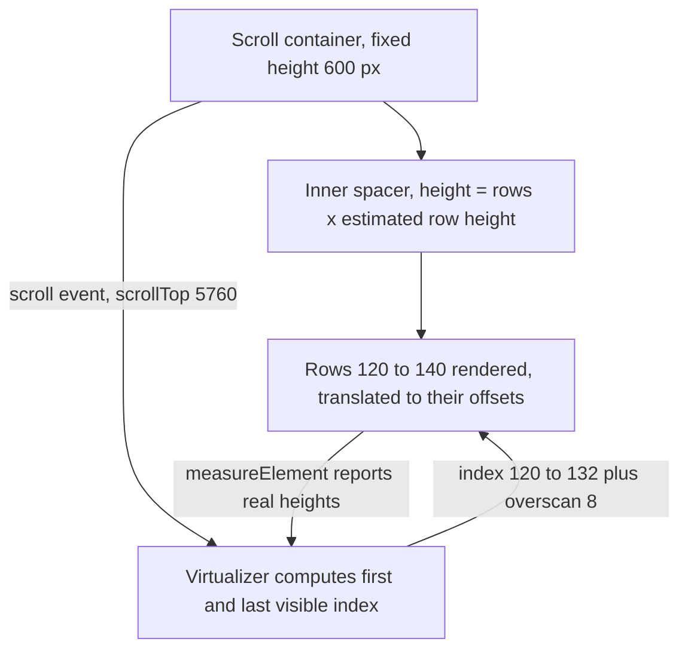
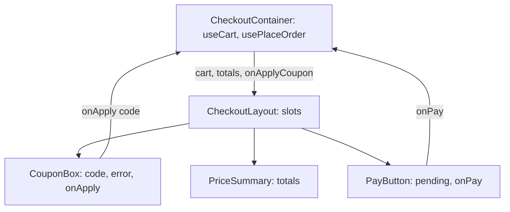

## 71.9 Lists, tables and large lists: virtualisation

#### Concept

Rendering a list in React is `array.map` returning elements with keys (71.3). For tables, use real `<table>`, `<thead>`, `<th scope="col">` and `<tbody>` elements, so screen readers can announce "row 4 of 50, column Status" (69.9).

The problem starts with size. Every row becomes DOM nodes, and each node costs memory, style calculation, layout and paint. A list of 10,000 orders with 8 cells each is over 80,000 DOM nodes. **Virtualisation** (also called windowing) renders only the rows that are visible in the scroll area, plus a few extra above and below (the **overscan**), and fakes the rest of the scroll height with an empty spacer. As you scroll, rows leaving the viewport are unmounted and rows entering it are mounted. 10,000 rows become about 30 rendered rows.

#### Why does it exist?

Measured on a mid-range Android phone (2023), rendering an order table with 8 columns:

| Rows rendered | DOM nodes | First render + layout | Memory | Scroll |
|---|---|---|---|---|
| 50 | about 500 | 25 ms | small | smooth |
| 1,000 | about 9,000 | 450 ms | +40 MB | some jank |
| 10,000 | about 90,000 | 4 to 6 s, one long task | +350 MB | unusable; tab may be killed |
| 10,000 virtualised | about 400 | 30 ms | +15 MB (data only) | smooth |

Backend engineers recognise the shape: it is `SELECT *` without `LIMIT`. Most of the cost is not React; it is the browser's layout and paint work on nodes nobody is looking at.

#### Mental model

Imagine a database cursor over a large result set. You do not materialise ten million rows in memory; you fetch the window you need. A virtualised list is a cursor over DOM: the data may be all in memory, but only the window on screen is materialised as elements. Pagination is the same idea one level lower, on the network.

#### How it works



1. The scroll container has a fixed height (600 px) and `overflow: auto`.
2. Inside it, a spacer element is as tall as all rows would be: `count x estimatedSize` (10,000 x 48 px = 480,000 px), so the scrollbar looks right.
3. On scroll, the virtualizer reads `scrollTop`, finds which indices fall in the visible range, adds overscan, and returns that small list of "virtual items", each with an `index`, `start` offset and `size`.
4. You render only those items, positioned with `transform: translateY(start)`.
5. For variable-height rows, each rendered row is measured after mount, and the virtualizer corrects offsets.

**@tanstack/react-virtual** (version 3) is the headless library most teams use: it calculates, you render. `react-window` and `react-virtuoso` are alternatives. Before reaching for any of them, consider two cheaper options:

- **Paginate or load more.** If users look at 50 orders at a time, show 50. Infinite scroll with a data library (Part 72) still loads only what is scrolled to.
- **`content-visibility: auto`** in CSS lets the browser skip layout and paint for off-screen sections while keeping them in the DOM (searchable with Ctrl+F). It helps for hundreds of rows, not tens of thousands.

#### Practical example

An operations dashboard for a delivery company lists today's orders for a city: 6,000 to 15,000 rows, filtered and sorted on the server, with live status updates. Agents scroll and use keyboard navigation. The team chose virtualisation (users genuinely scan the full list), cursor-loaded pages of 200 rows from the API, and fixed row heights (48 px) because fixed heights make the virtualizer exact and cheap.

#### React / Next.js example

```tsx
// src/ops/OrdersTable.tsx  (React 18, @tanstack/react-virtual 3)
import { useEffect, useRef } from 'react';
import { useVirtualizer } from '@tanstack/react-virtual';
import type { OpsOrderRow } from '@shop/contracts';

const ROW_HEIGHT = 48;

export function OrdersTable({ rows, onEndReached }: { rows: OpsOrderRow[]; onEndReached: () => void }) {
  const parentRef = useRef<HTMLDivElement>(null);

  const virtualizer = useVirtualizer({
    count: rows.length,
    getScrollElement: () => parentRef.current,
    estimateSize: () => ROW_HEIGHT,   // exact here: fixed-height rows
    overscan: 8,                      // render 8 extra rows each side to avoid blank flashes
  });

  const items = virtualizer.getVirtualItems();
  const lastIndex = items[items.length - 1]?.index ?? -1;
  useEffect(() => {
    if (lastIndex >= rows.length - 20) onEndReached(); // prefetch the next page early; not in render
  }, [lastIndex, rows.length, onEndReached]);

  return (
    <div ref={parentRef} role="table" aria-rowcount={rows.length} style={{ height: 600, overflow: 'auto' }}>
      <div style={{ height: virtualizer.getTotalSize(), position: 'relative' }}>
        {items.map((item) => {
          const row = rows[item.index]!;
          return (
            <div key={row.id} role="row" aria-rowindex={item.index + 1}   /* stable key: the order ID */
              style={{ position: 'absolute', top: 0, left: 0, right: 0, height: item.size,
                       transform: `translateY(${item.start}px)` }}>
              <span role="cell">{row.displayId}</span>
              <span role="cell">{row.status}</span>
              <span role="cell">{row.restaurantName}</span>
              <span role="cell">{row.etaMinutes} min</span>
            </div>
          );
        })}
      </div>
    </div>
  );
}
```

Notes that matter: the key is the order ID, not `item.index`, so a live update that reorders rows keeps identity; `aria-rowcount` and `aria-rowindex` tell assistive technology the real size; and `onEndReached` should be idempotent, because it fires on several renders (a data library's `fetchNextPage` ignores calls while a page is loading). For variable heights, pass `ref={virtualizer.measureElement}` and `data-index={item.index}` on each row.

#### Backend side (NestJS)

A virtualised list is only as good as the API that feeds it:

- **Cursor pagination with a capped limit** (71.3 showed the keyset query). Accept `limit` up to 200 for this screen and reject more; a client asking for 50,000 rows is a bug or an attack.
- **Slim rows.** The list needs 6 fields, not the full order with items and addresses. A list-specific DTO cut one team's payload from 2.1 KB to 160 bytes per row: 200 rows went from 420 KB to 32 KB.
- **Do not compute exact totals by default.** `SELECT count(*)` over a 40-million-row table with filters can take seconds. Return `hasMore`, or an estimate, and compute exact counts only on request or from a maintained counter.
- **Exports are jobs, not lists.** "Download all 80,000 orders as CSV" belongs in a background job (Part 36 — Background Jobs and Schedulers) that produces a file and a signed URL, not in a JSON endpoint the table calls with `limit=80000`.

```ts
// apps/api/src/ops/ops-orders.query.ts
import { z } from 'zod';

export const OpsOrdersQuerySchema = z.object({
  city: z.string().min(2).max(40),
  status: z.enum(['PLACED', 'PREPARING', 'PICKED_UP', 'DELIVERED', 'CANCELLED']).optional(),
  cursor: z.string().max(200).optional(),          // opaque, base64 of (placed_at, id)
  limit: z.coerce.number().int().min(1).max(200).default(100),
});
// The controller returns { items: OpsOrderRow[], nextCursor: string | null } with 6 fields per row.
```

#### Production scenario

The ops dashboard above initially loaded the whole city in one request: 14,000 rows, 9.8 MB of JSON, `JSON.parse` 120 ms, React render plus layout 3.4 s on agents' laptops, and each live status update re-rendered the full table (900 ms). After virtualisation, slim rows and 200-row pages: first page 32 KB, first render 28 ms, live updates re-render one row's component in under 2 ms.

#### Failure scenario

After virtualising the order list, support agents reported "orders are missing". They were not: agents used the browser's Ctrl+F to find an order number, and virtualised rows that are not mounted do not exist in the DOM, so the browser could not find them. Printing the page also printed only 20 rows.

The fixes were product decisions, not code tricks: a real search box that queried the API by order number (faster than scrolling anyway), a "Print" button that generated a server-side PDF, and a note in the team's design guidelines that any virtualised list must ship with a search box.

#### Edge cases & failure modes

- **Ctrl+F, printing and "select all"** see only mounted rows.
- **Variable row heights** with a bad estimate cause the scrollbar to jump; measure rows or keep heights fixed.
- **Scroll restoration** on Back navigation needs the scroll offset and loaded pages to be restored together.
- **Live updates that insert above the viewport** shift content down; anchor on the visible item.
- **Keyboard focus** on a row that scrolls out of view is lost when the row unmounts; manage focus by index.

#### How a Senior Full-Stack Engineer thinks about this

A senior first asks whether users need a long list at all. Search, filters and pagination are often better UX and much cheaper. When a long list is real, they virtualise, use fixed heights if the design allows, keep keys as IDs, and design the API as a cursor over slim rows with hard limits. They do not let the frontend become the place where a 50,000-row export is assembled.

#### Common mistakes

- **Rendering thousands of rows** and blaming React for the slowness.
- **Virtualising a 40-row list**, adding complexity and breaking Ctrl+F for nothing.
- **Using the virtual index as key** for data that reorders.
- **Fetching everything** so that client-side filtering "feels fast".

#### Interview questions

1. **How does list virtualisation work?**
   Expected answer: a scroll container with a full-height spacer; compute visible indices from `scrollTop` and row sizes; render only those plus overscan, positioned by offset; measure variable heights. Follow-up: what breaks? (Ctrl+F, printing, focus, scroll restoration.)
2. **When would you not virtualise?** Expected answer: small lists, when pagination or search serves the user better, or when in-page search and printing are essential.
3. **What does the API need to provide for a 15,000-row ops table?** Expected answer: cursor pagination, capped limits, slim row DTOs, no expensive exact counts by default, and exports as background jobs.

#### Practical exercise

Render 20,000 orders from a NestJS endpoint, first naively, then virtualised.

Acceptance criteria:

- A Performance panel recording for both versions, with first-render time and DOM node count.
- The virtualised table renders fewer than 60 row components at any time and scrolls at 60 fps.
- The API rejects `limit=1000` with `400` and returns pages of slim rows with an opaque cursor.
- A search box finds an order that is not currently rendered.

## 71.10 Component patterns: composition, lifting state up, container and presentational components

#### Concept

Four patterns account for most of how real React code is organised:

- **Composition**: components accept other elements as props, most often `children`, instead of knowing about every possible child. A `Card` renders whatever is inside it; a `Dialog` takes `title`, `children` and `actions` slots.
- **Lifting state up**: when two sibling components need the same state, move it to their closest common parent and pass it down as props, with callbacks to change it. One source of truth.
- **Container and presentational components**: a **container** knows where data comes from (calls hooks, handles loading and errors); a **presentational** component only renders props. The split is a convention, not an API.
- **Custom hooks as the container's engine**: in modern code the "container" is often a thin component calling a custom hook (`useOrder`, `usePlaceOrder`) and passing results to presentational children.

#### Why does it exist?

Without composition, generic components grow props for every case (`showHeader`, `headerIcon`, `footerButtons`, `footerAlign`) until they are unmaintainable. Without lifting state, siblings each keep their own copy of a value and fall out of sync: the coupon input thinks a coupon is applied while the price summary does not. Without a container/presentational split, every component fetches its own data, testing requires a network mock for every leaf, and changing the API touches 40 files.

Composition also solves prop drilling more often than context does: instead of passing `user` through five layers, the top component builds `<Header avatar={<Avatar user={user} />} />`, and the intermediate layers only pass an element through.

#### Mental model

Composition is dependency injection: `Dialog` does not construct its buttons; the caller injects them. Lifting state up is moving a value from two services' private caches into one shared repository. Container and presentational map directly to controller and view, or to a NestJS service and its DTO serializer: one layer talks to the outside world, the other is pure and trivially testable.

#### How it works



1. **Data flows down** from the container as props.
2. **Events flow up** through callback props (`onApply`, `onPay`).
3. **State lives at the lowest common owner.** The applied coupon affects both `CouponBox` and `PriceSummary`, so it lives in the container (or, better, in the server's cart response the container holds).
4. **Layout components use slots.** `CheckoutLayout` takes `summary`, `main` and `footer` elements and arranges them, knowing nothing about checkout.

A fifth pattern you will meet: **compound components**, where a parent shares implicit state with its children through context (`<Tabs><Tabs.List /><Tabs.Panel /></Tabs>`). Headless UI libraries (Radix UI, React Aria, Headless UI) use it to give you accessible behaviour without styling.

#### Practical example

The coupon field and the price summary on a checkout page. Version 1 (wrong): `CouponBox` holds `appliedCoupon` in its own state and calls the API; `PriceSummary` holds its own `totals` from the first cart load. After applying a coupon, the box shows "SAVE10 applied" and the summary still shows the old total.

Version 2 (lifted): the container owns the cart (from the server cache), `CouponBox` receives `appliedCoupon` and `onApply`, `PriceSummary` receives `totals`. Applying calls the API, the API returns the repriced cart, the container updates it, and both children re-render from the same data.

#### React / Next.js example

```tsx
// src/ui/Dialog.tsx: composition with slots (presentational, reusable everywhere)
import type { ReactNode } from 'react';

type Props = { title: string; children: ReactNode; actions: ReactNode; onClose: () => void };

export function Dialog({ title, children, actions, onClose }: Props) {
  return (
    <div role="dialog" aria-modal="true" aria-labelledby="dlg-title" className="dialog">
      <h2 id="dlg-title">{title}</h2>
      <div className="dialog__body">{children}</div>
      <footer className="dialog__actions">{actions}</footer>
      <button type="button" aria-label="Close" onClick={onClose} className="dialog__close">x</button>
    </div>
  );
}
```

```tsx
// src/orders/CancelOrderContainer.tsx: container owns data and the mutation
import { useState } from 'react';
import { useCancelOrder } from './useCancelOrder';   // custom hook wrapping the mutation (Part 72)
import { Dialog } from '../ui/Dialog';
import { CancelReasonPicker, type Reason } from './CancelReasonPicker'; // presentational

export function CancelOrderContainer({ orderId, onDone }: { orderId: string; onDone: () => void }) {
  const [reason, setReason] = useState<Reason | null>(null);          // lifted: picker and button both need it
  const { cancel, isPending, error } = useCancelOrder(orderId);

  return (
    <Dialog
      title="Cancel this order?"
      onClose={onDone}
      actions={
        <button type="button" disabled={!reason || isPending}
          onClick={async () => { if (reason && (await cancel(reason))) onDone(); }}>
          {isPending ? 'Cancelling...' : 'Cancel order'}
        </button>
      }
    >
      <CancelReasonPicker value={reason} onChange={setReason} />
      {error && <p role="alert">{error.message}</p>}
    </Dialog>
  );
}
```

`Dialog` and `CancelReasonPicker` can be tested and shown in Storybook with plain props. `CancelOrderContainer` is the only piece that needs a mocked API (Part 77 — Frontend Testing and Quality).

#### Backend side (NestJS)

Containers map to data sources, so the API's granularity decides how many containers a screen needs and how many requests it makes:

- **One container, one view endpoint** for regions that always load together (the checkout summary: cart, totals, addresses, available payment methods). A `GET /v1/checkout/view` that aggregates in the service is one round trip instead of four.
- **Separate endpoints for regions with different freshness**: live order status (SSE, 71.4) is separate from the order details (cacheable for minutes).
- **Mutations return the state the container needs next** (71.2), so lifted state is replaced from one response.
- **Consistent error shapes** let one custom hook map errors for every container (71.7).

```ts
// apps/api/src/checkout/checkout-view.controller.ts
import { Controller, Get, Header, UseGuards } from '@nestjs/common';
import type { CheckoutView } from '@shop/contracts';
import { JwtAuthGuard } from '../auth/jwt-auth.guard';
import { CurrentUser, type AuthUser } from '../auth/current-user.decorator';
import { CheckoutViewService } from './checkout-view.service';

@Controller('v1/checkout')
@UseGuards(JwtAuthGuard)
export class CheckoutViewController {
  constructor(private readonly view: CheckoutViewService) {}

  @Get('view')
  @Header('Cache-Control', 'private, no-store')
  get(@CurrentUser() user: AuthUser): Promise<CheckoutView> {
    // Loads cart, saved addresses and payment methods in parallel (Promise.all), prices once:
    // about 25 ms server time, one 4 KB response, instead of four client round trips.
    return this.view.forUser(user.id);
  }
}
```

When several frontends need different aggregations, this logic moves into a BFF (Part 73 — Next.js and Rendering Strategies) rather than into a growing list of screen-specific endpoints in a domain service.

#### Production scenario

A food delivery app's restaurant page had every card (menu item, offer banner, rating widget) fetch its own data: 38 requests on page load, with a waterfall four levels deep. Time to a complete page on 4G was 3.9 s. Refactoring into three containers (restaurant header, menu, offers) backed by two view endpoints cut it to 6 requests and 1.4 s, and made 30 of the components pure enough to snapshot in Storybook.

#### Failure scenario

The checkout "Place order" button was disabled until `termsAccepted` was true. The terms checkbox lived in one component with its own state; the button lived in another, which kept its own `termsAccepted` copy synced by an effect from a shared event emitter. Under a slow render on one Android WebView, the effect ran late: the checkbox showed ticked, the button stayed disabled for a few seconds, and some customers left. Lifting `termsAccepted` into the checkout container and passing it to both removed the emitter, the effect and the bug.

#### Edge cases & failure modes

- **Lifting state too high** (into the app root) re-renders large trees on every change; lift to the lowest common owner.
- **Containers inside presentational components** quietly bring fetching back into leaves.
- **Slot props recreated every render** defeat `memo` on the layout; usually harmless, occasionally measurable (71.12).
- **Compound components used outside their parent** throw or misbehave; give them a clear error like `useSession` in 71.5.

#### How a Senior Full-Stack Engineer thinks about this

A senior keeps one owner per piece of state and lets the rest of the tree be pure. They reach for composition before context, and for a container-plus-hook before scattering fetches. They also shape the API around the containers they intend to build: a screen with three containers should need about three requests, not thirty.

#### Common mistakes

- **Duplicating state in siblings** and syncing it with effects or event emitters.
- **Boolean prop explosions** on generic components instead of slots.
- **Every leaf fetching its own data.**
- **Building an endpoint per component** instead of per screen region.

#### Interview questions

1. **Two sibling components need the same value. What do you do?**
   Expected answer: lift it to the closest common parent and pass it down with a change callback; if it is server data, keep it in the server cache both read from. Follow-up: when would context or a store be better?
2. **What is the container/presentational split, and why does it help testing?** Expected answer: containers handle data and side effects, presentational components render props; presentational ones need no mocks.
3. **How does composition reduce prop drilling?** Expected answer: the top component builds the element that needs the data and passes the element down, so intermediate layers do not need the data.
4. **How should API granularity relate to the component tree?** Expected answer: one request per region that loads together, separate streams for different freshness, mutations returning next state.

#### Practical exercise

Refactor a checkout page where the coupon box and price summary hold separate copies of totals.

Acceptance criteria:

- One container owns the cart; both children are presentational and receive props.
- A `Dialog` with slots is reused for "Remove item" and "Cancel order" without new boolean props.
- The page makes one `GET /v1/checkout/view` request on load, and a coupon apply makes one `POST` whose response updates both children.
- Presentational components have tests with no network mocks.
