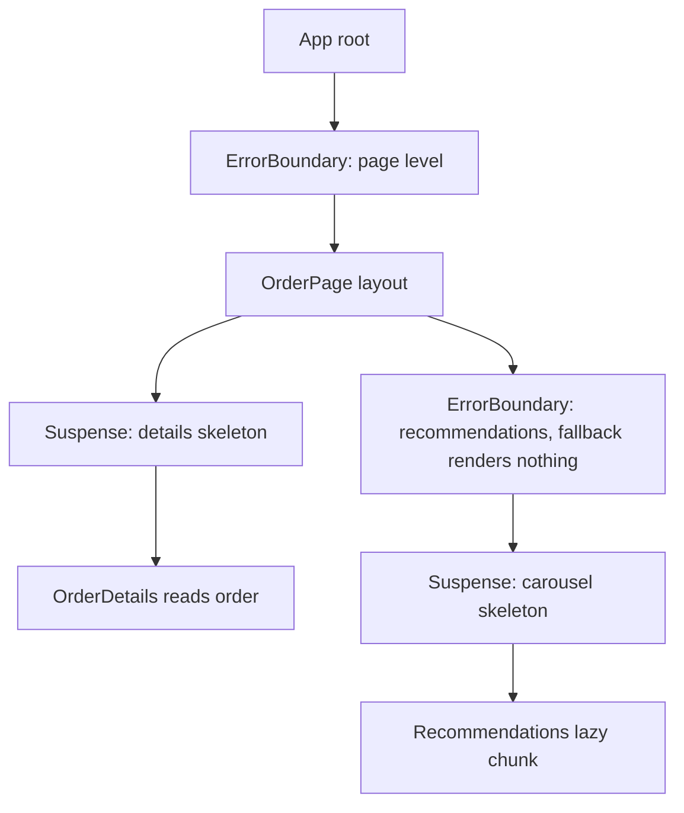

## 71.11 Error boundaries and Suspense

#### Concept

An **error boundary** is a component that catches errors thrown while rendering the components below it and shows a fallback UI instead of crashing the whole page. **Suspense** is a component that shows a fallback (a skeleton, a spinner) while something below it is **not ready yet**: a lazily loaded code chunk, or data read through a Suspense-enabled source.

Both are declarative boundaries in the tree. You place them where you want failure or loading to be contained: "if the recommendations widget breaks, the rest of the order page keeps working", "while the payment chunk loads, show a skeleton for that panel only".

#### Why does it exist?

Since React 16, **an uncaught error during rendering unmounts the entire React root**. The user sees a blank white page. One `undefined.toFixed()` in a "You may also like" carousel takes down the checkout. Before boundaries, every component had to defend itself; with them, you decide the blast radius in a few places.

Suspense exists because loading states were scattered: five data sources meant five spinners popping in at different times, shifting layout (69.5). Suspense lets a parent show one skeleton for a region and lets frameworks stream server HTML region by region (Part 73).

#### Mental model

An error boundary is a `try/catch` around a subtree's rendering, or a bulkhead on a ship: water in one compartment does not sink the vessel. In NestJS terms it is an exception filter scoped to part of the tree, turning a crash into a well-formed fallback response.

Suspense is a loading barrier: like `Promise.all` for a region, with a placeholder shown until the region's promises resolve.

#### How it works



**Error boundaries.**

1. A boundary is a **class component** with `static getDerivedStateFromError(error)` (return state that switches to the fallback) and optionally `componentDidCatch(error, info)` (log it, with `info.componentStack`). There is still no hook equivalent in React 18 or 19; most teams use the `react-error-boundary` package, which wraps the class.
2. When a component below throws during render, in a lifecycle method or in a constructor, React finds the nearest boundary above, renders its fallback, and unmounts the broken subtree.
3. Boundaries do **not** catch errors in event handlers, in asynchronous code (`setTimeout`, promise callbacks), during server rendering, or in the boundary itself. For event handlers, use `try/catch` and show an inline error. To send an async error to a boundary, set it in state and throw it during render; `react-error-boundary` provides `useErrorBoundary().showBoundary(error)` for exactly this.
4. In **React 19**, `createRoot` accepts `onCaughtError` and `onUncaughtError` options, a single place to report every error to your monitoring tool (Part 78 — Shipping and Operating Frontends), and React logs each error once instead of twice.

**Suspense.**

1. A component **suspends** when it cannot render yet. React then shows the nearest `<Suspense fallback>` above it and retries when the awaited thing resolves.
2. What can suspend: `React.lazy(() => import('./PaymentPanel'))` code chunks (since React 16.6); data from Suspense-enabled libraries in React 18 (TanStack Query's `useSuspenseQuery`, Relay, Next.js server components); and in **React 19**, `use(promise)` with a cached promise.
3. A plain `useEffect` fetch does not suspend; it only sets state.
4. **Transitions change the behaviour.** If an update wrapped in `startTransition` (or a router navigation, which most routers wrap) causes a suspend, React keeps showing the old UI with an `isPending` flag instead of replacing already visible content with a fallback. That avoids the "page flashes to skeleton on every tab click" problem.
5. Siblings inside one boundary are revealed together; nested boundaries reveal progressively, outer first.

#### Practical example

An order details page:

| Region | Error boundary fallback | Suspense fallback |
|---|---|---|
| Whole page | "Something went wrong" with a Retry button and request ID | none |
| Order details and timeline | "Could not load this order" with Retry | Skeleton matching final layout |
| Live tracking map (lazy chunk, 180 KB) | Static text ETA, no map | Map-sized grey box |
| Recommendations | Render nothing | Small skeleton |
| Support chat widget (third party) | "Chat unavailable, call us" | none |

The rule: wrap each **independent** region, choose a fallback the user can act on, and make skeletons the same size as the content to avoid layout shift.

#### React / Next.js example

```tsx
// src/orders/OrderPageShell.tsx  (React 18, react-error-boundary 4, TanStack Query v5)
import { lazy, Suspense } from 'react';
import { ErrorBoundary, type FallbackProps } from 'react-error-boundary';
import { QueryErrorResetBoundary, useSuspenseQuery } from '@tanstack/react-query';
import { fetchOrderView } from '../api/orders';
import { OrderDetails } from './OrderDetails';
import { OrderSkeleton } from './OrderSkeleton';
import { reportClientError } from '../observability/report';

const TrackingMap = lazy(() => import('./TrackingMap'));          // separate chunk (76.5)

function OrderRegion({ orderId }: { orderId: string }) {
  const { data } = useSuspenseQuery({ queryKey: ['order', orderId], queryFn: () => fetchOrderView(orderId) });
  return <OrderDetails order={data} onCancel={async () => {}} />;  // data is never undefined here
}

function OrderError({ error, resetErrorBoundary }: FallbackProps) {
  const requestId = (error as { requestId?: string }).requestId;  // from the API error (77.7)
  return (
    <div role="alert">
      <p>We could not load this order.</p>
      {requestId && <p>Reference: <code>{requestId}</code></p>}
      <button type="button" onClick={resetErrorBoundary}>Try again</button>
    </div>
  );
}

export function OrderPageShell({ orderId }: { orderId: string }) {
  return (
    <QueryErrorResetBoundary>
      {({ reset }) => (
        <ErrorBoundary FallbackComponent={OrderError} onReset={reset} resetKeys={[orderId]}
          onError={(error, info) => reportClientError(error, info.componentStack)}>
          <Suspense fallback={<OrderSkeleton />}>
            <OrderRegion orderId={orderId} />
          </Suspense>
          <ErrorBoundary fallback={<p>Live map unavailable. ETA is shown above.</p>}>
            <Suspense fallback={<div className="map-placeholder" style={{ height: 320 }} />}>
              <TrackingMap orderId={orderId} />
            </Suspense>
          </ErrorBoundary>
        </ErrorBoundary>
      )}
    </QueryErrorResetBoundary>
  );
}
```

`resetKeys={[orderId]}` clears the error when the user navigates to a different order; `QueryErrorResetBoundary` makes "Try again" refetch instead of re-throwing the cached error. In the Next.js App Router, `error.tsx` and `loading.tsx` files create these boundaries per route segment for you (Part 73).

#### Backend side (NestJS)

A fallback is only useful if it carries information the user and support can act on. The API should make every error identifiable and classifiable:

```ts
// apps/api/src/common/http-exception.filter.ts
import { ArgumentsHost, Catch, ExceptionFilter, HttpException, HttpStatus, Logger } from '@nestjs/common';
import type { Request, Response } from 'express';

@Catch()
export class AllExceptionsFilter implements ExceptionFilter {
  private readonly logger = new Logger('HTTP');

  catch(exception: unknown, host: ArgumentsHost): void {
    const ctx = host.switchToHttp();
    const req = ctx.getRequest<Request>();
    const res = ctx.getResponse<Response>();
    const requestId = (req.headers['x-request-id'] as string) ?? crypto.randomUUID();
    const status = exception instanceof HttpException ? exception.getStatus() : HttpStatus.INTERNAL_SERVER_ERROR;
    const body = exception instanceof HttpException ? exception.getResponse() : { code: 'INTERNAL' };

    if (status >= 500) this.logger.error({ requestId, path: req.url, err: exception });
    res.setHeader('X-Request-Id', requestId);  // expose it via CORS exposedHeaders if cross-origin
    res.status(status).json({ ...(typeof body === 'object' ? body : { message: body }), requestId });
  }
}
```

Three more backend duties:

- **Status codes the UI can branch on.** `404` renders "Order not found" (no retry), `401` redirects to login, `409` refetches, `429` and `503` retry after `Retry-After`, `500` shows the boundary with the request ID. A `200` with `{ "error": ... }` defeats all of this.
- **A client error intake.** `componentDidCatch`/`onError` reports go somewhere: a monitoring service, or a `POST /v1/client-errors` endpoint with `@Throttle` and a body size limit, because a broken bundle on 100,000 devices will report in a loop.
- **Do not stream half a page you cannot finish.** With streaming SSR (Part 73), headers are sent before all data is ready; the backend must keep slow dependencies out of the first chunk or give them timeouts.

#### Production scenario

A marketplace added a top-level boundary plus per-widget ones. About 0.3 % of sessions hit a caught error, mostly in a third-party reviews widget; before, each was a blank page, after, 92 % continued to checkout.

#### Failure scenario

A Monday deploy added `discountLabel.toUpperCase()` to the cart line component. For free-gift lines the API sent `discountLabel: null`, and with no boundary below the root, React unmounted the whole app: a blank page for about 7 % of carts during a promotion. The on-call engineer saw a healthy backend and spent 40 minutes looking at the API.

Fixes: boundaries around the cart and each checkout step, the shared zod schema parsing the response (so `null` vs `string` was caught at the network boundary and reported precisely, 71.4), and an alert on client error rate per release (Part 78).

#### Edge cases & failure modes

- **Errors in event handlers** are not caught; wrap async handlers and show inline errors.
- **A boundary that throws in its fallback** escalates to the next boundary up.
- **Retry loops**: "Try again" that re-renders without refetching hits the same cached error.
- **Suspense fallback flashes** on fast networks; keep old UI with transitions, or show skeletons only after about 200 ms.
- **Creating promises during render for `use`** (React 19) creates a new promise every render and suspends forever; cache promises outside render.
- **Lazy chunk load failures** after a deploy (old HTML, deleted chunk) throw a `ChunkLoadError`; catch it in a boundary and offer a reload (Part 78 tells that incident story).

#### How a Senior Full-Stack Engineer thinks about this

A senior draws failure and loading boundaries on the page design, not after the first incident. Every independent region gets a boundary with an actionable fallback, skeletons match final layout, and all caught errors are reported with the request ID and release version. They treat error responses as part of the contract: status codes that mean something, a request ID on every response, and a body the UI can trust.

#### Common mistakes

- **No boundary below the root**, so any render error is a blank page.
- **One boundary around everything**, so a broken widget hides the whole page.
- **Expecting boundaries to catch async or event handler errors.**
- **Spinners per component** instead of region-level Suspense.
- **Errors reported without a request ID or release**, impossible to correlate with backend logs.

#### Interview questions

1. **What does an error boundary catch, and what does it not catch?**
   Expected answer: errors during render, lifecycle methods and constructors below it; not event handlers, async code, SSR or itself. Follow-up: how do you route an async error to a boundary? (Set state and throw in render, or `showBoundary`.)
2. **What can suspend in React 18 vs React 19?** Expected answer: 18: `React.lazy` and Suspense-enabled libraries or frameworks; 19 adds `use(promise)` with cached promises.
3. **Why do transitions matter for Suspense?** Expected answer: they keep the current UI visible with a pending flag instead of replacing it with a fallback.
4. **What should an API return so an error fallback is useful?** Expected answer: meaningful status codes, a consistent error body, and a request ID header and field.

#### Practical exercise

Add boundaries and Suspense to an order page.

Acceptance criteria:

- Forcing a render error in the recommendations widget leaves the rest of the page usable.
- The order region shows a skeleton of the same height as the content, and "Try again" refetches.
- Every caught error is reported once with release version and the API's request ID, visible in NestJS logs for the same request.
- A `404` from the API renders "Order not found" without a retry button.

## 71.12 Performance basics: unnecessary renders, memoisation tradeoffs and the React Profiler

#### Concept

React performance problems come in three kinds:

1. **Too many renders**: one update re-renders far more components than changed (a keystroke re-rendering a 2,000-row table).
2. **Too expensive renders**: one component does heavy work in render (sorting 20,000 items, formatting 5,000 dates with a new `Intl.DateTimeFormat` each time).
3. **Too much DOM**: the browser's layout and paint work dominates (71.9).

The browser has about **16 ms per frame** at 60 Hz, and users notice input delay above about 100 ms. **Interaction to Next Paint (INP)**, a Core Web Vital, measures that delay on real devices; under 200 ms is "good" (Part 76 — Web Performance).

The **React Profiler** measures which components rendered, how long each took and why. It exists as a tab in React DevTools and as a `<Profiler>` component you can put in code.

#### Why does it exist?

React's default is safe: when a component re-renders, its children re-render too. That is cheap for most trees. Without measurement, teams either ignore real problems or wrap everything in `memo`, which adds complexity and hides bugs (71.6). The Profiler turns "it feels slow" into "`OrderRow` rendered 2,000 times in a 140 ms commit because its `onSelect` prop changed".

#### Mental model

Think of a re-render like a cache invalidation that cascades through dependent views. The goal is not zero invalidations; it is invalidating only what depends on the change. The Profiler is `EXPLAIN ANALYZE` for a commit: it shows the plan React actually executed and where the time went.

#### How it works

Techniques, in the order a senior tries them:

1. **Measure first.** React DevTools > Profiler > record, perform the slow interaction, stop. The flamegraph shows each commit; the ranked view lists the slowest components. Enable "Record why each component rendered while profiling" in the Profiler settings to see "props changed: onSelect" or "parent rendered". Use a production build for real numbers: development builds are 2 to 5 times slower. For profiling production, alias `react-dom$` to `react-dom/profiling` in the bundler.
2. **Move state down.** If typing in a search box re-renders the whole page, the input's state lives too high. Put it in the component that uses it.
3. **Lift content up (children as props).** A component with frequently changing state that wraps an expensive subtree can receive the subtree as `children`; the children are created by the parent, so they do not re-render when the wrapper's state changes.
4. **Split context** by change frequency (71.5).
5. **Memoise at the boundary.** Wrap the expensive child in `memo` and make its props stable (`useMemo`, `useCallback`, or primitive props). `memo(Component, arePropsEqual?)` skips rendering when props are shallowly equal.
6. **Make renders cheaper.** Hoist constants and formatters out of render, precompute on the server, use `useMemo` for heavy derived data.
7. **Defer non-urgent work** with `useDeferredValue` or `startTransition` (69.7 shows an example), so input stays responsive while a big list catches up.
8. **Reduce DOM**: virtualise (71.9).
9. **Turn on the React Compiler** (71.6) and delete manual memoisation it makes redundant.

Memoisation tradeoffs:

| Choice | Benefit | Cost |
|---|---|---|
| No memoisation | Simple code, nothing to keep in sync | Children re-render with parents |
| `memo` on a leaf rendered 2,000 times | Large: skips most renders | Shallow compare per render; useless if any prop is unstable |
| `useCallback` everywhere | Usually none | Noise, dependency bugs, stale closures |
| React Compiler | Automatic, fine-grained | Build plugin; code must follow the rules of React |

#### Practical example

An order management screen: a filter bar, a 300-row virtualised table (71.9) and a details side panel. Selecting a row took 140 ms. The Profiler showed every visible row (40) and the filter bar re-rendering on selection, because `selectedId` lived at the page level and each row received `onSelect={() => setSelectedId(row.id)}`, a new function per render. Each row also built an `Intl.NumberFormat` in render.

Changes: hoisting the formatter to module scope (row render 1.1 ms to 0.2 ms), passing `isSelected` (boolean) and a stable `onSelect(id)` callback to `memo(OrderRow)`, and moving the filter bar's input state into the filter bar. Selection commits fell to 9 ms, with 2 rows (old and new selection) and the panel rendering.

#### React / Next.js example

```tsx
// src/ops/OrderRow.tsx  (React 18)
import { memo } from 'react';
import type { OpsOrderRow } from '@shop/contracts';

const money = new Intl.NumberFormat('en-IN', { style: 'currency', currency: 'INR' }); // once, not per render

type Props = { row: OpsOrderRow; isSelected: boolean; onSelect: (id: string) => void };

export const OrderRow = memo(function OrderRow({ row, isSelected, onSelect }: Props) {
  return (
    <div role="row" aria-selected={isSelected} onClick={() => onSelect(row.id)}>
      <span role="cell">{row.displayId}</span>
      <span role="cell">{row.status}</span>
      <span role="cell">{money.format(Number(row.totalMinor) / 100)}</span>
    </div>
  );
});
```

```tsx
// src/ops/OrdersScreen.tsx: stable callback, primitive props, measured with <Profiler>
import { Profiler, useCallback, useState, type ProfilerOnRenderCallback } from 'react';
import type { OpsOrderRow } from '@shop/contracts';
import { OrderRow } from './OrderRow';

const onRender: ProfilerOnRenderCallback = (id, phase, actualDuration, baseDuration) => {
  // actualDuration: time spent rendering this commit; baseDuration: estimated time without memoisation.
  if (actualDuration > 16) navigator.sendBeacon('/api/v1/rum/slow-commit',
    JSON.stringify({ id, phase, actualDuration: Math.round(actualDuration), baseDuration: Math.round(baseDuration) }));
};

export function OrdersScreen({ rows }: { rows: OpsOrderRow[] }) {
  const [selectedId, setSelectedId] = useState<string | null>(null);
  const onSelect = useCallback((id: string) => setSelectedId(id), []); // setter is stable, so [] is correct

  return (
    <Profiler id="OrdersTable" onRender={onRender}>
      {rows.map((r) => <OrderRow key={r.id} row={r} isSelected={r.id === selectedId} onSelect={onSelect} />)}
    </Profiler>
  );
}
```

`<Profiler>` is disabled in normal production builds (its callback does not fire) unless you use the profiling build; sample it on a small percentage of sessions if you enable it in production, because it adds overhead.

#### Backend side (NestJS)

The backend influences render cost more than most backend engineers expect:

- **Stable data means fewer renders.** TanStack Query and similar libraries use **structural sharing**: after a refetch, unchanged objects keep their old references, so `memo` rows whose data did not change skip rendering. That only works if the API returns the same data in the same shape: deterministic ordering (`ORDER BY placed_at DESC, id DESC`, never unordered), no per-response timestamps like `serverTime` inside every row, and no random IDs for computed rows (71.3).
- **304 is the cheapest response.** For polled resources, send an `ETag` and `Cache-Control: private, no-cache`. The Express adapter in NestJS generates weak ETags for JSON responses by default, and returns `304 Not Modified` when the browser sends a matching `If-None-Match`. A 304 has no body to download or parse, and the cache keeps its existing objects.
- **Payload size is main-thread time.** Parsing JSON costs roughly 1 ms per 100 to 200 KB on a mid-range phone, before React touches it. Slim list DTOs (71.9) and server-side aggregation (71.6) are render optimisations.
- **A RUM endpoint for slow commits** (like the `sendBeacon` above) should be cheap, unauthenticated or token-light, throttled and sampled; it should never be on the critical path.

```ts
// apps/api/src/orders/orders-poll.controller.ts (excerpt)
@Get('active')
@Header('Cache-Control', 'private, no-cache')   // revalidate every time; Express adds a weak ETag
listActive(@CurrentUser() user: AuthUser) {
  return this.orders.activeForCustomer(user.id); // ORDER BY placed_at DESC, id DESC: deterministic
}
```

#### Production scenario

A cloud kitchen's order board polled every 5 s and re-rendered all 120 cards each time (35 to 60 ms on cheap tablets, laggy touch). The API stopped adding `fetchedAt` to every card and ordered results deterministically, so structural sharing kept unchanged cards identical; the poll returned `304` when nothing changed (70 % of polls); cards were wrapped in `memo`. Poll commits dropped to 0 ms (304) or 3 to 5 ms.

#### Failure scenario

A team chasing a slow checkout wrapped everything in `memo` and `useCallback`. Commit times barely moved: the real cost was parsing a 1.2 MB response and sorting 8,000 delivery slots every render. Worse, a custom `arePropsEqual` comparing only `id` stopped slots updating when availability changed, and 140 customers picked full slots before payment rejected them.

The Profiler would have pointed at the sort in five minutes. The fixes: the API returned only the next 3 days of slots (40 KB), the sort moved to SQL, the custom comparator was deleted, and the team adopted "no memoisation without a Profiler screenshot in the pull request".

#### Edge cases & failure modes

- **Profiling development builds** exaggerates costs and changes the ranking.
- **Custom `arePropsEqual` comparators** that skip fields cause stale UI.
- **`memo` with `children` props** almost never helps: JSX children are new objects every render.
- **Strict Mode double rendering** in development doubles render counts; do not count it as a production problem.
- **The Profiler measures React, not the browser**: long layout or paint shows in the Performance panel (69.10), not in the React Profiler.

#### How a Senior Full-Stack Engineer thinks about this

A senior profiles first, in a production build, on a representative device; fixes structure (state placement, context splits, virtualisation) before memoising measured hot spots; and checks the backend's share, because payload size, deterministic responses and 304s are often the cheapest render optimisation.

#### Common mistakes

- **Optimising without measuring.**
- **Memoising everything**, then debugging stale closures.
- **Unstable props** (inline objects, arrow functions) to `memo` children, making `memo` pointless.
- **Doing heavy work in render** that belongs on the server or in `useMemo`.
- **Ignoring the browser's layout cost** while tuning React render times.

#### Interview questions

1. **A keystroke in a search box makes the page lag. How do you investigate and fix it?**
   Expected answer: profile in a production build; check which components render and why; move state down, memoise the expensive subtree with stable props, defer the list with `useDeferredValue`, virtualise, or move filtering to the server. Follow-up: how would you confirm the fix with real users? (INP from RUM.)
2. **When does `memo` help and when does it not?** Expected answer: helps for expensive components re-rendered with equal props; useless with unstable props or `children`; harmful with incorrect custom comparators.
3. **What do `actualDuration` and `baseDuration` mean in the Profiler API?** Expected answer: time spent rendering the committed update vs estimated time to render the whole subtree without memoisation.
4. **How can the backend reduce React render work?** Expected answer: deterministic responses for structural sharing, ETag and 304 for polls, slim payloads, server-side aggregation and sorting.

#### Practical exercise

Profile and fix a slow order selection interaction in a 300-row table.

Acceptance criteria:

- Before-and-after Profiler screenshots from a production build, with commit times and rendered component counts.
- Selection renders at most the two affected rows and the details panel.
- The poll endpoint returns `304` when nothing changed, verified in the Network panel, and unchanged rows do not re-render after a `200` poll.
- A pull request description that explains each memoisation with a measured number.
