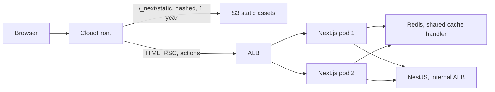
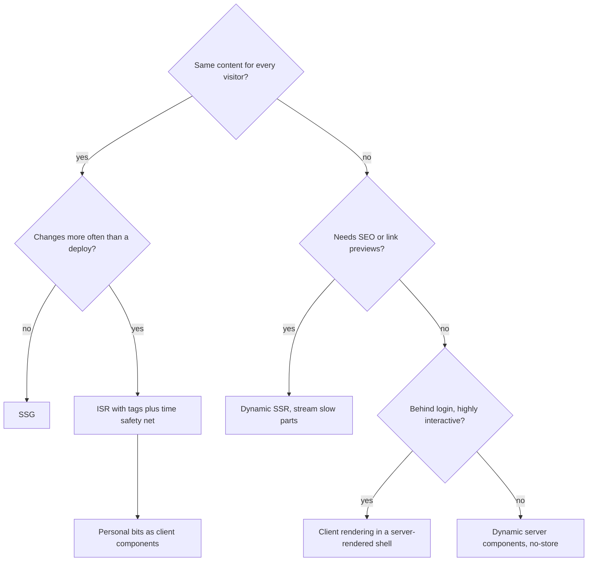
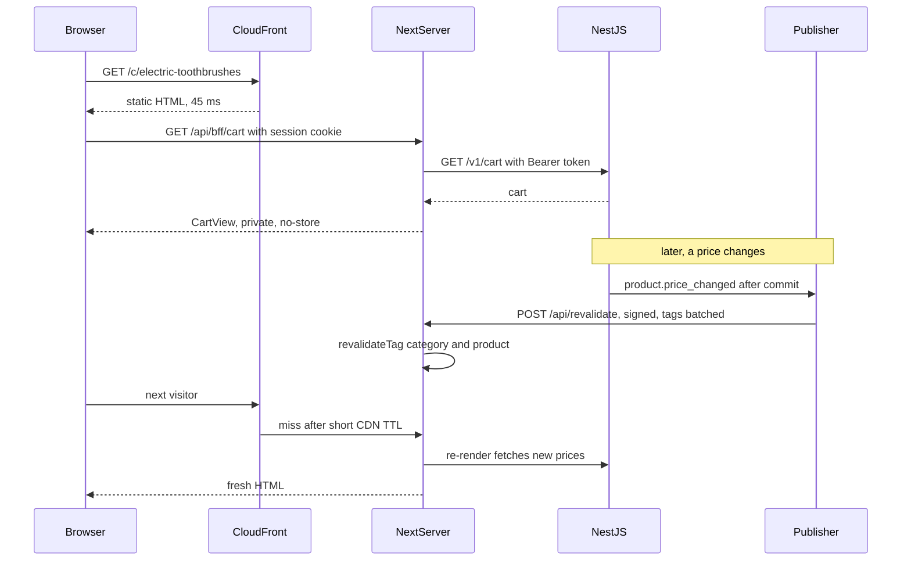

## 71.11 Deploying Next.js: static export, Node server, serverless and containers

#### Concept

`next build` can produce three kinds of output, and each one supports a different subset of what this Part has used:

- **Static export** (`output: 'export'` in `next.config.js`): plain HTML, CSS and JS in `out/`, hosted on S3 plus CloudFront or any static host. No server at all.
- **Node.js server**: `next start`, or `output: 'standalone'`, which copies only the files and `node_modules` the server needs into `.next/standalone` with a `server.js`. You run it in a container on ECS, Kubernetes or a VM.
- **Serverless**: each route runs as a function on demand, on Vercel or through adapters such as OpenNext on AWS Lambda.

| Feature | Static export | Node server (container) | Serverless |
|---|---|---|---|
| SSG pages | Yes | Yes | Yes |
| ISR, `revalidateTag` | No | Yes (shared cache handler for several replicas) | Yes (platform cache) |
| Server Actions, dynamic Route Handlers, cookies | No | Yes | Yes |
| Middleware | No | Yes | Yes |
| Default `next/image` optimisation | No (needs a loader or `unoptimized`) | Yes, uses your pods' CPU | Yes |
| Cost shape | Storage plus CDN | Pods running 24/7 | Per invocation; cold starts |

#### Why does it exist?

Because sites differ. A documentation site or a marketing site needs no server, and static export makes it nearly free and impossible to overload. A storefront with ISR, auth and Server Actions needs a server process. Teams that already run NestJS on Kubernetes usually want the web tier in the same place, with the same observability, rather than a second platform.

#### Mental model

Imagine publishing a cookbook. Static export is printing copies and shipping them to shops. A Node server is running a restaurant: always staffed, cooks anything to order. Serverless is a catering service that hires cooks per event: no idle staff, but the first cook takes a while to arrive.

#### How it works



What a self-hosted, multi-replica deployment must solve:

1. **One cache for all replicas.** The default ISR and Data Cache live in memory and on each pod's disk. Configure `cacheHandler` (stable from Next.js 14.1) to a shared store such as Redis and set `cacheMaxMemorySize: 0`, or each pod regenerates on its own schedule and `revalidateTag` reaches only one pod.
2. **Same build everywhere.** Build one image per commit and promote it through environments. Set `generateBuildId` to the commit SHA, and set `NEXT_SERVER_ACTIONS_ENCRYPTION_KEY` to the same value for every pod so closures encrypted by one pod decrypt on another.
3. **Version skew during deploys.** During a rolling deploy, a page from version A can request a chunk or post a Server Action to a pod running version B. Keep previous builds' `/_next/static` files available (upload them to S3 and never delete on deploy), and prefer blue/green or short rolling windows. Next.js reloads the page when it detects a new deployment on navigation.
4. **Runtime configuration.** `NEXT_PUBLIC_*` variables and `rewrites` destinations are fixed at build (68.6). Server-only `process.env` reads in server components happen at runtime. Keep environment-specific values server-side, or render them into the page from the server.
5. **Lifecycle.** Readiness probe on a dynamic `/api/health` Route Handler; on `SIGTERM`, the pod should stop receiving traffic before it exits (a `preStop` sleep of 5 to 10 s lets the load balancer deregister it), so in-flight streams and actions finish.

#### React / Next.js example

```js
// apps/web/next.config.js  (Next.js 14.1+)
module.exports = {
  output: 'standalone',
  cacheHandler: require.resolve('./cache-handler.js'),  // implements get/set/revalidateTag against Redis
  cacheMaxMemorySize: 0,                                // no per-pod in-memory copy that could diverge
  generateBuildId: async () => process.env.GIT_SHA ?? 'local',
};
```

```dockerfile
# apps/web/Dockerfile  (multi-stage; in a pnpm monorepo also set outputFileTracingRoot)
FROM node:20-alpine AS build
WORKDIR /app
RUN corepack enable
COPY package.json pnpm-lock.yaml ./
RUN pnpm install --frozen-lockfile
COPY . .
ARG GIT_SHA
ENV GIT_SHA=$GIT_SHA NEXT_TELEMETRY_DISABLED=1
RUN pnpm next build

FROM node:20-alpine AS run
WORKDIR /app
ENV NODE_ENV=production PORT=3000 HOSTNAME=0.0.0.0
RUN addgroup -S app && adduser -S app -G app
COPY --from=build /app/public ./public
COPY --from=build --chown=app:app /app/.next/standalone ./
COPY --from=build --chown=app:app /app/.next/static ./.next/static
USER app
EXPOSE 3000
CMD ["node", "server.js"]
```

The standalone image for a typical storefront is 150 to 250 MB instead of over 1 GB with full `node_modules`, and starts in about a second.

#### Backend side (NestJS)

- **The build calls the API.** `generateStaticParams` and static pages fetch from NestJS during `next build` in CI, so CI needs network access to a catalogue API with production-like data, or prerendering must be limited and the rest rendered on demand.
- **Web and API deploy independently.** During a deploy, old web pods call the new API and new web pods call the old API. Keep API changes additive and backward compatible (Part 24 — API Compatibility).
- **Keep-alive and pools.** Each Next.js pod is an HTTP client of NestJS; enable keep-alive to avoid a new TCP and TLS handshake per server-side fetch, and size NestJS for the web tier's concurrency at peak.

#### Production scenario

A retailer moved its storefront from Vercel to ECS Fargate next to its NestJS services to cut cost and API latency. Six 1 vCPU / 2 GB tasks served 1,800 requests per second at peak behind CloudFront (93 % CDN hit rate). Server-side calls to NestJS dropped from 25 ms (cross-provider) to 2 ms (same VPC), p75 TTFB on dynamic pages fell from 310 ms to 140 ms, and the monthly bill for the web tier dropped by about 60 %. The price: they now ran the cache handler, autoscaling, image optimisation CPU and version-skew handling themselves.

#### Failure scenario

The same team's first launch used the default file-system cache. With six replicas, each pod held its own ISR copy of every page. When a price changed, the revalidation webhook hit one pod. For the next 10 minutes, a customer refreshing the product page saw the new price on one request in six and the old price on the rest, depending on which pod the load balancer chose. Support received screenshots of both prices "seconds apart". A shared Redis cache handler made the six pods agree, and a synthetic check now fetches one product page from every pod after each revalidation and compares the price.

#### Edge cases & failure modes

- **Static export silently drops features**: the build fails on `cookies()`, Server Actions or ISR, and teams discover this late.
- **Image optimisation on pods** can eat CPU during traffic spikes; offload it to a CDN image service with a custom loader if needed.
- **Deleting old static assets** on deploy produces `ChunkLoadError` for users with open tabs (Part 76 — Shipping and Operating Frontends).
- **Serverless cold starts** of 300 ms to 1 s on rarely used routes; Edge or warm pools help.
- **Memory**: each pod's in-memory caches and in-flight streams grow with traffic; set container limits with headroom and watch for OOMKilled restarts.

#### How a Senior Full-Stack Engineer thinks about this

The senior picks the deployment by the features the app actually uses: static export when no page needs a server, a managed platform when the team wants zero infrastructure, containers when the rest of the system already runs there and the team can own a shared cache and version-skew handling. They treat the Next.js tier as a stateless service with shared state outside it, like any NestJS service in Part 43 — Containers and Kubernetes.

#### Common mistakes

- **Running several replicas with the default per-pod cache.**
- **Building separate images per environment** because of `NEXT_PUBLIC_` values.
- **Deleting the previous build's assets** on every deploy.
- **No `preStop` delay**, cutting off streams and actions during rollouts.

#### Interview questions

1. **What breaks when you self-host Next.js with three replicas and default settings?** Expected answer: per-pod ISR and Data Cache, revalidation reaches one pod; fix with a shared `cacheHandler`, `cacheMaxMemorySize: 0`. Follow-up: and Server Actions? (Same encryption key and build across pods.)
2. **When is static export the right choice?** Expected answer: no per-request logic, no ISR, no actions; marketing, docs, a Vite-like SPA.
3. **How do you handle version skew during a Next.js deploy?** Expected answer: keep old assets, consistent build ID, blue/green or short rolls, client reload on new deployment.

#### Practical exercise

Containerise the storefront and run three replicas behind a local load balancer. Acceptance criteria: the image is under 300 MB; a revalidation call changes the price seen on all three replicas within 3 s; a rolling restart during a 100 RPS load test produces zero `5xx`.

## 71.12 Decision table: a rendering strategy per page type

#### Concept

The rendering strategy is a per-page decision, made from four questions asked in 71.1: Is it the same for everyone? How stale may it be? Does search or sharing matter? What should happen when the API is down? This section turns the Part into one table that a team can apply in design review.

#### How it works



| Page | Strategy | Next.js 14 setup | Freshness | Personal parts | Why |
|---|---|---|---|---|---|
| Home, category | ISR | `revalidate = 600`, tags per category | Seconds via on-demand | Client components after paint | High traffic, SEO, same for all |
| Product page | ISR, prebuild top N | `generateStaticParams`, `dynamicParams = true`, `dynamic = 'error'` | Seconds via `product:<slug>` tag | Stock badge, delivery estimate on client | SEO, survives API outages |
| Search results | Dynamic SSR with cached fetches | Reads `searchParams`; facets via `unstable_cache` | Live | None or client | Infinite query space, some SEO |
| Cart | Client-rendered in static shell | Client component plus TanStack Query via BFF | Live | All of it | Personal, exact, no SEO |
| Checkout | Dynamic, `no-store` | `requireSession()`, Server Actions | Live, repriced server-side | All of it | Correctness over speed |
| Order history | Dynamic server components | `requireSession()`, `no-store`, `staleTimes.dynamic: 0` | Live | All of it | Personal, behind login |
| Order tracking | Dynamic shell, live client island | Server-rendered order, SSE client component (70.8) | Sub-second | Live status | Status changes constantly |
| Admin dashboard | CSR, separate app or `(admin)` group | Client components or a Vite SPA (68.11) | Live | All of it | Desktop, internal, interactive |
| Help articles, blog | SSG | Static, rebuilt or revalidated on publish | On publish | None | Rarely changes |

#### Backend side (NestJS)

Each row implies an API shape: ISR rows need cacheable catalogue endpoints, change events and a slug-listing endpoint; client rows need same-origin access, `private, no-store` and per-user rate limits; dynamic rows need 1 to 5 ms indexed lookups because they sit in TTFB on every view.

#### Failure scenario

A team that skipped this review made every page dynamic "to be safe" when migrating from the Pages Router. Their Next.js tier needed 40 pods where 6 would have done, and a catalogue API incident took the whole storefront down, because no page had a cached copy to fall back on.

#### How a Senior Full-Stack Engineer thinks about this

The senior writes the strategy, revalidation path and failure behaviour next to each route in the design document, then enforces it with route segment config (`dynamic = 'error'` on static pages) and reads the build output in review. The default for anything public is cached; request-time rendering has to justify its cost.

#### Common mistakes

- **One strategy for the whole site.**
- **Personal data in ISR pages.**
- **Deciding strategy by framework fashion rather than by the four questions.**

#### Interview questions

1. **Pick a rendering strategy for product, cart, order history and admin pages, and justify each.** Expected answer: as in the table; follow-up: what changes if product prices are personalised per customer segment? (Move price to a client or streamed dynamic section, or segment-specific static variants keyed by a cookie set in middleware.)
2. **How do you stop a static page from silently becoming dynamic?** Expected answer: `dynamic = 'error'`, build output review, a CI check.

#### Practical exercise

Fill in the table for your own product's ten busiest pages, including the NestJS endpoint each depends on and what users see when it is down. Acceptance criteria: every row has a revalidation path and a failure behaviour, and the `next build` output matches the table.

## 71.13 Worked example: an ISR product listing with a client-rendered personal cart

#### Requirements

Assemble the Part into one feature for the storefront: the category page `/c/electric-toothbrushes` and the cart in the site header.

- The listing is the same for everyone, must be indexed and shareable, and must survive a catalogue outage.
- A price change appears on the listing within 5 s p95; the page is never more than 10 minutes stale even if events are lost.
- The header shows the visitor's cart count; "Add to cart" updates it at once, never adds twice on a double tap, and never makes the listing dynamic.
- Numbers: listing TTFB under 100 ms p75 from the CDN; LCP under 1.5 s on a mid-range 4G phone; cart count visible within 400 ms of first paint.

#### The flow



#### The contract

From `@shop/contracts`: `CategoryPageSchema` (71.2), `CartViewSchema` (71.8), `RevalidateRequestSchema` (71.6) and the shared tag builders `cacheTags.product(slug)` and `cacheTags.category(slug)` (71.7). The listing page and the revalidation Route Handler are the ones already written in 71.2 and 71.6; the cart BFF is 71.8.

#### Backend: the revalidation publisher

```ts
// apps/api/src/catalog/revalidation.publisher.ts
import { Injectable, Logger } from '@nestjs/common';
import { OnEvent } from '@nestjs/event-emitter';
import { Interval } from '@nestjs/schedule';
import { createHmac } from 'node:crypto';
import { cacheTags } from '@shop/contracts';

type PriceChanged = { slug: string; categorySlugs: string[] };

@Injectable()
export class RevalidationPublisher {
  private readonly log = new Logger(RevalidationPublisher.name);
  private readonly pending = new Set<string>();             // a Set dedupes 300 changes to one category tag

  @OnEvent('product.price_changed')                         // emitted by the outbox relay, after commit (Part 29)
  onPriceChanged(e: PriceChanged) {
    this.pending.add(cacheTags.product(e.slug));
    for (const c of e.categorySlugs) this.pending.add(cacheTags.category(c));
  }

  @Interval(2_000)                                          // batch: a 20,000-SKU import becomes a few calls a tick
  async flush() {
    const tags = [...this.pending].slice(0, 100);           // the Route Handler accepts at most 100
    if (tags.length === 0) return;
    tags.forEach((t) => this.pending.delete(t));
    const body = JSON.stringify({ tags });
    const sig = createHmac('sha256', process.env.REVALIDATE_SECRET!).update(body).digest('hex');
    try {
      const res = await fetch(`${process.env.WEB_INTERNAL_URL}/api/revalidate`, {
        method: 'POST', body, headers: { 'Content-Type': 'application/json', 'x-signature': sig },
        signal: AbortSignal.timeout(3_000),
      });
      if (!res.ok) throw new Error(`revalidate ${res.status}`);
    } catch (err) {
      tags.forEach((t) => this.pending.add(t));             // retry next tick; revalidate = 600 is the backstop
      this.log.warn(`revalidation failed, ${tags.length} tags requeued: ${String(err)}`);
    }
  }
}
```

The queue is in memory, so a crash loses at most 2 seconds of tags; the page's `revalidate = 600` bounds the damage. The internal URL reaches any web pod because the cache handler is shared (71.11).

#### Frontend: the personal cart on the client

```tsx
// apps/web/cart/useCart.ts  (TanStack Query v5)
'use client';
import { useMutation, useQuery, useQueryClient } from '@tanstack/react-query';
import { CartViewSchema, type CartView } from '@shop/contracts';

export const cartKey = ['cart'] as const;

export function useCart() {
  return useQuery({
    queryKey: cartKey,
    queryFn: async ({ signal }) => {
      const res = await fetch('/api/bff/cart', { signal });   // same origin: session cookie sent, no CORS
      if (!res.ok) throw new Error(`cart ${res.status}`);
      return CartViewSchema.parse(await res.json());
    },
    staleTime: 15_000,
  });
}

type AddVars = { sku: string; quantity: number; idempotencyKey: string };

export function useAddToCart() {
  const qc = useQueryClient();
  return useMutation({
    mutationFn: async ({ sku, quantity, idempotencyKey }: AddVars) => {
      const res = await fetch('/api/v1/cart/items', {          // rewrites proxy to NestJS (79.8)
        method: 'POST',
        headers: { 'Content-Type': 'application/json', 'Idempotency-Key': idempotencyKey },
        body: JSON.stringify({ sku, quantity }),
        signal: AbortSignal.timeout(5_000),
      });
      if (!res.ok) throw new Error(`add ${res.status}`);
    },
    retry: 2,                                                  // safe: same key on every retry
    onMutate: async ({ quantity }) => {
      await qc.cancelQueries({ queryKey: cartKey });
      const before = qc.getQueryData<CartView>(cartKey);
      if (before) qc.setQueryData<CartView>(cartKey, { ...before, count: before.count + quantity });
      return { before };
    },
    onError: (_e, _v, ctx) => { if (ctx?.before) qc.setQueryData(cartKey, ctx.before); },
    onSettled: () => qc.invalidateQueries({ queryKey: cartKey }),
  });
}
```

The header's `CartCount` is a client component that renders `useCart().data?.count` inside a badge with a fixed width, so the count arriving after paint causes no layout shift. The `AddToCartButton` from 71.4 creates the idempotency key in its click handler. Nothing in the listing reads cookies, so `next build` still marks it static, and `dynamic = 'error'` keeps it that way.

#### Failure drills

| Drill | Expected behaviour | Mechanism |
|---|---|---|
| Catalogue API down for 5 minutes | Listing served from cache; revalidation errors logged, old page kept | ISR keeps the last good render (71.2) |
| Catalogue returns empty `200` during failover | Render throws on `totalCount > 0` with no products; old page kept | Loud failure contract (71.2) |
| Publisher crashes mid-batch | Up to 2 s of tags lost; pages correct within 10 minutes | `revalidate = 600` safety net |
| Cart service down | Listing unaffected; header badge hidden, "Add" shows an error toast | Client island, BFF `502` (71.8) |
| Double tap on "Add" | One line item | Disabled button, idempotency key |
| Six web pods, one receives the webhook | All pods serve the new price | Shared cache handler (71.11) |
| Someone adds `cookies()` to the layout | Build fails | `dynamic = 'error'` |

#### Numbers

On a staging copy with 40,000 products: CDN hit rate 96 %; listing TTFB 45 ms p75 on a hit and 140 ms on an origin hit from the Full Route Cache; LCP 1.2 s p75 on a throttled mid-range phone; cart badge at 310 ms after first paint; price change to fresh listing 2.8 s p50 and 4.6 s p95 (2 s batch, revalidation, 30 s CDN TTL cap only for visitors who hit the CDN copy); the catalogue API served about 12 calls per second for revalidation renders instead of 1,500 per second of browser traffic.

#### How a Senior Full-Stack Engineer thinks about this

The page is split by who sees what. Everything shared is rendered once and cached at every layer, with an event-driven invalidation path and a time-based backstop. Everything personal is fetched by the browser through a same-origin BFF, so it never touches a shared cache. The backend's job is to make both halves safe: fail loudly so caches keep good data, publish change events after commit, return per-user data as `private, no-store`, and deduplicate retries with idempotency keys.

#### Practical exercise

Build the feature end to end. Acceptance criteria: every drill in the table passes in a scripted run; `curl` of the listing shows prices in the HTML and no customer data; `next build` marks the listing static; the numbers above are measured and recorded for your environment.

## Senior Checklist — Part 71

- [ ] I understand the concept
- [ ] I can explain it simply
- [ ] I can implement it
- [ ] I understand its failure modes
- [ ] I understand its scaling limitations
- [ ] I understand its security implications
- [ ] I understand its operational implications
- [ ] I can choose between alternatives
- [ ] I can explain the tradeoffs
- [ ] I can answer senior-level interview questions
- [ ] I can compare CSR, SSR, SSG, ISR and streaming on TTFB, LCP, server cost, freshness, SEO and outage behaviour
- [ ] I can read `next build` output and explain why a route is static or dynamic, and I enforce intent with `dynamic = 'error'`
- [ ] I know which data decides the status code and keep it outside the first Suspense boundary
- [ ] I push `'use client'` to the leaves and treat props across the boundary as a public response body
- [ ] I state caching intent on every `fetch`, start independent requests in parallel, and key every cached function by all its inputs
- [ ] I can name the four Next.js caches, plus the CDN, and clear each one, including in Next.js 15 and 16
- [ ] I treat every Server Action and Route Handler as a public endpoint: validate, authenticate with the user's token, send an idempotency key
- [ ] I keep the BFF thin: aggregation, shaping and token handling, never business rules
- [ ] I place auth in middleware for convenience, in a data access layer for correctness, and in NestJS for enforcement
- [ ] I can diagnose and prevent hydration mismatches from time zones, locales, randomness and invalid HTML
- [ ] I can self-host Next.js on several replicas with a shared cache handler, consistent builds and version-skew handling
- [ ] I can choose a rendering strategy per page type and defend it in design review

## Part 71 — Key Takeaways

- Rendering strategy is a per-page choice between latency, server cost, freshness and SEO; there is no modern default.
- Static and ISR pages are the cheapest and most reliable pages you will ever serve, and they survive API outages.
- ISR is a cache with a freshness budget: on-demand tags as the mechanism, a time window as the safety net, narrow tags always.
- An API that returns an empty `200` on failure poisons every cache in front of it; fail loudly so stale-but-good is kept.
- The HTTP status is sent with the first streamed chunk; decide existence and access before the first Suspense boundary.
- One `cookies()` call in a shared layout can move a whole site from the CDN to your servers; read the build output.
- Everything passed to a client component is in the page source; pass IDs and view models, guard server code with `server-only`.
- Next.js 15 stopped caching `fetch` by default and made request APIs async; Next.js 16 moved caching to `"use cache"`.
- "Old data on screen" can come from six layers; debug from the browser inward and clear the right one.
- Server Actions are public `POST` endpoints; authorise with the user's own token in NestJS, never with a service token.
- Middleware is a receptionist, not a lock; real authorisation lives in a data access layer and in the API.
- Hydration needs identical first renders on server and client; pass time zone, locale and random values in explicitly.
