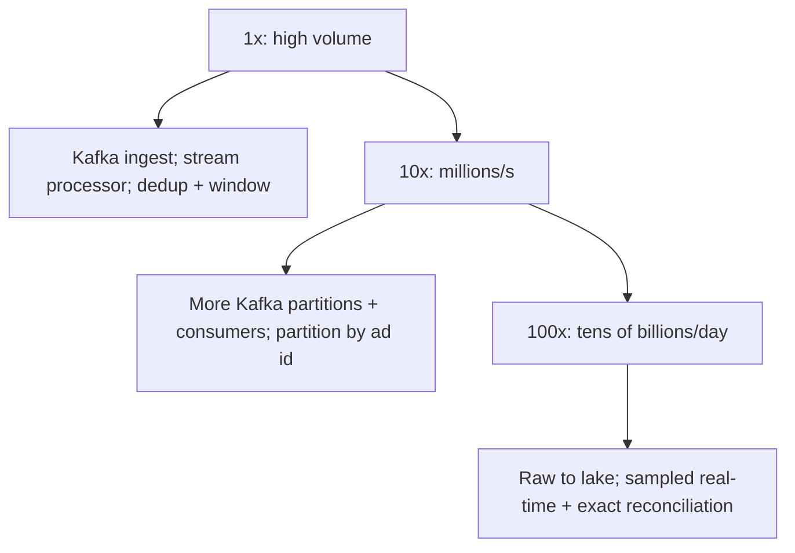

### 71.4.11 Caching

Served aggregates are small and can be cached for dashboards (short TTL) since they update per window. The dedup state is effectively a cache/index of seen event ids within the active window.

### 71.4.12 Messaging

Kafka is central (Part 31): durable, high-throughput, replayable ingestion, partitioned (by ad id for aggregation locality, so one consumer sees all of an ad's events and can aggregate in memory before flushing). Replayability is key — if aggregation has a bug, you can reprocess from Kafka. At-least-once delivery with idempotent, deduplicating consumers is the contract.

| Topic | Key | Producer | Consumers |
|---|---|---|---|
| `ad.click_raw` | `adId` | Click redirect service (assigns `event_id`), idempotent producer, `acks=all` | Fraud filter |
| `ad.click_validated` | `adId` | Fraud filter, with a validity verdict per click | Click aggregator (71.4.10), raw-click lake writer, budget pacing |
| `ad.impression` | `adId` | Ad servers, batched | Flink impression aggregator, lake writer |
| `ad.budget_exhausted` | `campaignId` | Budget pacing | Ad servers stop serving the campaign within seconds |

Budget pacing is the reason dashboards are not the only real-time consumer: an advertiser with a 500-dollar daily budget must stop receiving clicks close to 500 dollars, so pacing reads the fast, approximate counts and invoicing reads the slow, exact ones.

### 71.4.13 Scaling

Ingestion scales via Kafka partitions and consumer parallelism (partition by ad id for aggregation locality). Aggregates stay small regardless of event volume (the point of aggregating). At extreme scale, real-time dashboards may use sampling/approximation for speed while billing uses the exact reconciled counts — a fast-approximate plus slow-exact split.

### 71.4.14 Security

Prevent click fraud (fake clicks to inflate bills or drain competitors' budgets): bot detection, rate limiting, anomaly detection on click patterns, and validation — click fraud is a major real threat in ad systems. Protect PII in events (hash user identifiers, Part 42). Authorize who can read whose metrics. Ensure the billed counts cannot be tampered with.

### 71.4.15 Failure scenarios

| Failure | Detection | Impact | Mitigation | Effect |
|---|---|---|---|---|
| Duplicate events (at-least-once) | Normal | Over-count, over-bill | Dedup by event_id; idempotent aggregation | Exact counts |
| Consumer crash mid-aggregation | Offset lag | Reprocessing | Atomic (aggregate, offset); dedup | No double-count |
| Late events | Watermark | Miss the window | Allowed lateness; side output for very late; reconciliation | Counted or reconciled |
| Dropped event | Reconciliation mismatch | Under-count, lost revenue | Durable Kafka (no loss); reconciliation detects and corrects | Caught and fixed |
| Aggregation bug | Reconciliation mismatch | Wrong counts | Replay from Kafka with fixed code; reconcile | Corrected |
| Click fraud | Anomaly detection | Inflated bills | Fraud detection, rate limits, validation | Mitigated |
| Ingest overload | Kafka lag | Delayed aggregation | Kafka buffers; scale consumers | Smoothed, not lost |
| Viral ad makes one partition hot | Lag on one partition only | That ad's counts delayed | Pre-aggregate in memory per batch (one upsert per ad per minute), salt the key for the hottest ads | Smoothed |
| Replay beyond the dedup window | Reconciliation shows over-count after a replay | Over-billing | Replays recompute windows into fresh tables and swap, never add to live counts (71.4.21) | Prevented |
| Dedup partition dropped early | Duplicate rate falls to zero | Client retries counted twice | Alert on a dedup rate of exactly zero; partition maintenance tested | Caught |

### 71.4.16 Observability

Metrics: ingest rate, Kafka consumer lag, aggregation latency, dedup rate (duplicates caught), late-event rate, reconciliation discrepancies (should be ~zero; alert on any significant gap), fraud-detection signals. Alerts: reconciliation mismatch beyond tolerance (billing accuracy), consumer lag (aggregates falling behind), ingest loss (any event loss), fraud spikes. Dashboards: ingest/aggregation health, accuracy (reconciliation), fraud.

### 71.4.17 Deployment

High-throughput Kafka cluster; stream processor (Kafka Streams/Flink or custom consumers) scaled to the partition count; PostgreSQL for aggregates; a warehouse/lake for raw events; a scheduled reconciliation job. Replay capability (reprocess from Kafka) built in for fixing aggregation bugs. Fraud detection integrated at or near ingest.

### 71.4.18 Cost considerations

Dominated by the high-throughput ingestion (Kafka) and raw-event storage (about 17 TB/day uncompressed, a few TB as compressed Parquet — store in cheap columnar lake storage, and retain raw events only as long as needed for reconciliation and analysis, Part 42). Aggregates are tiny and cheap. The cost is controlled by retention policy on raw events (the dominant storage cost) and by right-sizing the stream-processing fleet. Accuracy (dedup, reconciliation) costs some compute but is non-negotiable because the counts are billed.

### 71.4.19 Tradeoffs

- **Exactly-once counting via dedup + idempotent aggregation on at-least-once delivery** over attempting exactly-once delivery (hard/impossible end to end): we get exact counts the practical way — unique event ids counted once — rather than chasing an exactly-once delivery guarantee.
- **Fast approximate real-time + slow exact reconciliation** over a single exact real-time path: dashboards get near-real-time (possibly sampled) numbers quickly, while billing uses the exact reconciled counts, because real-time and exact are in tension at this volume.
- **Durable Kafka buffer (replayable, no loss) with the cost of running it** over synchronous inserts (would never keep up and would lose events on failure): the durability and replay are worth the operational cost at this scale.
- **Retain raw events for reconciliation (storage cost) vs aggregate-and-drop (cheaper, no reconciliation)**: for billed counts, keeping raw events long enough to reconcile is worth the storage, because trust in the numbers requires it.

| Decision | Options | Chosen | Why | Cost |
|---|---|---|---|---|
| Who assigns `event_id` | Client, redirect server | Redirect server | Clients can forge or reuse ids | A server hop on every click |
| Reprocessing defence | Dedup only, offsets stored with counts | Offsets in the same transaction, plus a short dedup window | The dedup window only has to cover client retries | Custom seek on rebalance |
| Click aggregation engine | NestJS consumer on PostgreSQL, Flink | PostgreSQL consumer for clicks, Flink for impressions | Clicks fit one primary; impressions do not | Two engines to run |
| Fixing a bug | Replay into live tables, recompute and swap | Recompute and swap | Replays never double-count | Recompute capacity on standby |
| Invoice source | Stream aggregates, reconciled aggregates | Reconciled, D+1 | Two independent computations agree | Invoices a day later |

### 71.4.20 Alternative architectures

**Approximate-only counting** (count-min sketch, HyperLogLog for unique counts): for non-billed metrics where approximate counts suffice (rough dashboard trends), probabilistic structures count in tiny fixed memory with no exact-count machinery — far cheaper and simpler. Use this when accuracy is not billed; reserve the full exactly-once-plus-reconciliation design for metrics that are money.

**Database-only aggregation**: for moderate volume, insert events into PostgreSQL (partitioned by time, Part 26, section 26.7) and aggregate with SQL into summary tables (the Part 42 in-product analytics pattern). Simpler, no Kafka/stream processor; it does not scale to millions of events/second, but most "metrics" needs are far below that threshold — build this first unless the volume genuinely demands the streaming pipeline.

**Managed analytics/streaming service**: a managed ingestion-and-aggregation service offloads operating Kafka and stream processors; viable when you prefer managed infrastructure and accept its cost and constraints, especially for teams without a data-platform team.

### 71.4.21 Incident story: the replay that billed twice

An aggregator release shipped a time-zone bug: clicks from advertisers in one region were bucketed into the wrong hour. It was found after six hours. The fix was simple, and so was the recovery plan: reset the consumer group to the offsets of six hours ago and let the corrected code reprocess, since "the dedup table makes reprocessing harmless".

It did not. The dedup table kept two hours of ids. Clicks from the last two hours were recognised and skipped; clicks from the four hours before that had aged out of the dedup window, were treated as new, and were **added** to the existing counts, on top of the original, wrongly bucketed ones. 340 advertisers were over-counted by between 0.4 and 3.1 percent for the day.

The 03:00 reconciliation caught it: `count(DISTINCT event_id)` from the lake disagreed with the served hourly counts by far more than 0.01 percent, and invoices for those advertisers were held. Nobody was billed incorrectly, but the team spent a day producing corrected numbers by hand.

The postmortem replaced "replay into live tables" with **recompute and swap**: rebuild the affected windows from the raw lake (or Kafka) into a fresh table, verify it against reconciliation, then swap it in with a transaction. A replay can now be run twice without changing the result. The rule they wrote down: **deduplication protects against duplicates you expect; recomputation protects against the ones you cause.**

### 71.4.22 Interview follow-ups

1. **How do you count clicks exactly when Kafka delivers at least once?**
   Expected answer: server-assigned `event_id`, idempotent producer, counts and consumer offset in one transaction, a dedup window for client retries, and reconciliation from raw events. Why it matters: it shows you know exactly-once is built from layers. Follow-up: what does `exactly_once_v2` in Kafka Streams guarantee? (Atomic read-process-write within Kafka, not side effects in external systems.)
2. **A click arrives two hours late. Which window does it count in?**
   Expected answer: its event-time window; the billing aggregator upserts into the old row, the dashboard stream emits a correction or sends it to the late side output, and reconciliation guarantees it is billed.
3. **Why not store a counter per ad in Redis with `INCR`?**
   Expected answer: `INCR` is not idempotent, a retry double-counts, and Redis failover can lose increments; fine for pacing, wrong for invoices.
4. **How would you fix six hours of wrong aggregates?**
   Expected answer: recompute the windows from raw events into a new table, verify, swap; never replay additively into live counts.
5. **The volume grows from 20,000 to 500,000 clicks per second. What changes?**
   Expected answer: the PostgreSQL consumer gives way to Flink with keyed state and a transactional sink; aggregates and reconciliation stay the same.
6. **How do you keep fraud out of the bill?**
   Expected answer: a validation stage before aggregation (bot signatures, rate per user and IP, click-without-impression), invalid clicks kept and reported but not billed, and later refunds for fraud found after invoicing.

### 71.4.23 Practical exercise

Build the click path with NestJS, Kafka and PostgreSQL.

1. Create the schema from 71.4.7 and the aggregator from 71.4.10, with offsets stored in PostgreSQL and the seek on rebalance.
2. Produce 10 million clicks for 5,000 ads, with 3 percent duplicate `event_id` values and 2 percent arriving 10-90 minutes late.
3. Kill the consumer with `SIGKILL` five times during the run.
4. Write the reconciliation query and a recompute-and-swap job for a chosen hour.

Acceptance criteria:

- `SUM(clicks)` equals the number of distinct `event_id` values produced, exactly.
- Every per-ad, per-minute count matches a `count(DISTINCT event_id)` over the raw clicks.
- Running the recompute-and-swap job twice for the same hour leaves the counts unchanged.
- Consumer lag returns to zero within one minute of each restart.

## 71.5 Closing: what these four designs teach

The four systems in this Part each solve a distinct hard problem and reinforce patterns from across the book. The leaderboard shows that the right data structure — a Redis sorted set — turns an apparently expensive problem (ranking millions of users in real time) into fast, simple operations, and that when exact is too costly (top-K over a billion-event stream) a probabilistic structure (count-min sketch) trades a little accuracy for enormous savings. Collaborative editing is a correctness problem above all: concurrent edits must converge on every client, which operational transform and CRDTs achieve by two different rules, and which is hard enough that you use a proven library rather than building the merge engine yourself. Proximity search is about picking the right spatial index for the update/query profile — Redis geo for fast-moving drivers, PostGIS for query-rich static restaurants — and partitioning naturally by region because every query is local. Ad-click aggregation is about counting accurately at enormous scale: exactly-once counting on at-least-once delivery via unique event ids and idempotent aggregation, windowed by event time with late-event handling, and backed by reconciliation because the counts are billed.

Read across the system-design Parts (Part 59 and Parts 70–72, with Part 58 as the on-ramp), the senior lessons compound. The right data structure or index often turns a hard problem easy — a sorted set for ranking, a geohash for proximity, a conditional update for no-double-sell. Accuracy versus cost is a recurring, deliberate trade: approximate top-K and sampled dashboards where approximation is fine, exact counting and reconciliation where the numbers are money. At-least-once delivery plus idempotent, deduplicating consumers is the standard reliable contract, appearing in the crawler, the metrics aggregator and the click stream. Reconciliation — comparing a derived result against the source of truth — is the backstop that catches silent errors wherever correctness matters. And every design carries a "when not to build" alternative: a PostgreSQL-only leaderboard for small scale, section-locking instead of CRDTs for most documents, PostGIS-only for modest location rates, database aggregation instead of a streaming pipeline for modest volumes. The simplest design that meets the requirement wins, and the method — clarify, estimate, model, design, deep-dive the hot spot, cover the cross-cutting concerns, state tradeoffs, offer alternatives — is what lets you produce the right design for any problem, not just recall these.

The four incident stories share a shape with those of Part 70. In each, every dashboard was green while the system was wrong: a leaderboard lost two million players without one error, a compaction job deleted edits that were still on screen, a fleet of ghost drivers answered no offers, and a replay billed the same clicks twice. Each was caught, or would have been caught earlier, by an **invariant check**: `ZCARD` against the row count, snapshot-plus-tail against the live document, offer acceptance rate, and an independent recount from raw events. For every design, write down what must always be true, and build the check that pages when it is not.

## Senior Checklist — Part 71

- [ ] I understand the concept
- [ ] I can explain it simply
- [ ] I can implement it
- [ ] I understand its failure modes
- [ ] I understand its scaling limitations
- [ ] I understand its security implications
- [ ] I understand its operational implications
- [ ] I can choose between alternatives
- [ ] I can explain the tradeoffs
- [ ] I can answer senior-level interview questions
- [ ] I can build a real-time leaderboard with Redis sorted sets and know when to shard or approximate (count-min sketch)
- [ ] I can explain operational transform vs CRDTs and why collaborative edits must converge on all clients
- [ ] I can choose a geospatial index (geohash/Redis geo, PostGIS, quadtree) by update and query profile and partition by region
- [ ] I can achieve exactly-once counting on at-least-once delivery via unique event ids and idempotent aggregation
- [ ] I can window aggregates by event time with late-event handling and back them with reconciliation
- [ ] For each system I can name the simpler alternative and when to prefer it
- [ ] I can apply the full system-design method to a new problem, not just recall these designs
- [ ] I can break leaderboard ties with a composite score inside 2^53 and make score writes idempotent with `ZADD GT`
- [ ] I can size a count-min sketch and explain why its error bound only suits heavy hitters
- [ ] I can explain state-vector sync, tombstones and why compaction needs an upper bound on what it deletes
- [ ] I can design driver liveness without per-member TTLs and prevent double dispatch with an atomic claim
- [ ] I can store consumer offsets with aggregates in one transaction and fix bad aggregates by recompute-and-swap

## Part 71 — Key Takeaways

- A Redis sorted set makes real-time ranking (update, rank, top-N, neighbors) fast and simple for millions of users; keep a durable copy in PostgreSQL for rebuild, and shard only at extreme scale.
- When exact top-K over a huge stream is too costly, a count-min sketch counts approximately in fixed memory — trade slight over-estimation for enormous savings where exactness is not required.
- Collaborative editing is a convergence problem: operational transform (transform ops against concurrent ops, needs coordination) and CRDTs (stable element identities, merge in any order, offline-friendly) both guarantee all clients converge; use a proven library rather than building the merge engine.
- Choose a geospatial index by profile: Redis geo (geohash) for frequently-moving entities (cheap updates), PostGIS for query-rich static entities joined to attributes, quadtree for adaptive nearest-neighbor; partition by region because proximity queries are always local.
- Exactly-once counting on at-least-once delivery is achieved by giving each event a unique id and counting it once (dedup) plus atomic aggregate-and-offset updates, not by chasing exactly-once delivery.
- Aggregate by event time with watermarks and allowed lateness so late events (offline devices) are counted, not silently dropped, and side-output the very late for reconciliation.
- Reconciliation — recomputing aggregates from raw events and comparing to the served counts — is the non-negotiable accuracy backstop whenever the numbers are billed or otherwise must be trusted.
- The right data structure or index often turns a hard problem easy (sorted set, geohash, conditional update); choosing it is the core of the design.
- Accuracy versus cost is a deliberate, recurring trade: approximate where it is acceptable (dashboards, non-billed top-K), exact with reconciliation where it is money (clicks, seats).
- Redis must never hold data you cannot lose under an eviction policy that allows losing it; leaderboards get `noeviction` and a rebuild path.
- Search can be approximate; the claim that follows it must be exact: an atomic `SET NX` per driver, like the conditional seat update in Part 70.
- Replays and cleanups need explicit bounds: compaction deletes only up to its snapshot, and bad aggregates are recomputed and swapped, never re-added.
- Every design has a simpler alternative that avoids building the complex system — PostgreSQL-only leaderboards, section-locking over CRDTs, PostGIS-only proximity, database aggregation over streaming — and the method of clarify-estimate-model-design-deep-dive-tradeoffs-alternatives is what lets you choose correctly for any new problem.
