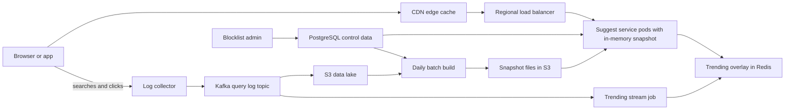
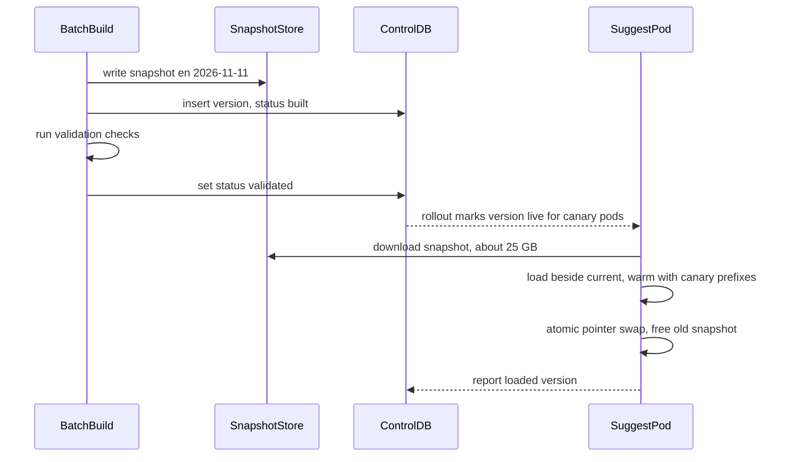

# Part 72 — More System Designs III

This Part adds seven more worked designs to the library built in Parts 59 and 70, 71. Each one teaches a skill the earlier designs only touched:

- **72.1 Search Autocomplete**: answering a prefix in a few milliseconds by doing almost all the work offline, then keeping the answers fresh, safe and personal.
- **72.2 File Sync (Dropbox-style)**: chunking, content hashes, a metadata service separate from block storage, and a sync protocol that survives offline edits and conflicts.
- **72.3 Distributed Message Queue**: building a Kafka-like log from the disk up: partitions, segments, replication, consumer groups and delivery guarantees.
- **72.4 Distributed Cache**: building a Redis- or Memcached-like cluster: hash slots, replication, eviction, expiry, hot keys and memory sizing.
- **72.5 Object Storage (S3-style)**: storing trillions of immutable objects durably and cheaply.
- **72.6 Stock Exchange Matching Engine**: a deterministic, single-threaded core that matches orders in microseconds.
- **72.7 Monitoring and Alerting**: collecting, storing and alerting on millions of time series without the monitoring system becoming the outage.

**How to use these designs.** If system design is new to you, start with Part 58 — System Design from Zero, which gives the on-ramp and the ladder of designs from easy to hard; these seven sit on the upper rungs. Then read section 59.0 in Part 59 — System Design Case Studies, which defines the nine-move method and the twenty-section template that every design here follows. Each design opens with a **Try it first** card: the problem, the requirements and the numbers. Cover the rest, spend the suggested time sketching your own API, data model, components and estimates, and only then read the model design. The model design restates everything it needs, so it also reads well on its own. Each design is split into two files: the design itself (requirements to deep dives), then operating it (caching, scaling, failures, cost, trade-offs, an incident story, interview follow-ups and an exercise).

## 72.1 Search Autocomplete

> **Try it first** · Level: Intermediate · About 45 minutes
>
> **Build:** a service that suggests the most likely complete search queries as the user types each character into a search box.
>
> **Requirements:**
> - return up to 10 ranked suggestions for any typed prefix
> - rank by popularity, with recent and trending queries rising within minutes
> - blend in the signed-in user's own recent searches
> - tolerate small typos and support several languages
> - never show offensive, illegal or private suggestions
>
> **Scale and constraints:** 100 million daily active users, 1 billion searches a day, about 5 suggestion requests per search (5 billion a day, about 58,000 per second on average and 150,000 per second at peak), 50 million distinct suggestible queries, a serving index of about 25 GB, under 100 ms p99 from keystroke to suggestions on screen, trending queries visible within 15 minutes, 99.95 percent availability.
>
> **Your task:** sketch the API, the data model and the main components; estimate storage and throughput; name the two hardest problems and how you would solve them.
>
> Spend the time on paper before you read on. The model design follows.

### 72.1.1 Requirements

Autocomplete (also called typeahead or search suggestions) is the dropdown that appears under a search box and guesses what you are about to type. You type "iph" and it offers "iphone 16", "iphone 16 pro max", "iphone charger". It looks like a tiny feature. It is one of the highest-traffic endpoints in any product with search, because it fires on keystrokes rather than on submitted searches, and it has one of the tightest latency budgets, because a suggestion that arrives after the user has typed two more characters is worse than no suggestion at all.

The users are the people typing (they want fast, relevant completions), the search and product teams (who want more searches completed and fewer typos sent to the search engine), and trust-and-safety and legal teams (who must be able to remove a suggestion within minutes). The design probes one central idea: **move work from read time to write time**. At 150,000 requests per second with a 10 ms server budget there is no time to search 50 million queries per keystroke. Instead, an offline pipeline precomputes the best ten completions for every useful prefix, and the online service does a single lookup.

#### Mental model

Imagine a librarian at a busy information desk. She cannot run to the shelves for every half-asked question. So every night she writes index cards: one card per opening phrase ("how do I re...") listing the ten questions people most often finished it with. During the day she just flips to the right card. A messenger brings her a short note every few minutes about questions that suddenly became popular, and she clips it to the front of the right cards. That is the whole design: nightly cards (the batch-built prefix index), the messenger (the trending stream), and the clipped notes (the serving-time overlay).

### 72.1.2 Functional requirements

1. Given a prefix and a locale, return up to 10 suggestions ranked by a popularity score.
2. Suggestions reflect recent behaviour: a full rebuild at least daily, and trending queries (a news event, a product launch) appear within 15 minutes.
3. For a signed-in user, blend their own recent searches into the list, marked as history so they can delete them.
4. Tolerate small typos ("iphnoe" still suggests "iphone") when the exact prefix finds too little.
5. Support multiple languages and scripts, including accent-insensitive matching ("cafe" matches "café") and scripts without spaces.
6. Filter offensive, hateful, sexual, illegal and personally identifying suggestions, with a removal path that takes effect within minutes globally.
7. Record which suggestion was shown and which was clicked, to feed the ranking pipeline.

Non-goals: this is not the search engine itself (submitting the query goes to Part 37 — Search: PostgreSQL Full-Text to Elasticsearch/OpenSearch), not spelling correction of the submitted query, and not product-catalogue autocomplete with live stock (a smaller, different problem covered in section 37.7).

### 72.1.3 Non-functional requirements

| Property | Target | Why |
|---|---|---|
| End-to-end latency | under 100 ms p99 keystroke to rendered list | Slower suggestions trail the typing and are ignored |
| Server latency | under 10 ms p99 inside the service | Leaves room for the network, which dominates |
| Throughput | 150,000 requests per second peak, global | Keystrokes, not searches, drive load |
| Freshness | trending within 15 minutes, full rebuild daily | Stale suggestions miss news and launches |
| Availability | 99.95 percent | The search box still works without suggestions, so this is high but not critical |
| Safety | a blocked phrase disappears everywhere within 5 minutes | Offensive suggestions become screenshots and headlines |
| Privacy | a query is never suggested unless many distinct users typed it | A suggestion must never reveal one person's search |

### 72.1.4 Constraints

- The read path cannot touch a database or a search cluster per keystroke at this rate and latency; it must be an in-memory lookup.
- Query logs are personal data. The pipeline must aggregate them, apply a minimum distinct-user threshold, and drop raw logs on a retention schedule.
- The default stack is NestJS on Kubernetes, Kafka, object storage (S3) for logs and snapshots, and a batch engine (Spark or similar) for the daily build. PostgreSQL holds small control data: blocklists, manual overrides and snapshot versions.
- The team is small. A design that needs a bespoke distributed trie database is a design the team cannot run.

### 72.1.5 Capacity estimation

| Quantity | Assumption | Calculation | Result |
|---|---|---|---|
| Searches per day | 100M DAU x 10 searches | 100M x 10 | 1 billion |
| Suggestion requests per search | average query 20 characters; debouncing sends about one request per 4 characters | given | about 5 |
| Suggestion requests per day | 1B x 5 | | 5 billion |
| Average request rate | 5B / 86,400 | | about 58,000 per second |
| Peak request rate | about 2.5x average (evening peak) | 58,000 x 2.5 | about 150,000 per second |
| Query log volume | 1B searches x ~100 bytes (normalized query, locale, user hash, time) | | about 100 GB per day raw, ~20 GB compressed |
| Distinct suggestible queries | after normalization and the 20-distinct-user threshold | given | 50 million |
| Prefix entries | prefixes of length 1 to 20 of 50M queries, heavily shared | estimate | about 300 million |
| Bytes per prefix entry | ~12 B prefix + 10 suggestion ids x 4 B + ~20 B index overhead | | about 75 bytes |
| Prefix table size | 300M x 75 B | | about 22 GB |
| Suggestion dictionary | 50M strings x ~30 B + offsets | | about 2 GB |
| Serving index total | 22 + 2 GB, plus small trending overlay | | about 25 GB per full snapshot |

The serving side follows from those numbers:

| Quantity | Assumption | Calculation | Result |
|---|---|---|---|
| Requests absorbed before origin | browser cache plus CDN cache for short, popular prefixes | assume about 40 percent | 90,000 per second reach origin at peak |
| Per-region origin load | 3 regions, the busiest takes about 45 percent | 90,000 x 0.45 | about 40,000 per second |
| Throughput per serving pod | in-memory lookup, JSON response of ~600 bytes | measured order of magnitude | about 8,000 per second per pod |
| Pods in the busiest region | 40,000 / 8,000, then 2x headroom for a zone failure | | 10 pods |
| Memory per pod | the 25 GB snapshot plus room to load the next one beside it | 25 x 2 + runtime | 64 GB nodes |
| Response bandwidth | 150,000 x 600 bytes | | about 90 MB per second globally, trivial |
| Trending stream | 1B searches per day from the log topic | 1B / 86,400 | about 12,000 events per second average |

Three numbers drive the design. **150,000 requests per second at under 10 ms** rules out any per-request search and forces a precomputed lookup. **25 GB** is small enough to hold an entire copy in each pod's memory, which means no sharding of the serving tier: every pod can answer every prefix, and scaling is just adding identical pods. And the factor of 2 in memory (old snapshot plus new snapshot during a swap) is easy to forget and decides the node size.

### 72.1.6 API design

| Method | Path | Request | Response | Status | Cacheable | Notes |
|---|---|---|---|---|---|---|
| GET | `/v1/suggest` | `q`, `locale`, `limit` (max 10) | `{ q, version, suggestions: [{ text, kind }] }` | 200, 400 | Yes, public, by `q` and `locale` | No cookies, no user data, so CDN and browser can cache it |
| GET | `/v1/suggest/history` | signed-in user | `{ items: [{ text, searchedAt }] }` | 200, 401 | Private, per session | Fetched once per session, filtered on the device |
| DELETE | `/v1/suggest/history/{itemId}` | signed-in user | | 204, 401, 404 | No | Removes one history item; idempotent |
| POST | `/v1/suggest/feedback` | `{ q, shown: [...], clicked, position, version }` | | 202 | No | Fire-and-forget, batched by the client |
| POST | `/admin/blocklist` | `{ pattern, matchType, locale, reason }` | `{ id, effectiveBy }` | 201, 403 | No | Trust-and-safety only; audited |

The key decision hides in the first two rows. Personalisation and CDN caching fight each other: a response that contains a user's history cannot be cached publicly. So the API **splits** them. The global suggestions are a pure function of `(q, locale, version)`, cacheable everywhere. The user's history is fetched once when the search box gets focus (a few dozen items, a few KB) and merged on the device. The heavy, high-rate endpoint stays cacheable, and the personal data never passes through a shared cache.

A typical response:

```json
{
  "q": "iph",
  "version": "2026-11-11T02:00Z.t1355",
  "suggestions": [
    { "text": "iphone 16", "kind": "query" },
    { "text": "iphone 16 pro max", "kind": "query" },
    { "text": "iphone 17 launch date", "kind": "trending" },
    { "text": "iphone charger", "kind": "query" }
  ]
}
```

`version` names the batch snapshot and the trending overlay that produced the answer. It turns "a user saw a bad suggestion" from an argument into a lookup, and it lets the feedback events be joined to the exact ranking that was shown.

### 72.1.7 Data model

There are three kinds of data, each stored where its access pattern fits.

**Control data in PostgreSQL** (small, transactional, edited by people):

```sql
CREATE TABLE suggest_blocklist (
  id           bigserial   PRIMARY KEY,
  pattern      text        NOT NULL,                 -- normalized phrase or token
  match_type   text        NOT NULL CHECK (match_type IN ('exact', 'token', 'prefix')),
  locale       text        NOT NULL DEFAULT '*',     -- '*' means every locale
  reason       text        NOT NULL,                 -- 'hate', 'sexual', 'legal-request', 'pii'
  created_by   text        NOT NULL,
  created_at   timestamptz NOT NULL DEFAULT now(),
  UNIQUE (pattern, match_type, locale)
);

CREATE TABLE suggest_snapshots (
  version      text        PRIMARY KEY,              -- '2026-11-11T02:00Z'
  locale       text        NOT NULL,
  s3_uri       text        NOT NULL,
  prefix_count bigint      NOT NULL,
  bytes        bigint      NOT NULL,
  status       text        NOT NULL CHECK (status IN ('built', 'validated', 'live', 'retired', 'rejected')),
  created_at   timestamptz NOT NULL DEFAULT now()
);
-- The serving fleet asks: which snapshot is live for this locale?
CREATE UNIQUE INDEX suggest_snapshots_live ON suggest_snapshots (locale) WHERE status = 'live';
```

The partial unique index enforces "at most one live snapshot per locale" in the database itself, so a botched promotion script cannot leave two live versions.

**Aggregates in the data lake** (large, append-only, read by batch jobs): daily counts per normalized query.

```text
s3://search-logs/query_daily_counts/day=2026-11-10/locale=en/part-00000.parquet
  columns: query_norm, searches, distinct_users (HyperLogLog sketch), clicks
```

**The serving snapshot** (the precomputed answer to every prefix), an immutable binary file built daily and loaded into memory:

```text
snapshot en/2026-11-11T02:00Z
  dictionary:   [id] -> "iphone 16"            50M strings, ~2 GB
  prefix table: "i"     -> [id 17, id 942, ...]  top 10 ids in rank order
                "ip"    -> [...]
                "iph"   -> [17, 18, 77013, 2901, ...]
                ... about 300M entries, ~22 GB, sorted by prefix
```

Storing ids instead of strings in the prefix table is what makes the size work: "iphone 16 pro max" appears in the top 10 of about 17 prefixes, and repeating a 4-byte id 17 times is far cheaper than repeating 17 characters 17 times.

### 72.1.8 High-level architecture



There are two paths, and they never meet in a request. The **online path** is short: the client asks the CDN, which answers popular short prefixes from its cache and forwards the rest to the nearest region, where any suggest pod looks the prefix up in its local memory, merges a few trending entries from Redis, filters against the in-memory blocklist and returns. The **offline path** is long and slow on purpose: logs flow through Kafka to the lake, a daily batch job aggregates them into a new snapshot, and a streaming job computes trending queries every minute into a small overlay.

### 72.1.9 Component design

| Component | Responsibility | Scale |
|---|---|---|
| Client | Debounce keystrokes, cancel stale requests, cache recent prefixes, merge personal history | Every user's device |
| CDN | Cache `GET /v1/suggest` responses for short prefixes, keyed by `q` and `locale` | Absorbs roughly 30 to 40 percent of requests |
| Suggest service | Normalize the prefix, look up the snapshot, merge trending and fuzzy results, filter, respond | 10 pods per busy region, stateless apart from the read-only snapshot |
| Snapshot loader | Download the newest validated snapshot, load it beside the current one, swap atomically | Runs inside each pod |
| Trending overlay | Small Redis hash per locale of prefix to trending suggestions, refreshed every minute | Thousands of entries, a few MB |
| Daily batch build | Aggregate 60 days of counts with time decay, apply thresholds and blocklist, compute top 10 per prefix, write and validate the snapshot | One job per locale, about an hour |
| Trending stream job | Count queries in sliding windows, compare with a baseline, emit spiking queries | Consumes about 12,000 events per second |
| Blocklist admin | Edit blocklist and overrides, publish changes to the fleet within seconds | Low traffic, audited |

Normalization deserves a sentence because every component must do it identically. The same function runs in the client (to key its cache), in the service (to look up) and in the batch job (to build): Unicode NFKC normalization, lower-casing with locale rules, accent folding where the locale allows it, collapsing repeated spaces and trimming. If the batch job folds "café" to "cafe" but the service does not, the prefix "caf" finds a card nobody wrote. Ship normalization as one versioned library, and stamp its version into the snapshot so a mismatch fails loudly at load time.

### 72.1.10 Deep dive: the prefix index, top-k precomputation, freshness

Three problems carry almost all the risk: choosing the **structure** that answers a prefix fast, **building** the top 10 per prefix from a billion log lines a day, and keeping results **fresh** without rebuilding everything every minute.

#### Deep dive: trie versus prefix table versus a search-engine suggester

A **trie** (section 10.14 in Part 10 — Computer Science Fundamentals: Data Structures) is the textbook answer. Each node is a character; the path from the root spells a prefix; walking down "i", "p", "h" lands on the node for "iph", and the completions are everything below it. Finding the best ten by walking the whole subtree is far too slow for short prefixes ("i" has millions of descendants), so the standard improvement is to **store the top 10 at every node** during the build. Then a lookup is: walk down the prefix (at most 20 steps), read the stored list. That is O(length of prefix), effectively constant.

The trouble with a classic trie is memory. A pointer-per-child node costs tens of bytes before any data, and 50 million queries create hundreds of millions of nodes. In a garbage-collected runtime like Node.js, hundreds of millions of small objects also make every garbage collection pause long. Compressed variants (a radix tree, which merges single-child chains into one node, or a finite-state transducer, which also shares common suffixes) cut memory several times. Lucene's completion suggester uses a finite-state transducer for exactly this reason.

A **prefix table** flattens the trie: precompute, for every prefix up to some length, the final top-10 list, and store `prefix -> list` in a sorted array or hash table. It wastes some space (shared structure is not shared), but a lookup is a single binary search or hash probe, the layout is one contiguous block of memory with almost no objects for the garbage collector, and it is trivial to build in a batch engine with a `GROUP BY`. At 25 GB it fits in memory, so the waste does not matter.

A **search-engine completion suggester** (Elasticsearch or OpenSearch `completion` field, or the `search_as_you_type` field) gives you a hosted finite-state transducer with fuzzy matching and per-entry weights, without writing any of it:

```json
{
  "suggest": {
    "q": {
      "prefix": "iphnoe",
      "completion": {
        "field": "suggest",
        "size": 10,
        "skip_duplicates": true,
        "fuzzy": { "fuzziness": 1 }
      }
    }
  }
}
```

It is the right choice for moderate traffic (a few thousand requests per second) and catalogues that change constantly. At 150,000 requests per second it means running a large search cluster purely for a lookup that a prefix table answers from local memory in microseconds.

| Option | Lookup cost | Memory for 50M queries | Build | Fuzzy | Choose when |
|---|---|---|---|---|---|
| Naive trie, walk the subtree | Grows with subtree size, terrible for 1-character prefixes | High | Simple | Hard | Never in production |
| Trie with top-k per node | O(prefix length) | High in a GC runtime, lower when compressed | Moderate | Possible by walking neighbours | You write a native service and need incremental updates |
| Flattened prefix table | One probe | About 25 GB, flat and GC-friendly | A batch `GROUP BY` | Via a separate fuzzy step | Very high read rate, daily rebuild acceptable (our case) |
| Search-engine completion suggester | Network hop plus FST lookup, ~5 to 20 ms | Inside the cluster | Indexing pipeline | Built in | Moderate traffic, frequently changing entries, small team |

We choose the **prefix table** for the global index and use a small fuzzy step only when the exact prefix returns fewer than 10 results. Prefixes longer than 20 characters are rare (users pick a suggestion long before then); for those the service simply truncates to 20 characters and filters the list by the full prefix.

How does a Node.js service hold 22 GB without hurting the garbage collector? Not as a `Map` of strings: that would be hundreds of millions of heap objects. The snapshot is loaded into a handful of large `Buffer` segments (outside the V8 heap), each holding a sorted run of fixed-width prefix entries, and a lookup is a binary search over bytes. If that feels too low-level for the team, the same file can be served by a small sidecar written in Go or Rust over a memory-mapped file, with the NestJS service calling it on localhost. Either way the garbage collector sees almost nothing.

```ts
// suggest/snapshot-store.ts
// One segment = entries sorted by prefix. Entry layout (fixed 64 bytes):
//   [0..23]  prefix, UTF-8, zero padded   [24..63] ten uint32 suggestion ids
const ENTRY = 64;
const PREFIX_BYTES = 24;

export class Segment {
  constructor(private readonly buf: Buffer, private readonly count: number) {}

  private compareAt(i: number, key: Buffer): number {
    return this.buf.compare(key, 0, key.length, i * ENTRY, i * ENTRY + PREFIX_BYTES);
  }

  lookup(prefix: string): number[] {
    const key = Buffer.alloc(PREFIX_BYTES);           // pad exactly as the builder did
    key.write(prefix, 'utf8');
    let lo = 0, hi = this.count - 1;
    while (lo <= hi) {                                 // about 28 steps for 300M entries
      const mid = (lo + hi) >>> 1;
      const c = this.compareAt(mid, key);              // compares stored bytes against the key
      if (c === 0) {
        const ids: number[] = [];
        for (let k = 0; k < 10; k++) {
          const id = this.buf.readUInt32LE(mid * ENTRY + PREFIX_BYTES + k * 4);
          if (id !== 0) ids.push(id);                  // 0 marks an empty slot
        }
        return ids;
      }
      if (c < 0) lo = mid + 1; else hi = mid - 1;      // stored < key: search right
    }
    return [];
  }
}
```

The fixed 24-byte prefix field holds 20 characters of most Latin text but fewer of a multi-byte script; the builder truncates by bytes and the service does the same, which is another reason both share one normalization library.

#### Deep dive: the offline build, from logs to top 10 per prefix

The daily build turns raw searches into ranked lists in five stages:

1. **Collect.** Every submitted search (not every keystroke) is logged with a normalized query, locale, a salted user hash, a timestamp and whether a suggestion was clicked. The log goes to a Kafka topic and lands hourly in the lake.
2. **Aggregate daily.** A job reduces each day to one row per `(locale, query_norm)` with the number of searches and a HyperLogLog sketch of distinct users. This is where 100 GB becomes about 2 GB.
3. **Score with time decay.** A query's score is the sum of its daily counts, each multiplied by a decay factor: `score = sum(count_d x 0.5^(age_d / 7))`. With a 7-day half-life, last week counts half as much as today and two months ago counts almost nothing. Click-through on suggestions can be blended in as a second signal.
4. **Filter.** Drop queries typed by fewer than 20 distinct users over the window (the privacy threshold), drop anything matching the blocklist, and drop navigational junk (URLs, long digit strings that look like order or tracking numbers).
5. **Expand and rank.** For each surviving query, emit one row per prefix of length 1 to 20, then keep the top 10 queries per prefix.

At small scale the whole pipeline is SQL, and it is worth seeing because the logic is identical at large scale (the batch engine runs the same plan across hundreds of machines):

```sql
WITH scored AS (
  SELECT query_norm,
         sum(searches * power(0.5, (current_date - day) / 7.0)) AS score
  FROM   query_daily_counts
  WHERE  locale = 'en' AND day > current_date - 60
  GROUP  BY query_norm
  HAVING max(distinct_users) >= 20                 -- privacy threshold on some day
),
clean AS (
  SELECT s.* FROM scored s
  WHERE NOT EXISTS (                               -- exact and token blocks; prefix blocks similar
    SELECT 1 FROM suggest_blocklist b
    WHERE b.locale IN ('en', '*')
      AND (  (b.match_type = 'exact' AND s.query_norm = b.pattern)
          OR (b.match_type = 'token' AND b.pattern = ANY (string_to_array(s.query_norm, ' '))))
  )
),
expanded AS (
  SELECT left(query_norm, n) AS prefix, query_norm, score
  FROM   clean, generate_series(1, least(length(query_norm), 20)) AS n
),
ranked AS (
  SELECT prefix, query_norm, score,
         row_number() OVER (PARTITION BY prefix ORDER BY score DESC, query_norm) AS rn
  FROM   expanded
)
SELECT prefix, array_agg(query_norm ORDER BY rn) AS top10
FROM   ranked
WHERE  rn <= 10
GROUP  BY prefix;
```

The expansion step is the expensive one: 50 million queries times an average of about 15 prefixes is roughly 750 million rows before ranking. In a batch engine that is a shuffle of tens of GB, which a modest cluster finishes in well under an hour. In PostgreSQL it is fine up to a few million queries, which is exactly the size of many real products; start there.

The output is written as the binary snapshot, then **validated before anyone serves it**:

- Size within 10 percent of yesterday's (a half-empty snapshot usually means a failed upstream partition, not a quiet day).
- A fixed set of canary prefixes returns sensible results ("weather" for "wea" in English, for example).
- A sample of 10,000 entries passes the current blocklist again, because the blocklist may have changed during the build.
- The normalization library version matches what the fleet runs.

Only then does the row in `suggest_snapshots` move from `built` to `validated`, and the rollout moves it to `live`.



#### Deep dive: freshness and trending without a full rebuild

A daily build cannot show "earthquake today" ten minutes after the earthquake. Rebuilding 25 GB every few minutes is wasteful, because almost every prefix's top 10 is the same as an hour ago. So freshness is a separate, much smaller system layered on top: the **trending overlay**.

The trending stream job consumes the query log topic and keeps, per locale, counts of each query in one-minute buckets. Every minute it compares a query's last 15 minutes with its baseline (the same window over the previous days, from a small state store). A query is trending when its recent rate is far above its baseline and above a minimum absolute volume, for example at least 5x baseline and at least 300 distinct users in 15 minutes. The minimum volume matters; without it, a query that went from 1 to 6 searches is "500 percent up".

For each trending query, the job writes the query into the overlay for each of its prefixes (up to 20), with a score and an expiry:

```text
HSET trend:en "eart" '[{"text":"earthquake today","score":91000,"exp":1794398400}]'
HSET trend:en "earth" '[...]'
EXPIRE handled per entry: the job rewrites the hash each minute and drops expired items
```

The overlay stays small (thousands of trending queries times 20 prefixes), so it lives in a single Redis hash per locale with replicas, and each pod also caches it in memory for 30 seconds. At serving time the pod merges: take the snapshot's top 10, insert any trending entries for this prefix whose score beats the tenth item, deduplicate, cut back to 10. Trending entries pass through the **same** serving-time blocklist filter as everything else (the incident in 72.1.21 is about what happens when they do not).

Why a separate overlay rather than real-time counters on every prefix? Because the hard part of trending is not counting, it is **deciding what is a spike**, and that logic is much easier to run on thousands of candidate queries than on 300 million prefixes. The overlay also gives trust-and-safety a small, reviewable set: a human can look at "what is trending right now" in a way nobody can review 300 million lists.
