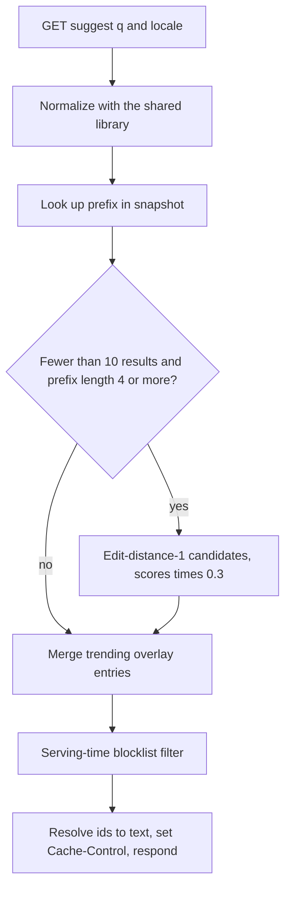
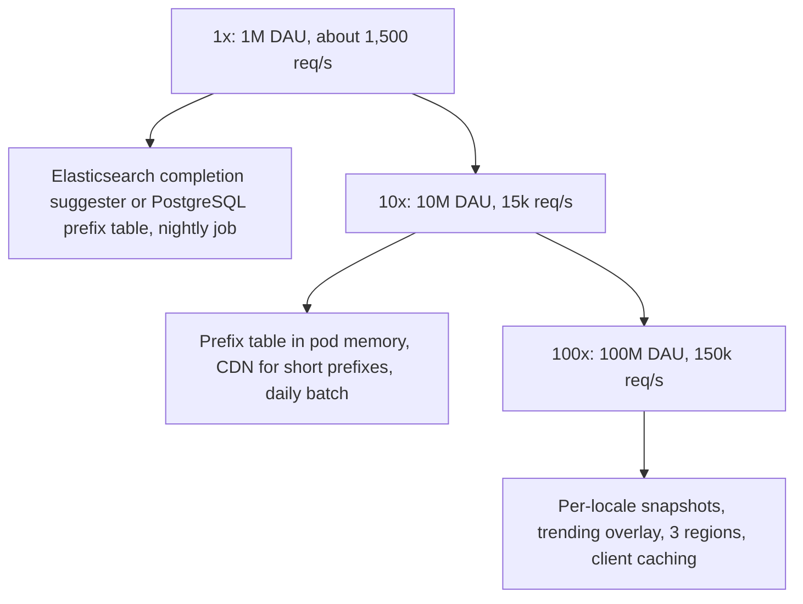

#### Deep dive: typo tolerance and the serving merge

Fuzzy matching runs only when it can help: when the exact prefix returns fewer than 10 suggestions, and the prefix is at least 4 characters (fuzzing "ip" produces noise). The service generates candidate prefixes at edit distance 1 (one character deleted, swapped with its neighbour, or substituted by a key adjacent on the keyboard) and looks each up in the same prefix table. For a 6-character prefix that is a few dozen lookups of a microsecond each, well inside the budget. Results from fuzzy candidates are ranked below exact matches by multiplying their score by a penalty (for example 0.3). Section 37.6 covers edit distance and the classic fuzzy-search techniques in depth.



The full serving path, in order, inside the 10 ms budget:

```text
normalize(q)                       ~ 5 µs
snapshot.lookup(prefix)            ~ 2 µs  (binary search over bytes)
trending.merge(prefix)             ~ 5 µs  (in-memory copy of the overlay)
fuzzy candidates if < 10 results   ~ 50 µs
blocklist.filter(results)          ~ 10 µs (in-memory automaton over phrases and tokens)
dictionary.resolve(ids)            ~ 5 µs
serialize JSON, set Cache-Control  ~ 20 µs
```

The service does about 0.1 ms of real work. The rest of the 10 ms budget, and nearly all of the 100 ms end-to-end budget, belongs to the network, the TLS handshake on a cold connection, and the browser rendering the list. That is why the operations half of this design spends its effort on the client, the CDN and connection reuse rather than on the lookup.

### 72.1.11 Caching

Autocomplete has the unusual property that its best cache is the user's own device. People type, delete and retype; they open the search box many times a day; and the global suggestions for a prefix change only when a new snapshot or a trend arrives. So there are three cache layers, each with a different job.

**The client.** The browser or app keeps an in-memory map of normalized prefix to response for the session (a few hundred entries, a few hundred KB). Backspacing from "iphon" to "iph" costs nothing. The client also **debounces**: it waits until the user pauses for about 80 to 150 ms before sending, and it **cancels** any in-flight request when a newer keystroke makes it obsolete, so a slow answer for "ip" can never overwrite a fresh answer for "iph". The HTTP response also carries `Cache-Control: public, max-age=300`, so the browser cache survives a page reload.

```ts
// web/suggest-client.ts (runs in the browser)
type Suggestion = { text: string; kind: 'query' | 'trending' | 'history' };

export class SuggestClient {
  private readonly cache = new Map<string, Suggestion[]>();
  private timer: ReturnType<typeof setTimeout> | undefined;
  private inFlight: AbortController | undefined;

  constructor(private readonly locale: string, private readonly history: string[], private readonly debounceMs = 100) {}

  onInput(raw: string, render: (items: Suggestion[]) => void): void {
    const q = raw.normalize('NFKC').toLowerCase().replace(/\s+/g, ' ').trimStart();
    clearTimeout(this.timer);
    if (q.length === 0) return render(this.historyFor(q));
    const cached = this.cache.get(q);
    if (cached) return render(this.merge(q, cached));          // backspace and retype cost nothing
    this.timer = setTimeout(() => void this.fetch(q, render), this.debounceMs);
  }

  private async fetch(q: string, render: (items: Suggestion[]) => void): Promise<void> {
    this.inFlight?.abort();                                     // an older prefix must not win the race
    this.inFlight = new AbortController();
    try {
      const url = `/v1/suggest?q=${encodeURIComponent(q)}&locale=${this.locale}&limit=10`;
      const res = await fetch(url, { signal: this.inFlight.signal });
      if (!res.ok) return;                                      // silently show nothing; search still works
      const body: { suggestions: Suggestion[] } = await res.json();
      this.cache.set(q, body.suggestions);
      render(this.merge(q, body.suggestions));
    } catch (err) {
      if ((err as Error).name !== 'AbortError') console.warn('suggest failed', err);
    }
  }

  private historyFor(q: string): Suggestion[] {
    return this.history.filter((h) => h.startsWith(q)).slice(0, 3).map((text) => ({ text, kind: 'history' as const }));
  }

  private merge(q: string, global: Suggestion[]): Suggestion[] {
    const mine = this.historyFor(q);                            // personal items first, at most 3
    const seen = new Set(mine.map((m) => m.text));
    return [...mine, ...global.filter((g) => !seen.has(g.text))].slice(0, 10);
  }
}
```

**The CDN.** Short prefixes dominate: every search passes through its 1-, 2- and 3-character prefixes, and there are only a few thousand of those per alphabet. Because the global response has no cookies and no user data, the CDN can cache it keyed by `q` and `locale` with a TTL of a few minutes. The cache key must be exactly those two parameters (normalized), or a tracking parameter appended by some client splits the cache into millions of useless entries. A 5-minute TTL means a new snapshot or a trend takes up to 5 minutes to reach users through the CDN, which fits the 15-minute freshness target; a blocklist change, which must be faster, triggers a targeted purge of the affected prefixes.

**The pods.** The snapshot is already in memory, so there is no separate application cache. The trending overlay is copied from Redis into each pod every 30 seconds, so Redis sees one read per pod every 30 seconds, not 8,000 reads per pod per second.

### 72.1.12 Messaging

Messaging carries the logs, not the requests. Searches and suggestion clicks are published to Kafka by the log collector:

| Topic | Key | Partitions | Consumers | Why |
|---|---|---|---|---|
| `search.query_logged` | `hash(query_norm)` | 48 | Lake sink (hourly Parquet files), trending stream job | Keying by query puts all counts of one query on one partition, so the trending job counts it without cross-partition merging |
| `suggest.feedback` | `version` | 12 | Lake sink, ranking-quality dashboards | Joins clicks to the exact snapshot that produced them |
| `suggest.blocklist_changed` | `locale` | 1 | Every suggest pod (as an independent consumer), CDN purge worker | Pushes removals to the fleet in seconds |

The blocklist topic is consumed by every pod with its own consumer group id (or, more simply, a pub/sub channel), because every pod needs every message; this is broadcast, not work distribution. Each message carries the full new blocklist version number, and a pod that missed messages (it was restarting) reloads the whole list from PostgreSQL at startup, so a lost message cannot leave a pod with a stale list for long. Duplicates are harmless: applying the same blocklist version twice changes nothing.

### 72.1.13 Scaling



| Stage | Load | Architecture | What changes and why |
|---|---|---|---|
| 1x | 1M DAU, about 1,500 req/s peak, 1M distinct queries | A `completion` field in the existing search cluster, or a PostgreSQL table `prefix -> top10` refreshed nightly by the SQL in 72.1.10 and cached in Redis | No new infrastructure; the whole index is a few hundred MB |
| 10x | 10M DAU, 15,000 req/s, 10M queries | Prefix table snapshot built by a batch job, loaded into the suggest pods; CDN caching; client debouncing | The search cluster no longer sees keystroke traffic |
| 100x | 100M DAU, 150,000 req/s, 50M queries, many locales | Per-locale snapshots, the trending overlay, three regions, fuzzy step | Freshness and safety become the hard parts, not throughput |
| Beyond | Hundreds of locales, snapshot above ~60 GB | Shard the serving tier by locale (each pod loads a subset of locales) and route by locale | Memory per pod, not CPU, forces the split |

Notice what does **not** change: the online path is a lookup at every stage. Scaling is mostly about where the precomputed answer lives and how often it is refreshed. The serving tier never needs sharding by prefix, because each locale's snapshot fits in one pod; if it ever did not, sharding by locale comes first and by prefix range only after that.

How it evolves in a real product usually follows this order: start with the search engine's completion suggester; move to a precomputed table when keystroke traffic starts to hurt the search cluster; add client caching and the CDN when latency in distant regions becomes the complaint; add the trending overlay when the product team asks why news does not show up; and add personalisation last, because it brings privacy work with it.

### 72.1.14 Security, safety and privacy

Autocomplete is a safety system as much as a performance system, because it **puts words in front of users that the company appears to endorse**. Four controls:

1. **Layered filtering.** The blocklist is applied in the batch build (so bad entries never enter the snapshot), and again at serving time on every response, including trending and fuzzy results. The serving-time filter is what makes a removal effective in minutes rather than at the next daily build. Patterns support exact phrases, single tokens and prefixes, and are maintained per locale by people who speak the language.
2. **Privacy thresholds.** A query becomes suggestible only after at least 20 distinct users typed it in the window. This k-anonymity-style threshold prevents a suggestion from exposing one person's search (an email address, a name plus an illness). Patterns that look like personal data (email addresses, long digit strings) are removed regardless of count.
3. **Manipulation resistance.** People try to plant suggestions ("brand X scam") by searching a phrase repeatedly from many accounts or bots. Counting **distinct users** rather than raw searches, discounting new or unverified accounts, and rate-limiting the log signal per user and per IP make planting expensive. Trending entries get extra scrutiny because they are the cheapest to manipulate.
4. **The endpoint itself.** `GET /v1/suggest` is public and cheap, so it is rate-limited per IP at the edge to stop scraping, and inputs are length-capped (a 2 KB "prefix" is rejected with 400). Personal history requires authentication and is never cached publicly.

Personal search history is personal data: users can view and delete it, it is retained for a fixed period, and the salted user hash in the logs is rotated so raw logs cannot be joined back to accounts after the retention window.

### 72.1.15 Failure scenarios

| Failure | Detection | Impact | Mitigation | User sees |
|---|---|---|---|---|
| Daily build fails | Job alert; snapshot age above 26 hours | Suggestions a day staler | Keep serving yesterday's snapshot; trending overlay still adds fresh items | Nothing noticeable |
| Bad snapshot (half empty, wrong locale) | Validation gate; canary pods' empty-result rate | Poor or missing suggestions | Validation blocks promotion; staged rollout; one-command rollback to the previous version | Nothing, if caught at the gate |
| Pod runs out of memory during snapshot swap | OOMKilled, CrashLoopBackOff | Pods restart, capacity drops | Size nodes for two snapshots; load one pod at a time per zone | Slightly slower responses |
| Redis overlay down | Connection errors | No trending items | Pods keep their last copy for up to 10 minutes, then serve snapshot only | Fewer fresh items |
| Trending job lags | Consumer lag above 5 minutes | Trends appear late | Scale consumers up to the partition count; lag is visible on a dashboard | News shows up later |
| Offensive suggestion goes live | User reports, social media, trust-and-safety review | Reputational damage | Serving-time blocklist plus CDN purge, live within 5 minutes | Suggestion disappears |
| CDN caches a response with a wrong key | Hit ratio collapse or cross-locale answers | Wrong language suggestions or load spike | Cache key restricted to normalized `q` and `locale`; strip other parameters at the edge | Brief oddity |
| Suggest service fully down | Error rate, synthetic probes | No dropdown | Client fails silently after a short timeout; the search box still submits | Search works without suggestions |
| Normalization mismatch between build and service | Load-time version check; empty-result rate for accented prefixes | Some prefixes find nothing | Snapshot stamped with library version; pods refuse a mismatched snapshot | Nothing, if refused |

The most important line is the second-to-last: autocomplete must **fail open to an ordinary search box**. The client uses a short timeout (around 300 ms) and simply shows no dropdown on error. A suggestion outage should be an annoyance, never a search outage.

### 72.1.16 Observability

The useful metrics are about **what users experienced**, not just what the server did:

- Client-side: keystroke-to-render latency (p50, p95, p99) by region and network type, sent with the feedback events; the share of searches where a suggestion was clicked (suggestion acceptance rate); average characters typed before acceptance.
- Server-side: request rate, p99 latency, empty-result rate per locale, fuzzy-path rate, snapshot version and age per pod, overlay age, blocklist version per pod.
- Pipeline: build duration, snapshot size versus yesterday, validation outcomes, trending job lag, number of trending entries.
- CDN: hit ratio for `/v1/suggest` (a sudden drop usually means a cache-key change), origin request rate.

Alerts: snapshot older than 26 hours; any pod on a blocklist version more than 2 behind; empty-result rate up 50 percent after a rollout; p99 server latency above 10 ms for 10 minutes. The blocklist-version check is the one people forget, and it is the one that matters on the bad day.

### 72.1.17 Deployment

The suggest service runs as a Deployment with 10 replicas per busy region on memory-optimized nodes, with a readiness probe that only passes **after** the snapshot is loaded and warmed with canary prefixes (otherwise Kubernetes sends traffic to a pod that answers nothing). Snapshot rollout is not a code deploy: the control table marks a version `live` for one canary pod per region, the empty-result rate and latency are watched for 15 minutes, then the version is promoted everywhere, one pod per zone at a time. Code deploys use the normal rolling update with `maxUnavailable: 1`, since each new pod spends a minute or two loading 25 GB from S3 (at about 300 MB/s); pre-pulling the snapshot to a node-local disk cache makes restarts faster.

### 72.1.18 Cost considerations

| Item | Assumption | Monthly ballpark |
|---|---|---|
| Serving pods | about 30 memory-optimized 64 GB nodes across 3 regions at roughly 0.50 USD per hour | about 11,000 USD |
| Batch build | an hour a day on a modest cluster | about 1,500 USD |
| Kafka, lake storage, trending job | 12,000 events per second, 60 days of aggregates | about 3,000 USD |
| CDN requests | 150 billion requests a month if every request goes through the CDN, at an approximate list price of 0.01 USD per 10,000 HTTPS requests | about 150,000 USD at list price |

The table is there to make one point: **for this endpoint, CDN request pricing can dwarf everything else**. Compute is cheap because each request costs 0.1 ms of work; per-request CDN fees are not cheap at 5 billion requests a day. A senior engineer notices this before the invoice does. The options are to negotiate committed-use pricing, to put the suggest endpoint on its own hostname served directly from regional origins behind a global anycast load balancer (paying for a few more pods instead of per-request fees), or to use the CDN only in regions far from an origin. Client-side caching is the one cache that is completely free, which is why it is worth getting right.

### 72.1.19 Tradeoffs

| Decision | Options | Chosen | Why | Cost |
|---|---|---|---|---|
| Index structure | Trie with top-k, prefix table, search-engine suggester | Prefix table snapshot in memory | One probe, flat memory, trivial batch build | Rebuild to change; about 25 GB per locale |
| Freshness | Rebuild often, real-time counters per prefix, overlay | Daily rebuild plus trending overlay | Spike detection on thousands of queries, not 300M prefixes | Two systems to run; overlay can miss slow-burn changes |
| Personalisation | Server-side merge, client-side merge | Client-side merge of a history list | Keeps the hot endpoint cacheable and personal data out of shared caches | History limited to what the device holds per session |
| Typo tolerance | Always fuzzy, fuzzy on few results, none | Fuzzy only when fewer than 10 exact results and prefix length 4 or more | Precision for common cases, help for typos | Some typos on popular prefixes go uncorrected |
| Safety | Filter in build only, filter at serve time only, both | Both | Build keeps the snapshot clean; serve time makes removals fast | The serve-time filter must be fast and identical everywhere |
| Ranking signal | Raw counts, time-decayed counts, decayed counts plus clicks | Decayed distinct-user counts plus clicks | Resists manipulation; reflects recent interest | Needs HyperLogLog sketches and a click pipeline |

### 72.1.20 Alternative architectures

**Search engine only.** Use an Elasticsearch or OpenSearch `completion` or `search_as_you_type` field, updated by the indexing pipeline, and query it per keystroke. It wins for catalogues of up to a few million entries and traffic in the low thousands of requests per second, especially when entries change constantly (marketplace listings). It loses at our rate, where it means a large cluster serving lookups.

**Redis sorted sets per prefix.** Store each prefix as a sorted set of suggestions scored by popularity and update scores in real time from the log stream. It gives instant freshness without a separate overlay, but 300 million sorted sets carry much more memory overhead than a flat table, every log event becomes up to 20 writes, and decay needs periodic rescoring of everything. It is a good fit for small, fast-moving vocabularies such as hashtags.

**Learned completion models.** A small language model generates completions for rare or unseen prefixes. It covers the long tail that a popularity table cannot, at the cost of compute per request and much harder safety review. In practice it is used as a fallback for prefixes the table does not cover, never as the primary path for popular prefixes.

### 72.1.21 Incident story: the trending suggestion that skipped the filter

A regional news story broke at 18:05 on a Friday. Thousands of people searched a phrase that combined a public figure's name with an offensive slur used in a viral clip. By 18:20 the trending job had flagged it: 40x its baseline, more than 2,000 distinct users. It wrote the phrase into the overlay for all of its prefixes, including the first four letters of the public figure's name.

The daily build had a solid blocklist step, and the slur was on the list. But the trending job was written later by a different team, reused the counting code, and wrote straight to Redis. The serving path assumed everything in the overlay had already been filtered, because "the build filters". Nothing filtered the overlay. From 18:20, anyone typing the first letters of a well-known name saw the slur as the third suggestion.

At 18:47 a screenshot was posted to social media. Trust-and-safety added a block pattern at 18:58, which changed nothing visible, because the pattern only fed the next daily build. The on-call engineer found the cause at 19:30, deleted the overlay entries by hand at 19:34, and then had to purge the CDN, which had cached the bad responses for those prefixes with a 5-minute TTL. The suggestion had been live for 74 minutes.

The postmortem made four changes. The blocklist filter moved into the serving path, applied to every result from every source, as one shared library with one test suite. Blocklist changes are now pushed to every pod over the broadcast topic within seconds, with an alert on any pod more than two versions behind. Trending entries for prefixes that match a list of public-figure names need a human approval step before entering the overlay. And the runbook gained a single command that blocks a phrase, purges the overlay and purges the affected CDN prefixes together. The lesson the team wrote at the top of the document: **every path to the user needs the same filter; "it was filtered upstream" is an assumption, not a control.**

### 72.1.22 Interview follow-ups

1. **Why not query the search engine on every keystroke?**
   Expected answer: at 150,000 requests per second with a 10 ms budget, per-request search means a huge cluster doing redundant work; the top 10 for a prefix changes slowly, so precompute it and serve a lookup. Why it matters: it shows the read-time versus write-time instinct. Follow-up: when is the search engine the right answer? (Small catalogues, low traffic, constantly changing entries.)
2. **How do you get a news event into suggestions within 15 minutes?**
   Expected answer: a streaming job detects spikes against a baseline with a minimum distinct-user volume and writes a small overlay merged at serving time; the daily rebuild stays daily.
3. **How do you personalise without breaking caching?**
   Expected answer: split the endpoint; global suggestions are public and cacheable, personal history is fetched once per session and merged on the device.
4. **A suggestion reveals someone's private search. How did it happen, and how do you prevent it?**
   Expected answer: a missing or bypassed distinct-user threshold or a personal-data pattern; enforce thresholds in the build, block personal-data patterns, and apply the same filters to every path.
5. **How big is the index, and does it need sharding?**
   Expected answer: about 300M prefix entries times about 75 bytes plus a 2 GB dictionary, roughly 25 GB per locale; it fits in memory, so replicate instead of shard, and size nodes for two snapshots during a swap.
6. **Users in a distant region complain suggestions feel slow. Where do you look?**
   Expected answer: client-measured latency broken down by phase; most of it is network and TLS, so edge termination, connection reuse, client caching and debouncing matter more than server code.

### 72.1.23 Practical exercise

Build a small autocomplete service with NestJS, PostgreSQL and Redis.

1. Load a public query or product-title dataset of at least 1 million rows into `query_daily_counts` with synthetic days and distinct-user counts.
2. Implement the SQL build from 72.1.10 with the 7-day decay, the distinct-user threshold and the blocklist, writing the result to a binary snapshot file in the layout of `Segment`.
3. Implement `GET /v1/suggest` that loads the snapshot into `Buffer` segments, merges a trending overlay from a Redis hash, applies the blocklist at serving time and sets `Cache-Control: public, max-age=300`.
4. Implement the browser `SuggestClient` with debouncing, cancellation, a session cache and history merge.
5. Implement snapshot validation (size within 10 percent, canary prefixes) and an atomic swap.

Acceptance criteria:

- Server p99 under 5 ms at 2,000 requests per second on a laptop, measured with a load generator.
- Adding a blocklist pattern removes the phrase from responses within 10 seconds without a rebuild, including from trending results (write a test that seeds a trending entry and blocks it).
- A snapshot 30 percent smaller than the current one is rejected by validation.
- A query typed by 19 distinct users never appears; one typed by 20 does.
- Swapping snapshots under load produces no errors and no empty responses.

#### Worked answer to the exercise

The build is a script that runs the SQL from 72.1.10 into a temporary table, then streams `prefix, top10` rows **ordered by the prefix's UTF-8 bytes** (`ORDER BY convert_to(prefix, 'UTF8')`, so the order matches `Buffer.compare`) into fixed 64-byte entries: the prefix zero-padded to 24 bytes, then ten `uint32` ids from a dictionary file written alongside. Segments are cut every 4 million entries (256 MB) so no single `Buffer` is huge. The serving side is a thin controller over the `Segment` lookup:

```ts
// suggest/suggest.controller.ts
import { BadRequestException, Controller, Get, Header, Query } from '@nestjs/common';
import { SnapshotService } from './snapshot.service';
import { TrendingService } from './trending.service';
import { BlocklistService } from './blocklist.service';
import { normalize } from './normalize';

@Controller('v1/suggest')
export class SuggestController {
  constructor(
    private readonly snapshot: SnapshotService,     // holds the live Segment[] and dictionary, swapped atomically
    private readonly trending: TrendingService,     // in-memory copy of the Redis hash, refreshed every 30 s
    private readonly blocklist: BlocklistService,   // reloaded on every message from the broadcast channel
  ) {}

  @Get()
  @Header('Cache-Control', 'public, max-age=300')
  suggest(@Query('q') q = '', @Query('locale') locale = 'en') {
    if (q.length > 100) throw new BadRequestException('prefix too long');
    const prefix = normalize(q, locale).slice(0, 20);
    if (!prefix) return { q, version: this.snapshot.version, suggestions: [] };
    const base = this.snapshot.top(locale, prefix);                 // [{ text, score, kind: 'query' }]
    const merged = this.trending.merge(locale, prefix, base);       // inserts trending items that beat the 10th
    const safe = merged.filter((s) => !this.blocklist.blocks(locale, s.text)).slice(0, 10);
    return { q, version: `${this.snapshot.version}.${this.trending.version}`, suggestions: safe };
  }
}
```

How each acceptance criterion is met and proved:

- **Latency**: the lookup is a binary search over bytes; `autocannon -c 50 -d 30 'http://localhost:3000/v1/suggest?q=iph&locale=en'` should show p99 well under 5 ms. If it does not, profile JSON serialization first, not the lookup.
- **Blocklist within 10 seconds**: an admin endpoint inserts into `suggest_blocklist` and publishes the new version on a Redis pub/sub channel; every instance reloads the list on the message (and on startup). The test seeds a trending entry in the Redis hash, asserts it appears, blocks it, and polls until it disappears, failing after 10 seconds.
- **Validation**: the build compares the new snapshot's entry count with the live row in `suggest_snapshots` and refuses to mark it `validated` outside plus or minus 10 percent; the test truncates the input to 70 percent and asserts status `rejected`.
- **Privacy threshold**: a fixture with one query at `distinct_users = 19` and another at 20; assert only the second is in the output.
- **Swap under load**: `SnapshotService` loads the new segments fully, runs the canary prefixes, then replaces one reference; in-flight requests keep the old object until they finish. Run the load test while triggering a swap and assert zero non-200 responses and zero empty results for canary prefixes.
