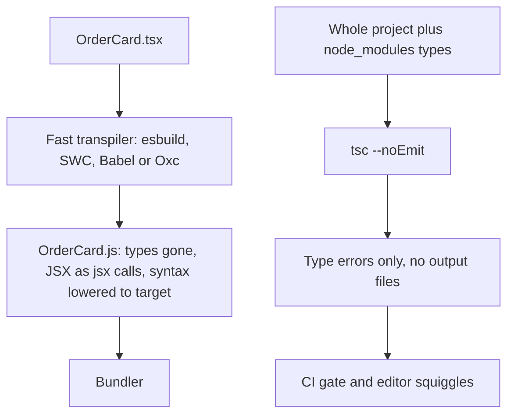

## 72.2 Transpiling: TypeScript, JSX and browser targets

#### Concept

**Transpiling** means converting source code in one language or language version into another at the same level of abstraction. In a frontend build it does three jobs: removes TypeScript types, turns JSX into function calls, and rewrites modern syntax that your oldest supported browser does not understand into older syntax.

The crucial idea for a backend engineer is that, in frontend builds, **transpiling and type checking are separated**. The tools that produce the JavaScript you ship (esbuild, SWC, Babel, Oxc) strip types without checking them, one file at a time, extremely fast. The TypeScript compiler `tsc` is run separately, with `noEmit: true`, only to report type errors. This is different from a typical NestJS project, where `tsc` both checks and emits.

A **browser target** is the list of browsers (and versions) your output must run in. The transpiler uses it to decide which syntax to rewrite. A **polyfill** is code that adds a missing API at runtime (for example `Array.prototype.at` in Safari 15.3). Transpilers rewrite syntax; they do not add APIs. Polyfills are a separate decision.

#### Why does it exist?

Type checking needs the whole program: to know whether `order.total.amount` is valid, the checker must read the `Order` type, which might come from another file, which imports from a package. That is slow. On a 2,000-file React app, `tsc --noEmit` commonly takes 20 to 45 s on a laptop. Stripping types does not need the whole program: you can look at one file, delete the annotations, and you are done. esbuild does this for the same 2,000 files in well under a second.

If the dev server had to type-check before every refresh, you would wait 20 s for each change. So the ecosystem split the jobs: fast per-file transpiling on every save, slower whole-program type checking in the editor (the TypeScript language server), in a background watcher, and in CI.

Targets exist because "JavaScript" is not one thing. Optional chaining (`a?.b`) arrived in Chrome 80 (2020) and Safari 13.1. Class static blocks in Safari 16.4. Top-level `await` in Safari 15. If 3 % of your shoppers are on a browser that does not understand a syntax feature, the entire bundle fails to parse for them: not one broken feature, a completely blank page.

#### Mental model

Imagine translating a contract. A lawyer reads the whole contract and checks every clause against every other clause and against the law (type checking): slow, needs the full document. A typist removes the margin notes, reformats it for the printer and replaces modern abbreviations with full words the recipient will understand (transpiling): fast, can work page by page. You want the typist working on every draft, instantly. You want the lawyer to review before it is signed (CI).

Browser targets are the recipient's reading level. A polyfill is a glossary stapled to the back for words the recipient's dictionary does not contain.

#### How it works



**The transpilers.**

| Tool | Written in | Used by | Notes |
|---|---|---|---|
| `tsc` | TypeScript (a Go-native port, TypeScript 7, was previewed in 2025 as `tsgo` with about 10x faster checking) | Type checking everywhere; emitting for Node backends | Whole-program; the only one that checks types |
| esbuild | Go | Vite 2 to 7 (dev transforms, dependency pre-bundling, minification), many libraries | Per-file; no type checking; very fast |
| SWC | Rust | Next.js 12+ (transforms and minification), `@vitejs/plugin-react-swc`, NestJS CLI optional builder | Per-file; Babel-compatible plugin model in Rust |
| Babel | JavaScript | Older webpack setups, `@vitejs/plugin-react` (for Fast Refresh and plugins), React Compiler | Slowest, most plugins |
| Oxc | Rust | Vite 8 (through Rolldown), oxlint | Per-file transformer, parser, minifier |

Because these tools see only one file at a time, a few TypeScript features cannot be compiled correctly by them:

- **`const enum`** across files: the value must be inlined from another file, which a per-file tool cannot read.
- **Re-exporting a type without `type`**: `export { OrderStatus } from './types'`. If `OrderStatus` is only a type, the per-file tool does not know and emits a runtime re-export of something that does not exist.
- **Namespaces merging across files.**

The tsconfig option **`isolatedModules: true`** makes `tsc` report an error for exactly these cases, so code that type-checks will also transpile correctly per file. TypeScript 5.0 added **`verbatimModuleSyntax: true`**, which is stricter and simpler: any import or export without the `type` modifier is kept in the output exactly as written, and any with `type` is removed. It forces you to write `import type { Order } from './types'`, which is exactly what a per-file transpiler needs. Vite's TypeScript templates enable it.

**JSX.** With React 17 and later, the "automatic runtime" is standard. `tsconfig` has `"jsx": "react-jsx"`, and the transpiler turns:

```tsx
<OrderCard order={order} compact />
```

into:

```ts
import { jsx as _jsx } from 'react/jsx-runtime';
_jsx(OrderCard, { order: order, compact: true });
```

The older `"jsx": "react"` setting produced `React.createElement(...)` and required `import React from 'react'` in every file.

**Targets.** You tell the build which browsers to support, and the transpiler lowers any syntax newer than that. Each tool expresses this differently:

| Tool | How you set the target | Default |
|---|---|---|
| Vite 5 and 6 | `build.target` | `'modules'`: browsers with native ES modules, dynamic import and `import.meta` (about Chrome 87, Safari 14) |
| Vite 7 and later | `build.target` | `'baseline-widely-available'`: Chrome 107, Edge 107, Firefox 104, Safari 16 |
| esbuild | `--target=es2020,chrome100,safari15` | `esnext` (no lowering) |
| Next.js | `browserslist` in `package.json` | Chrome 64, Edge 79, Firefox 67, Opera 51, Safari 12 (Next.js 14) |
| Babel and webpack | `browserslist` (`.browserslistrc` or `package.json`) | `defaults` query |

`browserslist` is a shared format: `"browserslist": ["> 0.5%", "last 2 versions", "not dead"]` resolves against usage data from caniuse to a concrete list of browser versions.

**Polyfills** are separate. If you call `structuredClone()` or `Array.prototype.findLast()` and your target includes Safari 15.3, no transpiler will save you; the function simply does not exist there. Options: avoid the API, add a specific polyfill (`core-js/actual/array/find-last`), or use `@vitejs/plugin-legacy`, which builds a second legacy bundle with Babel and core-js and serves it only to browsers that do not support modules, using `<script nomodule>`. The legacy bundle is usually 30 to 60 % larger and takes as long again to build, so you pay only if you need it.

**Where type checking goes.** Since the bundler will not do it, you add it explicitly:

```json
{
  "scripts": {
    "dev": "vite",
    "typecheck": "tsc --noEmit -p tsconfig.app.json",
    "build": "tsc -b && vite build",
    "preview": "vite preview"
  }
}
```

The Vite React TypeScript template runs `tsc -b` (build mode with project references, still emitting nothing because `noEmit` is set in each referenced config) before `vite build`. In a monorepo with Turborepo (72.9) you usually make `typecheck` its own task so it can run in parallel with tests and be cached separately. During development, `vite-plugin-checker` can run `tsc --watch` in a worker and show errors as an overlay in the browser without slowing HMR.

#### Practical example

A checkout team supports "the last two versions of every major browser plus Safari 15 on iOS", because 4 % of their iPhone shoppers are stuck on iOS 15 devices. They set `build.target: ['es2020', 'safari15', 'chrome100', 'firefox100']` in Vite.

Effects measured on their 230 KB gzip bundle:

- Optional chaining, nullish coalescing and `async`/`await` are kept as-is (all supported by Safari 15). No size change.
- Class static blocks used in one library were lowered to plain assignments: plus 0.3 KB.
- Top-level `await` in a config module failed the build with "Top-level await is not available in the configured target environment". They removed it and loaded config in an `async` bootstrap function instead.
- `Array.prototype.at()` (Safari 15.4+) was used in the cart. The transpiler did not touch it, and 0.6 % of iOS users got `TypeError: items.at is not a function` until they added a three-line helper.

That last one is the classic trap: targets cover syntax, not APIs.

#### React / Next.js example

A Vite config that sets targets deliberately and uses the SWC-based React plugin for faster transforms:

```ts
// vite.config.ts  (Vite 6 or 7)
import { defineConfig } from 'vite';
import react from '@vitejs/plugin-react-swc'; // SWC for JSX and Fast Refresh; @vitejs/plugin-react uses Babel

export default defineConfig({
  plugins: [react()],
  build: {
    // Syntax newer than these is lowered. APIs are NOT polyfilled.
    target: ['es2020', 'safari15', 'chrome100', 'firefox100', 'edge100'],
    cssTarget: ['safari15'], // CSS nesting and similar are lowered for Safari 15
  },
  esbuild: {
    // Drop console.debug calls and debugger statements in production builds only.
    pure: process.env.NODE_ENV === 'production' ? ['console.debug'] : [],
    drop: process.env.NODE_ENV === 'production' ? ['debugger'] : [],
  },
});
```

For Next.js the target lives in `package.json`, and SWC reads it:

```json
{
  "browserslist": ["chrome >= 100", "edge >= 100", "firefox >= 100", "safari >= 15", "ios_saf >= 15"]
}
```

#### Backend side (NestJS)

Choosing targets is a data decision, and the backend has the data. Every API request carries a `User-Agent` header (and, from Chromium browsers, `Sec-CH-UA` client hints). A small middleware that counts browser families and major versions into a metric answers "can we drop Safari 14?" with numbers instead of opinions:

```ts
// browser-usage.middleware.ts
import { Injectable, NestMiddleware } from '@nestjs/common';
import type { Request, Response, NextFunction } from 'express';
import { Counter, register } from 'prom-client';

const browserRequests =
  (register.getSingleMetric('api_browser_requests_total') as Counter<string>) ??
  new Counter({
    name: 'api_browser_requests_total',
    help: 'API requests by browser family and major version',
    labelNames: ['family', 'major'],
  });

// Deliberately coarse parsing: we need families and majors, not perfect detection.
const PATTERNS: Array<[string, RegExp]> = [
  ['edge', /Edg\/(\d+)/],
  ['chrome', /Chrome\/(\d+)/],
  ['firefox', /Firefox\/(\d+)/],
  ['safari', /Version\/(\d+)[\d.]* .*Safari\//],
];

@Injectable()
export class BrowserUsageMiddleware implements NestMiddleware {
  use(req: Request, _res: Response, next: NextFunction): void {
    const ua = req.headers['user-agent'] ?? '';
    const hit = PATTERNS.find(([, re]) => re.test(ua));
    const [family, major] = hit ? [hit[0], ua.match(hit[1])?.[1] ?? 'unknown'] : ['other', 'unknown'];
    // Cap label cardinality: bucket very old majors together.
    browserRequests.inc({ family, major: Number(major) < 90 ? 'old' : major });
    next();
  }
}
```

Register it only on browser-facing routes (`consumer.apply(BrowserUsageMiddleware).forRoutes('v1/orders', 'v1/cart')`) so server-to-server calls do not skew the numbers. After two weeks, a Grafana panel shows that Safari 14 is 0.4 % of checkout traffic, and the team can make the call with the product manager instead of guessing. The same data tells you when a polyfill can be deleted.

The backend's second job is not to make the frontend's target harder: an API that returns `BigInt`-sized numbers as JSON numbers, or dates in a non-ISO format that only some `Date` parsers accept, pushes compatibility problems into the browser. Part 76 — Frontend–Backend Contracts covers these wire formats.

#### Production scenario

A travel booking site had `browserslist: "defaults"` and Babel with `useBuiltIns: 'usage'` and core-js 3. Their main bundle was 410 KB gzip, of which 71 KB was core-js polyfills for features every browser in their real traffic already supported. Their API's browser metric showed 99.2 % of bookings came from browsers released in the last four years.

They changed the target to `chrome >= 100, safari >= 15, firefox >= 100` and removed the global polyfill injection, adding two specific polyfills that were still needed. The bundle fell to 322 KB gzip, the transpile step in CI went from 74 s to 21 s, and p75 Interaction to Next Paint on mobile improved by 40 ms because there was less JavaScript to parse at startup. The 0.8 % of users on older browsers got a server-rendered "please update your browser, or call us" page with the phone number, which the business accepted.

#### Failure scenario

On a Monday at 10:15, support tickets spiked from users of a corporate travel portal: "blank page". All tickets came from one enterprise customer. Error tracking showed nothing at all, because the error tracker itself was in the bundle that failed to parse.

A dependency upgrade had pulled in a new version of a date library that used class static blocks. The project's Vite 5 `build.target` was the default `'modules'`, which includes Chrome 87. The customer's managed laptops were pinned to Chrome 91, which does not support static blocks (added in Chrome 94). The entire bundle threw `SyntaxError: Unexpected token '{'` at parse time.

The immediate fix was setting `build.target: ['es2020', 'chrome87']`, which made esbuild lower the static blocks. The longer-term fixes: a tiny inline script in `index.html`, outside the bundle, that reports `window.onerror` for syntax errors to a NestJS endpoint, so parse failures are visible; and a CI step that runs the production build through the `es-check` tool against the declared target.

#### Edge cases & failure modes

- **Syntax errors kill the whole bundle**, including your error reporting. Report parse errors from a separate tiny inline script.
- **Dependencies are not always transpiled.** Some setups skip `node_modules` for speed. Vite's production build does lower dependencies to `build.target`, but pre-bundled dev dependencies may differ.
- **`const enum` from a library** compiled with `isolatedModules` off can break silently; prefer union string types (`type Status = 'PAID' | 'SHIPPED'`) in shared code.
- **Type-only imports without `import type`** produce runtime imports of things that do not exist, typically "does not provide an export named X" in the browser.
- **Decorators**: TypeScript's `experimentalDecorators` (used by NestJS, TypeORM, class-validator) differ from TC39 standard decorators (TypeScript 5.0+). Sharing decorated classes with a browser build invites trouble; share plain types or zod schemas instead (72.8).
- **Polyfills loaded twice**: once by you and once inside a library, growing the bundle and sometimes conflicting.

#### How a Senior Full-Stack Engineer thinks about this

A senior writes the supported browser list down, with a date and an owner, and derives it from real traffic, not from a default. They know a target is a cost decision: each older browser supported costs bundle size and build complexity for everyone else. They keep type checking as a separate, mandatory CI gate and never rely on the bundler for it. They avoid TypeScript features that need whole-program compilation (`const enum`, namespaces) in code that a per-file tool will see. And they make sure the one failure mode that hides itself, a parse error that takes out the error reporter, is reported by something outside the bundle.

#### Common mistakes

- **Believing the target polyfills APIs.** It lowers syntax only.
- **Leaving the default target forever** without checking it against real traffic.
- **Turning off `isolatedModules`** because it "complains", then hitting runtime import errors.
- **Running `tsc` to emit files in a Vite project**, producing a stray `.js` next to every `.ts` that the bundler may pick up instead of the source.
- **Relying on the error tracker to catch syntax errors** in the bundle that contains the error tracker.

#### Interview questions

1. **Why do frontend builds separate transpiling from type checking?**
   Expected answer: type checking needs the whole program and is slow; transpiling can be done per file in milliseconds, so it runs on every save while type checking runs in the editor and CI. Follow-up: what tsconfig options make per-file transpiling safe? (`isolatedModules`, `verbatimModuleSyntax`.)
2. **What is the difference between a build target and a polyfill?**
   Expected answer: the target controls which syntax is rewritten; a polyfill adds missing runtime APIs. Follow-up: how would you decide which polyfills you still need?
3. **A dependency upgrade made the page blank for one customer. How do you investigate?**
   Expected answer: check for a parse-time `SyntaxError` in that customer's browser version, compare the dependency's syntax with the build target, lower the target or pin the dependency, and add parse-error reporting outside the bundle.
4. **Why is `const enum` risky in a codebase built with esbuild or SWC?** Expected answer: the value must be inlined from another file, which a per-file tool cannot read.
5. **How do you choose which browsers to support?** Expected answer: from real traffic data and business impact, written down with an owner, revisited periodically.

#### Practical exercise

In a Vite React TypeScript project, add a class with a `static { }` block and a call to `[1, 2, 3].at(-1)`. Build twice: once with `build.target: 'esnext'` and once with `build.target: ['es2020', 'chrome87']`.

Acceptance criteria:

- You can show, in the built JavaScript, that the static block is rewritten in the second build and untouched in the first.
- You can show that `.at(-1)` is untouched in both, and explain why.
- You add `verbatimModuleSyntax: true` and fix every error it reports, explaining for one of them what would have gone wrong at runtime.
- You add the `BrowserUsageMiddleware` to a NestJS app and produce a `/metrics` output with at least two browser families.
