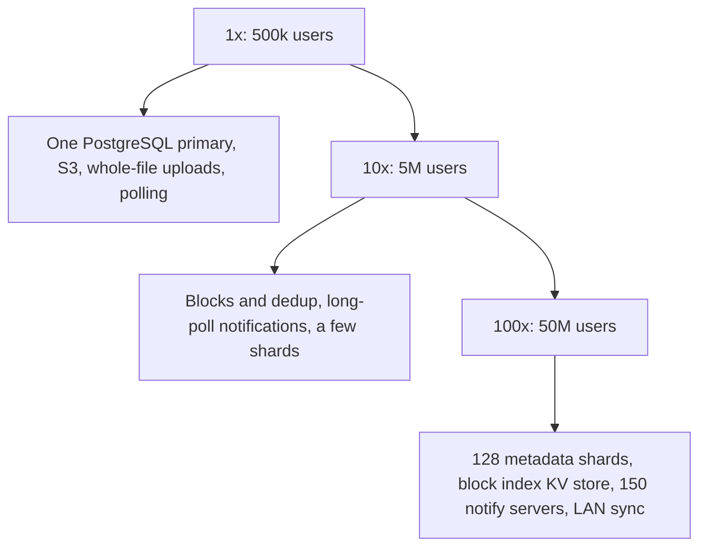

### 72.2.11 Caching

The biggest cache in a sync system is the **client's own disk**. Every block the client has ever downloaded or uploaded is, by definition, sitting in some local file, and the client's database maps hashes to local file offsets. When a new version of a file arrives, the client assembles it from blocks it already has and fetches only the missing ones. When a file is moved between folders, nothing is downloaded at all, because the block list did not change.

**LAN sync** extends the same idea across the office: desktop clients on the same local network announce which namespaces they hold, and a client that needs a block asks a nearby peer before going to object storage. A 2 GB video shared with a 30-person team is downloaded from the internet once and copied across the office network 29 times. The peer must prove it may read the namespace (the server issues short-lived tokens for this), and the receiving client still verifies every block's hash, so a malicious peer cannot inject content.

On the server side, three things are cached:

- **The shard map** (namespace id to metadata shard) in every API pod, refreshed on change. It is small and read on every request.
- **Permissions** for hot namespaces, for a few seconds, with explicit invalidation when membership changes. A revoked user must lose access within seconds, so this cache is short and invalidated on write, never long-TTL only.
- **Public shared-link downloads** through a CDN. A shared link to a popular file can be fetched millions of times; the CDN serves the assembled file with a signed, expiring URL so the origin and object storage see a tiny fraction of the requests.

### 72.2.12 Messaging

The journal itself is the system's event log. After each commit, the metadata service publishes a small event; it uses the transactional outbox pattern (Part 33 — Distributed Transactions: Sagas, Outbox, Inbox and Idempotency) so that a committed change always produces an event even if the publisher crashes after the commit.

| Topic | Key | Partitions | Consumers | Why |
|---|---|---|---|---|
| `sync.journal_committed` | `namespace_id` | 256 | Notification service, preview workers, search indexer, quota service | All events of one namespace stay ordered on one partition |
| `sync.share_changed` | `namespace_id` | 32 | Notification service (mount and unmount on member devices), permission cache invalidation | Membership changes must reach caches quickly |
| `sync.blocks_uploaded` | `hash` prefix | 64 | Malware scanner for shared links, cross-user dedup compactor | Background work that must not slow down commits |

The notification service consumes `sync.journal_committed` and keeps only the latest `seq` per namespace in memory. Each event is about 50 bytes, and at 7,000 commits per second the whole stream is 350 KB/s, so every notification server can afford to consume all of it and wake its own waiting clients. That avoids routing events to "the server that holds this client's connection", which is the more complex alternative. Duplicate or out-of-order events are harmless because the service keeps the maximum `seq` it has seen, and clients always re-read the changes feed.

### 72.2.13 Scaling



| Stage | Load | Architecture | What changes and why |
|---|---|---|---|
| 1x | 500k users, 100k DAU, 25 commits/s | One PostgreSQL primary with a replica; files uploaded whole with presigned URLs (section 36.7); clients poll changes every 30 s | It works; whole-file upload is fine while files are small and changes are few |
| 10x | 5M users, 250 commits/s, about 7 PB | Block chunking with CDC, per-user dedup, long-poll notifications, metadata split into 8 shards by namespace | Bandwidth complaints and storage cost force blocks; polling load forces notifications |
| 100x | 50M users, 7,000 commits/s peak, 70 PB | 128 metadata shards, block index in a key-value store, about 150 notification servers, LAN sync, storage tiering | Metadata size and connection count force dedicated tiers |
| Beyond | Hundreds of PB | Own storage system that packs blocks into large extents with erasure coding, multiple regions | Object-storage request and storage pricing make building storage cheaper than renting it (section 72.5 designs one) |

**Resharding** is the hard operational move at the 10x and 100x stages. Because a namespace is the shard key and never spans shards, moving a namespace is: copy its rows to the new shard, replay the journal tail, briefly block commits for that one namespace (seconds), flip the shard map entry, unblock. Clients notice nothing except a slightly slow commit. Moving 1,000 namespaces at a time keeps the blast radius small.

How a real product evolves usually follows the ladder: whole-file sync first, then blocks and delta uploads when bandwidth hurts, then notifications when polling hurts, then sharding when the database hurts, and only at very large scale, owned storage. Each step is driven by a measured pain, not by the diagram.

### 72.2.14 Security

1. **Authorization on every block URL.** Presigned URLs are issued only after checking that the caller can read (for GET) or write (for PUT) the namespace, they expire in 15 minutes, and they name exactly one object. Object keys are derived from the hash plus a server-side secret prefix, so knowing a hash is not enough to guess a key.
2. **No dedup oracle.** As explained in 72.2.10, `blocks/check` only reports blocks the caller can already read. Without this, a hash becomes a key to someone else's file.
3. **Encryption.** TLS everywhere; server-side encryption at rest for blocks and metadata. End-to-end encryption (keys only on devices) is possible but disables server-side dedup across files, previews and search, so it is usually an opt-in mode for specific folders.
4. **Sharing.** Revocation removes the member, invalidates permission caches through `sync.share_changed`, and stops issuing URLs; URLs already issued expire within 15 minutes, which is the honest revocation window and should be stated in the product. Shared links carry an unguessable token, an optional password and expiry, and are rate-limited.
5. **Ransomware and mass deletion.** Malware on a laptop that encrypts or deletes every file will happily sync that damage everywhere. The server watches for abnormal patterns (thousands of modifications with high-entropy content, or mass deletes, from one device in minutes), pauses that device's sync, alerts the user, and offers a one-click "restore the whole folder to 10:00 this morning" from the version history. Version history is a security feature.
6. **Untrusted client input.** Paths are normalized and validated (no `..`, no reserved device names, length limits), block lists are capped, and file sizes are checked against quota at commit time, not just in the client.

### 72.2.15 Failure scenarios

| Failure | Detection | Impact | Mitigation | User sees |
|---|---|---|---|---|
| Upload interrupted | Client timeout | Partial file not committed | Blocks are independent; resume with `blocks/check` | Upload continues after reconnect |
| Client crashes during download | Temp file present at startup | None | Write to temp file, verify hashes, atomic rename | Old version until retry |
| Commit timeout, client retries | Duplicate request | Possible double revision | Idempotent commit: same body and parent returns the original result | One revision |
| Concurrent edits | 409 on stale `parentRev` | Conflict | Conflicted copy, both versions kept | A second file with "conflicted copy" in the name |
| Metadata shard primary fails | Health checks, replication monitor | Commits fail for namespaces on that shard | Synchronous replica promoted in about 30 s; clients queue locally | Sync paused briefly |
| Notification server dies | Connection drops | Clients miss wake-ups | Clients reconnect elsewhere and compare cursors immediately | A few seconds of delay |
| Kafka lag on journal events | Consumer lag | Notifications late | Clients still long-poll with a 60 s timeout and re-read changes, so lag delays but never loses | Slower sync |
| Block missing at commit | 412 response | Commit refused | Client re-uploads | Nothing |
| Garbage collector deletes a live block | Download 404, integrity checker | Data loss | Grace period, touch on commit, soft delete with recovery window (72.2.21) | A file that cannot open, if not caught |
| Cursor too old | 410 response | Incremental sync impossible | Full resync by hash comparison | A longer "indexing" phase |
| Ransomware on a device | Entropy and mass-change detector | Damage spreads to all devices | Pause device sync, alert, point-in-time folder restore | A warning and a restore button |
| Hot shared folder (10,000 members) | Commit latency on one namespace, fan-out spikes | Slow commits, notification bursts | Per-namespace rate limit, batch notifications per second | Slightly slower updates |

### 72.2.16 Observability

The metric that matters most is **end-to-end sync latency**: the time from a commit on one device to the change applied on another. Clients report it (commit `seq` timestamps against apply times) and the service exports p50, p95 and p99 by region and file-size bucket. Alongside it:

- Commit rate, 409 conflict rate (a sudden rise often means a client bug, not users), 412 missing-block rate, commit latency per shard.
- Upload and download throughput per client version; dedup ratio (bytes skipped over bytes changed).
- Notification connections per server, wake-ups per second, long-poll timeouts.
- Journal lag between commit and notification.
- Garbage collector: blocks marked, blocks swept, bytes reclaimed, and an **integrity sampler** that every hour picks 100,000 random block references from live versions and confirms each object exists.

Alerts: sync latency p95 above 10 s for 10 minutes; conflict rate up 3x after a client release; any integrity-sampler miss (pages immediately, and pauses the sweeper automatically).

### 72.2.17 Deployment

The server side deploys like any stateless service: rolling updates for the metadata, block and API services; the notification service drains connections gradually (it stops accepting, then closes existing connections in batches over a few minutes so 80,000 clients do not reconnect in the same second). Schema changes on 128 shards go through a migration runner that applies them shard by shard with expand-and-contract steps.

The harder deployment is the **client**. Millions of desktop clients update over days or weeks, and some never do. So the protocol is versioned, the server supports at least the last several client versions, new behaviours are behind server-controlled flags rolled out by percentage, and the server can set a minimum supported version and tell older clients to upgrade. A client bug that corrupts local state is the worst kind of incident because rolling back the server does not fix it; staged client rollouts (1 percent, 10 percent, 50 percent) with conflict-rate and sync-latency gates are the main defence.

### 72.2.18 Cost considerations

| Item | Assumption | Monthly ballpark |
|---|---|---|
| Block storage | 70 PB, mostly in infrequent-access tiers at roughly 0.0125 to 0.021 USD per GB-month | about 0.9 to 1.5 million USD |
| Internet egress | about 9 PB a month downloaded at a volume rate of roughly 0.05 USD per GB | about 450,000 USD |
| Object storage requests | about 130 million PUTs a day at 0.005 USD per 1,000, plus GETs | about 30,000 USD |
| Metadata shards | 128 primaries plus synchronous replicas, large instances | about 150,000 to 250,000 USD |
| Notification and API tiers | about 150 notification servers plus API pods | about 50,000 USD |

Storage and egress are more than 80 percent of the bill. That explains the design's priorities: deduplication and delta uploads cut both; tiering moves old versions and cold files to cheaper classes after 30 days without access; LAN sync and client-side block reuse cut egress; and at this size, the per-GB margin of a cloud object store is big enough that building owned storage becomes a serious option. Dropbox has publicly described moving most of its storage from a public cloud to its own infrastructure for this reason.

### 72.2.19 Tradeoffs

| Decision | Options | Chosen | Why | Cost |
|---|---|---|---|---|
| Chunking | Whole file, fixed blocks, content-defined | Content-defined, 256 KB to 4 MB, average 1 MB | Insertions change one block, not all | Hashing CPU on clients; parameters frozen forever |
| Dedup scope | Global visible, per-user visible plus server-side global, none | Per-user visible, global invisible | No existence or download oracle | Some duplicate uploads across users |
| Ordering | Global order, per-namespace order, none | Per-namespace dense `seq` | Ordered application per folder, shardable | Busy shared folders serialize commits |
| Change discovery | Polling, long-poll, WebSocket, push | Long-poll (WebSocket on mobile foreground, OS push when backgrounded) | Works through proxies, cheap when idle | 12M open connections to run |
| Conflict policy | Last writer wins, auto-merge, conflicted copy | Conflicted copy | Never loses work; format-agnostic | Users must merge by hand |
| Garbage collection | Reference counting, mark and sweep | Mark and sweep with grace period and soft delete | No cross-store transactions needed; safe by design | Storage held for the grace period |

### 72.2.20 Alternative architectures

**Whole-file sync on object storage.** Every change uploads the whole file with presigned or multipart uploads (section 36.6), and the metadata is a simple table per user. It is dramatically simpler, and it is the right answer for apps whose files are small or rarely edited (receipts, profile documents). It fails on large files that change a little (a 2 GB video project re-uploaded for every save).

**rsync-style rolling delta.** Instead of content-defined blocks stored independently, compute a binary delta between the old and new version and store deltas. It sends even fewer bytes for small edits, but restoring a version means replaying a delta chain, deduplication across files is lost, and the server must hold the previous version to compute or apply deltas. Block storage is easier to operate at scale.

**Operation-based sync.** For structured data the app understands (notes, tasks), sync operations rather than files and merge them with CRDTs or operational transform (section 71.2). It avoids conflicted copies entirely, but it only works when the service understands the data format, which a general file sync service never does.

### 72.2.21 Incident story: the garbage collector that deleted live blocks

The block garbage collector ran weekly. Its mark phase scanned the journal on all 128 shards, collecting every block hash referenced by a live file or by a version still inside the 30-day history, and wrote the set to a table. Its sweep phase deleted every block not in the set and not uploaded in the last 24 hours. The mark phase took about seven hours.

On a Tuesday, support received a handful of tickets: files that would not open, with the client reporting "content unavailable". By Thursday there were 400. The integrity sampler did not exist yet; the only signal was a slowly rising 404 rate on block downloads that nobody had an alert on.

The cause was a race between deduplication and the mark phase. A user had a file whose only remaining reference to block H was a 29-day-old version. At 02:00 the mark phase started from a consistent snapshot of the journal. At 03:10 the user restored a copy of that old document; the client asked `blocks/check`, the server correctly said "you already have H", and the client committed a new version referencing H without uploading it. At 05:00 the 30-day version expired. The mark phase, reading its 02:00 snapshot, never saw the 03:10 commit, and the 02:00 reference was gone by the time it computed "still retained" using the current date. H was unmarked. It had been uploaded weeks ago, so the 24-hour upload rule did not protect it. The sweep deleted it. Every block in this situation, a few thousand across the fleet each week, was lost the same way.

Object storage versioning had been enabled on the bucket years earlier for unrelated reasons, so the deleted objects were still recoverable as non-current versions. The team restored 6,200 blocks and every affected file within two days. Without that accident of configuration, this would have been permanent data loss.

The fixes changed the GC's shape:

1. **Touch on reference.** Every commit updates `last_referenced_at` on each referenced block in the block index. The sweep only considers blocks whose `last_referenced_at` is older than the mark phase's start minus a 7-day grace period, so any block referenced during or near a mark is untouchable.
2. **Re-check before delete.** The sweeper re-reads the block index entry immediately before deleting and skips anything touched since the mark began.
3. **Soft delete.** Swept blocks move to a quarantine prefix with a 30-day lifecycle rule before real deletion, and bucket versioning is now a documented, monitored requirement rather than an accident.
4. **Integrity sampler.** The hourly check of 100,000 random live references (72.2.16) pages on a single miss and automatically pauses the sweeper.

The lesson the team wrote down: **in a deduplicating store, "nobody references this" is a claim about a moving target; deletion must be slow, conservative and reversible.**

### 72.2.22 Interview follow-ups

1. **Why split files into blocks, and why content-defined boundaries?**
   Expected answer: blocks give delta uploads, dedup, resumability and integrity; fixed boundaries shift on insertion so every hash changes, while content-defined boundaries re-synchronize after the edit. Follow-up: what breaks if two client versions chunk differently? (Dedup silently stops; parameters are frozen.)
2. **How does a phone learn about a change made on the laptop within seconds?**
   Expected answer: commit appends to a per-namespace journal, an event wakes the phone's long-poll, the phone reads changes after its cursor and fetches missing blocks with presigned URLs.
3. **Two devices edit the same file offline. What happens?**
   Expected answer: the second commit carries a stale `parentRev` and gets 409; the client keeps both as a conflicted copy, because clocks cannot order the edits and the server cannot merge arbitrary formats.
4. **What is wrong with "skip the upload if any user already has this hash"?**
   Expected answer: it is an oracle for whether a file exists and lets someone who knows a hash obtain the content; restrict visible dedup to the caller's namespaces and dedup across users invisibly after upload.
5. **How do you shard 100 billion file entries?**
   Expected answer: by namespace, so each folder's journal is ordered on one shard and the changes feed is a primary-key range scan; reshard by moving whole namespaces.
6. **How do you delete blocks nobody needs without ever deleting one somebody needs?**
   Expected answer: mark and sweep with touch-on-commit, a grace period, a re-check before delete, soft delete with a recovery window, and continuous integrity sampling.

### 72.2.23 Practical exercise

Build a minimal sync service with NestJS, PostgreSQL and S3 (or a local S3-compatible store), plus a command-line client.

1. Implement `file_journal`, `files_latest` and `namespaces` from 72.2.7 and the conditional commit transaction from 72.2.10.
2. Implement `blocks/check` with presigned PUT URLs that require the SHA-256 checksum header, and `blocks/download-urls`.
3. Implement the changes feed with signed cursors and a long-poll endpoint woken by a PostgreSQL `LISTEN/NOTIFY` channel (a single-server stand-in for Kafka).
4. Write the client: content-defined chunking with the gear hash, a local SQLite database of the synced tree, upload, download with atomic rename, and conflicted-copy handling.

Acceptance criteria:

- Inserting 10 bytes at the start of a 100 MB file uploads less than 5 MB.
- Two clients editing the same file while one is disconnected both end with two files: the winner and a conflicted copy, and neither edit is lost.
- Killing the client at random points during a 1 GB upload, 20 times, always ends with the correct file committed and no extra revisions.
- A change on client A appears on client B within 2 seconds on a local network.
- A forged PUT of wrong bytes to a presigned URL is rejected by the store.

#### Worked answer to the exercise

The heart of the server is the conditional commit. With TypeORM it is one transaction that returns one of three outcomes, mapped to 200, 409 and 412 by the controller:

```ts
// sync/commit.service.ts
import { Injectable } from '@nestjs/common';
import { DataSource } from 'typeorm';
import { BlockService } from './block.service';

export type CommitResult =
  | { kind: 'ok'; rev: number; seq: number }
  | { kind: 'conflict'; currentRev: number }
  | { kind: 'missing'; hashes: string[] };

@Injectable()
export class CommitService {
  constructor(private readonly ds: DataSource, private readonly blocks: BlockService) {}

  async commit(c: { ns: number; path: string; parentRev: number; size: number; hashes: string[]; fileId: string; deviceId: string }): Promise<CommitResult> {
    const missing = await this.blocks.missingFor(c.ns, c.hashes);          // HEAD checks plus block index lookups
    if (missing.length) return { kind: 'missing', hashes: missing };
    return this.ds.transaction(async (em) => {
      // Lock the namespace first, so two creates of the same new path cannot both see "no row"
      await em.query(`SELECT 1 FROM namespaces WHERE id = $1 FOR UPDATE`, [c.ns]);
      const [latest] = await em.query(
        `SELECT f.rev, f.seq, j.block_list FROM files_latest f JOIN file_journal j USING (namespace_id, seq)
          WHERE f.namespace_id = $1 AND f.path_lower = lower($2) FOR UPDATE OF f`, [c.ns, c.path]);
      const blockList = Buffer.concat(c.hashes.map((h) => Buffer.from(h, 'hex')));
      const currentRev = latest ? Number(latest.rev) : 0;
      if (currentRev !== c.parentRev) {
        // an idempotent retry: our own commit already landed with identical content
        if (latest && currentRev === c.parentRev + 1 && Buffer.compare(latest.block_list, blockList) === 0) {
          return { kind: 'ok', rev: currentRev, seq: Number(latest.seq) };  // same answer as the first attempt
        }
        return { kind: 'conflict', currentRev };
      }
      // For UPDATE ... RETURNING, TypeORM's PostgreSQL driver returns [rows, rowCount]
      const [[{ last_seq: seq }]] = await em.query(
        `UPDATE namespaces SET last_seq = last_seq + 1 WHERE id = $1 RETURNING last_seq`, [c.ns]);
      const rev = currentRev + 1;
      await em.query(
        `INSERT INTO file_journal (namespace_id, seq, file_id, path, rev, size, block_list, device_id)
         VALUES ($1, $2, $3, $4, $5, $6, $7, $8)`, [c.ns, seq, c.fileId, c.path, rev, c.size, blockList, c.deviceId]);
      await em.query(
        `INSERT INTO files_latest (namespace_id, path_lower, file_id, rev, seq) VALUES ($1, lower($2), $3, $4, $5)
         ON CONFLICT (namespace_id, path_lower) DO UPDATE SET file_id = EXCLUDED.file_id, rev = EXCLUDED.rev, seq = EXCLUDED.seq`,
        [c.ns, c.path, c.fileId, rev, seq]);
      await em.query(`SELECT pg_notify('ns_changed', $1)`, [`${c.ns}:${seq}`]);   // delivered only on commit
      return { kind: 'ok', rev, seq: Number(seq) };
    });
  }
}
```

The long-poll endpoint holds the request, subscribes to a dedicated `LISTEN ns_changed` connection, and resolves when a notification for one of the requested namespaces carries a `seq` beyond the client's cursor, or after 60 seconds with an empty list. `pg_notify` inside the transaction is only delivered if the transaction commits, which is exactly the outbox guarantee in miniature.

How the acceptance criteria are proved: the 10-byte insertion test chunks both versions with the gear-hash chunker and counts blocks the server reports missing (expect one or two blocks, well under 5 MB). The conflict test runs two client processes against the same namespace, disconnects one with a network toggle, edits on both, reconnects, and asserts both files exist with the right contents. The kill test wraps the upload in a loop that sends `SIGKILL` at a random moment, restarts, and finally compares the server's block list with a local hash of the file and counts revisions (exactly one new). The forged PUT test signs a URL for hash H and sends different bytes; the store must answer 400 because the signed `x-amz-checksum-sha256` header no longer matches.
