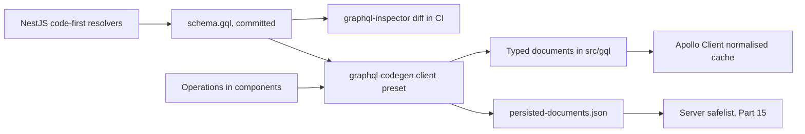
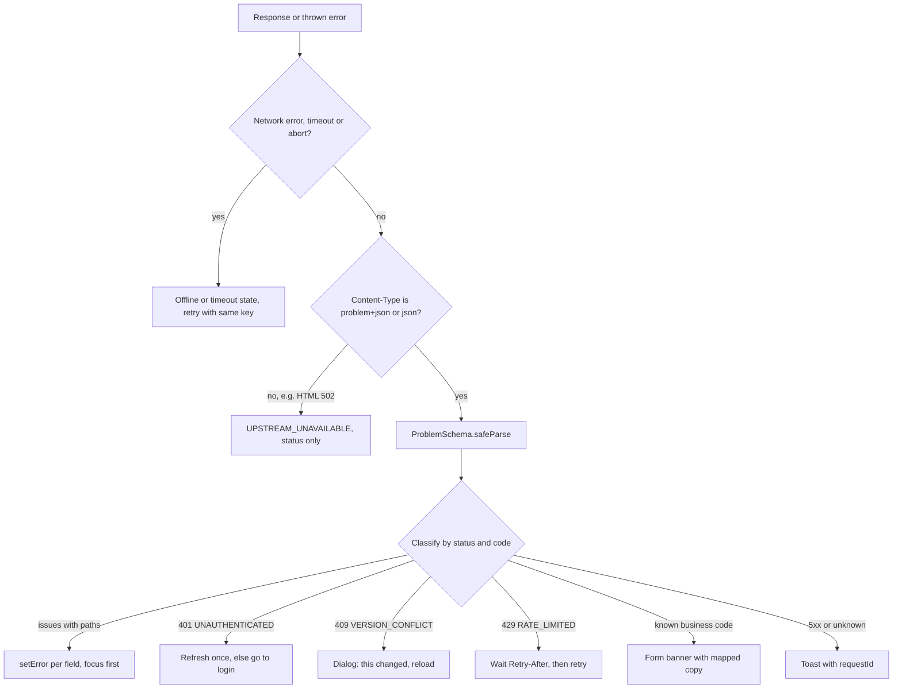

## 72.5 GraphQL clients and codegen for the frontend

#### Concept

Part 15 — GraphQL and gRPC built the GraphQL server: schema, resolvers, DataLoaders, complexity limits and persisted-query safelists. This section is the browser's side. A **GraphQL client** sends operations (queries, mutations, subscriptions) written in the GraphQL language and caches the results. The two clients you will meet most in React are:

- **Apollo Client** (version 3): a **normalised cache**. Every object with a `__typename` and an `id` is stored once, under a key such as `Order:42`, and every query that contains that object reads it from there.
- **urql** (version 4): a **document cache** by default, which caches whole query results and invalidates results that contain a `__typename` after a mutation on that type. Its optional Graphcache exchange adds normalised caching.

**Codegen** makes the contract typed: GraphQL Code Generator reads the server's schema plus the operations written in your components and generates a TypeScript type for each operation's variables and result. The schema is the contract; the operations are each screen's declared use of it.

#### Why does it exist?

GraphQL lets each screen ask for exactly the fields it needs, which is its strength (no over-fetching, one round trip for nested data) and its contract risk (every screen has a different shape). Without codegen, the result of a query is `any`, and the frontend is back to hand-written interfaces. Without a normalised cache, a mutation that changes an order's status must find and update every cached query that contains that order. Clients and codegen exist to make "ask for any shape" safe to consume.

#### Mental model

Imagine a library with a request desk. With REST, you borrow fixed bundles ("the order bundle", "the items bundle"). With GraphQL, you hand in a request slip listing exactly the pages you want. Codegen is a clerk who checks every slip against the library catalogue before you leave home, so you never ask for a page that does not exist. A normalised cache is your home filing cabinet that stores each page once, by catalogue number: when the library sends a corrected page 42, every folder at home that referenced page 42 shows the correction.

#### How it works



1. NestJS's code-first GraphQL module writes the schema to a file (`autoSchemaFile: 'schema.gql'`, `sortSchema: true` for stable diffs). Commit it, like `openapi.json`.
2. Components write operations with the generated `graphql()` function. The **client preset** of GraphQL Code Generator scans them and generates a typed document per operation, so `useQuery(OrderDetailQuery)` knows its result type.
3. **Fragments** colocate data needs with components: `OrderCard` declares `fragment OrderCard_order on Order { id displayId status }`, and the page query spreads it. The preset's fragment masking stops a parent from reading fields only the child asked for, so removing a field from a child's fragment cannot silently break the parent.
4. The same codegen run can emit a **persisted documents manifest**: a hash per operation. CI uploads it to the server's safelist (15.2), and the client sends hashes instead of query text.
5. At runtime, Apollo normalises each response into its cache by `__typename` and `id` (or `keyFields`), merges paginated lists with **type policies**, and re-renders every component watching a changed object.

The TanStack Query comparison, because Part 70 built on it:

| | TanStack Query with REST | Apollo Client | urql (default) |
|---|---|---|---|
| Cache unit | One entry per query key (70.2) | One entry per object (`Order:42`) | One entry per query document and variables |
| After a mutation | You invalidate or `setQueryData` | Objects in the response update everywhere | Results containing the mutated `__typename` refetch |
| Pagination | `useInfiniteQuery` and cursors (70.7) | `typePolicies` with `merge`, `relayStylePagination` | Graphcache resolvers, or manual |
| Bundle size (gzip, approx.) | 13 KB | 33 KB | 7 KB core |
| Best for | REST or tRPC APIs | Data-heavy apps with shared entities | Smaller apps, simpler caching |

#### Practical example

The order details page shows the order header, its items, the rider and a "similar products" strip, from one GraphQL query. When the rider app marks the order delivered, the web receives a subscription event (or refetches), the response contains `{ __typename: 'Order', id: '42', status: 'DELIVERED' }`, and Apollo updates the header on the details page, the row in the order list and the badge in the navigation at once, because all three read `Order:42`.

#### React / Next.js example

The codegen configuration and a typed query:

```ts
// apps/web/codegen.ts  (@graphql-codegen/cli 5, client preset)
import type { CodegenConfig } from '@graphql-codegen/cli';

const config: CodegenConfig = {
  schema: '../api/schema.gql',                 // the committed schema, never a live endpoint in CI
  documents: ['src/**/*.{ts,tsx}'],
  ignoreNoDocuments: true,
  generates: {
    './src/gql/': {
      preset: 'client',
      presetConfig: { persistedDocuments: true }, // emits persisted-documents.json for the safelist
      config: {
        enumsAsTypes: true,                    // string unions, so unknown values do not need a runtime enum
        scalars: { DateTime: 'string', BigInt: 'string', Money: 'string' }, // wire types, converted in code (80.7)
      },
    },
  },
};
export default config;
```

```tsx
// apps/web/src/orders/OrderDetail.tsx  (Apollo Client 3)
'use client';
import { useQuery } from '@apollo/client';
import { graphql } from '../gql';

const OrderDetailQuery = graphql(`
  query OrderDetail($id: ID!) {
    order(id: $id) {
      id
      displayId
      status
      totalMinor
      currency
      items { sku name quantity }
    }
  }
`);

export function OrderDetail({ id }: { id: string }) {
  const { data, loading, error } = useQuery(OrderDetailQuery, { variables: { id }, errorPolicy: 'all' });
  if (loading && !data) return <OrderSkeleton />;
  if (!data?.order) return <OrderError error={error} />;   // error.graphQLErrors[i].extensions.code, 80.6
  return <OrderView order={data.order} />;                 // data.order is fully typed from the schema
}
```

```ts
// apps/web/src/gql/client.ts
import { ApolloClient, HttpLink, InMemoryCache } from '@apollo/client';
import { relayStylePagination } from '@apollo/client/utilities';

export const apollo = new ApolloClient({
  link: new HttpLink({ uri: '/graphql', credentials: 'same-origin' }),
  cache: new InMemoryCache({
    typePolicies: {
      Order: { keyFields: ['id'] },
      Query: { fields: { orders: relayStylePagination(['status']) } }, // pages merged per status filter
    },
    possibleTypes: { PaymentMethod: ['Card', 'Upi', 'Wallet'] },       // needed for fragments on interfaces and unions
  }),
});
```

The equivalent urql client is `new Client({ url: '/graphql', exchanges: [cacheExchange, fetchExchange] })`, with `useQuery({ query: OrderDetailQuery, variables: { id } })` from `urql`.

#### Backend side (NestJS)

What the GraphQL server must do so clients and codegen stay correct:

```ts
// apps/api/src/graphql.module.ts (excerpt)
import { ApolloDriver, type ApolloDriverConfig } from '@nestjs/apollo';
import { GraphQLModule } from '@nestjs/graphql';

export const Gql = GraphQLModule.forRoot<ApolloDriverConfig>({
  driver: ApolloDriver,
  autoSchemaFile: 'schema.gql',   // committed; CI fails if regeneration changes it unexpectedly
  sortSchema: true,               // stable order, so the diff shows only real changes
  introspection: process.env.NODE_ENV !== 'production',
});
```

- **Diff the schema in CI.** `graphql-inspector diff` between `schema.gql` on main and on the branch classifies changes as breaking, dangerous or safe. "Dangerous" includes adding an enum value or a union member, which strict clients may not handle.
- **Deprecate, measure, remove.** `@Field({ deprecationReason: 'Use orderNumber' })` marks a field in the schema; codegen and IDEs show it struck through. GraphQL's advantage over REST is that you can measure field usage per operation (15.4), so "is anyone still reading `displayId`?" has an exact answer.
- **Errors use the same catalogue as REST.** Throw `GraphQLError` with `extensions: { code: 'ORDER_NOT_CANCELLABLE', issues, requestId }`, so the frontend maps codes the same way for both protocols (72.6).
- **IDs are strings.** GraphQL's `ID` is serialised as a string, which avoids the large-integer problem of 72.7 by construction.

#### Production scenario

A marketplace web app moved its seller dashboard from 30 REST calls per page load to 4 GraphQL queries with fragments. p75 time to complete data fell from 1.9 s to 750 ms on 4G. Codegen caught 41 field mismatches in the first month, mostly fields the old hand-written types had and the schema did not. The persisted-documents manifest, uploaded in CI, let the server reject every operation not shipped in a real build, which removed a class of abusive queries entirely.

#### Failure scenario

The payments team added `PayLater` to the `PaymentMethod` union and deployed. The web's checkout used a fragment with `... on Card` and `... on Upi` and a `switch` on `__typename` with no default branch. For customers with a pay-later method saved, the component returned `undefined`, React rendered nothing, and the "Pay" button never appeared. Conversion fell 3 % before anyone connected it to the API deploy. The schema diff had flagged "union member added" as dangerous; nobody read warnings. Warnings on unions and enums consumed by checkout now block merge unless a frontend reviewer approves, and every `__typename` switch has a default branch that renders a safe fallback.

#### Edge cases & failure modes

- **Missing `id` in a selection** stops Apollo normalising that object; updates elsewhere no longer reach it. Select `id` everywhere (a lint rule in `@graphql-eslint` enforces it).
- **Partial data with errors**: a `200` response can carry `data` and `errors` together. With `errorPolicy: 'none'` (Apollo's default), the data is discarded; choose the policy per screen.
- **Custom scalars** (`DateTime`, `BigInt`) arrive as strings; mapping them to `Date` in codegen types without a runtime conversion makes the types lie.
- **Cache growth**: a normalised cache keeps every object ever seen; long-lived dashboards need `cache.evict` and `cache.gc()`.
- **Introspection-based codegen in CI** against a live server reintroduces the moving-target problem from 72.2.

#### How a Senior Full-Stack Engineer thinks about this

The senior picks GraphQL for the frontend when screens need many related entities and several clients need different shapes, and they accept the price: a bigger client, a cache with its own rules, and a server that must be bounded (Part 15). They commit the schema, generate types from operations, colocate fragments, and ship a persisted-documents manifest with every build. Because GraphQL tells them exactly which operations read which fields, they evolve it by deprecation and measured removal rather than by versions.

#### Common mistakes

- **Writing operations as untyped strings** with `gql` and no codegen.
- **Forgetting `id` in selections**, breaking normalisation.
- **No default branch** for `__typename` and enum switches.
- **Treating automatic persisted queries as a safelist** (15.2).
- **Choosing Apollo for a small app** whose data does not share entities across screens.

#### Interview questions

1. **Normalised cache versus per-query cache: what changes after a mutation?** Expected answer: normalised caches update every view of the object automatically if the mutation returns it with `id`; per-query caches need invalidation or manual updates. Follow-up: when is the normalised cache wrong? (Lists that should gain or lose items; you still update them.)
2. **What does codegen generate from, and why not from a live server?** Expected answer: the committed schema plus the operations in the code; live servers change under you.
3. **How do you safely add a member to a union that web and mobile consume?** Expected answer: treat it as dangerous, ensure every client has a default branch, release clients first or gate the new member behind a capability.
4. **How does GraphQL make field removal safer than REST?** Expected answer: per-operation field usage is observable; deprecate, measure to zero, remove.

#### Practical exercise

Add GraphQL Code Generator with the client preset to the web app and convert the order details page to a typed query with a fragment per child component.

Acceptance criteria:

- Removing `displayId` from `schema.gql` fails codegen or `tsc` with the operation name and file in the message.
- `persisted-documents.json` is produced in CI and the server rejects an operation not in it.
- Changing an order's status through a mutation updates the details page and the order list without a refetch.
- A response containing an unknown `__typename` in a union renders a fallback, not nothing.

## 72.6 Error contracts: one shape, mapped to fields, banners and toasts

#### Concept

An **error contract** is the agreement about what a failed request looks like and what the client may do about it. Since 68.12 this volume has used `{ code, issues: [{ path, code, message }], requestId }`. This section makes it a full **problem details** document as defined by RFC 9457 (which replaced RFC 7807 in 2023), with media type `application/problem+json`:

```json
{
  "type": "https://errors.shop.example/order-not-cancellable",
  "title": "Order cannot be cancelled",
  "status": 409,
  "detail": "Order DK-20481 has already shipped.",
  "instance": "/v1/orders/1d6c.../cancel",
  "code": "ORDER_NOT_CANCELLABLE",
  "issues": [],
  "requestId": "req_01JC8W5Y2Q"
}
```

`type`, `title`, `status`, `detail` and `instance` are the standard members. `code`, `issues` and `requestId` are **extension members**, which the RFC allows. Part 14.9 built the same idea with `errors` and `correlationId`; this volume keeps `issues` and `requestId` because every frontend helper since 77.7 already reads them. The names matter less than having one set of names across every endpoint, every service and every protocol.

The other half of the contract is the **presentation rule**: which errors become a message under a field, which become a banner at the top of a form, which become a toast, which redirect, and which are retried silently.

#### Why does it exist?

Without one shape, every call site parses errors its own way, and three bad things happen. Users see raw strings (`Unexpected token < in JSON at position 0`, `Request failed with status code 500`). Field-level problems ("we do not deliver to this postcode") become generic toasts, and conversion drops (69.7's pharmacy story). And support cannot find the failing request because nothing on screen identifies it. A single shape plus a single client-side classifier makes every new endpoint's errors display correctly with no new UI code.

#### Mental model

Imagine a hospital triage desk. Every patient arrives with the same intake form (the problem document). The triage nurse (the client classifier) reads two boxes, the category code and the body part, and sends the patient to the right place: a sprained finger to the minor injuries room (a field message), a broken leg to orthopaedics (a form banner), an expired appointment back to reception (redirect to login), and a patient brought in by someone else without any form (an HTML page from a load balancer) straight to the general ward with a reference number.

#### How it works



1. **Transport first.** `fetch` rejects only on network failure or abort; a `500` is a resolved `Response`. `AbortSignal.timeout` rejects with a `DOMException` named `TimeoutError` (69.8).
2. **Do not assume JSON.** A gateway timeout, a WAF block or a CDN error page arrives as HTML. Check `Content-Type` before `res.json()`.
3. **Parse the problem tolerantly.** `code` is an open string: a new code from a newer API must still produce a sensible default treatment.
4. **Classify once, centrally**, into a small set of UI treatments. Feature code receives the treatment, not the raw response.
5. **Translate on the client by `code`.** Server `title` and `detail` are English fallbacks. For a multilingual UI, the client maps `code` (and issue codes with `params`) to its own copy; it never parses English text.

The presentation table the web team and API team agree on:

| Status | `code` example | UI treatment | Automatic retry |
|---|---|---|---|
| 400 | `VALIDATION_FAILED` with issue paths | Message under each field, focus first | No |
| 401 | `UNAUTHENTICATED` | Silent refresh once (Part 73), then login with return URL | Once, after refresh |
| 403 | `FORBIDDEN` | Full-page "no access" or hidden action | No |
| 404 | `NOT_FOUND` | Page-level not found (`notFound()` in Next.js) | No |
| 409 | `VERSION_CONFLICT` | Dialog: "This order changed. Reload?" | No |
| 409 / 422 | `ORDER_NOT_CANCELLABLE`, `PRICE_CHANGED` | Form or action banner with mapped copy | No |
| 422 | `ADDRESS_NOT_SERVICEABLE` with `issues[0].path = 'postcode'` | Message under postcode | No |
| 429 | `RATE_LIMITED` | Inline "Too many attempts, try in 30 s" | Yes, after `Retry-After` |
| 502 / 503 / 504 | `UPSTREAM_UNAVAILABLE` | Keep stale data, toast or inline retry, show `requestId` | Yes, with backoff (70.3) |
| 500 | `INTERNAL` | Toast "Something went wrong. Ref req_01JC..." | Queries yes, mutations only with an idempotency key |

#### Practical example

A customer applies a coupon at checkout. The API returns `422` with `code: 'COUPON_REJECTED'` and `issues: [{ path: 'couponCode', code: 'EXPIRED', message: 'This code expired on 31 Oct', params: { expiredAt: '2026-10-31' } }]`. The classifier sees an issue with a path, React Hook Form puts the message under the coupon field, and the Hindi UI renders its own translation of `EXPIRED` using `params.expiredAt`. The same response from a mobile app is shown natively, from the same codes.

#### React / Next.js example

The shared schema and the classifier:

```ts
// packages/contracts/src/problem.ts
import { z } from 'zod';

export const IssueSchema = z.object({
  path: z.string(),                                     // matches form field names: 'address.postcode', 'items.2.quantity'
  code: z.string(),                                     // open: 'EXPIRED', 'TOO_LONG', 'NOT_SERVICEABLE'
  message: z.string(),                                  // safe English fallback
  params: z.record(z.union([z.string(), z.number()])).optional(),
});
export const ProblemSchema = z.object({
  type: z.string().default('about:blank'),
  title: z.string(),
  status: z.number().int(),
  detail: z.string().optional(),
  instance: z.string().optional(),
  code: z.string(),                                     // open string; known codes listed in KnownErrorCodes
  issues: z.array(IssueSchema).default([]),
  requestId: z.string().optional(),
});
export type Problem = z.infer<typeof ProblemSchema>;
export const KnownErrorCodes = ['VALIDATION_FAILED', 'UNAUTHENTICATED', 'FORBIDDEN', 'NOT_FOUND', 'VERSION_CONFLICT',
  'ORDER_NOT_CANCELLABLE', 'PRICE_CHANGED', 'RATE_LIMITED', 'UPSTREAM_UNAVAILABLE', 'INTERNAL'] as const;
```

```ts
// apps/web/src/api/errors.ts  (extends 77.7's ApiError without changing its constructor)
import { ProblemSchema, type Problem } from '@shop/contracts';

export type ApiIssue = Problem['issues'][number];
export class ApiError extends Error {
  constructor(public status: number, public code: string, public issues: ApiIssue[] = [], public requestId?: string,
              public title?: string, public retryAfterSec?: number) { super(code); }
}

export async function toApiError(res: Response): Promise<ApiError> {
  const requestId = res.headers.get('X-Request-Id') ?? undefined;
  const retryAfter = Number(res.headers.get('Retry-After')) || undefined;  // needs exposedHeaders under CORS
  const type = res.headers.get('Content-Type') ?? '';
  if (!type.includes('json')) {                                           // HTML from a proxy, empty body, etc.
    return new ApiError(res.status, res.status >= 500 ? 'UPSTREAM_UNAVAILABLE' : `HTTP_${res.status}`, [], requestId);
  }
  const parsed = ProblemSchema.safeParse(await res.json().catch(() => null));
  if (!parsed.success) return new ApiError(res.status, `HTTP_${res.status}`, [], requestId);
  const p = parsed.data;
  return new ApiError(p.status, p.code, p.issues, p.requestId ?? requestId, p.title, retryAfter);
}

export type Treatment =
  | { kind: 'fields'; issues: ApiIssue[] } | { kind: 'reauth' } | { kind: 'reload' }
  | { kind: 'wait'; seconds: number } | { kind: 'banner'; code: string } | { kind: 'toast'; requestId?: string };

export function classify(e: ApiError): Treatment {
  if (e.issues.some((i) => i.path)) return { kind: 'fields', issues: e.issues };
  if (e.status === 401) return { kind: 'reauth' };
  if (e.code === 'VERSION_CONFLICT') return { kind: 'reload' };
  if (e.status === 429) return { kind: 'wait', seconds: e.retryAfterSec ?? 30 };
  if (e.status < 500 && e.code in errorCopy) return { kind: 'banner', code: e.code };
  return { kind: 'toast', requestId: e.requestId };                      // unknown codes degrade safely
}

export const errorCopy: Record<string, string> = {
  ORDER_NOT_CANCELLABLE: 'This order has already shipped, so it can no longer be cancelled.',
  PRICE_CHANGED: 'Prices in your cart changed. Please review the new total.',
};
```

`applyServerErrors` from 69.7 handles the `fields` case unchanged. A Server Action (71.6) returns the same problem shape as its state instead of throwing, so forms that post through actions use the same classifier.

#### Backend side (NestJS)

One global filter produces every error body, including those from pipes, guards and the throttler:

```ts
// apps/api/src/common/problem-details.filter.ts
import { ArgumentsHost, Catch, ExceptionFilter, HttpException, HttpStatus, Logger } from '@nestjs/common';
import { ThrottlerException } from '@nestjs/throttler';
import type { Request, Response } from 'express';
import { DomainError } from './domain-error';                      // code + httpStatus, Part 8.9

const BASE = 'https://errors.shop.example/';

@Catch()
export class ProblemDetailsFilter implements ExceptionFilter {
  private readonly log = new Logger('Problem');
  catch(err: unknown, host: ArgumentsHost) {
    const req = host.switchToHttp().getRequest<Request>();
    const res = host.switchToHttp().getResponse<Response>();
    const requestId = String(req.headers['x-request-id'] ?? '');
    let status: number = HttpStatus.INTERNAL_SERVER_ERROR;
    let code = 'INTERNAL', title = 'Something went wrong', issues: unknown[] = [];

    if (err instanceof DomainError) ({ httpStatus: status, code, message: title } = err);
    else if (err instanceof ThrottlerException) { status = 429; code = 'RATE_LIMITED'; title = 'Too many requests'; }
    else if (err instanceof HttpException) {
      status = err.getStatus();
      const body = err.getResponse() as { code?: string; issues?: unknown[]; message?: string } | string;
      code = typeof body === 'object' && body.code ? body.code : HttpStatus[status] ?? `HTTP_${status}`;
      issues = typeof body === 'object' && Array.isArray(body.issues) ? body.issues : [];
      title = typeof body === 'object' && typeof body.message === 'string' ? body.message : err.message;
    }
    if (status >= 500) this.log.error(`unhandled ${requestId}`, err instanceof Error ? err.stack : String(err)); // details only in logs
    res.status(status).type('application/problem+json').json({
      type: BASE + code.toLowerCase().replace(/_/g, '-'), title, status, code, issues, requestId,
      instance: req.originalUrl,
    });
  }
}
```

Rules on the API side:

- **Paths in `issues` match form field names**, including nesting and array indexes (69.7).
- **Codes are a catalogue**, versioned in `@shop/contracts` and documented per operation in OpenAPI (72.2). Adding a code is additive; changing which status or code an existing case returns is breaking.
- **Never put internals in `title` or `detail`.** Stack traces, SQL and upstream bodies go to logs under the `requestId`.
- **CORS exposes the headers the classifier reads**: `exposedHeaders: ['X-Request-Id', 'Retry-After', 'Idempotent-Replayed']` (69.8).
- **The BFF translates, it does not invent.** 71.8's BFF returns `502 CART_UNAVAILABLE` in the same shape; it never forwards an upstream HTML page.

#### Production scenario

A travel booking site measured its checkout errors: 38 % of all error toasts were field-level problems shown as generic messages. After moving to one problem shape with paths, a central classifier, and a copy table keyed by code, field errors appeared under fields, the copy table covered 31 codes, and checkout completion rose 2.1 points. Support tickets that included a request reference went from 9 % to 64 %, and median time to diagnose a reported checkout failure fell from 50 minutes to 8.

#### Failure scenario

On a sale night the load balancer's idle timeout fired on slow `POST /v1/orders` requests and returned its own `504` HTML page. The web's old error helper called `res.json()` unconditionally, which threw `SyntaxError: Unexpected token '<'`. The checkout caught it as a generic error and, because it was not an `ApiError`, the retry logic treated it as a network failure and retried immediately, without the original idempotency key (a code path written before 69.8). 214 customers were charged twice. The fixes: check `Content-Type` before parsing, classify non-JSON `5xx` as `UPSTREAM_UNAVAILABLE`, reuse the same idempotency key on every retry of an intent, and align the load balancer's timeout with the API's own deadline.

#### Edge cases & failure modes

- **Empty bodies**: `204`, `304` and some `502`s have no body; `res.json()` throws.
- **Errors inside successful responses**: GraphQL `errors` with `200`, batch endpoints with per-item failures (Part 14.7). Use the same `code` and `issues` shape per item.
- **Paths that no longer match the form** after a UI rename; unmatched issues should fall back to the form banner, not disappear.
- **Translated server messages** that the client also translates, producing mixed languages; pick one owner of copy.
- **Rate-limit `429` without `Retry-After`**, or with it but not exposed through CORS, so clients retry in a tight loop.
- **Status code drift** between services behind one BFF (`404` versus `410` versus `422` for the same case); the catalogue decides.

#### How a Senior Full-Stack Engineer thinks about this

The senior designs errors as a product surface with a contract, not as an afterthought. One shape everywhere, codes as a catalogue, paths that match fields, a request reference on every error, and a presentation table agreed between the API and web teams. They classify in one place so feature code never parses responses. They care most about the errors nobody designed: HTML from proxies, empty bodies, timeouts, and unknown codes from a newer API, and they make every one of those degrade to a safe, honest message.

#### Common mistakes

- **`res.json()` without checking `Content-Type`.**
- **Branching on English `message` text** instead of `code`.
- **Generic toasts for field errors.**
- **Leaking stack traces or upstream bodies** in error responses.
- **Different error shapes from pipes, guards and the throttler** because only some go through the filter.

#### Interview questions

1. **What is RFC 9457 and which members would you add?** Expected answer: problem details for HTTP APIs, `application/problem+json`, standard `type`, `title`, `status`, `detail`, `instance`; extensions for a machine `code`, field `issues` and a `requestId`. Follow-up: how is `type` used? (Stable URI identifying the problem kind, can link to documentation.)
2. **How do you map a server validation error onto a form field?** Expected answer: issue paths that match form names, `setError` per issue, banner fallback for unmatched paths.
3. **The UI shows "Unexpected token <". What happened and how do you fix it?** Expected answer: a non-JSON error page from a proxy; check `Content-Type`, classify as upstream unavailable, align timeouts.
4. **Which errors should a client retry automatically?** Expected answer: network errors, `429` after `Retry-After`, `502` to `504` with backoff; mutations only with an idempotency key; never `4xx` business errors.
5. **How do you localise API errors?** Expected answer: client maps `code` and issue codes with `params` to its own copy; server text is a fallback.

#### Practical exercise

Make every error from the NestJS API a problem document and add the classifier to the web app.

Acceptance criteria:

- Validation, domain, throttler, guard and unknown errors all return `application/problem+json` with `code`, `issues` and `requestId`.
- A test sends a request through a proxy that returns HTML `502`; the UI shows the upstream-unavailable message with no JSON parse error.
- Every code in `KnownErrorCodes` has an entry in the presentation table and a test that checks its treatment.
- An unknown code from a stubbed newer API renders a toast with the request reference.
